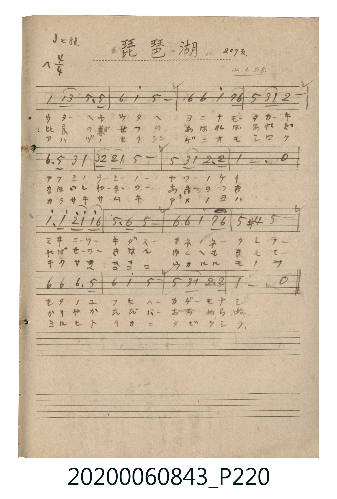

# 琵琶湖

> Re:Shōka 使用 AI 協助辨識與重建樂譜，可能會有錯誤。歡迎[回報](https://github.com/TMDLang/reshoka/issues)。

- **鋼琴伴奏版**：<br><audio controls src="biwako.mp3"></audio>

- 日治時期公學校《唱歌帳》第十冊（P220・207頁・昭和2年1月28日抄）
- 原載：一條慎三郎 編《新編 小學校・公學校 唱歌教材集》第 207 頁

## 說明

> [!NOTE]
> **原頁資訊與歌詞全文（對應 P220.jpg）**
> - **出處標註**：標題旁記「207頁 2.1.28.」，即昭和 2 年（1927 年）1 月 28 日抄自《新編 小學校・公學校 唱歌教材集》（1923 年發行）第 207 頁之〈琵琶湖〉（源自納所辨次郎、田村虎藏編《教科統合 唱歌教科書 巻三》，大和田建樹作詞，詠嘆近江八景）。
> - **調性與拍號**：ハ調 4/4 拍（`?= C`, `<4/4>`），速度 `!= 88`。第 12 小節第二拍明確記有 `#4`（`4'`）。
>
> **一、**
> ウターヘヤ　ウタヘ　ヨニナモー　タカーキ
> アフミノ　ウーミーノー　ヤツーノケイ
> 三井ニーツーキダスー　カネノネー　クレテー
> セタノユフヒハー　カゲーモナシ
>
> **二、**
> 比良の暮雪の　あはれはあれど
> なほいしやまの　あきのつき
> やばせのきはん　ゆくへもきえて
> かりやかただに　おちぬらむ
>
> **三、**
> アハヅノセイラン　ゲニオモシロク
> カラサキサムキ　アメノヨハ
> キクサヱココロ　ウカルルモノヲ
> ミルヒトイカニ　タビヲシテ


## 歌詞

```text
（TMD 檔案未包含歌詞註解）
```

## ABC

<div class="abc-score" data-abc-src="biwako.abc" aria-label="五線譜載入中"></div>

[下載 ABC 原始檔](biwako.abc)

## TMD 檔案連結

- [主旋律 TMD 檔案](biwako.tmd) [[在 TMD Studio 編輯](https://tmdlang.github.io/Tmd-TS/#tmd=s7IKdvYPcrWy4qpTUCpJTLdSSM7PyUlNLsnMz7MqzsjPTkzOyFeCS5bl55TmploBqXhDA4RwcX5pUXJqfEFieqpVgJERhgzcpPi8_JLUpPz8bISKgqL8stS8xDygqtzEvNLi5KLMgpL45PyCSoSa1LLMlFSQiuLkxLz4stSizLTM1BQkZ6UWFYMdDHFHSVFiHsQcoCBCVUlGKtDtOYl5KUBjClLRJcoTS1KL0AULchKTMVQCzS9LzUGI5hdlpmfmWeWmZmZlxpekVpSg-jC_qCQjP70osSCj0iojs7gEqDw5MSc-OzEvUYlLS0vh-YStzydse7ZzmoKWFpeirYKFBZe9rYIzl42JvokdyJRn05c-27T72cymZ3PmP21d83TtjmcLFj5u6Ho6ZeOztT1Pd2x-3ND9fM2ap72NT9u63u_pAEXB4-bdRgbmLxc0AhnPZqx9OqnH6OnOLYbP5nQYWYDM62p5v6cT7ManffNf7Ol8v2fWkx0NzxbNfdba92RH58vmPoXn21cALXk2bQOQofB0Qz_U3ubdcDcoQFzwbOrMZ3MnvJzdBnGHAtBiBaDNSlxc-loKttQCXAoKCnYK0Yp-_iGusRCOlhbQ8UCbXmxuf7Gi60VHO9AxL1bOe9q64tm0dmBAPN3Q-6y9UwEUHnpZBelAHwNDGKxTF6S3fdeLmVOfrZj5YsVuLS1gAACZLxf2PJve-GLFjMcNPZDwUzDSM9QzstB73ND7fk_P097NkNBUMFIAhifQDkNLI3MIs9NQARi8CkYWCpAAftG-ivTwg5hoDDLx-cw9Lxb2AM1FCtMnO7sfN3TAU8zjBmDEdTzbNQFo1_Mtvc86G17sW_FszUJg9D1uaHw-ZcOzuRNfzOx7Mb0fGplTZz5fPvH51o1PJ3QgLAcKPZu9Q-Hp9t3AmAe7oefpkuVATwINeLp717MVO5_snQMMV6D4i5ULns5oe7F_4rONwKS4-tnM9UD3PW5oQoTqi1X7nzUsB8VFd--LmfPBAfu4uR8orABMzwpAUaCLE0AJPEFHIQGcxhOAZgDNftkw_-muZQoJ4CyQADQU5G9DYDhv6H--vgHIebKrB6j92Yy-54t2AaPo2ZxOhQRlE6DujgQTdZAhMIfAUgcwRQODARbnj5uWPW7a_7h5z-PmGY-blzxuaICJAGO74XHzisfN3Y-bux43LwKpAcnuf9y0GsRuWgszASg19XHz_Meg8AVrB5kG5ALJPqguoMnNLVCRpo2Pm5ZA9AKD9skuoF6gFUApsIKmtY-bgYbshFkHtKsXbA6QhIisf9y85nFzG5ALc8BusIOBaoBWA02bBAxahPamTWDDgY7sety0HTUodvUgBcWz9VNedK5_3Lju2ax1L2evAjJAJjQ2PW5c_7ipB0QC2SDGSqi9jUA1ux83tjxunP64CUjuQ9LSC2I3LgEyYI4EKtjwuHE2WBwoCzRzMtiFbY8b-x837njcBNHV8bhxGcz87sdNQDcDNXY_bpz_uHHB48bVYPO7HjcufNy45nFT5-OmBrTIBcY3UuQCfQ0MilZwsANDCRgLKx83A4tGoL3AYAGavwoUMk3bHzevBQYsTBcwzFc-btoKigsg2bwAxABpAZoGzKrAcAamin6YYpBGsDJgtG4GIaBR0FQENAeCgBqBujZBtYDSBlAQGE0dICeBlAEzMDhpNU8GKgO7pw2kmPICEgoUtPS5uJwyyxOz863C8jOTUx1qDGqqQVYo2FhogYNPAVguA10NxPuBTtwDxDOAeIlCDZLoDBCveQUQdwNxFxAvAqsFqQHKN62G6GxaC7IPZGaNgiGwADBUMFYwBdK6QLJGwQwkEgfmgIR0oUJwYXMgswYsaQzUaQRTBDbPxxDiHF2whUAS6CSQLMKh6DIg40FOBol0g8kuMLkIIgNRC3Q4iFyLapcRUL5xE1imE0Q2roPY1Qj2cONsMHsJkgzYxMYmsMh6sL4eOBsuAxVbiWqXMcgtIDcBUxaYbIX6qw_syt1gnWC7wCkYYV0T2IEQrzWtQvHadjAP5ClgEkWxDhzVoKibCkqNcFuA0QyOeJAIiAaLAkMWWDTBRYDFF1jtEkQUg2IOFJvGoBgE220MjDYjIBsRw6jRaQRNGDBogAgIcASDfAByO8R5kGCA-AkcwUhisAiGBE0LkjjCoQh74hH2gCMXFF6gyNgNxGC9jdOh9kB4-8AkZuT2IomDkgBIBiSGxR5wxIKSFzjqgOytYLeBYgUkA-Y1L4CLwWIVkhQWIvsHmIhBPgUlD0x7gDEKLPsUgLUJNHOCYgsSayDj1gJZDUB6J5gHyqa9kNgE0xA164GsNUDchpR5QfkRnC2N4kAkEMHyJijDomZgkAhaBjZRBxJwVYgIbgTlOpCXJ8BzJSjAIS6FeBbiWkSAgHMo0LWwAIGwIe4G8daAyTZUu0CRDI5KUDRtgOdZUMQhogyUP4GVEZJdIFOAtRKY3AF2JyjaYTqAdRSYBCVFJLvAEQ11PSgsoVG7EWomJMuCaEiWhNkFKbEgvkOQoIiGJAGIX0GZHGEXOPsC0yy4TAZF4jKwBlDUTwKnEGgkA8sGSEIAZfUuaJmAkm1hGGfJTFq-hRRTkOIXlmphbgOxJ4FJWAqGRyu0DIPlephLseYncL6FlHbgghwevd3gCAKXDI3g_NQIyXWQiAOrbQTnp0ZQUgHp7ATb04DdHlB0QssZSLSA3A6iO-ClCizaQK6B-Qfid1BigkUayCcgs2BJE2FPLReXrp0CpFaO9jGMVUDiGaHwjME8ZS4A)]
- [鋼琴伴奏 TMD 檔案](biwako_piano.tmd) [[在 TMD Studio 編輯](https://tmdlang.github.io/Tmd-TS/#tmd=s7IKdvYPcrWy4qpTUCpJTLdSSM7PyUlNLsnMz7MqzsjPTkzOyFeCS5bl55TmploBqXhDA4RwcX5pUXJqfEFieqpVgJERhgzcpPi8_JLUpPz8bISKgqL8stS8xDygqtzEvNLi5KLMgpL45PyCSoSa1LLMlFSQiuLkxLz4stSizLTM1BQkZ6UWFYMdDHFHSVFiHsQcoCBCVWIRUDw9NTc1r8SqIDMxLz8-MTk5P7cgMS8TJIZQmF9UkpGfXpRYkFFplZFZXJJflJmcmBOfnZiXiFBUkgE0ySo1pTQ5EWKNlpbC8wlbn0_Y9mzntPd7Ol5273k-YcuTPVueLu1_3tnxfk-ngpYWl6KtgoUFl72tgjOXjYm-iR3IuGfTlz7btPvZzKZnc-Y_bV3zdO2OZwsWPm7oejpl47O1PU93bH7c0P18zZqnvY1P27qAJoNC-HHzbiMD85cLGoGMZzPWPp3UY_R05xbDZ3M6jCxA5nW1AC0EO_Zp3_wXezrf75n1ZEfDs0Vzn7X2PdnR-bK5T-H59hVAS55N2wBkKDzd0A-1t3k33A0KEBc8mzrz2dwJL2e3QdyhALRYAWizEheXU2Z5Yna-VQAoMIM8HGoMaqq5FIDAxkLLDszQ11J43LQMiPcrPG7eA8QzgHiJQg2S6AwQr3kFEHcDcRcQLwKrBakByjethuhsWqugpQ82s0bBUEEXiI0VTIG0LpCsUTADicSBOSAhXagQXNgcyKwBSxoDdRrBFIHN8zGEOEcXbCGQBDoJJItwKLoMyHiQk0Ei3WCyC0wugshA1AIdDiLXotplBJRv3ASW6QSRjesgdjWCPdw4G8xegiQDNrGxCSyyHqyvB86Gy0DFVqLaZQxyC8hNj5v7wWQr1F99YFfuBusE29W88nHzZoR1TWAHQrzWtArFa9vBPJCnHjeBnICwDhzVoKibCsTz4bYAoxkc8SAREA0WBYbs4-YWuMjjpo1gtUsQUQyKOVBsGoNiEGy3MTDajIBsRAyjRqcRNGHAoAEiIMARDPIByO0Q50GCAeIncAQjicEiGBI0LUjiCIci7IlH2AOOXFB4gSJjNxCD9TZOh9oD4e0Dk5iR24skDkoCIBmQGBZ7wBELSl7gqAOyt4LdBooVkAyY17wALgaLVUhSWIjsH2AiBvkUlDww7QHGKLCoUHiyCxRkoMwJii1IrIGMWwtkNQDpnWAeKJv2QmITTEPUrAey1gBxG1LmBeVHcLY0igORQATLm6AMi5qBQSJoGdhEHUjAVSEiuBGU60BengDPlaAAh7gU4lmIaxEBAs6hQNfCAgTChrgbxFsDJttQ7QJFMjgqQdG0AZ5nQRGHiDJQ_nzcNBnJLpApjxvB-bBxB9idoGiH6Xjc2AEmQUkRyS5wRENdDwpLaNRuhJoJybIgGpIlYXZBSiyI7xAkKKIhSQDiV1AmR9gFzr7ANAsuk0GRuAysART1k8ApBBrJwLIBkhBAWb0LWiagZFsYxlkyk5ZvIcUUpPiFpVqY20DsSWASloLh0Qotw2C5HuZSrPkJnG8hpR24IIdHbzc4gsAlQyM4PzVCch0k4sBqG8H5qRGUVEA6O8H2NGC3BxSd0HIGEi0gt4PoDnipAos2kGtg_oH4HZSYYJEG8gnILFjSRNhTi1op-yBXyiaISvlFX9fL9t6nrTtezm6FNFGQMmi8QrRhLIyqUTABMkwQfKgqqCiUgusyjQfSpvEY6uCmGQEZRrlYFGIYgOQQA0LWEnAc2FLcjoOrw-5VQi4DhrmunQIk2KN9gOJIPKCtSDxjME-ZCwA)]

## 分析

```text
================================================================================
📊 TMD Song Profile: [ 琵琶湖 ]
================================================================================
⏱  Duration:       2:10 (130.9s), 48 measures total
🎼 Key & Tempo:    首調基準 C, != 88.0 BPM, <4/4>
   - 分析範圍：      由實際發聲的音符與和弦推測調性；播放脈絡另行呈現
🎤 人聲音域:    C4 (MIDI 60) – D5 (MIDI 74) [跨度: 14 個半音 / 1.2 個八度, 難度: moderate]
   - 最低音:  C4 in [Biwako[L1] #1 @ m.1, 0:00]
   - 最高音: D5 in [Biwako[L1] #1 @ m.9, 0:23]
   - 適合: soprano, mezzo-soprano, contralto, tenor, baritone, bass
🏛  結構:      Biwako[L1] (43.6s) -> Biwako[L2] (43.6s) -> Biwako[L3] (43.6s)
⚡ 編曲密度:        Peak 1 軌道同時演奏
🗝  調性診斷：       C 大調（純淨自然大調，未偵測到可信轉調）
   - 風格氣質:    純淨自然大調（陽光明朗、易唱易記，無明顯調外色彩）
   - 轉調歷程:    全曲維持單一推測調性（未偵測到可信轉調）
   - 核心骨幹音:  G, C, A, D, E
   - 調性數值:    C 大調 [相關度: 0.82, 穩定度: Moderate, 自然音純度: 98.4%]
   - 候選調性 (K-S): C 大調 (0.82), G 大調 (0.74), A 小調 (0.60)
   - 五度圈歷程:   +0 -> +0 -> +0
   - 各段落調性細節:
     • [Biwako[L1] #1]: C 大調 (r: 0.82, 自然音純度: 98.4%, 調外音: F#)
     • [Biwako[L2] #1]: C 大調 (r: 0.82, 自然音純度: 98.4%, 調外音: F#)
     • [Biwako[L3] #1]: C 大調 (r: 0.82, 自然音純度: 98.4%, 調外音: F#)

  [ 五度圈游移軌跡 ]
              [C ]*
         F            G  
      Bb               D  
      Eb               A  
         Ab           E  
            Db       B  
               F# 
     (* = active key center)

  [ 十二半音累積音高分佈 ]
     C  : ███████████████████████   28.2%
     C# :                            0.0%
     D  : ██████████                12.1%
     D# :                            0.0%
     E  : █████                      5.6%
     F  :                            0.0%
     F# : █                          1.6%
     G  : ████████████████████████  29.8%
     G# :                            0.0%
     A  : █████████████████         21.0%
     A# :                            0.0%
     B  : █                          1.6%
--------------------------------------------------------------------------------
Assignment 軌道音域：
  - Voice         : C4 – D5 (14 個半音 / 1.2 個八度, 186 個音符)
================================================================================
```


## 原書掃描頁




