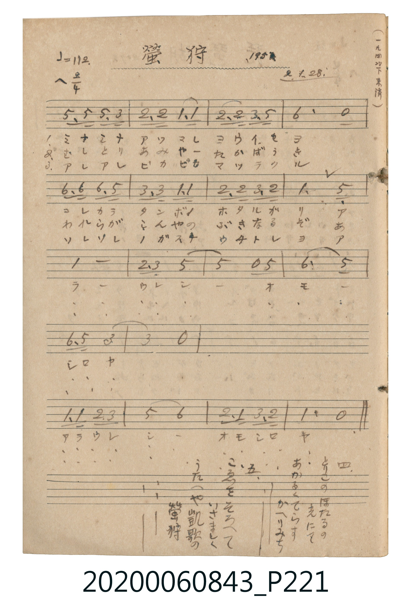

# 螢狩（捕螢）

> Re:Shōka 使用 AI 協助辨識與重建樂譜，可能會有錯誤。歡迎回報。

- **鋼琴伴奏版**：<br><audio controls src="hotarugari.mp3"></audio>

- 日治時期公學校《唱歌帳》第十冊（P221・195頁・昭和2年1月28日抄）
- 原載：一條慎三郎 編《新編 小學校・公學校 唱歌教材集》第 195 頁

## 說明

> [!NOTE]
> **原頁資訊與歌詞全文（對應 P221.jpg）**
> - **出處標註**：標題旁記「195頁 2.1.28.」、右上角記「（一九四以下未済）」，即抄自《新編 小學校・公學校 唱歌教材集》（1923 年發行）第 195 頁之〈螢狩〉。
> - **調性與拍號**：ヘ調 2/4 拍（`?= F`, `<2/4>`），速度 `!= 112`。
> - **手抄頁面細節**：第三段首句原書作「舞つてくる」，抄寫者誤抄為「マツラクル」。
>
> **一、**
> ミナミナアツマレ　ヨウイセヨ
> コレカラタンボノ　ホタルガリ
> アラウレシ　オモシロヤ　アラウレシ　オモシロヤ
>
> **二、**
> むしとりあみや　たかばうき
> われらがこんやの　ぶきなるぞ
> ああうれし　おもしろや　ああうれし　おもしろや
>
> **三、**
> アレアレピカピカ　マツラクル
> ソレソレノガスナ　ウチトレヨ
> アアウレシ　オモシロヤ　アアウレシ　オモシロヤ
>
> **四、**
> とりこのほたるの　光にて
> あかるくてらす　かへりみち
> ああうれし　おもしろや　ああうれし　おもしろや
>
> **五、**
> こゑをそろへて　いさましく
> うたへや凱歌の　螢狩
> ああうれし　おもしろや　ああうれし　おもしろや


## 歌詞

```text
（TMD 檔案未包含歌詞註解）
```

## ABC

<div class="abc-score" data-abc-src="hotarugari.abc" aria-label="五線譜載入中"></div>

[下載 ABC 原始檔](hotarugari.abc)

## TMD 檔案連結

- [主旋律 TMD 檔案](hotarugari.tmd) [[在 TMD Studio 編輯](https://tmdlang.github.io/Tmd-TS/#tmd=s7IKdvYPcrWy4qpTUCpJTLdSSM7PyUlNLsnMz7MqzsjPTkzOyFeCS5bl55TmploBqXhDA4RwcX5pUXJqfEFieqpVgJGRIboM3KT4vPyS1KT8_GyEioKi_LLUvMQ8oKrcxLzS4uSizIKS-OT8gkqEmtSyzJRUkIri5MS8-LLUosy0zNQUJGelFhWDHQxxR0lRYh7EHKAgQlVJRirQ7Yl5mbmJOeiiBTmJSPblF2WmZ-ZZlSRmlgPty09Ly0zOBOnR0lJ4MW_R8-6V7_d0POudCmS_39OpoKXFpWirYGhoxGVvq-DGZWOkb2IHMurZ9KXPNu1-NrPp2Zz5T1vXPF2749mChY8bup5O2fhsbc_THZsfN3Q_X7PmaW_j07YuoImgkHvcvNvQ0vTlgkYg49mMtU8n9Rg93bnF8NmcDiMLkHldLUAbwQ592jf_xZ7O93tmPdnR8GzR3GetfU92dL5s7lN4vn0F0JJn0zYAGQpPN_RD7W3eDXeDAsQFz6bOfDZ3wsvZbRB3KAAtVgDarMTFpa-lYEstwKWgoGCnEK3o5x_iGgvhaGkBHQ-06cXm9hcrul50tAMd82LlvKetK55NawcGxNMNvc_aOxVA4aGXVZAO9DEwiME6dUF623e9mDn12YqZL1bs1tICBgCQ-XJhz7PpjS9WzHjc0AMJPwUjPUM9Iwu9xw29jxsan_ZvfrKj68XySRAlQDuAofZk59yns2c_2b30yY7uZ3NWPdvRAbQJqP79np6nvZuBQf2ifRXpIQk029DSyFgBGG3PZ-55sRBoWSdS6D7Z2f24oQOSih43AK1rQvjsxar9zxqWg8Kju_fFzPlgzz1ungEUVgCmKQWgKNDwBFAiS9BRSACnswSg6UD3vmyY_3TXMoUESDpMQDH1WWc30C9Aq1_OXfR8y4bn6xvABgPdBEwwz9Ztfbls2tP-pcAYeTZ7x5O9c4DB86Jj3uPGJY8blz1u7H_cBHQvKEiAZjxdv_pFQ-uLVUuA7OdNu4AqHzfPe9zc8rh55eOm9Y-bV4MDG2I1LKaB4QwMf1j8PW6e_7i5C0o2LQLrBZqw5nFDw-PmFY-blj1uWvK4aTeQDVXftBkk27QabMX-x81A7pzHzX1g9bPBIqsfN6153LwKph5oJlDlMrCu7SBlTaseNy8CsZvXPm5eAhYhoAbV_bt6kN3f1PC4cfrjRqBTux43Nj1u3P-4qQVkQuP8x43djxs3PG5se9zYC1MMDL2ex02djxt7HjdOftwERC2PG9eB1W8DKnvcuAoUvI3zoOpBBgJRG0gX0BaQMmAoAUWmP27qhVlEQA1a4AMTGJLjgR4HehlMNk8BhyqYBAUmSjzC1O8FqweTwDAHhnPTTlDEgUIMGHrAMqoDLAWPLGAYAhGhwMerBsX9wOyJ7H5osE8GhWHjblCYg0IPFJ5PW4GBvBqYYpFCshss2w9KxqAomAkOK6DIDrAh-x83LqRZsO-aguJsYLxPfNw06XHjXJBioAOATgKZAEwMUx837gOnqH6YYmD6AaYloCNbnraDyhaIByEFBpUdTHnhDgUKWvpcXB75JYlFpemJRZlWYfnJiTkONQY11SBrFGwMzbTAgaOArWJRAJdEDcCSUkHDBFTMAksoHXjhr4lFA9A2kGE1CqbxwBJOF0RBWcbxQFEjCBtIGUJYQApZFKgIqqtGwQzChkADIK4BG-1jWAMqq8CiwBSPwgbKNC2C8lqAeB6UvQYk07wCwmtaBsRLoOzdSDIQCLIVapMRyLwGiMrG6aBEDtUFtqmxCSqzHyjSAtUNEoe6p7EbiDdA2W1gmV7s9hgju3sNChvkuilQW1ejsEEyMP-B_LoSKrMeLLMau00mIFcgfAFM_1D3rQO7bzeUNx8o240iswnhJ6A-CBvshsZl2G0yBclBTW-aCMSToLrmgmMJEhLAzIRkAkgHJByBmQ-I90HZ08Ey_Rj24E-2u3rISbbQRAekoCxwUoQmSyCFN9kCWTUwFRAITvtI6bZpM8RP4FiGxBEo5kAy-6G8zUA8B8ruA8flbGgoAtMZNF6B5T1YZhWSVZBUg5xyISEGLGWAuBMalj3gsITFy2R4yoXF8zYorxeIIaaDUgJIBpLWoHaB0z5y6t2L5C8EG-TGPriLgVUUVAaSUyHxDqysgLgDRQ9yfkTxFzj9wvIdKC3CUmk_UloE-RZYqUD1g8RhqoCpDZ5694NlFuLyFTj9tkHFgfkBqBdidgtYXw9UBpjz4KbjzkPgUIfajGoXgaIX1EYA1rTglGxGWko2RLINEg5GYNpYwRQuAmKBSlYQBrGB6R9JB7KIKVAfTBeMBdIFFkEqlyGlELKtiHgGpYDtcHEQCcodIAxsaEDUNkNKPlT9ED3ANggQQ8ptmH6YGUiuAKV8aApBMQUWl6DcACxRsLqiERRDIBux6YfoAZVcyKU9DlcglegDGBZIuWUAwwKckwbSFQTqiSnk1BOQ3GUIz1OQvASCsBwEy2-G0PxihJYn0Vo08Dp_JUoqQcQ5it_BaQSkYhFKmgClGliqgIUBZr4A0cihjwhL1PCFlpTAsEcOa5DtsNBGswO5HQOkaeIPlBqARv5ASrG0sKOWi0vXTgHRJo_2MYxVQBMxwhAxxhAxwRAxBYsocwEA)]
- [鋼琴伴奏 TMD 檔案](hotarugari_piano.tmd) [[在 TMD Studio 編輯](https://tmdlang.github.io/Tmd-TS/#tmd=s7IKdvYPcrWy4qpTUCpJTLdSSM7PyUlNLsnMz7MqzsjPTkzOyFeCS5bl55TmploBqXhDA4RwcX5pUXJqfEFieqpVgJGRIboM3KT4vPyS1KT8_GyEioKi_LLUvMQ8oKrcxLzS4uSizIKS-OT8gkqEmtSyzJRUkIri5MS8-LLUosy0zNQUJGelFhWDHQxxR0lRYh7EHKAgQlViEVA8PTU3Na_EqiAzMS8_PjE5OT-3IDEvEySmxKWlpfBi3qLn3Svf7-l41jsVyH6_p1NBS4tL0VbB0NCIy95WwY3LxkjfxA5k5rPpS59t2v1sZtOzOfOftq55unbHswULHzd0PZ2y8dnanqc7Nj9u6H6-Zs3T3sanbV1AE0EB87h5t6Gl6csFjUDGsxlrn07qMXq6c4vhszkdRhYg87pagDaCXfy0b_6LPZ3v98x6sqPh2aK5z1r7nuzofNncp_B8-wqgJc-mbQAyFJ5u6Ifa27wb7gYFiAueTZ35bO6El7PbIO5QAFqsALRZiYvLI78ksag0PbEo0yoAFA5BHg41BjXVXApAYGNopmUHZtUomMYr6AIhkIKyjOOBokYQNpAyhLCAFLIoUBFUV42CGYQNgQZAXAM22sewRuFx83yw6OPmLhQ2UKZpEZTXAsTzoOw1IJnmFRBe0zIgXgJl70aSgUCQrVCbjEDmNUBUNk4HYpgJYJsam6Ay-4EiLVDdIHGoexq7gXgDlN0GlunFbo8xsrvXoLBBrpsCtXU1ChskA_MfyK8roTLrwTKrsdtkAnIFwhePGydD3bcO7L7dUN58oGw3iswmhJ-A-iBssBsal2G3yRQkBzW9aSIQT4LqmguOJUhIPG7cgWQCSAckHB83TgXifVD2dLBMP1Z74MkESEFZ4MQDTUhACm9CA7JqYCogEJxakVJa02aIK8DxAglVUFiDZPZDeZuBeA6U3QcO_dlQfwNTBjQmHjdB4nIVklWQeEZOaxA_Pm7qAeJOqO97wL6HheRkeFqDxcw2KK8XiCGmg-IOJANJHVC7wKkVOb3tRfIXgg1yYx_cxY-bdkJlIHkLElOPmxuBuANFD3IOQvEXOMXBcgoo9cDSVT9S6gH59nHjTKh-kDhMFTB9wNPbfrDMQly-Aqe4Nqg4MAUD9ULMbgHr64HKAPMK3HTcqR4c6lCbMe0CphkkGYibjcC0sYIpXATEApVbIAxiA9Mqkg5kEVOgPpguGAukCyyCVOpB8jiyrYg4AcXWdrg4iASlZBB-3ARKFyD9kHIFVT9Ez-PmtUAMKRVh-mFmILkClEqhsYliCizcQSkXmF-xuqIRFJogG7Hph-gBlQvIZSkOVyCVlwMYFkgpewDDApzqB9oVsPxgCM8FkNQPgrA0D8shhtAUboSWi9BqeHgduBIlXhGxhOJacKyCVCxCiUVQPMPiEeZqzJQMopHDC-F71BCBlkPA0EIOHZDtsPBBswO5XgfSNPEHSvlKI38gpTFa2FGL2ar0QW5VWsAblcCa2jQeXKWDKFAjE7cAuL1pBmQDGSDKAJ5WTSAKYGqgmkFqwI0EmBkwjGwtwhCwGJQEt3aReGCFBhDTTGB2QYxC4-I0GS4O5gPdCdFI2HXAwNS1U0CEZ7SPYawCmogRhogxhogJhogpWESZCwA)]

## 分析

```text
================================================================================
📊 TMD Song Profile: [ 螢狩（捕螢） ]
================================================================================
⏱  Duration:       1:36 (96.4s), 90 measures total
🎼 Key & Tempo:    首調基準 F, != 112.0 BPM, <2/4>
   - 分析範圍：      由實際發聲的音符與和弦推測調性；播放脈絡另行呈現
🎤 人聲音域:    F3 (MIDI 53) – D5 (MIDI 74) [跨度: 21 個半音 / 1.8 個八度, 難度: difficult]
   - 最低音:  F3 in [Hotarugari[L1] #1 @ m.2, 0:01]
   - 最高音: D5 in [Hotarugari[L1] #1 @ m.12, 0:11]
   - 適合: mezzo-soprano, contralto, tenor, baritone, bass
🏛  結構:      Hotarugari[L1] (19.3s) -> Hotarugari[L2] (19.3s) -> Hotarugari[L3] (19.3s) -> Hotarugari[L4] (19.3s) -> Hotarugari[L5] (19.3s)
⚡ 編曲密度:        Peak 1 軌道同時演奏
🗝  調性診斷：       F 大調（純淨自然大調，未偵測到可信轉調）
   - 風格氣質:    純淨自然大調（陽光明朗、易唱易記，無明顯調外色彩）
   - 轉調歷程:    全曲維持單一推測調性（未偵測到可信轉調）
   - 核心骨幹音:  F, C, D, A, G
   - 調性數值:    F 大調 [相關度: 0.82, 穩定度: Moderate, 自然音純度: 100.0%]
   - 候選調性 (K-S): F 大調 (0.82), D 小調 (0.73), C 大調 (0.69)
   - 五度圈歷程:   -1 -> -1 -> -1 -> -1 -> -1
   - 各段落調性細節:
     • [Hotarugari[L1] #1]: F 大調 (r: 0.82, 自然音純度: 100.0%)
     • [Hotarugari[L2] #1]: F 大調 (r: 0.82, 自然音純度: 100.0%)
     • [Hotarugari[L3] #1]: F 大調 (r: 0.82, 自然音純度: 100.0%)
     • [Hotarugari[L4] #1]: F 大調 (r: 0.82, 自然音純度: 100.0%)
     • [Hotarugari[L5] #1]: F 大調 (r: 0.82, 自然音純度: 100.0%)

  [ 五度圈游移軌跡 ]
               C  
        [F ]*          G  
      Bb               D  
      Eb               A  
         Ab           E  
            Db       B  
               F# 
     (* = active key center)

  [ 十二半音累積音高分佈 ]
     C  : ███████████████████       19.7%
     C# :                            0.0%
     D  : ███████████████████       19.7%
     D# :                            0.0%
     E  :                            0.0%
     F  : ████████████████████████  25.0%
     F# :                            0.0%
     G  : █████████████████         17.4%
     G# :                            0.0%
     A  : █████████████████         18.2%
     A# :                            0.0%
     B  :                            0.0%
--------------------------------------------------------------------------------
Assignment 軌道音域：
  - Vocal         : F3 – D5 (21 個半音 / 1.8 個八度, 250 個音符)
================================================================================
```


## 原書掃描頁




