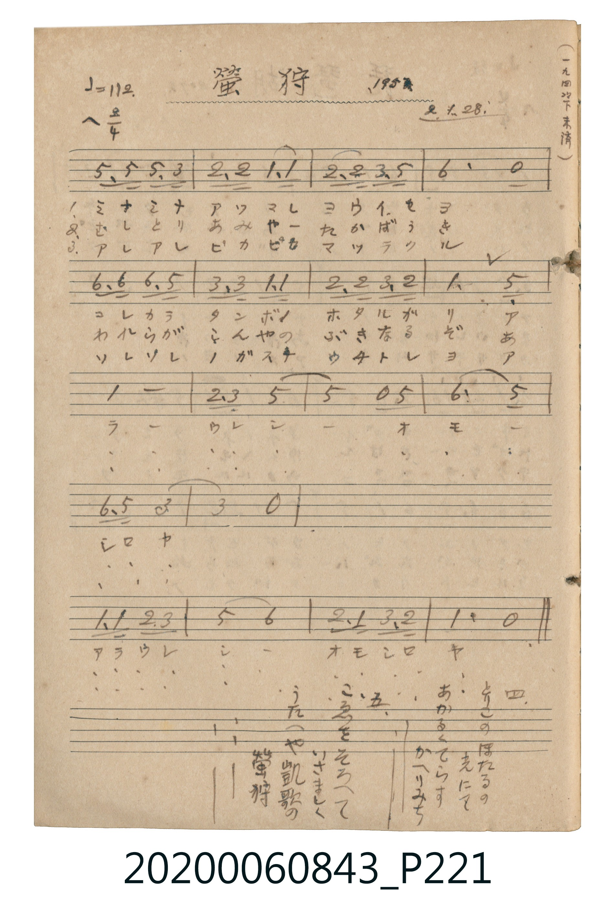

# 螢狩（捕螢）

> Re:Shōka 使用 AI 協助辨識與重建樂譜，可能會有錯誤。歡迎[回報](https://github.com/TMDLang/reshoka/issues)。

- **鋼琴伴奏版**：<br><audio controls src="hotarugari.mp3"></audio>

- 日治時期公學校《唱歌帳》第十冊（P221・195頁・昭和2年1月28日抄）
- 原載：一條慎三郎 編《新編 小學校・公學校 唱歌教材集》第 195 頁

## 說明

> [!NOTE]
> **原頁資訊與歌詞全文（對應 P221.jpg）**
> - **出處標註**：標題旁記「195頁 2.1.28.」、右上角記「（一九四以下未済）」，即抄自《新編 小學校・公學校 唱歌教材集》（1923 年發行）第 195 頁之〈螢狩〉。
> - **調性與拍號**：ヘ調 2/4 拍（`?= F`, `<2/4>`），速度 `!= 112`。
> - **手抄頁面細節**：第三段首句原書作「舞つてくる」，抄寫者誤抄為「マツラクル」。
>
> **一、**
> ミナミナアツマレ　ヨウイセヨ
> コレカラタンボノ　ホタルガリ
> アラウレシ　オモシロヤ　アラウレシ　オモシロヤ
>
> **二、**
> むしとりあみや　たかばうき
> われらがこんやの　ぶきなるぞ
> ああうれし　おもしろや　ああうれし　おもしろや
>
> **三、**
> アレアレピカピカ　マツラクル
> ソレソレノガスナ　ウチトレヨ
> アアウレシ　オモシロヤ　アアウレシ　オモシロヤ
>
> **四、**
> とりこのほたるの　光にて
> あかるくてらす　かへりみち
> ああうれし　おもしろや　ああうれし　おもしろや
>
> **五、**
> こゑをそろへて　いさましく
> うたへや凱歌の　螢狩
> ああうれし　おもしろや　ああうれし　おもしろや


## 歌詞

```text
（TMD 檔案未包含歌詞註解）
```

## ABC

<div class="abc-score" data-abc-src="hotarugari.abc" aria-label="五線譜載入中"></div>

[下載 ABC 原始檔](hotarugari.abc)

## TMD 檔案連結

- [主旋律 TMD 檔案](hotarugari.tmd) [[在 TMD Studio 編輯](https://tmdlang.github.io/Tmd-TS/#tmd=s7IKdvYPcrWy4qpTUCpJTLdSSM7PyUlNLsnMz7MqzsjPTkzOyFeCS5bl55TmploBqXhDA4RwcX5pUXJqfEFieqpVgJGRIboM3KT4vPyS1KT8_GyEioKi_LLUvMQ8oKrcxLzS4uSizIKS-OT8gkqEmtSyzJRUkIri5MS8-LLUosy0zNQUJGelFhWDHQxxR0lRYh7EHKAgQlVJRirQ7Yl5mbmJOeiiBTmJSPblF2WmZ-ZZlSRmlgPty09Ly0zORNaTX1SSkZ9elFiQUWmVkVlcAlSfnJgTn52Yl6jEpaWl8GLeoufdK9_v6XjWOxXIfr-nU0FLi0vRVsHQ0IjL3lbBjcvGSN_EDmTes-lLn23a_Wxm07M585-2rnm6dsezBQsfN3Q9nbLx2dqepzs2P27ofr5mzdPexqdtXUATQcH7uHm3oaXpywWNQMazGWufTuoxerpzi-GzOR1GFiDzulqANoJd-7Rv_os9ne_3zHqyo-HZornPWvue7Oh82dyn8Hz7CqAlz6ZtADIUnm7oh9rbvBvuBgWIC55Nnfls7oSXs9sg7lAAWqwAtFmJi0tfS8GWWoBLQUHBTiFa0c8_xDUWwtHSAjoeaNOLze0vVnS96GgHOubFynlPW1c8m9YODIinG3qftXcqgMJDL6sgHehjYBCDdeqC9LbvejFz6rMVM1-s2K2lBQwAIPPlwp5n0xtfrJjxuKEHEn4KRnqGekYWeo8beh83ND7t3_xkR9eL5ZMgSoB2AEPtyc65T2fPfrJ76ZMd3c_mrHq2owNoE1D9-z09T3s3A4P6Rfsq0kMSaLahpZGxAjDans_c82Ih0LJOpNB9srP7cUMHJBU9bgBa14Tw2YtV-581LAeFR3fvi5nzwZ573DwDKKwATFMKQFGg4QmgRJago5AATmcJQNOB7n3ZMP_prmUKCZB0mIBi6rPObqBfgFa_nLvo-ZYNz9c3gA0GugmYYJ6t2_py2bSn_UuBMfJs9o4ne-cAg-dFx7zHjUseNy573Nj_uAnoXlCQAM14un71i4bWF6uWANnPm3YBVT5unve4ueVx88rHTesfN68GBzbEalhMA8MZGP6w-HvcPP9xcxeUbFoE1gs0Yc3jhobHzSseNy173LTkcdNuIBuqvmkzSLZpNdiK_Y-bgdw5j5v7wOpng0VWP25a87h5FUw90EygymVgXdtByppWPW5eBGI3r33cvAQsQkANqvt39SC7v6nhceP0x41Ap3Y9bmx63Lj_cVMLyITG-Y8bux83bnjc2Pa4sRemGBh6PY-bOh839jxunPy4CYhaHjeuA6vfBlT2uHEVKHgb50HVgwwEojaQLqAtIGXAUAKKTH_c1AuziIAatMAHJjAkxwM9DvQymGyeAg5VMAkKTJR4hKnfC1YPJoFhDgznpp2giAOFGDD0gGVUB1gKHlnAMAQiQoGPVw2K-4HZE9n90GCfDArDxt2gMAeFHig8n7YCA3k1MMUihWQ3WLYflIxBUTATHFZAkR1gQ_Y_blxIs2DfNQXF2cB4n_i4adLjxrkgxUAHAJ0EMgGYGKY-btwHTlH9MMXA9ANMS0BHtjxtB5UtEA9CCgwqO5jywh0KFLT0ubg88ksSi0rTE4syrQIyE_PyHWoMaqpB1ijYGJppgQNHAVvFogAuiRqAJaWChgmomAWWUDrwwl8TiwagbSDDahRMgQWcLpCE0MZAESMwy0jBEEwbIokYQ9XWKJiBWRBoAMQ1YNN8DGtAxRNYFJjIUdhAmaZFUF4LEM-DsteAZJpXQHhNy4B4CZS9G0kGAuMRNhmBzGuAqGycDkrXUF1gmxqboDL7gSItUN0gcah7GruBeAOU3QaW6cVujzGyu9egsEGumwK1dTUKGyQD8x_IryuhMuvBMqux22QCcgXCF8AkD3XfOrD7dkN584Gy3SgymxB-AuqDsMFuaFyG3SZTkBzU9KaJQDwJqmsuOJYgIQHMP0gmgHRAwhGY34B4H5Q9HSzTj2EP_pS6q4eclApJc2ZQGpQKIenRGGdKNQKKQOQgEJTGkVJq02aIL8DxCokVUFyBZPZDeZuBeA6U3QeOvdnQcAOmLGhMAgt1sMwqJJsg6QQ5rULCCFiUAHEnNPR6wKEHi4nJ8LQKi9ltUF4vEENMB8U9SAaSuqB2gVM7cnrdi-QvBBvkxj64i4H1EFQGkjchMQ2skYC4A0UPcg5E8Rc4xcJyGij1wdJlP1LqA_kWWHNA9YPEYaqA6QueXveDZRbi8hU4xbZBxYE5AKgXYnYLWF8PVAaY1-Cm48414FCH2oxqF4HyFdQQAFan4LRrRlraRU6FkHCApFRjaLkLEgGxQGUpCINTKkopiyxiCk3fIBEYC6QLLIJUEkPKHWRbEfEMSgHb4eIgEpRzQRjYmoCobYaUdaj6IXqADQ0ghpTUMP0wM5BcAUr50BSCYgosLkG5AViGYHVFIyiGQDZi0w_RAyqrkMt3HK5AKsMHMCyQcssAhgU4Jw2kKwjUDFPIqRlg5T8sT8FaNaDaAuYSiJwhjpoBrQ0Dr-VXoqQSRJyj-B2cRkAqFqGkCVCqgaUKWBhg5gsQjRz6iLBEDV9oSQkMe-SwBtkOC200O5BbLkCaJv5AqQFo5A-kFEsLO2q5uHTtFBAN72gfw1gFNBEjDBFjDBETDBFTsIgyFwA)]
- [鋼琴伴奏 TMD 檔案](hotarugari_piano.tmd) [[在 TMD Studio 編輯](https://tmdlang.github.io/Tmd-TS/#tmd=s7IKdvYPcrWy4qpTUCpJTLdSSM7PyUlNLsnMz7MqzsjPTkzOyFeCS5bl55TmploBqXhDA4RwcX5pUXJqfEFieqpVgJGRIboM3KT4vPyS1KT8_GyEioKi_LLUvMQ8oKrcxLzS4uSizIKS-OT8gkqEmtSyzJRUkIri5MS8-LLUosy0zNQUJGelFhWDHQxxR0lRYh7EHKAgQlViEVA8PTU3Na_EqiAzMS8_PjE5OT-3IDEvEySGUJhfVJKRn16UWJBRaZWRWVySX5SZnJgTn52Yl4hQVJIBNMkqNaU0ORFijZaWwot5i553r3y_p-NZ71Qg-_2eTgUtLS5FWwVDQyMue1sFNy4bI30TO5AZz6YvfbZp97OZTc_mzH_auubp2h3PFix83ND1dMrGZ2t7nu7Y_Lih-_maNU97G5-2dQFNBAXr4-bdhpamLxc0AhnPZqx9OqnH6OnOLYbP5nQYWYDM62oB2gh24dO--S_2dL7fM-vJjoZni-Y-a-17sqPzZXOfwvPtK4CWPJu2AchQeLqhH2pv8264GxQgLng2deazuRNezm6DuEMBaLEC0GYlLi6P_JLEotL0xKJMqwBQKAZ5ONQY1FRzKQCBjaGZlh2YVaNgGq-gC4RACsoyjgeKGkHYQMoQwgJSyKJARVBdNQpmEDYEGgBxDdhoH8MahcfN88Gij5u7UNhAmaZFUF4LEM-DsteAZJpXQHhNy4B4CZS9G0kGAkG2Qm0yApnXAFHZOB2IYSaAbWpsgsrsB4q0QHWDxKHuaewG4g1QdhtYphe7PcbI7l6Dwga5bgrU1tUobJAMzH8gv66EyqwHy6zGbpMJyBUIXzxunAx13zqw-3ZDefOBst0oMpsQfgLqg7DBbmhcht0mU5Ac1PSmiUA8CaprLjiWICHxuHEHkgkgHZBwfNw4FYj3QdnTwTL9WO2BJxMgBWWBEw80IQEpvAkNyKqBqYBAcGpFSmlNmyGuAMcLJFRBYQ2S2Q_lbQbiOVB2Hzj0Z0P9DUwZ0Jh43ASJy1VIVkHiGTmtQfz4uKkHiDuhvu8B-x4WkpPhaQ0WM9ugvF4ghpgOijuQDCR1QO0Cp1bk9LYXyV8INsiNfXAXP27aCZWB5C1ITD1ubgTiDhQ9yDkIxV_gFAfLKaDUA0tX_UipB-Tbx40zofpB4jBVwPQBT2_7wTILcfkKnOLaoOLAFAzUCzG7BayvByoDzCtw03GnenCoQ23GtAuYZpBkIG42AtPGCqZwERALVG6BMIgNTKtIOpBFTIH6YLpgLJAusAhSqQfJ48i2IuIEFFvb4eIgEpSSQfhxEyhdgPRDyhVU_RA9j5vXAjGkVITph5mB5ApQKoXGJoopsHAHpVxgfsXqikZQaIJsxKYfogdULiCXpThcgVReDmBYIKXsAQwLcKofaFfA8oMhPBdAUj8IwtI8LIcYQlO4EVouQqvh4XXgSpR4RcQSimvBsQpSsQglFkHxDItHmKsxUzKIRg4vhO9RQwRaDgFDCzl0QLbDwgfNDuR6HUjTxB8o5SuN_IGUxmhhRy1mq9IHuVVpAW9UAmtq03hwlQ6iQI1M3ALg9qYZkA1kgCgDeFo1gSiAqYFqBqkBNxJgZsAwsrUIQ8BiUBLc2kXigRUaQEwzgdkFMQqNi9NkuDiYD3QnRCNh1wEDU9dOARGe0T6GsQpoIkYYIsYYIiYYIqZgEWUuAA)]

## 分析

```text
================================================================================
📊 TMD Song Profile: [ 螢狩（捕螢） ]
================================================================================
⏱  Duration:       1:36 (96.4s), 90 measures total
🎼 Key & Tempo:    首調基準 F, != 112.0 BPM, <2/4>
   - 分析範圍：      由實際發聲的音符與和弦推測調性；播放脈絡另行呈現
🎤 人聲音域:    F4 (MIDI 65) – D5 (MIDI 74) [跨度: 9 個半音 / 0.8 個八度, 難度: easy]
   - 最低音:  F4 in [Hotarugari[L1] #1 @ m.2, 0:01]
   - 最高音: D5 in [Hotarugari[L1] #1 @ m.4, 0:03]
   - 適合: soprano, mezzo-soprano, contralto, tenor, baritone, bass
🏛  結構:      Hotarugari[L1] (19.3s) -> Hotarugari[L2] (19.3s) -> Hotarugari[L3] (19.3s) -> Hotarugari[L4] (19.3s) -> Hotarugari[L5] (19.3s)
⚡ 編曲密度:        Peak 1 軌道同時演奏
🗝  調性診斷：       F 大調（純淨自然大調，未偵測到可信轉調）
   - 風格氣質:    純淨自然大調（陽光明朗、易唱易記，無明顯調外色彩）
   - 轉調歷程:    全曲維持單一推測調性（未偵測到可信轉調）
   - 核心骨幹音:  F, C, D, A, G
   - 調性數值:    F 大調 [相關度: 0.82, 穩定度: Moderate, 自然音純度: 100.0%]
   - 候選調性 (K-S): F 大調 (0.82), D 小調 (0.73), C 大調 (0.69)
   - 五度圈歷程:   -1 -> -1 -> -1 -> -1 -> -1
   - 各段落調性細節:
     • [Hotarugari[L1] #1]: F 大調 (r: 0.82, 自然音純度: 100.0%)
     • [Hotarugari[L2] #1]: F 大調 (r: 0.82, 自然音純度: 100.0%)
     • [Hotarugari[L3] #1]: F 大調 (r: 0.82, 自然音純度: 100.0%)
     • [Hotarugari[L4] #1]: F 大調 (r: 0.82, 自然音純度: 100.0%)
     • [Hotarugari[L5] #1]: F 大調 (r: 0.82, 自然音純度: 100.0%)

  [ 五度圈游移軌跡 ]
               C  
        [F ]*          G  
      Bb               D  
      Eb               A  
         Ab           E  
            Db       B  
               F# 
     (* = active key center)

  [ 十二半音累積音高分佈 ]
     C  : ███████████████████       19.7%
     C# :                            0.0%
     D  : ███████████████████       19.7%
     D# :                            0.0%
     E  :                            0.0%
     F  : ████████████████████████  25.0%
     F# :                            0.0%
     G  : █████████████████         17.4%
     G# :                            0.0%
     A  : █████████████████         18.2%
     A# :                            0.0%
     B  :                            0.0%
--------------------------------------------------------------------------------
Assignment 軌道音域：
  - Piano         : F4 – D5 (9 個半音 / 0.8 個八度, 250 個音符)
================================================================================
```


## 原書掃描頁




