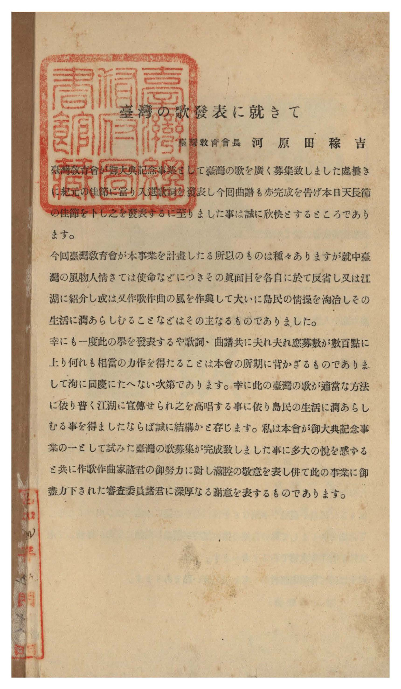
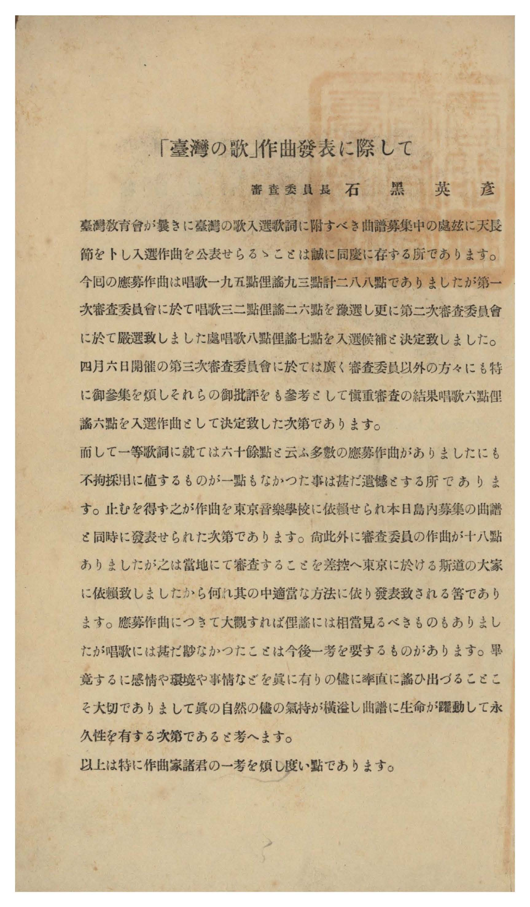
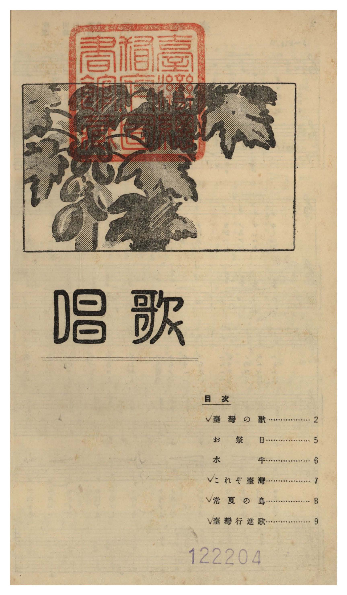
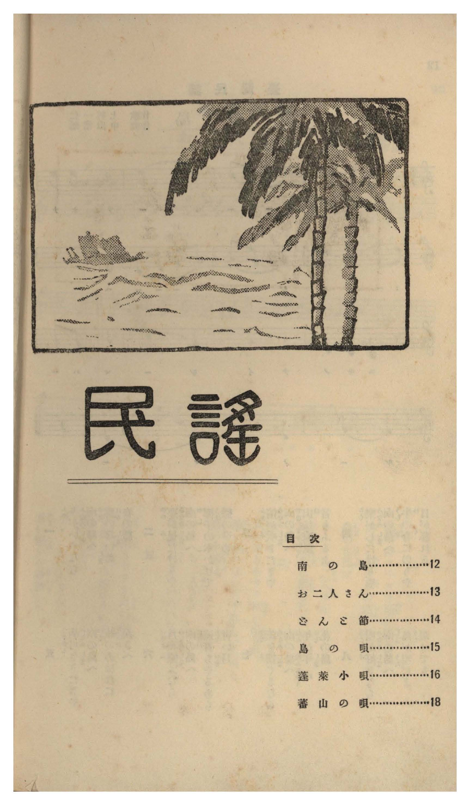
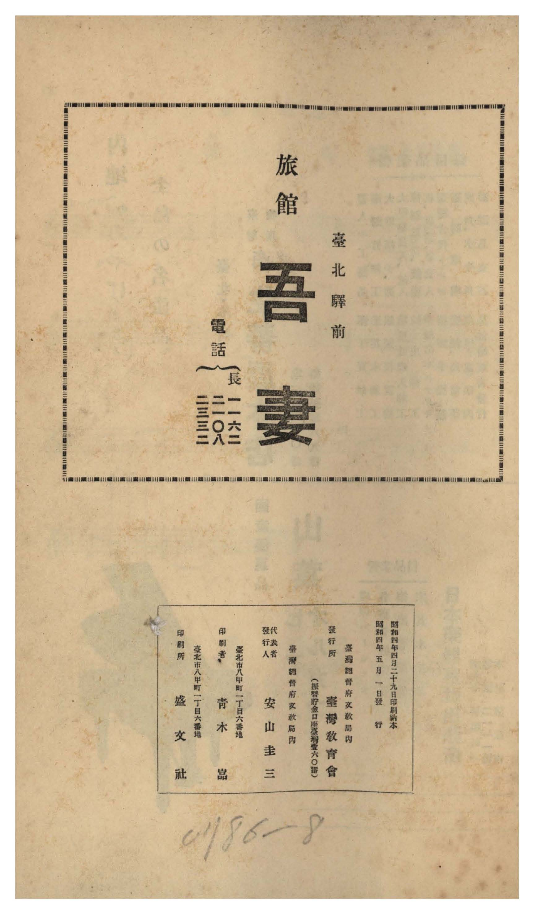
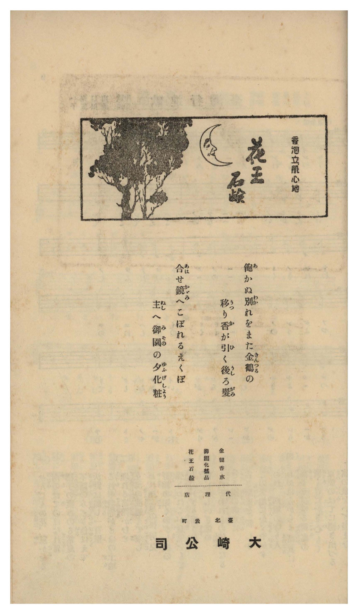
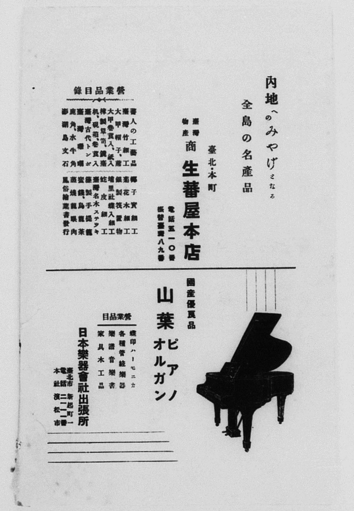

# 書訊與卷首／卷末掃描頁 — 《臺灣の歌》 臺灣教育會御大典記念事業・昭和四年版（國臺圖 0786 8）

本頁收錄本冊之封面、扉頁、目次（もくろく）、樂典大要、版權頁與封底等原書掃描圖檔（共 7 頁）。

## 館藏詮釋資料（國立臺灣圖書館）

| 欄位 | 內容 |
| :--- | :--- |
| **系統編號** | `jpli2011-bk-sxt_0786_8_1929` |
| **資料格式** | 圖書（樂譜集） |
| **主要題名** | 臺灣の歌（御大典記念事業） |
| **編纂／發行者** | 臺灣總督府文教局內 臺灣教育會（代表者：安山圭三；會長：河原田稼吉；審査委員長：石黑英彥） |
| **印刷者／印刷所** | 小塚兼吉／盛文社（臺北市北門町三番地） |
| **出版日期** | 昭和 4 年（1929 年）4 月 28 日印刷、昭和 4 年 5 月 1 日發行（非賣品） |
| **總頁數** | 掃描影像共 22 頁（含扉頁與序、審査報告、唱歌目次與樂譜 6 首、民謠目次與樂譜 6 首、版權頁與封底） |
| **索書號** | `0786 8` |

---

## 序文與審査報告（原文轉錄）

### 序（臺灣教育會長 河原田稼吉）

> 昭和三年秋、曠古の御大典を擧げさせらるゝに方り、本會は記念事業の一として洽く島内に臺灣の歌（唱歌、俚謠）を募集したるところ、多數應募ありたる中より審査の結果、各六篇を選び、更に之が曲譜を募集して、茲に之を發表するに至れり。
>
> 本歌詞並曲譜が、廣く全島に愛誦せられ、本島趣味の涵養、情操の陶冶に資するを得ば、本會の幸慶之に過ぐるものなし。
>
> 昭和四年天長節の佳辰に際し、一言を述べて序とす。
>
> 臺灣教育會長　河原田稼吉

### 審査に就いて（審査委員長 石黑英彥）

> 一、昨年御大典記念事業の一として本會に於て募集した「臺灣の歌」は、先づ歌詞の審査を行ひ、唱歌六篇、俚謠六篇を選び、次に此の當選歌に對する曲譜を募集し、去る二月二十日を以て締切つたのであるが、應募總數二百八十八篇、內唱歌百九十五篇、俚謠九十三篇に達した。
>
> 二、審査委員は慎重審議を重ねた結果、唱歌五篇、俚謠六篇の當選を見るに至つたことは喜ばしい次第である。唯だ遺憾なことは、唱歌の一等に當選した「臺灣の歌」の應募曲譜が六十餘篇あつたに拘らず、これぞと思ふものの無かつたことである。仍て委員會の決議に基き、東京音樂學校教授信時潔氏に特に其の作曲を煩はしたことを一言して置く。
>
> 三、一般に應募曲譜を通じて見られた缺點は、歌詞の氣分と曲想とがしつくり合つてゐないものや、アクセントを無視したもの、或は徒らに技巧に走つて實際に歌ひ難いもの等が少くなかつたことである。併し當選したものは何れも相當苦心の跡が見え、推奨するに足るものと信ずる。
>
> 昭和四年四月　　審査委員長　石黑英彥

---

## 卷首、目次與卷末原書掃描頁

### P001.jpg

扉頁（上題「御大典記念事業　臺灣の歌　臺灣教育會」，蓋有「臺灣總督府圖書館藏」大方印，右上貼索書號籤「0786 8」）與臺灣教育會長河原田稼吉序文（昭和四年天長節之佳辰）。

### P002.jpg

審査委員長石黑英彥（臺灣總督府文教局長）撰「審査に就いて」：詳述歌詞與曲譜兩階段公開懸賞募集經過（應募曲譜共 288 篇，其中唱歌 195 篇、俚謠 93 篇；唱歌第一等歌詞〈臺灣の歌〉特委託東京音樂學校教授信時潔作曲）。

### P003.jpg

前半部「唱歌」目次頁（原書第 1 頁）：列出〈臺灣の歌〉（内田隆作歌・信時潔作曲）、〈お祭日〉（田村富士雄作歌・陳華提作曲）、〈水牛〉（御船武作歌・郭明峯作曲）、〈これぞ臺灣〉（川島傳作歌・中山常雄作曲）、〈常夏の島〉（萱島保之作歌・柚木厚司作曲）、〈臺灣行進歌〉（山口充一作歌・池田玉子作曲）共 6 首。

### P012.jpg

後半部「臺灣民謠」（目次題「民謡」）目次頁（原書第 11 頁）：列出〈南の島〉（上村一仁作歌・中山常雄作曲）、〈お二人さん〉（西村忠三作歌・中美春治作曲）、〈どんこ節〉（山口充一作歌・大江田雪太郎作曲）、〈島の唄〉（佐野文吾作歌・中美春治作曲）、〈蓬萊小唄〉（小松忠文作歌・北川義雄作曲）、〈蕃山の唄〉（山口次郎作歌・小林柳美作曲）共 6 首。

### P020.jpg

版權頁：標明「昭和四年四月二十八日印刷、昭和四年五月一日發行」、「臺灣の歌（非賣品）」、「發行者 臺灣總督府文教局內 臺灣教育會 代表者 安山圭三」、「印刷者 臺北市榮町二丁目十二番地 小塚兼吉」、「印刷所 臺北市北門町三番地 盛文社」。

### P021.jpg

封底裏頁，貼有國立臺灣圖書館條碼籤「3 1111 004781371」與索書號「0786 8」。

### P022.jpg

封底外頁（墨綠布紋美術紙裝幀）。

