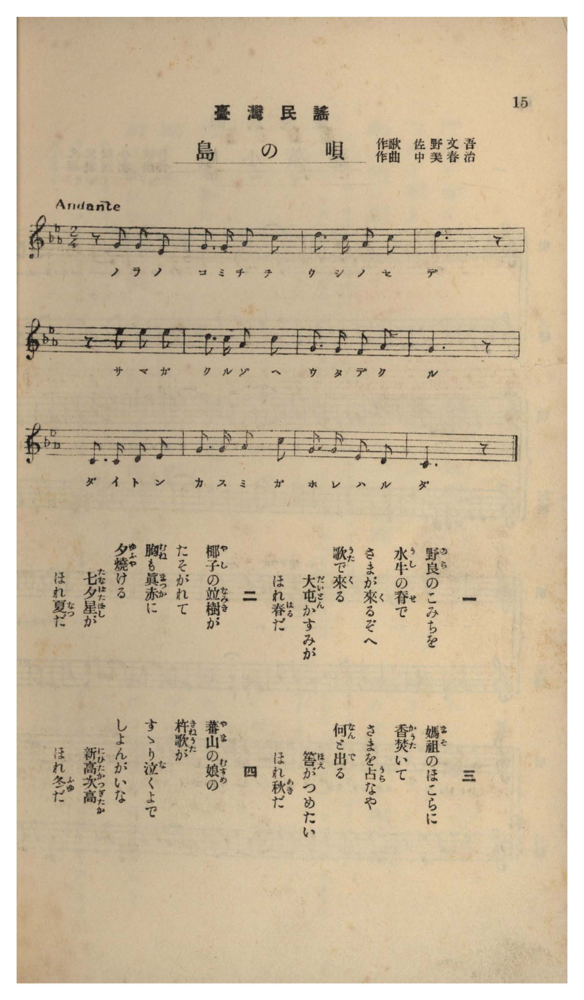

# 島の唄

> Re:Shōka 使用 AI 協助辨識與重建樂譜，可能會有錯誤。歡迎回報。

- **NEUTRINO 歌聲合成版**：<br><audio controls src="shima_no_uta_neutrino.mp3"></audio>
- **鋼琴伴奏版**：<br><audio controls src="shima_no_uta.mp3"></audio>


- 作詞：佐野文吾
- 作曲：中美春治
- 臺灣教育會《臺灣の歌》（御大典記念事業，昭和四年五月一日發行，國臺圖 0786 8）第 15 頁（民謡第四曲）

## 說明

曲目說明與原書資訊（對應 P016.jpg，原書第 15 頁，民謠第四曲）：
- 書名：《臺灣の歌》（國立臺灣圖書館「日治時期圖書影像系統」典藏號 jpli2011-bk-sxt_0786_8_1929，索書號 0786 8）
- 作歌：佐野文吾
- 作曲：中美春治
- 調性與拍號：ハ調都節音階（三降記號）2/4 拍子（Andante），12 小節
- 內容簡介：四節歌詞依序詠唱臺灣四季風物：春（水牛背上唱歌、大屯山春霞）、夏（椰子並木夕照、七夕星）、秋（媽祖廟焚香擲筊「筈／ほえ」問卜）、冬（山地少女杵歌與新高- 次高山）。

編曲說明：
- 依原譜都節音階（Andante，♩= 72）編配 4 小節前奏與雅致伴奏。


## 歌詞

```text
一
野良（のら）のこみちを
水牛（うし）の脊（せ）で
さまが來（く）るぞへ
歌（うた）で來（く）る
大屯（だいとん）かすみが
ほれ春（はる）だ

二
椰子（やし）の並樹（なみき）が
たそがれて
胸（むね）も眞赤（まつか）に
夕燒（ゆふや）ける
七夕星（たなばたぼし）が
ほれ夏（なつ）だ

三
媽祖（まそ）のほこらに
香（かう）焚（た）いて
さまを占（うら）なや
何（なん）と出（で）る
筈（ほえ）がつめたい
ほれ秋（あき）だ

四
蕃山（やま）の娘（むすめ）の
杵歌（きねうた）が
すゝり泣（な）くよで
しよんがいな
新高次高（にひたかつぎたか）
ほれ冬（ふゆ）だ

一、在田間小徑上，那人騎在水牛背上唱著歌兒過來了；大屯山籠罩著薄霧，看哪，是春天了。
二、椰子林蔭大道漸入黃昏，連胸口也被晚霞染得通紅；天邊亮起牛郎織女星，看哪，是夏天了。
三、在媽祖廟裡焚香祈禱，占卜心上人的心意會擲出什麼結果呢？木筊（筈）觸手微涼，看哪，是秋天了。
四、高山上少女的杵歌，聽來宛如低聲啜泣般惹人憐愛；遠望新高山與次高山（雪山），看哪，是冬天了。）
```

## ABC

```abc
X:1
T:島の唄
M:2/4
L:1/16
Q:1/4=72
K:Eb
V:V1 name="Voice" snm="Voi"
[V:V1]
z2 G2 G2 F2 | G3 G A2 c2 | d3 c A2 c2 | d6 z2 |
w: 1.~の ら の | こ み ち を | う し の せ | で
w: 2.~や し の | な み き が | た そ が れ | て
w: 3.~ま そ の | ほ こ ら に | か う た い | て
w: 4.~や ま の | む す め の | き ね う た | が
z2 e2 e2 e2 | d3 c A2 c2 | G3 G F2 A2 | G6 z2 |
w: 1.~さ ま が | く る ぞ へ | う た で く | る
w: 2.~む ね も | ま つ か に | ゆ ふ や け | る
w: 3.~さ ま を | う ら な や | な ん と で | る
w: 4.~す す り | な く よ で | しょ ん が い | な
D3 D F2 G2 | A3 A B2 c2 | A3 A G2 F2 | C6 z2 |
w: 1.~だ い と ん | か す み が | ほ れ は る | だ
w: 2.~た な ば た | ぼ し _ が | ほ れ な つ | だ
w: 3.~ほ え が _ | つ め た い | ほ れ あ き | だ
w: 4.~に ひ た か | つ ぎ た か | ほ れ ふ ゆ | だ
```

## TMD 檔案連結

- [主旋律 TMD 檔案](shima_no_uta.tmd) [[在 TMD Studio 編輯](https://tmdlang.github.io/Tmd-TS/#tmd=s7IKdvYPcrWy4qpTUCpJTLdSyC_KTM_MsypJzCxPzIvPT0vLTM5MzFHi0tJSeLp52-PGdU-ntChoaYHUP9k758XKee_3zHqyd8LL9r5n09qfTtinBJV5NnsTSGbH2uf7-p7NWPps026wzIv2Xc8bFz-bOvNF06Znc5ofN3RBRIAGP1vb87ih-_2ejqf7Fj5dsvxp644XK2Y83b_1ya7uZ0vXvt_T82zG2qeTep7Onv1055Ynu6Y8m9PxZEfDs-lLn8_c82JhD1DB0zndQNOezpmmYGBuYaZg8X5P5_M1axQMTRVeLmgEGvxsw8QXaxYChYBmgN3XCXYT1N8lGfnpRYkFGZVWGZnFJcBwSE7Mic9OzEtU4lK0VTA34rK3VXDV4bIx0jex4-LS1-ICGvF89roXq1Y9m9H3oqP9ad_8Z7N3vNjc_mJFF8gXG3qftXcqBBgYmullFaSDnAdWgOyiHrCLFiC7CBhoXI-bdwMVPp3QC-RgD6E53c9Xg_wKFAd6F6j45ZIVjxt6gIEBDOhnM5uezZkPEX-6d-PT5v7nm3c_37rxcUMvKFCn97-YOV8hqyAn08jA0FA3KVu3uKIkHhRi8RbxhpZGlkB3Pd-yCOQXoDp4SIJcBYrXtcCQRolxmARGhIMkXqza_6xhOTB0nnX3Ao0Deai5Hyj4snnv8_UNL-dvfjmrD-ihJzs6X87sBcY3WE0nMIgVgBqerp0AlHPMS0nMK0kFh02PoZHC0w39QK0gw5-2Ln-6bufzDQuf7AaGyixgGAIlgA4Epson--Y-3dX_YuWCp1M2QsMJmG7WLn65aMXzzpVAxUAnglPElueds1809zzZ0QVUCQ7gRlDi27j-6caNQDUv5wATeCdYsB-kfskGoKOe7Fj2bM6Kp0umPm9dDpR6sqMZyH42A-RyIPf5cnAUrdr7fOm0p7vnP2-Z9XLZzGeTNz1f2wWMoudrO97v6X_cuPtxYwcoQqb2P-2dA7WibQ1I48aNT-dseLph4tOlm5_N3QryDjD0pm14uXoGKF2sWQhkANWAtTRxcT1umADx8dPWFcD4eNwwkQuYK4DCDcAIetG5HmgiMOU8bgIGXieI0Tj5ceP-x40LHzdNAimCBABYUdvjxukQRS9aQAn4cSNQHMhdDlL3uHHq48Z9jxt7nuxrA8sBQ6PzcVP348Z5jxt3gE0CJQyIMeCAaFyOphSkCBK0YNEFjxtbHjeueNw0GawaaNJMsMt6INbtftwEzPCgOHrcuB6oG6xoARfXk11gBZCIAMk2AU2BuhsULyt2grWsApsFzEBAcaiJ8x83zgVygOY-blwGEnrRvANsAFAOWLwAndj0fM68F1uXgA0A-nUJ0FVgA1ZDnD71efsksAagF7cC7QXLTYT6DCkRAHUD7QK6YAOYsQfmPiSfQVITWBHQOqjPdgDzGNAecMKBuWEuLNqA6WUyMBahjgGmKLAKYKgBw7gTmMYg1oJVAwME7D9onDVNetq7ABo10GSwCuh6sKP3ToU6AxoLK5627wKLLEfEGTjFAoVAKRbiD1DQNDWCPQc2BuInSLp_3NgEC3egn4CZDhzSU5vBSRYSW_sgfnq6YgYs-GcCjYMIguMWnOrBZvUCowYpSUFDEKh87uOmrmebF0NcD5brf9wEcjdExXQQpwmY1IFuBdq4CmwsOA9BMhBY3-rHjZvAngCGIjCu-yBscFEHjydwlgRHNyicwX4CCrxYNe_FWmAyngXKa6CcO2fF8ykbXk6bDCybnu6bCCxMgEXVy6bFT3btermiDyiLVs68mDgd6MOnrZNeNvYBc8mTXUDDZ8OLnecbFzzfuxKo5sW0lpdzgDHR83xO99PJQG8Cc8R6YKZ4umQlUAso-wNzA9B6SGZ4Nm_6iylrgaa8bJz8bM-Op61LX-5ufjYDmNB6XjYsBib2p_2Ln-yc_2LR6mczZwHLtWfzJz_dN_1lw6znW1rB1q982dT1ZNe6F1u3A936srnv-c4poDIIlKRRXABMvEgu2AEuuoDFIazAe7F4IaTMe7604_kyYKz3ANMfsJB7ur8Z6HtgkDyf1QJkP2vpBzYAgOUiMMk92d3wctee51uBfpjzdOKi93vmA8tXYHkJDGpw6ut8sXzHs87up_vWPdu2B801wGSHcA0wvQFdAykhQUENLkWB9sGSVM-Lxr3AAH-6bvbTZU1P9va9aNz0dOocYEJ60bHmWfNOoOOetU141gIs-Ga_bFzwbM5sSKIBmgYqhBFlb8fL2asghTB62LStgbsGlJK09Lm4fBOBDaqw_MzkVIcag5pqLgUgsDE007IDs2oUDBR0FYyh2AiIa8AsEN8ESJqBRczBImYYIhAIMqEGbJqPYY1CPJAHzEogsqkTzq4B0pPBqoFFIxAvBMtPgsq0QWWmw3Q2zobKLEeyB2Qy1B4jqD1NLVB9yPasQrKnF8zqgcrMh8rMhYoB8xhUZhl2e4xh_tkH1Ydsz26oaZPhPl0NlemGyrRB7QQWA_jtMUH1D8Q2qD1NDVDTZgLZjSguAPkOxF8LDUOIbSAZkL9Q7UGKbsM4FAJb_MLSAChFgERhIrhjfCqSy2Gh2g9xX1M3kD0PLLMDKgOL8fnQOIaoBfkWEna4YxwUGiAfg9hNUNNAtoJEl0DDHh4TTTB7tsLDdiJ-e-AxjuQf9HQKjG1IKoOYiZTmmoBpoXEFWCfIV3jsgcU4MFbhZFMXqmnAMAHWJMimgaqWdiSrwIkYnrgg2rBEujmIpwuiQPEJiskacKyC4tYUSELiHCaCKAnMIPqwRTqwMoI6sgXmZaCLUJM_MMECMyFygoBmGWC2A7arwCyQWoRp2KIdkW1XAfEGMAuWzPdAZUAFAC57wBEFTBp47QFGOyJDdyBlIJA4SC_ItEaozYgQR7YHlBghWRKPPcBohyROkNpNcPNgoQC1qbEPQwbZpq1gFigxYreplotL104BVPAr6NopcwEA)]
- [鋼琴伴奏 TMD 檔案](shima_no_uta_piano.tmd) [[在 TMD Studio 編輯](https://tmdlang.github.io/Tmd-TS/#tmd=s7IKdvYPcrWy4tLSUni6edvjxnVPp7S839PxsnvP8wlbnuzZ8nRp__POjvd7OhW0tLjqFJSe7J3zYuW893tmPdk74WV737Np7U8n7FOCyjybvQkks2Pt8319z2YsfbZpN1jm-fYVEJmgVKvijKO92YkKL2fPfNbZjWwLWOWL9l3PGxc_mzrzRdOmZ3OaHzd0QUSA7nq2tudxQzfQaU_3LXy6ZPnT1h0vVsx4un_rk13dz5aufb-n59mMtU8n9TydPfvpzi1Pdk15NqfjyY6GZ9OXPp-558XCHqCCp3O6gaY9nTNNwcDcwkzBAuip52vWKBiaKrxc0Ai2viQx3Uohv6gkIz-9KLEgo9IqI7O4JL8oMzkxJz47MS9RiUvRVsHciMveVsFVh8vGSN_EjotLX4sL4sEXq1Y9m9EH9CbX4-bdT_bNfdo3_8XaOS-b9z5f3_By_uaXs4ByHY55KYl5JalA5zyauRJkGMgV21e8bO1VMFF4uqEfqPZpZy8wPF50tL-c3fqiHRo8jxuauLT0ubg880qK8q0CMhPz8oM8HGoMaqq5FIDAxtBMyw7MqlEwj1fQBUIgZQSkjIG4Bmg2SMhEwRRImqGIgORB6moUzCD6INAAJMRVi2KhDw4LjeNBOs3BJDIbaAmYNgQRSEyYuBGmBjMwjeEI38TMPPyeBikFeQXhHRALxAd5FOJlc7CIGYYIsmUg03wMaxRAzgCmOhDZ1Aln1wDpyWDVjxv3A_FCsPwkqEwbVGY6TGfjbKjMciR7wB6F2GMEtaepBaoP2Z5VSPb0glk9UJn5UJm5ULHHTTCZZdjtMYb5Zx9UH7I9u6GmTYb7dDVUphsq0wa183EjyJ147DFB9Q_ENqg9TQ1Q02YC2Y0oLgD5DsRfCw1DiG0gGZC_UO1Bim7DOBQCW_zC0gAoRYBEYSK4Y3wqksthodoPcV9TN5A9DyyzAyoDi_H50DiGqAX5FhJ2uGMcFBogH4PYTVDTQLaCRJdAwx4eE00we7bCw3YifnvgMY7kH_R0CoxtSCqDmImU5pqAaaFxBVgnyFd47IHFODBW4WRTF6ppwDB53NSBbFrj9MdN7UhWgRMxPHFBtGGJdCoWbLBIf9y4AOrIFpiXgS5CTf7ABAvMhMgJApplgNnuceN6MAukFmEatmhHZNtVQLwBzIIl8z1QGVABgMsecEQBkwZee4DRjsjQHUgZCCQO0gsyrRFqMyLEke0BJUZIlsRjDzDaIYkTpHYT3DxYKEBtauzDkEG2aSuYBUqM2G1CKfdx1T2QCsMYRCAxUcRRah7k6ganBISNSCm4rcFpHIb94MqOkDW0r0l17RTANboCkAEK3Wgfw1gE2wiJbYzENgGxlbkA)]

## 分析

```text
================================================================================
📊 TMD Song Profile: [ 島の唄 ]
================================================================================
⏱  Duration:       0:20 (20.0s), 12 measures total
🎼 Key & Tempo:    首調基準 E,, != 72.0 BPM, <2/4>
   - 分析範圍：      由實際發聲的音符與和弦推測調性；播放脈絡另行呈現
🎤 人聲音域:    C4 (MIDI 60) – D#5 (MIDI 75) [跨度: 15 個半音 / 1.2 個八度, 難度: moderate]
   - 最低音:  C4 in [Main #1 @ m.12, 0:18]
   - 最高音: D#5 in [Main #1 @ m.5, 0:07]
   - 適合: soprano, mezzo-soprano, contralto, tenor, baritone, bass
🏛  結構:      Main (20.0s)
⚡ 編曲密度:        Peak 1 軌道同時演奏
🗝  調性診斷：       C 小調（純淨自然小調，未偵測到可信轉調）
   - 風格氣質:    純淨自然小調（陰鬱抒情、旋律集中，無明顯調外色彩）
   - 轉調歷程:    全曲維持單一推測調性（未偵測到可信轉調）
   - 核心骨幹音:  G, C, D, G#, F
   - 調性數值:    C 小調 [相關度: 0.68, 穩定度: Moderate, 自然音純度: 100.0%]
   - 候選調性 (K-S): C 小調 (0.68), G 小調 (0.52), G 大調 (0.52)
   - 五度圈歷程:   +0
   - 各段落調性細節:
     • [Main #1]: C 小調 (r: 0.68, 自然音純度: 100.0%)

  [ 五度圈游移軌跡 ]
              [C ]*
         F            G  
      Bb               D  
      Eb               A  
         Ab           E  
            Db       B  
               F# 
     (* = active key center)

  [ 十二半音累積音高分佈 ]
     C  : █████████████████         18.6%
     C# :                            0.0%
     D  : █████████████████         18.6%
     D# : ███████                    7.0%
     E  :                            0.0%
     F  : █████████                  9.3%
     F# :                            0.0%
     G  : ████████████████████████  25.6%
     G# : █████████████████         18.6%
     A  :                            0.0%
     A# : ██                         2.3%
     B  :                            0.0%
--------------------------------------------------------------------------------
Assignment 軌道音域：
  - Voice         : C4 – D#5 (15 個半音 / 1.2 個八度, 37 個音符)
================================================================================
```


## 原書掃描頁




