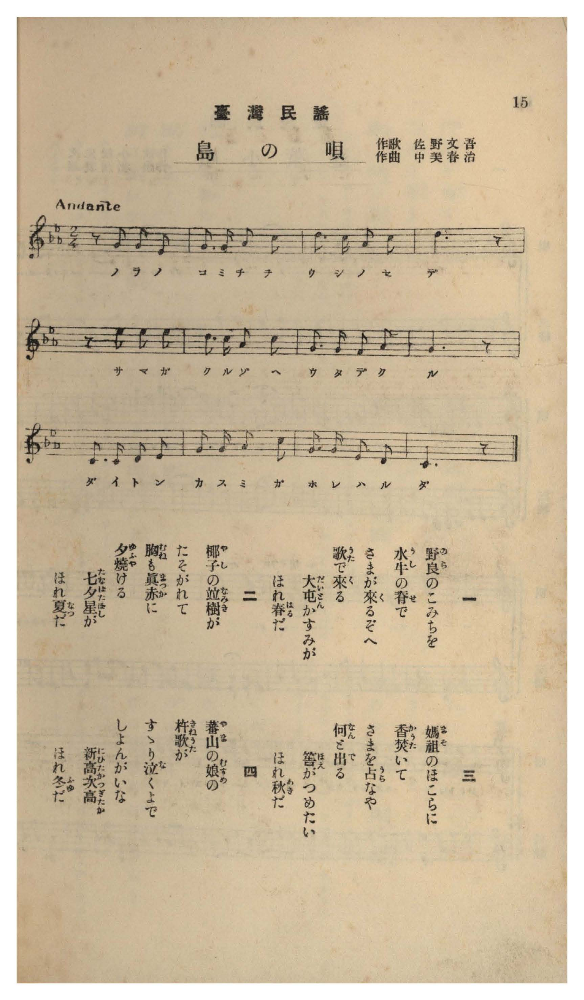

# 島の唄

> Re:Shōka 使用 AI 協助辨識與重建樂譜，可能會有錯誤。歡迎回報。

- **鋼琴伴奏版**：<br><audio controls src="shima_no_uta.mp3"></audio>
- **NEUTRINO 歌聲合成版**：<br><audio controls src="shima_no_uta_neutrino.mp3"></audio>

- 作詞：佐野文吾
- 作曲：中美春治
- 臺灣教育會《臺灣の歌》（御大典記念事業，昭和四年五月一日發行，國臺圖 0786 8）第 15 頁（民謡第四曲）

## 說明

曲目說明與原書資訊（對應 P016.jpg，原書第 15 頁，民謠第四曲）：
- 書名：《臺灣の歌》（國立臺灣圖書館「日治時期圖書影像系統」典藏號 jpli2011-bk-sxt_0786_8_1929，索書號 0786 8）
- 作歌：佐野文吾
- 作曲：中美春治
- 調性與拍號：ハ調都節音階（三降記號）2/4 拍子（Andante），12 小節
- 內容簡介：四節歌詞依序詠唱臺灣四季風物：春（水牛背上唱歌、大屯山春霞）、夏（椰子並木夕照、七夕星）、秋（媽祖廟焚香擲筊「筈／ほえ」問卜）、冬（山地少女杵歌與新高- 次高山）。

編曲說明：
- 依原譜都節音階（Andante，♩= 72）編配 4 小節前奏與雅致伴奏。


## 歌詞

```text
一
野良（のら）のこみちを
水牛（うし）の脊（せ）で
さまが來（く）るぞへ
歌（うた）で來（く）る
大屯（だいとん）かすみが
ほれ春（はる）だ

二
椰子（やし）の並樹（なみき）が
たそがれて
胸（むね）も眞赤（まつか）に
夕燒（ゆふや）ける
七夕星（たなばたぼし）が
ほれ夏（なつ）だ

三
媽祖（まそ）のほこらに
香（かう）焚（た）いて
さまを占（うら）なや
何（なん）と出（で）る
筈（ほえ）がつめたい
ほれ秋（あき）だ

四
蕃山（やま）の娘（むすめ）の
杵歌（きねうた）が
すゝり泣（な）くよで
しよんがいな
新高次高（にひたかつぎたか）
ほれ冬（ふゆ）だ

一、在田間小徑上，那人騎在水牛背上唱著歌兒過來了；大屯山籠罩著薄霧，看哪，是春天了。
二、椰子林蔭大道漸入黃昏，連胸口也被晚霞染得通紅；天邊亮起牛郎織女星，看哪，是夏天了。
三、在媽祖廟裡焚香祈禱，占卜心上人的心意會擲出什麼結果呢？木筊（筈）觸手微涼，看哪，是秋天了。
四、高山上少女的杵歌，聽來宛如低聲啜泣般惹人憐愛；遠望新高山與次高山（雪山），看哪，是冬天了。）
```

## ABC

<div class="abc-score" data-abc-src="shima_no_uta.abc" aria-label="五線譜載入中"></div>

[下載 ABC 原始檔](shima_no_uta.abc)

## TMD 檔案連結

- [主旋律 TMD 檔案](shima_no_uta.tmd) [[在 TMD Studio 編輯](https://tmdlang.github.io/Tmd-TS/#tmd=s7IKdvYPcrWy4qpTUCpJTLdSyC_KTM_MsypJzCxPzIvPT0vLTM5MzFGCyyfn5-SkJpdk5sPV5OXHl5YkIlSU5eeU5qZaGSJEivNLi5JTcamHyMYXJKanWgUYGJohZAqK8stS8xLzEHpTU0qTE0GWxycWF-cDXQZiIzSklmWmpIKUFxRl5iYWVcan5CcD3ZJXguS61KJikOPL8pORvVWSkQp0M8yFiSWlRalKXFpaCk83b3vcuO7plBYFLS2Q4id757xYOe_9nllP9k542d73bFr70wn7wMYAZZ7N3gSS2bH2-b6-ZzOWPtu0Gyzzon3X88bFz6bOfNG06dmc5scNXRARoMHP1vY8buh-v6fj6b6FT5csf9q648WKGU_3b32yq_vZ0rXv9_Q8m7H26aSep7NnP9255cmuKc_mdDzZ0fBs-tLnM_e8WNgDVPB0TjfQtKdzpikYmFuYKVi839P5fM0aBUNThZcLGoEGP9sw8cWahUAhoBlg93UiPJ1fVJKRn16UWJBRaZWRWVwCjHtgoMRnJ-YBo0fRVsHciMveVsFVh8vGSN_EjotLX4sLaMTz2eterFr1bEbfi472p33zn83e8WJz-4sVXSBfbOh91t6pAIpFvayCdJDzwAqQXdQDdtECZBcBA43rcfNuoMKnE3qBHOwhNKf7-WqQX4HiQO8CFb9csuJxQw8wMIAB_Wxm07M58yHiT_dufNrc_3zz7udbNz5u6AUF6vT-FzPnK2QV5GQaGRga6iZl6xZXlMSDQizeIt7Q0sgS6K7nWxaB_AJUBw9JkKtA8boWGNIoMQ6TwIhwkMSLVfufNSwHhs6z7l6gcSAPNfcDBV82732-vuHl_M0vZ_UBPfRkR-fLmb3A-Aar6QQGsQJQw9O1E4ByjnkpiXklqeCw6TE0Uni6oR-oFWT409blT9ftfL5h4ZPdwFCZBQxDoATQgcBU-WTf3Ke7-l-sXPB0ykZoOAHTzdrFLxeteN65EqgY6ERwitjyvHP2i-aeJzu6gCrBAdwISnwb1z_duBGo5uUcYALvBAv2g9Qv2QB01JMdy57NWfF0ydTnrcuBUk92NAPZz2aAXA7kPl8OjqJVe58vnfZ09_znLbNeLpv5bPKm52u7gFH0fG3H-z39jxt3P27sAEXI1P6nvXOgVrStAWncuPHpnA1PN0x8unTzs7lbQd4Bht60DS9XzwClizULgQygGrCWJi6uxw0TID5-2roCGB-PGyZyAXMFFzB2XnSuBxoHTDaPm4Ah1wliNE5-3Lj_cePCx02TuCBeB6toe9w4HaLiRQso6T5uBIoDucu5HjdOfdy473Fjz5N9bWAJYCB0Pm7qftw473HjDi5wYoAYAPZ843I0dVyQsAQLLXjc2PK4ccXjpslgpUAzZoJd0wO0ZffjJmD2BsXI48b1QH1gFQu4uJ7s6uGChDlIqgmoH-pQUBSs2AlWvwpsCjCvAMVBZs1_3DgXyAKa-LhxGdeL5h1grQ2PG4FlCNBNTc_nzHuxdQlYK9BnS4AuAWtdDXTr1Oftk8CqgR7aCrQOLDER5A-kOAbqA1oBtHUDmLEH5iaYPyApBawCaAvUHzs6uSApAmbvXFiUABPCZGAMgRwATCdgaWDQAEOxE5hyILaBlQL9vgwWH02TnvYugIY8NHJXAZ3L9WTvVKjV0EBe8bR9F1hkOTQ-wMkPyAclP4irQUHQ1Aj2SgvUB5AU_LixCRasQB8Asw_Xi6nN4JQHiYl9EB88XTEDFsAzgQZBBLkgKRdsSi8w5JGSCCiYgArnPm7qerZ5McS5YIn-x00ghwKlp4NYTcC0CnQc0KJVXJDkD0n7YB2rHzduAjsZGFTAGOyDsMGlFCQOwFkJHImgkAT7ACjwYtW8F2uBqXEWKI-ActycFc-nbHg5bTKwTHm6byKwEAAWMS-bFj_Ztevlij6gLFr58GLidKCvnrZOetnYB0zpT3YBDZ8NLy6eb1zwfO9KoJoX01pezgGGeM_zOd1PJwN9B0zb64HJ--mSlUAtoGwLTNdA6yEp-9m86S-mrAWa8rJx8rM9O562Ln25u_nZDGAi6nnZsBiYfp_2L36yc_6LRaufzZwFLI-ezZ_8dN_0lw2znm9pBVu_8mVT15Nd615s3Q5068vmvuc7p4DKDlBaRXEBMGEiuWAHuMgBFmOwgurF4oWQsur50o7ny4DR3ANMZMDC6en-ZqDvgUHyfFYLkP2spR9YcQPLM2DSerK74eWuPc-3Av0w5-nERe_3zAeWi8ByDhjU4ITW-WL5jmed3U_3rXu2bQ-aa4CJDOEaYOoCugZSsoGCGlz6Ae2DJaOeF417gQH-dN3sp8uanuzte9G46enUOcD086JjzbPmnUDHPWub8KwFWGzNftm44Nmc2ZAUAzQNVHgiysyOl7NXQQpP9LBpWwN3DSgZaelzcfkmAht_YfmZyakONQY11VwKQGBjaKZlB2bVKBgo6CoYQ7ERENeAWSC-CZA0A4uYg0XMMEQgEGRCDdg0H8MahXggD5h3QGRTJ5xdA6Qng1UDyzkgXgiWnwSVaYPKTIfpbJwNlVmOZA_IZKg9RlB7mlqg-pDtWYVkTy-Y1QOVmQ-VmQsVA-YxqMwy7PYYw_yzD6oP2Z7dUNMmw326GirTDZVpg9oJLADw22OC6h-IbVB7mhqgps0EshtRXADyHYi_FhqGENtAMiB_odqDFN2GcSgEtviFpQFQigCJwkRwx_hUJJfDQrUf4r6mbiB7HlhmB1QGFuPzoXEMUQvyLSTscMc4KDRAPgaxm6CmgWwFiS6Bhj08Jppg9myFh-1E_PbAYxzJP-jpFBjbkFQGMRMpzTUB00LjCrBOkK_w2AOLcWCswsmmLlTTgGECrEOQTQNVKu1IVoETMTxxQbRhiXRzEE8XRIHiExSTNeBYBcWtKZCExDlMBFESmEH0YYt0YGUEdWQLzMtAF6Emf2CCBWZC5AQBzTLAbAdsIYFZILUI07BFOyLbrgLiDWAWLJnvgcqACgBc9oAjCpg08NoDjHZEhu5AykAgcZBekGmNUJsRIY5sDygxQrIkHnuA0Q5JnCC1m-DmwUIBalNjH4YMsk1bwSxQYsRuUy0Xl66dAqjgV9C1U-YCAA)]
- [鋼琴伴奏 TMD 檔案](shima_no_uta_piano.tmd) [[在 TMD Studio 編輯](https://tmdlang.github.io/Tmd-TS/#tmd=s7IKdvYPcrWy4qpTUCpJTLdSSM7PyUlNLsnMz7MqScwsT8yLz8uPLy1JVIKrKMvPKc1NtTJEiBTnlxYlp-JSD5GNL0hMT7UKMDA0Q8gUFOWXpeYl5iH0pqaUJieCLI9PLC7OT84EsxEaUssyU1JByguKMnMTiyrjU_KTgW7JK0FyXWpRMcjxBZmJQIckFhUl5qWnoiopyQAKwF2bWFJalKrEpaWl8HTztseN655OaXm_p-Nl957nE7Y82bPl6dL-550d7_d0KmhpgUx4snfOi5Xz3u-Z9WTvhJftfc-mtT-dsA9sNlDm2exNIJkda5_v63s2Y-mzTbvBMs-3r4DIBKVaFWcc7c1OVHg5e-azzm5kW8AqX7Tvet64-NnUmS-aNj2b0_y4oQsiAnTXs7U9jxu6gU57um_h0yXLn7bueLFixtP9W5_s6n62dO37PT3PZqx9Oqnn6ezZT3duebJryrM5HU92NDybvvT5zD0vFvYAFTyd0w007emcaQoG5hZmChZATz1fs0bB0FTh5YJGRPDkF5Vk5KcXJRZkVFplZBaX5BdlJifmxGcn5gEjVdFWwdyIy95WwVWHy8ZI38SOi0tfiwviwRerVj2b0Qf0Jtfj5t1P9s192jf_xdo5L5v3Pl_f8HL-5pezgHIdjnkpiXklqUDnPJq5EmQYyBXbV7xs7VUwUXi6oR-o9mlnLzA8XnS0v5zd-qIdGjyPG5q4tPS5uDzzSoryrQJAsRvk4VBjUFPNpQAENoZmWnZgVo2CebyCLhACKSMgZQzENUCzQUImCqZA0gxFBCQPUlejYAbRB4EGICGuWhQLfZAttIDbZxwfD7QsHk4DzQaShvEwCsI3QlZgBiQhtoDt8E3MzMPvJ5BzQC5FuBbEAvFB_oD4yBwsYoYhguwhkGk-hjUKIOuBiQpENnXC2TVAejJY9ePG_UC8ECw_CSrTBpWZDtPZOBsqsxzJHpDJUHuMoPY0tUD1IduzCsmeXjCrByozHyozFyr2uAkmswy7PcYw_-yD6kO2ZzfUtMlwn66GynRDZdqgdj5uBLkTjz0mqP6B2Aa1p6kBatpMILsRxQUg34H4a6FhCLENJAPyF6o9SNFtGIdCYItfWBoApQiQKEwEd4xPRXI5LFT7Ie5r6gay54FldkBlYDE-HxrHELUg30LCDneMg0ID5GMQuwlqGshWkOgSaNjDY6IJZs9WeNhOxG8PPMaR_IOeToGxDUllEDOR0lwTMC00rgDrBPkKjz2wGAfGKpxs6kI1DRgmj5s6kE1rnP64qR3JKnAihicuiDYskU7FcgsW6Y8bF0Ad2QLzMtBFqMkfmGCBmRA5QUCzDDDbPW5cD2aB1CJMwxbtiGy7Cog3gFmwZL4HKgMqAHDZA44oYNLAaw8w2hEZugMpA4HEQXpBpjVCbUaEOLI9oMQIyZJ47AFGOyRxgtRugpsHCwWoTY19GDLINm0Fs0CJEbtNKOU-jqoFVE8Yx8MoOB9escBqFAwBEA2qXLAbg6ENyVxgPYXLGMorOl07BXB9qgBkgDwf7WMYi2AbIbGNkdgmILYyFwA)]

## 分析

```text
================================================================================
📊 TMD Song Profile: [ 島の唄 ]
================================================================================
⏱  Duration:       0:20 (20.0s), 12 measures total
🎼 Key & Tempo:    首調基準 E,, != 72.0 BPM, <2/4>
   - 分析範圍：      由實際發聲的音符與和弦推測調性；播放脈絡另行呈現
🎤 人聲音域:    C4 (MIDI 60) – D#5 (MIDI 75) [跨度: 15 個半音 / 1.2 個八度, 難度: moderate]
   - 最低音:  C4 in [Main #1 @ m.12, 0:18]
   - 最高音: D#5 in [Main #1 @ m.5, 0:07]
   - 適合: soprano, mezzo-soprano, contralto, tenor, baritone, bass
🏛  結構:      Main (20.0s)
⚡ 編曲密度:        Peak 1 軌道同時演奏
🗝  調性診斷：       C 小調（純淨自然小調，未偵測到可信轉調）
   - 風格氣質:    純淨自然小調（陰鬱抒情、旋律集中，無明顯調外色彩）
   - 轉調歷程:    全曲維持單一推測調性（未偵測到可信轉調）
   - 核心骨幹音:  G, C, D, G#, F
   - 調性數值:    C 小調 [相關度: 0.68, 穩定度: Moderate, 自然音純度: 100.0%]
   - 候選調性 (K-S): C 小調 (0.68), G 小調 (0.52), G 大調 (0.52)
   - 五度圈歷程:   +0
   - 各段落調性細節:
     • [Main #1]: C 小調 (r: 0.68, 自然音純度: 100.0%)

  [ 五度圈游移軌跡 ]
              [C ]*
         F            G  
      Bb               D  
      Eb               A  
         Ab           E  
            Db       B  
               F# 
     (* = active key center)

  [ 十二半音累積音高分佈 ]
     C  : █████████████████         18.6%
     C# :                            0.0%
     D  : █████████████████         18.6%
     D# : ███████                    7.0%
     E  :                            0.0%
     F  : █████████                  9.3%
     F# :                            0.0%
     G  : ████████████████████████  25.6%
     G# : █████████████████         18.6%
     A  :                            0.0%
     A# : ██                         2.3%
     B  :                            0.0%
--------------------------------------------------------------------------------
Assignment 軌道音域：
  - Voice         : C4 – D#5 (15 個半音 / 1.2 個八度, 37 個音符)
================================================================================
```


## 原書掃描頁




