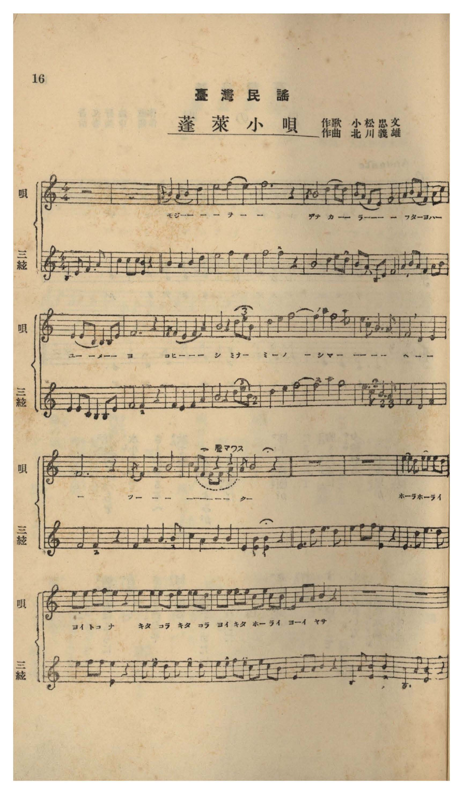
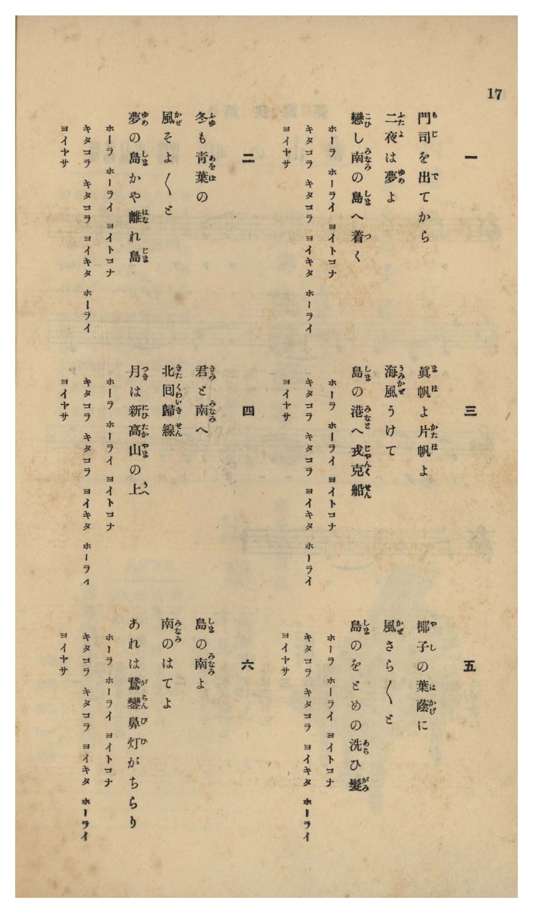

# 蓬萊小唄

> Re:Shōka 使用 AI 協助辨識與重建樂譜，可能會有錯誤。歡迎回報。

- **NEUTRINO 歌聲合成版**：<br><audio controls src="horai_kouta_neutrino.mp3"></audio>
- **鋼琴伴奏版**：<br><audio controls src="horai_kouta.mp3"></audio>


- 作詞：小松忠文
- 作曲：北川義雄
- 臺灣教育會《臺灣の歌》（御大典記念事業，昭和四年五月一日發行，國臺圖 0786 8）第 16–17 頁（民謡第五曲）

## 說明

曲目說明與原書資訊（對應 P017.jpg–P018.jpg，原書第 16–17 頁，民謠第五曲）：
・書名：《臺灣の歌》（國立臺灣圖書館「日治時期圖書影像系統」典藏號 jpli2011-bk-sxt_0786_8_1929，索書號 0786 8）
・作歌：小松忠文
・作曲：北川義雄（原書附三絃伴奏譜）
・調性與拍號：イ調都節・民謠調式（無升降記號）4/4 拍子，共 25 小節（含三絃前奏 2 小節、三絃間奏 2 小節、三絃尾奏 2 小節）
・內容簡介：原譜採用「唄」與「三絃」（三味線）雙行對照譜面，第 15 小節上方特別標註民謠轉音技法「聲マワス」（轉腔／こぶし），中間穿插兩小節三絃間奏後進入輕快囃子詞「ホーラ ホーライ ヨイトコナ キタコラ キタコラ ヨイキタ ホーライ ヨーイ ヤサ」。全曲共六節，自門司港出航兩夜抵臺唱起，描繪常夏青葉、戎克船（ジャンク船）、新高山明月、椰蔭少女洗髮與鵝鑾鼻燈火。

編曲說明：
・忠實轉錄原書第 16 頁（P017.jpg）北川義雄作曲之「三絃」（三味線）伴奏聲部（含前奏、間奏與尾奏）。

## 歌詞

```text
一
門司（もじ）を出（で）てから
二夜（ふたよ）は夢（ゆめ）よ
戀（こひ）し南（みなみ）の島（しま）へ着（つ）く
ホーラ　ホーライ　ヨイトコナ
キタコラ　キタコラ　ヨイキタ　ホーライ
ヨイヤサ

二
冬（ふゆ）も青葉（あをば）の
風（かぜ）そよ／＼と
夢（ゆめ）の島（しま）かや離（はな）れ島（じま）
ホーラ　ホーライ　ヨイトコナ
キタコラ　キタコラ　ヨイキタ　ホーライ
ヨイヤサ

三
眞帆（まほ）よ片帆（かたほ）よ
海風（うみかぜ）うけて
島（しま）の港（みなと）へ戎克船（じやんくせん）
ホーラ　ホーライ　ヨイトコナ
キタコラ　キタコラ　ヨイキタ　ホーライ
ヨイヤサ

四
君（きみ）と南（みなみ）へ
北回歸線（きたくわいきせん）
月（つき）は新高山（にひたかやま）の上（うへ）
ホーラ　ホーライ　ヨイトコナ
キタコラ　キタコラ　ヨイキタ　ホーライ
ヨイヤサ

五
椰子（やし）の葉蔭（はかげ）に
風（かぜ）さら／＼と
島（しま）のをとめの洗（あら）ひ髮（がみ）
ホーラ　ホーライ　ヨイトコナ
キタコラ　キタコラ　ヨイキタ　ホーライ
ヨイヤサ

六
島（しま）の南（みなみ）よ
南（みなみ）のはてよ
あれは鵞鑾鼻（がらんび）灯（ひ）がちらり
ホーラ　ホーライ　ヨイトコナ
キタコラ　キタコラ　ヨイキタ　ホーライ
ヨイヤサ

一、自從離開門司港，兩夜航程恍如夢境；抵達令人眷戀的南方之島。嘿啦蓬萊好地方，嘿呀嘿呀好個蓬萊，嘿呀颯！
二、即使冬日也是青翠綠葉，微風輕柔吹拂；是夢幻之島嗎，這座南方離島。嘿啦蓬萊好地方，嘿呀嘿呀好個蓬萊，嘿呀颯！
三、滿帆呀、片帆呀，迎著海風，戎克帆船駛入島嶼港灣。嘿啦蓬萊好地方，嘿呀嘿呀好個蓬萊，嘿呀颯！
四、與你一同向南跨越北回歸線，明月高掛在新高山巔。嘿啦蓬萊好地方，嘿呀嘿呀好個蓬萊，嘿呀颯！
五、椰子樹蔭下微風沙沙吹拂，島嶼少女正梳理洗淨的長髮。嘿啦蓬萊好地方，嘿呀嘿呀好個蓬萊，嘿呀颯！
六、島嶼的南方呀、南疆的盡頭呀，那是鵝鑾鼻的燈塔在遠方閃爍。嘿啦蓬萊好地方，嘿呀嘿呀好個蓬萊，嘿呀颯！）
```

## ABC

```abc
X:1
T:蓬萊小唄
M:4/4
L:1/16
Q:1/4=96
K:C
V:V1 name="Voice" snm="Voi"
[V:V1]
z16 | z16 | A4 G4 A4 c4 | d4 e6 f4 z2 |
w: 1.~も じ を でて | か ら _
w: 2.~ふ ゆ も あを | ば の _
w: 3.~ま ほ よ かた | ほ よ _
w: 4.~き み と みな | み へ _
w: 5.~や し の はか | げ に _
w: 6.~し ま の みな | み よ _
A4 d6 c2 A2 G2 | A4 A2 c2 A2 G2 F2 A2 | G2 G2 D2 E2 G2 A4 z2 | G4 F4 G4 A4 |
w: 1.~ふ た よ は _ | ゆ め _ _ _ _ _ | _ _ _ _ _ よ | こ ひ し _
w: 2.~か ぜ そ よ と | そ よ _ _ _ _ _ | _ _ _ _ _ と | ゆ め の _
w: 3.~う み か ぜ う | け て _ _ _ _ _ | _ _ _ _ _ て | し ま の _
w: 4.~き た くゎい き せ | ん _ _ _ _ _ _ | _ _ _ _ _ ん | つ き は _
w: 5.~か ぜ さ ら と | さ ら _ _ _ _ _ | _ _ _ _ _ と | し ま の _
w: 6.~み な み の は | て _ _ _ _ _ _ | _ _ _ _ _ よ | あ れ は _
c4 z4 d2 e2 c4 | d4 e4 f8- | f2 e4 d2 f8 | e4 c4 F4 E4 |
w: 1.~み な み の | し ま _ | _ _ _ へ | _ _ つ _
w: 2.~し ま か や | は な _ | _ _ _ れ | _ _ じ _
w: 3.~み な と へ | じゃ ん _ | _ _ _ く | _ _ せ _
w: 4.~に ひ た か | や ま _ | _ _ _ の | _ _ う _
w: 5.~を と め の | あ ら _ | _ _ _ ひ | _ _ が _
w: 6.~が ら ん び | ひ が _ | _ _ _ ち | _ _ ら _
F12 z4 | F4 A4 c8 | c2 A2 F2 E2 F4 z4 | A12 z4 |
w: 1.~_ | つ _ _ | _ _ _ _ _ | く
w: 2.~_ | じ _ _ | _ _ _ _ _ | ま
w: 3.~_ | せ _ _ | _ _ _ _ _ | ん
w: 4.~_ | う _ _ | _ _ _ _ _ | へ
w: 5.~_ | が _ _ | _ _ _ _ _ | み
w: 6.~_ | ら _ _ | _ _ _ _ _ | り
z16 | z16 | d2 e2 d2 c2 d2 e2 d2 c2 | d2 d2 e2 e2 d4 z4 |
w: 1.~ほ _ ら _ ほ _ ら い | よ い と こ な
w: 2.~ほ _ ら _ ほ _ ら い | よ い と こ な
w: 3.~ほ _ ら _ ほ _ ら い | よ い と こ な
w: 4.~ほ _ ら _ ほ _ ら い | よ い と こ な
w: 5.~ほ _ ら _ ほ _ ら い | よ い と こ な
w: 6.~ほ _ ら _ ほ _ ら い | よ い と こ な
d2 d2 d2 c2 d2 d2 d2 c2 | d2 d2 e2 d2 c2 d2 c2 A2- | A2 A2 A2 c6 z4 | z16 |
w: 1.~き た こ ら き た こ ら | よ い き た ほ _ ら い | _ よ い や
w: 2.~き た こ ら き た こ ら | よ い き た ほ _ ら い | _ よ い や
w: 3.~き た こ ら き た こ ら | よ い き た ほ _ ら い | _ よ い や
w: 4.~き た こ ら き た こ ら | よ い き た ほ _ ら い | _ よ い や
w: 5.~き た こ ら き た こ ら | よ い き た ほ _ ら い | _ よ い や
w: 6.~き た こ ら き た こ ら | よ い き た ほ _ ら い | _ よ い や
z16 |
```

## TMD 檔案連結

- [主旋律 TMD 檔案](horai_kouta.tmd) [[在 TMD Studio 編輯](https://tmdlang.github.io/Tmd-TS/#tmd=s7IKdvYPcrWy4tLSUngxec2LCV1PN_Q_ndKioKXFVaeg9GTvnBcr573fMwso-mzuvqf7Fzyb1q4ElXk2exNIpmf60-1zn-9b-XJ2C1jmRfuu542Ln02d-aJp07M5zY8buiAijxvXPVvb87ih-_2ejqf7Fj5dsvxp644XK2Y83b_1ya7uZ0vXvt_T82zG2qeTep7Onv1055Ynu6Y8m9PxZEfDs-lLn8_c82JhD1DB0zndQNOezpmmYGBuYaZg8X5P5_M1axQMzR41TDY0V3i5oBFo-rMNE1-sWQgUBxkBcmQn2GElielWCvlFJRn56UWJBRmVVhmZxSX5RZnJiTnx2Yl5iUpcirYKlmZc9rYKzlw2Jvomdlxc-lpcQBOez173YtWqZzP6XnS0P-2b_2z2jheb21-s6AL5ZEPvs_ZOhQADQ3O9rIJ0oDOATAsQE-RasFoMB_aAHbgA2YHAgOR63LwbqPrphF4gB3uozel-vhrkf6A4MAiAil8uWfG4oQcYQM827X42s-nZnPkQ8ad7Nz5t7n--effzrRsfN_SCAnp6_4uZ8xWyCnIyjQwMDXWTsnWLK0riQaEYbxFvaGlkCXTX8y2LQH4DqoOHLshVoLheCwx9lFQAk8BIBCCHgv39cmbLkx2dz7c2P9mz5enS_hdr50DNe7Fq_7OG5cCwfNbdC7QM5N2mJUDBl817n69vAAUDOHyAIk_39AONe96y8Glv-8uZvcDUAlbfCYwcBaDmp2sngEK5daOCkakC0HFA3SDbJ6yG2Pu0sxdor4IRVOpxQyNE_OW0yVjFn27YhywOde3T1uVP1-18vmHhk93ASJgF9BvQJ8_6Fj6fAgp7YF4BBjDQL0A2xBQgF-gIIPvpxM3Pt88CmvJy9kxg6gWmlOety4F6X85dBAprUKqAufrJjq5n03Y-79z5tGPpsxUzX6yABcHezpfzNz_rani2eSrQgheNmx43z3vcvP5x006INUAFL1qnvN_T_7hx8uPGbY8bp4MTE9Apa4G-fL5y_7P-SU9bV8JsQfj-6b6elw2bnrYufbFn6tP9q5_ObgYGJjCvA2153Dz7cfOex80rFeAsYPwAOSuA1OPmjsdNmx83dyk8blr7uGk_mANUicKBqAQLYZoB5IBZQAVbgZ543ND0tHUFMBkBo_Fp61pwuPe8aF_1clrD0_4dz3asf9q-60XHKpAnlsx51rUVlP2nbHyxdTsoH_X3P9-56umOHU-X9L-cO-nFxE5gXD7r6Hva2v2iYycweB437XjcvPhx8-bHTevBImAF0za8XD3j6caNwAwNLGFAIks2vJiy9umGiU-Xbn62ZfrL1euAEfpy69yXE_e93LP7eXvH88bVQHdycT1umADMCcBgAjl5GjDOJ3IBCyigcAPEuWArmx43zgDZ1DQJ6HSQSONyELdx2ePG7sdNwDTV0PBkVw_QN2C5rY8b5z9u6gCrWP90CTBpAI1oe9wELCeARnSAVD_rACVrcAyDygpgJD_tBcYzUGT_48ZVQBIsuO7p5m1gwemPG_eBRXY8nwvRuATM7QeZhYgOZDYwtkBclAgGq0aKVixcpHhGMw5iFcQ8UERzcQG9DBJ82rYG6u2mNrAPmyARBxZsAobZ48YNEO-AQ3XRCrBE9-NGUOHxuHEuOKiAhcKex40rwOahhRiWYAAGesvL2WBljeuBAQa2tgembAZE2cCGzQ6w_c_nzHu6AxgqQFfte9y4G5IAnne2wwSBoTAfLg5OGFu3w0KoDZwY4OEE5E4EpjhwCKGHxzpgpkJKPUD9oLSCkm2AodLU8rgJmOCABctsIGOgQwjYJAD7ZcJssPN6YYl-BbacsAOsFFglzZ73bO0OcBkM0QMMvf7HTUAvtYC5SB4DlgOQnAKUgGRFeCkBFl8NzHpg_aDEBA9IYLENC3xg1h_gNLRrCtgjSzaAa0WgJUB3gmoDoDuB-QtYvsEyADCRTAKLr8aaxaYCyyjULIaRgMDZFGh5IygxbYFEADDvArUBZTcBi0-wSA8kPgY23bSuxe4FLOkGkqewFq3gcFsGVQH2K9Bz619unQepIaDebQKaAcwym0GN0kZIFoOU10DFC8GyEO8NVGCA2gur5r1YC3TaLFC9Baz5gBXt033zgKXjy2nd8BoX3KYCVbfAevf5iu5njb1PlzUBC9qni5rf75kNrINfNk55snvJk127ns_ZDqycns9qAYYasAHzZGc3MKRBNfqM_U-nLoN2KJbufTpnA1AWZCxQfGIDlASKN3RD1MClXi4C2t4IqiyAjnvau_nJ3v3AGgPYwH2yc_6zGeuBdcXz_Queb1sArjF6nu5bB0y-wBbMs_lTnk7Y-ay7CeS-GaBq9OnO3RDXPJ3eB1T5smHm013LIa4E-pZKrtwBbk7s3g8soIGiQDaksAayQW2Y_X0vJk6HFdE9kPIVKAssYl8unw1seYEct20PMLxBzXzKXQMsIkER2tH-ZO8CYOQ-ndDzdMJEoI9fbF_xYlsXanEI7GiBmj7AAu5Z3-ync4BtGWhh93T7FKpEH9AUUKsKWBQ9W7ETWPY82dENiaxnm2YCESyyQLUwMAygLa-1i58t2vx8QhuwSHm2fQUwVb2cuh1YmFAjbFrXgtIT2DJ4aoVEGZD9fFobUPD57IUvF6yFxN3LpsWg1AZvAQJl2zueLpwCDKqXjcDez86X05qfd4DbrpS5DFQ-aulzcfkmZuZZheVnJqc61BjUVHMpAIGNhZYdmFGjYKCgiwKxiIBV-hjWKMRjqMUQgag1IkGtMQlqTUhQa0qCWjPi1EKDzAzIMQViEG0YB1ZrBKKMQYSuggmIMoCqA0uAlZkB9UDEzGBcEyCJCF1ggxUoCWwggcimSWD2cmDdALYAWIuChTvhzokHi24FK5sPFgFWIkD2eoj6pjawSCOmZ4GRA9UHVQOxFtRChlq1ASywDs0qsAMa50CsapwLtW4FWG4u1HoMy4CxC6wYwTp2w9VA2ptQyxDCyJaBXda4H2pZN9hikChIbiJYDBQumMkD2MiC6wQ5DswG1rdQyyDCO9Asg2iBBiKoHdcHbMeBxYEtOXBgTkayDDWNARtDYF3T4WEGaQlBLYRE42q8QTkVHK-woJwKDg9EPCMnUpg1kACFWIbuO4yghPgZpAYSMCCNoGQCkkMORJQ0bgqERgrGQBKUYkGpGZTiTYAYlvJrIGkfVFoAEzkw7WNkBXBGQPIAMI0jbIK4E-JCUOgCGzTwcATrgboclAtBroe5HCKDCAbMxI1kBzgBgO1Ayg6IlA0zCWLHPkhCA8cnSAaUkWDhhp6mke0AhSHEH-iRg90fK6ApECQD7Aw1gx2GnMAQqRk5uEAqINYsARsFSbQgR8KsAaUyiDWbwMkZngqhSRRLcAETMNbgwuUVcBEBsQPoDWBwIqIEXIrgSLfYox2iowfDHyARsB2gXAH0N7DdC5WBJBGQPEaChaY5YOpDJDuIEDhdglKuMVgMxIJBUOKFiMDLciSHI6VXRJmBLAaKCFQxEAQ5HRZNyBAzhUI8j24qqPzHbSpMFs1UpDQJLMGwmDobr6kwWTRTkZIgcjJAiIFyFW5TYbJopiIlOkiUopuKGSrIpiJHP5KpSMkM2CfCNBWeNLGaipJwIaZCExa4rjYBJh5QMoEkGFBigUGICCmtKGx-gsUYQoyUthY2E5EzO4kmopRviBBCLqJINBGlKEO4EVEPk2wiSsGFMBHSYCDLRJRiCuHrLrJMhKYdSMUIJIGJCJkNloEIQMRg6QgiDNcAZyNpgEuCEyZS8xHakgIlZAQb1JABeQPUVAM1aUCVD6hEBVVrsEADNXNAtQVQHKwDlY-sGyaDYjpSq3JAXQBuag6oC8DtzwF1AahBOrAuALdSB8oF8LaAGaSTBcqM5BTQcHvALSfyimQKzQAXwhSaAS52KTQDXNBSaAa4aCXfjFouLl07BdA4hoKunTIXAA)]
- [鋼琴伴奏 TMD 檔案](horai_kouta_piano.tmd) [[在 TMD Studio 編輯](https://tmdlang.github.io/Tmd-TS/#tmd=s7IKdvYPcrWy4tLSUngxec2LCV1PN_Q_ndLyfk_H0775zzs7nuzofL61-UVH-8vuPc8nbHmyZ8vTpf0v1s55v6dTQUuLq05B6cneOS9Wznu_ZxZQ57O5-57uX_BsWrsSVObZ7E2Pm3c_374CyAAp6Zn-dPvc5_tWvpzdAlbyon3X88bFz6bOfNG06dmc5scNXRCRx43rnq3tedzQDXLIvoVPlyx_2rrjxYoZT_dvfbKr-9nSte_39DybsfbppJ6ns2c_3bnlya4pz-YAHdvwbPrS5zP3vFjYA1TwdE430LSnc6YpGJhbmClYAN38fM0aBUOzRw2TDc0VXi5oBLuhJDHdSiG_qCQjP70osSCj0iojs7gkvygzOTEnPjsxL1GJS9FWwdKMy95WwZnLxkTfxI6LS1-LC-KpF6tWPZvRB_QaF9CfQL8_Xb_sxd7Olz0twOB7NnsHxD6QVUCPBBgYmutlFaQD3YEcEJBgerKz-3FDDyS4Hzf0ApUD2U8nbn6-fRZQPTTcGze9bF4BCpIJq5929gJFHjc0vpw2GSTV0f50wz4gA6j4cUMTl5Y-F5dvYmaeVUBmYl5-kIdDjUFNNZcCENhYaNmBGTUKBgq6KBCLCFilj2GNQjyGWgwRiFojEtQak6DWhAS1piSoNSNOLTTIzIAcUyAG0YZxYLVGIMoYROgqmIAoA6g6sARYmRlQD0TMDMY1AZKI0H3c1ASUfNw4A0Q2TQKzlz9uXAa24HFjN1i4E-6ceLDoVrCy-WCRx00dQPZ6iPqmNrBII6ZngZED1QdVA7G2CWInSHIDWGAdmlVgBzTOgVjVOBdq3Qqw3Fyo9RiWAWP3ceM-sI7dcDVAsyBuBkkihJEtA7uscT_Usm6wxSBRkNxEsBgoXDCTx-PGXrhOkOPA7MeNq6CWQYR3oFkG0QINxMb-x019jxtbwOKPG2eDA3MykmWoaexxUwtY13R4mAGjABJYIKMh0bgab1BOBccrLCingsMDEc_IiRRmDSRAIZah-w4jKCF-BqmBBAxIIyiZgOSQAxEljZsCoZGCMZAEpVhQagaleBMghqX8GkjaB5UWwEQOTPsYWQGcEZA8AEzjCJsg7oS4EBS6jxs3wcMRrAfqclAuBLke5nKIDCIYMBM3kh3gBAC2Ayk7IFI2zCSIHfsgCQ0cnyAZUEaChRt6mka2AxSGEH-gRw52f6yApkCQzIzHTc1ghyEnMERqRg4ukAqINUvARkESLciRMGtAqQxizSZwcoanQmgSxRJcwASMNbhweQVcREDsAHoDGJyIKAGXIjjSLfZoh-jowfAHSARsByhXAP39uHEzVAaSREDyGAkWmuaAqQ-R7CBC4HQJSrnGYDEQCwZBiRciAi_LkRyOlF4RZQayGCgiUMVAEOR0WDQhQ8wUCvE8uqmg8h-3qTBZNFOR0iSwBMNi6my8psJk0UxFSoLIyQAhBspVuE2FyaKZipToIFGKbipmqCCbihz9SKYiJbPHjQsxTYUnTaymoiRciKnQhAWuq02AiQeUTCAJBpRYYBAiQkorCpufYDGGECOlrYXNROTMTqKJKOUbIoSQiygSTUQpyhBuRNTDJJuIUnAhTIQ0GMgyEaWYQvi6iywToWkHUjECSWAiQmaDZSACEDFYOoIIwzXA2Uga4JLghInUfIS2pEAJGcEGNWRA3gA11UBNGlDlAypRQdUaLNBAzRxQbQEUB-tA5SPrhsmgmI7UqhxQF4CbmgPqAnD7c0BdAGqQDqwLwK3UgXIBvC1gBulkgTIjOQU03B5wy4m8IplCM8CFMIVmgItdCs0AF7QUmgEuWsk3oxZ5GMMH-zCGWTxInzmYNIIYYQJqZRqC2EACJA-lwAkCRZspmISwwRqAxS2IMoaaBjQJ2qNHmA81zBiIQdphckj2gIRNgBjEhtkHEgNhIyStEI3gLhaYBdKD6iaoN8BdLZA-TEeCXYgIcXBzGNnxkKAFC4H1QuwAuQAkDuFBSJAl0GYxeqggmw_1I0gNyBSEXuSAgJHI5sG8ADYTyIS6CkgAHQpmIscPRC2QhCiGs8EyEAGIGLwCBfPgGuBsJA1wSagfEEEG4kEjEORQiImgNAV0mhnEO-CYQfImUAbIh4YxMA5BiVXXTgGUXqN9DGMV4GwjJLYxEtsEiW2KxDYDsZW5AA)]

## 分析

```text
================================================================================
📊 TMD Song Profile: [ 蓬萊小唄 ]
================================================================================
⏱  Duration:       1:02 (62.5s), 25 measures total
🎼 Key & Tempo:    首調基準 C, != 96.0 BPM, <4/4>
   - 分析範圍：      由實際發聲的音符與和弦推測調性；播放脈絡另行呈現
🎤 人聲音域:    D4 (MIDI 62) – F5 (MIDI 77) [跨度: 15 個半音 / 1.2 個八度, 難度: moderate]
   - 最低音:  D4 in [Main #1 @ m.7, 0:15]
   - 最高音: F5 in [Main #1 @ m.4, 0:09]
   - 適合: soprano, mezzo-soprano, contralto, tenor, baritone, bass
🏛  結構:      Main (62.5s)
⚡ 編曲密度:        Peak 1 軌道同時演奏
🗝  調性診斷：       D 調性不明確（純淨自然大調，未偵測到可信轉調）
   - 風格氣質:    純淨自然大調（陽光明朗、易唱易記，無明顯調外色彩）
   - 轉調歷程:    全曲維持單一推測調性（未偵測到可信轉調）
   - 核心骨幹音:  A, D, F, C, E
   - 調性數值:    D 調性不明確 [相關度: 0.79, 穩定度: Ambiguous, 自然音純度: 100.0%]
   - 候選調性 (K-S): D 小調 (0.79), A 小調 (0.78), F 大調 (0.74)
   - 五度圈歷程:   +2
   - 各段落調性細節:
     • [Main #1]: D 調性不明確 (r: 0.79, 自然音純度: 100.0%)

  [ 五度圈游移軌跡 ]
               C  
         F            G  
      Bb              [D ]*
      Eb               A  
         Ab           E  
            Db       B  
               F# 
     (* = active key center)

  [ 十二半音累積音高分佈 ]
     C  : ████████████████████      17.4%
     C# :                            0.0%
     D  : ███████████████████████   20.3%
     D# :                            0.0%
     E  : ████████████████          13.8%
     F  : ██████████████████████    19.6%
     F# :                            0.0%
     G  : █████████                  8.0%
     G# :                            0.0%
     A  : ████████████████████████  21.0%
     A# :                            0.0%
     B  :                            0.0%
--------------------------------------------------------------------------------
Assignment 軌道音域：
  - Voice         : D4 – F5 (15 個半音 / 1.2 個八度, 85 個音符)
================================================================================
```


## 原書掃描頁






