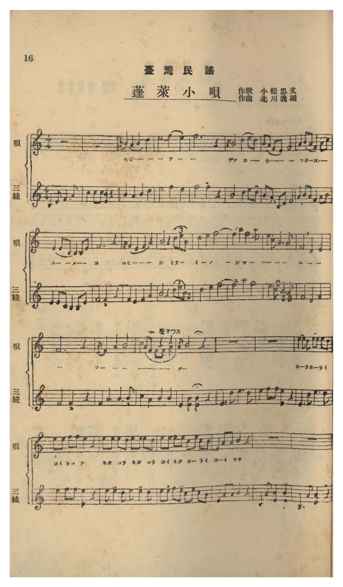
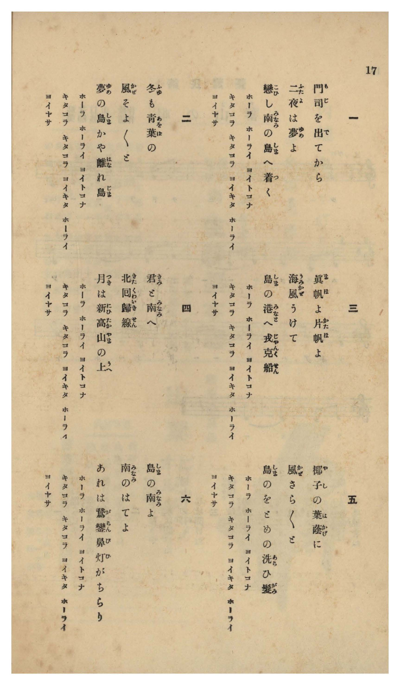

# 蓬萊小唄

> Re:Shōka 使用 AI 協助辨識與重建樂譜，可能會有錯誤。歡迎[回報](https://github.com/TMDLang/reshoka/issues)。

- **鋼琴伴奏版**：<br><audio controls src="horai_kouta.mp3"></audio>
- **NEUTRINO 歌聲合成版**：<br><audio controls src="horai_kouta_neutrino.mp3"></audio>

- 作詞：小松忠文
- 作曲：北川義雄
- 臺灣教育會《臺灣の歌》（御大典記念事業，昭和四年五月一日發行，國臺圖 0786 8）第 16–17 頁（民謡第五曲）

## 說明

曲目說明與原書資訊（對應 P017.jpg–P018.jpg，原書第 16–17 頁，民謠第五曲）：
- 書名：《臺灣の歌》（國立臺灣圖書館「日治時期圖書影像系統」典藏號 jpli2011-bk-sxt_0786_8_1929，索書號 0786 8）
- 作歌：小松忠文
- 作曲：北川義雄（原書附三絃伴奏譜）
- 調性與拍號：イ調都節- 民謠調式（無升降記號）4/4 拍子，共 25 小節（含三絃前奏 2 小節、三絃間奏 2 小節、三絃尾奏 2 小節）
- 內容簡介：原譜採用「唄」與「三絃」（三味線）雙行對照譜面，第 15 小節上方特別標註民謠轉音技法「聲マワス」（轉腔／こぶし），中間穿插兩小節三絃間奏後進入輕快囃子詞「ホーラ ホーライ ヨイトコナ キタコラ キタコラ ヨイキタ ホーライ ヨーイ ヤサ」。全曲共六節，自門司港出航兩夜抵臺唱起，描繪常夏青葉、戎克船（ジャンク船）、新高山明月、椰蔭少女洗髮與鵝鑾鼻燈火。
- 史料對照：另見 1930 年 8 月《臺灣教育》第 337 號刊載之審查員赤尾寅吉所作之 C 大調同詞異曲版本（附大譜表鋼琴前奏），詳見[史料考證專題：〈臺灣の歌審査員の作曲發表〉](../shinsain_sakkyoku_1930/index.md#3-蓬萊小唄（赤尾寅吉-作曲）)。

編曲說明：
- 忠實轉錄原書第 16 頁（P017.jpg）北川義雄作曲之「三絃」（三味線）伴奏聲部（含前奏、間奏與尾奏）。


## 歌詞

```text
一
門司（もじ）を出（で）てから
二夜（ふたよ）は夢（ゆめ）よ
戀（こひ）し南（みなみ）の島（しま）へ着（つ）く
ホーラ　ホーライ　ヨイトコナ
キタコラ　キタコラ　ヨイキタ　ホーライ
ヨイヤサ

二
冬（ふゆ）も青葉（あをば）の
風（かぜ）そよ／＼と
夢（ゆめ）の島（しま）かや離（はな）れ島（じま）
ホーラ　ホーライ　ヨイトコナ
キタコラ　キタコラ　ヨイキタ　ホーライ
ヨイヤサ

三
眞帆（まほ）よ片帆（かたほ）よ
海風（うみかぜ）うけて
島（しま）の港（みなと）へ戎克船（じやんくせん）
ホーラ　ホーライ　ヨイトコナ
キタコラ　キタコラ　ヨイキタ　ホーライ
ヨイヤサ

四
君（きみ）と南（みなみ）へ
北回歸線（きたくわいきせん）
月（つき）は新高山（にひたかやま）の上（うへ）
ホーラ　ホーライ　ヨイトコナ
キタコラ　キタコラ　ヨイキタ　ホーライ
ヨイヤサ

五
椰子（やし）の葉蔭（はかげ）に
風（かぜ）さら／＼と
島（しま）のをとめの洗（あら）ひ髮（がみ）
ホーラ　ホーライ　ヨイトコナ
キタコラ　キタコラ　ヨイキタ　ホーライ
ヨイヤサ

六
島（しま）の南（みなみ）よ
南（みなみ）のはてよ
あれは鵞鑾鼻（がらんび）灯（ひ）がちらり
ホーラ　ホーライ　ヨイトコナ
キタコラ　キタコラ　ヨイキタ　ホーライ
ヨイヤサ

一、自從離開門司港，兩夜航程恍如夢境；抵達令人眷戀的南方之島。嘿啦蓬萊好地方，嘿呀嘿呀好個蓬萊，嘿呀颯！
二、即使冬日也是青翠綠葉，微風輕柔吹拂；是夢幻之島嗎，這座南方離島。嘿啦蓬萊好地方，嘿呀嘿呀好個蓬萊，嘿呀颯！
三、滿帆呀、片帆呀，迎著海風，戎克帆船駛入島嶼港灣。嘿啦蓬萊好地方，嘿呀嘿呀好個蓬萊，嘿呀颯！
四、與你一同向南跨越北回歸線，明月高掛在新高山巔。嘿啦蓬萊好地方，嘿呀嘿呀好個蓬萊，嘿呀颯！
五、椰子樹蔭下微風沙沙吹拂，島嶼少女正梳理洗淨的長髮。嘿啦蓬萊好地方，嘿呀嘿呀好個蓬萊，嘿呀颯！
六、島嶼的南方呀、南疆的盡頭呀，那是鵝鑾鼻的燈塔在遠方閃爍。嘿啦蓬萊好地方，嘿呀嘿呀好個蓬萊，嘿呀颯！）
```

## ABC

<div class="abc-score" data-abc-src="horai_kouta.abc" aria-label="五線譜載入中"></div>

[下載 ABC 原始檔](horai_kouta.abc)

## TMD 檔案連結

- [主旋律 TMD 檔案](horai_kouta.tmd) [[在 TMD Studio 編輯](https://tmdlang.github.io/Tmd-TS/#tmd=s7IKdvYPcrWy4qpTUCpJTLdSyC_KTM_MsypJzCxPzIvPT0vLTM5MzFGCyyfn5-SkJpdk5sPV5OXHl5YkIlSU5eeU5qZaGSJEivNLi5JTcamHyMYXJKanWgUYGJrrAgkLhHRBUX5Zal5iHsKA1JTS5ESQC-ITi4vzgc4DsREaUssyU1JByguKMnMTiyrjU_KTgQ7KK0FyYmpRMcgHZfnJyH4ryUgFOjwtPyc7vjg_L12JS0tL4cXkNS8mdD3d0P90SouClhZI7ZO9c16snPd-zyyg6LO5-57uX_BsWjvYFKDMs9mbQDI9059un_t838qXs1vAMi_adz1vXPxs6swXTZuezWl-3NAFEXncuO7Z2p7HDd3v93Q83bfw6ZLlT1t3vFgx4-n-rU92dT9buvb9np5nM9Y-ndTzdPbspzu3PNk15dmcjic7Gp5NX_p85p4XC3uACp7O6Qaa9nTONAUDcwszBYv3ezqfr1mjYGj2qGGyobnCywWNQNOfbZj4Ys1CoDjICJAjOxEezy8qychPL0osyKi0ysgsLgEmAmDAxGcn5gHjSdFWwdKMy95WwZnLxkTfxI6LS1-LC2jC89nrXqxa9WxG34uO9qd985_N3vFic_uLFV0gn2zofdbeqQCKTb2sgnSgM0BxCmKCXAtWi-HAHrADFyA7EBiQXI-bdwNVP53QC-RgD7U53c9Xg_wPFAcGAVDxyyUrHjf0AAPo2abdz2Y2PZszHyL-dO_Gp839zzfvfr514-OGXlBAT-9_MXO-QlZBTqaRgaGhblK2bnFFSTwoFOMt4g0tjSyB7nq-ZRHIb0B18NAFuQoU12uBoY-SCmASGIkA5FCwv1_ObHmyo_P51uYne7Y8Xdr_Yu0cqHkvVu1_1rAcGJbPunuBloG827QEKPiyee_z9Q2gYACHD1Dk6Z5-oHHPWxY-7W1_ObMXmFrA6juBkaMA1Px07QRQKLduVDAyVQA6DqgbZPuE1RB7n3b2Au1VMIJKPW5ohIi_nDYZq_jTDfuQxaGufdq6_Om6nc83LHyyGxgJs4B-A_rkWd_C51NAYQ_MK8AABvoFyIaYAuQCHQFkP524-fn2WUBTXs6eCUy9wJTyvHU5UO_LuYtAYQ1KFTBXP9nR9WzazuedO592LH22YuaLFbAg2Nv5cv7mZ10NzzZPBVrwonHT4-Z5j5vXP27aCbEGqOBF65T3e_ofN05-3LjtceN0cGICOmUt0JfPV-5_1j_paetKmC0I3z_d1_OyYdPT1qUv9kx9un_109nNwMAE5nWgLY-bZz9u3vO4eaUCnAWMHyBnBZB63NzxuGnz4-YuhcdNax837QdzgCpROBCVYCFMM4AcMAuoYCvQE48bmp62rgAmI2A0Pm1dCw73nhftq15Oa3jav-PZjvVP23e96FgF8sSSOc-6toKy_5SNL7ZuB-Wj_v7nO1c93bHj6ZL-l3MnvZjYCYzLZx19T1u7X3TsBAbP46Ydj5sXP27e_LhpPVgErGDahperZzzduBGYoYElDEhkyYYXU9Y-3TDx6dLNz7ZMf7l6HTBCX26d-3Livpd7dj9v73jeuBroTnBq6N_0bNpMSFyCUkP_shfLuhUMLY0NFIBlloKFAthEaOaFFILAzAuKbGNjcwVg6n3a0fViT-eTnd1P1698Nn_p08kLX2xdAkp561ufTuh81tkAzFRAWQVnBWAJCcoCE3qA0fJ86gZQOdTZ8WzOGqC_gFkLJLt2zouFK15273k-YQskrUMi_8XKzUBHRUOc-qKh-cXazqcbOl6CClBgwdKBXLCAHbEb6AggF5KbwUUtMGV3xmro6ekXZ2TmFSdm5sUXJ2ZnV-ZnlwKLCmMD_cy8lNQKvdwUZWNd5FoDlCCRPKMLKx86NUGhx_W4YQLQSqBvQBE-DZhjJnIBi3cuSEyDY6vpceMMUCQ1TQLGOkikERjInY8blz1u7H7c1Mn1ZFcPMBWAJbY-bpz_uKkDLL3-6RJglgLqb3vcBCxfgfo7uJ51gMoCcLYAuQCYM572AjMHUGT_48ZVQBIsuO7p5m1gwemPG_eBRXY8nwvRuATM7QdGOiwBNwDLJkRiBnNRsgQXci4ASaNxkbIFmllASyAmgTIFF8ibXE_bQBEN8mdTG9hLTZAUDhZsAobQ48YNEC9wvVy0Aiza_bgRVMQ-bpwLDhhgatjzuHEFF3rgYPE0MHBbXs4GK2tcDwwesIU9MGUzIMoGJCR2dHI9nzPv6Q5gGABdsu9x425I_D7vbIcJAr09Hy7O9Wzrdlh4tIHjGh4qQO5EYFLiwvD9OmApg5QygJpB6QClHAGGQVPL4yZgYgKWtLOBjAEKD2DTiOvphNlgJ_XCEvEKbCl7BxeoUp4979naHeBaCKIBGFD9j5uAfmgBc2E-ARZakDQPFIXkKHghCRZfDcxEYM2ghAIPNmCtBQtnYPYdmPSxawoXsPQGNwSAZgPdBqoAgW4D5hRgkQ5L0MA0MAksvhozs0wFFixImQUjcYCzGtDORlBC2QIJaGD-A-oBym4C1hVgkR5IuA9Immhdi8XZWNIEMHdgLQPBQbQMJA32GdAr619unQep_KCeawLqBib-zaD2diMks0BKVaDihWBZoH_o73VQhbNq3ou1QBfNAtUlwLoc2HR4um8esDB7Oa0b3oYAtxJBDQhgS-L5iu5njb1PlzUBy8Wni5rf75kNbFW8bJzyZPeSJ7t2PZ-zHVhzPJ_VAgwpYJMMVE9v3gZqo8zY_3TqMmhlt3Tv0zkbgLIgY4HiExugJFC8oRuiBi71chHQ9kZQkQ503NPezU_27gcW7cAm-5Od85_NWA8s1J_vX_B82wJw0d7zdN86YAIFtsmezZ_ydMLOZ91NIPfNAFVwT3fuhrjm6fQ-oMqXDTOf7loOcSXQt1Ry5Q5wA2n3fmDZChQFsiHlLJANalfs73sxcTqsgO2BFJBAWWAZ-XL5bGBbEuS4bXuA4Q1qX1DuGmBhB4rQjvYnexcAIxfYEno6YSLQxy-2r3ixrQu1eAN2HUGNOWCZ9axv9tM5wPYFtPx6un0KVaIPaAqonQgsaZ6t2AksWp7s6IZE1rNNM4EIFlmgShMYBtC25NrFzxZtfj6hDVhuPNu-ApiqXk7dDiwxqBE2rWtB6QlsGTy1QqIMyH4-rQ0o-Hz2wpcL1kLi7mXTYlBqg7dpgbLtHU8XTgEG1ctGYH9u58tpzc87wK1xylwGKgS19Lm4fIGtRquw_MzkVIcag5pqLgUgsLHQsgMzahQMFHRRIBYRsEofwxqFeAy1GCIQtUYkqDUmQa0JCWpNSVBrRpxaaJCZATmmQAyiDePAao1AlDGI0FUwAVEGUHVgCbAyM6AeiJgZjGsCJBGhC2xZAiWBLRwQ2TQJzF4OrA_AFgDrSbBwJ9w58WDRrWBl88EiwIoDyF4PUd_UBhZpxPQsMHKg-qBqINaCmrJQqzaABdahWQV2QOMciFWNc6HWrQDLzYVaj2EZMHaBNSFYx264GkhTEWoZQhjZMrDLGvdDLesGWwwSBclNBIuBwgUzeQDbTXCdIMeB2cA6FmoZRHgHmmUQLdBABLXL-oDtMrA4sGUGDszJSJahpjFgWwesazo8zCANHaiFkGhcjTcop4LjFRaUU8HhgYhn5EQKswYSoBDL0H2HEZQQP4PUQAIGpBGUTEByyIGIksZNgdBIwRhIglIsKDWDUrwJEMNSfg0k7YNKC2AiB6Z9jKwAzghIHgCmcYRNEHdCXAgKXWA7Bh6OYD1Ql4NyIcj1MJdDZBDBgJm4kewAJwCwHUjZAZGyYSZB7NgHSWjg-ATJgDISLNzQ0zSyHaAwhPgDPXKw-2MFNAWCZIC9mWaww5ATGCI1IwcXSAXEmiVgoyCJFuRImDWgVAaxZhM4OcNTITSJYgkuYALGGly4vAIuIiB2AL0BDE5ElIBLERzpFnu0Q3T0YPgDJAK2A5QrgP4GNnehMpAkApLHSLDQNAdMfYhkBxECp0tQyjUGi4FYMAhKvBAReFmO5HCk9IooM5DFQBGBKgaCIKfDogkZYqZQiOfRTQWV_7hNhcmimYqUJoElGBZTZ-M1FSaLZipSEkROBggxUK7CbSpMFs1UpEQHiVJ0UzFDBdlU5OhHMhUpmQG7QpimwpMmVlNREi7EVGjCAtfVJsDEA0omkAQDSiwwCBEhpRWFzU-wGEOIkdLWwmYicmYn0USU8g0RQshFFIkmohRlCDci6mGSTUQpuBAmQhoMZJmIUkwhfN1FlonQtAOpGIEkMBEhs8EyEAGIGCwdQYThGuBsJA1wSXDCRGo-QltSoISMYIMaMiBvgJpqoCYNqPIBlaigag0WaKBmDqi2AIqDdaDykXXDZFBMR2pVDqgLwE3NAXUBuP05oC4ANUgH1gXgVupAuQDeFjCDdLJAmZGcAhpuD7jlRF6RTKEZ4EKYQjPAxS6FZoALWgrNABet5JtRy8Wla6cAGsdQ0LVT5gIA)]
- [鋼琴伴奏 TMD 檔案](horai_kouta_piano.tmd) [[在 TMD Studio 編輯](https://tmdlang.github.io/Tmd-TS/#tmd=s7IKdvYPcrWy4qpTUCpJTLdSSM7PyUlNLsnMz7MqScwsT8yLz8uPLy1JVIKrKMvPKc1NtTJEiBTnlxYlp-JSD5GNL0hMT7UKMDA01wUSFgjpgqL8stS8xDyEAakppcmJIBfEJxYX5ydngtkIDallmSmpIOUFRZm5iUWV8Sn5yUAH5ZUgOTG1qBjkg4LMRKBrEouKEvPSU1GVlGQABazS8nOy44vz89KVuLS0FF5MXvNiQtfTDf1Pp7S839PxtG_-886OJzs6n29tftHR_rJ7z_MJW57s2fJ0af-LtXPe7-lU0NICmfdk75wXK-e93zMLqPPZ3H1P9y94Nq0dbBNQ5tnsTY-bdz_fvgLIACnpmf50-9zn-1a-nN0CVvKifdfzxsXPps580bTp2Zzmxw1dEJHHjeuere153NANcsi-hU-XLH_auuPFihlP9299sqv72dK17_f0PJux9umknqezZz_dueXJrinP5gAd2_Bs-tLnM_e8WNgDVPB0TjfQtKdzpikYmFuYKVgA3fx8zRoFQ7NHDZMNzRVeLmhEBEh-UUlGfnpRYkFGpVVGZnFJflFmcmJOfHZiHjAuFW0VLM247G0VnLlsTPRN7Li49LW4IJ56sWrVsxl9QK9xAf0J9PvT9cte7O182dMCDL5ns3dA7ANZBfQIKPr1sgrSge5ADghIMD3Z2f24oQcS3I8beoHKgeynEzc_3z4LqB4a7o2bXjavAAXJhNVPO3uBIo8bGl9OmwyS6mh_umEfkAFU_LihiUtLn4vLNzEzzyoAlAiCPBxqDGqquRSAwMZCyw7MqFEwUNBFgVhEwCp9DGsU4jHUYohA1BqRoNaYBLUmJKg1JUGtGXFqoUFmBuSYAjGINowDqzUCUcYgQlfBBEQZQNWBJcDKzIB6IGJmMK4JkESE7uOmJqDk48YZILJpEpi9_HHjMrAFjxu7wcKdcOfEg0W3gpXNB4s8buoAstdD1De1gUUaMT0LjByoPqgaiLVNEDtBkhvAAuvQrAI7oHEOxKrGuVDrVoDl5kKtx7AMGLuPG_eBdeyGqwGaBXEzSBIhjGwZ2GWN-6GWdYMtBomC5CaCxUDhgpk8Hjf2wnWCHAdmP25cBbUMIrwDzTKIFmggNvY_bup73NgCFn_cOBscmJORLENNY4-bWsC6psPDDBgFkMACGQ2JxtV4g3IqOF5hQTkVHB6IeEZOpDBrIAEKsQzddxhBCfEzSA0kYEAaQckEJIcciChp3BQIjRSMgSQoxYJSMyjFmwAxLOXXQNI-qLQAJnJg2sfICuCMgOQBYBpH2ARxJ8SFoNB93LgJHo5gPVCXg3IhyPUwl0NkEMGAmbiR7AAnALAdSNkBkbJhJkHs2AdJaOD4BMmAMhIs3NDTNLIdoDCE-AM9crD7YwU0BYJkZjxuagY7DDmBIVIzcnCBVECsWQI2CpJoQY6EWQNKZRBrNoGTMzwVQpMoluACJmCswYXLK-AiAmIH0BvA4ERECbgUwZFusUc7REcPhj9AImA7QLkC6O_HjZuhMpAkApLHSLDQNAdMfYhkBxECp0tQyjUGi4FYMAhKvBAReFmO5HCk9IooM5DFQBGBKgaCIKfDogkZYqZQiOfRTQWV_7hNhcmimYqUJoElGBZTZ-M1FSaLZipSEkROBggxUK7CbSpMFs1UpEQHiVJ0UzFDBdlU5OhHMhUpmT1uXIhpKjxpYjUVJeFCTIUmLHBdbQJMPKBkAkkwoMQCgxARUlpR2PwEizGEGCltLWwmImd2Ek1EKd8QIYRcRJFoIkpRhnAjoh4m2USUggthIqTBQJaJKMUUwtddZJkITTuQihFIAhMRMhssAxGAiMHSEUQYrgHORtIAlwQnTKTmI7QlBUrICDaoIQPyBqipBmrSgCofUIkKqtZggQZq5oBqC6A4WAcqH1k3TAbFdKRW5YC6ANzUHFAXgNufA-oCUIN0YF0AbqUOlAvgbQEzSCcLlBnJKaDh9oBbTuQVyRSaAS6EKTQDXOxSaAa4oKXQDHDRSr4ZtcjDGD7YhzHM4kH6zMGkEcQIE1Ar0xDEBhIgeSgFThAo2kzBJIQN1gAsbkGUMdQ0oEnQHj3CfKhhxkAM0g6TQ7IHJGwCxCA2zD6QGAgbIWmFaAR3scAskB5UN0G9Ae5qgfRhOhLsQkSIg5vDyI6HBC1YCKwXYgfIBSBxCA9CgiyBNovRQwXZfKgfQWpApiD0IgcEjEQ2D-YFsJlAJtRVQALoUDATOX4gaoEkRDGcDZaBCEDE4BUomAfXAGcjaYBLQv2ACDIQDxqBIIdCTASlKaDTzCDeAccMkjeBMkA-NIyBcQhKrLp2CqD0Gu1jGKsAZxshsY2R2CZIbFMkthmIrcwFAA)]

## 分析

```text
================================================================================
📊 TMD Song Profile: [ 蓬萊小唄 ]
================================================================================
⏱  Duration:       1:02 (62.5s), 25 measures total
🎼 Key & Tempo:    首調基準 C, != 96.0 BPM, <4/4>
   - 分析範圍：      由實際發聲的音符與和弦推測調性；播放脈絡另行呈現
🎤 人聲音域:    D4 (MIDI 62) – F5 (MIDI 77) [跨度: 15 個半音 / 1.2 個八度, 難度: moderate]
   - 最低音:  D4 in [Main #1 @ m.7, 0:15]
   - 最高音: F5 in [Main #1 @ m.4, 0:09]
   - 適合: soprano, mezzo-soprano, contralto, tenor, baritone, bass
🏛  結構:      Main (62.5s)
⚡ 編曲密度:        Peak 1 軌道同時演奏
🗝  調性診斷：       D 調性不明確（純淨自然大調，未偵測到可信轉調）
   - 風格氣質:    純淨自然大調（陽光明朗、易唱易記，無明顯調外色彩）
   - 轉調歷程:    全曲維持單一推測調性（未偵測到可信轉調）
   - 核心骨幹音:  A, D, F, C, E
   - 調性數值:    D 調性不明確 [相關度: 0.79, 穩定度: Ambiguous, 自然音純度: 100.0%]
   - 候選調性 (K-S): D 小調 (0.79), A 小調 (0.78), F 大調 (0.74)
   - 五度圈歷程:   +2
   - 各段落調性細節:
     • [Main #1]: D 調性不明確 (r: 0.79, 自然音純度: 100.0%)

  [ 五度圈游移軌跡 ]
               C  
         F            G  
      Bb              [D ]*
      Eb               A  
         Ab           E  
            Db       B  
               F# 
     (* = active key center)

  [ 十二半音累積音高分佈 ]
     C  : ████████████████████      17.4%
     C# :                            0.0%
     D  : ███████████████████████   20.3%
     D# :                            0.0%
     E  : ████████████████          13.8%
     F  : ██████████████████████    19.6%
     F# :                            0.0%
     G  : █████████                  8.0%
     G# :                            0.0%
     A  : ████████████████████████  21.0%
     A# :                            0.0%
     B  :                            0.0%
--------------------------------------------------------------------------------
Assignment 軌道音域：
  - Voice         : D4 – F5 (15 個半音 / 1.2 個八度, 85 個音符)
================================================================================
```


## 原書掃描頁






