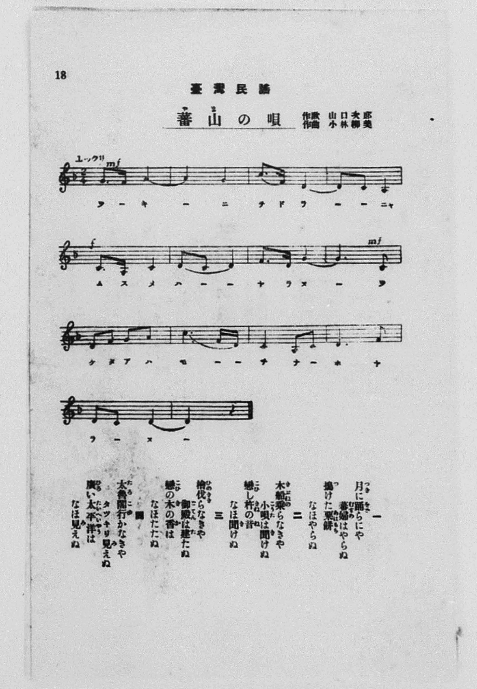

# 蕃山の唄

> Re:Shōka 使用 AI 協助辨識與重建樂譜，可能會有錯誤。歡迎[回報](https://github.com/TMDLang/reshoka/issues)。

- **鋼琴伴奏版**：<br><audio controls src="banzan_no_uta.mp3"></audio>
- **NEUTRINO 歌聲合成版**：<br><audio controls src="banzan_no_uta_neutrino.mp3"></audio>

- 作詞：山口次郎
- 作曲：小林柳美
- 臺灣教育會《臺灣の歌》（御大典記念事業，昭和四年五月一日發行，國臺圖 0786 8）第 18 頁（民謡第六曲）

## 說明

曲目說明與原書資訊（對應 P019.jpg，原書第 18 頁，民謠第六曲）：
- 書名：《臺灣の歌》（國立臺灣圖書館「日治時期圖書影像系統」典藏號 jpli2011-bk-sxt_0786_8_1929，索書號 0786 8）
- 作歌：山口次郎
- 作曲：小林柳美
- 調性與拍號：ニ短調／ヘ長調五聲音階（D–F–G–A–C–D，一降記號）2/4 拍子（標註「ユックリ」緩慢地），14 小節
- 內容簡介：全曲共四節歌詞，描繪臺灣原住民族部落月下歌舞、搗小米麻糬（粟餅／あはもち）、乘獨木舟（木船／きぶね）聽戀人杵音、伐檜木與行經太魯閣（タロコ）- 立霧溪（タツキリ）眺望太平洋的山地風情。
- 史料對照：另見 1930 年 8 月《臺灣教育》第 337 號刊載之審查員赤尾寅吉所作、獲東京音樂學校評為「折紙付」保證之 D 大調同詞異曲版本，詳見[史料考證專題：〈臺灣の歌審査員の作曲發表〉](../shinsain_sakkyoku_1930/index.md#1-蕃山の唄（赤尾寅吉-作曲）)。

編曲說明：
- 依原譜「ユックリ」（♩= 68）緩慢深邃之山地民謠風格編配 4 小節前奏與雙手鋼琴伴奏。


## 歌詞

```text
一
月（つき）に踊（をど）らにや
蕃婦（むすめ）はやらぬ
搗（つ）けた粟餅（あはもち）
なほやらぬ

二
木船（きぶね）乘（の）らなきや
小唄（こうた）は聞（き）けぬ
戀（こひ）し杵（きね）の音（ね）
なほ聞（き）けぬ

三
檜（ひのき）伐（き）らなきや
御殿（ごてん）は建（た）たぬ
戀（こひ）の木（き）の香（か）は
なほたたぬ

四
太魯閣（たろこ）行（ゆ）かなきや
タツキリ見（み）えぬ
廣（ひろ）い太平洋（たいへいやう）は
なほ見（み）えぬ

一、若不在月下共舞，可不把姑娘嫁給你；連剛搗好的小米麻糬，也更不會給你。
二、若不乘上獨木舟，可聽不到動人的小曲；那令人眷戀的搗杵聲，也更聽不到。
三、若不採伐檜木，可蓋不起華美的殿堂；那芬芳的戀木香氣，也更不會飄散。
四、若不前往太魯閣，可看不見立霧溪（タツキリ）；那遼闊的太平洋，也更看不見。）
```

## ABC

<div class="abc-score" data-abc-src="banzan_no_uta.abc" aria-label="五線譜載入中"></div>

[下載 ABC 原始檔](banzan_no_uta.abc)

## TMD 檔案連結

- [主旋律 TMD 檔案](banzan_no_uta.tmd) [[在 TMD Studio 編輯](https://tmdlang.github.io/Tmd-TS/#tmd=s7IKdvYPcrWy4qpTUCpJTLdSyC_KTM_MsypJzCxPzIvPT0vLTM5MzFGCyyfn5-SkJpdk5sPV5OXHl5YkIlSU5eeU5qZaGSJEivNLi5JTcamHyMYXJKanWgUYGFoiZAqK8stS8xLzEHpTU0qTE0GWxycWF-cDXQZiIzSklmWmpIKUFxRl5iYWVcan5CcD3ZJXguS61KJikOPL8pORvVWSkQp0c25-aR7QJqCJWloKL6Y2P9248XHjuqdTWhS0tEBKn-yd82LlvPd7ZgElnvYvfrZm4cvmPrAhQJlnszeBZDb0P5s3_dn8zc_3QWRetO963rj42dSZL5o2PZvT_LihCyICNPjZ2p7HDd3v93Q83bfw6ZLlT1t3vFgx4-n-rU92dT9buvb9np5nM9Y-ndTzdPbspzu3PNk15dmcjic7Gp5NX_p85p4XC3uACp7O6Qaa9nTONAUDcwszBYv3ezqfr1mjYGih8HJBI9DgZxsmvlizECj0tHUt2H2dCC_nF5Vk5KcXJRZkVFplZBaXAGMeGCTx2Yl5wMhRtFUws-Cyt1Vw47Ix0jex4-LS1-ICmvB89roXq1Y9m9H3oqP9ad_8Z7N3vNjc_mJFF8gTG3qftXcqgKJQL6sgHeQ6sAJkB_WAHbQA2UHAMON63LwbqPDphF4gB3sAzel-vhrkVaA40LdAxS-XrHjc0AMMi2ebdj-b2fRsznyI-NO9G5829z_fvPv51o2PG3pBYTq9_8XM-QpZBTmZRgaGhrpJ2brFFSXxoACLt4g3tDSyBLrr-ZZFIL8A1cEDEuQqULSuBQY0SoTDJDDiGyTxYtX-Zw3LgaHzrLsXaBzIQ83dz-evBYq_39P_uHnGy6nbgWxgbL5o3PRy_uaXs_qA_nN51DDZDYjdgdgRiJ2B2AXoLGB0v5zZC0wVYKM6gTGhADT36doJoLhdMfPFit3AQHjcvOxxc_PjpvWPm1cBvfx8-8pnrYueztkADtweQxMFoBufr28Aue5p6_Kn63Y-37DwyW5gsM562roC6IunrRuBSQyoAuhVcPLuedbf_3znKmhw981_srcfGG_Ppve_bF7xYsJecDLsBinumPe4ofHZhOkgCzZufrlr9_PNa4Aue75p_sslrSDvNjY9blz_uAlILgS6Bqj4yc4Zz3tXPJuz4kUH0EMdYMZOsMrex43bHjcCU33ni8a9zzoanuza9WzuVmAIgXTtmfBs1Ryw4nZgwn--bfLTJaterl3_ctpioCGPm_Y_bl77uGkzyIrm3cCE8nLO8me7VsGkWh43rQUGDShvzNn1bM5soN6nOzc_29L9fFYLKF7nbHi5aMWz5tbHDU3gMOrf9GzaTGBqft66HBRG_cteLOtWMLQ0NlAAZkMFCwWg_-GJFJKvgYkUlMqNjc0VgBH1tKPrxZ7OJzu7n65f-Wz-0qeTF77YuuTphn1P17c-ndD5rLMBmHiAnnreu-nZ3I1Pdq0B-vHZiqana3c8W7Dwxcqpz5t2gVJ214znW2Y-2T0DGKNP9s99sRZkoIKLArCcACafpxNAMfV86gZQluwEBiMw2IEim4EujYa4_0VDM1DP0w0dL0EFBTBXdSDnKrDLdgNdBuRCkjK4SAFmqc5YDT09_eKMzLxiYEEYX5yYnV2Zn10KzCfGBvqZeSmpFXq5KcqGusilIzCgkX2oC8scnZqgIOV63DABkrJAyW1a--OGiVzAdM0FDEZQDDUuAcY9KOYaV7_YASpHHjdNety4EiTSBBJ83NTCBbJs5TKwXMPjxpmPm4BFCVAOmLKAcQtkrOECJkKIYWCJiY8b58MSIVAQJRFyPW5c9bhxN0Ir15NdPUDHQBIiUDUiIQITK1hkHcwxQI29IPcA0zvE248bJz9ubAPaBnHPi0Zg7gEZAXMF0GEdDTB1oBB53DgdmKph9oAsARoPTABgERAX6jwsJgEDrZMLmA3A4puA2iCywLyBUIniyH0Ln60DFjpAuSmPG5c9bpoMceTT3bvAghA3z8fqyHXA8ECyf93LZTPBXGChATICFoYg3WADuIAFCBdKngSKNwF9CLITXFUBo64NrLkb4ULk3AlMuWBtQAcDFQEZa7ie7oaYtAloEli0BZ5zoTY0tjxu3AEigZHZCDEe5jYs5nGB0umqeS_WrgfVOcAkCMyEL7qXPtnR-3QOsEgCFWrAohBYqIGqrv71QPFnXV1Pl098CqyUVzc-37rsyd4F7_fMftmw-GnnbFCpt3QvqARBKft6nuwE1nlbQHrnNEO0gPIAMInBLQOmqic7upBKQZBlwDIP5I6ODU-7pwJLPoi54Ew0-2XT4ie7l4AE52wHRhRQCmg3MBEB6w-4fXDtYMt2gEpaiGXP-hbCC0-oTZO7geIvtm5_0b8eWGeBjFu3_-mCJohNL7rWvOjaDBLsaABqAcb7sw3AWEDx1svFLc-mLgbZBIx1RBh29j7d14CUBkCWPZ8DtmwZqPbGVShDLH7ZuOfl9C6QvxFxDLUVbgjQSlAO0dLn4vIFFk5WYfmZyakONQY11VwKQGBjaKZlB2bVKBgp6AKhkYIxmNYFikBokBhMxBRMGyuYxaMoMgVxjeFiYAN9DGsUgIULVAyYfDGMBZZUcDFgCQYVWwlkd2JT-7ipGdUCI5AFMGOBJRAWTWsRFjSug4gBDQcmdyxqgfkLzQJjkLZNcAUQA9A0IVkAYZNigQlI23yYgiZsQTQZYUFTG1SsmxgLoLEKjhpw5EBZIC3g6APzkSLSEEwDBRDRDTMaBMHKkaK2qQFq60wguxEpGNajaIO4vAXqQ1DQrMFqPCSpIMcsxOfAQgopjHCYDwv6xol4zAeZhxyxU6Diy4DuQgplrOZD7AfRRJmPFK8gf6Ekk6YuLObvh6rtwGM-KCHCoxUcb6AYA0UWKMfC8iYEGoIUwCMfmjchMYiIcohC1Pw6EepNENkEJkHBAXI2iIfu7IVwxyGSI7AiQXU4MPKRoxXkDWCVDiZBwQLJpIgMimoDSI6gDUBz0HMsxDSYDSA2SKYbiw2w6MZvw3zkqAVnVGAdCpGBMUC1KkQ3uGol26r9aLGMnk9hKg1gIkh5ElZwYktFaMUzODJA0U2kenDQwssqwurBeaCDKPW1XFy6dgqg-klB106ZCwA)]
- [鋼琴伴奏 TMD 檔案](banzan_no_uta_piano.tmd) [[在 TMD Studio 編輯](https://tmdlang.github.io/Tmd-TS/#tmd=s7IKdvYPcrWy4qpTUCpJTLdSSM7PyUlNLsnMz7MqScwsT8yLz8uPLy1JVIKrKMvPKc1NtTJEiBTnlxYlp-JSD5GNL0hMT7UKMDC0RMgUFOWXpeYl5iH0pqaUJieCLI9PLC7OT84EsxEaUssyU1JByguKMnMTiyrjU_KTgW7JK0FyXWpRMcjxBZmJQIckFhUl5qWnoiopyQAKWOXml-YBbQWarqWl8GJq89ONGx83rns6peX9no6X3XueT9jyZM-Wp0v7n3d2vN_TqaClBdL_ZO-cFyvnvd8zC6j6af_iZ2sWvmzuA5sMlHk2exNIZkP_s3nTn83f_HwfROb59hUQmaBUq-KMo73ZiQovZ8981tmNbAtY5Yv2Xc8bFz-bOvNF06Znc5ofN3RBRIDuera253FDN9BpT_ctfLpk-dPWHS9WzHi6f-uTXd3Plq59v6fn2Yy1Tyf1PJ09--nOLU92TXk2p-PJjoZn05c-n7nnxcIeoIKnc7qBpj2dM03BwNzCTMEC6Knna9YoGFoovFzQiAic_KKSjPz0osSCjEqrjMzikvyizOTEnPjsxDxglCraKphZcNnbKrhx2Rjpm9hxcelrcUH892LVqmcz-oC-5HrcvPvJvrlP--a_WDvncUPP4-Zlj5ubHzetf9y86nFDL9ALj2auBJkDcsD2lc9aFz3bvvFlU_OTnd2gQJ2z4dmGiS_WLHi5aMWzBXuAZr9s7VUwUQCG6vP1DU87e4Fh9aKjHTMAHzc0cWnpc3F55pUU5VsFgGI_yMOhxqCmmksBCGwstOzAjBoF03gFXQXjeBBdo2AG4ugqGEKYQCGwQA1Y0ADE4qpFMdMHu5mG8SATzeLBFMgownwk832ByRCLkw3N4OYbgR1kpGAMpmEOhIjBREzBtDHMSzBFMO9CxcAG-hjWKDxuXAIVe9zYi2Hs48bVcLHHTZOgYiuB7E5sah83NaNaYASyAGbs48ZtWDStRVjQuA4iBjT8ceMqLGp7MSwwBmnbBFcAMQBNE5IFEDYpFpiAtM2HKWjCFkSTERY0tUHFuomxADklwtIiTAs4-sB8pIg0BNNAAUR0w4wGQbBypKhtaoDaOhPIbkQKhvUo2iAub4H6EBQ0a7AaD0kqyDEL8fnjxjakMMJhPizoGyfiMR9kHnLEToGKLwO6CymUsZoPsR9EE2U-UryC_IWSTJq6sJi_H6q2A4_5oIQIj1ZwvIFiDBRZoBwLy5sQaAhSAI98aN6ExCAiyiEKUfPrRKg3QWQTmAQFB8jZIB66sxfCHYdIjo8bd6M6HBj5yNEK8sbjxulgEhQskEyKyKCoNoDkCNoANAc9x0JMg9kAYoNkurHYAItu_DbMR45acEZ93AhK1EAZGGMHhAFO7qBUS65V-9FiGT2fwlSCinawCFKehBWc2FIRWvEMjgxQdBOpHhy08LKKsHpwHuggSj1K9YSj9jMFVmdGmNUdVJhQ7YhShUJIzBrTBMgAysGNhDKAQgZwEwhYi90VUIPRzMBVU-vaKYAbAwpABihYon0MYxFsIyS2MRLbBMRW5gIA)]

## 分析

```text
================================================================================
📊 TMD Song Profile: [ 蕃山の唄 ]
================================================================================
⏱  Duration:       0:24 (24.7s), 14 measures total
🎼 Key & Tempo:    首調基準 F, != 68.0 BPM, <2/4>
   - 分析範圍：      由實際發聲的音符與和弦推測調性；播放脈絡另行呈現
🎤 人聲音域:    A3 (MIDI 57) – C5 (MIDI 72) [跨度: 15 個半音 / 1.2 個八度, 難度: moderate]
   - 最低音:  A3 in [Main #1 @ m.4, 0:06]
   - 最高音: C5 in [Main #1 @ m.3, 0:03]
   - 適合: soprano, mezzo-soprano, contralto, tenor, baritone, bass
🏛  結構:      Main (24.7s)
⚡ 編曲密度:        Peak 1 軌道同時演奏
🗝  調性診斷：       C 大調（純淨自然大調，未偵測到可信轉調）
   - 風格氣質:    純淨自然大調（陽光明朗、易唱易記，無明顯調外色彩）
   - 轉調歷程:    全曲維持單一推測調性（未偵測到可信轉調）
   - 核心骨幹音:  D, C, G, A, F
   - 調性數值:    C 大調 [相關度: 0.70, 穩定度: Moderate, 自然音純度: 100.0%]
   - 候選調性 (K-S): C 大調 (0.70), G 大調 (0.66), D 小調 (0.61)
   - 五度圈歷程:   +0
   - 各段落調性細節:
     • [Main #1]: C 大調 (r: 0.70, 自然音純度: 100.0%)

  [ 五度圈游移軌跡 ]
              [C ]*
         F            G  
      Bb               D  
      Eb               A  
         Ab           E  
            Db       B  
               F# 
     (* = active key center)

  [ 十二半音累積音高分佈 ]
     C  : ███████████████████████   27.8%
     C# :                            0.0%
     D  : ████████████████████████  29.6%
     D# :                            0.0%
     E  :                            0.0%
     F  : ██████                     7.4%
     F# :                            0.0%
     G  : ███████████████           18.5%
     G# :                            0.0%
     A  : ██████████████            16.7%
     A# :                            0.0%
     B  :                            0.0%
--------------------------------------------------------------------------------
Assignment 軌道音域：
  - Voice         : A3 – C5 (15 個半音 / 1.2 個八度, 34 個音符)
================================================================================
```


## 原書掃描頁




