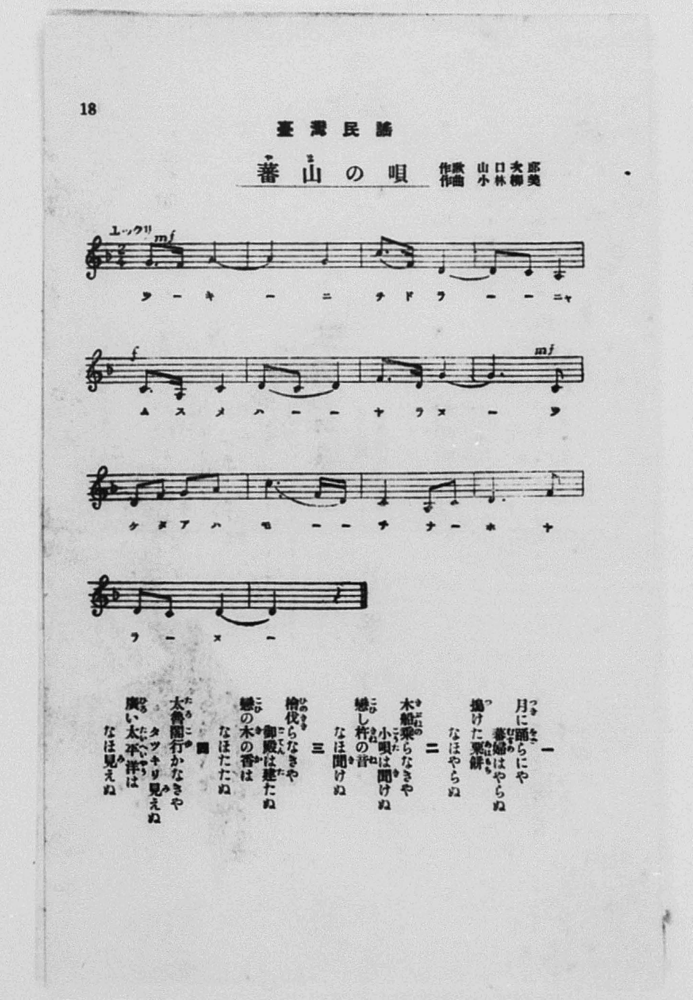

# 蕃山の唄

> Re:Shōka 使用 AI 協助辨識與重建樂譜，可能會有錯誤。歡迎回報。

- **NEUTRINO 歌聲合成版**：<br><audio controls src="banzan_no_uta_neutrino.mp3"></audio>
- **鋼琴伴奏版**：<br><audio controls src="banzan_no_uta.mp3"></audio>


- 作詞：山口次郎
- 作曲：小林柳美
- 臺灣教育會《臺灣の歌》（御大典記念事業，昭和四年五月一日發行，國臺圖 0786 8）第 18 頁（民謡第六曲）

## 說明

曲目說明與原書資訊（對應 P019.jpg，原書第 18 頁，民謠第六曲）：
- 書名：《臺灣の歌》（國立臺灣圖書館「日治時期圖書影像系統」典藏號 jpli2011-bk-sxt_0786_8_1929，索書號 0786 8）
- 作歌：山口次郎
- 作曲：小林柳美
- 調性與拍號：ニ短調／ヘ長調五聲音階（D–F–G–A–C–D，一降記號）2/4 拍子（標註「ユックリ」緩慢地），14 小節
- 內容簡介：全曲共四節歌詞，描繪臺灣原住民族部落月下歌舞、搗小米麻糬（粟餅／あはもち）、乘獨木舟（木船／きぶね）聽戀人杵音、伐檜木與行經太魯閣（タロコ）- 立霧溪（タツキリ）眺望太平洋的山地風情。

編曲說明：
- 依原譜「ユックリ」（♩= 68）緩慢深邃之山地民謠風格編配 4 小節前奏與雙手鋼琴伴奏。


## 歌詞

```text
一
月（つき）に踊（をど）らにや
蕃婦（むすめ）はやらぬ
搗（つ）けた粟餅（あはもち）
なほやらぬ

二
木船（きぶね）乘（の）らなきや
小唄（こうた）は聞（き）けぬ
戀（こひ）し杵（きね）の音（ね）
なほ聞（き）けぬ

三
檜（ひのき）伐（き）らなきや
御殿（ごてん）は建（た）たぬ
戀（こひ）の木（き）の香（か）は
なほたたぬ

四
太魯閣（たろこ）行（ゆ）かなきや
タツキリ見（み）えぬ
廣（ひろ）い太平洋（たいへいやう）は
なほ見（み）えぬ

一、若不在月下共舞，可不把姑娘嫁給你；連剛搗好的小米麻糬，也更不會給你。
二、若不乘上獨木舟，可聽不到動人的小曲；那令人眷戀的搗杵聲，也更聽不到。
三、若不採伐檜木，可蓋不起華美的殿堂；那芬芳的戀木香氣，也更不會飄散。
四、若不前往太魯閣，可看不見立霧溪（タツキリ）；那遼闊的太平洋，也更看不見。）
```

## ABC

```abc
X:1
T:蕃山の唄
M:2/4
L:1/16
Q:1/4=68
K:F
V:V1 name="Voice" snm="Voi"
[V:V1]
G3 G A4- | A4 G4 | c3 A D4- | D2 C2 A,4 |
w: 1.~つ き に | _ を | ど ら にゃ | _ _ _
w: 2.~き ぶ ね | _ の | ら な きゃ | _ _ _
w: 3.~ひ の き | _ き | ら な きゃ | _ _ _
w: 4.~た ろ こ | _ ゆ | か な きゃ | _ _ _
C3 A, C4 | D2 C2 D4 | F3 D G4- | G6 C2 |
w: 1.~む す め | は _ や | ら _ ぬ | _ つ
w: 2.~こ う た | は _ き | け _ ぬ | _ こ
w: 3.~ご て ん | は _ た | た _ ぬ | _ こ
w: 4.~た つ き | り _ み | え _ ぬ | _ ひ
D2 F2 G2 A2 | c6 F D | C4 A,2 C2 | D6 F2 |
w: 1.~け た あ は | も _ ち | な ほ や | ら _
w: 2.~ひ し き ね | の _ ね | な ほ き | け _
w: 3.~ひ の き の | か _ は | な ほ た | た _
w: 4.~ろ い たい へい | やう _ は | な ほ み | え _
D2 C2 D4- | D4 z4 |
w: 1.~_ _ ぬ | _
w: 2.~_ _ ぬ | _
w: 3.~_ _ ぬ | _
w: 4.~_ _ ぬ | _
```

## TMD 檔案連結

- [主旋律 TMD 檔案](banzan_no_uta.tmd) [[在 TMD Studio 編輯](https://tmdlang.github.io/Tmd-TS/#tmd=s7IKdvYPcrWy4qpTUCpJTLdSyC_KTM_MsypJzCxPzIvPT0vLTM5MzFHi0tJSeDG1-enGjY8b1z2d0qKgpQXS8mTvnBcr573fMwso8bR_8bM1C1829ylBZZ7N3gSS2dD_bN70Z_M3P98HkXnRvut54-JnU2e-aNr0bE7z44YuiAjQ4Gdrex43dL_f0_F038KnS5Y_bd3xYsWMp_u3PtnV_Wzp2vd7ep7NWPt0Us_T2bOf7tzyZNeUZ3M6nuxoeDZ96fOZe14s7AEqeDqnG2ja0znTFAzMLcwULN7v6Xy-Zo2CoYXCywWNQIOfbZj4Ys1CoNDT1rVg93WC3QT1eklGfnpRYkFGpVVGZnEJMCiSE3PisxPzEpW4FG0VzCy47G0V3LhsjPRN7Li49LW4gCY8n73uxapVz2b0vehof9o3_9nsHS82t79Y0QXyxIbeZ-2dCgEGhpZ6WQXpINeBFSA7qAfsoAXIDgKGGdfj5t1AhU8n9AI52ANoTvfz1SCvAsWBvgUqfrlkxeOGHmBYPNu0-9nMpmdz5kPEn-7d-LS5__nm3c-3bnzc0AsK0-n9L2bOV8gqyMk0MjA01E3K1i2uKIkHBVi8RbyhpZEl0F3PtywC-QWoDh6QIFeBonUtMKBRIhwmgRHfIIkXq_Y_a1gODJ1n3b1A40Aeau5-Pn8tUPz9nv7HzTNeTt0OZANj80XjppfzN7-c1Qf0n8ujhsluQOwOxI5A7AzELkBnAaP75cxeYKoAG9UJjAkFoLlP104Axe2KmS9W7AYGwuPmZY-bmx83rX_cvAro5efbVz5rXfR0zgZw4PYYmigA3fh8fQPIdU9blz9dt_P5hoVPdgODddbT1hVAXzxt3QhMYkAVQK-Ck3fPs_7-5ztXQYO7b_6Tvf3AeHs2vf9l84oXE_aCk2E3SHHHvMcNjc8mTAdZsHHzy127n29eA3TZ803zXy5pBXm3selx4_rHTUByIdA1QMVPds543rvi2ZwVLzqAHuoAM3aCVfY-btz2uBGY6jtfNO591tHwZNeuZ3O3AkMIpGvPhGer5oAVtwMT_vNtk58uWfVy7fqX0xYDDXnctP9x89rHTZtBVjTvBiaUl3OWP9u1CibV8rhpLTBoQHljzq5nc2YD9T7dufnZlu7ns1pA8Tpnw8tFK541tz5uaOLietwwARIMoLCZ1v64YSIXMBKAwg1Ab4NMbFwCdCvIpsbVL3aA0v3jpkmPG1eCRJpAgo-bWkCqQaXHymVg6YbHjTMfNwFTP1AaGBhA5wAZa8BGTpgOMRIsN_Fx43xY0AEFUYIOpPpx46rHjbsRBnA92dUDcRgkEIF6EIEIDGiwyDqYw4B6e6FuA0YXsEwDS09-3NgGtBbitheNwMgHmQJzDsSRHQ0wpaD8-rhxOjBeYLaBrAJaAowmsAiIi3AqFvOAgQlWAIxOsNQmoGaIAmAcIxSjO3jfwmfrgPkHKD3lceOyx02TIQ5-unsXWBDi_vm4HLwOGEJIDln3ctlMMBeYBUCmIIUtyAywMVzAHAG2GTmdAaWagH4GWQ4ufoFx2wY2ohvFtciJ7sUyUPH1uBHoeKA6IAPswqe7IeZtApoHlmiBp0moPY0tjxt3gEhgbDdCLEFyJxZTuYACL1bNe7F2PahABSZZYLZ50b30yY7ep3OA-Q2UY4H5HJhjQeVy_3qg-LOurqfLJz4F1jirG59vXfZk74L3e2a_bFj8tHM2KEsv3QvKHigZu-fJTmCBvgWkd04zRAsozwCTIdwyYLJ7sqMLKYuDLANmaJA7OjY87Z4KzNYQc8HF5-yXTYuf7F4CEpyzHRhvQCmg3cD0BSwc4fbBtYMt2wEqRiCWPetbCC8ZoDZN7gaKv9i6_UX_emCBDDJu3f6nC5ogNr3oWvOiazNIsAOUaYDJ4NkGYESgeOvl4pZnUxeDbAKmAEQYdvY-3YecGECWPZ8DtmwZqGrCVeJALH7ZuOfl9C6QvxHRDLUVbgjQSlDm0dLn4vJNBDZJwvIzk1MdagxqqrkUgMDG0EzLDsyqUTBS0AVCIwVjMK0LFIHQIDGYiCmYNlYwi0dRZAriGsPFwAb6GNYoAMsgsAgwFQPxagyDgYUcXAxY2kHFOkFqHzc1YyiHQagFRiBNvVALtgHxWkwLGtchLAAaDBFbBdJHhAXGIAs2wQ2CWYZqAUKMdAtMQBbMh3obFESTMS1oakNY0NhNvAXQWAVHDThyoCyQanD0gflIEWkIpoECiOhGNhGsHClqmxqgbpkJZDciuXE93OUtCFFo0IDUr8FqPCSpIMcsJCyA5RQ8jNDMRw76xokEzQeZhxyxU6Diy4CuQ4Q7svnItsLYRJmPHK9Af6Emki64jv1I5ncQNB-UEOHRCo43UIyBIguUY2F5EwINQQrgkQ_Nm5AYREQ5RCFqfgUFI8TpwKYCmAQFB8jZIB6ycxaCnb0Kzt8NIsFRjhzdMIgcsSCPAOt7MAkKGEjGBcnAMivMzLXY7ADrQY5yNDvguRZiHswOEBuRhRB2rMdqBygEkKMdzQ5QBAMzLEglyMeQuhXMAFWv0DAA1bFEWQZKB8hpAGEZcmyj51eYKgNUpwGjEWEfZlpCK6SBEUKCamDQkqAaGEjEqa7l4tK1UwDVTwq6dspcAA)]
- [鋼琴伴奏 TMD 檔案](banzan_no_uta_piano.tmd) [[在 TMD Studio 編輯](https://tmdlang.github.io/Tmd-TS/#tmd=s7IKdvYPcrWy4tLSUngxtfnpxo2PG9c9ndLyfk_Hy-49zydsebJny9Ol_c87O97v6VTQ0uKqU1B6snfOi5Xz3u-ZBVT9tH_xszULXzb3KUFlns3eBJLZ0P9s3vRn8zc_3weReb59BUQmKNWqOONob3aiwsvZM591diPbAlb5on3X88bFz6bOfNG06dmc5scNXRARoLuere153NANdNrTfQufLln-tHXHixUznu7f-mRX97Ola9_v6Xk2Y-3TST1PZ89-unPLk11Tns3peLKj4dn0pc9n7nmxsAeo4OmcbqBpT-dMUzAwtzBTsAB66vmaNQqGFgovFzSCrS9JTLdSyC8qychPL0osyKi0ysgsLskvykxOzInPTsxLVOJStFUws-Cyt1Vw47Ix0jex4-LS1-KC-O_FqlXPZvQBfcn1uHn3k31zn_bNf7F2zuOGnsfNyx43Nz9uWv-4edXjhl6gFx7NXAkyB-SA7SuftS56tn3jy6bmJzu7QYE6Z8OzDRNfrFnwctGKZwv2AM1-2dqrYKIADNXn6xuedvYCw-pFRztmAD5uaOLS0ufi8swrKcq3CshMzMsP8nCoMaip5lIAAhtDMy07MKtGwTReQRcMjUEMMK9GwQwmCIKGCCGwNFyyBq7EACbCVYtiqQ8OSw1BRoAtNIuHM0F2kCOO4QDfxMw8_J42Ais2UjDG8AlEBiRiCgkVdO-CgwBsP8Q-kIE-hjUKjxuXgEUeN_YC8WoMgx83TYKLPW5cCRXrBKl93NSMoRwGoRYYgTT1Qi3YBsRrMS1oXIewAGgwRGwVSB8RFhiDLNgENwhmGaoFCDHSLTABWTAf6m1QEE3GtKCpDWFBYzfxFqAmZWDkwBM1jnQLStJgAUR0I5sIyQWIqG1qgLplJpDdiOTG9XCXtyBEoUEDUr8Gq_GQpIIcs5CweNzYBg8jNPORg75xIkHzQeYhR-wUqPgyoOsQ4Y5sPrKtMDZR5iPHK9BfqImkC65jP5L5HQTNByVEeLSC4w0UY6DIAuVYWN6EQEOQAqLLMaT8CgpGiNMfNzaBSVBwgJwN4iE7ZyHY2avg_N0gEhzlyNENg8gRC_LI48bpYBIUMJCMC5KBZVaYmWux2QHWgxzlaHbAcy3EPJgdIDYiCyHsWI_VDlAIIEc7mh2gCAZmWJBKkI-B6mCMHRAGSL4FlHaJsQyUDpDTAMIy5NgmXM_AohFhH2ZaQiukgRFCgmpg0JKgGhhIxKlGqZ5wVY-m4HrNCF89iKSE1OoUow5GsHBXtSZgDlglitVIHLAkKIZgNpDoXMK-QHIEFjuIaRro2imAmycKQAYoHqJ9DGMRbCMktjES2wTEVuYCAA)]

## 分析

```text
================================================================================
📊 TMD Song Profile: [ 蕃山の唄 ]
================================================================================
⏱  Duration:       0:24 (24.7s), 14 measures total
🎼 Key & Tempo:    首調基準 F, != 68.0 BPM, <2/4>
   - 分析範圍：      由實際發聲的音符與和弦推測調性；播放脈絡另行呈現
🎤 人聲音域:    A3 (MIDI 57) – C5 (MIDI 72) [跨度: 15 個半音 / 1.2 個八度, 難度: moderate]
   - 最低音:  A3 in [Main #1 @ m.4, 0:06]
   - 最高音: C5 in [Main #1 @ m.3, 0:03]
   - 適合: soprano, mezzo-soprano, contralto, tenor, baritone, bass
🏛  結構:      Main (24.7s)
⚡ 編曲密度:        Peak 1 軌道同時演奏
🗝  調性診斷：       C 大調（純淨自然大調，未偵測到可信轉調）
   - 風格氣質:    純淨自然大調（陽光明朗、易唱易記，無明顯調外色彩）
   - 轉調歷程:    全曲維持單一推測調性（未偵測到可信轉調）
   - 核心骨幹音:  D, C, G, A, F
   - 調性數值:    C 大調 [相關度: 0.70, 穩定度: Moderate, 自然音純度: 100.0%]
   - 候選調性 (K-S): C 大調 (0.70), G 大調 (0.66), D 小調 (0.61)
   - 五度圈歷程:   +0
   - 各段落調性細節:
     • [Main #1]: C 大調 (r: 0.70, 自然音純度: 100.0%)

  [ 五度圈游移軌跡 ]
              [C ]*
         F            G  
      Bb               D  
      Eb               A  
         Ab           E  
            Db       B  
               F# 
     (* = active key center)

  [ 十二半音累積音高分佈 ]
     C  : ███████████████████████   27.8%
     C# :                            0.0%
     D  : ████████████████████████  29.6%
     D# :                            0.0%
     E  :                            0.0%
     F  : ██████                     7.4%
     F# :                            0.0%
     G  : ███████████████           18.5%
     G# :                            0.0%
     A  : ██████████████            16.7%
     A# :                            0.0%
     B  :                            0.0%
--------------------------------------------------------------------------------
Assignment 軌道音域：
  - Voice         : A3 – C5 (15 個半音 / 1.2 個八度, 34 個音符)
================================================================================
```


## 原書掃描頁




