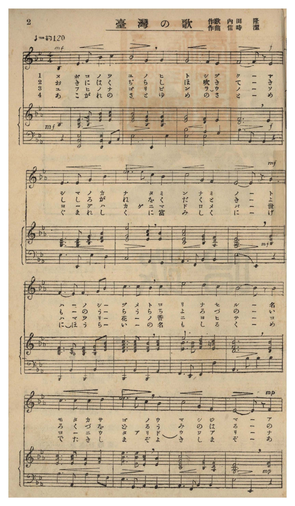
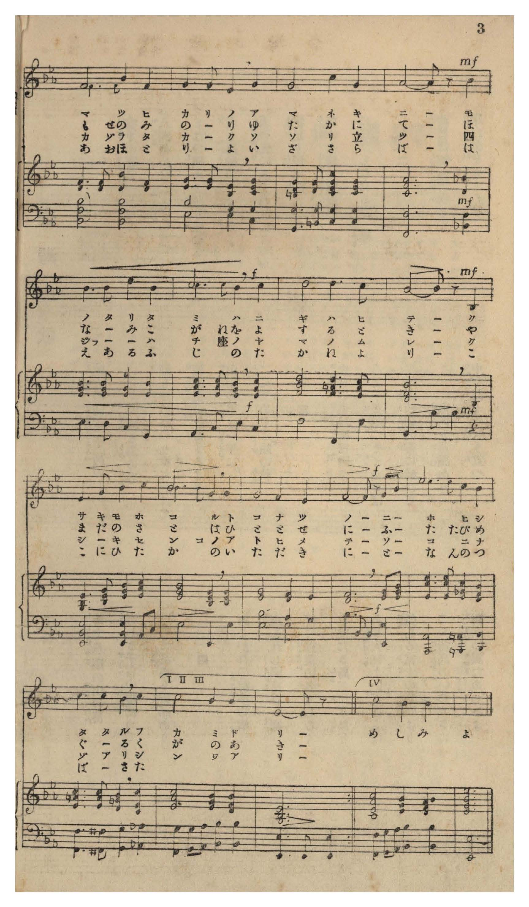
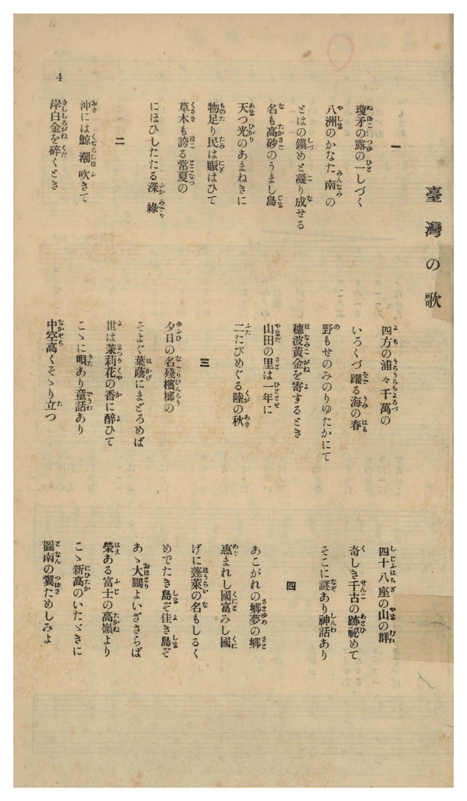

# 臺灣の歌

> Re:Shōka 使用 AI 協助辨識與重建樂譜，可能會有錯誤。歡迎[回報](https://github.com/TMDLang/reshoka/issues)。

- **鋼琴伴奏版**：<br><audio controls src="taiwan_no_uta.mp3"></audio>
- **NEUTRINO 歌聲合成版**：<br><audio controls src="taiwan_no_uta_neutrino.mp3"></audio>

- 作詞：内田隆
- 作曲：信時潔
- 臺灣教育會《臺灣の歌》（御大典記念事業，昭和四年五月一日發行，國臺圖 0786 8）第 2–4 頁（唱歌第一曲）

## 說明

曲目說明與原書資訊（對應 P004.jpg–P006.jpg，原書第 2–4 頁，唱歌第一曲）：
- 書名：《臺灣の歌》（國立臺灣圖書館「日治時期圖書影像系統」典藏號 jpli2011-bk-sxt_0786_8_1929，索書號 0786 8）
- 作歌：内田隆（唱歌第一等入選）
- 作曲：信時潔（東京音樂學校教授，1887–1965）
- 調性與拍號：變ホ長調（降 E 大調）4/4 拍子（♩= 約120），原書附雙手鋼琴伴奏譜
- 背景說明：昭和 3 年（1928 年）臺灣教育會為紀念昭和天皇御大典公開募集「臺灣の歌」歌詞與曲譜；本曲為唱歌部第一曲（一等入選歌詞），因島內應募之六十餘件曲譜皆未獲採用，特委託東京音樂學校教授信時潔譜寫此曲並附雙手鋼琴伴奏，於昭和 4 年（1929 年）天長節發表。第一至三節結尾收於主音 Eb4（1，對應原譜 I II III 括號），第四節結尾則昂揚上行至高音 Eb5（1^，對應原譜 IV 括號）。

編曲說明：
- 忠實轉錄原書第 2–3 頁（P004.jpg–P005.jpg）所印東京音樂學校教授信時潔作曲之原版雙手鋼琴伴奏大譜表（PianoRH 為單音主旋律與歌詞，Piano2 為右手內聲部和弦，PianoLH 為左手八度／和聲低音進行）。


## 歌詞

```text
一
瓊矛（ぬぼこ）の露（つゆ）の一（ひと）しづく
八洲（やしま）のかなた南（みんなみ）の
とほの鎭（しづ）めと凝（こ）り成（な）せる
名（な）も高砂（たかさご）のうまし島（じま）
天（あま）つ光（ひかり）のあまねきに
物足（ものた）り民（たみ）は賑（にぎ）はひて
草木（くさき）も誇（ほこ）る常夏（とこなつ）の
にほひしたたる深綠（ふかみどり）

二
沖（おき）には鯨（くぢら）潮（しほ）吹（ふ）きて
岸（きし）白金（しろがね）を碎（くだ）くとき
四方（よも）の浦々（うらうら）千萬（ちよろづ）の
いろくづ躍（をど）る海（うみ）の春（はる）
野（の）もせのみのりゆたかにて
穗波（ほなみ）黃金（こがね）を寄（よ）するとき
山田（やまだ）の里（さと）は一（ひと）とせに
二（ふた）たびめぐる陸（くが）の秋（あき）

三
夕日（ゆふひ）の名殘（なごり）檳榔（びんらう）の
そよぐ葉蔭（はかげ）にまどろめば
世（よ）は茉莉花（まつりくや）の香（か）に醉（ゑ）ひて
こゝに唄（うた）あり童話（どうわ）あり
中空（なかぞら）高（たか）くそゝり立（た）つ
四十八座（しじふはちざ）の山（やま）の群（むれ）
奇（く）しき千古（せんこ）の跡（あと）祕（ひ）めて
そこに謎（なぞ）あり神話（しんわ）あり

四
あこがれの郷（さと）夢（ゆめ）の郷（さと）
惠（めぐ）まれし國（くに）富（と）みし國（くに）
げに蓬萊（ほうらい）の名（な）もしるく
めでたき島（しま）ぞ佳（よ）き島（しま）ぞ
あゝ大鵬（おほとり）よいざさらば
榮（はえ）ある富士（ふじ）の高嶺（たかね）より
こゝ新高（にひたか）のいたゞきに
圖南（となん）の翼（つばさ）ためしみよ

一、天沼矛滴落的一滴晶露，在八洲遠方的南國海疆，凝結成為鎮護遠方的寶島，名喚高砂的美麗島嶼。在遍照大地的天光之下，萬物豐足、人民安居繁榮；草木也誇耀著常夏之島那芬芳滴翠的深綠。
二、當外海的鯨魚噴湧潮水、拍岸浪花碎作白銀之時，四方海灣裡千萬魚群躍動著海洋之春；遍野豐收富饒、稻穗金波搖曳之際，山田村里一年之中兩度迎來大地之秋。
三、在夕陽餘暉下搖曳的檳榔樹蔭裡小憩，人間沉醉於茉莉花香之中，這裡有歌謠、也有童話；高聳入雲的四十八座群山，秘藏著奇妙的千古遺跡，那裡有謎團、也有神話。
四、令人憧憬的故鄉、夢中的故鄉，蒙受恩澤的國度、富庶的國度；蓬萊之名誠然名不虛傳，是吉祥之島、美好之島。啊，大鵬鳥啊！從榮耀的富士高嶺，飛向這新高山的巔峰，試展圖南的雙翼吧！）
```

## ABC

<div class="abc-score" data-abc-src="taiwan_no_uta.abc" aria-label="五線譜載入中"></div>

[下載 ABC 原始檔](taiwan_no_uta.abc)

## TMD 檔案連結

- [主旋律 TMD 檔案](taiwan_no_uta.tmd) [[在 TMD Studio 編輯](https://tmdlang.github.io/Tmd-TS/#tmd=s7IKdvYPcrWy4qpTUCpJTLdSyC_KTM_MsypJzCzOyI8H4vLE-NzEzLycxLwUJSyqyhPz4vPT0jKTMxNzEPLJ-Tk5qcklmflwNXn58aUliQgVZfk5pbmpVoYIkeL80qLkVFzqIbLxBYnpqVYBBgYmukDCDCFdUJRflpqXmIcwIDWlNDkR5IL4xOLifKDzQGyEhtSyzJRUkPKCoszcxKLK-JT8ZKCD8kqQnJhaVAzyQVl-MrLfSjJSgQ6HOTOxpLQoVYlLS0vhRfuu542LHzeue7a2R0FLC6T-yd45L1bOe79n1tO21udTNryc1QY2Bij8bPYmoPCT_QufzWx6tncKWBhiwLOpM180bXo2p_lxQxeykY8but_v6Xi6b-HTJcuftu54sWLG0_1bn-zqfrZ07fs9Pc9mrH06qefp7NlPd255smvKszkdT3Y0PJu-9PnMPS8W9gAVPJ3TDTTt6ZxpCgbmFmYKFu_3dD5fs0bB6FHDZBOFlwsaQWZP2Qi0BygK0gpyXydyhJdk5KcXJRZkVFplZBaXABMAMFDisxPzgHGkaKtgaGTAZW-r4KrDZWOib2LHxaWvxQU04_nsdS9WrXo2o-9FR_vTvvnPZu94sbn9xYoukG0bep-1dyqA4lIvqyAd6A5QjIKYINeC1aI5sAfTgcAw5HrcvBuo9umEXiAHe5jN6X6-GuR7oDgwAICKXy5Z8bihBxg8zzbtBkXAnPkQ8ad7Nz5t7n--effzrRsfN_SCgnl6_4uZ8xWyCnIyjQwMDXWTsnWLK0riQWEYbxFvaGlkCXTX8y2LQD4DqoOHLchVoGheCwx7ROyjBfLztZ1PW5e-bNyBpAE1XQA1PJu78cmuNS_nb362ounp2h3PFiwEppBnfR1Aew0tLMyBwWNoaWYKNeHFqv3PGpYDA_tZdy_QPUCjXqzretw8--XU7UApoGkvZ_YquCoAkxCY2wmMKwWg0qdrJwDlHs1caavwfEsLMC7BQQuNhZczW17Onvmss_tl957nE7Y82bPl6dL-F2vngO1r7nk2cz0kioGWQVKhgrECMBUCDQQGjwWE2YmWtp837Xq-pQGYgKHpdsnK57Pa4Wn7aeual9O6n3bPfzm7DRhPqDHaCySBmQrkx9mbgM54v2f2szlrQGmtaRckcF82r0BKI6CMAA9oiF6o72YveLp529PW5cBkCLTryc7up61rn_Y2vlwy48nubRDDn89qezZn1fPeTc_6Fj6fsgIU1507ny6f8mLFdFzxAo87oPan61c_W7sEaNSTHcuwBiMo507bAw02E0SwWUKDDRgwwKh7vr4BnI-BibYJ4rMX7Zuf7OgEiW-d8HTDvmdTtgGNebJjN9A5Cq5JJiBDQD4EZzFgLAKdouCp4AlCnsD4XgNOGqAwAJoGLDPg5jztbH82o-lZ_6wnO7qAxQbQlperZ0DMBKawDsM4DEPDEMYBHcfF9bhhAiSMn7aueDat_XHDRC6gc7meT-56Pn820IjHjWseN-553DgZpKFx3cs5oBh63LjkcRMwc4BEgKrBIpseNwKDGygy_XHj0seN_VxPW1c_2wJW3dQCFt0H0fC4sftx46rHjfOf9k4H69z_uGkyWASUwIEKuIAmPW7cDbKtD1hUAlWAjATJNTUCpZ62zwULgl3U1PWsA5QVgPrBmmc_burmAhctMKGmJmCQPF_QBBaZD7Z86uNGYEaFuKUN6C6gBcCEBVYwA-JMLmA8gvlNMGcvedoKDH-IP7uB1sL0gxQ8blz7uLH3ceNqruedK19s2wz2M1ACKA0OZ6AjN0yE2Q_x5PoXmyEiqx83AjMiSARs9DKuF72dz-YAQxIo1w92KtAvIF-8WNUOFgSGC8Tn3U937Hi6BJgigYLA8IIE4RJ4EAINBioFGgkMPKC184Eanm3f-HzbArCGreCA2P-4cSXEL1xcT3b1cD3bNA0s2wW1FWTI-pfr4a5Z9LgJGAidz_aug0XLblCan7ATYiZYCzAclnE93QQsIoFCQA4wjjufz9z7sh3i3-mPm4CCPcAgA3ti0vNFQO9DTAe6DKgfyAD6ppcLmMyfTQMb3AQKTYi_nm1d9rihFayhDegWCAlyQm_ziwlrwOILweqBdoBTDDgoWsB8oMFLX-wCp4ymSUCPQwLx2dbtUONgye_ZDKBOoMh6oCwoZF62Q1wI9DMoHkBpDBSzwLBbBww7YD6AJStgYC3jer5y-rPNi2AxBU3UL3c3w_wPjCaE55-ub4F4EGzzTKCFMM9v3AisgGB5B5jAIGGz7mU7sHoCmgJMFpDMth4j-wH1Ax24GhSfsJgGJ0KQIzeDc9AEoD0vZ0IiCBgoQGUgo58vB1W94AQNintggtgBygZTgZUu2B1AbwKNAtXhQMXAHPZs3QxIJgNmJkgaerZq87NloBoQbNFkSPzAI2EuKF4aJ7yY2PliCiRXA1M80L-TYAkN6EtgYuwFO3ED0HZwUoQGzfoXPZ0v-jpfdG0E6wQqBRZAwFTaDwwfaMgsmwmWAkUZ0LiXbeDc2gQMdCAXnLFAYd80Fyj3dAo41EFRDgmZJqBZz1cvfbESYvpKcLICZiyoFNAta5-v3AXzLdDN8yCpDliwwEsVWNoFehOIgMZBQhNiwRJQagbWVMAi8emu5bC8AyxrgCEKDIWFjxuBngWH60awE8CRDo2WfcAsDRRpeNwEiiiup0shxQDEeUBTeoFp_2k_WBGo9AOmL2hR_WL7QliEglLG86VTIQkFVpCCQgQYHEANq1-sgSRxoO9AdS00RJbOg4UIMNMCww4pRED-AWoHGg1Oz03AJL3uZTMkJ0HT5tMl4FwATDdNwKYgOIpQFXA9awaXReAkCVaxD2zQdGDzD5Y2V4MMWg9JyJDkDcx26AqADgHm59UvJq95MQHUUAXnPEjxAE0caBUC2EPAaOznAlu-HByDvbAqAF5TzXuyF1KUQ9IgFgXgIGiaC2wEvdwKKX2AaRJo-QpoBQFK8cConAbyM8g5G7ieLYMUncBYh5gK1N8N9OHTxUCfQHIrME2BQ2v1jKfbIIkOUrxAygygc7qgSfnZtA2wFAjMPsA0Dk-HwOIJaC2wyJ8HrZeArWVYbQssH1YBoxOauvbvAQsuAboN6EhoOQEKFKAngfVyBxcXUP7Fqnkv1q4HNd2Bpc3jhkZg5fhs0x5g--DZ7i0vJux9PqsF1HbbveXZzG3g9gGw77ICUvu_bFwALMSBCoC2A2MNWNg-nwYsEnqAdTiwAQOsuoFtwJd9616s3Y5QuX4bOKB7gJH2dNosSOUNFH--r-_lLlA9_XTbHmDLBWjFy8be563LQS3QORtAGpesBNbRwFbhkx3AUOgB1geg2njjBGCFDHTzk127gJXw03WdTze2Pt_ZCI6H2ZC69snO-cDK9UVDw4uJ0yF1KqhpuXnby6bFL7rWvOjaDPTa8_0LgFZAKlBQuwlYugINfT5129Ml00C-mtUCrCZfrp31dOaWZzuXAyvIZxu2ABWAmuqbdjzbugpYcgFrOmB_AVQVdjUALQC2OcFtWlAtBzKhcfGLxQsh9RjQHGC2B9ZVT7unAt0ElH22pRukBVQzzQZ6G1glAT0GbEQCU87LpZNALlmxG1jzACsZYOXzbAKwa7QZqP7lLGALrgdSlzybOxFYeQDjCdTfBIXR2qetK5_uWvZif9-TfW2QQASKA2sBsPd2AFuHjaBoXDL1JdDFS2Y8m9UJDFeI0aCQAJf1z1bsBBbmIHdv6H_WBqxRe4DB_HLa5GebOoEFMLCFCy-2gcUzxFagmpcNM4Fans3pBDU81wCDsxEYA0AurAieDYzzF42bQR0AYCcBGLFIZScwXMBlZM_z5TNAXT1gjC1tf7psJjiJgcrBl427wAVfDyj2wLYAC7enc2YgbAEXayBPAs0Fie5eAkobbcufta0BeWxq68sWsOeXLAKV-zARUIqaNPNp__RnjSuf7VsCsm9ONzD8QCqB2XfXNrgIKF2BiyJQKprQ-2LVguct24CMJzuAPbzZT5uAZQqw97_-6QSgU5ZCUhooAvf1PV26F8ZtejoVWIAAu1mgguXl5qVgbuPTffOA6RaYUMHZBFRmwAqJnpeLZz-dMBEYspBCARTnQDXbpzzdDGxFAJv3y55unAopBEBJdfZMYMZ_OgFYE4GKZi4tfS6uMODYSaqhkbGJVVh-ZnKqQ42uYU01lwIQ2Fho2YEZNQoGCrpwWJ2bVqtgGg9k1SgYgkWMFUyBpBlYBMSCiEFwDZgEQSMgBqmvAbMg0EChGmgYWBRsk49hjQLIZBgEdkLAOoA9ESh_MhCvA7OWQGSa2uBqIeKboDpWwMWng8mlUPF-uOnxQN0tCLuN0O3ugurohfJXA_F6MAtkBkhmEUxtUyfcJpD4brgZW8EkyASQ-DJkuyGiELuN0ewG-wqkA6Qf4iuY_1ZBZabA1YLcCWx6QcNjMpqbYCaBdCPsnouw2wTd301QHRCTgPU80KweMAtkBkhmKlwtKJThrm1qhItD3ApShxwXkDAHqarhgiYtSBIyBCcTUOIBisRB1YJSFEQIxIKlKlDqgWmDpiFQigQnNngigkQFyAn74I7phjoGFIAQuflgcj96wIFVwMXRAg7kFUSCQdgzHWgCKEJBwQXRtxZmXtMksDgs0SyA2wMSgZoIT2awQOpA2ANMHBA-SPUEeCKE-QdkOiyBQnwMEV8Jtx_sLkiwA8U34LIHmBBA5sPDDRrpsEQNyzgwe2DuBoUTLAyQ_QlShQg3kCvhkQ4pAQzBNKj0gMWwGVJJAk8G5nAhWOECinRwwkCKb0SWg8Q2zNWgbA_xPTSxgpM1KERB2QY5vmdDxUHhinA3OLsh4rsJlDmQ7YElfVBmg_BhGW8hVAYSc_B4gBdEqOkKqSACxTc4jmHpF1TUQdwLjgdIqYXsCFhSgAU5sP8DFoeVhajlDjgAkKIcogsUhBDvQDwAkkG3B1r2IAUCOMrBQYZZtqLkc1gEg2hQjJKVzwtqIcKIeIc6BZSXIcGAKHTgBSRqTIHzB3J6nYEmDgkkcCGIFO-guIOkbkgMQnI1aj6D2A-zB5EvIPaDYhQzfYGLVKR4hxW6oMoGHBngUgokAw90aIEPshckDq8AmyDlCbT4hqdvjHQMjvTlSOEGSZewHIMIn3lgU8ElBFQVcrjByhmQKmzhpq8FjFVgEwM5yxuBIxoStZCGgTE4ilGbCqBkABExgZsNLebRsz3CseBMAk_xkEAGBQIs-GG1GkLHWjAJ8hZGcQVOVpjZHlRIwMxDrx6g0QKvuUHRBtEDSRYg8zHzIqjYQo5-qLuBgQorRmDRD0s2sGoDXINDaeRkAVMPCg-EPeDIRYp-mH9A4QNyA7w4RxSL4IiHFkxAehrcflAGQ5QRKNUJJJHD8jykvDaF5HTkHA4p50FtP0jBDioQQBBCm6EV9UgtTqSYh4Q7OAGj-RyR8SAVJSzk-1DEIakFM0bA1RdSBY9oLoDMhVcf4GoekoqgFTw8o8yEhyAsNldgqeDRC3xQMQRRDWkzQosLcDUC4k-DpTyITpSUDA2LpgZwDEJchsU_4JiHNSSa4AUWyD5UF0BSOGbKWwu1pwNLAQOpVVBadZR2DMBNA6QohzQ7QQEJyZDQ7AO1HBHkiLYJepsO2mlAq3vBCQQpyiEBC2qp4WrIwpIWZmcD0saAtiXQ2kDggEaKcljbEegfsA5IGxTV3aiFF8IekM2INh1qEkZt3KPWKWB9WKIWYg8saSEKL1BrFUchCW0Lw6IcUp0DKfT6HKlVh7XBBnESrPqBWA3J10jpEyl6kFSAez2IYIA0XhHJACntI1WusDIB0ZeCVGGQPAEpS9DLS0gpAIogtP4ntPwDJRFohwLa7qlF7lsHZCbm5RsR7lyD2MCcEa8NLu6AwRivbahgqA3KKobaoMoQGM5gHlwSTiHaSuYgvRCTwEyY0WAhqKUIKyAsqCEQw0GWwGpeCAtigRlQEVwCqsMkXhtsCbKREOugxTbEcVBrYaph1sL4cH-CnKxtBLUEykT3P6QoAdFGYDZQRh3qW23kIgTKhdkNczqIhrAh9qAaSYl_gc1TiBzURqhXgRSYBdUH6_GCNcMjz1QdHjRACmwzyNcgBswtKMUjKHBRLIOlCxANDTGo55C9DRIHj7lAIxoSgiAIDAxQKEKDEyMwsSceqqZPyFgQOBXA_QQpQUA0NGIQCRTJtUC3IgcWct5zzUuBjWwZYOY9WIcDFAjQ0QesfoYUWYjSEtIUgLbAUSpCpGYKuLCCVcboJXkvdj3gvj6iNsPdoofoQfMouJjB6lFEOobnLzgDMylDPA4z3ITkMIT17CCmoQQi0hgRpBsBG36BdZMh3sOwH7fXjOKBHgHpMAYyjEFlSry2CahEg3oKzgA6DMg0RB7sgntU104BXlorIHGAVsO5IHcAOcpcAA)]
- [鋼琴伴奏 TMD 檔案](taiwan_no_uta_piano.tmd) [[在 TMD Studio 編輯](https://tmdlang.github.io/Tmd-TS/#tmd=s7IKdvYPcrWy4qpTUCpJTLdSSM7PyUlNLsnMz7MqScwsT8yLz8uPLy1JVIKrKMvPKc1NtTJEiBTnlxYlp-JSD5GNL0hMT7UKMDAw0QUSZgjpgqL8stS8xDyEAakppcmJIBfEJxYX5ydngtkIDallmSmpIOUFRZm5iUWV8Sn5yUAH5ZUgOTG1qBjkg4LMRKBrEouKEvPSU1GVlGQABeBOTiwpLUpV4tLSUnjRvut54-LHjeuere15v6fjad_8550dL7v3PJ-w5cmeLU-X9r9YO-f9nk4FLS2QUU_2znmxct77PbOetrU-n7Lh5aw2sA1A4WezNz1u3v18-wogAyj_ZP_CZzObnu2dApaHWPJs6swXTZuezWl-3NCFbO3jhm6QzfsWPl2y_GnrjhcrZjzdv_XJru5nS9e-39PzbMbap5N6ns6e_XTnlie7pjyb0_FkR8Oz6Uufz9zzYiHQyT1P53QDTXs6Z5qCgbmFmYIF0LXP16xRMHrUMNlE4eWCRkQY5BeVZOSnFyUWZFRaZWQWl-QXZSYn5sRnJ-YBo0_RVsHQyIDL3lbBVYfLxkTfxI6LS1-LC-KjF6tWPZvRB_QXF9CTT_cveLp-2Yu9nS97WoDh9Wz2Dph9xiD7gH4BRbteVkE6UAjINAUxga561tnwtHfDs7kbn-xa83L-5mcrmp6u3fFswUJguDzr64CHGCQwn-zshsbF7JnPOruRYwQYTMBIebFwBcgmUIwHeSg8b9r1dNo6oKlPdux-Nr376b7uFx3twLAFx1YPWJURWFH_ZqBpT1uXv2jc9LJ5BShk9yyDqfCBmLN9GVjJ6qe7gDL9QCVAtU_29gENf9mwCRzmnY8bmri09Lm4woAJL9XQyNgK6g6HGl3DmmouBSCwsdCyAzNqFAwUdOGwOjetVsE0HsiqUTAEixgrmAJJM7AIiAURg-AaMAmCRkAMUl8DZkGggUI10DCwKNgmH8MaBZDJMPi4cQ1Yx-PGPVD-ZCBeB2Ytgcg0tcHVQsQ3QXWsgItPB5NLoeL9cNPjgbpbEHYbodvdBdXRC-WvBuL1YBbIDJDMIpjapk64TSDx3XAztoJJkAkg8WXIdkNEIXYbo9kN9hVIB0g_xFcw_62CykyBqwW583HjZmh4TEZzE8wkkG6E3XPBdkOjFxKNhuCoAkUgUCQOqhYUqxAhEAsWs6AYhGmDxiMoVYAjHB6RkOAAOWEf3PHdUMeAPAGRmw8m96M7HqwCLo7meFDUIiINYc90oAmgQH3c2APVtxYeGJPA4rCIWwC3ByQCNREe1bDE0YGwBxhBED5I9QR4QoD5B2Q6LJFAfAwRXwm3H-yupkao-AYs9kAjA5I7DME0KGfBQt4MKZfBo8ccLgTLeKDIAEcYUjwgkiMkFmDJFJQlIK6ChAAoe0HiAZSkkONhNlQc5F9EPICTIiIemprQ7IEmPXBChPBhiXIhVAYSovDwgWdS1PhGyqSgeACHPSxdgYoBiHvBmRuSo5EdAYsiUMRArJoIFoeVE6h5EhwAsKiABTyIBoU0WfmioBYijIgPaDiB0j7EeY8bp0IdA8_UqCEITk-wNA4iZ6CJQxwPMhc5PiCpGZTGISELyQWo6RJiP8weUH5Dth8U0pjxDpJDjg9IroUUkCCTILkaJANPEdBCCmQvSBxeaDdB8h_Y5UjpDjl9oeQLI3CoQ8IZUrMYg8Mbua4xBscJRMQEbiC0jELPG4iQBackeLKA-BjkIlhYQN2IpGMtmASFMnICg-Rp9LiAxflsuHnoZRs0jOBFPygMIXogcQQyHzPBgvI2clxA3d04D57XYHEBi0NYmQeuAqA0chzB1IPCA2EPuMyAxQWksDGFZAfkbAAppECVOqRUAuUaEITQZmjlFFJTAilGIOEBzh1oLkKkTkjpCwuRPhRxSCxihhS47EeqNRB1EMhceNkHrjsgsQutNSDlM1BkJjykYKG8AkutgV5agfIqRDWkMQDNU-AyEMSfBksREJ0oKQwaFk0N4NwBcRmqf1CqcEpbYuD6BikqQMUSJIlDEjA0uUEDCxEUiAoUvQKHttLQCnRwxCFFBcTDoGoZljlgBSKiFQeJcszWHaTiglZQqJkQHODIUQFrKAD9A9YBaXCguhs1syPsAdmMqMBRkxZqawpSRwAp9EoCqQrHWjuDrYDXzpD8D8kHkEBG8g442JBUgJt_COdNgJkJ1YmU9pFKbFgeQjQq50FFm-B5DyXfw-o6kDegDUV4OBiAewnIHkMUOJAMBi38UQp5pMwP9hIsiaPHQy92PeBmGSIt4q5MIHpq0Ts8RoT7O2BfKRjHa4MLKqC_47UNFQy1QZnJUBtUvQADAcyDS8IpRPCYg_RCTAIzMYMM2QoIC2oIxHCQJbC6DMKCWGAGVASXgOowidcGW4JsJMQ6aIELcRzUWphqmLUwPtyfICdrG0EtgTLR_Q8pbEC0EZgNlFGH-lYbuZCBcmF2w5wOoiFsiD2oRlLiX2DrCyIHtRHqVSAFZkH1wTpAYM3wyDNVhwcNkALbDPI1iAFzC0oBCgpcFMtg6QJEQ0MM6jlkb4PEwd1gaERDQhAEgYEBCkVocGIEJvbEQ9X0Cemeg1MB3E-QQgBEQyMGkUCRXAt0K0pgIWINnprgDMyIg3gNI7v6EDE-AfGFYTzIRKDlEFORuCgyJvGgiI0HuwBmP5APYoKEIbGM5DYQxwTEMYZIgtmg8ARlV3gYwoIKbjeEaY4wEWocyHqQWTDDIOJGcNMgJNwkiFmolgCVIFSicLDLQSxB-BdkIshCkLUwTVA_wbIDkm1Q_4IMgQUDUBvcgSBDqeMnbSOkUEfngzQjeEA2ODZAcQONFqDtECZQrzqEDZdFUgZ0FNBcqDFI5SNUFC0eQdEHiTp0z4FEwYrADV-oJNxgvKGLml4GJs1CXR2vDdUOj2uwRnhaBQYkkA8kIZrBLkIPRiNQaAMJRAwADYDYjqQOKgmVAnkMmtKgDEhQIAUDNAjAIqhFg8lgHbiENVxgfeMeaPsd2nuGN67hTVhYvw_choOIY28KQ3oZ4JYerQfwIM1I8EAL1PGwxilsFBXWgIS1__fDxSEDFbABN9R2OXgYgoYDXhDbQE1r6IAEuCsMkkEfHYI2fJGGrsDuBjebkf2JJdBpNDrUuBzqEFCrvhfuJNR-IaidjuiXglQhBzps9BHSmocFOmREgrajKbBRDtCoCahfA08YiBFFsKuhY3pAehrc7aB0jogolBFSSJ-ZLqMPsDFeUA8IqdcFpBH9eEjSmQ8VR3Rz1sJ9iN79QBtYpE1vHXkYDtKVxHQixOmwwAfJQ8RBA-I4hrKgw-2k9G6xdRRheQPiftRAhwzFgHpyaLM70GQAShwI16IWkpAkDyp3QOKwAWWI27HUFKM9vtEeHzyaRnt8GOmTej0-UGChdPqgFMKJcG_Dcx16bh3t8I12-KCaRzt8I6TDh1Yc6NopwAaBon0MYxVQ-EZofGME3wSqWpkLAA)]

## 分析

```text
================================================================================
📊 TMD Song Profile: [ 臺灣の歌 ]
================================================================================
⏱  Duration:       1:08 (68.0s), 34 measures total
🎼 Key & Tempo:    首調基準 E,, != 120.0 BPM, <4/4>
   - 分析範圍：      由實際發聲的音符與和弦推測調性；播放脈絡另行呈現
🎤 人聲音域:    A#3 (MIDI 58) – D#5 (MIDI 75) [跨度: 17 個半音 / 1.4 個八度, 難度: challenging]
   - 最低音:  A#3 in [Verse1234 #1 @ m.1, 0:01]
   - 最高音: D#5 in [Verse1234 #1 @ m.7, 0:12]
   - 適合: soprano, mezzo-soprano, contralto, tenor, baritone, bass
🏛  結構:      Verse1234 (60.0s) -> Verse123End (4.0s) -> Verse4End (4.0s)
⚡ 編曲密度:        Peak 2 軌道同時演奏
🗝  調性診斷：       D# 大調（推測轉調經歷 2 次）
   - 風格氣質:    純淨自然大調（陽光明朗、易唱易記，無明顯調外色彩）
   - 轉調歷程:    D# 大調起奏 ➔ [Verse123End] 轉至 C 小調 (-3 半音 / 五度圈 +3 步) ➔ [Verse4End] 轉至 A# 大調 (+10 半音 / 五度圈 -2 步)
   - 核心骨幹音:  D#, A#, G, C, D
   - 調性數值:    D# 大調 [相關度: 0.97, 穩定度: High, 自然音純度: 98.2%]
   - 候選調性 (K-S): D# 大調 (0.97), C 小調 (0.69), A# 大調 (0.67)
   - 五度圈歷程:   -3 -> +0 -> -2
   - 各段落調性細節:
     • [Verse1234 #1]: D# 大調 (r: 0.96, 自然音純度: 98.6%, 調外音: A, B)
     • [Verse123End #1]: C 小調 (r: 0.80, 自然音純度: 92.3%, 調外音: A)
     • [Verse4End #1]: A# 大調 (r: 0.80, 自然音純度: 94.9%, 調外音: G#)

  [ 五度圈游移軌跡 ]
              [C ]*
         F            G  
     [Bb]*              D  
     [Eb]*              A  
         Ab           E  
            Db       B  
               F# 
     (* = active key center)

  [ 十二半音累積音高分佈 ]
     C  : █████████                 10.6%
     C# :                            0.0%
     D  : █████████                  9.8%
     D# : ████████████████████████  27.6%
     E  :                            0.0%
     F  : ████████                   9.6%
     F# :                            0.0%
     G  : ████████████              13.9%
     G# : ████████                   8.7%
     A  : █                          1.4%
     A# : ████████████████          18.1%
     B  :                            0.4%
--------------------------------------------------------------------------------
Assignment 軌道音域：
  - Piano         : D#2 – G#4 (29 個半音 / 2.4 個八度, 22 個音符)
  - Piano2        : G3 – C5 (17 個半音 / 1.4 個八度, 177 個音符)
  - Voice         : A#3 – D#5 (17 個半音 / 1.4 個八度, 106 個音符)
================================================================================
```


## 原書掃描頁








