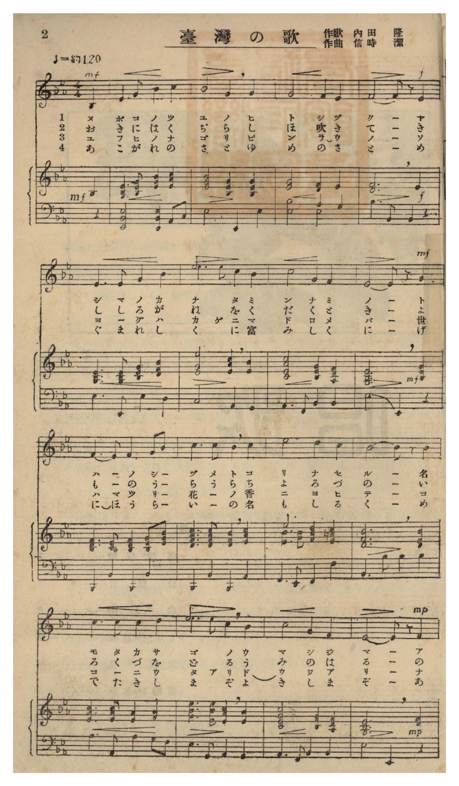
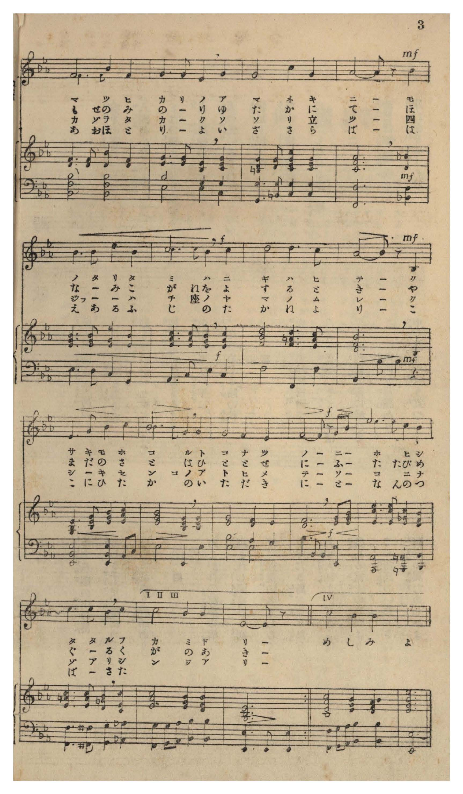
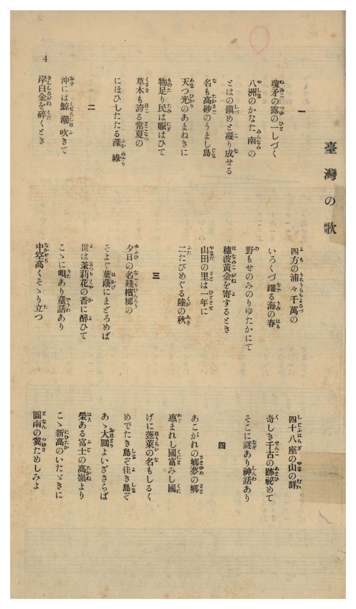

# 臺灣の歌

> Re:Shōka 使用 AI 協助辨識與重建樂譜，可能會有錯誤。歡迎回報。

- **鋼琴伴奏版**：<br><audio controls src="taiwan_no_uta.mp3"></audio>
- **NEUTRINO 歌聲合成版**：<br><audio controls src="taiwan_no_uta_neutrino.mp3"></audio>

- 作詞：内田隆
- 作曲：信時潔
- 臺灣教育會《臺灣の歌》（御大典記念事業，昭和四年五月一日發行，國臺圖 0786 8）第 2–4 頁（唱歌第一曲）

## 說明

曲目說明與原書資訊（對應 P004.jpg–P006.jpg，原書第 2–4 頁，唱歌第一曲）：
- 書名：《臺灣の歌》（國立臺灣圖書館「日治時期圖書影像系統」典藏號 jpli2011-bk-sxt_0786_8_1929，索書號 0786 8）
- 作歌：内田隆（唱歌第一等入選）
- 作曲：信時潔（東京音樂學校教授，1887–1965）
- 調性與拍號：變ホ長調（降 E 大調）4/4 拍子，原書附雙手鋼琴伴奏譜
- 背景說明：昭和 3 年（1928 年）臺灣教育會為紀念昭和天皇御大典公開募集「臺灣の歌」歌詞與曲譜；本曲為唱歌部第一曲（一等入選歌詞），因島內應募之六十餘件曲譜皆未獲採用，特委託東京音樂學校教授信時潔譜寫此曲並附雙手鋼琴伴奏，於昭和 4 年（1929 年）天長節發表。第一至三節結尾收於主音 Eb4（1，對應原譜 I II III 括號），第四節結尾則昂揚上行至高音 Eb5（1^，對應原譜 IV 括號）。

編曲說明：
- 忠實轉錄原書第 2–3 頁（P004.jpg–P005.jpg）所印東京音樂學校教授信時潔作曲之原版雙手鋼琴伴奏譜。


## 歌詞

```text
一
瓊矛（ぬぼこ）の露（つゆ）の一（ひと）しづく
八洲（やしま）のかなた南（みんなみ）の
とほの鎭（しづ）めと凝（こ）り成（な）せる
名（な）も高砂（たかさご）のうまし島（じま）
天（あま）つ光（ひかり）のあまねきに
物足（ものた）り民（たみ）は賑（にぎ）はひて
草木（くさき）も誇（ほこ）る常夏（とこなつ）の
にほひしたたる深綠（ふかみどり）

二
沖（おき）には鯨（くぢら）潮（しほ）吹（ふ）きて
岸（きし）白金（しろがね）を碎（くだ）くとき
四方（よも）の浦々（うらうら）千萬（ちよろづ）の
いろくづ躍（をど）る海（うみ）の春（はる）
野（の）もせのみのりゆたかにて
穗波（ほなみ）黃金（こがね）を寄（よ）するとき
山田（やまだ）の里（さと）は一（ひと）とせに
二（ふた）たびめぐる陸（くが）の秋（あき）

三
夕日（ゆふひ）の名殘（なごり）檳榔（びんらう）の
そよぐ葉蔭（はかげ）にまどろめば
世（よ）は茉莉花（まつりくや）の香（か）に醉（ゑ）ひて
こゝに唄（うた）あり童話（どうわ）あり
中空（なかぞら）高（たか）くそゝり立（た）つ
四十八座（しじふはちざ）の山（やま）の群（むれ）
奇（く）しき千古（せんこ）の跡（あと）祕（ひ）めて
そこに謎（なぞ）あり神話（しんわ）あり

四
あこがれの郷（さと）夢（ゆめ）の郷（さと）
惠（めぐ）まれし國（くに）富（と）みし國（くに）
げに蓬萊（ほうらい）の名（な）もしるく
めでたき島（しま）ぞ佳（よ）き島（しま）ぞ
あゝ大鵬（おほとり）よいざさらば
榮（はえ）ある富士（ふじ）の高嶺（たかね）より
こゝ新高（にひたか）のいたゞきに
圖南（となん）の翼（つばさ）ためしみよ

一、天沼矛滴落的一滴晶露，在八洲遠方的南國海疆，凝結成為鎮護遠方的寶島，名喚高砂的美麗島嶼。在遍照大地的天光之下，萬物豐足、人民安居繁榮；草木也誇耀著常夏之島那芬芳滴翠的深綠。
二、當外海的鯨魚噴湧潮水、拍岸浪花碎作白銀之時，四方海灣裡千萬魚群躍動著海洋之春；遍野豐收富饒、稻穗金波搖曳之際，山田村里一年之中兩度迎來大地之秋。
三、在夕陽餘暉下搖曳的檳榔樹蔭裡小憩，人間沉醉於茉莉花香之中，這裡有歌謠、也有童話；高聳入雲的四十八座群山，秘藏著奇妙的千古遺跡，那裡有謎團、也有神話。
四、令人憧憬的故鄉、夢中的故鄉，蒙受恩澤的國度、富庶的國度；蓬萊之名誠然名不虛傳，是吉祥之島、美好之島。啊，大鵬鳥啊！從榮耀的富士高嶺，飛向這新高山的巔峰，試展圖南的雙翼吧！）
```

## ABC

```abc
X:1
T:臺灣の歌
M:4/4
L:1/16
Q:1/4=108
K:Eb
V:V1 name="Voice" snm="Voi"
[V:V1]
z12 B,2 B,2 | E6 F2 G4 A4 | B6 B2 G4 G4 | F8 E4 C4 |
w: 1.~ぬ ぼ | こ の つ ゆ | の ひ と し | づ く _
w: 2.~お き | に は く ぢ | ら し ほ ふ | き て _
w: 3.~ゆ ふ | ひ の な ご | り び ん ら | う の _
w: 4.~あ こ | が れ の さ | と ゆ め の | さ と _
B,10 z2 B,4 | E6 E2 F4 G4 | c6 c2 A4 G4 | B8 F4 F4 |
w: 1.~_ や | し ま の か | な た み ん | な み の
w: 2.~_ き | し し ろ が | ね を く だ | く と き
w: 3.~_ そ | よ ぐ は か | げ に ま ど | ろ め ば
w: 4.~_ め | ぐ ま れ し | く に と み | し く に
E10 z2 F4 | E6 E2 E4 F2 G2 | A6 A2 G4 A4 | c6 c2 B4 A4 |
w: 1.~_ と | ほ の し づ _ | め と こ り | な せ る _
w: 2.~_ よ | も の う ら _ | う ら ち よ | ろ づ の _
w: 3.~_ よ | は ま つ り _ | く や の か | に ゑ ひ て
w: 4.~_ げ | に ほ う ら _ | い の な も | し る く _
B10 z2 B4 | c6 c2 c4 d4 | e6 c2 B4 G4 | B8 F4 F4 |
w: 1.~_ な | も た か さ | ご の う ま | し じ ま
w: 2.~_ い | ろ く づ を | ど る う み | の は る
w: 3.~_ こ | こ に う た | あ り ど う | わ あ り
w: 4.~_ め | で た き し | ま ぞ よ き | し ま ぞ
E10 z2 E4 | F6 F2 c4 F4 | G6 F2 E4 F4 | G6 G2 c4 G4 |
w: 1.~_ あ | ま つ ひ か | り の あ ま | ね き に _
w: 2.~_ の | も せ の み | の り ゆ た | か に て _
w: 3.~_ な | か ぞ ら た | か く そ そ | り た つ _
w: 4.~_ あ | あ お ほ と | り よ い ざ | さ ら ば _
B10 z2 c4 | B6 B2 e4 B4 | c6 c2 B4 c4 | d8 d4 c4 |
w: 1.~_ も | の た り た | み は に ぎ | は ひ て
w: 2.~_ ほ | な み こ が | ね を よ す | る と き
w: 3.~_ し | じ ふ は ち | ざ の や ま | の む れ
w: 4.~_ は | え あ る ふ | じ の た か | ね よ り
B10 z2 B,4 | E6 F2 G4 A4 | B6 B2 G4 G4 | F8 E4 C4 |
w: 1.~_ く | さ き も ほ | こ る と こ | な つ の
w: 2.~_ や | ま だ の さ | と は ひ と | と せ に
w: 3.~_ く | し き せ ん | こ の あ と | ひ め て
w: 4.~_ こ | こ に ひ た | か の い た | だ き に
B,10 z2 G2 B2 | e6 e2 d4 c4 | B6 B2 A4 B4 | c8 B4 B4 |
w: 1.~_ に _ | ほ ひ し た | た る ふ か | み ど り
w: 2.~_ ふ _ | た た び め | ぐ る く が | の あ き
w: 3.~_ そ _ | こ に な ぞ | あ り し ん | わ あ り
w: 4.~_ と _ | な ん の つ | ば さ た め | * * *
E10 z2 z4 | e6 e2 d4 c4 | B6 B2 A4 B4 | c8 B4 B4 |
w: 1.~_ | な ん の つ | ば さ た _ | め し み
w: 2.~_ | * * * * | * * * * | * * *
w: 3.~_ | * * * * | * * * * | * * *
e10 z2 z4 |
w: よ
```

## TMD 檔案連結

- [主旋律 TMD 檔案](taiwan_no_uta.tmd) [[在 TMD Studio 編輯](https://tmdlang.github.io/Tmd-TS/#tmd=s7IKdvYPcrWy4qpTUCpJTLdSyC_KTM_MsypJzCzOyI8H4vLE-NzEzLycxLwUJSyqyhPz4vPT0jKTMxNzlLi0tBRetO963rj4ceO6Z2t7FLS0QFqe7J3zYuW893tmPW1rfT5lw8tZbWCTgMLPZm8CCj_Zv_DZzKZne6eAhSEGPJs680XTpmdzmh83dCEb-bih-_2ejqf7Fj5dsvxp644XK2Y83b_1ya7uZ0vXvt_T82zG2qeTep7Onv1055Ynu6Y8m9PxZEfDs-lLn8_c82JhD1DB0zndQNOezpmmYGBuYaZg8X5P5_M1axSMHjVMNlF4uaARZPaUjUB7gKIgrSD3dSL7uyQjP70osSCj0iojs7gEGA7JiTnx2Yl5iUpcirYKhgYWXPa2Cq46XDYm-iZ2XFz6WlxAM57PXvdi1apnM_pedLQ_7Zv_bPaOF5vbX6zoAtm2ofdZe6dCgIGBiV5WQTrQHUCmGYgJci1YLZoDezAdCAxDrsfNu4Fqn07oBXKwh9mc7uerQb4HigMDAKj45ZIVjxt6gMHzbNNuUATMmQ8Rf7p349Pm_uebdz_fuvFxQy8omKf3v5g5XyGrICfTyMDQUDcpW7e4oiQeFIbxFvGGlkaWQHc937II5DOgOnjYglwFiua1wLBHxD5aID9f2_m0denLxh1IGlDTBVDDs7kbn-xa83L-5mcrmp6u3fFswUJgCnnW1wG019DCwhwYPIaWZqZQE16s2v-sYTkwsJ919wLdAzTqxbqux82zX07dDpQCmvZyZq-CqwIwCYG5ncC4UgAqfbp2AjzQX85seTl75rPO7pfde55P2PJkz5anS_tfrJ0DNr6559nM9ZAYBZoNSXQKxgrARAc0GxgaFhBmJ1pSft606_mWBmB6hSbTJSufz2qHJ-WnrWteTut-2j3_5ew2YLSgRmAvkATmIZCXZm8COuP9ntnP5qwBJa2mXZCwfNm8AilJgNI9PFwhesHpBJg3FjzdvO1p63JgqgPa9WRn99PWtU97G18umfFk9zaI4c9ntT2bs-p576ZnfQufT1kBitrOnU-XT3mxYjquaIBHFVD70_Wrn61dAjTqyY5lWIMRlFGn7YEGmwki2CyhwQYMGGBMPV_fAM62wDTaBPHZi_bNT3Z0gsS3Tni6Yd-zKduAxjzZsRvoHAXXJBOQISAfgnMUMBaBTlHwVPAEIU9g9K4BpwRQGABNAxYRcHOedrY_m9H0rH_Wkx1dwFICaMvL1TMgZgITVIdhHIahYQjjgI7j4nrcMAESxk9bVzyb1v64YSIX0Llczyd3PZ8_G2jE48Y1jxv3PG6cDNLQuO7lHFAMPW5c8rgJmBdAIkDVYJFNjxuBwQ0Umf64cenjxn6up62rn20Bq25qAYvug2h43Nj9uHHV48b5T3ung3Xuf9w0GSwCSs9ABVxAkx437gbZ1gcsGYEqQEaC5JoagVJP2-eCBcEuaup61gFM-UDuKrDm2Y-burnAJQlMqKkJGCTPFzSBReaDLZ_6uBGYLyFuaQO6C2gBMGGBFcyAOJMLGI9gfhPM2UuetgLDH-LPbqC1MP0gBY8b1z5u7H3cuJrreefKF9s2g_0MlABKg8MZ6MgNE2H2Qzy5_sVmiMjqx43AjAgSARu9jOtFb-ezOcCQBMr1g50K9AvIFy9WtYMFgeEC8Xn30x07ni4BpkigIDC8IEG4BB6EQIOBSoFGAgMPaO18oIZn2zc-37YArGErOCD2P25cCfELF9eTXT1czzZNA8t2QW0FGbL-5Xq4axY9bgIGQuezvetg0bIblOYn7ISYCdYCDIdlXE83AUtEoBCQA4zjzucz975sh_h3-uMmoGAPMMjAnpj0fBHQ-xDTgS4D6gcygL7p5QIm82fTwAY3gUIT4q9nW5c9bmgFa2gDugVCgpzQ2_xiwhqw-EKweqAd4BQDDooWMB9o8NIXu8Apo2kS0OOQQHy2dTvUOFjyezYDqBMosh4oCwqZl-0QFwL9DIoHUBoDxSww7NYBww6YD2DJChhYy7ier5z-bPMiWExBE_XL3c0w_wOjCeH5p-tbIB4E2zwTaCHM8xs3AusbWN4BJjBI2Kx72Q6sjYCmAJMFJLOtx8h-QP1AB64GxScspsGJEOTIzeAcNAFoz8uZkAgCBgpQGcjo58tBNS04QYPiHpggdoCywVRgHQt2B9CbQKNAVTZQMTCHPVs3A5LJgJkJkoaerdr8bBmowgNbNBkSP_BImAuKl8YJLyZ2vpgCydXAFA_07yRYQgP6EpgYe8FO3AC0HZwUoUGz_kVP54u-zhddG8E6gUqBBRAwlfYDwwcaMstmgqVAUQY07mUbOLc2AQMdyAVnLFDYN80Fyj2dAg51UJRDQqYJaNbz1UtfrISYvhKcrIAZCyoFdMva5yt3wXwLdPM8SKoDFizwUgWWdoHeBCKgcZDQhFiwBJSagTUVsEh8ums5LO8AyxpgiAJDYeHjRqBnweG6EewEcKRDo2UfMEsDRRoeN4EiiuvpUkgxAHEe0JReYNp_2g9WBCr9gOkLWlS_2L4QFqGglPF86VRIQoEVpKAQAQYHUMPqF2sgSRzoO1BdCw2RpfNgIQLMtMCwQwoRkH-A2oFGg9NzEzBJr3vZDMlJ0LT5dAk4FwDTTROw5QeOIlQFXM-awWUROEmCVewDGzQd2NqDpc3VIIPWQxIyJHkDsx26AqBDgPl59YvJa15MALVLwTkPUjxAEwdahQD2EDAa-7nAli8Hx2AvrAqA11TznuyFFOWQNIhFATgImuYCG0Evt0JKH2CaBFq-AlpBgFI8MCqngfwMcs4GrmfLIEUnMNYhpgL1dwN9-HQx0CeQ3ApMU-DQWj3j6TZIooMUL5AyA-icLmhSfjZtAywFArMPMI3D0yGweAJaCyzy50HrJWDjGFbbAsuHVcDohKau_XvAgkuAbgM6ElpOgAIF6ElgvdzBxQWUf7Fq3ou160EtdWBp87ihEVg5Ptu0B9g-eLZ7y4sJe5_PagG13XZveTZzG7h9AOyqrIDU_i8bFwALcaACoO3AWAMWts-nAYuEHmAdDmzAAKtuYBvwZd-6F2u3I1Su3wYO6B5gpD2dNgtSeQPFn-_re7kLVE8_3bYH2HIBWvGysfd563JQC3TOBpDGJSuBdTSwVfhkBzAUeoD1Aag23jgBWCED3fxk1y5gJfx0XefTja3PdzaC42E2pK59snM-sHJ90dDwYuJ0SJ0Kalpu3vayafGLrjUvujYDvfZ8_wKgFZAKFNRuApauQEOfT932dMk0kK9mtQCryZdrZz2dueXZzuXACvLZhi1ABaCW-aYdz7auApZcwJoO2D0AVYVdDUALgG1OcJsWVMuBTGhc_GLxQkg9BjQHmO2BddXT7qlANwFln23pBmkB1Uyzgd4GVklAjwEbkcCU83LpJJBLVuwG1jzASgZY-TybAOwJbQaqfzkL2ILrgdQlz-ZOBFYewHgCdS9BYbT2aevKp7uWvdjf92RfGyQQgeLAWgDsvR3A1mEjKBqXTH0JdPGSGc9mdQLDFWI0KCTAZf2zFTuBhTnI3Rv6n7UBa9QeYDC_nDb52aZOYAEMbOHCi21g8QyxFajmZcNMoJZnczpBDc81wOBsBMYAkAsrgmcD4_xF42ZQBwDYSQBGLFLZCQwXcBnZ83z5DFDPDhhjS9ufLpsJTmKgcvBl4y5wwdcDij2wLcDC7emcGQhbwMUayJNAc0Giu5eA0kbb8mdta0Aem9r6sgXs-SWLQOU-TASUoibNfNo__Vnjymf7loDsm9MNDD-QSmD23bUNLgJKV-CiCJSKJvS-WLXgecs2IOPJDmCHbvbTJmCZAuzsr386AeiUpZCUBorAfX1Pl-6FcZueTgUWIMBuFqhgebl5KZjb-HTfPGC6BSZUcDYBlRmwQqLn5eLZTydMBIYspFAAxTlQzfYpTzcDWxHA5v2ypxunQgoBUFKdPROY8Z9OANZEoKKZS0ufiysstag41dDI2MQqLD8zOdWhRtewpppLAQhsLLTswIwaBQMFXTg0jQehGgVDMM8I2IfUBXaIdIEiphB5sAgI1wBlIXpAas3iIYpAFAQaQDg1YEt8DGsUEFK6CsD-BxDvAeoAFnpQkXVAvATEamoDmwUSgchsAuIVYNZ0qMxSuDn9UBay-fFAM1oQdhuh290FxL1gc1ZDRdZDTQI2hiE2NHVCZaYD8W4wayvU7l64Ocuw2w1WAbXbGM1uoN9AJoHM2YTk71Vg1hSo3V1Qmc1ANih0IK4B6QGFDEwXdrvnIuw2Qfd3Ezi0Qeb0QF3TAzUJWEtAbQCFM9SdTY1wm0AyIBUQcyBqMMMcpL6GC5qqICnIEJxKIOnFDCxiBk5PEBFImgKlMwiG6YKkH7AIPPlAIh9k_T64o7uhTgMFH4g_H4j3g50PCjaEDEgOLA71DGqQgbyDSCoIe4BR3wSKSkhwgWTWQgNnEjy5LIDKwJIhLKGCkwBa8HQg7AEmCwgfpHYCOAEi-2cSVGY12Lcg1kqIDNg9EDdAImcDfnuASQBkPjzcgBGOnI0grobYA3E3KJQQYQDLYJCMgh5uIFdiRDeIBhUbNeBoBhUeiCIElgBA0Y5cqECiG8RGjm5QroPlD5BzILkeFAggr0OCGlJ6QHIMckKYDRQDBSaWVApWgxTdTU1I9oDyF3puA_GBrXkwCxy08GgAuQh3TkQqgUDRDY5iWPKFlHMwV0OjAVhmoSdsaPnUNBHIBpUXkDIH3SZwYkeKcFipthvDRyA3oZQ5YN8jJXpgqOEuU1HyNywyQbQ5WLFhHFQIFJPEZHAQGynG4TEBysagEECUSqCSESWOwNkCNaHOQBJHDR-wH5FiHBZ7_dA0BcrQENNA2QwWChB7YBkCFsvQrApOXej2gAsXpBiH1Wyg7AUxbT7UNKhPgSkAYidEHuQ2REECUgNLIzhTMDi-lyOFG8hviAwOCg0Qfx407cIKJuRwgxQw83CGGzS-IbW9ETi-IVEJimIQG5LlESLGYDWoCQAU3SBR5AwOc9wSeOKGJnt4BQiKbnAwwKN7LVSmF57MMZMpenTDkhWwUIBmL9RIBUcDuNGBiCBI4QGJOlzVPKiAQo5umB5QYIMyHKZpoAQHqqCh1TSST0FRByoUsNkDjkyk6Ib5B5R4IE0TcA2GMA0Y1ZCsDuykQl0AqbwhRRmozsBmDyhhw6Mb1twDZ2pw0YxSfIPjEpzvQRBEQ0RQCnTU9h-iPQf0LNipiAACRQgkb0GiFTh8CpWBlJogEdzlHyjPIFfgsFpgPxCD6wdsFTg0P8yEBh2stsBXgaOX6KASB6R2K9SdkFoCJAMKdmgCButCJGB4OdLUACYhLsPpH3CEwxoKwPYb2J2ItijMBaCMAgpLRM0B8SkkMeAqRyD1BkoFTlmL3xioGjnCoakOlFvBuRCaZ6BWwwpaSIBjttjAlSTWFhu4NYIU4bCSZAFUPUZzFpywIAkImlfgjVhQuQDJ6Zj2gIMZKcJhLUNQ6QPWBW9nIndiID6F2QNp5oPUQlps2BIwaqMdteKAuBq9JAHZA0lYMBlQSxTmOlz-gbR0YREOqa6BFHr2NQUnAFztMVBvDNIeg1kNomGRCQoyaCpEiiCoCnAxtxkeGCAZaOMU3u6A5lUctSiknwSpq1BrUbCLINGBFJDQkgAoDksYoEQFkoEUgqCEAs050NZNLaLT7JqXAus2G2D2miGlISSYIOUjctMG1KdGDjxIAQeyEFzdY8mOSIUlOMgQDQ5IegLFKk4d4P4E4aYDRAfMiya4PEhKAsEWDhB92AOC-BgBQZC3IK19kAwk1UErb2j3Cc1junYK8DEPBSQO0KtwLsjfQI4yFwA)]
- [鋼琴伴奏 TMD 檔案](taiwan_no_uta_piano.tmd) [[在 TMD Studio 編輯](https://tmdlang.github.io/Tmd-TS/#tmd=s7IKdvYPcrWy4tLSUnjRvut54-LHjeuere15v6fjad_8550dL7v3PJ-w5cmeLU-X9r9YO-f9nk4FLS2uOgWlJ3vnvFg57_2eWU_bWp9P2fByVpsSVPjZ7E2Pm3c_374CyADKP9m_8NnMpmd7p4DlIZY8mzrzRdOmZ3OaHzd0IVv7uKEbZPO-hU-XLH_auuPFihlP9299sqv72dK17_f0PJux9umknqezZz_dueXJrinP5nQ82dHwbPrS5zP3vFgIdHLP0zndQNOezpmmYGBuYaZgAXTt8zVrFIweNUw2UXi5oBHsgpLEdCuF_KKSjPz0osSCjEqrjMzikvyizOTEnPjsxLxEJS5FWwVDAwsue1sFVx0uGxN9EzsuLn0tLoiPXqxa9WxGH9BfXEBPPt2_4On6ZS_2dr7saQGG17PZO2D2GYPsA_olwMDARC-rIB0oBGSagphAVz3rbHjau-HZ3I1Pdq15OX_zsxVNT9fueLZgITBcnvV1wEMMEphPdnZD42L2zGed3Wgx8rihiUtLn4srLLWoONXQyNgqIDMxLz_Iw6FG17CmmksBCGwstOzAjBoFAwVdODSNB6EaBUMwz0jBGEiaAHGNgilEHiwCwjVAWYgekFqzeIgiEAWBBhBODdgSH8MaBYSUrsLjxjVAvAeo43HjZKjIOiBeAmI1tYHNAolAZDYB8QowazpUZincnH4oC9n8eKAZLQi7jdDt7gLiXrA5q6Ei66EmPW5cBLGhqRMqMx2Id4NZW6F298LNWYbdbrAKqN3GaHYD_QYyCWTOJiR_rwKzpkDt7oLKbAayQaEDcQ1IDyhkYLqw2z0XbDc0ZiGxaAiOKUicmYFFzMBxChGBxCsoriEYpgsSh2AReBRCIgBk_T6oEx43dkOdBvICiD8fiPeDHQ1yOkIGJAcWB-tDdzYoehHRhbAHGPxNoOB83NgDNW0tNCAnwaNsAVQGlhRgiQUcDWjJogNhDzBqIHyQ2gngRIDsn0lQmdVg34JYKyEyYPdA3NAIFt-A0x60aADRoCxVAw5-UMZCZC9YxICiAznDQaIBxEaOBlCKhKUdUFBBcgTIcSAnQYIAkrMgqQk5gmYDxUCexJZ6QGqQoqGpCckeUNpDT4kg_uPGhWAW2Mvw4AG5CHcqRcqdoGgABz0sWUHKAJirIZEKys_oCQ6ad5smQvMSJD-i2wROhLCIgAUyiDYHKzaMgwqBQpiYDAFiI8UEPIRAyR7ksseNU6HuA-VmlLADJyNE4gaJzEASR3U3yFzkmICFaj80rkEZAGIaKFmC-N1we0DZDFF-Qso3iApMe8CZESkmYKUxKNlDTJsPNQ3qU2DMQOyEyIPchsh4IDWwuMOWsqDxAKk5jMDxAAliUNCD2JAsghAxBqtBjRhQNIBEkTMEKAhBDlgCTwzQZAIvTEHRAHYePBrWQmV64YkJMx-jRwMsuoGZCJocUQMbHDzgCgwRcJDMBglSXFUGKEMjRwNMzzxolsM0DZQQQIU9tMhH8ikoKYIyETZ7wBUoLBpgVTo4E4CLGJRiCBzG4HwCgiAaIoJSMKHW8Yg6G-gIsIMQDgcFFCQtQoL7cWMfVAaS-0EiuPMxKI0hVxCw0mw_NM1irSDAZdLjxpnQAIKVevgqCPSSCZRDQWq3wnIRuLQDyUyDygATFlgXImHB811TA5iEuAybf1AqCMpaW8ZA1cgRASqGoKkbnGqhaQwaXLACAxIQmDU1uBDGWlODog45ImA5bwE8R8AKQJDZsAiHRCy4lofLQPIRJGdg2gNubiFFBKxFAMqtYF3w9gVyAxLiU5g9kCYWSC2kpsaWsFAbTJDqAEihJ3dTcMQgZxIIDyKCXEOAmtPY6mpQKxZSV8NyBIiGRQTIu4i6DZJXQCLgkhZLiYqU78DRADULnPk3w70MkpmAZAukwQTLKYj6ARJsmPkByRaM2gHSZp0HNQu5dgD7EhY9RNQOEFtq0fsrPkT0V8CBrWAIMsEYRIBZJrDsAaKNQIQZmAmWBOYkiAhMC4pqczAJYiNHJLINYN1Qk0wQxhoh24BkM7KxUGMgQoYYdkAcCXUTQiGKNcj-Q_gDyT4My_HYAVYB1oMkjAhGcv2BcBfYCmhhBdUCjwyoJ5BsRmIS8AVYDdgsRLygBJMxshVIRiHZQ8AK2iQpaIxiRgYsLMH6IK6H2ouQRfEhSpTjiA5YjjIZhP3_JnBpAio5QKURpJbEUYGA-szQAhxSIcEqN1hRD4Lo9Ti49KNdPxhaqII6LODqHTE0Ae2wgItISO26HyqDaPZDimFstR64UU-7fiNsvGM3EKP250AtGFglCi7ZIU1fRMULrz8Ihjb1e1mNy6GuA9VuvWAWLLhhzQ9QQxnS2gPJowY3pPsOqalQgxvSvKdZrwTWWwBVipBBJGjLBNZWBzoZEvSQ5iRSuw3csQaNLGAJbnBDlKateNiwCDCXglvNiNEvWHsYlE7mg1mwNstaqHHQeMDaC0TpjdOi1YvcQIG0OUGORO43gRwOCXGYDGj8CCIHSVrY8iVkfIrSViJEH8Tl6M1EaIcG2GyCFYOgNjhIBpIKQCkD1syDpCHIUA8sM8DLGeiYFsTlkIhFqwhGG1ajDSvsvhhtWBHbsNK1U4D1VqJ9DGMVUPhGaHxjBN8EqlqZCwA)]

## 分析

```text
================================================================================
📊 TMD Song Profile: [ 臺灣の歌 ]
================================================================================
⏱  Duration:       1:20 (80.0s), 36 measures total
🎼 Key & Tempo:    首調基準 E,, != 108.0 BPM, <4/4>
   - 分析範圍：      由實際發聲的音符與和弦推測調性；播放脈絡另行呈現
🎤 人聲音域:    A#3 (MIDI 58) – D#5 (MIDI 75) [跨度: 17 個半音 / 1.4 個八度, 難度: challenging]
   - 最低音:  A#3 in [Verse1234 #1 @ m.1, 0:01]
   - 最高音: D#5 in [Verse1234 #1 @ m.15, 0:31]
   - 適合: soprano, mezzo-soprano, contralto, tenor, baritone, bass
🏛  結構:      Verse1234 (66.7s) -> Verse123End (4.4s) -> Verse4End (8.9s)
⚡ 編曲密度:        Peak 1 軌道同時演奏
🗝  調性診斷：       D# 大調（純淨自然大調，未偵測到可信轉調）
   - 風格氣質:    純淨自然大調（陽光明朗、易唱易記，無明顯調外色彩）
   - 轉調歷程:    全曲維持單一推測調性（未偵測到可信轉調）
   - 核心骨幹音:  A#, D#, C, F, G
   - 調性數值:    D# 大調 [相關度: 0.87, 穩定度: Moderate, 自然音純度: 100.0%]
   - 候選調性 (K-S): D# 大調 (0.87), A# 大調 (0.81), C 小調 (0.59)
   - 五度圈歷程:   -3 -> -2 -> -3
   - 各段落調性細節:
     • [Verse1234 #1]: D# 大調 (r: 0.87, 自然音純度: 100.0%)
     • [Verse123End #1]: A# 調性不明確 (r: 0.62, 自然音純度: 100.0%)
     • [Verse4End #1]: D# 大調 (r: 0.81, 自然音純度: 100.0%)

  [ 五度圈游移軌跡 ]
               C  
         F            G  
     [Bb]*              D  
     [Eb]*              A  
         Ab           E  
            Db       B  
               F# 
     (* = active key center)

  [ 十二半音累積音高分佈 ]
     C  : █████████████             16.2%
     C# :                            0.0%
     D  : ████                       4.3%
     D# : █████████████████         20.6%
     E  :                            0.0%
     F  : █████████                 11.6%
     F# :                            0.0%
     G  : █████████                 11.2%
     G# : █████                      6.5%
     A  :                            0.0%
     A# : ████████████████████████  29.6%
     B  :                            0.0%
--------------------------------------------------------------------------------
Assignment 軌道音域：
  - Voice         : A#3 – D#5 (17 個半音 / 1.4 個八度, 121 個音符)
================================================================================
```


## 原書掃描頁








