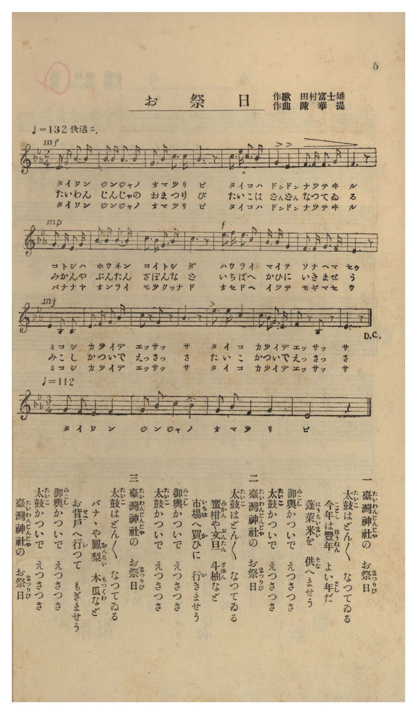

# お祭日

> Re:Shōka 使用 AI 協助辨識與重建樂譜，可能會有錯誤。歡迎回報。

- **鋼琴伴奏版**：<br><audio controls src="omatsuribi.mp3"></audio>
- **NEUTRINO 歌聲合成版**：<br><audio controls src="omatsuribi_neutrino.mp3"></audio>

- 作詞：田村富士雄
- 作曲：陳華堤
- 臺灣教育會《臺灣の歌》（御大典記念事業，昭和四年五月一日發行，國臺圖 0786 8）第 5 頁（唱歌第二曲）

## 說明

曲目說明與原書資訊（對應 P007.jpg，原書第 5 頁，唱歌第二曲）：
- 書名：《臺灣の歌》（國立臺灣圖書館「日治時期圖書影像系統」典藏號 jpli2011-bk-sxt_0786_8_1929，索書號 0786 8）
- 作歌：田村富士雄
- 作曲：陳華堤（臺灣本土音樂家；原譜第 5 頁右上排印作「陳華提」，《新定兒童唱歌》正作「陳華堤」）
- 調性與拍號：變ホ長調（降 E 大調五聲音階）2/4 拍子（♩= 132 快活ニ，主部 24 小節），D.C. 三節唱畢後接 3/4 拍（♩= 112，4 小節）尾奏「臺灣神社の お祭日」作結。
- 內容簡介：描繪十月二十八日臺灣神社大祭（臺灣祭）太鼓齊鳴、供奉蓬萊米、到市場採買蜜柑- 文旦- 斗柚（ざぼん）、在後院摘取香蕉- 鳳梨（おんらい）- 木瓜（もつくわ）及扛神輿遊行之熱鬧景象。

編曲說明：
- 以祭典太鼓與神輿遊行之快活節奏（♩= 132）編配 4 小節前奏與雙手鋼琴伴奏，並於三節唱畢後進入 3/4 拍（♩= 112）莊重喜慶之尾奏。


## 歌詞

```text
一
臺灣神社（たいわんじんじや）の　お祭日（まつりび）
太鼓（たいこ）はどん／＼　なつてゐる
今年（ことし）は豐年（ほうねん）　よい年（とし）だ
蓬萊米（はうらいまい）を　供（そな）へませう
御輿（みこし）かついで　えつさつさ
太鼓（たいこ）かついで　えつさつさ

二
臺灣神社（たいわんじんじや）の　お祭日（まつりび）
太鼓（たいこ）はどん／＼　なつてゐる
蜜柑（みかん）や文旦（ぶんたん）　斗柚（ざぼん）など
市場（いちば）へ買（か）ひに　行（い）きませう
御輿（みこし）かついで　えつさつさ
太鼓（たいこ）かついで　えつさつさ

三
臺灣神社（たいわんじんじや）の　お祭日（まつりび）
太鼓（たいこ）はどん／＼　なつてゐる
バナナや鳳梨（おんらい）　木瓜（もつくわ）など
お背戶（せど）へ行（い）つて　もぎませう
御輿（みこし）かついで　えつさつさ
太鼓（たいこ）かついで　えつさつさ
臺灣神社（たいわんじんじや）の　お祭日（まつりび）

一、臺灣神社的祭典日，太鼓咚咚地響個不停；今年是豐年、是個好年冬，來供奉蓬萊米吧！扛起神轎唷嘿咻、扛起太鼓唷嘿咻！
二、臺灣神社的祭典日，太鼓咚咚地響個不停；柑橘、文旦還有斗柚，去市場買回來吧！扛起神轎唷嘿咻、扛起太鼓唷嘿咻！
三、臺灣神社的祭典日，太鼓咚咚地響個不停；香蕉、鳳梨還有木瓜，到後院去摘下來吧！扛起神轎唷嘿咻、扛起太鼓唷嘿咻！臺灣神社的祭典日！）
```

## ABC

<div class="abc-score" data-abc-src="omatsuribi.abc" aria-label="五線譜載入中"></div>

[下載 ABC 原始檔](omatsuribi.abc)

## TMD 檔案連結

- [主旋律 TMD 檔案](omatsuribi.tmd) [[在 TMD Studio 編輯](https://tmdlang.github.io/Tmd-TS/#tmd=s7IKdvYPcrWy4qpTUCpJTLdSSM7PyUlNLsnMz7MqScwsT8yLz8uPLy1JVIKrKM4vLUpOtSpOzsjPz4kvSa0oScrPz0aXjy9ITE-1CjAwMEfIFBTll6XmJeYBdRcUZeaVpKaAtSMUpJZlpqSCpIuTgRaXpRZlpmWmpiDkgSLFIJdBrSgpSswrTi7KLAA5F6Eqv6gkIz-9KLEgo9IqI7O4JL8oMzkxJz47MQ_JFyUZqbmpVmmpxSWZZYk5yJoz0zPhfs9PS8tMzkSWL8vPKQVqNFTi0tJSeNzY9Xzp2mfTlypoaYFUPNk758XKee_3zHo-ZcOzuROfru95unj1y9ktYO1AyWezNwElX87c_KJ__dMFS8DCL9p3PW9c_GzqzBdNm57NaX7c0AURedy47tnanscN3e_3dDzdt_DpkuVPW3e8WDHj6f6tT3Z1P1u69v2enmcz1j6d1PN09uynO7c82TXl2ZyOJzsagM55PnPPi4U9QAVP53QDTXs6Z5qCgbmFmYLF-z2dz9esUTBVeLmgEWTulI1AO4AiT3b1gN3WqcSlaKtgaGzEZW-r4KrDZWOkb2LHxaWvxQWUfj573YtVq57N6HvR0f60b_6z2TtebG5_saILZNCG3mftnQqg6NbLKkgH2QxWgGRZD6ZlwLDgety8G6ju6YReIAe73-d0P18N8gVQHOgRoOKXS1Y8bugBevPZpt3PZjY9mzMfIv5078anzf3PN-9-vnXj44ZeUHBN738xc75CVkFOppGBoaFuUrZucUVJPCgs4i3iDS2NLIHuer5lEcgrQHXwMAK5ChRda4FhiB6XMDnUqAQ6FBqRc9Y8nTP_5fzNz1Y0PV237f2e2cCQeLF2DjwknvZvfrKj61nfpKe9G4DmAH0CMeRZ_wSgo4HuAYbCs2kbnq6b9bR10vPVSyHBBgyLZ2sXI6sHWgpWD3bsi1X7nzUsB8bLs-5eoE-ALnuxrutx8-yXU7cDpYCOezmzV8FVAZiIgFxgSnnRuAnoxJez-oD6gVGsANT2dO0EoLpHM1eC41_h6f7Vz7bsftwMjIKeJzt2v2xeoWBkovB0Q__z9Q3gqOtx0XPWU3iyoxMoAHTj86mLnu7reda3VMEYYh7cMEMjoGIkrU837Hu6tB_oD0iAPV867_mSfcAYR-QmoL-APn2-FRggTSDfPW1d_nTdzucbFj7ZDXTOrGf9_c93rnra2whK77t6gIynrauB2pDNA_oUaBY8VsDszqdLVr3cM_nl3q6Xm7c8bmh8sm_206WdLyaveTGh6_nGzUCRpx0bnu5oerpgy7O-hS82bX8xZ86z-RNBKXRa-7Ppy8CM6c_mzwIa-7hx2uPGPY-bJgONBWmcswLo-5czFz2bOONp_7SXy2a-mNoJVP9y8-Zni1aA1XcBFT9u6nzc2ALSAjRqzornk-eApJqaHjcuedzY_7ipH-TI_q5nnbOBvnixZ__Lxi5gPn6ys_t528aXa5Y_m7n-xcaFoEDhetwwAZgqgIXN09YVQNc9bpjIBcz6XMhBALZ1PtA-oLkguxtnwEiwCxrXPW5ogAc5WDEwFpY8bup63LgZlKwgoYUwpRHs18b1jxtXgv0NdOwesBGrwM5f9rhpwuOmbq4nu7uApRFYG9C2FY8bp0O0vdg4ASa--3Fj2-PGtbDQa3jcBBRsgcnCtSzggscNWAJocxskBMFOBfuiaRJQPzAiwQrmAt0C1rkDrGA2UD0XsOgEBiRYej_YRRCzu8FuBhq0HOwFoCyQOxVC4vI5Xj1cwJQ4GIIfkmZh_u2GhnFTCyQJg8W3gR0yHx782BM1yNyVXJDsAJYDOmHh48YNkAAG5g6wIDA_ArmbHjeuBhoErnNAKsGCvQMRCTs6B0MkPG6e8LgZWP4C83wLziIAGPA4igBo2AM1vGjuedYBrESAmoEBuRIa9ijBDLYWlIeARvTRP8ipGdpcoPJ61bwXa9eDWgbA8gxYsiKb_3xWC1AvsF4Ha--BOPfppFkgNGfDy_n7nzZ0P9nR-7QRGKazIeXQsxnQggdoFJANVPB06V4g92nbGlDFtq8NrRJ4OmH5-z2NwAL4xdbtoDJ4b9_TKdufztj_dNJukAlgcai9MHGgelDmp8StwBz7bOUMkAXgXPoSmF3ndMKyJbAptRuSDYGZ7unseUBHk-vKHaC6imxXQmu1hkZIkoa6EpqGe0B1J7gKBDoXWAs-2dFNtkNxuxDYjuzk0tLn4goD9gRSrcLyM5NTHWoMaqq5FIDAxtBMyw7MqlGozk2rVTBU0AVCY2DDC0SbAoVhLISIMZRlBqbN4Gog0ACIa8BG-hjWAFso88GiwCSuAEzjEHbTZKAeYCqH88ApvhmqcB1YsgvK2wfES6AKu8Aym5Esi0dYZkRPy4zpZBk0aiAhbRgHZSAiASgIpWsUjMC0EZQ2hosQjJbGyVD2erArQOU0VBMKByS3Ciq8BIiXQd0-ASTT1I09oNBjhZZ2oUcKjeyCZ5eCWmgsGMGzDbbsAoszWLaBiWCPF5ibVwDxdBT374by2oB4LdSN4OTW1IHk5xVQ9nSwngXYQwocK_uhKrvB5kDMawHr2gY3HR6e0IQ9DapnD0IPMOzAoYvdJlCcNE-AqGzuAmNkm2A8oE1NnXBfgPzUBOWBYgRUyROwDBYpoCIsDixuFAdjIUooWCQgZxdYFNbAsxK2aFkPtR8Y-KgOBWZjeOA3TYKbDmxaw10MbIBA2fvAMqDWBvbQAsdLC1TxQiDeAGXvAGuEpEVg4xGIVyNZBdPRi-Sc2WAZHPaAcwqsHJoND1CYPTDzELkBbA88TvqIsAezUgEGP0gKTMACGxb8sFwBCnaQCDj48VYrkNQLcgEoHULyCnIYgdwO88dysAyw8bQY6jxwYwzGAclNxR5OSPmExjaBY4TWNkHjBJot4NUJSDlqIWUIzR-gQAfHFyQ-8GUQzHKXVvFBF5tw1CXUtamWi8s5PyURo1FmAW2TVdsAR4bsahWqFW2BY0K10OgzhtY3oAgC8SANMVBegfBA4qBoRMQXUlxBvIVos0CKcZDoDNT2Cqi1ApEAltrwtgqopQIRhbVV4D7RtVMANzEVgAyQr0C0MhcA)]
- [鋼琴伴奏 TMD 檔案](omatsuribi_piano.tmd) [[在 TMD Studio 編輯](https://tmdlang.github.io/Tmd-TS/#tmd=s7IKdvYPcrWy4qpTUCpJTLdSSM7PyUlNLsnMz7MqScwsT8yLz8uPLy1JVIKrKMvPKc1NtTJEiBTnlxYlp-JSD5GNL0hMT7UKMDAwR8gUFOWXpeYl5iH0pqaUJieCLI9PLC7OT84EsxEaUssyU1JByguKMnMTiyrjU_KTgW7JK0FyXWpRMcjxBZmJQIckFhUl5qWnoiopyQAKWKWlFpdkliXmKHFpaSk8bux6vnTts-lL3-_peNm95_mELU_2bHm6tP95Z8f7PZ0KWlogzU_2znmxct77PbOeT9nwbO7Ep-t7ni5e_XJ2C9hkoOSz2ZuAki9nbn7Rv_7pgiVg4efbV0CEg1KtijOO9mYnKrycPfNZZzeyLWCVL9p3PW9c_GzqzBdNm57NaX7c0AURedy47tnanscN3UCnPd238OmS5U9bd7xYMePp_q1PdnU_W7r2_Z6eZzPWPp3U83T27Kc7tzzZNeXZnI4nOxqAvnk-c8-LhT1ABU_ndANNezpnmoKBuYWZggXQU8_XrFEwVXi5oBERMPlFJRn56UWJBRmVVhmZxSX5RZnJiTnx2Yl5wOhUtFUwNDbisrdVcNXhsjHSN7Hj4tLX4oJ48MWqVc9m9AG9yfW4efeT3UuBgQl05dMlq17umfyio_350nkv9ux_2dgFdM2Tnd1P969-tmX38_UNQL8DffVo5kqw2SBHbV_xsrVXwUTh6YZ-kHxnL1AJ0ADMMAN66smOZc-m7XmyoxOkcsrG51MXPd3X87Jh09PWpQrG-iYKz7p74aYbgkx_0df1sr336bQ5z1q3gZyxYR_QoMcNTVxa-lxcnnklRflWAaBkE-ThUGNQU82lAAQ2hmZadmBWjYJhnIIuEAIpMzBDFygGYZkqGEOkgCJGQNoAJBYPZQA1QpWDIFiEqxbFQh9kCy3g9pnEA3WCCSjbMB5kKtCKeKAxpvEgEmg4SBAoC-GCTA4D5gFgXsPnlerctFqos4yBrof4oQbOQohA_GUK9acZXA2yZ0BG-hjWAHPRfLDo48YWhcdN_RB202SgnseNM-A8IPtxUzNU4TqwZBeUtw-Il0AVdoFlNiNZBgpPqGVG9LTMmE6WQaMGEtLwRIaIBFDygiU7UCLTBZIQ2hguQjBaGidD2evBrlgJcjdEEwoHJLcKKrwEiJdB3T4BJNPUjT2g0GOFlnahRwqN7IJnl4JaaCwYwbMNtuyCWhwgRLDHC8zNK4B4Oor7d0N5bUC8FupGcHJr6kDy8wooezpYzwLsIQWOlf1Qld1gcyDmtYB1bYObDg9PaMKeBtWzB6EHGHbg0MVuEyhOmidAVDZ3gTGyTTAe0KamTrgvQH5qgvJAMdIPz184LYNFCqgIgxTJRnEwFqKEgkUCcnaBRSG2IhkRLeuh9gMDH9WhwGwMD_ymSXDTHzfOhbv4ceMOKHsfWGY2yBjc8dICVbwQiDdA2TvAGiFp8XHjJiBejWQVTEcvknNmg2Vw2APOKbByaDY8QGH2wMxD5AawPfA46SPCHsxKBVr9gQlYYMOCH5YrQMEOEoHUkfiqFUjqBbkAlA4heQU5jEBuh_ljOVim43HjYqjzHjdORXBAclOxhxNSPqGxTeAYobVN1G-z4KtPaBUfdLEJR11CXZtQ22U4WnyQBh6smYeNB20OwqVATT7M1iKqTlDzENhkhFIofIR2fFajND5h9pBjM1pbFdlmVDXIthlA_Ynd3eQ2kp3zUxKxtJFhcVFtA-xC2NUqVCvaAjsPtVDLjKHVPyi_gHiQdjGo6ILwQOKgXIXIPkhZB5LKEE1ISK0KEp2B2nwENR4hEsBKFN50BDUcIaKwpiM8YSH8gpKuTPD6BRHsYDYo7JCiCCYOT2RAa3TtFMCdFgUgA5yWo30MY5E4RsgcYzAH5DIQrcwFAA)]

## 分析

```text
================================================================================
📊 TMD Song Profile: [ お祭日 ]
================================================================================
⏱  Duration:       0:28 (28.2s), 28 measures total
🎼 Key & Tempo:    首調基準 E,, != 132.0 BPM, <2/4>
   - 分析範圍：      由實際發聲的音符與和弦推測調性；播放脈絡另行呈現
🎤 人聲音域:    A#3 (MIDI 58) – F5 (MIDI 77) [跨度: 19 個半音 / 1.6 個八度, 難度: challenging]
   - 最低音:  A#3 in [Verse #1 @ m.17, 0:15]
   - 最高音: F5 in [Verse #1 @ m.13, 0:11]
   - 適合: soprano, mezzo-soprano, contralto, tenor, baritone, bass
🏛  結構:      Verse (21.8s) -> Coda (6.4s)
⚡ 編曲密度:        Peak 1 軌道同時演奏
🗝  調性診斷：       D# 大調（純淨自然大調，未偵測到可信轉調）
   - 風格氣質:    純淨自然大調（陽光明朗、易唱易記，無明顯調外色彩）
   - 轉調歷程:    全曲維持單一推測調性（未偵測到可信轉調）
   - 核心骨幹音:  A#, D#, G, C, F
   - 調性數值:    D# 大調 [相關度: 0.86, 穩定度: Moderate, 自然音純度: 100.0%]
   - 候選調性 (K-S): D# 大調 (0.86), A# 大調 (0.76), G 小調 (0.64)
   - 五度圈歷程:   -3 -> -3
   - 各段落調性細節:
     • [Verse #1]: D# 大調 (r: 0.86, 自然音純度: 100.0%)
     • [Coda #1]: D# 大調 (r: 0.81, 自然音純度: 100.0%)

  [ 五度圈游移軌跡 ]
               C  
         F            G  
      Bb               D  
     [Eb]*              A  
         Ab           E  
            Db       B  
               F# 
     (* = active key center)

  [ 十二半音累積音高分佈 ]
     C  : ██████████████            15.3%
     C# :                            0.0%
     D  :                            0.0%
     D# : ███████████████████████   24.5%
     E  :                            0.0%
     F  : ██████████████            15.3%
     F# :                            0.0%
     G  : ██████████████████        19.0%
     G# :                            0.0%
     A  :                            0.0%
     A# : ████████████████████████  25.9%
     B  :                            0.0%
--------------------------------------------------------------------------------
Assignment 軌道音域：
  - Voice         : A#3 – F5 (19 個半音 / 1.6 個八度, 82 個音符)
================================================================================
```


## 原書掃描頁




