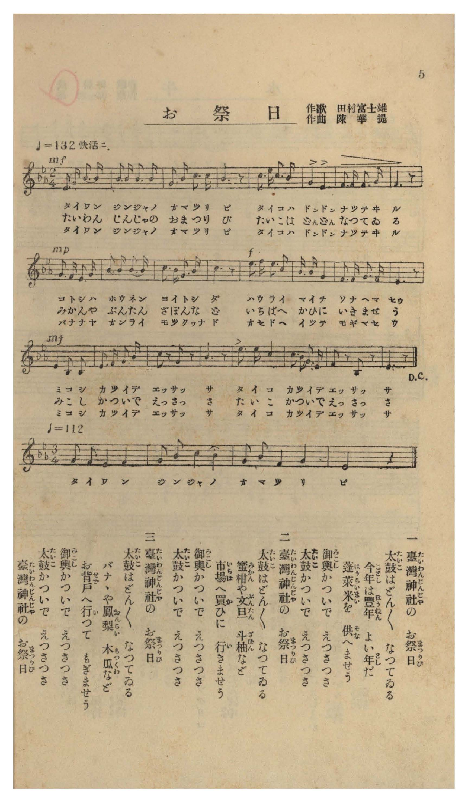

# お祭日

> Re:Shōka 使用 AI 協助辨識與重建樂譜，可能會有錯誤。歡迎回報。

- **鋼琴伴奏版**：<br><audio controls src="omatsuribi.mp3"></audio>
- **NEUTRINO 歌聲合成版**：<br><audio controls src="omatsuribi_neutrino.mp3"></audio>

- 作詞：田村富士雄
- 作曲：陳華提
- 臺灣教育會《臺灣の歌》（御大典記念事業，昭和四年五月一日發行，國臺圖 0786 8）第 5 頁（唱歌第二曲）

## 說明

曲目說明與原書資訊（對應 P007.jpg，原書第 5 頁，唱歌第二曲）：
- 書名：《臺灣の歌》（國立臺灣圖書館「日治時期圖書影像系統」典藏號 jpli2011-bk-sxt_0786_8_1929，索書號 0786 8）
- 作歌：田村富士雄
- 作曲：陳華提（臺灣本土音樂家）
- 調性與拍號：變ホ長調（降 E 大調五聲音階）2/4 拍子（♩= 132 快活ニ，主部 24 小節），D.C. 三節唱畢後接 3/4 拍（♩= 112，4 小節）尾奏「臺灣神社の お祭日」作結。
- 內容簡介：描繪十月二十八日臺灣神社大祭（臺灣祭）太鼓齊鳴、供奉蓬萊米、到市場採買蜜柑- 文旦- 斗柚（ざぼん）、在後院摘取香蕉- 鳳梨（おんらい）- 木瓜（もつくわ）及扛神輿遊行之熱鬧景象。

編曲說明：
- 以祭典太鼓與神輿遊行之快活節奏（♩= 132）編配 4 小節前奏與雙手鋼琴伴奏，並於三節唱畢後進入 3/4 拍（♩= 112）莊重喜慶之尾奏。


## 歌詞

```text
一
臺灣神社（たいわんじんじや）の　お祭日（まつりび）
太鼓（たいこ）はどん／＼　なつてゐる
今年（ことし）は豐年（ほうねん）　よい年（とし）だ
蓬萊米（はうらいまい）を　供（そな）へませう
御輿（みこし）かついで　えつさつさ
太鼓（たいこ）かついで　えつさつさ

二
臺灣神社（たいわんじんじや）の　お祭日（まつりび）
太鼓（たいこ）はどん／＼　なつてゐる
蜜柑（みかん）や文旦（ぶんたん）　斗柚（ざぼん）など
市場（いちば）へ買（か）ひに　行（い）きませう
御輿（みこし）かついで　えつさつさ
太鼓（たいこ）かついで　えつさつさ

三
臺灣神社（たいわんじんじや）の　お祭日（まつりび）
太鼓（たいこ）はどん／＼　なつてゐる
バナナや鳳梨（おんらい）　木瓜（もつくわ）など
お背戶（せど）へ行（い）つて　もぎませう
御輿（みこし）かついで　えつさつさ
太鼓（たいこ）かついで　えつさつさ
臺灣神社（たいわんじんじや）の　お祭日（まつりび）

一、臺灣神社的祭典日，太鼓咚咚地響個不停；今年是豐年、是個好年冬，來供奉蓬萊米吧！扛起神轎唷嘿咻、扛起太鼓唷嘿咻！
二、臺灣神社的祭典日，太鼓咚咚地響個不停；柑橘、文旦還有斗柚，去市場買回來吧！扛起神轎唷嘿咻、扛起太鼓唷嘿咻！
三、臺灣神社的祭典日，太鼓咚咚地響個不停；香蕉、鳳梨還有木瓜，到後院去摘下來吧！扛起神轎唷嘿咻、扛起太鼓唷嘿咻！臺灣神社的祭典日！）
```

## ABC

```abc
X:1
T:お祭日
M:2/4
L:1/16
Q:1/4=132
K:Eb
V:V1 name="Voice" snm="Voi"
[V:V1]
E3 F G3 G | G3 G G3 G | F3 G B3 B | G6 z2 |
w: 1.~た い わ ん | じ ん じゃ の | お ま つ り | び
w: 2.~た い わ ん | じ ん じゃ の | お ま つ り | び
w: 3.~た い わ ん | じ ん じゃ の | お ま つ り | び
B3 c B3 G | F2 F2 E2 E2 | F3 F F3 G | F6 z2 |
w: 1.~た い こ は | ど ん ど ん | な つ て ゐ | る
w: 2.~た い こ は | ど ん ど ん | な つ て ゐ | る
w: 3.~た い こ は | ど ん ど ん | な つ て ゐ | る
G3 F E3 F | G3 G G3 G | B3 G E3 F | G6 z2 |
w: 1.~こ と し は | ほ う ね ん | よ い と し | だ
w: 2.~み か ん や | ぶ ん た ん | ざ ぼ ん な | ど
w: 3.~ば な な や | お ん ら い | も つ くゎ な | ど
c3 e c3 B | G3 G E4 | F3 F G3 F | E6 z2 |
w: 1.~は う ら い | ま い を | そ な へ ま | しょ
w: 2.~い ち ば へ | か ひ に | い き ま せ | う
w: 3.~お せ ど へ | い つ て | も ぎ ま せ | う
E4 B,2 B,2 | E3 F G3 B | c2 z2 F2 z2 | G6 z2 |
w: 1.~み こ し | か つ い で | えっ さっ | さ
w: 2.~み こ し | か つ い で | えっ さっ | さ
w: 3.~み こ し | か つ い で | えっ さっ | さ
c3 c B4 | c3 B G3 E | F2 z2 B,2 z2 | E6 z2 |
w: 1.~た い こ | か つ い で | えっ さっ | さ
w: 2.~た い こ | か つ い で | えっ さっ | さ
w: 3.~た い こ | か つ い で | えっ さっ | さ
[M:3/4] [Q:1/4=112] G2 F2 E4 F4 | G2 B2 c4 B4 | G2 B2 F4 G4 | E8 z4 |
w: た い わ ん | じ ん じゃ の | お _ ま つ | び
```

## TMD 檔案連結

- [主旋律 TMD 檔案](omatsuribi.tmd) [[在 TMD Studio 編輯](https://tmdlang.github.io/Tmd-TS/#tmd=s7IKdvYPcrWy4qpTUCpJTLdSyC_KTM_MsypJzCxPzIvPT0vLTM5MzFHi0tJSeNzY9Xzp2mfTlypoaYHUP9k758XKee_3zHo-ZcOzuROfru95unj1y9ktSlDJZ7M3ASVfztz8on_9s_4JYOEX7bueNy5-NnXmi6ZNz-Y0P27ogog8blz3bG3P44bu93s6nu5b-HTJ8qetO16smPF0_9Ynu7qfLV37fk_Psxlrn07qeTp79tOdW57smvJsTseTHQ1A5zyfuefFwh6ggqdzuoGmPZ0zTcHA3MJMweL9ns7na9YomCq8XNAIMnfKRqAdQJEnu3rAbusEOwnq7ZKM_PSixIKMSquMzOISYDAkJ-bEZyfmJSpxKdoqGBobcdnbKrjqcNkY6ZvYcXHpa3EBzXg-e92LVauezeh70dH-tG_-s9k7Xmxuf7GiC2Tbht5n7Z0KAQYG5npZBekg54EVILmoB9NFwADjety8G6ju6YReIAd7AM3pfr4a5FWgONC3QMUvl6x43NADDItnm3Y_m9n0bM58iPjTvRufNvc_37z7-daNjxt6QWE6vf_FzPkKWQU5mUYGhoa6Sdm6xRUl8aAAi7eIN7Q0sgS66_mWRSCvANXBAxLkKlCcrgUGNHqEw-RQ4xvoUGhsz1nzdM78l_M3P1vR9HTdNqhhL1btf9awHBhuz7p7gTYBdb5Y1_W4efbLqduBUkDNL2f2KrgqAFMCkAuM7heNm4BGvJzVB9QPjAIFoLana0GWPJq5Ehw_Ck_3r362ZffjZmAQ9TzZsftl8woFIxOFpxv6n69vAAdtj4ues57Ckx2dQAFg0D-fuujpvp5nfUsVjCHmwQ0zNAIqRtL6dMO-p0v7gSEM8dDzpfOeL9kHjBFElgAGLjAEnm-d8LihCeS7p63Ln67b-XzDwie7gc6Z9ay___nOVU97G0GJdlcPkPG0dTVQG7J5QJ8CzYKHGpjd-XTJqpd7Jr_c2_Vy85bHDY1P9s1-urTzxeQ1LyZ0Pd-4GSjytGPD0x1NTxdseda38MWm7S_mzHk2fyIoBU1rfzZ9GZgx_dn8WUBjHzdOe9y453HTZKCxII1zVgB9_3LmomcTZzztn_Zy2cwXUzuB6l9u3vxs0Qqw-i6g4sdNnY8bW0BagEbNWfF88hyQVFPT48Yljxv7Hzf1gxzZ3_WsczbQFy_27H_Z2AXMjE92dj9v2_hyzfJnM9e_2LgQFChcjxsmAFMPsMR42roC6LrHDRO5gPkXKNyAHApgi-cDrQQaDbK-cQaMBDuicR1QPTzUwYqBEbHkcVPX48bN4JTV0AAJM4RBjWAfN65_3LgS7Hugk_eATVkF9sSyx00THjd1g3Q-2d0FLFvAOoF2rnjcOB2i88XGCTDx3Y8b2x43roUFY8PjJqBgC0wWrmUB2F-weALLAe1vg4Qm2M1g7zRNAtm6bzZYwVygi8Cad4AVzAaqB3tn30JguIJV7Ae7C2JDN9jxQLOWg_0ClAVyp0JIPKGAVxsXMG0OqgiBJGeY37uhod7UAkndYPFtYOfMh0cI9vQOMnol2C3gzAKWBjpk4ePGDZAgB-YdsCAwtwK5mx43rgZZD6pWQCrBgr0DFy07wOE4aKLlcfOEx83AwhpYQLTgLC-AUYGjvEDEBlDPi-aeZx3ASgGoHxi0K6GxgRLwYMtBWQ1oSt9ARQKVw58LVNCvmvdi7XpQlQ8sCIFFMrL5z2e1APUCK2yw9h6Ii59OmgVCcza8nL__aUP3kx29TxuB4TsbUm49mwEtqIBGAdlABU-X7gVyn7atAdWI-9rQao-nE5a_39MILLlfbN0OKrz39j2dsv3pjP1PJ-0GmQAWh9oLEweqB5URlLgVmJ-frZwBsgCch18CM_OcTlimBbaRdkNyKDA_Pp09D-hocl25A1TJke1KaHXY0AhJ3lBXQtNzD6jSBdedQOcCq88nO7rJdihuFwIbiJ1cWvpcXGGpRcWpVmH5mcmpDjUGNdVcCkBgY2imZQdm1SgYKugCoZGCMZg2BorAWAgRIyjLFEybwtVAoAEQ14BN8zGsAbZq5oNFgalbAZi8IeymyUA9wAQO54ETezNU4TqwZBeUtw-Il0AVdoFlNiNZFo-wzIielhnTyTJorEBC2gxKw-IAhEHxBcKwWDGCxw5MhGCsNE6GsteDHbES6nKQCIINklkFVbcEiJdBHT4BJNPUjT2U0KOEdjahxwdNbIJGBiSxG8GzCrYsAosodDXYIwPm2BVAPB3F4buhvDYgXgt1HjiJNXUgeXYFlD0drGcB9iACR8Z-qMpuaBCAzGsB69oGNx0ekNDEPA2qZw9CDzDYYMGKKzI2wFXCAxlqEzT9g2xq6oT7AuSnJigPFBnAmrCPgGXQ-DADCxnGQRmI8ggW_Mi5AxZ5sJIOe4Ssh9oMDHZUJwIzLTzYmybBTQc2uJG8uwPK3geWmf64qR17OIFjpAWqeCFSmO0Aa4QkQGADEohXI1kF09GL5JzZYJk27PaA4wNW6syGByXMHph5iCwAtgceG31E2INSewDjACQKJtBrFFDsgOIJFOKgOAGHPN7MAUmyIMsh-ReUQZCDB-RsmBeWg2WADaTFUJeB21wwDkhuKvYgQsocNLYJHBm0tgklZ8CqDZBiWBaBBLghNGOAghwcW5DYwJczMMtYWsUGXWzCUW9Q16ZaLi7n_JREjGaXBbTVVW0DHDSyq1WoBg0OGhrVwusZSB0DiiEQzxQce6C4hPBA4qB4REQYZmQhGieIKm8GasME1CyBSICKCEhWB_sZrVEC94uunQK4GakAZID8BaSVuQA)]
- [鋼琴伴奏 TMD 檔案](omatsuribi_piano.tmd) [[在 TMD Studio 編輯](https://tmdlang.github.io/Tmd-TS/#tmd=s7IKdvYPcrWy4tLSUnjc2PV86dpn05e-39PxsnvP8wlbnuzZ8nRp__POjvd7OhW0tLjqFJSe7J3zYuW893tmPZ-y4dnciU_X9zxdvPrl7BYlqOSz2ZuAki9nbn7Rv_5Z_wSw8PPtKyDCQalWxRlHe7MTFV7OnvmssxvZFrDKF-27njcufjZ15oumTc_mND9u6IKIPG5c92xtz-OGbqDTnu5b-HTJ8qetO16smPF0_9Ynu7qfLV37fk_Psxlrn07qeTp79tOdW57smvJsTseTHQ1A3zyfuefFwh6ggqdzuoGmPZ0zTcHA3MJMwQLoqedr1iiYKrxc0Ai2vSQx3Uohv6gkIz-9KLEgo9IqI7O4JL8oMzkxJz47MS9RiUvRVsHQ2IjL3lbBVYfLxkjfxI6LS1-LC-LBF6tWPZvRB_Qm1-Pm3U92LwUGJtCVT5eserln8ouO9udL573Ys_9lYxfQNU92dj_dv_rZlt3P1zcA_Q701aOZK8Fmgxy1fcXL1l4FE4WnG_pB8p29QCVAAzDDDOipJzuWPZu258mOTpDKKRufT130dF_Py4ZNT1uXKhjrmyg86-6Fm24IMv1FX9fL9t6n0-Y8a90GcsaGfUCDHjc0cWnpc3F55pUU5VsFZCbm5Qd5ONQY1FRzKQCBjaGZlh2YVaNgpqALhGbAYAPRunARUwVjMG0IFDEC0gYgsXgoowYoDFEOgmARrloU63xwWGcCMgKk2RDEABuIQ9AIZplpPJK1EAVg9QhhkN1hqUXFqfi9CnGzEdRjxkARGAshAvIqiAUJDlO4GmSfgkzzMawBZrD5YNHHjS0Kj5v6IeymyUA9jxtnwHlA9uOmZqjCdWDJLihvHxAvgSrsAstsRrIMHAwQy4zoaZkxnSyDxgokpGEJEBYHIAxOESCl0FgxgscOTIRgrDROhrLXgx2xEupykAiCDZJZBVW3BIiXQR0-ASTT1I09lNCjhHY2occHTWyCRgYksRvBswq2LAKLKHQ12CMD5tgVQDwdxeG7obw2IF4LdR44iTV1IHl2BZQ9HaxnAfYgAkfGfqjKbmgQgMxrAevaBjcdHpDQxDwNqmcPQg8w2GDBiisyNsBVwgMZahM0_YNsauqE-wLkpyYoDxQZ_Y-b-ghYhlI6G8bBC2VEhMBKYETugEUettIZESHroTYDgx3VicBMCw_2pklw0x83zkXy7g4oex9YZvrjpnbs4QSOkRao4oVIYbYDrBGSAB83bgLi1UhWwXT0IjlnNlimDbs94PiAlTqz4UEJswdmHiILgO2Bx0YfEfag1B7Q6glaR6HWKKDYAcUTKMRhVSb-zAFJsiDLIfkXlEGQgwfkbJgXloNlOh43Loa67HHjVAQHJDcVexAhZQ4a2wSODFrbRO12C756g1axQRebcNQb1LUJteWFq9WHaNcht_Cwi0Jad-DWHxITQzUi8ogwCCxsjN98DHHCNlAgimw4vPkLZ5AZNhDluN2OLzyRm-I4Wt143U7t9rxzfkoilua8BTRNVdsAe0N2tQrVoC6coVEtvP0CabuAcj6IZwouFUBlBIQHEgeVD4iCALMQQDR6EU2pGagNXlBzFyIBqnogVQg4L6E1dsE-R_UNShYh4Bv0mIOKQIIXI-YRatBiCmi_rp0CuHOmAGSA82u0j2EsEscImWMM5oCcDFWlzAUA)]

## 分析

```text
================================================================================
📊 TMD Song Profile: [ お祭日 ]
================================================================================
⏱  Duration:       0:28 (28.2s), 28 measures total
🎼 Key & Tempo:    首調基準 E,, != 132.0 BPM, <2/4>
   - 分析範圍：      由實際發聲的音符與和弦推測調性；播放脈絡另行呈現
🎤 人聲音域:    A#3 (MIDI 58) – D#5 (MIDI 75) [跨度: 17 個半音 / 1.4 個八度, 難度: challenging]
   - 最低音:  A#3 in [Verse #1 @ m.17, 0:15]
   - 最高音: D#5 in [Verse #1 @ m.13, 0:11]
   - 適合: soprano, mezzo-soprano, contralto, tenor, baritone, bass
🏛  結構:      Verse (21.8s) -> Coda (6.4s)
⚡ 編曲密度:        Peak 1 軌道同時演奏
🗝  調性診斷：       D# 大調（純淨自然大調，未偵測到可信轉調）
   - 風格氣質:    純淨自然大調（陽光明朗、易唱易記，無明顯調外色彩）
   - 轉調歷程:    全曲維持單一推測調性（未偵測到可信轉調）
   - 核心骨幹音:  G, D#, F, A#, C
   - 調性數值:    D# 大調 [相關度: 0.74, 穩定度: Moderate, 自然音純度: 100.0%]
   - 候選調性 (K-S): D# 大調 (0.74), G 小調 (0.70), A# 大調 (0.60)
   - 五度圈歷程:   -3 -> -3
   - 各段落調性細節:
     • [Verse #1]: D# 調性不明確 (r: 0.71, 自然音純度: 100.0%)
     • [Coda #1]: D# 大調 (r: 0.81, 自然音純度: 100.0%)

  [ 五度圈游移軌跡 ]
               C  
         F            G  
      Bb               D  
     [Eb]*              A  
         Ab           E  
            Db       B  
               F# 
     (* = active key center)

  [ 十二半音累積音高分佈 ]
     C  : ███████                    9.3%
     C# :                            0.0%
     D  :                            0.0%
     D# : ██████████████████        23.1%
     E  :                            0.0%
     F  : ████████████████          20.4%
     F# :                            0.0%
     G  : ████████████████████████  31.5%
     G# :                            0.0%
     A  :                            0.0%
     A# : ████████████              15.7%
     B  :                            0.0%
--------------------------------------------------------------------------------
Assignment 軌道音域：
  - Voice         : A#3 – D#5 (17 個半音 / 1.4 個八度, 84 個音符)
================================================================================
```


## 原書掃描頁




