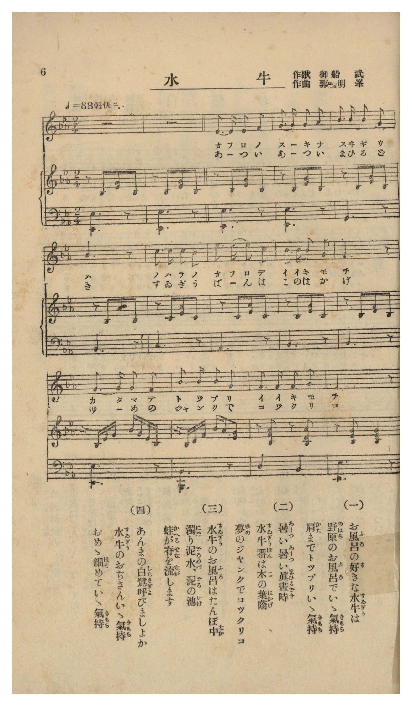

# 水牛

> Re:Shōka 使用 AI 協助辨識與重建樂譜，可能會有錯誤。歡迎回報。

- **鋼琴伴奏版**：<br><audio controls src="suigyu.mp3"></audio>
- **NEUTRINO 歌聲合成版**：<br><audio controls src="suigyu_neutrino.mp3"></audio>

- 作詞：御船武
- 作曲：郭明峯
- 臺灣教育會《臺灣の歌》（御大典記念事業，昭和四年五月一日發行，國臺圖 0786 8）第 6 頁（唱歌第三曲）

## 說明

曲目說明與原書資訊（對應 P008.jpg，原書第 6 頁，唱歌第三曲）：
- 書名：《臺灣の歌》（國立臺灣圖書館「日治時期圖書影像系統」典藏號 jpli2011-bk-sxt_0786_8_1929，索書號 0786 8）
- 作歌：御船武
- 作曲：郭明峯（臺灣本土音樂家，原書附雙手鋼琴伴奏譜）
- 調性與拍號：變ホ長調（降 E 大調）2/4 拍子（♩= 88 輕快ニ）
- 內容簡介：生動描繪臺灣農村水牛喜愛泡在田野泥水池裡洗澡、牧童（水牛番）在樹蔭下打盹、青蛙替水牛刷背與白鷺鷥替水牛按摩（あんま）的鄉土童趣。

編曲說明：
- 忠實轉錄原書第 6 頁（P008.jpg）所印臺灣本土音樂家郭明峯作曲之原版雙手鋼琴伴奏譜（含 2 小節前奏與輕快切分伴奏音型）。


## 歌詞

```text
（一）
お風呂（ふろ）の好（す）きな水牛（すゐぎう）は
野原（のはら）のお風呂（ふろ）でいゝ氣持（きもち）
肩（かた）までトツプリいゝ氣持（きもち）

（二）
あーつい暑（あつ）い眞晝時（まひるどき）
水牛番（すゐぎうばん）は木（こ）の葉蔭（はかげ）
夢（ゆめ）のジヤンクでコツクリコ

（三）
水牛（すゐぎう）のお風呂（ふろ）はたんぼ中（なか）
濁（にご）り泥水（どろみづ）、泥（どろ）の池（いけ）
蛙（かへる）が脊（せな）を流（なが）します

（四）
あんまの白鷺（しらさぎ）呼（よ）びましよか
水牛（すゐぎう）のおぢさんいゝ氣持（きもち）
おめゝ細（ほそ）めていゝ氣持（きもち）

一、喜歡泡澡的水牛，在曠野的澡盆裡真舒服，泡到肩膀深處真舒服。
二、炎熱無比的正午時分，放牛牧童在樹蔭下，乘著夢中的帆船（Junk）點頭打瞌睡。
三、水牛的澡盆在水田中央，混濁的泥水、泥巴池塘，青蛙替牠刷洗背脊。
四、要不要叫按摩師白鷺鷥來呢？水牛大叔真舒服，瞇起眼睛真舒服。）
```

## ABC

<div class="abc-score" data-abc-src="suigyu.abc" aria-label="五線譜載入中"></div>

[下載 ABC 原始檔](suigyu.abc)

## TMD 檔案連結

- [主旋律 TMD 檔案](suigyu.tmd) [[在 TMD Studio 編輯](https://tmdlang.github.io/Tmd-TS/#tmd=s7IKdvYPcrWy4qpTUCpJTLdSyC_KTM_MsypJzCxPzIvPT0vLTM5MzFHi0tJSeLZhy_PO2QpaWiDFT_bOebFy3vs9s57uW_iiY-eztcuUoMLPZm8CCr9sXvtsRt_TzevBwi_adz1vXPxs6swXTZuezWl-3NAFEXncuO7Z2p7HDd3v93QADXq6ZPnT1h0vVsx4un_rk13dz5aufb-n59mMtU8n9TydPfvpzi1Pdk15NqfjyY6GZ9OXPp-558XCHqCCp3O6gaY9nTNNwcDcwkzB4v2ezudr1iiYKbxc0Agyd8pGoB1AkSc7OsFu6wQ7Cerbkoz89KLEgoxKq4zM4hKg75MTc-KzE_MSlbgUbRUsLLjsbRVcdbhsjPRN7Li49LW4gEY8n73uxapVQO-96Gh_2jf_2ewdLza3v1jRBbJsQ--z9k6FAAMDC72sgnSQ68AKkBzUg-kgYHhxPW7eDVT3dEIvkIM9fOZ0P18N8ilQHOhZoOKXS1Y8bugBBsWzTbufzWx6Nmc-RPzp3o1Pm_ufb979fOvGxw29oCCd3v9i5nyFrIKcTCMDQ0PdpGzd4oqSeFB4xVvEG1oaWQLd9XzLIpBXgOrg4QhyFShK1wLDGRHTMFHUiAY6ERrNc9Y8nTP_5fzNz1Y0PV23DR4GL2e2vJw981ln98vuPc8nbHmyZ8vTpf0v1s6B2vNi1f5nDcuBQfqsuxfoCKDRL9Z1PW6e_XLqdqAU0PSXM3sVXBWAaQTM7QTGiAJQ6dO1E4Byj2auBMWWwos9U5_uX_24GRhgYEOfti5_um7n8w0Ln-wGCs16PmX-0-6pz_r7n-9cBXHsi32bns2dCEnaT6fNedYy-9nmhU_nrHg-ZcPL9r5nm5cCpZ5tXPBi8cJnW6Y_27fwcUPj887lz1cvBVoK0fV86iqgZUAtz1bsfDFl7ZMd3c86Jz-fvROo8uXcSS-APp69H2p-x_YXzT1AHz6fuffl9l0vty-FSz3r6Xw2cSXQzMeNTY-bJj9u3AdKxbNaXrYATZ4PtO7FtsWPG5q4uB43TADGBjDrPW1d8Wxa--OGiVxAXcAcAfZwY9fLRSueTmwCG7T1cRMwMXUC09DTpXvBIjPB3N7HjasgtkIEHzdNeNzY97ixDSy7ngvob2CEgeXWAfmPm4DpE2QKDtOXP25sedw099mGxc96QPkNZEFT0-PGhSAXvWiCeKr7cSPQRKDqfSANzR2Pm1seN09_3LwKn2awz3YBkx7IZ02Pm_c8blwCVP9s1kRoQDUuAZvZ8nzOvGcz5wKzAFgcaMWmx01AG1cCTQNpRoonFP8-btwADGuIr5_NWQGWhXDXvZjYCYxLsMh6sOsngQx6umQRSKip7XET0LHgMGna8bh5yePmzY-bgOqWP27aDPIZkA30WdNmiA92gMIP6ghsIY4rYIEGzgenhT1PdkCcAgwtcMJ-th8SVqsfN04BKW3qgiRUsOBKoP7HjfsfNwKTaCcwEQKl4OIQ-4DpGSzS8rgRGJLASJoNTBiQSNoBDDiwop4XLaDy7HHjbKC1YDsmPdsKsRXoClCcPG6cDg7rmWBfAstnWDyBky_QGkgqB2uZDkxEjxunAj0NyioT94BDsQNsyGawYqACkAMIhNLjxkUgU0AW4E41IHVNjUDp51s2gOV2P26cC_ZB4-PGZYTS24tV816sBZZls7iAeQoYeqAyYe1CYJkAzPvA_AhzH7DSWfFs9gJgVgEJAqVmtwGLiOdz5r_omPRsDjCce0DFSMcGYPp_0dbwbPvGFzOnwmVBGRmYrkFFSVPf87aNz1sWPls_BWTQ2sVPezuA6fhpB9DTPc-m7AOlW3Bxg1y-AKWe7JzxYuJ0YHoEJg2gxqc72oBFM9D5XqV52UCvvNw97-WCtaByaF7P87nAQgto4Q5wYoBkBZibQaYCRaZsABrzdMk6kJ3btwNTF0gBOEVB0s_T7aAy8OnCGUAF8DLteecCYIEGLBVBZVpLF8gOYCIAanixrPHJjl4g-bR_NaRce7pjNbzIe7Kv7elEYDaaDy0TgVV-_xTkgHs-r_3F1u3P5-x5Pnc2cpCBYkhLn4vLNxHYPgnLz0xOdagxqKnmUgACG0MzLTswq0bBUEEXCA3BNAjXKBiBRYzANAjXKBiDRYzBNLIIBBqARMCm-RjWKADTE1gUmDMVgFkIzFoH1gNMo1CZXiBeBWaBUi1Usg8q2QbE66FG1yjEI1kEYkMtMgLpaILqWALELWAWSAQkswQq0wLE-8CsTRCZpm6ozEqwMwjYYgx2NMSJIE19YOch-wjTryCng2TmQ2SaJgPZe8AyIB-DZCBOwLDMBMlLYF0Qh8Nsmg6V6QSyp0JdA_FSB9QNm-F6gMVDO07LoPFuBuTAsClYsWEcWBWQArNAEjVgKRBGKMMX9SDHQoIA5FD8AbUcKgOJOQgJlmmCxeJC7AEFjntorEBCARYrG6AhMhlq2XogBrERzgA7DRwowDoKajT-6F8NVjsF7DCQJ0BJB2ILJPkA6w4gXoohAwsMiMcm4rMHHPNYPYQeeotgkQ_2IqmhRyDHGyuYAElI_obJIcoAiC7s0Q7LVPPhKRAWuSugMouBeDs8DMmO9iZQsIDUNsLDd8bjpmZEcPRD7VsOj_nFSDKwGISkD0IxD_PVDmixAazHoWbNhsqsAsqAUhEib4NUQPIqLCRAZR7-mIdGLshPQAzSsxtq2lwk3y6Dhxci9BDhBgk1bPbUcnHp2imAagEFXTtlLgA)]
- [鋼琴伴奏 TMD 檔案](suigyu_piano.tmd) [[在 TMD Studio 編輯](https://tmdlang.github.io/Tmd-TS/#tmd=s7IKdvYPcrWy4tLSUni2Ycvzztnv93Q87Zv_vLPjZfee5xO2PNmz5enS_hdr57zf06mgpcVVp6D0ZO-cFyvnvd8z6-m-hS86dj5bu0wJKvxs9qbHzbufb18BZADlXzavfTaj7-nm9WD5F-27njcufjZ15oumTc_mND9u6IKIPG5c92xtz-OGbpDN-xY-XbL8aeuOFytmPN2_9cmu7mdL177f0_Nsxtqnk3qezp79dOeWJ7umPJvT8WRHw7PpS5_P3PNiYQ9QwdM53UDTns6ZpmBgbmGmYAF07fM1axTMFF4uaATbXpKYbqWQX1SSkZ9elFiQUWmVkVlckl-UmZyYE5-dmJeoxKVoq2BhwWVvq-Cqw2VjpG9ix8Wlr8UF8cyLVauAPgF6iQvov6f7Fzxdv-zF3s6XPS3AoHo2ewfcKqAXAgwMLPSyCtKBLnjW2fC0dwPU33PWPJ0z_-X8zc9WND1dtw0eNJBQe7KzGxros2c-6-zGCPqOpxNWKxgpPN3Q_3x9w9POXpB4R_uLPVOf7l_9tKP9aUcbRDHQ_KfzgAHZ-bihiUtLn4vLM6-kKN8qIDMxLz_Iw6HGoKaaSwEIbCy07MCMGgUDBdN4BWMQgcLmqkXR7INds2F8PBAr6AJ1onJA2n0TM_OwWG1ohtAOVKwLJEE0CNcA_QgSMQLTIFwDdA5IxBhMI4tAoAFIBGyaj2GNwuPGLrDo48atCo-besGsdWA9jxtnQmV6gXgVmDXzcdMEqGQfVLINiNdDja5RAPkFBkFsqEVGIB1NUB1LgLgFzAKJgGSWQGVagHgfmLUJItPUDZVZCXYGAVuMwY6GOBGkqQ_sPGQfYfoV5HSQzHyITNNkIHsPWAbkY5AMxAkYlpkgeQmsC-JwmE3ToTKdQPZUqGsgXuqAumEzXM_0x03tOC2DxrsZkAPDpmDFhnFgVUAKzAJJ1IClQBihDF_UgxwLCQKQQ_EH1HKoDCTmICRYpgkWiwuxBxQ47qGxAgkFWKxsgIbIZKhl64EYxEY4A-w0cKA8bpwENRp_9K8Gq50CdhjIE6CkA7EFknweN-4H4qUYMrDAgHhsIj57wDGP1UPoobcIFvlgL5IaegRyvLGCCZCE5G-YHKIMgOjCHu2wTDUfngJhkbsCKrMYiLfDw5DsaG8CBQtIbSM8fGc8bmpGBEc_1L7l8JhfjCQDi0FI-iAU8zBf7YAWG48be6BmzYbKrALKgFIRIm-DVEDyKiwkQGUe_piHRi7IT0AM0rMbatpcJN8ug4cXIvQQ4QYJNWz2oFQCKFUIciUAUguscoCJAM4C5n1gZQLlGCEJIxQjWDhEocabgA0yAxEmcBXAZIcmDGYBCxiEtcgWILkG0wZQvQcSAtd-QD-A6lAQCapRIRpBbjADYqBPgJYBSWRJqK9BpDmYhJkIloBWqNDQ1LVTAFfKCkAGKGSjfQxjEWwjJLYxEtsExFbmAgA)]

## 分析

```text
================================================================================
📊 TMD Song Profile: [ 水牛 ]
================================================================================
⏱  Duration:       0:16 (16.4s), 12 measures total
🎼 Key & Tempo:    首調基準 E,, != 88.0 BPM, <2/4>
   - 分析範圍：      由實際發聲的音符與和弦推測調性；播放脈絡另行呈現
🎤 人聲音域:    D#4 (MIDI 63) – D#5 (MIDI 75) [跨度: 12 個半音 / 1.0 個八度, 難度: easy]
   - 最低音:  D#4 in [Main #1 @ m.1, 0:00]
   - 最高音: D#5 in [Main #1 @ m.6, 0:06]
   - 適合: soprano, mezzo-soprano, contralto, tenor, baritone, bass
🏛  結構:      Main (16.4s)
⚡ 編曲密度:        Peak 1 軌道同時演奏
🗝  調性診斷：       D# 大調（純淨自然大調，未偵測到可信轉調）
   - 風格氣質:    純淨自然大調（陽光明朗、易唱易記，無明顯調外色彩）
   - 轉調歷程:    全曲維持單一推測調性（未偵測到可信轉調）
   - 核心骨幹音:  D#, F, G, C, A#
   - 調性數值:    D# 大調 [相關度: 0.81, 穩定度: High, 自然音純度: 100.0%]
   - 候選調性 (K-S): D# 大調 (0.81), C 小調 (0.66), A# 大調 (0.49)
   - 五度圈歷程:   -3
   - 各段落調性細節:
     • [Main #1]: D# 大調 (r: 0.81, 自然音純度: 100.0%)

  [ 五度圈游移軌跡 ]
               C  
         F            G  
      Bb               D  
     [Eb]*              A  
         Ab           E  
            Db       B  
               F# 
     (* = active key center)

  [ 十二半音累積音高分佈 ]
     C  : ████████                  11.1%
     C# :                            0.0%
     D  :                            0.0%
     D# : ████████████████████████  35.6%
     E  :                            0.0%
     F  : ██████████████            21.1%
     F# :                            0.0%
     G  : ██████████████            21.1%
     G# : ██                         2.2%
     A  :                            0.0%
     A# : ██████                     8.9%
     B  :                            0.0%
--------------------------------------------------------------------------------
Assignment 軌道音域：
  - Voice         : D#4 – D#5 (12 個半音 / 1.0 個八度, 39 個音符)
================================================================================
```


## 原書掃描頁




