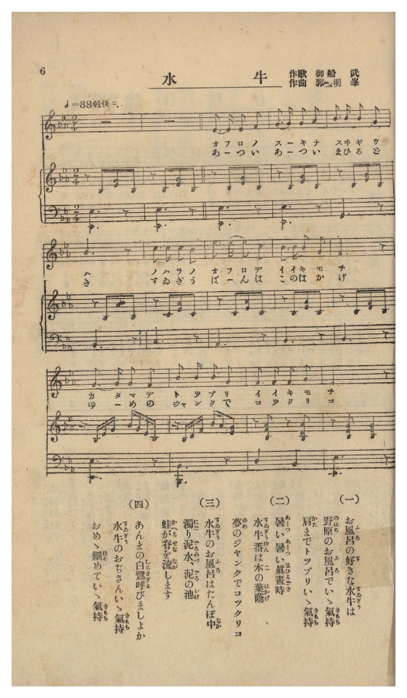

# 水牛

> Re:Shōka 使用 AI 協助辨識與重建樂譜，可能會有錯誤。歡迎回報。

- **鋼琴伴奏版**：<br><audio controls src="suigyu.mp3"></audio>
- **NEUTRINO 歌聲合成版**：<br><audio controls src="suigyu_neutrino.mp3"></audio>

- 作詞：御船武
- 作曲：郭明峯
- 臺灣教育會《臺灣の歌》（御大典記念事業，昭和四年五月一日發行，國臺圖 0786 8）第 6 頁（唱歌第三曲）

## 說明

曲目說明與原書資訊（對應 P008.jpg，原書第 6 頁，唱歌第三曲）：
- 書名：《臺灣の歌》（國立臺灣圖書館「日治時期圖書影像系統」典藏號 jpli2011-bk-sxt_0786_8_1929，索書號 0786 8）
- 作歌：御船武
- 作曲：郭明峯（臺灣本土音樂家，原書附 2 小節前奏與雙手鋼琴伴奏譜）
- 調性與拍號：變ホ長調（降 E 大調）2/4 拍子（♩= 88 輕快ニ）
- 流傳沿革：本曲後收錄於 1931 年臺灣教育會《新定兒童唱歌》尋常科第二學年用（〈水牛〉）及 1934 年臺灣總督府編《公學校唱歌》第二學年用第六課（〈スヰギウ〉）。
- 內容簡介：生動描繪臺灣農村水牛喜愛泡在田野泥水池裡洗澡、牧童（水牛番）在樹蔭下打盹、青蛙替水牛刷背與白鷺鷥替水牛按摩（あんま）的鄉土童趣。

編曲說明：
- 忠實轉錄原書第 6 頁（P008.jpg）所印臺灣本土音樂家郭明峯作曲之原版三行大譜表（含 2 小節鋼琴前奏、歌唱主旋律 PianoRH、原譜鋼琴右手伴奏音型與十六分音符琶音 Piano2、以及左手低音伴奏 PianoLH）。


## 歌詞

```text
（一）
お風呂（ふろ）の好（す）きな水牛（すゐぎう）は
野原（のはら）のお風呂（ふろ）でいゝ氣持（きもち）
肩（かた）までトツプリいゝ氣持（きもち）

（二）
あーつい暑（あつ）い眞晝時（まひるどき）
水牛番（すゐぎうばん）は木（こ）の葉蔭（はかげ）
夢（ゆめ）のジヤンクでコツクリコ

（三）
水牛（すゐぎう）のお風呂（ふろ）はたんぼ中（なか）
濁（にご）り泥水（どろみづ）、泥（どろ）の池（いけ）
蛙（かへる）が脊（せな）を流（なが）します

（四）
あんまの白鷺（しらさぎ）呼（よ）びましよか
水牛（すゐぎう）のおぢさんいゝ氣持（きもち）
おめゝ細（ほそ）めていゝ氣持（きもち）

一、喜歡泡澡的水牛，在曠野的澡盆裡真舒服，泡到肩膀深處真舒服。
二、炎熱無比的正午時分，放牛牧童在樹蔭下，乘著夢中的帆船（Junk）點頭打瞌睡。
三、水牛的澡盆在水田中央，混濁的泥水、泥巴池塘，青蛙替牠刷洗背脊。
四、要不要叫按摩師白鷺鷥來呢？水牛大叔真舒服，瞇起眼睛真舒服。）
```

## ABC

<div class="abc-score" data-abc-src="suigyu.abc" aria-label="五線譜載入中"></div>

[下載 ABC 原始檔](suigyu.abc)

## TMD 檔案連結

- [主旋律 TMD 檔案](suigyu.tmd) [[在 TMD Studio 編輯](https://tmdlang.github.io/Tmd-TS/#tmd=s7IKdvYPcrWy4qpTUCpJTLdSSM7PyUlNLsnMz7MqScwsT8yLz8uPLy1JVIKrKM4vLUpOtSpOzsjPz4kvSa0oScrPz0aXjy9ITE-1CjAwsEDIFBTll6XmJeYBdRcUZeaVpKaAtSMUpJZlpqSCpIuTgRaXpRZlpmWmpiDkgSLFIJdBrSgpSswrTi7KLAA5F6Eqv6gkIz-9KLEgo9IqI7O4JL8oMzkxJz47MQ_JFyUZqbmpVol5mbmJOeiieYklpUWpyAZmpmfCwyM_LS0zORNZV1l-TilQm6ESl5aWwrMNW553zlbQ0gJJP9k758XKee_3zHq6b-GLjp3P1i4D6wIKP5u9CSj8snntsxl9TzevBwu_aN_1vHHxs6kzXzRtejan-XFDF0TkceO6Z2t7Hjd0v9_TATTo6ZLlT1t3vFgx4-n-rU92dT9buvb9np5nM9Y-ndTzdPbspzu3PNk15dmcjic7Gp5NX_p85p4XC3uACp7O6Qaa9nTONAUDcwszBYv3ezqfr1mjYKbwckEjyNwpG4F2AEWe7OgEu61TiUvRVsHCgsveVsFVh8vGSN_EjotLX4sLKPt89roXq1YBXf6io_1p3_xns3e82Nz-YkUXyJwNvc_aOxVAEa-XVZAOshisAMmuHky7gEHB9bh5N1Dd0wm9QA52r8_pfr4a5AmgONAfQMUvl6x43NAD9OWzTbufzWx6Nmc-RPzp3o1Pm_ufb979fOvGxw29oNCa3v9i5nyFrIKcTCMDQ0PdpGzd4oqSeFBQxFvEG1oaWQLd9XzLIpBXgOrgQQRyFSi21gKDEBGJMFHUOAQ6ERqDc9Y8nTP_5fzNz1Y0PV23DR4GL2e2KBgpPN3Q_3x9w9PO3qdL-4Hh93L2zGed3S-79zyfsOXJni0gwbVzoDa_WLX_WcNyoKJn3b1AZwEte7Gu63Hz7JdTtwOlgPa9nNmr4KoATBBgbicwjhSASp-unQCUezRzJSj-FF7smfp0_-rHzcAgBBv6bGvj06bNzzbtfzl3JdBEoGOB_ni6r-fZlG0ve1qeTdujYGhpbKgATEeY6fHZtA1P18162jrp-eqlkFgERs3TDd1Pd-x4vnwiKEZ39TxduwOo9_mUFUA3PG7ogOSHxw3AOO582t8FMtwEYfjzHXufz138dNec59uBUdn1tHUNUPuzBQvhhqOZCeQ-bV37YhUw4EGGP27a-bh5w-OmdY-blkGseNzQBPLk09blT9ftfL5h4ZPdQH_Pej5l_tPuqc_6-5_vXAWx-MW-Tc_mToQ47um0Oc9aZj_bvPDpnBXPp2x42d73bPNSoNSzjQteLF74bMv0Z_sWPm5ofN65HOhtoMUQXc-nrgJ5ac6KZyt2vpiy9smO7medk5_P3glU-XLupBfAaJ29H2p-x_YXzT3AaHw-c-_L7btebl8Kl3rW0_lsIjAaOh43Nj1umvy4cR8oX85qedkCNHk-0LoX2xaDvMT1uGECMECAhcnT1hXPprU_bpjIBdQFzOPgWG3serloxdOJTWCDtj5uAuahTmDWebp0L1hkJpjb-7hxFcRWiODjpgmPG_seN7aBZddzAf0NTKdguXVA_uMmcHiC2FhNX_64seVx09xnGxY_6wGVICALmpoeNy4EuehFE8RT3Y8bgSYCVe8DaWjueNzc8rh5-uPmVfg0g322C5jjQD5rety853HjEqD6Z7MmQgOqcQnYzJbnc-Y9mzkXmPPB4kArNj1uAtq4EmgaSDNSPKH493EjMMlMhvj62RxwOm2EcNe9mNgJjEuwyHqw6yeBDHq6ZBFIqKntcRPQseAwadrxuHnJ4-bNj5uA6pY_btoM8hmQDfRZ02aID3aAwg_qCGwhjitggQbOB6eFPU92QJwCDC1w7n22HxJWqx83TgEpbeqCJFSw4Eqg_seN-x83ApMoMBs0AqXg4hD7gOkZLNLyuBEYksBImg1MGJBI2gEMOLCinhctoGL8ceNsoLVgOyYBCwyYK0Bx8rhxOjisZ4J9CaxxYPEETr5AayCpHKxlOjARPW6cCvQ0KKtM3AMOxQ6wIZvBioEKQA4gEEqPGxeBTAFZgDvVgNQ1NQKln2_ZAJbb_bhxLtgHjY8blxFKby9WzXuxFliEz-IC5ilg6IHKhLULgWUCMO8D8yPMfcBqdMWz2QuAWQUkCJSa3QYsIp7Pmf-iY9KzOcBw7gEVIx0bgOn_RVvDs-0bX8ycCpcFZWRgugYVJU19z9s2Pm9Z-Gz9FJBBaxc_7e0ApuOnHUBPA0vifaB0Cy5ukMsXoNSTnTNeTJwOTI_ApAHU-HRHG7BGAjrfqzQvG-iVl7vnvVywFlQOzet5PhdYaAEt3AFODJCsAHMzyFSgyJQNQGOeLlkHsnP7dmDqAikApyhI-nm6HVQGPl04A6gAXqY971wALNCApSKoTGvpAtkBTARADS-WNT7Z0Qskn_avhpRrT3eshhd5T_a1PZ0IzEbzoWUisBHTPwU54J7Pa3-xdfvzOXuez52NHGSgGNLS5-LyTQS2wcLyM5NTHWoMaqq5FIDAxtBMyw7M0tdSsEUHCuAmRsOzdVsVNIB1Drje1YE3TUCyCoaPGiYbKQBbSJpYtANtBRldo2CooAuEhmDaCIhrFIzBIsZg2gQsYgoWMQXTIFGYCAQagETApvkY1igAkypYFJjpFYC5E8xaB9YDTP5QHcAUCiZXoYgD8waQ3QeWaYPKrEeyJx5hjxFIrglu2hIw2QLVg0t8H1R0E9CmbjBrJVQG5BosthhjuA3iMISHML0KcjBIZj5U22Qgew-KZ0FWY7HMBOF0iC6QcxE2TYfKdALZU8EyoIACyjR1QN2wGa4HWPC047QMf4ra1YMvReFKTcjpyQxslxmYBqUSYAqLAwsBKTALJIEtSYESH64kBQoFSOiCQgB_DCyHyoCiHRL90OTWBApdkMxC7DEATlS4k-IGqA5Q7CDHNIgHcRFEDBLoIJlJ2O0BJ6vVMNMap4DNBPkDJA5KkiB-L5C9Hyy_FIsMyPeIhD0Ruz3gFEVU8l0ES1Rgr5EaeATKqE58KcqYiBSFXB5BSihciccITENEIOUa9uQEyRWgTArLMtBE0wzNTM1AfzeDshywzUNGiMCTUxMovCER0Igc8qAW1mKoVcB82wRJN1BHNG1GOAIiA3MEVAZ7ioJ5age8eOuBOnA2zBHgMgjY6oGKg3gQdZDyBRIYyAU1thQFSTRwL4FJkPhuqGlz4Z5dRkbQ1XJx6dopgOpDBSCtzAUA)]
- [鋼琴伴奏 TMD 檔案](suigyu_piano.tmd) [[在 TMD Studio 編輯](https://tmdlang.github.io/Tmd-TS/#tmd=s7IKdvYPcrWy4qpTUCpJTLdSSM7PyUlNLsnMz7MqScwsT8yLz8uPLy1JVIKrKMvPKc1NtTJEiBTnlxYlp-JSD5GNL0hMT7UKMDCwQMgUFOWXpeYl5iH0pqaUJieCLI9PLC7OT84EsxEaUssyU1JByguKMnMTiyrjU_KTgW7JK0FyXWpRMcjxBZmJQIckFhUl5qWnoiopyQAKWCXmAY3IKVbi0tJSeLZhy_PO2e_3dDztm_-8s-Nl957nE7Y82bPl6dL-F2vnvN_TqaClBdL-ZO-cFyvnvd8z6-m-hS86dj5buwxsKlD42exNj5t3P9--AsgAyr9sXvtsRt_TzevB8i_adz1vXPxs6swXTZuezWl-3NAFEXncuO7Z2p7HDd0gm_ctfLpk-dPWHS9WzHi6f-uTXd3Plq59v6fn2Yy1Tyf1PJ09--nOLU92TXk2p-PJjoZn05c-n7nnxcIeoIKnc7qBpj2dM03BwNzCTMEC6Nrna9YomCm8XNCI8HN-UUlGfnpRYkFGpVVGZnFJflFmcmJOfHZiHjCmFG0VLCy47G0VXHW4bIz0Tey4uPS1uCCeebFqFdAnQC9xAf33dP-Cp-uXvdjb-bKnBRhUz2bvgFsF9AIocvWyCtKBLnjW2fC0dwPU33PWPJ0z_-X8zc9WND1dtw0eNJBQe7KzGxLoT3Z0Aj0EDANgiL9YuAIUJBNWKxgpPN3Q_3x9AyRKnnb2AqPkcUMjMNieTtn4ZMfuZ9O7n-7rVggAxXaQB1AGaBjQAKjy_s3POrsh8Qi0_-m87hcd7U97G5-2rn3a0QYUeb5m2fMJ24AMiAFGQP1Pdi992t_1dPsykM69fUA5iH6ICh8PoOceNzRxaelzcXnmlRTlW0GtdqgxqKnmUgACGwstOzCjRsFAwTRewVDbGESh8bhqUQzwwW6AYXy8tmG8gi4QGmBwQUb4JmbmYXGCoRnCCLByQzBtBMQ1CsZgEWMwbQIWMQWLmIJpkChMBAINQCJg03wMaxQeN3aBRR83blV43NQLZq0D63ncOBOq43EjRHwVivjjpglAdh9Ypg0qsx7JHpDHoPYYgeSa4KYtAZMtUD24xPdBRTcBbeoGs1ZCZUCuwWKLMYbbIA5DeAjTqyAHg2TmQ7VNBrL3oHgWZDUWy0wQTofoAjkXYdN0qEwnkD0VLAMKKKBMUwfUDZvheqY_bmrHaRk02s3AQmZgGhSZwIQQBxYCUmAWSAJbzIPSCK6YBzkWEgggh-IPqOVQGVDsQGIJmiqaQIEAklmIPaDAcY87xWyA6gAFInKEgHgQF0HEIGEDkpmE3R5w7K-GmdY4BWwmyB8gcVDKAfF7gez9YPmlWGRAvkekv4nY7QFHPFGpbBEs7sFeIzXwoBGPnLsh-R1XHBuBaYgIpJTAHuuQNAZK8rAECI3bZmjSbAY6rxmUgB83wzIBWbHeBAoWSDg1IgdQ047HzYuhVgFzQRMkeqGOaNqMcAREBuYIqAz2iId5age8sOiBOnA2zBHgHP24CZR8QOIgHkQdJLdCAgO52MMW8ZC4hXsJTILEd0NNmwv37DIygg6lBjDCXgGAohNY4wBzPrDqgTIJihprg1ILuqgJkiiS6WYQc0B1CZiJTxSPnebx2qAEiWY8qM4EJlJTIDZEqkfN44Gp1xRYf0HMghmjbQS2EMqBmgiXhNkLZYAgWhiSUw8rGMcj2KYINqwkRpI1wa4Siy40K4AK4rWRdZiD2RARbA0DXTsFcPNCAcgAeS_axzAWwTZCYhsjsU3AbGUuAA)]

## 分析

```text
================================================================================
📊 TMD Song Profile: [ 水牛 ]
================================================================================
⏱  Duration:       0:16 (16.4s), 12 measures total
🎼 Key & Tempo:    首調基準 E,, != 88.0 BPM, <2/4>
   - 分析範圍：      由實際發聲的音符與和弦推測調性；播放脈絡另行呈現
🎤 人聲音域:    D#4 (MIDI 63) – D#5 (MIDI 75) [跨度: 12 個半音 / 1.0 個八度, 難度: easy]
   - 最低音:  D#4 in [Main #1 @ m.1, 0:00]
   - 最高音: D#5 in [Main #1 @ m.6, 0:06]
   - 適合: soprano, mezzo-soprano, contralto, tenor, baritone, bass
🏛  結構:      Main (16.4s)
⚡ 編曲密度:        Peak 1 軌道同時演奏
🗝  調性診斷：       D# 調性不明確（純淨自然大調，未偵測到可信轉調）
   - 風格氣質:    純淨自然大調（陽光明朗、易唱易記，無明顯調外色彩）
   - 轉調歷程:    全曲維持單一推測調性（未偵測到可信轉調）
   - 核心骨幹音:  A#, G, D#, F, C
   - 調性數值:    D# 調性不明確 [相關度: 0.82, 穩定度: Ambiguous, 自然音純度: 100.0%]
   - 候選調性 (K-S): D# 大調 (0.82), A# 大調 (0.80), G 小調 (0.70)
   - 五度圈歷程:   -3
   - 各段落調性細節:
     • [Main #1]: D# 調性不明確 (r: 0.82, 自然音純度: 100.0%)

  [ 五度圈游移軌跡 ]
               C  
         F            G  
      Bb               D  
     [Eb]*              A  
         Ab           E  
            Db       B  
               F# 
     (* = active key center)

  [ 十二半音累積音高分佈 ]
     C  : ███████                    8.9%
     C# :                            0.0%
     D  :                            0.0%
     D# : █████████████████         20.0%
     E  :                            0.0%
     F  : ███████████████           17.8%
     F# :                            0.0%
     G  : ██████████████████        22.2%
     G# : ██                         2.2%
     A  :                            0.0%
     A# : ████████████████████████  28.9%
     B  :                            0.0%
--------------------------------------------------------------------------------
Assignment 軌道音域：
  - Voice         : D#4 – D#5 (12 個半音 / 1.0 個八度, 39 個音符)
================================================================================
```


## 原書掃描頁




