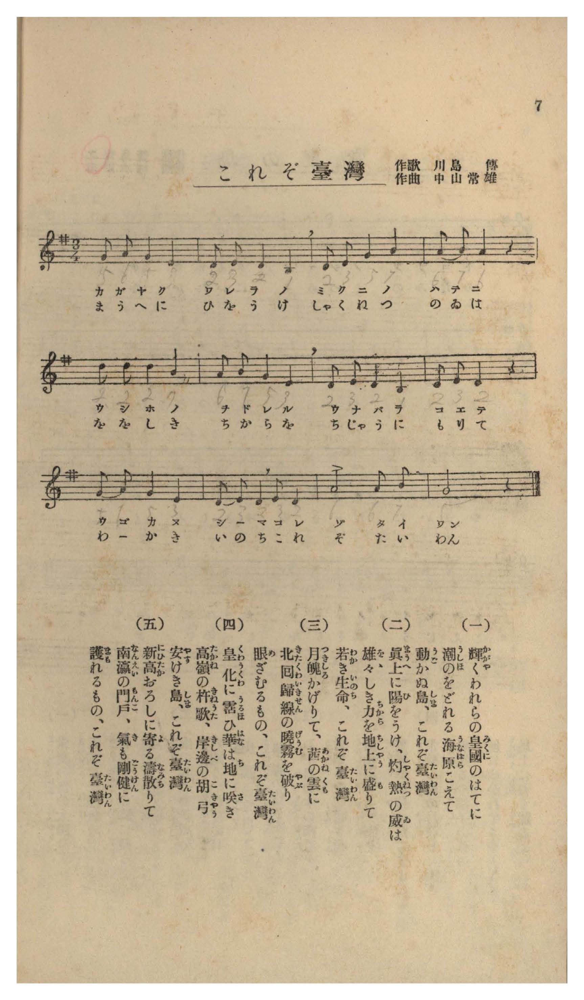

# これぞ臺灣

> Re:Shōka 使用 AI 協助辨識與重建樂譜，可能會有錯誤。歡迎回報。

- **鋼琴伴奏版**：<br><audio controls src="korezo_taiwan.mp3"></audio>
- **NEUTRINO 歌聲合成版**：<br><audio controls src="korezo_taiwan_neutrino.mp3"></audio>

- 作詞：川島傳
- 作曲：中山常雄
- 臺灣教育會《臺灣の歌》（御大典記念事業，昭和四年五月一日發行，國臺圖 0786 8）第 7 頁（唱歌第四曲）

## 說明

曲目說明與原書資訊（對應 P009.jpg，原書第 7 頁，唱歌第四曲）：
- 書名：《臺灣の歌》（國立臺灣圖書館「日治時期圖書影像系統」典藏號 jpli2011-bk-sxt_0786_8_1929，索書號 0786 8）
- 作歌：川島傳
- 作曲：中山常雄
- 調性與拍號：ト長調（G 大調／C 五聲調式）3/4 拍子，12 小節（三樂句結構），每節皆以「これぞ臺灣」（這就是臺灣）作結。

編曲說明：
- 依原譜 3/4 拍莊重開闊之三樂句結構編配 4 小節前奏與雙手鋼琴伴奏。


## 歌詞

```text
（一）
輝（かがや）くわれらの皇國（みくに）のはてに
潮（うしほ）のをどれる海原（うなばら）こえて
動（うご）かぬ島（しま）、これぞ臺灣（たいわん）

（二）
眞上（まうへ）に陽（ひ）をうけ、灼熱（しやくねつ）の威（ゐ）は
雄々（をゝ）しき力（ちから）を地上（ちじやう）に盛（も）りて
若（わか）き生命（いのち）、これぞ臺灣（たいわん）

（三）
月魄（つきしろ）かげりて、茜（あかね）の雲（くも）に
北回歸線（きたくわいきせん）の曉霧（げうむ）を破（やぶ）り
眼（め）ざむるもの、これぞ臺灣（たいわん）

（四）
皇化（くわうくわ）に霑（うるほ）ひ華（はな）は地（ち）に咲（さ）き
高嶺（たかね）の杵歌（きねうた）、岸邊（きしべ）の胡弓（こきやう）
安（やす）けき島（しま）、これぞ臺灣（たいわん）

（五）
新高（にひたか）おろしに寄（よ）る濤（なみ）散（ち）りて
南瀛（なんえい）の門戶（もんこ）、氣（き）も剛健（ごうけん）に
護（まも）れるもの、これぞ臺灣（たいわん）

一、在光輝國度的南疆盡頭，越過黑潮翻湧的蒼茫大海，屹立不搖的島嶼，這就是臺灣。
二、正上方承接烈日陽光，灼熱的威力將雄健的生命力盛滿大地，年輕的生命，這就是臺灣。
三、殘月隱沒，在茜紅朝雲裡破開北回歸線的晨霧而甦醒的，這就是臺灣。
四、繁花遍地盛開，高山上的杵歌與海岸邊的胡弓聲交織，安詳的島嶼，這就是臺灣。
五、新高山吹下的山風激起浪濤飛散，南瀛的門戶氣魄剛健，屹立守護著的，這就是臺灣。）
```

## ABC

<div class="abc-score" data-abc-src="korezo_taiwan.abc" aria-label="五線譜載入中"></div>

[下載 ABC 原始檔](korezo_taiwan.abc)

## TMD 檔案連結

- [主旋律 TMD 檔案](korezo_taiwan.tmd) [[在 TMD Studio 編輯](https://tmdlang.github.io/Tmd-TS/#tmd=s7IKdvYPcrWy4qpTUCpJTLdSyC_KTM_MsypJzCxPzIvPT0vLTM5MzFGCyyfn5-SkJpdk5sPV5OXHl5YkIlSU5eeU5qZaGSJEivNLi5JTcamHyMYXJKanWgUYGFgiZAqK8stS8xLzEHpTU0qTE0GWxycWF-cDXQZiIzSklmWmpIKUFxRl5iYWVcan5CcD3ZJXguS61KJikOPL8pORvVWSkQp0M8yFiSWlRalKXFpaCo8bJz9u6nncOO9F-67njYsVtLRAWp7snfNi5bz3e2Y93T736eZtT5s2g00CCj-bvQko_GTH2qcbNz7dsePl7BawDET3s6kzXzRtejan-XFDF0TkceO6Z2t7Hjd0v9_T8XTfwqdLlj9t3fFixYyn-7c-2dX9bOna93t6ns1Y-3RSz9PZs5_u3PJk15Rnczqe7Gh4Nn3p85l7XizsASp4OqcbaNrTOdMUDMwtzBQs3u_pfL5mjYK5wssFjSBzp2wE2gEUARoBdl4nwtv5RSUZ-elFiQUZlVYZmcUlwNgHBkt8dmIeMIIUbRUMDSy47G0V3LlsjPVN7Li49LW4gEY8n73uxapVz2b0vehof9o3_9nsHS82t79Y0QWybEPvs_ZOBVA86mUVpINcB1aA5KAeTAcBg4zrcfNuoLqnE3qBHOzhM6f7-WqQT4HiQM8CFb9csuJxQw8wKJ5t2v1sZtOzOfMh4k_3bnza3P988-7nWzc-bugFBen0_hcz5ytkFeRkGhkYGuomZesWV5TEg8Ir3iLe0NLIEuiu51sWgbwCVAcPR5CrQLG6FhjOiMiGiWLENUjixar9zxqWA0PmWXcv0CyQb5o7Xk7dDhQHesJdARjHYGa_swIwNl80bgLynu7pB1oGDGIFoKanaycAHWNopPB0Q__z9Q1ATU92dD5b0fS0f-nzrROeLQeGBTDAep6tB8k-n9X2ZPdSYCigJVSgt4EaXzbMfLph47MZ6yGCQI1AZwMNedzQxMX1uGEC0F_AdPy0dcWzae2PGyZyge0C2tjJ9WLPXCDncWP348aex00tQKHHjf2Pm4AIyAWy1z2f1Q6MELCa_SCpxtVgNeseN65_3LgMyOV6tncdWLrtceP0x427odJNkx43rgSb0v1s63Zg4oCpWfW4cQPQaLCyyY8bgYLLuJ52T4VJTwFLAJ2zBhgHYEGgoftAgg2NaH4Hy85_3NgCdu9kkHfAPtsFjMROrudz5j3ZAUqqQO1gk3eATV79cuZesCAoPYJdCZSaCDT8eeOe520boTY2tYD9uvZx4xKIf56uAGWxx03AKANy13MBE8Hjhlaw0KTHTcAwBIoCHdr7tGs22IiFID9AfNk06emcDTCnAMVngE1vg7jm-Wyw-qYmsMouUGC86F4KFgLaD0oCQEOfT5n_dCLE1UCdwKBfSFJ47AA5gwtYnrxcC4xgoJolQDPBvgSmHUhgA_0Ashto5oueOWA1TWBxYLkE8v1LUA4ACgKNBTsUGOtPe6Y_nT3v2dodz7fPAssBTQTaDU47IFcCubMhjgDl7dmdL-csBysDB3gTKO0BA-b5gi1grwLVA-MaFADAaNsDFgIGN1DnNKBSYAoCWgvyN7E-BpY34BQATLo902AOBzoLGNMgBjQdzJkITXNA86HJdtOL_vVgQWDaXgWJaWDcQSIOouvpJEhIANMrKGa4Xq6e8XTbLpg7ECH2bO5WcGECCRhgOgLaDcwCoFh7umnHyyZIagDHQuNOiJYXzQuf7gH6ASgOzBe98FTC9XQdMAIhoTQTrHQiKKGRnTtAOYzr2bQNQKeD1awG-hvierDhXcBkATZ29dP14OTS1AGOmu5n-4F5AagemIGBxVrns6kQK8ABA0m5T3unP2-ApP9VQCvBmRtSpKx7Oa3hWQfYxcCoBEmBU0ZD47MNEFPAKbGp6Wnn7KeN4OTfOAWaM6FpaDXXi7XbobkZmltAZQuJKePFqnkv1gKjeBYXsPwDxcWcFU9bO4GFILCMe7pr2fNZLSA_TGt7PnvhywWgSvnFtq6XjX0vd08ElnLP9-9-tnM5UM2LSXte9KwGFvDAkg1Uz23cCaywnuzofTZhGsgEYN2xDZiIe9BKZVBhDCybQJ5euxhYHjybtvNZ5_5nfUufN3cA6zZguQR0Cqh6AhdEIINWNAKLk6cb2oGFDTBUgCKQggAoCCw2nu3eD2pGgJJnD7DF8GLPVLgCHHbvAAf4uhmgkmDWxmebJoHbFCuAOf75ltZnc-YCc_mLxQuBefLltG7k7A0099nMFcAM_KKh5_mUZS_bJgFFsNsBzHmgonRn44uujS-BiXTOBqBLgcaBVANzysaNQH-DjAPnDlDdCawawNkBFKrg9A-sKJ_sWvJ8JzCV9gAT_ouVmwkG6RSQt8DpGVRBT9j5ZEc3SM_GjS8XrXi2v-HF1u3Ptq4Cpt6Xi2eDE20PJJ0C1UBSJTANAktGWNKDRufTdR3ABPdi4nRcfgUlKS19Li7fRGAzOiw_MznVocagpppLAQhsLLTswIwaBUMFIyDWVTCLBxI1CqbxIBaQ1FUwQRYBKTEG842AtBGQZQDigQ3xMawBtk-7gbhHAVgKAMWB5RhYLTBxAzFItBMsug4i2rgfrAKYaVBE1wPxMqgo2G6I6UYguX1A3AbEO8A6QCpAopuAJk8Cy4BEJ0JFgRVHM9SCtWCJJVCJdUDlE8AWoVhgDJJbAsS9IM0gHU29UB0gTwEtaOoCm7MMKtoElYGYDnM-yKsgGTTnm4DlHjf1QTwAYsF9DnI3KJRAhu0G-wckCnIeSNMqaJgsRPHzVDAP5EAkS0xBMqshIdI4H6yiG6q-C-wdqMdgpjR1QG1dBRbdD1W7EOxViEchpkNTiSkYIicBItIMWAQ9mYDCYDrYu0hhB47EleCkAgp9mNNBakGBsAEsCkpCINHJQAx0PpIj4ckEZA7YLIhnYbEI9BYoviCJECiPEAW2dUBJBZJ-YGEDjES0UEAkE1BIzodHKCStw6yZDdQHchzIU6BkA_dEUwPUWkjuAIluA_NAyQo9qYBMx0xcIHvXwl0KimGYKCgwd6KoBbkBWD3DPIaeTIAhCnZmB1gTzEGgvAHy-GSwKIiEWgBO01OQkyswo0FMQKR0AoUJLDGAko4uGIKSEEg9hIctkUyBpmFgSxtqLSRSQSUB0HJwUgGJzoOaAQm5FkipA_EHCKKnEFDBBDMYFnEtEP-DUwR5RoPSRlMjUNE0cGwjJWJg8EHihlyjQYkCmGyAbStwyCO7m9IAAScHoHZwxKNkPUpcXcvFpWunAKp2FHTtlLkA)]
- [鋼琴伴奏 TMD 檔案](korezo_taiwan_piano.tmd) [[在 TMD Studio 編輯](https://tmdlang.github.io/Tmd-TS/#tmd=s7IKdvYPcrWy4qpTUCpJTLdSSM7PyUlNLsnMz7MqScwsT8yLz8uPLy1JVIKrKMvPKc1NtTJEiBTnlxYlp-JSD5GNL0hMT7UKMDCwRMgUFOWXpeYl5iH0pqaUJieCLI9PLC7OT84EsxEaUssyU1JByguKMnMTiyrjU_KTgW7JK0FyXWpRMcjxBZmJQIckFhUl5qWnoiopyQAKwF2bWFJalKrEpaWl8Lhx8uOmnseN816073reuPj9no6X3XueT9jyZM-Wp0v7n3d2vN_TqaClBTLnyd45L1bOe79n1tPtc59u3va0aTPYeKDws9mbgMJPdqx9unHj0x07Xs5uAcs8374CIhOUalWccbQ3O1Hh5eyZzzq7ka0Aq4RY_mzqzBdNm57NaX7c0AURedy47tnanscN3UB3Pd238OmS5U9bd7xYMePp_q1PdnU_W7r2_Z6eZzPWPp3U83T27Kc7tzzZNeXZnI4nOxqeTV_6fOaeFwt7gAqezukGmvZ0zjQFA3MLMwULoI-er1mjYK7wckEjIoDyi0oy8tOLEgsyKq0yMotL8osykxNz4rMT84DRqmirYGhgwWVvq-DOZWOsb2LHxaWvxQXx34tVq57N6AP6kutx8-4n--Y-7Zv_Yu0cBaAqhWfdvS_6ul62976c1v1yeteTnd1PdnQ-W9H0tH_p860Tni3vBprwsrVXwUTh6Yb-5-sbnnb2AkPkRUc7ZjA9bmji0tLn4vLMKynKtwoARXSQh0ONQU01lwIQ2Fho2YEZNQqGCkZArKtgFg8kahRM40EsOAkSMgKSIGikYAxWD-EZgOS4alGs8EG2wgRuhUl8vIIhyMR4sAVgDogCGg0kQcIQniFEygBirm9iZh5ZLtcFWogkAlJiDPWIMdgzEKeDDPExrAEm6W4g7lF43NQCFH_c2A9W-7ipH4hBop1g0XUQ0cb9YBWPG1ejiK4H4mVQUbDdENONQHL7gLgNiHeAdYBUgEQ3AU2eBJYBiU6Eik5_3NQMtWAtWGIJVGIdUPkEsEUoFhiD5JYAcS9IM0hHUy9UB8hTQAuausDmLIOKNkFlIKbDnA_yKkgGzfkmYLnHTX0QD4BYcJ-D3A0KJZBhu8H-AYmCnAfStAoaJgtR_DwVzAM5EMkSU5DMakiINM4Hq-iGqu8CewfqMZgpTR1QW1eBRfdD1S4EexXiUYjp0FRiCobISYCINAMWQU8moDCYDvYuUtiBI3ElOKmAQh_mdJBaUCBsAIuCkhBIdDIQA52P5Eh4MgGZAzYL4llYLAK9BYovSCIEyiNEZ0CSCiT9wMIGGIlooYBIJqCQnA-PUEhah1kzG6gP5DiQp0DJBu6JpgaotZDcARLdBuaBkhV6UgGZjpm4QPauhbsUFMMwUVBg7kRRC3JDL8Jj6MkEGKJgZ3aANcEcBMobII9PBouCSKgF4DQ9BTm5AjMaxARESqdKMYiaSKZA0_DjxjVQayGRCioJgJaDkwpIdB7UDEjItUBKHYg_QBA9hYAKJpjBsIhrgfgfnCLIMxqUNpoagYqmgWMbKREDgw8SN-QaDUoUwGTzuHEmOOSR3U1pgICTA1A7OOJRsh4lrkapdYitzIziwWLwms0YSQJcr8FSGFgKSMJV4jADTR-xtSdUHbT21LVTAFfMCkAGyE_RPoaxCLYREtsYiW2CxDYFsZW5AA)]

## 分析

```text
================================================================================
📊 TMD Song Profile: [ これぞ臺灣 ]
================================================================================
⏱  Duration:       0:20 (20.0s), 12 measures total
🎼 Key & Tempo:    首調基準 G, != 108.0 BPM, <3/4>
   - 分析範圍：      由實際發聲的音符與和弦推測調性；播放脈絡另行呈現
🎤 人聲音域:    C4 (MIDI 60) – D5 (MIDI 74) [跨度: 14 個半音 / 1.2 個八度, 難度: moderate]
   - 最低音:  C4 in [Main #1 @ m.2, 0:02]
   - 最高音: D5 in [Main #1 @ m.5, 0:06]
   - 適合: soprano, mezzo-soprano, contralto, tenor, baritone, bass
🏛  結構:      Main (20.0s)
⚡ 編曲密度:        Peak 1 軌道同時演奏
🗝  調性診斷：       G 大調（純淨自然大調，未偵測到可信轉調）
   - 風格氣質:    純淨自然大調（陽光明朗、易唱易記，無明顯調外色彩）
   - 轉調歷程:    全曲維持單一推測調性（未偵測到可信轉調）
   - 核心骨幹音:  D, G, E, A, B
   - 調性數值:    G 大調 [相關度: 0.85, 穩定度: Moderate, 自然音純度: 100.0%]
   - 候選調性 (K-S): G 大調 (0.85), D 大調 (0.78), E 小調 (0.62)
   - 五度圈歷程:   +1
   - 各段落調性細節:
     • [Main #1]: G 大調 (r: 0.85, 自然音純度: 100.0%)

  [ 五度圈游移軌跡 ]
               C  
         F           [G ]*
      Bb               D  
      Eb               A  
         Ab           E  
            Db       B  
               F# 
     (* = active key center)

  [ 十二半音累積音高分佈 ]
     C  : █████                      6.1%
     C# :                            0.0%
     D  : ████████████████████████  27.3%
     D# :                            0.0%
     E  : ████████████████          18.2%
     F  :                            0.0%
     F# :                            0.0%
     G  : ███████████████████       21.2%
     G# :                            0.0%
     A  : ███████████████           16.7%
     A# :                            0.0%
     B  : █████████                 10.6%
--------------------------------------------------------------------------------
Assignment 軌道音域：
  - Voice         : C4 – D5 (14 個半音 / 1.2 個八度, 43 個音符)
================================================================================
```


## 原書掃描頁




