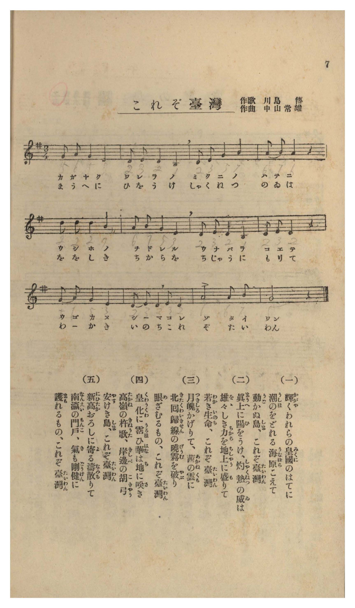

# これぞ臺灣

> Re:Shōka 使用 AI 協助辨識與重建樂譜，可能會有錯誤。歡迎回報。

- **NEUTRINO 歌聲合成版**：<br><audio controls src="korezo_taiwan_neutrino.mp3"></audio>
- **鋼琴伴奏版**：<br><audio controls src="korezo_taiwan.mp3"></audio>


- 作詞：川島傳
- 作曲：中山常雄
- 臺灣教育會《臺灣の歌》（御大典記念事業，昭和四年五月一日發行，國臺圖 0786 8）第 7 頁（唱歌第四曲）

## 說明

曲目說明與原書資訊（對應 P009.jpg，原書第 7 頁，唱歌第四曲）：
- 書名：《臺灣の歌》（國立臺灣圖書館「日治時期圖書影像系統」典藏號 jpli2011-bk-sxt_0786_8_1929，索書號 0786 8）

- 作歌：川島傳

- 作曲：中山常雄

- 調性與拍號：ト長調（G 大調／C 五聲調式）3/4 拍子，12 小節（三樂句結構），每節皆以「これぞ臺灣」（這就是臺灣）作結。


編曲說明：
- 依原譜 3/4 拍莊重開闊之三樂句結構編配 4 小節前奏與雙手鋼琴伴奏。


## 跨冊／重複收錄參照

> 同曲（《新定兒童唱歌》、《臺灣の歌》共同收錄教材）

- **[同曲]** 《新定兒童唱歌》尋常科第四學年用（2020.006.0847.0004）：[**〈これぞ臺灣〉**](../../shintei_jido_shoka/grade_4_2020.006.0847.0004/2_11_korezo_taiwan/index.md)（`G` / `3/4` — [原始 TMD](../../shintei_jido_shoka/grade_4_2020.006.0847.0004/2_11_korezo_taiwan/korezo_taiwan.tmd)）
- 總表：[跨冊重複與同名歌曲總索引](../../duplicate_songs.md)

## 歌詞

```text
（一）
輝（かがや）くわれらの皇國（みくに）のはてに
潮（うしほ）のをどれる海原（うなばら）こえて
動（うご）かぬ島（しま）、これぞ臺灣（たいわん）

（二）
眞上（まうへ）に陽（ひ）をうけ、灼熱（しやくねつ）の威（ゐ）は
雄々（をゝ）しき力（ちから）を地上（ちじやう）に盛（も）りて
若（わか）き生命（いのち）、これぞ臺灣（たいわん）

（三）
月魄（つきしろ）かげりて、茜（あかね）の雲（くも）に
北回歸線（きたくわいきせん）の曉霧（げうむ）を破（やぶ）り
眼（め）ざむるもの、これぞ臺灣（たいわん）

（四）
皇化（くわうくわ）に霑（うるほ）ひ華（はな）は地（ち）に咲（さ）き
高嶺（たかね）の杵歌（きねうた）、岸邊（きしべ）の胡弓（こきやう）
安（やす）けき島（しま）、これぞ臺灣（たいわん）

（五）
新高（にひたか）おろしに寄（よ）る濤（なみ）散（ち）りて
南瀛（なんえい）の門戶（もんこ）、氣（き）も剛健（ごうけん）に
護（まも）れるもの、これぞ臺灣（たいわん）

一、在光輝國度的南疆盡頭，越過黑潮翻湧的蒼茫大海，屹立不搖的島嶼，這就是臺灣。
二、正上方承接烈日陽光，灼熱的威力將雄健的生命力盛滿大地，年輕的生命，這就是臺灣。
三、殘月隱沒，在茜紅朝雲裡破開北回歸線的晨霧而甦醒的，這就是臺灣。
四、繁花遍地盛開，高山上的杵歌與海岸邊的胡弓聲交織，安詳的島嶼，這就是臺灣。
五、新高山吹下的山風激起浪濤飛散，南瀛的門戶氣魄剛健，屹立守護著的，這就是臺灣。）
```

## ABC

```abc
X:1
T:これぞ臺灣
M:3/4
L:1/16
Q:1/4=108
K:G
V:V1 name="Voice" snm="Voi"
[V:V1]
G2 A2 G4 E4 | D2 E2 D4 C4 | D2 E2 G4 B4 | A2 B2 A4 z4 |
w: 1.~か が や く | わ れ ら の | み く に の | は て に
w: 2.~ま う へ に | ひ を う け | しゃ く ね つ | の ゐ は
w: 3.~つ き し ろ | か げ り て | あ か ね の | く も に
w: 4.~くゎう くゎ に う | る ほ ひ は | な は ち に | さ _ き
w: 5.~に ひ た か | お ろ し に | よ る な み | ち り て
d2 d2 d4 B4 | A2 B2 G4 E4 | D2 E2 D4 C4 | D2 E2 D4 z4 |
w: 1.~う し ほ の | を ど れ る | う な ば ら | こ え て
w: 2.~を を し き | ち か ら を | ち じゃ う に | も り て
w: 3.~き た くゎい き | せ ん の げ | う む を や | ぶ _ り
w: 4.~た か ね の | き ね う た | き し べ の | こ きゃ う
w: 5.~な ん え い | の も ん こ | き も ご う | け ん に
G2 A2 G4 E4 | D2 E2 D2 E2 D4 | A8 A2 B2 | G8 z4 |
w: 1.~う ご か ぬ | し _ ま こ れ | ぞ た い | わん
w: 2.~わ _ か き | い の ち こ れ | ぞ た い | わん
w: 3.~め ざ む る | も _ の こ れ | ぞ た い | わん
w: 4.~や す け き | し _ ま こ れ | ぞ た い | わん
w: 5.~ま も れ る | も _ の こ れ | ぞ た い | わん
```

## TMD 檔案連結

- [主旋律 TMD 檔案](korezo_taiwan.tmd) [[在 TMD Studio 編輯](https://tmdlang.github.io/Tmd-TS/#tmd=s7IKdvYPcrWy4tLSUnjcOPlxU8_jxnkv2nc9b1ysoKXFVaeg9GTvnBcr573fM-vp9rlPN2972rRZCSr8bPYmoPCTHWufbtz4dMeOl7NbwDIQ3c-mznzRtOnZnObHDV0QkceN656t7Xnc0P1-T8fTfQufLln-tHXHixUznu7f-mRX97Ola9_v6Xk2Y-3TST1PZ89-unPLk11Tns3peLKj4dn0pc9n7nmxsAeo4OmcbqBpT-dMUzAwtzBTsHi_p_P5mjUK5govFzSCzJ2yEWgHUARoBNh5nWAnlSSmWynkF5Vk5KcXJRZkVFplZBaX5BdlJifmxGcn5iUqcSnaKhgaWHDZ2yq4c9kY65vYcXHpa3EBjXg-e92LVauezeh70dH-tG_-s9k7Xmxuf7GiC2TZht5n7Z0KAQYGlnpZBekg14EVIDmoB9NBwCDjety8G6ju6YReIAd7-Mzpfr4a5FOgONCzQMUvl6x43NADDIpnm3Y_m9n0bM58iPjTvRufNvc_37z7-daNjxt6QUE6vf_FzPkKWQU5mUYGhoa6Sdm6xRUl8aDwireIN7Q0sgS66_mWRSCvANXBwxHkKlCsrgWGMyKyYaIYcQ2SeLFq_7OG5cCQedbdCzQL5JvmjpdTtwPFgZ5wVwDGMZjZ76wAjM0XjZuAvKd7-oGWAYNYAajp6doJQMcYGik83dD_fH0DUNOTHZ3PVjQ97V_6fOuEZ8uBYQEMsJ5n60Gyz2e1Pdm9FBgKaAkV6G2gxpcNM59u2PhsxnqIIFAj0NlAQx43NHFxPW6YAPQXMB0_bV3xbFr744aJXGC7gDYC_d3Q8GLPXCD_cWP348aex00tQNHHjf2Pm4AIyAWy1z2f1Q6ME7Ca_SCpxtVgNeseN65_3LgMyAWZ8mzvOrCKtseN0x837oaqaJr0uHEl2KDuZ1u3A5MITM2qx40bgKaDlU1-3AgUXAYy5Wn3VJiKKWA5oKPWACMDLAg0dx9IsKERLRDAsvMfN7aAXT0Z5C-wF3cBYxPsxedz5j3ZAUq2QBPAhu8AG7765cy9YEFQ2gS7FSg1EWj-88Y9z9s2Qi1tagF7eu3jxiUQXz1dAcpuj5uA0QfkrgdZAEwTjxtawaKTHjcBwxMoAXRu79Ou2WBTFoJ8AvFu06SnczbAXAMUnwG2oA3ioOezweqbmsAqu6Ch8qJ7KVgU6ApQogCa-3zK_KcTIW4HagbGxEKSAmYHyCXgWJvT8XItMMqBypYAjQV7F5igIAEP9AnIBUBjX_TMAatpAosDCytQMLwEZQugINBksHMh6eBpz_Sns-c9W7vj-fZZYGmgoUAXgBMUyK1A7myIU0B5fnbnyznLwcrAgd8ESpPAEHq-YAvYw0D1wKgHhQQkFveARYGhD9Q8DagamKyAloMCgFivA4siWJoApuqeaTAfAB0HjHsQA5oy5kyEJkSgFdDkvOlF_3qwIDDZr4LEPTAqIfEI0fV0EiRIgIkYFEvglLF6xtNtu2CuQYTes7lbwaUNJISAiQtoPTB3gCLx6aYdL5sg6QMcI407IVpeNC98ugfoE6A4MMv0wtMNONjXAaMUEmIzwaonglIf2RkHlPnA6WPaBqAHwMpWAwMA4gew-V3AhAI2efXT9eAE1NQBjqnuZ_uB2QSoHpjDgaVf57OpEFvAIQRP0U97pz9vgGSNVUCLwQUApORZ93Jaw7MOsLuBMQuSAqeVhsZnGyAGgZNnU9PTztlPG8HZonEKNN9CUxU4Gb5Yux2a3aF5CVQEkZhWXqya92ItMMZncQELS1C8zFnxtLUTWFwCS8Onu5Y9n9UC8sa0tuezF75cAKrBX2zretnY93L3RGBh-Hz_7mc7lwPVvJi050XPamBtACwAQZXixp3A2u3Jjt5nE6aBTABWNNuAyboHrQgHldzA8gvk77WLgaXFs2k7n3Xuf9a39HlzB7AiBBZcQKeA6jJwSQUyaEUjsLB5uqEdWBQBAwYoAikjgILAQuXZ7v2gNgcotfYAmxcv9kyFK8Bh9w5wmK-bASohZm18tmkSuAGyAlgSPN_S-mzOXGDuf7F4ITCjvpzWjZzngeY-m7kCmKtfNPQ8n7LsZdskoAh2O4B5EVTW7mx80bXxJTC1ztkAdCnQOJBqYK7ZuBHob5Bx4JwCqmiBNQg4a4BCFZwXgLXqk11Lnu8EJtceYA54sXIzwSCdAvIWOFWDavMJO5_s6Abp2bjx5aIVz_Y3vNi6_dnWVcA0_HLxbHDS7YEkVaAaSMIEJkNgiQlLfdDofLquA5jgXkycjsuvoCSlpc_F5ZuYmWcVlp-ZnOpQY1BTzaUABDYWWnZgRo2CoYIREOsqmMUDiRoF03gQC0jqKpggi4CUGIP5RkDaCMgyAPHAhvgY1gAbs91A3KMALA6A4sBiDawWmLiBGCTaCRZdBxFt3A9WAcw3KKLrgXgZVBRsN8R0I5DcPiBuA-IdYB0gFSDRTUCTJ4FlQKIToaLACqUZasFasMQSqMQ6oPIJYItQLDAGyS0B4l6QZpCOpl6oDpCngBY0dYHNWQYVbYLKQEyHOR_kVZAMmvNNwHKPm_ogHgCx4D4HuRsUSiDDdoP9AxIFOQ-kaRU0TBai-HkqmAdyIJIlpiCZ1ZAQaZwPVtENVd8F9g7UYzBTmjqgtq4Ci-6Hql0I9irEoxDToanEFAyRkwARaQYsgp5MQGEwHexdpLADR-JKcFIBhT7M6SC1oEDYABYFJSGQ6GQgBjofyZHwZAIyB2wWxLOwWAR6CxRfkEQIlEeIAltCoKQCST-wsAFGIlooIJIJKCTnwyMUktZh1swG6gM5DuQpULKBe6KpAWotJHeARLeBeaBkhZ5UQKZjJi6QvWvhLgXFMEwUFJg7UdSC3ACsqmEeQ08mwBAFO7MDrAnmIFDeAHl8MlgUREItAKfpKcjJFZjRICYgUjqBwgSWGEBJRxcMQUkIpB7Cw5ZIpkDTMLA1DrUWEqmgkgBoOTipgETnQc2AhFwLpNSB-AME0VMIqGCCGQyLuBaI_8EpgjyjQWmjqRGoaBo4tpESMTD4IHFDrtGgRAFMNsBGFjjkkd1NaYCAkwNQOzjiUbIeJa6u5eLStVMAVTsKunbKXAA)]
- [鋼琴伴奏 TMD 檔案](korezo_taiwan_piano.tmd) [[在 TMD Studio 編輯](https://tmdlang.github.io/Tmd-TS/#tmd=s7IKdvYPcrWy4tLSUnjcOPlxU8_jxnkv2nc9b1z8fk_Hy-49zydsebJny9Ol_c87O97v6VTQ0uKqU1B6snfOi5Xz3u-Z9XT73Kebtz1t2qwEFX42exNQ-MmOtU83bny6Y8fL2S1gmefbV0BkglKtijOO9mYnKrycPfNZZzeyFWCVEMufTZ35omnTsznNjxu6ICKPG9c9W9vzuKEb6K6n-xY-XbL8aeuOFytmPN2_9cmu7mdL177f0_Nsxtqnk3qezp79dOeWJ7umPJvT8WRHw7PpS5_P3PNiYQ9QwdM53UDTns6ZpmBgbmGmYAH00fM1axTMFV4uaATbXpKYbqWQX1SSkZ9elFiQUWmVkVlckl-UmZyYE5-dmJeoxKVoq2BoYMFlb6vgzmVjrG9ix8Wlr8UF8d-LVauezegD-pLrcfPuJ_vmPu2b_2LtHAWgKoVn3b0v-rpetve-nNb9cnrXk53dT3Z0PlvR9LR_6fOtE54t7waa8LK1V8FE4emG_ufrG5529gJD5EVHO2YwPW5o4tLS5-LyzCspyrcKyEzMyw_ycKgxqKnmUgACGwstOzCjRsFQwQiIdRXM4oFEjYJpPIgFJ0FCRkASBI0UjMHqITwDkBxXLYoVPtitMIkHGWQIIszATJA1cCEIE2gNmIYogIkZIpTB7fNNzMwjy0e6QIcgiYCUGEM9aAz2JMQKkCE-hjXApN4NxD0Kj5tagOKPG_vBah839QMxSLQTLLoOItq4H6ziceNqFNH1QLwMKgq2G2K6EUhuHxC3AfEOsA6QCpDoJqDJk8AyINGJUNHpj5uaoRasBUssgUqsAyqfALYIxQJjkNwSIO4FaQbpaOqF6gB5CmhBUxfYnGVQ0SaoDMR0mPNBXgXJoDnfBCz3uKkP4gEQC-5zkLtBoQQybDfYPyBRkPNAmlZBw2Qhip-ngnkgByJZYgqSWQ0Jkcb5YBXdUPVdYO9APQYzpakDausqsOh-qNqFYK9CPAoxHZpKTMEQOQkQkWbAIujJBBQG08HeRQo7cCSuBCcVUOjDnA5SCwqEDWBRUBICiU4GYqDzkRwJTyYgc8BmQTwLi0Wgt0DxBUmEQHmE6AxIUoGkH1jYACMRLRQQyQQUkvPhEQpJ6zBrZgP1gRwH8hQo2cA90dQAtRaSO0Ci28A8ULJCTyog0zETF8jetXCXgmIYJgoKzJ0oakFu6EV4DD2ZAEMU7MwOsCaYg0B5A-TxyWBREAm1AJympyAnV2BGg5iASOlUKR5RE8kUaBp-3LgGai0kUkElAdBycFIBic6DmgEJuRZIqQPxBwiipxBQwQQzGBZxLRD_g1MEeUaD0kZTI1DRNHBsIyViYPBB4oZco0GJAphsHjfOBIc8srspDRBwcgBqB0c8StajxNUotQ6plZwRpBTBqPeMMRRBaz1YyoMrArNQ9BK0AYt55NfCSDrhtbCunQK44lcAMkBhE-1jGItgGyGxjZHYJkhsUxBbmQsA)]

## 分析

```text
================================================================================
📊 TMD Song Profile: [ これぞ臺灣 ]
================================================================================
⏱  Duration:       0:20 (20.0s), 12 measures total
🎼 Key & Tempo:    首調基準 G, != 108.0 BPM, <3/4>
   - 分析範圍：      由實際發聲的音符與和弦推測調性；播放脈絡另行呈現
🎤 人聲音域:    C4 (MIDI 60) – D5 (MIDI 74) [跨度: 14 個半音 / 1.2 個八度, 難度: moderate]
   - 最低音:  C4 in [Main #1 @ m.2, 0:02]
   - 最高音: D5 in [Main #1 @ m.5, 0:06]
   - 適合: soprano, mezzo-soprano, contralto, tenor, baritone, bass
🏛  結構:      Main (20.0s)
⚡ 編曲密度:        Peak 1 軌道同時演奏
🗝  調性診斷：       G 大調（純淨自然大調，未偵測到可信轉調）
   - 風格氣質:    純淨自然大調（陽光明朗、易唱易記，無明顯調外色彩）
   - 轉調歷程:    全曲維持單一推測調性（未偵測到可信轉調）
   - 核心骨幹音:  D, G, E, A, B
   - 調性數值:    G 大調 [相關度: 0.85, 穩定度: Moderate, 自然音純度: 100.0%]
   - 候選調性 (K-S): G 大調 (0.85), D 大調 (0.78), E 小調 (0.62)
   - 五度圈歷程:   +1
   - 各段落調性細節:
     • [Main #1]: G 大調 (r: 0.85, 自然音純度: 100.0%)

  [ 五度圈游移軌跡 ]
               C  
         F           [G ]*
      Bb               D  
      Eb               A  
         Ab           E  
            Db       B  
               F# 
     (* = active key center)

  [ 十二半音累積音高分佈 ]
     C  : █████                      6.1%
     C# :                            0.0%
     D  : ████████████████████████  27.3%
     D# :                            0.0%
     E  : ████████████████          18.2%
     F  :                            0.0%
     F# :                            0.0%
     G  : ███████████████████       21.2%
     G# :                            0.0%
     A  : ███████████████           16.7%
     A# :                            0.0%
     B  : █████████                 10.6%
--------------------------------------------------------------------------------
Assignment 軌道音域：
  - Voice         : C4 – D5 (14 個半音 / 1.2 個八度, 43 個音符)
================================================================================
```


## 原書掃描頁




