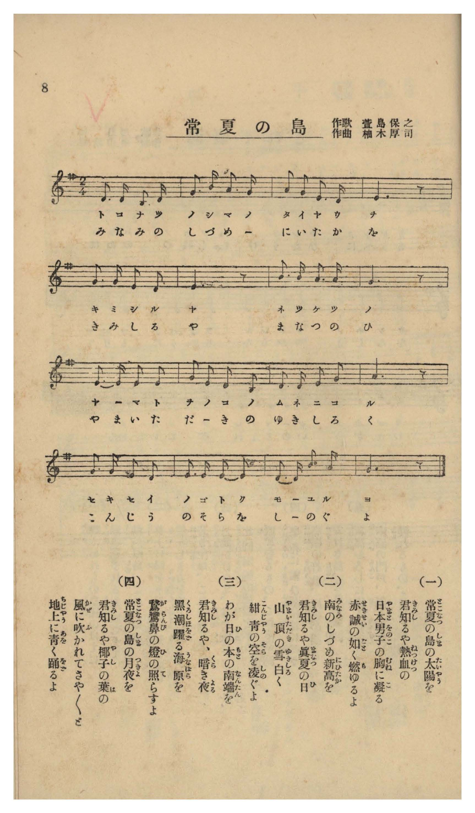

# 常夏の島

> Re:Shōka 使用 AI 協助辨識與重建樂譜，可能會有錯誤。歡迎回報。

- **NEUTRINO 歌聲合成版**：<br><audio controls src="tokonatsu_no_shima_neutrino.mp3"></audio>
- **鋼琴伴奏版**：<br><audio controls src="tokonatsu_no_shima.mp3"></audio>


- 作詞：萱島保之
- 作曲：柚木厚司
- 臺灣教育會《臺灣の歌》（御大典記念事業，昭和四年五月一日發行，國臺圖 0786 8）第 8 頁（唱歌第五曲）

## 說明

曲目說明與原書資訊（對應 P010.jpg，原書第 8 頁，唱歌第五曲）：
- 書名：《臺灣の歌》（國立臺灣圖書館「日治時期圖書影像系統」典藏號 jpli2011-bk-sxt_0786_8_1929，索書號 0786 8）
- 作歌：萱島保之
- 作曲：柚木厚司
- 調性與拍號：ト長調（G 大調五聲音階）2/4 拍子，16 小節
- 內容簡介：以附點節奏歌詠常夏之島的太陽、新高山頂白雪與紺青晴空、黑潮海原與鵝鑾鼻（がらんび）燈塔，以及月夜裡隨風沙沙搖曳的椰子葉。

編曲說明：
- 依原譜 G 大調五聲音階（2/4 拍，♩= 104）編配 4 小節前奏與雙手鋼琴伴奏。


## 歌詞

```text
（一）
常夏（とこなつ）の島（しま）の太陽（たいやう）を
君（きみ）知（し）るや熱血（ねつけつ）の
日本男子（やまとをのこ）の胸（むね）に凝（こ）る
赤誠（せきせい）の如（ごと）く燃（も）ゆるよ

（二）
南（みなみ）のしづめ新高（にひたか）を
君（きみ）知（し）るや眞夏（まなつ）の日（ひ）
山頂（やまいただき）の雪（ゆき）白（しろ）く
紺青（こんじやう）の空（そら）を凌（しの）ぐよ

（三）
わが日（ひ）の本（もと）の南端（なんたん）を
君（きみ）知（し）るや、暗（くら）き夜（よる）
黑潮（くろしほ）躍（をど）る海原（うなばら）を
鵞鑾鼻（がらんび）の燈（ひ）の照（て）らすよ

（四）
常夏（とこなつ）の島（しま）の月夜（つきよ）を
君（きみ）知（し）るや椰子（やし）の葉（は）の
風（かぜ）に吹（ふ）かれてさやく／＼と
地上（ちじやう）に青（あを）く踊（をど）るよ

一、你可知道常夏之島的太陽？如同凝聚於熱血男兒胸中的赤誠一般熊熊燃燒啊。
二、你可知道鎮護南疆的新高山？盛夏之日山頂白雪皚皚，高聳直入紺青色的天際啊。
三、你可知道南端海角？在暗夜裡，鵝鑾鼻的燈塔照亮黑潮躍動的蒼茫大海啊。
四、你可知道常夏之島的月夜？椰子樹葉隨風沙沙搖曳，在大地上映出青翠舞影啊。）
```

## ABC

```abc
X:1
T:常夏の島
M:2/4
L:1/16
Q:1/4=104
K:G
V:V1 name="Voice" snm="Voi"
[V:V1]
D3 D B,3 D | G3 B A3 G | A2 G2 E3 D | E6 z2 |
w: 1.~と こ な つ | の し ま の | た い や う | を
w: 2.~み な み の | し づ め に | ひ た か _ | を
w: 3.~わ が ひ の | も と の な | ん た ん _ | を
w: 4.~と こ な つ | の し ま の | つ き よ _ | を
G3 G E2 D2 | E6 z2 | B3 B A3 A | G6 z2 |
w: 1.~き み し る | や | ね つ け つ | の
w: 2.~き み し る | や | ま な つ の | ひ
w: 3.~き み し る | や | く ら き よ | る
w: 4.~き み し る | や | や し の は | の
E3 E E2 E2 | G2 E2 D2 B,2 | D3 D E2 G2 | A6 z2 |
w: 1.~や ま と を | の こ の む | ね に こ る | _
w: 2.~や ま い た | だ き の ゆ | き し ろ く | _
w: 3.~く ろ し ほ | を ど る う | な ば ら を | _
w: 4.~か ぜ に ふ | か れ て さ | や さ や と | _
G3 G E2 D2 | E3 E E2 E2 | D3 D B3 A | G6 z2 |
w: 1.~せ き せ い | の ご と く | も ゆ る _ | よ
w: 2.~こ ん じゃ う | の そ ら を | し の ぐ _ | よ
w: 3.~が ら ん び | の ひ の て | ら す _ _ | よ
w: 4.~ち じゃ う に | あ を く を | ど る _ _ | よ
```

## TMD 檔案連結

- [主旋律 TMD 檔案](tokonatsu_no_shima.tmd) [[在 TMD Studio 編輯](https://tmdlang.github.io/Tmd-TS/#tmd=s7IKdvYPcrWy4qpTUCpJTLdSyC_KTM_MsypJzCxPzIvPT0vLTM5MzFHi0tJSeLpjx9Ml_Y8b1z3dvE1BSwuk5cneOS9Wznu_Z9aLCRuBok_2z32ys1sJKvNs9iagzLP5s57NWfG0b9bT_h1gmRftu543Ln42deaLpk3P5jQ_buiCiAANfra253FD9_s9HU_3LXy6ZPnT1h0vVsx4un_rk13dz5aufb-n59mMtU8n9TydPfvpzi1Pdk15NqfjyY6GZ9OXPp-558XCHqCCp3O6gaY9nTNNwcDcwkzB4v2ezudr1ihYKLxc0Agyd8pGoB1AEZBmkPM6wU6C-rwkIz-9KLEgo9IqI7O4BBgSyYk58dmJeYlKXIq2CoYGJlz2tgruXDZG-iZ2XFz6WlxAI57PXvdi1apnM_pedLQ_7Zv_bPaOF5vbX6zoAlm2ofdZe6dCgIGhgV5WQTrIdWAFSA7qwXQQMMi4HjfvBqp7OqEXyMEePnO6n68G-RQoDvQsUPHLJSseN_QAg-LZpt3PZjY9mzMfIv5078anzf3PN-9-vnXj44ZeUJBO738xc75CVkFOppGBoaFuUrZucUVJPCi84i3iDS2NLIHuer5lEcgrQHXwcAS5ChSra4HhjBLfMAmM6AZJvFi1_1nDcmDgPOvuBRoH8lBzx8up24HiQH-4KwCjGcgE-v5F46aX8ze_nNUHtAoYwApA9U_XTgA6xdBM4emG_ufrG0DGPW1d_nTdzucbFj7ZDQyHWU92L305s-Xl7nlA6adL-4Fue7FyASSdAh0GdOHzWS1Pl6x6OXPv44bGZ9M2vFw94-nGjS8XND2fuffl7FVAZz3fsuvl3EnPZm55vnIXUM3L3ROf7V33bOt2YFQBZV9unfty4r6Xe3YD3fq4sedxU-fjpsmPGzeDklV7x9OFU4DuA7rhaX8XMCk-XTLnxeKFL2eteLloxbNNM0FoAjAKNgPd8GzJBqBnXkzsfNzQxMX1uGEC2KXznraueDat_XHDRC6g-cCUDA7lhgaIB8BWrnjcCLRv1ePGJUA5SNYDi09_3LgPKgL2Hlhw_uPGlsdNLY8b20BSTZPAZk2YDZbrfdwIDPDO5_OXQvSDVXQDVT9v2_hiIdBmoOBaoDWPGyfCLQPpB6WoOWueT9kOjowOsPH7QO5qmgRUAXQdROmL5h1g2QagKWCR1U_b54INBStoAiaShoYXW5e8WLUALDob7CIg2QL1xbImsPgUoNFgkf7n7c1gE4HiQP1tYMd2cIEDahcwBUICqhfoD6Cu_eAgAvkP7CZg4Cx93ASNb7CC1Y8bN4HDB5hoiA-ZOfNg0QD0MSIOgEECFgTlVrBB4BSFFDhAEmjVAqDREA3AlAaWbYOIANMeNA6bIAr6QaZAEiIkyMCJbAYiKhvXAVMnWGouMAlCvPC0HRgKkJSwDqxmAjx8doCUgMx83AQsrkGFAty9IOfPWQMJWFhQrwMG4_PV68FqVoGtng8kSQgoUN6aBYmJfqj7GnuBuQFsDRCBAh1kECRzwdQBjQO6HZizOl_sAoYDUB0wRa2EGArJgGCVwEADBv0GuL_BBm2dhytbgsKqvQPZv89bl4O5y8D6gSIzYQEFrEfIyXGQrA4WBGaXXqBpJIQVpCSAJRawODD3TAR6DqgMGAewfAcsQ8BC3Y8bgVaBM9SEnWCRrWAu0KweoJ8eN04FGwR0OxDtATof7Io5G57sAFVBjxsXoiak1bA01gR0MCTxvYCoRAp9WPi8WDXvxVqgm2ZxAcsmYCQ_2bvgaf96oJ9eNk7GWsi-3zMfmJGfTugBZv4XjbOeTdsDKV1AxUfrJGAZ8WTHWqBiSDkANPNFx5rnbV0g1N78vH3S06ldoPIRmL_RLHvZt-7F2u2gZDqtDVSawgpyoH3PgW0BsDuAqRy5aH8-axYQAYtnoMoXjZufz97ytHUpJI-96NwEdvHKl7Nmw6zcASyZUf0HzhPAdPhiOTCcgJXpCmASh5TwIENh9QLQIEhFAExlT3atg6RwYHp-2j0V5NFJe170rAZWcaD0DLEJmObwhyQsdc2HpJRnK3YCUwdmpQJu66wANZLAcf1sxoKn7SDPPd-_4EXHPFCtD7YPlL619Lm4fBOBjbqw_MzkVIcag5pqLgUgsDE007IDs2oUTOMVdIEQSBnDWTUKhmCmsYIRmDYEioBYIFEzJFVQNgQaAHEN2FAfwxoFYHoEiwLzFBCvgrKXADUBkzmUNx2I90HZ68Ay88HsFhDZBCJBvDaQTNMkJJtAtkJtMgLp2g9VuQqJDTFvOpS3FGhCI5S9GiyzCcyG2NcNNRePPcYguX6oCT1Q_XB7mpqgvBVIvlsFlpmMsAfMJmCPCbkhtwTM7gXb04HXHmi8Q2LYEBKH4ESALT6BSQA5IRjBNWKPc5D9IHfsh4Y9sEiBugMSm0juAKpYC_cbsO2BxZ_YY5s0O2ChBEoboDBChBgkBrHGNIl2QNNFUydCJzAOQKphKQtbLJNkBzw3gGIelgrW4wgraAxDYxNIgVlgAhJ9iDgH53nkQgAsBVIDyfE4IhrunH3Q5ApJaDDngJIuJKBBMg1QGVh0r4bJQz2MnOjQIhvFHnCxAM5KINMWgHmgQITZ0waVgQUsMKiaIPKgCMJpDzjCYVHYC4uMxt0Q08D-AtaPcPeCCiSIPbCsuQEc9YgwwGEPONIhCQJYs4PDAcTaCjUNbHZTD1hsGZicCnUBLAymQtmQEMdmD-GsjZYYkAp_MINQ_p4NdQoomEBsSKQgl0xTYAkCGujwshEYPYj8ABKHlVJYoh2cPCAlJrgR0ww2EBbuMKvmooU7orhfB8QTCFsFjnlQiEMzL7Sw3oxmzyZ4qgbFC8g8kK0g_ky4qXhsAcf7QqgOsGcgXoEkAJAkLIQmQUMN4SFQsoMlPHwW1XJx6dopgKp6BV07ZS4A)]
- [鋼琴伴奏 TMD 檔案](tokonatsu_no_shima_piano.tmd) [[在 TMD Studio 編輯](https://tmdlang.github.io/Tmd-TS/#tmd=s7IKdvYPcrWy4tLSUni6Y8fTJf2PG9c93bzt_Z6Ol917nk_Y8mTPlqdL-593drzf06mgpcVVp6D0ZO-cFyvnvd8z68WEjUClT_bPfbKzWwkq82z2JqDMs_mzns1Z8bRv1tP-HWCZ59tXQGSCUq2KM472ZicqvJw981lnN7ItYJUv2nc9b1z8bOrMF02bns1pftzQBREBuuvZ2p7HDd1Apz3dt_DpkuVPW3e8WDHj6f6tT3Z1P1u69v2enmcz1j6d1PN09uynO7c82TXl2ZyOJzsank1f-nzmnhcLe4AKns7pBpr2dM40BQNzCzMFC6Cnnq9Zo2Ch8HJBI9j2ksR0K4X8opKM_PSixIKMSquMzOKS_KLM5MSc-OzEvEQlLkVbBUMDEy57WwV3LhsjfRM7Li59LS6I_16sWvVsRh_Ql1yPm3c_2Tf3ad_8F2vnKLgrAF37YtV-oJNeNG56OX_zy1lARR1AzQrPunuBzno0cyXYVJBztq942dqrYKLwdEP_8_UNTzt7gQHzoqMdM7QeNzRxaelzcXnmlRTlWwVkJublB3k41BjUVHMpAIGNoZmWHZhVo2CooAuEhgpm8UDKFETUQNi6IArMAhM1EEmwGmMwwwiuGwINQKq4alFs9cFlK8gsYxCBYIHshYsgMUE2g2gjiAvhTKgpEBFDMAl3gm9iZh5-fyP5Bs6C-ccY6DdIqNSAWSBRaJiAVUHZyN4GGepjWKPwuHEFWPRx42QgXgVlLwFqAiZSKG86EO-DsteBZeaD2S0gsglEgnhtIJmmSUg2gT0NsckIpGs_VOUqJDbEvOlQ3lKgCY1Q9mqwzCYwG2JfN9RcPPYYg-T6oSb0QPXD7WlqgvJWIPluFVhmMsIeMJuAPSbkhtwSMLsXbE8HXnsIp3ek-IQmcVhCwJ7UEXEOsh_kjv3QsH_cBApbkDsgsYnkDqCKtXC_PW6ciMWf2GObNDtgoQRKG6AwQoQYJAaxxjSJdkDTRVMnQicwDkCqYSkLWyyTZAc8N4BiHpYK1uMIK2gMYy-94HkYHOfQAgdRCIClQGogOR5HRMOdsw-aXCEJDeYcUNKFBDRIpgEqA4vu1TB5qIeREx1aZKPYAy4WwFkJZNoCMA8UiDB72qAysIAFBlUTRB4UQTjtAUc4LAp7YZHRuBtiGthfjxtXwt0LKpAg9sCy5gZw1CPCAIc94EiHJIjHjXPA4QBibYWaBja7qQcstgxMToW6ABYGU6FsSIhjs4dGVRkif8-GOgUUTCA2JFKQS6YpsAQBDXR42QiMHkR-AInDSiks0Q5OHpAS83HjjMdNzWADYeEOs2ouWrgjivt1QDyBsFXgmAeFODTzQgvrzWj2bIKnalC8gMwD2Qriz4SbiscWcLwvhOoAewbiFUgCAEnCQmgSNNQQHgIlO1jCw2cRSk2Pq62Bt_UALghQhI3AHEj7A0UCo3WCSCVEN2iglQtCGIeLwCxk83E1jXB4AomDvyVFhh_IbpTp2imAm4YKQAYo2qJ9DGMRbCMktjES2wTEVuYCAA)]

## 分析

```text
================================================================================
📊 TMD Song Profile: [ 常夏の島 ]
================================================================================
⏱  Duration:       0:18 (18.5s), 16 measures total
🎼 Key & Tempo:    首調基準 G, != 104.0 BPM, <2/4>
   - 分析範圍：      由實際發聲的音符與和弦推測調性；播放脈絡另行呈現
🎤 人聲音域:    B3 (MIDI 59) – B4 (MIDI 71) [跨度: 12 個半音 / 1.0 個八度, 難度: easy]
   - 最低音:  B3 in [Main #1 @ m.1, 0:00]
   - 最高音: B4 in [Main #1 @ m.2, 0:01]
   - 適合: soprano, mezzo-soprano, contralto, tenor, baritone, bass
🏛  結構:      Main (18.5s)
⚡ 編曲密度:        Peak 1 軌道同時演奏
🗝  調性診斷：       E 小調（純淨自然小調，未偵測到可信轉調）
   - 風格氣質:    純淨自然小調（陰鬱抒情、旋律集中，無明顯調外色彩）
   - 轉調歷程:    全曲維持單一推測調性（未偵測到可信轉調）
   - 核心骨幹音:  E, G, D, A, B
   - 調性數值:    E 小調 [相關度: 0.85, 穩定度: High, 自然音純度: 100.0%]
   - 候選調性 (K-S): E 小調 (0.85), G 大調 (0.69), D 大調 (0.53)
   - 五度圈歷程:   +4
   - 各段落調性細節:
     • [Main #1]: E 小調 (r: 0.85, 自然音純度: 100.0%)

  [ 五度圈游移軌跡 ]
               C  
         F            G  
      Bb               D  
      Eb               A  
         Ab          [E ]*
            Db       B  
               F# 
     (* = active key center)

  [ 十二半音累積音高分佈 ]
     C  :                            0.0%
     C# :                            0.0%
     D  : ████████████              16.9%
     D# :                            0.0%
     E  : ████████████████████████  33.1%
     F  :                            0.0%
     F# :                            0.0%
     G  : ██████████████████        25.4%
     G# :                            0.0%
     A  : ██████████                13.6%
     A# :                            0.0%
     B  : ████████                  11.0%
--------------------------------------------------------------------------------
Assignment 軌道音域：
  - Voice         : B3 – B4 (12 個半音 / 1.0 個八度, 49 個音符)
================================================================================
```


## 原書掃描頁




