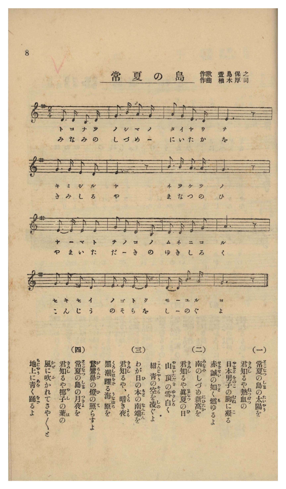

# 常夏の島

> Re:Shōka 使用 AI 協助辨識與重建樂譜，可能會有錯誤。歡迎回報。

- **鋼琴伴奏版**：<br><audio controls src="tokonatsu_no_shima.mp3"></audio>
- **NEUTRINO 歌聲合成版**：<br><audio controls src="tokonatsu_no_shima_neutrino.mp3"></audio>

- 作詞：萱島保之
- 作曲：柚木厚司
- 臺灣教育會《臺灣の歌》（御大典記念事業，昭和四年五月一日發行，國臺圖 0786 8）第 8 頁（唱歌第五曲）

## 說明

曲目說明與原書資訊（對應 P010.jpg，原書第 8 頁，唱歌第五曲）：
- 書名：《臺灣の歌》（國立臺灣圖書館「日治時期圖書影像系統」典藏號 jpli2011-bk-sxt_0786_8_1929，索書號 0786 8）
- 作歌：萱島保之
- 作曲：柚木厚司
- 調性與拍號：ト長調（G 大調五聲音階）2/4 拍子，16 小節
- 內容簡介：以附點節奏歌詠常夏之島的太陽、新高山頂白雪與紺青晴空、黑潮海原與鵝鑾鼻（がらんび）燈塔，以及月夜裡隨風沙沙搖曳的椰子葉。

編曲說明：
- 依原譜 G 大調五聲音階（2/4 拍，♩= 104）編配 4 小節前奏與雙手鋼琴伴奏。


## 歌詞

```text
（一）
常夏（とこなつ）の島（しま）の太陽（たいやう）を
君（きみ）知（し）るや熱血（ねつけつ）の
日本男子（やまとをのこ）の胸（むね）に凝（こ）る
赤誠（せきせい）の如（ごと）く燃（も）ゆるよ

（二）
南（みなみ）のしづめ新高（にひたか）を
君（きみ）知（し）るや眞夏（まなつ）の日（ひ）
山頂（やまいただき）の雪（ゆき）白（しろ）く
紺青（こんじやう）の空（そら）を凌（しの）ぐよ

（三）
わが日（ひ）の本（もと）の南端（なんたん）を
君（きみ）知（し）るや、暗（くら）き夜（よる）
黑潮（くろしほ）躍（をど）る海原（うなばら）を
鵞鑾鼻（がらんび）の燈（ひ）の照（て）らすよ

（四）
常夏（とこなつ）の島（しま）の月夜（つきよ）を
君（きみ）知（し）るや椰子（やし）の葉（は）の
風（かぜ）に吹（ふ）かれてさやく／＼と
地上（ちじやう）に青（あを）く踊（をど）るよ

一、你可知道常夏之島的太陽？如同凝聚於熱血男兒胸中的赤誠一般熊熊燃燒啊。
二、你可知道鎮護南疆的新高山？盛夏之日山頂白雪皚皚，高聳直入紺青色的天際啊。
三、你可知道南端海角？在暗夜裡，鵝鑾鼻的燈塔照亮黑潮躍動的蒼茫大海啊。
四、你可知道常夏之島的月夜？椰子樹葉隨風沙沙搖曳，在大地上映出青翠舞影啊。）
```

## ABC

<div class="abc-score" data-abc-src="tokonatsu_no_shima.abc" aria-label="五線譜載入中"></div>

[下載 ABC 原始檔](tokonatsu_no_shima.abc)

## TMD 檔案連結

- [主旋律 TMD 檔案](tokonatsu_no_shima.tmd) [[在 TMD Studio 編輯](https://tmdlang.github.io/Tmd-TS/#tmd=s7IKdvYPcrWy4qpTUCpJTLdSyC_KTM_MsypJzCxPzIvPT0vLTM5MzFGCyyfn5-SkJpdk5sPV5OXHl5YkIlSU5eeU5qZaGSJEivNLi5JTcamHyMYXJKanWgUYGBogZAqK8stS8xLzEHpTU0qTE0GWxycWF-cDXQZiIzSklmWmpIKUFxRl5iYWVcan5CcD3ZJXguS61KJikOPL8pORvVWSkQp0M8yFiSWlRalKXFpaCk937Hi6pP9x47qnm7cpaGmB1D_ZO-fFynnv98x6MWEjUPTJ_rlPdnaDTQLKPJu9CSjzbP6sZ3NWPO2b9bR_B1jmRfuu542Ln02d-aJp07M5zY8buiAiQIOfre153ND9fk_H030Lny5Z_rR1x4sVM57u3_pkV_ezpWvf7-l5NmPt00k9T2fPfrpzy5NdU57N6Xiyo-HZ9KXPZ-55sbAHqODpnG6gaU_nTFMwMLcwU7B4v6fz-Zo1ChYKLxc0gsydshFoB1AEpBnkvE6Et_OLSjLy04sSCzIqrTIyi0uAsQ8MlvjsxDxgBCnaKhgamHDZ2yq4c9kY6ZvYcXHpa3EBjXg-e92LVauezeh70dH-tG_-s9k7Xmxuf7GiC2TZht5n7Z0KoHjUyypIB7kOrADJQT2YDgIGGdfj5t1AdU8n9AI52MNnTvfz1SCfAsWBngUqfrlkxeOGHmBQPNu0-9nMpmdz5kPEn-7d-LS5__nm3c-3bnzc0AsK0un9L2bOV8gqyMk0MjA01E3K1i2uKIkHhVe8RbyhpZEl0F3PtywCeQWoDh6OIFeBYnUtMJxR4hsmgRHdIIkXq_Y_a1gODJxn3b1A40Aeau54OXU7UBzoD3cFYDQDmUDfv2jc9HL-5pez-oBWAQNYAaj-6doJQKcYmik83dD_fH0DyLinrcufrtv5fMPCJ7uB4TDrye6lL2e2vNw9Dyj9dGk_0G0vVi6ApFOgw4AufD6r5emSVS9n7n3c0Phs2oaXq2c83bjx5YKm5zP3vpy9Cuis51t2vZw76dnMLc9X7gKqebl74rO9655t3Q6MKqDsy61zX07c93LPbqBbHzf2PG7qfNw0-XHjZlCyau94unAK0H1ANzzt7wImxadL5rxYvPDlrBUvF614tmkmCE0ARsFmoBueLdkA9MyLiZ2PG5q4uB43TAC7dN7T1hXPprU_bpjIBTQfmJJBoQxxPdi-FY8bgZatety4BCgByXdg8emPG_dBRcB-AwvOf9zY8rip5XFjG0iqaRLX0wmzwRK9jxuBQd35fP5SiGawdDdQ6fO2jS8WAu0ECq4F2vG4cSLcJi5QQpqz5vmU7eA46AAbvA_koqZJQGmguyDqXjTvAMs2AI0Ai6x-2j4XbCJYQVM314utS16sWgAWmg12C5BsgTp-WRNYfArQXLBI__P2ZrBxQHGg5jawMzu4wIGzC5jqgIHTC3Q-UMt-cLCAvAV2DTBAlj5ugkYwWMHqx42bwGECTCVEhsacebBwB3oUEejAkAALgvImFyTxIAUIkARasgBoLkQ1MFGBZdsgIsBkBo2xJoiCfi5IgoOEETgxzUDEWuM6YCoES80FJjWIy5-2A30OifR1YDUT4GGyA6SE63ETsEwG5Xy4M0GunrMGEpKwsF0HDLrnq9eD1awC2zsfSBIbOKDcMwsS9P1QlzX2AtM72A4gAoUyFyTvwBQBzQI6GZhxOl_sAvodqAiYclZCTITkL7BKYEABw3oD3LtcL7fOw5XlQOHT3oHszeety8HcZWDNQJGZsMAB1hEk5yZIHgYLAnNDL9AoYsMHkr9h6QIsDswcE4F-AioDBjo4TwGLBTC_-3Ej0BJwZpmwEyyyFcwFGtQD9MrjxqlgU4CuBqI9QIdzPZ2z4ckOUJXyuHEhaoJZDUtLTUB3QlLYC4hKpOCGhcmLVfNerAW6ZhYXsKwBRumTvQue9q8H-uZl42Ssheb7PfOBmfTphB5grn7ROOvZtD2QMgNULrROAmb-JzvWAhVD8jjQzBcda563dYFQe_Pz9klPp3aByjtg3kWz7GXfuhdrt4NS5LQ2UOkIK5iB9j0H1u1gdwATNHJR_XzWLCACFrdAlS8aNz-fveVp61JIXnrRuQns4pUvZ82GWbkDWNKi-g-c_IEJ78VyYDgBK8cVwAQNKbFBhsLKeaBBkIIdmLKe7FoHSdLABPy0eyrIo5P2vOhZDayyQAkYYhMwneEPSViimg9JI89W7ASmC8xKAtx2WQFq9IDj-tmMBU_bQZ57vn_Bi455oFocbB8oTWvpc3H5JgIbpmH5mcmpDjUGNdVcCkBgY2imZQdm1SiYxivoAiGQMoazahQMwUxjBSMwbQgUAbFAomZIqqBsCDQA4hqwoT6GNQrAxAgWBWYlIF4FZS8BagImcChvOhDvg7LXgWXmg9ktILIJTDa2gUwF8iYh2QSyFWqTEUjXfqgZq5DYEPOmQ3lLgSY0QnWDxFeDRTeBSYid3fjtMQbJ9UNN64HqhdvT1ATlQfyMsB_kb2ChhLAHzMZjjwm5IbcEzO4F29GB8CkWe6DxDolhQ0gcghMBtvgEJgHkhGAE14g9zkH2g9yxHxH2Td1gd4BiE8UdQBVr4X4Dtiiw-BN7bJNmByyUQGkDFEaIEIPEINaYJtEOaLpo6kToBMYBSDUoVeGKZZLsgIpBYh6WCtbjCCtoDENjE0iBWWACEn2IOAfneeRCACwFUgPJ8TgiGu5ESABDkiwsuUGcBEq-MDZIpgGqfi00-0FU4AkkUGTDvb0PiCEFAigbgby9AO4CUEAi7AEVGBBRRLD2IkUT9giHRSFMF7A9guKjlWBZmEtBOmD2gBLWBqjuToJZG2YCsGIHk6CQAIlvBfNAssCqHcxeBpWZCjW7BYWNKCawRDyerI2WGJAKfzCDUP6eDXU8KJhgbIhjYGlyCtRhkCBFlI0gZ0ODDJrKYaUUlmgHJx1IaQluxDRDDW9DsWouOMRBykAhjijuYakBRE_AZxU45kGhDc284MIZpGszij2bkDIZSBwUMzA9EBUz8dkCjveFUJVgz8ASD6IuAkk1wRMbLORgCQmS_PCFXC0Xl66dAqiqV9C1U-YCAA)]
- [鋼琴伴奏 TMD 檔案](tokonatsu_no_shima_piano.tmd) [[在 TMD Studio 編輯](https://tmdlang.github.io/Tmd-TS/#tmd=s7IKdvYPcrWy4qpTUCpJTLdSSM7PyUlNLsnMz7MqScwsT8yLz8uPLy1JVIKrKMvPKc1NtTJEiBTnlxYlp-JSD5GNL0hMT7UKMDA0QMgUFOWXpeYl5iH0pqaUJieCLI9PLC7OT84EsxEaUssyU1JByguKMnMTiyrjU_KTgW7JK0FyXWpRMcjxBZmJQIckFhUl5qWnoiopyQAKwF2bWFJalKrEpaWl8HTHjqdL-h83rnu6edv7PR0vu_c8n7DlyZ4tT5f2P-_seL-nU0FLC2TIk71zXqyc937PrBcTNgKVPtk_98nObrDxQJlnszcBZZ7Nn_VszoqnfbOe9u8AyzzfvgIiE5RqVZxxtDc7UeHl7JnPOruRbQGrfNG-63nj4mdTZ75o2vRsTvPjhi6ICNBdz9b2PG7oBjrt6b6FT5csf9q648WKGU_3b32yq_vZ0rXv9_Q8m7H26aSep7NnP9255cmuKc_mdDzZ0fBs-tLnM_e8WNgDVPB0TjfQtKdzpikYmFuYKVgAPfV8zRoFC4WXCxoRAZRfVJKRn16UWJBRaZWRWVySX5SZnJgTn52YB4xWRVsFQwMTLntbBXcuGyN9EzsuLn0tLoj_Xqxa9WxGH9CXXI-bdz_ZN_dp3_wXa-couCsAXfti1X6gk140bno5f_PLWUBFHUDNCs-6e4HOejRzJdhUkHO2r3jZ2qtgovB0Q__z9Q1PO3uBAfOiox0ztB43NHFp6XNxeeaVFOVbBYDiO8jDocagpppLAQhsDM207MCsGgVDBV0gNFQwiwdSpiCiBsLWBVFgFpiogUiC1RiDGUZw3RBoAFLFVYtiqw-yrRYIS4FmxENJkHVgNpQCWRSvYBQPo8CqQWxDIDaA2OCbmJmH31tIjoWzYM41Bjod4ukaMAskCvUyWBWUjewrkKE-hjUKjxtXgEUfN04G4lVQ9hKgJmAahPKmA_E-KHsdWGY-mN0CIpvAZGMbOEQfN01CsgkcyhCbjEC69kPNWIXEhpg3HcpbCjShEaobJL4aLLoJTELs7MZvjzFIrh9qWg9UL9yepiYoD-JnhP0gfz9umoywB8zGY48JuSG3BMzuBdvRgfApFnsIJ2ek-ISmYFhCwJ6SEXEOsh_kjv2IsG_qBrsDFJso7gCqWAv32-PGiVj8iT22SbMDFkqgtAEKI0SIQWIQa0yTaAc0XTR1InQC4wCkGpSqcMUySXZAxSAxD0sF63GEFTSGsRdO8DwMjnNwnkcuBMBSIDWQHI8jouFOhAQwJMnCkhvESaDkC2ODZBqg6tdCsx9EBZ5AAkU23Nv7gBhSIICyEcjbC-AuAAUkwh5QgQERRQRrL1I0YY9wWBTCdD1u3I3io5VgWZhLQTpg9oAS1gao7k6CWRtmwuPGOWASFBIg8a1gHkj2cVMPmL0MKjMVanYLChtRTGCJeGrXVIj8PRvqeFAwwdgQx8DS5BSowyBBiigbQc6GBhk0lcNKKSzRDk46kNLyceOMx03NUMPbUKyaCw5xkDJQiCOKe1hqANET8FkFjnlQaEMzL7hwBunajGLPJqRMBhIHxQxMD0TFTHy2gON9IVQl2DOwxIOoi0BSTfDEBgs5WEKCJD98IYdS0-NoSmBpLABzP5xrBGSAGhZwAaTGBqgxQaA9AlQCFANz0WwAkgj96C0YNEdAGdgaOES4gcg2ka6dArjhpQBkgEIt2scwFsE2QmIbI7FNQGxlLgA)]

## 分析

```text
================================================================================
📊 TMD Song Profile: [ 常夏の島 ]
================================================================================
⏱  Duration:       0:18 (18.5s), 16 measures total
🎼 Key & Tempo:    首調基準 G, != 104.0 BPM, <2/4>
   - 分析範圍：      由實際發聲的音符與和弦推測調性；播放脈絡另行呈現
🎤 人聲音域:    B3 (MIDI 59) – B4 (MIDI 71) [跨度: 12 個半音 / 1.0 個八度, 難度: easy]
   - 最低音:  B3 in [Main #1 @ m.1, 0:00]
   - 最高音: B4 in [Main #1 @ m.2, 0:01]
   - 適合: soprano, mezzo-soprano, contralto, tenor, baritone, bass
🏛  結構:      Main (18.5s)
⚡ 編曲密度:        Peak 1 軌道同時演奏
🗝  調性診斷：       E 小調（純淨自然小調，未偵測到可信轉調）
   - 風格氣質:    純淨自然小調（陰鬱抒情、旋律集中，無明顯調外色彩）
   - 轉調歷程:    全曲維持單一推測調性（未偵測到可信轉調）
   - 核心骨幹音:  E, G, D, A, B
   - 調性數值:    E 小調 [相關度: 0.85, 穩定度: High, 自然音純度: 100.0%]
   - 候選調性 (K-S): E 小調 (0.85), G 大調 (0.69), D 大調 (0.53)
   - 五度圈歷程:   +4
   - 各段落調性細節:
     • [Main #1]: E 小調 (r: 0.85, 自然音純度: 100.0%)

  [ 五度圈游移軌跡 ]
               C  
         F            G  
      Bb               D  
      Eb               A  
         Ab          [E ]*
            Db       B  
               F# 
     (* = active key center)

  [ 十二半音累積音高分佈 ]
     C  :                            0.0%
     C# :                            0.0%
     D  : ████████████              16.9%
     D# :                            0.0%
     E  : ████████████████████████  33.1%
     F  :                            0.0%
     F# :                            0.0%
     G  : ██████████████████        25.4%
     G# :                            0.0%
     A  : ██████████                13.6%
     A# :                            0.0%
     B  : ████████                  11.0%
--------------------------------------------------------------------------------
Assignment 軌道音域：
  - Voice         : B3 – B4 (12 個半音 / 1.0 個八度, 49 個音符)
================================================================================
```


## 原書掃描頁




