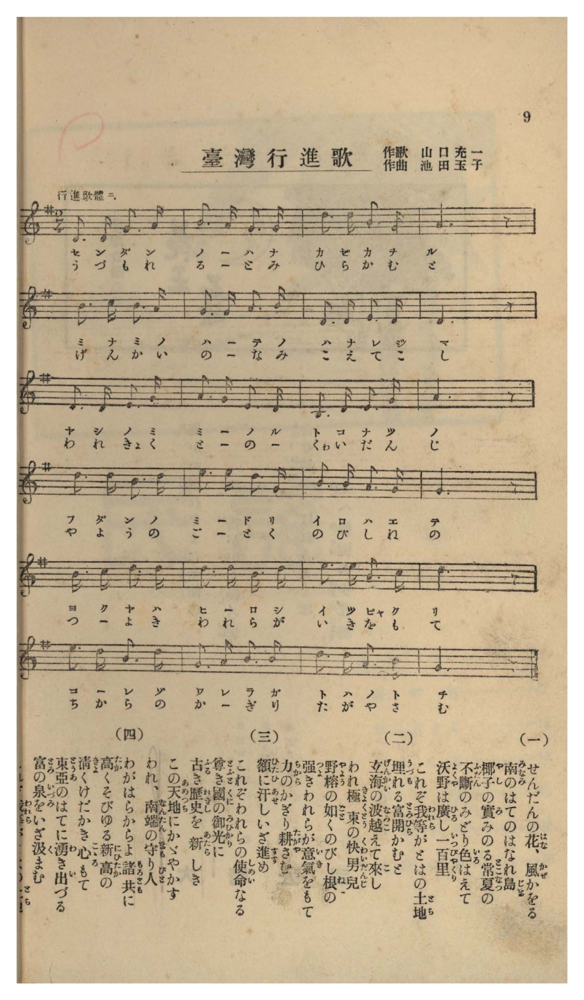

# 臺灣行進歌

> Re:Shōka 使用 AI 協助辨識與重建樂譜，可能會有錯誤。歡迎回報。

- **NEUTRINO 歌聲合成版**：<br><audio controls src="taiwan_koshinka_neutrino.mp3"></audio>
- **鋼琴伴奏版**：<br><audio controls src="taiwan_koshinka.mp3"></audio>


- 作詞：山口充一
- 作曲：池田玉子
- 臺灣教育會《臺灣の歌》（御大典記念事業，昭和四年五月一日發行，國臺圖 0786 8）第 9 頁（唱歌第六曲）

## 說明

曲目說明與原書資訊（對應 P011.jpg，原書第 9 頁，唱歌第六曲）：
- 書名：《臺灣の歌》（國立臺灣圖書館「日治時期圖書影像系統」典藏號 jpli2011-bk-sxt_0786_8_1929，索書號 0786 8）
- 作歌：山口充一
- 作曲：池田玉子
- 調性與拍號：ト長調（G 大調）2/4 拍子，24 小節（標註「行進歌體ニ」）
- 內容簡介：以連續附點八分音符與十六分音符之進行曲節奏，描繪苦楝花（栴檀の花）飄香、椰子結果、野榕（ガジュマル）紮根與高聳入雲的新高山。

編曲說明：
- 依原譜「行進歌體ニ」（G 大調，2/4 拍，♩= 116）編配 4 小節前奏與精神抖擻之雙手進行曲伴奏。


## 歌詞

```text
（一）
せんだんの花（はな）、風（かぜ）かをる
南（みなみ）のはてのはなれ島（じま）
椰子（やし）の實（み）みのる常夏（とこなつ）の
不斷（ふだん）のみどり色（いろ）はえて
沃野（よくや）は廣（ひろ）し一百里（いつぴやくり）
これぞ我等（われら）がとはの土地（とち）

（二）
埋（うづも）れる富（とみ）開（ひら）かむと
玄海（げんかい）の波（なみ）越（こ）えて來（こ）し
われ極東（きよくとう）の快男兒（くわいだんじ）
野榕（やよう）の如（ごと）くのびし根（ね）の
強（つよ）きわれらが意氣（いき）をもて
力（ちから）のかぎり耕（たがや）さむ

（三）
額（ひたひ）に汗（あせ）しいざ進（すす）め
これぞわれらの使命（しめい）なる
尊（たふと）き國（くに）の御光（みひかり）に
古（ふる）き歷史（れきし）を新（あたら）しき
この天地（あめつち）にかゞやかす
われ、南端（なんたん）の守（まも）り人（びと）

（四）
わがはらからよ諸共（もろとも）に
高（たか）くそびゆる新高（にひたか）の
清（きよ）くけだかき心（こゝろ）もて
東亞（とうあ）のはてに湧（わ）き出（い）づる
富（とみ）の泉（いづみ）をいざ汲（く）まむ
われらが前途（ゆくて）に幸（さち）あれや

一、苦楝花隨風飄香，南方盡頭的離島；椰果成熟的常夏之島，四季常綠映照光彩，肥沃原野廣袤百里，這就是我們永恆的土地。
二、為了開拓蘊藏的富源，越過玄界灘波濤而來的熱血兒女；懷著如野榕般扎根伸展的堅強意氣，竭盡全力耕耘大地吧。
三、額頭流著汗水向前邁進，這正是我們的使命；讓古老的歷史在這片新天地煥發光芒，我們是南疆的守護者。
四、同胞手足們一同攜手，懷著如巍峨新高山般清澈高潔的心志，共同汲取湧現於東亞南端的富饒泉源，願我們的前途充滿幸福！）
```

## ABC

```abc
X:1
T:臺灣行進歌
M:2/4
L:1/16
Q:1/4=116
K:G
V:V1 name="Voice" snm="Voi"
[V:V1]
D3 D G3 A | B3 A G3 A | d3 d B3 G | A6 z2 |
w: 1.~せ ん だ ん | の は な か | ぜ か を _ | る
w: 2.~う づ も れ | る と み ひ | ら か む _ | と
w: 3.~ひ た ひ に | あ せ し い | ざ す す _ | め
w: 4.~わ が は ら | か ら よ も | ろ と も _ | に
d3 e d3 B | G3 G A3 B | D3 D E3 D | D6 z2 |
w: 1.~み な み の | は て の は | な れ じ _ | ま
w: 2.~げ ん か い | の な み こ | え て こ _ | し
w: 3.~こ れ ぞ わ | れ ら の し | め い な _ | る
w: 4.~た か く そ | び ゆ る に | ひ た か _ | の
D3 D E3 G | A3 G E3 D | B,3 D E3 G | A6 z2 |
w: 1.~や し の み | み の る と | こ な つ _ | の
w: 2.~わ れ きょ く | と う の くゎ | い だ ん _ | じ
w: 3.~た ふ と き | く に の み | ひ か り _ | に
w: 4.~き よ く け | だ か き こ | こ ろ も _ | て
d3 d B3 d | e3 e d3 G | B3 B A3 G | G6 z2 |
w: 1.~ふ だ ん の | み ど り い | ろ は え _ | て
w: 2.~や よ う の | ご と く の | び し ね _ | の
w: 3.~ふ る き れ | き し を あ | た ら し _ | き
w: 4.~と う あ の | は て に わ | き い づ _ | る
c3 c d3 d | d3 d c3 d | e3 e A3 c | d6 z2 |
w: 1.~よ く や は | ひ ろ し い | っ ぴゃ く _ | り
w: 2.~つ よ き わ | れ ら が い | き を も _ | て
w: 3.~こ の あ め | つ ち に か | が や か _ | す
w: 4.~と み の い | づ み を い | ざ く ま _ | む
e3 d B3 d | G3 A B3 B | d3 d A3 B | G6 z2 |
w: 1.~こ れ ぞ わ | れ ら が と | は の と _ | ち
w: 2.~ち か ら の | か ぎ り た | が や さ _ | む
w: 3.~わ れ な ん | た ん の ま | も り び _ | と
w: 4.~わ れ ら が | ゆ く て に | さ ち あ れ | や
```

## TMD 檔案連結

- [主旋律 TMD 檔案](taiwan_koshinka.tmd) [[在 TMD Studio 編輯](https://tmdlang.github.io/Tmd-TS/#tmd=s7IKdvYPcrWy4tLSUnjRvut54-IXC3teNmx6trZHQUuLq05B6cneOS9Wznu_Z9bTjRuf9i9-2tr6ZEeDElTm2exNQJlnGxc8n7LheV_n07UTwDIQk55NnfmiadOzOc2PG7ogIo8b1wENftzQ_X5Px9N9C58uWf60dceLFTOe7t_6ZFf3s6Vr3-_peTZj7dNJPU9nz366c8uTXVOezekA2vds-tLnM_cAnQZU8HRON9C0p3OmKRiYW5gpWLzf0_l8zRoFS4WXCxpB5k7ZCLQDKPK0dS3YeZ1gJ5Ukplsp5BeVZOSnFyUWZFRaZWQWl-QXZSYn5sRnJ-YlKnEp2ioYGppx2dsquHPZGOmb2HFx6WtxAY14Pnvdi1Wrns3oe9HR_rRv_rPZO15sbn-xogtk2YbeZ-2dCgEGhoZ6WQXpINeBFSA5qAfTQcAg43rcvBuo7umEXiAHe_jM6X6-GuRToDjQs0DFL5eseNzQAwyKZ5t2P5vZ9GzOfIj4070bnzb3P9-8-_nWjY8bekFBOr3_xcz5ClkFOZlGQKfpJmXrFleUxIPCK94i3tDSyBLorudbFoG8AlQHD0eQq0CxuhYYzijxDZPAiG6QxItV-581LAcGzrPuXqBxIA81d7ycuh0oDvSHuwIwmsHMTmCgKgDVALUBrTcyUXi6of_5-gagmmcrZr5YsRvoOXjie7l6yuPmbqBvoK562rr86bqdzzcsfLIbGDiznuxe-rJh8fNdPS9ntrzcPe9p6-qnHW0v529-vmYZKJJ6G4FhDRd5srMbaCjQaFBcrm94urQflMz6-5_vXPWie9mzpXNfdG0EOWLBlmerGoBRAOZ2vlzc8nLZzMcNjc-WbAC6-PnWCc_mzQFyX7b3PVs2Faj-cdOax007Hjcvfdw873HzalAy3LLu2YKdQAe8XD3jRePmp61LXwJtnNXybNoGoAgwPB83NHFxPW6YAPQgME89bV3xbFr744aJXEDTgIEM9moD0AWzHzdNfty4AExCXNPxuHH948ZVQBUgFyxaARbpftw4ByQCZDRNetzUDdL8tHc6WG4_UDWQBEuvA2teBmOsetzU83TzNrCyGY8b90GthXgT7K-Wx41AU0A6n65fBjEOzAUaug5oz9MdO54uAYYhUHzF40agG4E2LYGoBxn0ZEfvs2nbwdJbIb6AuQKof-Xjpq4XncBUBJRtedwEil6wo4DcZWBXbGoGBjDYFUChfqBbICqe7l4M1rMJpmc6MMCez9z3sh2YVMFmNS553LgF7HagLmDehIblZKBvHzfOe9Yx8flaYMYDmguU7nncBGQDTQFKAb0AtH_dU1Bu2gDz1EKQfnC07AKaDzbq6XxQrnzc2Pa4cenjpiaQdpA53U_XQ1wA1AUKpZfTIMqADoVYAYwcoDNWgIx43tfybCskZIDxBQw4YAxC_Lfu2eZFYHFopL3YBipdgK4Hy4IC58m-NiSR6WDPgb3ybOnWZ3MhSaQXGmggtwBVgyNw_-rnU7Y_bZ0EVgBUD5QFBhEkbc2Aeg0pSQPjBORHqOZlQG8CuVOAJoJFgJqB0bgZaD8wnYOlgCU2LN6f7oF4bQnQCLAo0DnQsAYG9LOW_mcbIHEItB8ch6BE2wSN96dds8FyC8EBBgk5oFXAAOoDpZgGsOsa54NiDJokpgLDFRJFO0DKwf5YCDQXHPYglaCS9nHj6mcbITkCaBPQClDYgV0wDVgkgMVnAhHYNY0oCQbJ7eue7N3_dOJesOrpQHWwSANmJEie2wCJLKCdwAQPCaleYPENDfJGUNEACk1ghdcKToKgjAB0I9CjoHQKVAA2pR-Yh8B5pgmoE2TEs7Xbn_aDHQlyUS80UzZNAhYnMB_Nh4UV0FO9MPcDrVqyEpaYm8AOBuYNUJIGWgW2Fug7YBAAA3cmIh0BCxZg4fF89XpoOgQlEKDx0Mz7dB0wToHi-2BJv-vJrl1gEWBqAHkZHBXAWhuW8UAJDejq9eAQBEUpMFW8WL3jaSs4qQLjvQnooRVQ0yAhACwjYeEICQGgEXNBFjS1AcMEUoiCFQA9AYliiDJw6nu2oxWeB2CaJ4ISOsibvU_3N0Nyz-OmudASBJ70gLnnyS5gAweSh4HZG-IkeKm5-tnO5ZCCAxqz7RCPQxIBsCyAJALUYgCcpSGRDQzppVBBYIoHp71nGyFpD2IiMEyBFSw8HsDZ5Wln78uGKWBrgS4C-gVYDoPC6enOHWCdU2ERCgxIUJYAB_-LVfNerAXG3ywuYOEIjE947fZy1gpgpQGp0UAtkt7pz6btfD574csFa4HV08vZi8D1wWxgFQCs4551THjeNh8oDinngbUnWBbcJFu7GCj4fNuCZzMWPAfWyK2dT_euBEq9aAK2SZqBTR9gSQIsqV8sWgIrmoHV-cynGzY-m7EeWAI_bZj4bMOOZ41tIMPB5S2oQgQWsUC3Pm_a9WRXG7D0fNY9-cWMLmALBqRofc-zXaDGArA8fNnYByw_n0_ted44A1haPtu_5EVDD7BUBCp73rbxxcIGYCH3dOlmkDfat7-YOB1YeEHKtRcda5519gELrCd7djzdOBVk7IJWYGEFK5F6nq9eCwwLYG0MLISAJc2LhhmghumcDU8nLAe7bwe40l3YCwytZ1sbgUYDi5RnG7Y8nTARFEtNjeCSBOTRZ2sXwz0KtAZWbMx-sW4yMHe_AHoS2BYAZ-qnc1YA1T_vbAemakhmfd4KauECQ_RFF7Cs7oGG1oz1oDw5DRxg6zperN3-oqEV5CZgXIDy64SeF83znnV2v9i2GagaGOlAkWdT5gBFQEbAguHp9t6nm4FNDWgjBBQeO1qf7esAcp_tnQIyen_z0_3AwqUHmDtBJmzc9LR_GjDVP-_f92zaHkj-gJQNkDh5uXQSMHFDYublwhlwD0MSLbDF-Gz3fmBCfb4MmL6BLeBOLi19Li7fxMw8q7D8zORUhxqDmmouBSCwMTTTsgOzahRM4xV0gRBIGYIZRkAxYygLIWIKUQSVMQSKGIFZEGgAxDVg83wMaxSABT5YFFiIAdkL4GyQzDoIr3E9EK-CsrvBMnPgPGB2hZoLFG_qRrIH5FSoPUYgPW1QPUuB6pqg9vQg6QIWC0C8H8reBJbpRLKnAWEPUCVWe4xBcpugeuYjsVeDdUFtBfoYWBdA2S1gmWlQ3kwwRvinEbs9JiC5fqieHnAIQfzTCTYN6h8gD1jOQtlNYPN6ET6FhgHEP6sx7IFFOFjIDEobA0Ug0WwIjVKQCCJRmMFZcFHscQ4L5VVI7HVgl0B90rgMJf5BMtAUAIwzYKMIye37sIcROM4haQOStmCxDAlxmNnILoCkOmiIgV0wGckeSIxhj3OIOojb5kHZ_eAQ74HygHEBt3M6UtyC3APzG940DIpzYJqC6AGmx0ZY_M8Fu24z1J42pPQMSXXI6RFmNiIEsMU5enwicrAhShQb41aINdqbWuABgAiM_WDHIBIBcnZEClpwRC3B63x4tMOyBjg6gG2NdqgR4BiB5l1QeYBwBLBO7wNLwly4AJxoELbBEhy2yIdFylYkw3vBumBRtBrDv7BIARUsXUj2YGZEROT3Qn3VgWTyRLAuaLEJThZQVdDEDEuYvWgZfhmGPSgZHlZ2mwJFzMAsWBEAimKInDE8TcAKBayRDgwW9CCF5XVYpK-EBwI0d8LLKVDJD8mPuJyNiHRo1IGDB1bWQ-yZAuWByndYwEFkoLkGnCDXItmDI3GBoxvqH2AyRUQJuB6BBz3QNGitBCrzkZIIuBSAlSMIHdijGzmdwmoOzDISkmCgpQ3cBaAyZSnCHixlCjS6TcBCJvBoRyQAiAxyAoBEtwlcDdbohlU4wIBG5HdIAQ5N86C0iFb9LYbygEMDzfA4grgcljmwxDi0OIDEOCwmMEtdKBtqFUzdJIIZAqN0BxVOsJgAlt5ILmhciIgJaAsF5gJQTCCXurDaHV-M74enQJirIXEJloGnLNSWAzC44TUhKARgrRWMGIfEJnIGhzXcYNkakQYQdTy-DE5c5QeLBkipDkvCoCCFNaZA4guxBw84uiFykDIT1jCDZAhYjdGHVJDMx4iGqXiDBx7dKLUHrNEBKU1h2RjUnIBF0D6webBk0QUUgRQqeBuKyA04kD1w_0AapLDiCxSpkIQJq8whfoAkONRGLCSvIdtUy8Wla6cAatIr6NopcwEA)]
- [鋼琴伴奏 TMD 檔案](taiwan_koshinka_piano.tmd) [[在 TMD Studio 編輯](https://tmdlang.github.io/Tmd-TS/#tmd=s7IKdvYPcrWy4tLSUnjRvut54-IXC3teNmx6trbn_Z6Ol917nk_Y8mTPlqdL-593drzf06mgpcVVp6D0ZO-cFyvnvd8z6-nGjU_7Fz9tbX2yo0EJKvNs9iagzLONC55P2fC8r_Pp2glgmefbV0BkglKtijOO9mYnKrycPfNZZzeyLWCVEIc8mzrzRdOmZ3OaHzd0QUQeN64DuutxQzfQaU_3LXy6ZPnT1h0vVsx4un_rk13dz5aufb-n59mMtU8n9TydPfvpzi1Pdk15NqcD6LJn05c-n7kH6DOggqdzuoGmPZ0zTcHA3MJMwQLoqedr1ihYKrxc0Ai2vSQx3Uohv6gkIz-9KLEgo9IqI7O4JL8oMzkxJz47MS9RiUvRVsHQ0IzL3lbBncvGSN_EjotLX4sL4r8Xq1Y9m9EH9CXX4-bdT_bNfdo3_8XaOY8beuDh-nL1lMfN3Y8beoG-cFcAeuLFqv1AdwHNUXjWDRTseTRzJdgCkMu2r3jZ2qtgovB0Q__z9Q1PO3uBYfSio_35pn3Pl8571jXt2eTdT3Z2Q8OxYRPQEqAbIEH5uKGJS0ufi8szr6Qo3yogMzEvP8jDocagpppLAQhsDM207MCsGgUzBV0gNFUwhtI1CoZglhFUxBgoYgqVM4KLQNRAoAEQ13DVotjmg8u2-HigakM4YQwigMbB2ciipmDFRiACiQlVDRExBJNwF_gmZubh964pSD1IN9ybNVCPGiGJwDwMkTEEikC8juxhkHk-hjUKjxtng0UfN00GshfA2SCZdRBe43ogXgVld4Nl5sB5j5smQc0Fijd1I9kD9i3EHiOQnjaonqVAdU1Qe3qQdD1uXAHE-6HsTWCZTiR7GhD2AFVitccYJLcJqmc-Ens1WBfUVqCPHzdOh7JbwDLToLyZYIzwTyN2e0xAcv1QPT3gEIL4pxNsGtQ_QN7jpg4ouwlsXi_Cp9AwgPhnNYY9sAgHC5lBaUTaNURKzYhEYQZnwUWxxzkslFchsdeBXQL1SeMylPgHyUBTADDOHjfOQHL7PuxhBI5zSNqApC1YLENCHGY2sgsgqQ4aYmAXTEayBxJj2OMcog7itnlQdj84xHugPGBcwO2cjhS3IPfA_IY3DYPiHJimIHqA6bERFv9zwa7bDLWnDSk9Q1IdcnqEmY0IAWxxjh6fiBxsiBLF4IIGu0Ks0d7UAg8ARGDsBzsGkQiQsyNS0IIjagle58OjHZY1wNHR-7ipHWoEOEageRdUHiAc0f-4qQ8sCXPhAnCiQdgGS3DYIh8WKVuRDO8F64JF0WoM_8IiBVSwdCHZg5kREZHfC_VVB5LJE8G6oMUmOFlAVUETMyxh9qJl-GUY9qBkeOQKDVLFwYoAUBTDqjZYmsBWoSHy-laogxBBCsvrsEhfCQ8EaO6El1Ogkh-SH3E5GxHp0KgDBw-srIfYMwXKA5XvsICDyEBzDThBrkWyB0fiAkc31D_AZIqIEnA9Ag96oGnQWglU5iMlEXApACtHEDqwRzdyOoXVHJhlJCTBQEsbuAtAZcpShD1YyhRodJuAhUzg0Y5IABAZ5AQAiW4TuBqs0Q2rcIABjcjvkAIcmuZBaRGt-lsM5W153NQMjyOIy2GZA0uMQ4sDSIzDYgKz1IWyoVbB1E0imCEwSndQ4QSLCWDpjeSCxoWImIC2UGAuAMUEcqkLq93xxfh-eAqEuRoSl2AZeMpCbTkAgxteE4JCANZawYhxarVYERmcuMoPFg2QUh2WhEFBCmtMgcQXYg8ecHRD5CBlJqxhBskQsBqjD6kgmY8RDVPxBg88ulFqD1ijA1KawrIxqDkBi6B9YPNgyaILKAIpVPA2FJEbcCB74P6BNEhhxRcoUiEJE1aZQ_wASXCojVhIXkO2CaVFj6tLgdQ1INylILKjgUgghA1C6ZogcZC6OgRsIEITqeLEesMEe38M1rlC9x6aIcjmI5mEQwuSCpSOoBGYCREg4Akadx917RTAfVgFIAOU8KJ9DGMRbCMktjES2wTEVuYCAA)]

## 分析

```text
================================================================================
📊 TMD Song Profile: [ 臺灣行進歌 ]
================================================================================
⏱  Duration:       0:24 (24.8s), 24 measures total
🎼 Key & Tempo:    首調基準 G, != 116.0 BPM, <2/4>
   - 分析範圍：      由實際發聲的音符與和弦推測調性；播放脈絡另行呈現
🎤 人聲音域:    B3 (MIDI 59) – E5 (MIDI 76) [跨度: 17 個半音 / 1.4 個八度, 難度: challenging]
   - 最低音:  B3 in [Main #1 @ m.11, 0:10]
   - 最高音: E5 in [Main #1 @ m.5, 0:04]
   - 適合: soprano, mezzo-soprano, contralto, tenor, baritone, bass
🏛  結構:      Main (24.8s)
⚡ 編曲密度:        Peak 1 軌道同時演奏
🗝  調性診斷：       D 大調（純淨自然大調，未偵測到可信轉調）
   - 風格氣質:    純淨自然大調（陽光明朗、易唱易記，無明顯調外色彩）
   - 轉調歷程:    全曲維持單一推測調性（未偵測到可信轉調）
   - 核心骨幹音:  D, G, A, B, E
   - 調性數值:    D 大調 [相關度: 0.85, 穩定度: Moderate, 自然音純度: 95.6%]
   - 候選調性 (K-S): D 大調 (0.85), G 大調 (0.79), B 小調 (0.59)
   - 五度圈歷程:   +2
   - 各段落調性細節:
     • [Main #1]: D 大調 (r: 0.85, 自然音純度: 95.6%, 調外音: C)

  [ 五度圈游移軌跡 ]
               C  
         F            G  
      Bb              [D ]*
      Eb               A  
         Ab           E  
            Db       B  
               F# 
     (* = active key center)

  [ 十二半音累積音高分佈 ]
     C  : ███                        4.4%
     C# :                            0.0%
     D  : ████████████████████████  33.3%
     D# :                            0.0%
     E  : ██████████                13.3%
     F  :                            0.0%
     F# :                            0.0%
     G  : ████████████              17.2%
     G# :                            0.0%
     A  : ████████████              17.2%
     A# :                            0.0%
     B  : ██████████                14.4%
--------------------------------------------------------------------------------
Assignment 軌道音域：
  - Voice         : B3 – E5 (17 個半音 / 1.4 個八度, 78 個音符)
================================================================================
```


## 原書掃描頁




