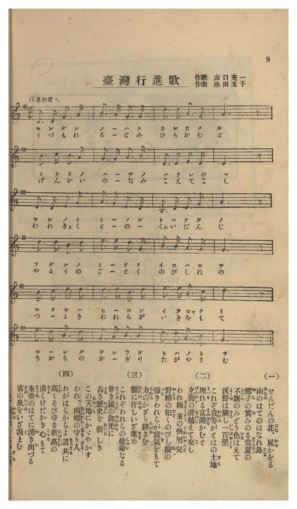

# 臺灣行進歌

> Re:Shōka 使用 AI 協助辨識與重建樂譜，可能會有錯誤。歡迎[回報](https://github.com/TMDLang/reshoka/issues)。

- **鋼琴伴奏版**：<br><audio controls src="taiwan_koshinka.mp3"></audio>
- **NEUTRINO 歌聲合成版**：<br><audio controls src="taiwan_koshinka_neutrino.mp3"></audio>

- 作詞：山口充一
- 作曲：池田玉子
- 臺灣教育會《臺灣の歌》（御大典記念事業，昭和四年五月一日發行，國臺圖 0786 8）第 9 頁（唱歌第六曲）

## 說明

曲目說明與原書資訊（對應 P011.jpg，原書第 9 頁，唱歌第六曲）：
- 書名：《臺灣の歌》（國立臺灣圖書館「日治時期圖書影像系統」典藏號 jpli2011-bk-sxt_0786_8_1929，索書號 0786 8）
- 作歌：山口充一
- 作曲：池田玉子
- 調性與拍號：ト長調（G 大調）2/4 拍子，24 小節（標註「行進歌體ニ」）
- 內容簡介：以連續附點八分音符與十六分音符之進行曲節奏，描繪苦楝花（栴檀の花）飄香、椰子結果、野榕（ガジュマル）紮根與高聳入雲的新高山。

編曲說明：
- 依原譜「行進歌體ニ」（G 大調，2/4 拍，♩= 116）編配 4 小節前奏與精神抖擻之雙手進行曲伴奏。


## 歌詞

```text
（一）
せんだんの花（はな）、風（かぜ）かをる
南（みなみ）のはてのはなれ島（じま）
椰子（やし）の實（み）みのる常夏（とこなつ）の
不斷（ふだん）のみどり色（いろ）はえて
沃野（よくや）は廣（ひろ）し一百里（いつぴやくり）
これぞ我等（われら）がとはの土地（とち）

（二）
埋（うづも）れる富（とみ）開（ひら）かむと
玄海（げんかい）の波（なみ）越（こ）えて來（こ）し
われ極東（きよくとう）の快男兒（くわいだんじ）
野榕（やよう）の如（ごと）くのびし根（ね）の
強（つよ）きわれらが意氣（いき）をもて
力（ちから）のかぎり耕（たがや）さむ

（三）
額（ひたひ）に汗（あせ）しいざ進（すす）め
これぞわれらの使命（しめい）なる
尊（たふと）き國（くに）の御光（みひかり）に
古（ふる）き歷史（れきし）を新（あたら）しき
この天地（あめつち）にかゞやかす
われ、南端（なんたん）の守（まも）り人（びと）

（四）
わがはらからよ諸共（もろとも）に
高（たか）くそびゆる新高（にひたか）の
清（きよ）くけだかき心（こゝろ）もて
東亞（とうあ）のはてに湧（わ）き出（い）づる
富（とみ）の泉（いづみ）をいざ汲（く）まむ
われらが前途（ゆくて）に幸（さち）あれや

一、苦楝花隨風飄香，南方盡頭的離島；椰果成熟的常夏之島，四季常綠映照光彩，肥沃原野廣袤百里，這就是我們永恆的土地。
二、為了開拓蘊藏的富源，越過玄界灘波濤而來的熱血兒女；懷著如野榕般扎根伸展的堅強意氣，竭盡全力耕耘大地吧。
三、額頭流著汗水向前邁進，這正是我們的使命；讓古老的歷史在這片新天地煥發光芒，我們是南疆的守護者。
四、同胞手足們一同攜手，懷著如巍峨新高山般清澈高潔的心志，共同汲取湧現於東亞南端的富饒泉源，願我們的前途充滿幸福！）
```

## ABC

<div class="abc-score" data-abc-src="taiwan_koshinka.abc" aria-label="五線譜載入中"></div>

[下載 ABC 原始檔](taiwan_koshinka.abc)

## TMD 檔案連結

- [主旋律 TMD 檔案](taiwan_koshinka.tmd) [[在 TMD Studio 編輯](https://tmdlang.github.io/Tmd-TS/#tmd=s7IKdvYPcrWy4qpTUCpJTLdSyC_KTM_MsypJzCxPzIvPT0vLTM5MzFGCyyfn5-SkJpdk5sPV5OXHl5YkIlSU5eeU5qZaGSJEivNLi5JTcamHyMYXJKanWgUYGCLpKyjKL0vNS8xD6E1NKU1OBFken1hcnA90GYiN0JBalpmSClJeUJSZm1hUGZ-Snwx0S14JkutSi4pBji_LT0b2VklGKtDNQD3JGUpcWloKL9p3PW9c_GJhz8uGTc_W9ihoaYGUPtk758XKee_3zHq6cePT_sVPW1uf7GgAGwKUeTZ7E1Dm2cYFz6dseN7X-XTtBLAMxKRnU2e-aNr0bE7z44YuiMjjxnVAgx83dL_f0_F038KnS5Y_bd3xYsWMp_u3PtnV_Wzp2vd7ep7NWPt0Us_T2bOf7tzyZNeUZ3M6gPY9m770-cw9QKcBFTyd0w007emcaQoG5hZmChbv93Q-X7NGwVLh5YJGkLlTNgLtAIo8bV0Ldl4nwsf5RSUZ-elFiQUZlVYZmcUlwIgHhkh8dmIeMG4UbRUMDc247G0V3LlsjPRN7Li49LW4gEY8n73uxapVz2b0vehof9o3_9nsHS82t79Y0QWybEPvs_ZOBVAU6mUVpINcB1aA5KAeTAcBg4zrcfNuoLqnE3qBHOzhM6f7-WqQT4HiQM8CFb9csuJxQw8wKJ5t2v1sZtOzOfMh4k_3bnza3P988-7nWzc-bugFBen0_hcz5ytkFeRkGgGdppuUrVtcURIPCq94i3hDSyNLoLueb1kE8gpQHTwcQa4CxepaYDijxDdMAiO6QRIvVu1_1rAcGDjPunuBxoE81Nzxcup2oDjQH-4KwGgGMzuBgaoAVAPUBrTeyETh6Yb-5-sbgGqerZj5YsVuoOfgie_l6imPm7uBvoG66mnr8qfrdj7fsPDJbmDgzHqye-nLhsXPd_W8nNnycve8p62rn3a0vZy_-fmaZaBI6m0EhjVc5MnObqChQKNBcbm-4enSflAy6-9_vnPVi-5lz5bOfdG1EeSIBVuerWoARgGY2_lyccvLZTMfNzQ-W7IB6OLnWyc8mzcHyH3Z3vds2VSg-sdNax437XjcvPRx87zHzatByXDLumcLdgId8HL1jBeNm5-2Ln0JtHFWy7NpG4AiwPB83NDExfW4YQLQg8A89bR1xbNp7Y8bJnIBTQMGMtirjbMfN01-3LgATEKc0vG4cf3jxlVAaZD1i1aARbofN84BiQAZTZMeN3VzPe2dDpbYD1QKJMFy68A6l8EYqx439TzdvA2sbMbjxn0gCyG-A3un5XEj0AiQtqfrl0HMAnOBJq4D2vB0x46nS4BBBxRf8bgR6DqgNUsg6rme7Oh9Nm07WG4rxPEw-4GaVz5u6nrRCUw5QNmWx02gKAU7B8hdxvVsUzMwRMH2A_n9QFdApJ_uXgzWsAmmYTowhJ7P3PeyHZg2wQY1LnncuAXsaqAuYGYEBd5koA8fN8571jHx-VpgNgMaCpTredwEZAONAEoBXQ60ed1TUN7ZAPPLQpBmcCTsAhreyfV0PigDPm5se9y49HFTE0gvyJDup-shdgO1gELm5TSIMqATIeYDowKYflZwPe9rebYVEhrAqAGGFDCyIN5a92zzIrA4NIpebAOVIkB3g2VBAfJkXxuSyHQuiA-eLd36bC4kKfRCAwrkCqBScHTtX_18yvanrZPACoDqgbLAYIGkoRkgHyElWmAMgLwG1bkM6DsgdwrQOLAIUCcw0jYDbQamZLAUsEwGR_HTPRAfLQHqBwsBHQINXGDIPmvpf7YBEmNAm8ExBkqWTaAofto1GyyxEBxCkKACWgIMlD5QymgAu6txPih-oLE_FRiQkAjZAVLO9XIh0ERwSIOUgYrQx42rn22EJHigHUDzQYEFtnsaMK-DxWcCEdgdjYiEgeTkdU_27n86cS9Y6XSgIlgUATMJMDNtgMQL0DZgeoYETS-wRIYGcCMot4OCD1iHtYLTGSidA10H9B8oJQIVcD3tB2YOcH5oAmoD6X-2dvvTfrDbQG7phea2pknA4gHmkfmw8AH6pRfsbKAlS1bC0moT2J3AdA9KsUBLwBYCPQX0NjA0Z0ITC7CUABYGz1evh6Y0UCoAGgzNkk_XAaMPKL4PlrK7nuzaBRYBxjrIp-CAB9a_4BwFSkpAx64HBxko9oCx_2L1jqet4MQIjN8moD9WQI0C-hpYzsECDuJroP65IKOb2oDhACkIwQqAbofEJkTZOq5nO1rh6RumcyIoEYO81vt0fzMkWzxumgstESCJC5gtnuwCNk8g2RKYYyEugZd8q5_tXA4pCKCR2A7xLCSygdkbGNmo2RqcSyGRCgzXpVBBYGoGp65nGyGpC2IcMBCBdSNSPnja2fuyYQrYQqBbgF4AFqSggHm6cwdY21RY3AFDDpTcwYH9YtW8F2uBsTULWI42AGMPXiu9nLUCWN5DaiJQS6J3-rNpO5_PXvhywVpgtfJy9iJwaT4bWIYD66ZnHROet80HikMKamCtB5YFN6XWLgYKPt-24NmMBc-BNWlr59O9K4FSL5qAbYlmYJMFWD4AC9wXi5bASlhgNTzz6YaNz2asB5alTxsmPtuw41ljG8hwcMkJqsiAhSXQrc-bdj3Z1QYsCp91T34xowvY8gApWt_zbBeokgeWby8b-4Dl4fOpPc8bZwBLv2f7l7xo6AGWckBlz9s2vljYACy3ni7dDPJG-_YXE6cDiyRIafWiY82zzj5gMfRkz46nG6eCjF3QCiyFYEVNz_PVa4FhAaxFgQUMsBR50TAD1KCcs-HphOVg9-0A15cLe4Gh9WxrI9BoYInxbMOWpxMmgmKpqRFcUIA8-mztYrhHgdbACobZL9ZNBubiF0BPAutwcOZ9OmcFUP3zznZgSobky-etoJYpMERfdAGL3x5oaM1YD8qB08ABtq7jxdrtLxpaQW4CxgUod07oedE871ln94ttm4GqgZEOFHk2ZQ5QBGQELBiebu99uhnYRIA2HkDhsaP12b4OIPfZ3ikgo_c3P90PLER6gNkRZMLGTU_7pwHT-_P-fc-m7YHkDEhJAImTl0snAVM2JGZeLpwB9zAk0QJbes927wcm1OfLgIkb2HLt5NLS5-LyTQR2jcLyM5NTHWoMaqq5FIDAxtBMyw7MqlEwjVfQBUIgZQhmGAHFjKEshIgpRBFUxhAoYgRmQaABENeAzfMxrFEAludgUWCRBWQvgLNBMusgvMb1QLwKyu4Gy8yB84B5FWouULypG8kekFOh9hiB9LRB9SwFqmuC2tODpAtYJgDxfih7E1imE8meBoQ9QJVY7TEGyW2C6pmPxF4N1gW1FehjYJkPZbeAZaZBeTPBGOGfRuz2mIDk-qF6esAhBPFPJ9g0qH-APGDxCmU3gc3rRfgUGgYQ_6zGsAcW4WAhMyhtDBSBRLMhNEpBIohEYQZnwUWxxzkslFchsdeBXQL1SeMylPgHyUBTADDOgO0cJLfvwx5G4DiHpA1I2oLFMiTEYWYjuwCS6qAhBnbBZCR7IDGGPc4h6iBumwdl94NDvAfKA8YF3M7pSHELcg_Mb3jTMCjOgWkKogeYHhth8T8X7LrNUHvakNIzJNUhp0eY2YgQwBbn6PGJyMGGKFFsjFsh1mhvaoEHACIw9oMdg0gEyNkRKWjBEbUEr_Ph0Q7LGuDoADYx2qFGgGMEmndB5QHCEcA6vQ8sCXPhAnCiQdgGS3DYIh8WKVuRDO8F64JF0WoM_8IiBVSwdCHZg5kREZHfC_VVB5LJE8G6oMUmOFlAVUETMyxh9qJl-GUY9qBkeFjZbQoUMQOzYEUAKIohcsbwNAErFLBGOjBY0IMUltdhkb4SHgjQ3Akvp0AlPyQ_4nI2ItKhUQcOHlhZD7FnCpQHKt9hAQeRgeYacIJci2QPjsQFjm6of4DJFBEl4HoEHvRA06C1EqjMR0oi4FIAVo4gdGCPbuR0Cqs5MMtISIKBljZwF4DKlKUIe7CUKdDoNgELmcCjHZEAIDLICQAS3SZwNVijG1bhAAMakd8hBTg0zYPSIlr1txjKA_bwm-FxBHE5LHNgiXFocQCJcVhMYJa6UDbUKpi6SQQzBEbpDiqcYDEBLL2RXNC4EBET0BYKzAWgmEAudWG1O74Y3w9PgTBXQ-ISLANPWagtB2Bww2tCUAjAWisYMQ6JTeQMDmu4wbI1Ig0g6nh8GZy4yg8WDZBSHZaEQUEKa0yBxBdiDx5wdEPkIGUmrGEGyRCwGqMPqSCZjxENU_EGDzy6UWoPWKMDUprCsjGoOQGLoH1g82DJogsoAilU8DYUkRtwIHvg_oE0SGHFFyhSIQkTVplD_ABJcKiNWEheQ7aplotL104B1KRX0LVT5gIA)]
- [鋼琴伴奏 TMD 檔案](taiwan_koshinka_piano.tmd) [[在 TMD Studio 編輯](https://tmdlang.github.io/Tmd-TS/#tmd=s7IKdvYPcrWy4qpTUCpJTLdSSM7PyUlNLsnMz7MqScwsT8yLz8uPLy1JVIKrKMvPKc1NtTJEiBTnlxYlp-JSD5GNL0hMT7UKMDBE0ldQlF-WmpeYh9CbmlKanAiyPD6xuDg_ORPMRmhILctMSQUpLyjKzE0sqoxPyU8GuiWvBMl1qUXFIMcXZCYCHZJYVJSYl56KqqQkAyhgBdSfnKHEpaWl8KJ91_PGxS8W9rxs2PRsbc_7PR0vu_c8n7DlyZ4tT5f2P-_seL-nU0FLC6T_yd45L1bOe79n1tONG5_2L37a2vpkRwPYZKDMs9mbgDLPNi54PmXD877Op2sngGWeb18BkQlKtSrOONqbnajwcvbMZ53dyLaAVUIc8mzqzBdNm57NaX7c0AURedy4Duiuxw3dQKc93bfw6ZLlT1t3vFgx4-n-rU92dT9buvb9np5nM9Y-ndTzdPbspzu3PNk15dmcDqDLnk1f-nzmHqDPgAqezukGmvZ0zjQFA3MLMwULoKeer1mjYKnwckEjImzyi0oy8tOLEgsyKq0yMotL8osykxNz4rMT84AxqmirYGhoxmVvq-DOZWOkb2LHxaWvxQXx34tVq57N6AP6kutx8-4n--Y-7Zv_Yu2cxw098HB9uXrK4-buxw29QF-4KwA98WLVfqC7gOYoPOsGCvY8mrkSbAHIZdtXvGztVTBReLqh__n6hqedvcAwetHR_nzTvudL5z3rmvZs8u4nO7uh4diwCWgJ0A2QoHzc0MSlpc_F5ZlXUpRvFQBKB0EeDjUGNdVcCkBgY2imZQdm1SiYKegCoamCMZSuUTAEs4ygIsZAEVOonBFcBKIGAg2AuIarFsU2H2TbLBCWxccrGIKRcTzIFDAN45kCJY3iYRRYFsQ2BGIDiAW-iZl5-H1jGg9xKlAb1Bc1UH8YIYnA_AORMQSKQHyG7B-QeT6GNQqPG2eDRR83TQayF8DZIJl1EF7jeiBeBWV3g2XmwHmPmyZBzQWKN3Uj2QNyKtQeI5CeNqiepUB1TVB7epB0PW5cAcT7oexNYJlOJHsaEPYAVWK1xxgktwmqZz4SezVYF9RWoI8fN06HslvAMtOgvJlgjPBPI3Z7TEBy_VA9PeAQgvinE2wa1D9A3uOmDii7CWxeL8Kn0DCA-Gc1hj2wCAcLmUFpRNI0REqsiERhBmfBRbHHOSyUVyGx14FdAvVJ4zKU-AfJQFMAMM4eN85Acvs-7GEEjnNI2oCkLVgsQ0IcZjayCyCpDhpiYBdMRrIHEmPY4xyiDuK2eVB2PzjEe6A8YFzA7ZyOFLcg98D8hjcNg-IcmKYgeoDpsREW_3PBrtsMtacNKT1DUh1yeoSZjQgBbHGOHp-IHGyIEsXAYgWXQqzR3tQCDwBEYOwHOwaRCJCzI1LQgiNqCV7nw6MdljXA0dH7uKkdagQ4RqB5F1QeIBzR_7ipDywJc-ECcKJB2AZLcNgiHxYpW5EM7wXrgkXRagz_wiIFVLB0IdmDmRERkd8L9VUHkskTwbqgxSY4WUBVQRMzLGH2omX4ZRj2oGR45PoKUoPBigBQFMNqLliawFZfIfL6VqiDEEEKy-uwSF8JDwRo7oSXU6CSH5IfcTkbEenQqAMHD6ysh9gzBcoDle-wgIPIQHMNOEGuRbIHR-ICRzfUP8BkiogScD0CD3qgadBaCVTmIyURcCkAK0cQOrBHN3I6hdUcmGUkJMFASxu4C0BlylKEPVjKFGh0m4CFTODRjkgAEBnkBACJbhO4GqzRDatwgAGNyO-QAhya5kFpEa36WwzlbXnc1AyPI4jLYZkDS4xDiwNIjMNiArPUhbKhVsHUTSKYITBKd1DhBIsJYOmN5ILGhYiYgLZQYC4AxQRyqQur3fHF-H54CoS5GhKXYBl4ykJtOQCDG14TgkIA1lrBiHFqNUgRGZy4yg8WDZBSHZaEQUEKa0yBxBdiDx5wdEPkIGUmrGEGyRCwGqMPqSCZjxENU_EGDzy6UWoPWKMDUprCsjGoOQGLoH1g82DJogsoAilU8DYUkRtwIHvg_oE0SGHFFyhSIQkTVplD_ABJcKiNWEheQ7YJpUWPo8cA7Q1g7zHg7D-A-gsQ_dg0wHsYUAa0V4LDBByKCPHxOcMEtRsE6eWgdHwgihH6oTrQlEBF4f0qIyAFYuJwBIW9L107BXAPTwHIAMVbtI9hLIJthMQ2RmKbgNjKXAA)]

## 分析

```text
================================================================================
📊 TMD Song Profile: [ 臺灣行進歌 ]
================================================================================
⏱  Duration:       0:24 (24.8s), 24 measures total
🎼 Key & Tempo:    首調基準 G, != 116.0 BPM, <2/4>
   - 分析範圍：      由實際發聲的音符與和弦推測調性；播放脈絡另行呈現
🎤 人聲音域:    B3 (MIDI 59) – E5 (MIDI 76) [跨度: 17 個半音 / 1.4 個八度, 難度: challenging]
   - 最低音:  B3 in [Main #1 @ m.11, 0:10]
   - 最高音: E5 in [Main #1 @ m.5, 0:04]
   - 適合: soprano, mezzo-soprano, contralto, tenor, baritone, bass
🏛  結構:      Main (24.8s)
⚡ 編曲密度:        Peak 1 軌道同時演奏
🗝  調性診斷：       D 大調（純淨自然大調，未偵測到可信轉調）
   - 風格氣質:    純淨自然大調（陽光明朗、易唱易記，無明顯調外色彩）
   - 轉調歷程:    全曲維持單一推測調性（未偵測到可信轉調）
   - 核心骨幹音:  D, G, A, B, E
   - 調性數值:    D 大調 [相關度: 0.85, 穩定度: Moderate, 自然音純度: 95.6%]
   - 候選調性 (K-S): D 大調 (0.85), G 大調 (0.79), B 小調 (0.59)
   - 五度圈歷程:   +2
   - 各段落調性細節:
     • [Main #1]: D 大調 (r: 0.85, 自然音純度: 95.6%, 調外音: C)

  [ 五度圈游移軌跡 ]
               C  
         F            G  
      Bb              [D ]*
      Eb               A  
         Ab           E  
            Db       B  
               F# 
     (* = active key center)

  [ 十二半音累積音高分佈 ]
     C  : ███                        4.4%
     C# :                            0.0%
     D  : ████████████████████████  33.3%
     D# :                            0.0%
     E  : ██████████                13.3%
     F  :                            0.0%
     F# :                            0.0%
     G  : ████████████              17.2%
     G# :                            0.0%
     A  : ████████████              17.2%
     A# :                            0.0%
     B  : ██████████                14.4%
--------------------------------------------------------------------------------
Assignment 軌道音域：
  - Voice         : B3 – E5 (17 個半音 / 1.4 個八度, 78 個音符)
================================================================================
```


## 原書掃描頁




