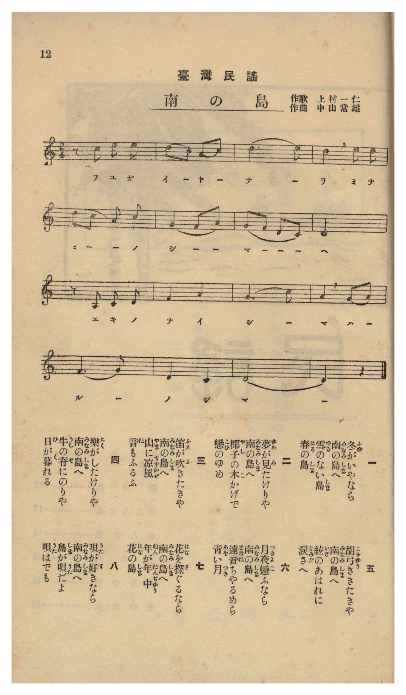

# 南の島

> Re:Shōka 使用 AI 協助辨識與重建樂譜，可能會有錯誤。歡迎回報。

- **鋼琴伴奏版**：<br><audio controls src="minami_no_shima.mp3"></audio>
- **NEUTRINO 歌聲合成版**：<br><audio controls src="minami_no_shima_neutrino.mp3"></audio>

- 作詞：上村一仁
- 作曲：中山常雄
- 臺灣教育會《臺灣の歌》（御大典記念事業，昭和四年五月一日發行，國臺圖 0786 8）第 12 頁（民謡第一曲）

## 說明

曲目說明與原書資訊（對應 P013.jpg，原書第 12 頁，民謠第一曲）：
- 書名：《臺灣の歌》（國立臺灣圖書館「日治時期圖書影像系統」典藏號 jpli2011-bk-sxt_0786_8_1929，索書號 0786 8）
- 作歌：上村一仁
- 作曲：中山常雄
- 調性與拍號：ニ調陽音階／律音階（D–E–F–G–A–C–D，無升降記號）2/4 拍子，16 小節
- 內容簡介：全曲共八節歌詞，每節皆以「…なら／…たきりや 南の島へ」呼應，吟詠常春無雪、椰子樹蔭、山間涼風、牛背夕陽、胡弓哀音與嗩吶（ちやるめら）月夜等南國風情。

編曲說明：
- 依原譜 D 陽音階／律音階民謠風味編配 4 小節前奏與抒情伴奏。


## 歌詞

```text
一
冬（ふゆ）がいやなら
南（みなみ）の島（しま）へ
雪（ゆき）のない島（しま）
春（はる）の島（しま）

二
夢（ゆめ）が見（み）たけりや
南（みなみ）の島（しま）へ
椰子（やし）の木（こ）かげで
戀（こひ）のゆめ

三
笛（ふえ）が吹（ふ）きたきや
南（みなみ）の島（しま）へ
山（やま）に涼風（すずかぜ）
音（ね）もふるふ

四
樂（らく）がしたけりや
南（みなみ）の島（しま）へ
牛（うし）の脊（せ）にのりや
日（ひ）が暮（く）れる

五
胡弓（こきゆう）引（ひ）きたきや
南（みなみ）の島（しま）へ
絃（いと）のあはれに
淚（なみだ）さへ

六
月夜（つきよ）戀（こ）ふなら
南（みなみ）の島（しま）へ
遠音（とほね）ちやるめら
青（あを）い月（つき）

七
花（はな）を探（さぐ）るなら
南（みなみ）の島（しま）へ
年（ねん）が年中（ねんぢゆう）
花（はな）の島（しま）

八
唄（うた）が好（す）きなら
南（みなみ）の島（しま）へ
島（しま）が唄（うた）だよ
唄（うた）はでも

一、若討厭寒冬，就到南方島嶼來吧；沒有冰雪的島嶼、四季如春的島嶼。
二、若想做美夢，就到南方島嶼來吧；在椰子樹蔭下，做一場戀愛之夢。
三、若想吹笛子，就到南方島嶼來吧；山間涼風吹拂，笛音也隨之顫動。
四、若想圖個悠閒，就到南方島嶼來吧；騎在牛背上晃呀晃，不知不覺日落西山。
五、若想拉胡弓，就到南方島嶼來吧；琴絃淒美動人，連淚水也悄然滑落。
六、若眷戀月夜，就到南方島嶼來吧；遠處傳來嗩吶（チャルメラ）聲，映著藍色的明月。
七、若想尋訪繁花，就到南方島嶼來吧；一年到頭百花盛開的花之島。
八、若喜愛歌謠，就到南方島嶼來吧；就算不開口唱，整座島嶼本身就是一首動人的歌。）
```

## ABC

<div class="abc-score" data-abc-src="minami_no_shima.abc" aria-label="五線譜載入中"></div>

[下載 ABC 原始檔](minami_no_shima.abc)

## TMD 檔案連結

- [主旋律 TMD 檔案](minami_no_shima.tmd) [[在 TMD Studio 編輯](https://tmdlang.github.io/Tmd-TS/#tmd=s7IKdvYPcrWy4qpTUCpJTLdSyC_KTM_MsypJzCxPzIvPT0vLTM5MzFHi0tJSeNo7_XHjuqebtyloaYHUP9k758XKee_3zHqyo-vZ3IlPdjQ82d2oBJV5NnsTWGbt040bn-7Y8XJ2C1jmRfuu542Ln02d-aJp07M5zY8buiAiQIOfre153ND9fk_H030Lny5Z_rR1x4sVM57u3_pkV_ezpWvf7-l5NmPt00k9T2fPfrpzy5NdU57N6QBa-Wz60ucz97xY2ANU8HRON9C0p3OmKRiYW5gpWLzf0_l8zRoFQyOFlwsagQY_2zDxxZqFQCGQPpD7OsFugvq7JCM_vSixIKPSKiOzuAQYDsmJOfHZiXmJSlyKtgoWFlz2tgrOXDZG-iZ2XFz6WlxAE57PXvdi1apnM_pedLQ_7Zv_bPaOF5vbX6zoAnliQ--z9k6FAANDY72sgnSQ68AKkB3UA3bQAmQHAcOM63HzbqDCpxN6gRzsATSn-_lqkFeB4kDfAhW_XLLicUMPMCyebdr9bGbTsznzIeJP92582tz_fPPu51s3Pm7oBYXp9P4XM-crZBXkZBoZGBrqJmXrFleUxIMCLN4i3tDSyBLorudbFoH8AlQHD0iQq0DRuhYY0CgRDpPAiG-QxItV-581LAeGzrPuXqBxIA81dwMFX87c-3L-5pez-t7v6X-6rxvG7nB51DDZFYjdgNgdiB2B2BmIXUCOaln4tLf95cxeYLIAm9UJjAoFoMFP104AShuaKTzd0P98fQPI3qety5-u2_l8w8Inu4EBNutp6wqg-562bnzauhqoAugJcMLtebYepOH5rLYnu5cCw-9Rw7LHjaseNwFjoR_Mnv-4sfdxU9fjphZE4n_cuAMUkhP3AKMXFKsT5r9YuQDo42czlgJd-HL2qscNjc-WbAA66tmKnS-mrAVygUHyctrkZ9v2vFwEjKbG552zXzT3PF0yFRgKQO6L5oVP90x-OrkBGAqgdDR95dMJ24Bh8bhxIdDix03dj5sawW7qBKb4p0vmPF_bCXQMMA0ATXvW3Pq4oYmL63HDBIinQD6d1v64YSIXMHaAwg1P29aAzdr6uKkNaMTjxp7HjUBDWyAeBavonQ5WsR8k1LgfrAjkUbAg0NP7wCI7QEqBvgOJNrUBwwWiDqynBU01SCkwOMBC64EewGokF9eTXT1g-5csghraBMwTIBe-WAZK5TC3ACNhIiQSSHQtJBbAZgO9C9QGUvpszgqw0slgbvfjxkmPG5eDVXc0QCQeN4IyIshvYCcB3bkD7KPna2ZDQ7KxA-LOpxN2QkTA3F5YeiHVncDkAXMkRHQ1JKmAlc583DgL7M450IAFphKwBLBE7Hzc1ASOWaD0Vi4uYMkI9siKJrBxQIP6YTEOtJDsYAQmV7AoMNKhYfiiBVTCPW4EioNcCw4qmMHAMggsBwnDnmez1oG5YJc09QCdCor3KSCVkHQPC3NguAEtACXRp3umIplAdqg-39oMFgWGKjAkIWkVGFrA9AgMj9Vgp26fBVYBMulx4wKwoqkg3VxPW9eCFYDzG1jNErAbQPEOTydg9cDEQE4-alwAi8YVjxt3QyMTNb-D1c2dBFbU9LgJyACqaAE6Ce4eSCba0QwOzC5wGgJ6rxGYRYFBPelZHzhbgXwEzANAEWAiIcOpwLoWktweN0F83AOqfXcAHQwVfNy4CB512FyCJeMDS2Gw0VNaYAkLVJqDjF66F5LoYVFPjoPRRXsw7FkAjEmsDgC6eTkwT3FxAYVfrJr3Yu16UH0MLElBxXT30hcr-p72rX26fhK4UO15umHj044NQKc9m7YTaOvTbXue7Gt7OmH5-z2zn22a9GxO59O2DcAS8_ksUPkIlAXVBMDGy9rFT5c1gWoLhHgTqCyE2PGsefPTxlnP9_WBi0V8djydswK5nnmyA1ho9gD1Ap37dMEWYDJ91jL7yc5uoDlgC3Z0IiyYsBNYmEGqTXwWIFVbQC3PuoHlSg9QIzDpPtk5_-WsFUDTXy5c_bR7KsgCoNcQFsyZ9rSh-1nTgpfTgOkWnx0vgUE6ZwWkRgS1KmY2P53YACSBup7s6H0-fymQfLFsF7BUeTFh74ul-4FuggTXFLhlz7o7YUUJPpueT9gCLBKebZ8ECtvuqU927QKqf9mwGFgKPNuwBeihZ00tz1u2Pds9EWgT2EOtoLobaMfzOdtBoQktDPD6pnHBi5lTnzZtBonA6_HmxsfNix83r37cvPBx80pgQnsBKtuAzdkFLyZOfzG990XnJmBaALYigVZAogrYLoaF5IbuFytWPd_ZCM5W-OwGRfvOLUDZlwvWPp-5D6j--ezZL6d1A40GskEJAdh2AXtrNcT0p9PmAFMIqNmwBlj24U0IGzY-XzcdGBNA4572L346BeSUZ1O3PN21HKLy2Zw1L3atBip7NmM90B0vl02DhDDIW6BGKzDhdHJp6XNx-SYC-xZh-ZnJqQ41BjXVXApAYGOhZQdm1CgYKBjGKRiDUY2CURyIZwYiwBxdIARLAAXALBAHrNHHsEYhXgFYGCsASyIg3QNUBCwrgapALTddMG8VWD-wOAHy4kGsxv1gUagJRmATQLqbGuEm7Aermw81YSLUBGBN14zdEGO4Mxo74IZsBavrhRoCMgzMx2mICcQlnUCxfrgh00l0iSnEJZMhNrUCqTawzk0kOsYMYs4SsCZgqQnWNhmsDuQvIgLWHGLCerAYsFoC65kKVjcBYkJTN9QZoMIeuyEWEENAcTsfHiYzUfyC2xnQtIWSnExAKUjBFMwyVjBSMAQpAJsANA2epiApAGTWOngsgFUA2fuQ2DtQdQLTEpk6gQmITJ3AVEOmTmBSIVMnMHGQqROYKMjUCUwJpOuEly5m8cCYNoLGvxlYnSlYDThRgARMgSRKoQIuUIBpH2oZKJlBihaE1SBrYYluPcKp0CKlBawOph-Sd0ApHsSbBNW_HK4fJI9SmoD17wPi1UiJfhZUPyznzIHrX4vQDylIwJkGYf9ssKrVUP3rIPpRCxJQGYFajICcsAJuRBPCo0CtPVAngJwH0Q9qoCGMgJYgIO27we4DGQFs6DaDLYYGBLDMhTgEkXtBtqAWIWuB8qACDZL7QR4F8SEemQEq5CAOARV0GHEBLUBA4QAKS4gRbWBVsEJ1AdQJoDIOoh8kD088oBQDSh6QcsIQrAleYoBJA4R1oLIDXqwhUikkfUKMR-gD8ZBLDlD4w_UBkx_IUaDwwaMPVG40gUIMUjDDbIcV0jj1gUsNWAz2w-MTFi849YHLDGiAAQtzlNyGWxeovABWABBdLWBdS8DsXvz6wKUFtHwnJTTBZQWsjlsP1rcc7Dtw2sKqr5aLS9dOAdRKUdC1U-YCAA)]
- [鋼琴伴奏 TMD 檔案](minami_no_shima_piano.tmd) [[在 TMD Studio 編輯](https://tmdlang.github.io/Tmd-TS/#tmd=s7IKdvYPcrWy4tLSUnjaO_1x47qnm7e939PxsnvP8wlbnuzZ8nRp__POjvd7OhW0tLjqFJSe7J3zYuW893tmPdnR9WzuxCc7Gp7sblSCyjybvQkss_bpxo1Pd-x4ObsFLPN8-wqITFCqVXHG0d7sRIWXs2c-6-xGtgWs8kX7rueNi59NnfmiadOzOc2PG7ogIkB3PVvb87ihG-i0p_sWPl2y_GnrjhcrZjzdv_XJru5nS9e-39PzbMbap5N6ns6e_XTnlie7pjyb0wF03LPpS5_P3PNiYQ9QwdM53UDTns6ZpmBgbmGmYAH01PM1axQMjRReLoB4oSQx3Uohv6gkIz-9KLEgo9IqI7O4JL8oMzkxJz47MS9RiUvRVsHCgsveVsGZy8ZI38SOi0tfiwvivxerVj2b0Qf0Jdfj5t1P9s192jf_xdo5Ci4KL2fufTl_88tZQLn-p_u6IexnGya-WLPg5aIVTyduBup_2dqrYKLwdEP_8_UNTzt7geHxoqP9WdekZ82tkOB53NDEpaXPxeWZV1KUbxWQmZiXH-ThUGNQU82lAAQ2Flp2YEYN0BhdIDQFsoyAtCEQQ1ggWAMmDUAsrloUw3ywG2YUr2AWDyJN4-E8QxQehATx4pGN9k3MzMPrTAMFwzgFYzACao4D8cxABJgDciVYAigAZoE4YI0-hjUK8QqPG7cqPG5qA9I9QEWPG1uAqh43gUgQbxVY_-OmTiAP5KjHjfvBolATjMAmgHQ3NcJN2A9WNx9qwkSoCV2Pm5qxG2IMd0ZjB9yQrWB1vVBDQIaB-TgNMYG4pBMo1g83ZDqJLjGFuGQyxKZWINUG1rmJRMeYQcxZAtb0uKkDrG0yWB3IX0QErDnEhPVgscdNk8B6poLVTYCY0NQNdcYqnIZYQAwBxe18eJjMRPELbmfAUi1ycgLlB2NwfjAB0kbAHIGUH-BpCpICQGatg8cCJMc8btyHxN6BqhOYlsjUCUxAZOoEphoydQKTCpk6gYmDTJ3AREGmTmBKIF0nvHQBFVTAeIbEvxlYnSlYDThRgARMgSRKoQIuUIBpH2oZKJlBihaE1SBrYYluPcKp0CKlBawOph-Sd0ApHsSbBNW_HK4fJI9SmoD17wPi1UiJfhZUPyznzIHrX4vQDylIwJkGYf9ssKrVUP3rIPpRCxJQGYFajICcsAJuRBPCo0CtPVAngJwH0b8KEkGoJQhI-26w-0BGLATZB7IYGhDAMhfiEETuBdmCWoSsBcqDCjRI7gd5FMSHeGQGqJCDOARU0GHEBbQAAYUDKCwhRrSBVcEK1QVQJ4DKOIh-kDw88RBbg8LLDnixhkilkPQJMR6hD8RDLjlA4Q_XB0x-IEeBwgePPlC50QQKMUjBDLMdVkjj1AcuNWAx2A-PT1i84NQHLjOgAQYszFFyG25doPICWAFAdLWAdS0Bs3vx6wOXFtDynZTQBJcVsDpuPVjfcrDvwGkLqz6URgqO5o8ZsFFjDGrggClYkweNC2sBoSlGaUGhaUFtQmE0qAzQdCPaWCDaBGiWCYgL0QfTDRWGyaIYQMA-bA04XTsFcPNQAcgAhVO0j2Esgm2ExDZGYpsgsU2R2GZIbHMktgWIrcwFAA)]

## 分析

```text
================================================================================
📊 TMD Song Profile: [ 南の島 ]
================================================================================
⏱  Duration:       0:21 (21.8s), 16 measures total
🎼 Key & Tempo:    首調基準 C, != 88.0 BPM, <2/4>
   - 分析範圍：      由實際發聲的音符與和弦推測調性；播放脈絡另行呈現
🎤 人聲音域:    A3 (MIDI 57) – E5 (MIDI 76) [跨度: 19 個半音 / 1.6 個八度, 難度: challenging]
   - 最低音:  A3 in [Main #1 @ m.9, 0:11]
   - 最高音: E5 in [Main #1 @ m.1, 0:00]
   - 適合: soprano, mezzo-soprano, contralto, tenor, baritone, bass
🏛  結構:      Main (21.8s)
⚡ 編曲密度:        Peak 1 軌道同時演奏
🗝  調性診斷：       D 小調（純淨自然小調，未偵測到可信轉調）
   - 風格氣質:    純淨自然小調（陰鬱抒情、旋律集中，無明顯調外色彩）
   - 轉調歷程:    全曲維持單一推測調性（未偵測到可信轉調）
   - 核心骨幹音:  D, C, F, A, E
   - 調性數值:    D 小調 [相關度: 0.79, 穩定度: High, 自然音純度: 100.0%]
   - 候選調性 (K-S): D 小調 (0.79), C 大調 (0.64), F 大調 (0.56)
   - 五度圈歷程:   +2
   - 各段落調性細節:
     • [Main #1]: D 小調 (r: 0.79, 自然音純度: 100.0%)

  [ 五度圈游移軌跡 ]
               C  
         F            G  
      Bb              [D ]*
      Eb               A  
         Ab           E  
            Db       B  
               F# 
     (* = active key center)

  [ 十二半音累積音高分佈 ]
     C  : ███████████████           20.0%
     C# :                            0.0%
     D  : ████████████████████████  31.7%
     D# :                            0.0%
     E  : █████████                 11.7%
     F  : ██████████                13.3%
     F# :                            0.0%
     G  : ████████                  10.0%
     G# :                            0.0%
     A  : ██████████                13.3%
     A# :                            0.0%
     B  :                            0.0%
--------------------------------------------------------------------------------
Assignment 軌道音域：
  - Voice         : A3 – E5 (19 個半音 / 1.6 個八度, 39 個音符)
================================================================================
```


## 原書掃描頁




