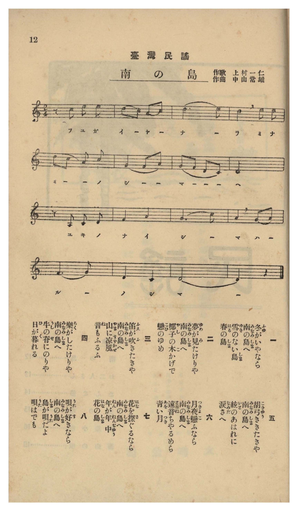

# 南の島

> Re:Shōka 使用 AI 協助辨識與重建樂譜，可能會有錯誤。歡迎回報。

- **鋼琴伴奏版**：<br><audio controls src="minami_no_shima.mp3"></audio>
- **NEUTRINO 歌聲合成版**：<br><audio controls src="minami_no_shima_neutrino.mp3"></audio>

- 作詞：上村一仁
- 作曲：中山常雄
- 臺灣教育會《臺灣の歌》（御大典記念事業，昭和四年五月一日發行，國臺圖 0786 8）第 12 頁（民謡第一曲）

## 說明

曲目說明與原書資訊（對應 P013.jpg，原書第 12 頁，民謠第一曲）：
- 書名：《臺灣の歌》（國立臺灣圖書館「日治時期圖書影像系統」典藏號 jpli2011-bk-sxt_0786_8_1929，索書號 0786 8）
- 作歌：上村一仁
- 作曲：中山常雄
- 調性與拍號：ニ調陽音階／律音階（D–E–F–G–A–C–D，無升降記號）2/4 拍子，16 小節
- 內容簡介：全曲共八節歌詞，每節皆以「…なら／…たきりや 南の島へ」呼應，吟詠常春無雪、椰子樹蔭、山間涼風、牛背夕陽、胡弓哀音與嗩吶（ちやるめら）月夜等南國風情。
- 史料對照：另見 1930 年 8 月《臺灣教育》第 337 號刊載之審查員一條愼三郎採花蓮港紅座社蕃謠所作之同詞異曲版本，詳見[史料考證專題：〈臺灣の歌審査員の作曲發表〉](../shinsain_sakkyoku_1930/index.md#2-南の島（一條愼三郎-作曲）)。

編曲說明：
- 依原譜 D 陽音階／律音階民謠風味編配 4 小節前奏與抒情伴奏。


## 歌詞

```text
一
冬（ふゆ）がいやなら
南（みなみ）の島（しま）へ
雪（ゆき）のない島（しま）
春（はる）の島（しま）

二
夢（ゆめ）が見（み）たけりや
南（みなみ）の島（しま）へ
椰子（やし）の木（こ）かげで
戀（こひ）のゆめ

三
笛（ふえ）が吹（ふ）きたきや
南（みなみ）の島（しま）へ
山（やま）に涼風（すずかぜ）
音（ね）もふるふ

四
樂（らく）がしたけりや
南（みなみ）の島（しま）へ
牛（うし）の脊（せ）にのりや
日（ひ）が暮（く）れる

五
胡弓（こきゆう）引（ひ）きたきや
南（みなみ）の島（しま）へ
絃（いと）のあはれに
淚（なみだ）さへ

六
月夜（つきよ）戀（こ）ふなら
南（みなみ）の島（しま）へ
遠音（とほね）ちやるめら
青（あを）い月（つき）

七
花（はな）を探（さぐ）るなら
南（みなみ）の島（しま）へ
年（ねん）が年中（ねんぢゆう）
花（はな）の島（しま）

八
唄（うた）が好（す）きなら
南（みなみ）の島（しま）へ
島（しま）が唄（うた）だよ
唄（うた）はでも

一、若討厭寒冬，就到南方島嶼來吧；沒有冰雪的島嶼、四季如春的島嶼。
二、若想做美夢，就到南方島嶼來吧；在椰子樹蔭下，做一場戀愛之夢。
三、若想吹笛子，就到南方島嶼來吧；山間涼風吹拂，笛音也隨之顫動。
四、若想圖個悠閒，就到南方島嶼來吧；騎在牛背上晃呀晃，不知不覺日落西山。
五、若想拉胡弓，就到南方島嶼來吧；琴絃淒美動人，連淚水也悄然滑落。
六、若眷戀月夜，就到南方島嶼來吧；遠處傳來嗩吶（チャルメラ）聲，映著藍色的明月。
七、若想尋訪繁花，就到南方島嶼來吧；一年到頭百花盛開的花之島。
八、若喜愛歌謠，就到南方島嶼來吧；就算不開口唱，整座島嶼本身就是一首動人的歌。）
```

## ABC

<div class="abc-score" data-abc-src="minami_no_shima.abc" aria-label="五線譜載入中"></div>

[下載 ABC 原始檔](minami_no_shima.abc)

## TMD 檔案連結

- [主旋律 TMD 檔案](minami_no_shima.tmd) [[在 TMD Studio 編輯](https://tmdlang.github.io/Tmd-TS/#tmd=s7IKdvYPcrWy4qpTUCpJTLdSyC_KTM_MsypJzCxPzIvPT0vLTM5MzFGCyyfn5-SkJpdk5sPV5OXHl5YkIlSU5eeU5qZaGSJEivNLi5JTcamHyMYXJKanWgUYGBojZAqK8stS8xLzEHpTU0qTE0GWxycWF-cDXQZiIzSklmWmpIKUFxRl5iYWVcan5CcD3ZJXguS61KJikOPL8pORvVWSkQp0M8yFiSWlRalKXFpaCk97pz9uXPd08zYFLS2Q4id757xYOe_9nllPdnQ9mzvxyY6GJ7sbwcYAZZ7N3gSWWft048anO3a8nN0ClnnRvut54-JnU2e-aNr0bE7z44YuiAjQ4Gdrex43dL_f0_F038KnS5Y_bd3xYsWMp_u3PtnV_Wzp2vd7ep7NWPt0Us_T2bOf7tzyZNeUZ3M6gFY-m770-cw9Lxb2ABU8ndMNNO3pnGkKBuYWZgoW7_d0Pl-zRsHQSOHlgkagwc82THyxZiFQCKQP5L5OhKfzi0oy8tOLEgsyKq0yMotLgHEPDJT47MQ8YPQo2ipYWHDZ2yo4c9kY6ZvYcXHpa3EBTXg-e92LVauezeh70dH-tG_-s9k7Xmxuf7GiC-SJDb3P2jsVQJGol1WQDnIdWAGyg3rADlqA7CBgmHE9bt4NVPh0Qi-Qgz2A5nQ_Xw3yKlAc6Fug4pdLVjxu6AGGxbNNu5_NbHo2Zz5E_OnejU-b-59v3v1868bHDb2gMJ3e_2LmfIWsgpxMIwNDQ92kbN3iipJ4UIDFW8QbWhpZAt31fMsikF-A6uABCXIVKFrXAgMaJcJhEhjxDZJ4sWr_s4blwNB51t0LNA7koeZuoODLmXtfzt_8clbf-z39T_d1w9gdLo8aJrsCsRsQuwOxIxA7A7ELyFEtC5_2tr-c2QtMFmCzOoFRoQA0-OnaCUBpQzOFpxv6n69vANn7tHX503U7n29Y-GQ3MMBmPW1dAXTf09aNT1tXA1UAPQFOuD3P1oM0PJ_V9mT3UmD4PWpY9rhx1eMmYCz0g9nzHzf2Pm7qetzUgkj8jxt3gEJy4h5g9IJidcL8FysXAH38bMZSoAtfzl71uKHx2ZINQEc9W7HzxZS1QC4wSF5Om_xs256Xi4DR1Pi8c_aL5p6nS6YCQwHIfdG88OmeyU8nNwBDAZSOpq98OmEbMCweNy4EWvy4qftxUyPYTZ3AFP90yZznazuBjgGmAaBpz5pbHzc0gX3cv-nZtJnAVPe8dTnIx_3LXizrVjC0NDZQAGYXBQsFoGZ4YoLkP2BiAqVGY2NzBWB4Pu3oerGn88nO7qfrVz6bv_Tp5IWgRLlo7rOWPU92dL5s7nvWt_BF18YXk9c927H--ZbWp7uWP1-y78XUZmAKftbZAEwCIL0TQCH7fOoGUObo7Hg2Zw0wiF6s3Ax0SzTEhS8aml8APbCh4yUoywLTdwdy-gbbvRtoN5ALSVTgzA0Mtc5YDT09_eKMzLzixMy8-OLE7OzK_OxSYIo1NtDPzEtJrdDLTVE20oXHEzAE0TygC0umnZqgQON63DABkhJAyWNa--OGiVxAHVxP24COBob-1sdNbUC1jxt7HjcCo6EFkjS4gBaApfeD-I37wSqg9j1uBNq9DyyygwuYEkBCTW3ANARRBNbQgqaUC5huwPz1wJjGahgX15NdPVxPlyyCGtcELDlArgKGKcQhYC4wqU6EJFWiXQhJpWBTgZ4D6gGpezZnBVjdZDC3-3HjpMeNy7medTRARB83gsIP5BmwS4Bu29HJ9XzNbGiINXZA3PZ0wk6ICJjbC8tJxLsNmGVgDoMIrYZkH7C6mY8bZ4HdNgcUPMBsAxYFVhGdj5uawBEHlNvKxQWsKrierWgCGwQ0oh8Wm0B7yAguYLYFCwEjFBpWL1pAJf3jRqA4yIXgUAEbCSyIwRKQsOp5NmsdmAt2QFMP0HmgOJ3CBcn5sIAFhg_QaFCSe7pnKpJ2MkLv-dZmsBAw9IAhBkl7wIABJjGg71dzPds-CywNMuNx4wKwiqkgfVxPW9dyQUoZsIIlYHtBcQpPAGDFwIgmLS80LoDF0orHjbuhcYVavnG9nDsJrKLpcROQAZRuAboE7gxIRtjRzAUsg6D5pRGYwYDhOelZHzhrgLwATM1AEWDsk-Q8YAEJSUGPmyD-6wG1MHYAHQkVfNy4CB45GA7AkmGB1QzX0yktsOQCqqtAhi7dC0m-sGglzZHoQj0YNiwAxhWmvUB3LgfmCy4uoPCLVfNerF0PamQASzpQ3dO99MWKvqd9a5-unwQu93qebtj4tGMD0FHPpu0EWvl0254n-9qeTgDWKbOfbZr0bE7n07YNwKLt-SxQQQaUBVVvwBbZ2sVPlzWBqkCEeBOo3ILY8ax589PGWc_39YFLMXx2PJ2zArnyfLIDWMb1APUCnft0wRZgKnzWMhtUzyxZBLZgRyfCggk7geUQpC2AzwKkuhio5Vk3sHjoAWoEps8nO-e_nLUCaPrLhaufdk8FWQD0GsKCOdOeNnQ_a1rwchowfeKz4yUwSOesgFTzoKbSzOanExuAJFDXkx29z-cvBZIvlu0ClhIvJux9sXQ_0E2Q4JoCt-xZdyesdMBn0_MJW4B5_dn2SaCw7Z76ZNcuoPqXDYuBOfzZhi1ADz1rannesu3Z7olAm8AeagU1SIB2PJ-zHRSa0LyO1zeNC17MnPq0aTNIBN44aW583Lz4cfPqx80LHzevBCa0F6DiCthGX_Bi4vQX03tfdG4CpgVg0xjc7gBFFbCxDwvJDd0vVqx6vrMRnJXw2Q2K9p1bgLIvF6x9PnMfUP3z2bNfTusGGg1kgxICsEEG9tZqiOlPp80BphBQtb4GWK7hTQgbNj5fNx0YE0DjnvYvfjoF5JRnU7cA2zUQlcDGy4tdq4HKns1YD3THy2XTICEM8haoJQ5MOJ1cWvpcXL7ABolVWH5mcqpDjUFNNZcCENhYaNmBGTUKBgqGcQrGYFSjYBQH4pmBCDBHFwjBEkABMAvEAWv0MaxRiFcAlrUKwKIHSPcAFQHLRKAqUHNUF8xbBdYPLEWAvHgQq3E_WBRqghHYBJDupka4CfvB6uZDTZgINQFYbTVjN8QY7ozGDrghW8HqeqGGgAwD83EaYgJxSSdQrB9uyHQSXWIKcclkiE2tQKoNrHMTiY4xg5izBKwJWGSCtU0GqwP5i4iANYeYsB4sBqyBwHqmgtVNgJjQ1A11BqiMx26IBcQQUNzOh4fJTBS_4HYGNG2hJCcTUApSMAWzjBWMFAxBCsAmAE2DpylICgCZtQ4eC2AVQPY-JPYOVJ3AtESmTmACIlMnMNWQqROYVMjUCUwcZOoEJgoydQJTAuk64aWLWTwwpo2g8W8GVmcKVgNOFCABUyCJUqiACxRg2odaBkpmkKIFYTXIWliiW49wKrRIaQGrg-mH5B1QigfxJkH1L4frB8mjlCZg_fuAeDVSop8F1Q_LOXPg-tci9EMKEnCmQdg_G6xqNVT_Ooh-1IIEVEagFiMgJ6yAG9GE8ChQaw_UCSDnQfSDmmYII6AlCEj7brD7QEYAW7PNYIuhAQEscyEOQeRekC2oRchaoDyoQIPkfpBHQXyIR2aACjmIQ0AFHUZcQAsQUDiAwhJiRBtYFaxQXQB1AqiMg-gHycMTDyjFgJIHpJwwBGuClxhg0gBhHajsgBdriFQKSZ8Q4xH6QDzkkgMU_nB9wOQHchQofPDoA5UbTaAQgxTMMNthhTROfeBSAxaD_fD4hMULTn3gMgMaYMDCHCW34dYFKi-AFQBEVwtY1xIwuxe_PnBpAS3fSQlNcFkBq-PWg_UtB_sOnLaw6qvl4tK1UwC1UhR07ZS5AA)]
- [鋼琴伴奏 TMD 檔案](minami_no_shima_piano.tmd) [[在 TMD Studio 編輯](https://tmdlang.github.io/Tmd-TS/#tmd=s7IKdvYPcrWy4qpTUCpJTLdSSM7PyUlNLsnMz7MqScwsT8yLz8uPLy1JVIKrKMvPKc1NtTJEiBTnlxYlp-JSD5GNL0hMT7UKMDA0RsgUFOWXpeYl5iH0pqaUJieCLI9PLC7OT84EsxEaUssyU1JByguKMnMTiyrjU_KTgW7JK0FyXWpRMcjxBZmJQIckFhUl5qWnoiopyQAKwF2bWFJalKrEpaWl8LR3-uPGdU83b3u_p-Nl957nE7Y82bPl6dL-550d7_d0KmhpgUx4snfOi5Xz3u-Z9WRH17O5E5_saHiyuxFsNlDm2exNYJm1TzdufLpjx8vZLWCZ59tXQGSCUq2KM472ZicqvJw981lnN7ItYJUv2nc9b1z8bOrMF02bns1pftzQBREBuuvZ2p7HDd1Apz3dt_DpkuVPW3e8WDHj6f6tT3Z1P1u69v2enmcz1j6d1PN09uynO7c82TXl2ZwOoOOeTV_6fOaeFwt7gAqezukGmvZ0zjQFA3MLMwULoKeer1mjYGik8HIBxAvg4MkvKsnITy9KLMiotMrILC7JL8pMTsyJz07MA0aqoq2ChQWXva2CM5eNkb6JHReXvhYXxH8vVq16NqMP6Euux827n-yb-7Rv_ou1cxRcFF7O3Pty_uaXs4By_U_3dUPYzzZMfLFmwctFK55O3AzU_7K1V8FE4emG_ufrG5529gLD40VH-7OuSc-aWyHB87ihiUtLn4vLM6-kKN8qABS7QR4ONQY11VwKQGBjoWUHZtQAjdEFQlMgywhIGwIxhAWCNWDSAMTiqkUxzAe7YUbxCmbxINI0Hs4zROFBSBAvHtlo38TMPLzONFAwjFMwBiOg5jgQzwxEgDkgV4IlgAJgFogD1uhjWKMQr_C4cavC46Y2IN0DVPS4sQWo6nETiATxVoH1P27qBPJAjnrcuB8sCjXBCGwCSHdTI9yE_WB186EmTISa0PW4qRm7IcZwZzR2wA3ZClbXCzUEZBiYj9MQE4hLOoFi_XBDppPoElOISyZDbGoFUm1gnZtIdIwZxJwlYE2PmzrA2iaD1YH8RUTAmkNMWA8We9w0CaxnKljdBIgJTd1QZ6zCaYgFxBBQ3M6Hh8lMFL_gdgYs1SInJ1B-MAbnBxMgbQTMEUj5AZ6mICkAZNY6eCxAcszjxn1I7B2oOoFpiUydwAREpk5gqiFTJzCpkKkTmDjI1AlMFGTqBKYE0nXCSxdQQQWMZ0j8m4HVmYLVgBMFSMAUSKIUKuACBZj2oZaBkhmkaEFYDbIWlujWI5wKLVJawOpg-iF5B5TiQbxJUP3L4fpB8iilCVj_PiBejZToZ0H1w3LOHLj-tQj9kIIEnGkQ9s8Gq1oN1b8Ooh-1IAGVEajFCMgJK-BGNCE8CtTaA3UCyHkQ_asgEYRagoC07wa7D2TEQpB9IIuhAQEscyEOQeRekC2oRchaoDyoQIPkfpBHQXyIR2aACjmIQ0AFHUZcQAsQUDiAwhJiRBtYFaxQXQB1AqiMg-gHycMTD7E1KLzsgBdriFQKSZ8Q4xH6QDzkkgMU_nB9wOQHchQofPDoA5UbTaAQgxTMMNthhTROfeBSAxaD_fD4hMULTn3gMgMaYMDCHCW34dYFKi-AFQBEVwtY1xIwuxe_PnBpAS3fSQlNcFkBq-PWg_UtB_sOnLaw6kNppOBo_pgBGzXGoAYOmII1edC4sBYQmmKUFhSaFtQmFEaDygBNN6KNBaJNgGaZgLgQfTDdUGGYLIoBBOzD1oDTtVMANw8VgAxQOEX7GMYi2EZIbGMktgkS2xSJbYbENkdiW4DYylwA)]

## 分析

```text
================================================================================
📊 TMD Song Profile: [ 南の島 ]
================================================================================
⏱  Duration:       0:21 (21.8s), 16 measures total
🎼 Key & Tempo:    首調基準 C, != 88.0 BPM, <2/4>
   - 分析範圍：      由實際發聲的音符與和弦推測調性；播放脈絡另行呈現
🎤 人聲音域:    A3 (MIDI 57) – E5 (MIDI 76) [跨度: 19 個半音 / 1.6 個八度, 難度: challenging]
   - 最低音:  A3 in [Main #1 @ m.9, 0:11]
   - 最高音: E5 in [Main #1 @ m.1, 0:00]
   - 適合: soprano, mezzo-soprano, contralto, tenor, baritone, bass
🏛  結構:      Main (21.8s)
⚡ 編曲密度:        Peak 1 軌道同時演奏
🗝  調性診斷：       D 小調（純淨自然小調，未偵測到可信轉調）
   - 風格氣質:    純淨自然小調（陰鬱抒情、旋律集中，無明顯調外色彩）
   - 轉調歷程:    全曲維持單一推測調性（未偵測到可信轉調）
   - 核心骨幹音:  D, C, F, A, E
   - 調性數值:    D 小調 [相關度: 0.79, 穩定度: High, 自然音純度: 100.0%]
   - 候選調性 (K-S): D 小調 (0.79), C 大調 (0.64), F 大調 (0.56)
   - 五度圈歷程:   +2
   - 各段落調性細節:
     • [Main #1]: D 小調 (r: 0.79, 自然音純度: 100.0%)

  [ 五度圈游移軌跡 ]
               C  
         F            G  
      Bb              [D ]*
      Eb               A  
         Ab           E  
            Db       B  
               F# 
     (* = active key center)

  [ 十二半音累積音高分佈 ]
     C  : ███████████████           20.0%
     C# :                            0.0%
     D  : ████████████████████████  31.7%
     D# :                            0.0%
     E  : █████████                 11.7%
     F  : ██████████                13.3%
     F# :                            0.0%
     G  : ████████                  10.0%
     G# :                            0.0%
     A  : ██████████                13.3%
     A# :                            0.0%
     B  :                            0.0%
--------------------------------------------------------------------------------
Assignment 軌道音域：
  - Voice         : A3 – E5 (19 個半音 / 1.6 個八度, 39 個音符)
================================================================================
```


## 原書掃描頁




