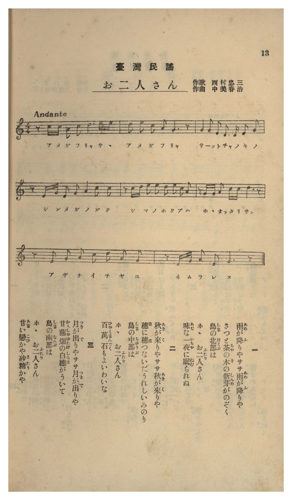

# お二人さん

> Re:Shōka 使用 AI 協助辨識與重建樂譜，可能會有錯誤。歡迎回報。

- **鋼琴伴奏版**：<br><audio controls src="ofutarisan.mp3"></audio>
- **NEUTRINO 歌聲合成版**：<br><audio controls src="ofutarisan_neutrino.mp3"></audio>

- 作詞：西村忠三
- 作曲：中美春治
- 臺灣教育會《臺灣の歌》（御大典記念事業，昭和四年五月一日發行，國臺圖 0786 8）第 13 頁（民謡第二曲）

## 說明

曲目說明與原書資訊（對應 P014.jpg，原書第 13 頁，民謠第二曲）：
- 書名：《臺灣の歌》（國立臺灣圖書館「日治時期圖書影像系統」典藏號 jpli2011-bk-sxt_0786_8_1929，索書號 0786 8）
- 作歌：西村忠三
- 作曲：中美春治
- 調性與拍號：イ短調五聲音階（A–C–D–E–G，無升降記號）4/4 拍子（Andante），8 小節
- 內容簡介：三節歌詞分別以臺灣北部的茶樹新芽、中部的百萬石稻穗、南部的甘蔗園白穗與製糖，襯托年輕男女「ホヽお二人さん」的浪漫情愫。

編曲說明：
- 依原譜 Andante 抒情民謠風格編配 2 小節前奏與溫婉伴奏。


## 歌詞

```text
一
雨（あめ）が降（ふ）りやササ雨（あめ）が降（ふ）りや
さつと茶（ちや）の木（き）の新芽（しんめ）がのぞく
島（しま）の北部（ほくぶ）は
ホヽお二人（ふたり）さん
味（あぢ）な一夜（いちや）に眠（ねむ）られぬ

二
秋（あき）が來（く）りやササ秋（あき）が來（く）りや
穗（ほ）に穗（ほ）つないだうれしいみのり
島（しま）の中部（ちゆうぶ）は
ホヽお二人（ふたり）さん
百萬石（ひやくまんごく）もよいわいな

三
月（つき）が出（で）りやササ月（つき）が出（で）りや
甘蔗畑（かんしやばたけ）の白穗（しらほ）がういて
島（しま）の南部（なんぶ）は
ホヽお二人（ふたり）さん
甘（あま）い戀（こひ）かや砂糖（さたう）かや

一、春雨一下呀沙沙春雨一下，茶樹的新芽颯然冒出頭；在島嶼的北部，呵呵小倆口，在饒富情味的一夜裡輾轉難眠。
二、秋天一到呀沙沙秋天一到，稻穗連著稻穗喜迎豐收；在島嶼的中部，呵呵小倆口，百萬石的收成也比不上這般美好。
三、月亮一出呀沙沙月亮一出，甘蔗田裡的白穗在月光下搖曳；在島嶼的南部，呵呵小倆口，究竟是甜蜜的戀情還是甘甜的砂糖呢？）
```

## ABC

<div class="abc-score" data-abc-src="ofutarisan.abc" aria-label="五線譜載入中"></div>

[下載 ABC 原始檔](ofutarisan.abc)

## TMD 檔案連結

- [主旋律 TMD 檔案](ofutarisan.tmd) [[在 TMD Studio 編輯](https://tmdlang.github.io/Tmd-TS/#tmd=s7IKdvYPcrWy4qpTUCpJTLdSyC_KTM_MsypJzCxPzIvPT0vLTM5MzFGCyyfn5-SkJpdk5sPV5OXHl5YkIlSU5eeU5qZaGSJEivNLi5JTcamHyMYXJKanWgUYGJogZAqK8stS8xLzEHpTU0qTE0GWxycWF-cDXQZiIzSklmWmpIKUFxRl5iYWVcan5CcD3ZJXguS61KJikOPL8pORvVWSkQp0c1p-TnZ8cmlxSX6uEpeWlsLjxq4nu3qe7Nr1uHHq46bJClpaIA1P9s55sXLe-z2zXizd_2zuxKf7FzzZ0Qk2CijzbPYmoMyTHWuf7-t7NmPps027wTIv2nc9b1z8bOrMF02bns1pftzQBRF53Lju2dqexw3d7_d0PN238OmS5U9bd7xYMePp_q1PdnU_W7r2_Z6eZzPWPp3U83T27Kc7tzzZNeXZnI4nOxqeTV_6fOaeFwt7gAqezukGmvZ0zjQFA3MLMwWL93s6n69Zo2BorPByQSPQ4GcbJr5YsxAoBPQM2H0Q10LjuyQjP70osSCj0iojE-jzokxgwMRnJ-YBo0jRVsHcjMveVsGZy8ZE38SOi0tfiwtowvPZ616sWvVsRt-LjvanffOfzd7xYnP7ixVdIE9s6H3W3qkAiki9rIJ0kOvACpAd1AN20AJkBwHDjOtx826gwqcTeoEc7AE0p_v5apBXgeJA3wIVv1yy4nFDDzAsgOH8bGbTsznzIeJP92582tz_fPPu51s3Pm7oBYXp9P4XM-crZBXkZBoZGBrqJmXrFleUxIMCLN4i3tDSyBLorudbFoH8AlQHD0iQq0DRuhYY0CgRDpPAiG-QxItV-581LAeGzrPuXqBxIA81LXk-fy1QHBiDLxo3vZy_-eWsPqCfHB81THYGYhcgdgVid5AzWhY-7W1_ObMXmBDAujuBga8ANOrp2gkgLXkpiXklqeBQ67FQeLqh__n6BpCtT1uXP1238_mGhU92A4ML6KhOoATQ5cDU-rSj7WnH0ie7l0JDr2f6y-YVz2e1vOjZ9mzFzmfTNrzo2vu4oRHoD4j485n7XkxY83z-5ucrdj9fOR0o9bQXquX5lBkvpkx_OmfS85l7gVJAT75YvPf55mlAx7xYuv5Z5wxgMn2xZ-rzKdufLt0MjJ3HzbMfN-9Fy0rASAEa9Wzrqmd7Vj9rbn3WsvpxQxMX1-OGCVD3tq54Nq39ccNELmBa53o5ewXQ348bmx43AZNP5-PGHmDggEW2grhNXY-bWh43bQUiYlRygZzQuORx4wqg78FyC4GiYNXrns2B6AfqAXPBAQMWmQ5yNcxQoNTjxnmPG_u5nm6GGDH9ceM-iB5I2IIFdwNVPG4EKgCKrwfGEEpAQFz1uHE-0FVgFaBw4Xo6cTPUA42LwKKrgAHwdMkcsGALklNXP5-zACy49nFTA9hvQAR02BouLqD5XM-Xg3IM2ByIX3qe7GsDi_SjBRkxKrmAEQ3xEdRuFC4wKFeBHbfgcWMb2BHA0ABy94OCqakLSxhB0hks7NtA2kgLJnj6BEtvAnkGFNT7QJHUOAXmdGAqAIdaE1AKqGAVMGiAGRdYgIJ1AZ0N9fDTdog1y9GChhiVXJD88HzqRLBEN9gFwMQCtG8DyNWNQHGQlyG5BZaUgCKQsAMGFtDvQMXLsCUlcJ4DC64Cm0taGE2ZAYtYiHktzzqAKQUoAjQJVOiCXdvyfEETOPcCxYHZAuhgYORDpbi4gMIvVs17sXY9qIAGpkRgQQAs5YC5DMh-sqP76cSGZ5tmghCSIKggABcroBwOzkAvF61_3rLtadskYPC9XACs02Y_nbMC6N2n2_YA1cAyTM_TiVtBaEP_04a2p_2LwTXbipdLJz1d3wMsI4A5A6gYkhteLF74Ys--F3s7X85eDMwHoLIDGBJAxwET89MlK0GKOjbAHYcsCCpewUXay4bFLyZOh7CfTpvzYn_fi40Tnk0BhjCK42ApFYvjEGUk0J9Ttj3rmPBk5_xn66c82dH7ZEfXy4aZLzrWAGuFp0uBJSvQfTs6QYEHrLx3AZN_AzAkEIGHJAgyF5KgpmwA-hJcFIMSDtBNQGVPWzuBAfxsArCOA6Z81FCEphVsDl257fnq-c9mrH8-Zc6LOXNAzu1oAIboy6YWsOAMoDjIInBCeDoRWO6A6hwuLX0uLt9EYGMwLD8zOdWhxqCmmksBCGwMzbTswKwaBQMFXQXDOBAyg7B0FYxABAgaQxhAqgYiCBYAqwEpNoUqA0GQMTVgI30MaxTigTxgslUAFrdAugfM2woiQRmuGaoFmFrhdA1YOUhBI1gEhxYQBJkNtckIyabGXri2fqJsAmpA2IShBc0mY5hNS1BsWk7IpiUYNmFoQdgEjRFYsIJoYyA2AvOMwGyQGCTOjIFsmAgoMkAQHDNgAhEVMBeB7F4MJleASWCpDXEBsJSCO3Ed2HiIT6cDnTkZLUJA8hA98-DBhogLYIkIl18NJkF8SCCA6FVA3AJmLUCypw1oRw_YPhAPIr8fbg7IRmBwIewBxgSkjIYrARbGIJ8AS2swOR8qPBGmG1xaI1kIcRTEQ21wSyGalkFZ8MiAZg9g6genfTCBJStAFJoCITQXQfTgzx_AEG7cB3clxFnghNi4DUyuhzkG7nAIBoUGpLYABw1SDINDBVsGQbUKGPetSN6nlm3wTIJq2yq4WqpYhRQxyOkfUXLBiiZEPgGJgNTC8gmuCIGUC4sQroYmx4VgJ0DYoIQNU78WKNoAxKDUBUrEILE1SHZgiwlgSweSWiExvQ8pcKYgxJtAToFqaeoAOwTYBkJyEsh5-MopiFfApkN1QOzYBCa74R6CqZ8KxMBQh6YIhDyqHbVcXLp2CqAqRUHXTpkLAA)]
- [鋼琴伴奏 TMD 檔案](ofutarisan_piano.tmd) [[在 TMD Studio 編輯](https://tmdlang.github.io/Tmd-TS/#tmd=s7IKdvYPcrWy4qpTUCpJTLdSSM7PyUlNLsnMz7MqScwsT8yLz8uPLy1JVIKrKMvPKc1NtTJEiBTnlxYlp-JSD5GNL0hMT7UKMDA0QcgUFOWXpeYl5iH0pqaUJieCLI9PLC7OT84EsxEaUssyU1JByguKMnMTiyrjU_KTgW7JK0FyXWpRMcjxBZmJQIckFhUl5qWnoiopyQAKWKXl52THJ5cWl-TnKnFpaSk8bux6sqvnya5djxunPm6a_H5Px8vuPc8nbHmyZ8vTpf3POzve7-lU0NICmfJk75wXK-e93zPrxdL9z-ZOfLp_wZMdnWDzgTLPZm8CyjzZsfb5vr5nM5Y-27QbLPN8-wqITFCqVXHG0d7sRIWXs2c-6-xGtgWs8kX7rueNi59NnfmiadOzOc2PG7ogIo8b1z1b2_O4oRvotKf7Fj5dsvxp644XK2Y83b_1ya7uZ0vXvt_T82zG2qeTep7Onv1055Ynu6Y8m9PxZEfDs-lLn8_c82JhD1DB0zndQNOezpmmYGBuYaZgAfTU8zVrFAyNFV4uaEQEUX5RSUZ-elFiQUalVUYmMIyKMpMTc-KzE_OAEatoq2BuxmVvq-DMZWOib2LHxaWvxQXx34tVq57N6AP6kutx8-4n--Y-7Zv_Yu0cBce8lMS8klSFZ12TnjW3Ptsw8cWaBS8XrXi2YA9Q28vWXgUjhacb-p-vb3ja2QsMhhcd7c92rX66shMSKo8bmri09Lm4PPNKivKtAkARG-ThUGNQU82lAAQ2hmZadmBWjYKBgq6CMRCbArEZEBvGAQkjEAHigURhakzBIiC1IBoGQXI1XLUodvkg22UBt8osPh5kAIgwAhGmIAJFGMIEGQo20jcxM4-w64EuBiJUt4OgMYQBpGoggmABsBqY11A9ATLSx7BGAeSGx41NCo-bGoF0D5i3FUQ2dT1uaoZqAaZ5OF0DVg5S0AgWwaEFBMFehthkhGRTYy9cWz9RNgE1IGzC0IJmkzHMpiUoNi0nZNMSDJswtCBsgsYILFhBNCitGIF5RvA0hkhNyKkOBMExAyYQUQFzEcjuxWByBZhcCHMBMIvDnbgObDzEp9OBzpyMFiEgeYieefBgQ8TF48bdcPnVYBLEhwQCiF4FxC1g1gIke9qAdvSA7QPxIPL74eaAbAQGF8IeYEw8buwGOQ2mZDrEJ48bN4DJ-VDhiTDdIAWdSBZCHAXxUBvcUoimZVAWPDKg2QOY-sFpH0xgyQoQhabQHA7JT_BshCt_AEO4cR_clRBngRNi4zYwuR7mGLjDIRgUGsDMAfIqKGiQYhgcKtgyCKpVwLhvRfI-tWyDZxJU21bB1VLFKqqWuugFFohchHA1NDkuBDsBwgYlbJj6tUDRBiAGpS5QIgaJrUGyA1tMbIKlVkhM70MKnCkI8SaQU6BamjrADnncBNEBcQbIefjKKYhXwKZDdUDs2AQmu-EegqmfCsTAUIemCIQ8qh0oNQrZdZQxmGkYD66kIJqAHKikKVgSrBNZGEk7TA-6RWYQPXDTEcIIe0iuQHXtFMDVsgKQAfJ6tI9hLIJthMQ2BrGVuQA)]

## 分析

```text
================================================================================
📊 TMD Song Profile: [ お二人さん ]
================================================================================
⏱  Duration:       0:25 (25.3s), 8 measures total
🎼 Key & Tempo:    首調基準 C, != 76.0 BPM, <4/4>
   - 分析範圍：      由實際發聲的音符與和弦推測調性；播放脈絡另行呈現
🎤 人聲音域:    D4 (MIDI 62) – E5 (MIDI 76) [跨度: 14 個半音 / 1.2 個八度, 難度: moderate]
   - 最低音:  D4 in [Main #1 @ m.3, 0:07]
   - 最高音: E5 in [Main #1 @ m.1, 0:02]
   - 適合: soprano, mezzo-soprano, contralto, tenor, baritone, bass
🏛  結構:      Main (25.3s)
⚡ 編曲密度:        Peak 1 軌道同時演奏
🗝  調性診斷：       G 調性不明確（純淨自然大調，未偵測到可信轉調）
   - 風格氣質:    純淨自然大調（陽光明朗、易唱易記，無明顯調外色彩）
   - 轉調歷程:    全曲維持單一推測調性（未偵測到可信轉調）
   - 核心骨幹音:  E, G, A, D, C
   - 調性數值:    G 調性不明確 [相關度: 0.72, 穩定度: Ambiguous, 自然音純度: 100.0%]
   - 候選調性 (K-S): G 大調 (0.72), C 大調 (0.69), A 小調 (0.68)
   - 五度圈歷程:   +1
   - 各段落調性細節:
     • [Main #1]: G 調性不明確 (r: 0.72, 自然音純度: 100.0%)

  [ 五度圈游移軌跡 ]
               C  
         F           [G ]*
      Bb               D  
      Eb               A  
         Ab           E  
            Db       B  
               F# 
     (* = active key center)

  [ 十二半音累積音高分佈 ]
     C  : █████████████████         15.5%
     C# :                            0.0%
     D  : █████████████████████     19.1%
     D# :                            0.0%
     E  : ████████████████████████  21.8%
     F  :                            0.0%
     F# :                            0.0%
     G  : ████████████████████████  21.8%
     G# :                            0.0%
     A  : ████████████████████████  21.8%
     A# :                            0.0%
     B  :                            0.0%
--------------------------------------------------------------------------------
Assignment 軌道音域：
  - Voice         : D4 – E5 (14 個半音 / 1.2 個八度, 52 個音符)
================================================================================
```


## 原書掃描頁




