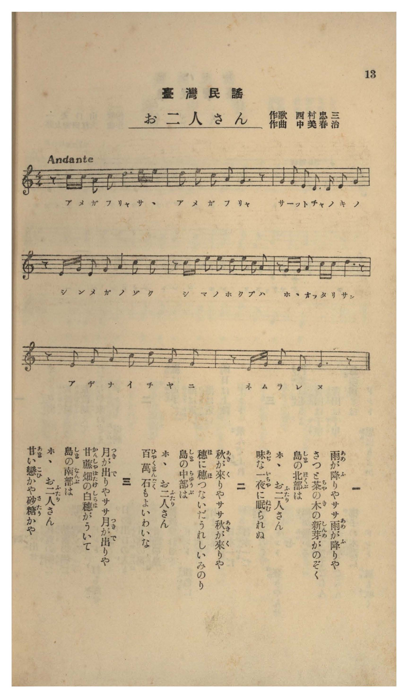

# お二人さん

> Re:Shōka 使用 AI 協助辨識與重建樂譜，可能會有錯誤。歡迎回報。

- **NEUTRINO 歌聲合成版**：<br><audio controls src="ofutarisan_neutrino.mp3"></audio>
- **鋼琴伴奏版**：<br><audio controls src="ofutarisan.mp3"></audio>


- 作詞：西村忠三
- 作曲：中美春治
- 臺灣教育會《臺灣の歌》（御大典記念事業，昭和四年五月一日發行，國臺圖 0786 8）第 13 頁（民謡第二曲）

## 說明

曲目說明與原書資訊（對應 P014.jpg，原書第 13 頁，民謠第二曲）：
・書名：《臺灣の歌》（國立臺灣圖書館「日治時期圖書影像系統」典藏號 jpli2011-bk-sxt_0786_8_1929，索書號 0786 8）
・作歌：西村忠三
・作曲：中美春治
・調性與拍號：イ短調五聲音階（A–C–D–E–G，無升降記號）4/4 拍子（Andante），8 小節
・內容簡介：三節歌詞分別以臺灣北部的茶樹新芽、中部的百萬石稻穗、南部的甘蔗園白穗與製糖，襯托年輕男女「ホヽお二人さん」的浪漫情愫。

編曲說明：
・依原譜 Andante 抒情民謠風格編配 2 小節前奏與溫婉伴奏。

## 歌詞

```text
一
雨（あめ）が降（ふ）りやササ雨（あめ）が降（ふ）りや
さつと茶（ちや）の木（き）の新芽（しんめ）がのぞく
島（しま）の北部（ほくぶ）は
ホヽお二人（ふたり）さん
味（あぢ）な一夜（いちや）に眠（ねむ）られぬ

二
秋（あき）が來（く）りやササ秋（あき）が來（く）りや
穗（ほ）に穗（ほ）つないだうれしいみのり
島（しま）の中部（ちゆうぶ）は
ホヽお二人（ふたり）さん
百萬石（ひやくまんごく）もよいわいな

三
月（つき）が出（で）りやササ月（つき）が出（で）りや
甘蔗畑（かんしやばたけ）の白穗（しらほ）がういて
島（しま）の南部（なんぶ）は
ホヽお二人（ふたり）さん
甘（あま）い戀（こひ）かや砂糖（さたう）かや

一、春雨一下呀沙沙春雨一下，茶樹的新芽颯然冒出頭；在島嶼的北部，呵呵小倆口，在饒富情味的一夜裡輾轉難眠。
二、秋天一到呀沙沙秋天一到，稻穗連著稻穗喜迎豐收；在島嶼的中部，呵呵小倆口，百萬石的收成也比不上這般美好。
三、月亮一出呀沙沙月亮一出，甘蔗田裡的白穗在月光下搖曳；在島嶼的南部，呵呵小倆口，究竟是甜蜜的戀情還是甘甜的砂糖呢？）
```

## ABC

```abc
X:1
T:お二人さん
M:4/4
L:1/16
Q:1/4=76
K:C
V:V1 name="Voice" snm="Voi"
[V:V1]
z2 c c A2 c2 d4 e3 e | d2 e2 c2 A2 G6 z2 | G4 G2 E2 D3 D E2 G2 | z2 E G E2 G2 A4 c2 c2 |
w: 1.~あ め が ふ りゃ さ さ | あ め が ふ りゃ | さ っ と ちゃ の き の | し ん め が の ぞ く
w: 2.~あ き が く りゃ さ さ | あ き が く りゃ | ほ に ほ つ な い だ | う れ し い み の り
w: 3.~つ き が で りゃ さ さ | つ き が で りゃ | かん しゃ ば た け の しら | ほ _ が う い て _
z2 c d e2 e2 d2 e2 c2 A2 | z2 G G A2 c c d6 z2 | z2 E2 G2 A2 c2 d2 A2 G2 | z2 E G A2 E2 A6 z2 |
w: 1.~し ま の ほ く ぶ は _ | ほ ほ お ふた り さ | あ ぢ な い ち や に | ね む ら れ ぬ
w: 2.~し ま の ちゅ う ぶ は _ | ほ ほ お ふた り さ | ひゃ く ま ん ご く も | よ い わ い な
w: 3.~し ま の な ん ぶ は _ | ほ ほ お ふた り さ | あ ま い こ ひ か や | さ た う か や
```

## TMD 檔案連結

- [主旋律 TMD 檔案](ofutarisan.tmd) [[在 TMD Studio 編輯](https://tmdlang.github.io/Tmd-TS/#tmd=s7IKdvYPcrWy4tLSUnjc2PVkV8-TXbseN0593DRZQUuLq05B6cneOS9Wznu_Z9aLpfufzZ34dP-CJzs6laAyz2ZvAso82bH2-b6-ZzOWPtu0Gyzzon3X88bFz6bOfNG06dmc5scNXRCRx43rnq3tedzQ_X5Px9N9C58uWf60dceLFTOe7t_6ZFf3s6Vr3-_peTZj7dNJPU9nz366c8uTXVOezel4sqPh2fSlz2fuebGwB6jg6ZxuoGlP50xTMDC3MFOweL-n8_maNQqGxgovFzQCDX62YeKLNQuBQkDPgN0HcW1JYrqVQn5RSUZ-elFiQUalVUZmcUl-UWZyYk58dmJeohKXoq2CuRmXva2CM5eNib6JHReXvhYX0ITns9e9WLXq2Yy-Fx3tT_vmP5u948Xm9hcrukCe2ND7rL1TIcDA0EQvqyAd5DqwAmQH9YAdtADZQcAw43rcvBuo8OmEXiAHewDN6X6-GuRVoDjQt0DFL5eseNzQAwwLYDg_m9n0bM58iPjTvRufNvc_37z7-daNjxt6QWE6vf_FzPkKWQU5mUYGhoa6Sdm6xRUl8aAAi7eIN7Q0sgS66_mWRSC_ANXBAxLkKlC0rgUGNEqEwyQw4hsk8WLV_mcNy4Gh86y7F2gcyENNS57PXwsUB8bgi8ZNL-dvfjmrD-gnx0cNk52B2AWIXYHYHeSMloVPe9tfzuwFJgSw7k5g4CsAjXq6dgJIS15KYl5JKjjUeiwUnm7of76-AWTr09blT9ftfL5h4ZPdwOACOqoTKAF0OTC1Pu1oe9qx9MnupdDQ65n-snnF81ktL3q2PVux89m0DS-69j5uaAT6AyL-fOa-FxPWPJ-_-fmK3c9XTgdKPe2Fank-ZcaLKdOfzpn0fOZeoBTQky8W732-eRrQMS-Wrn_WOQOYTF_smfp8yvanSzcDY-dx8-zHzXvRshIwUoBGPdu66tme1c-aW5-1rH7c0MTF9bhhAtS9rSueTWt_3DCRC5jWgcINL2evAHr9cWPT4yZgCup83NgDDB-wyFYQt6nrcVPL46atQESMSpCJIIc0LnncuAIYBmDphUAJsIZ1z-ZAjABqA3PBwQMWmQ5yO8xcoNTjxnmPG_tBxj3dDDFl-uPGfRBtkEAGC-4GKnrcCFQAFF8Pthw1UCDOe9w4H-g8sCJQGIFNnbgZ6pnGRWCJVcDweLpkDliwBcnNq5_PWQAWXPu4qQHsTyACunANFxfQCpBRz5eD8hDYKIi_ep7sawOL9KOFIDEqwSaunA7xHdQFKFxgyK4CO3HB48Y2sFOAIQPk7geFWlMX9iCDpD9YbLSBdJITavDUC1axCeQxUPjvA0Ve4xSYN4AJBByITUApoIJVwJACZeuGBmAJC9YI9ALU_0_bIZYtRwspYlSCHQTOM8-nTgTLdYPdAUxKQFs3gJzfCBQHeR-So2AJDSgCCUpg2AHDAah4GY6EBs6aYMFVYKPJCbIpM2BxDjG15VkHMB0BRYDmgUposLNbni9oAmd1oDgw9wBdDkwXUCkuLqDwi1XzXqxdDyrNgekUWGoAi0RgfgSyn-zofjqx4dmmmSCEJAgqNcBlEKg4AOezl4vWP2_Z9rRtEjAoXy4AVoCzn85ZAfT00217gGpgmarn6cStILSh_2lD29P-xeBqcMXLpZOeru8BFijAfANUDMkrLxYvfLFn34u9nS9nLwbmElBBAwwMoOOA6fzpkpUgRR0b4I5DFgSVxeDy72XD4hcTp0PYT6fNebG_78XGCc-mAMMZxXGw5IvFcYgCFejPKduedUx4snP-s_VTnuzofbKj62XDzBcda4BVyNOlwGIY6L4dnaDAA9b0u4B5ogEYEojAQxIEmQtJWVM2AH0JLrdBKQjoJqCyp62dwAB-NgFYIQIzAmooQlMMNoeu3PZ89fxnM9Y_nzLnxZw5IOd2NABD9GVTC1hwBlAcZBE4ITydCCyVQBUUl5Y-F5dvYmaeVVh-ZnKqQ41BTTWXAhDYGJpp2YFZNQoGCroKhnEgZAZh6SoYgQgQNIYwgFQNRBAsAFYDUmwKVQaCIGNqwEb6GNYoxAN5wGSrACyVgXQPmLcVRIIyXzNUCzC1wukasHKQgkawCA4tIAgyG2qTEZJNjb1wbf1E2QTUgLAJQwuaTcYwm5ag2LSckE1LMGzC0IKwCRojsGAF0cZAbATmGYHZIDFInBkD2TARUGSAIDhmwAQiKmAuAtm9GEyuAJPAohziAmBZBXfiOrDxEJ9OBzpzMlqEgOQheubBgw0RF8CiES6_GkyC-JBAANGrgLgFzFqAZE8b0I4esH0gHkR-P9wckI3A4ELYA4wJSGENVwIslUE-ARbbYHI-VHgiTDe42EayEOIoiIfa4JZCNC2DsuCRAc0ewNQPTvtgAktWgCg0BUJoLoLowZ8_gCHcuA_uSoizwAmxcRuYXA9zDNzhEAwKDUiFAQ4apBgGhwq2DIJqFTDuW5G8Ty3b4JkE1bZVcLVUsQopYpDTP6LkghVNiHwCEgGpheUTXBECKRcWIVwNTY4LwU6AsEEJG6Z-LVC0AYhBqQuUiEFia5DswBYTwIYPJLVCYnofUuBMQYg3gZwC1dLUAXYIsEmE5CSQ8_CVUxCvgE2H6oDYsQlMdsM9BFM_FYiBoQ5NEQh5VDtqubh07RRAVYqCrp0yFwA)]
- [鋼琴伴奏 TMD 檔案](ofutarisan_piano.tmd) [[在 TMD Studio 編輯](https://tmdlang.github.io/Tmd-TS/#tmd=s7IKdvYPcrWy4tLSUnjc2PVkV8-TXbseN0593DT5_Z6Ol917nk_Y8mTPlqdL-593drzf06mgpcVVp6D0ZO-cFyvnvd8z68XS_c_mTny6f8GTHZ1KUJlnszcBZZ7sWPt8X9-zGUufbdoNlnm-fQVEJijVqjjjaG92osLL2TOfdXYj2wJW-aJ91_PGxc-mznzRtOnZnObHDV0QkceN656t7Xnc0A102tN9C58uWf60dceLFTOe7t_6ZFf3s6Vr3-_peTZj7dNJPU9nz366c8uTXVOezel4sqPh2fSlz2fuebGwB6jg6ZxuoGlP50xTMDC3MFOwAHrq-Zo1CobGCi8XNIKtL0lMt1LILyrJyE8vSizIqLTKyCwuyS_KTE7Mic9OzEtU4lK0VTA347K3VXDmsjHRN7Hj4tLX4oL478WqVc9m9AF9yfW4efeTfXOf9s1_sXaOgmNeSmJeSarCs65Jz5pbn22Y-GLNgpeLVjxbsAeo7WVrr4KRwtMN_c_XNzzt7AUGw4uO9me7Vj9d2QkJlccNTVxa-lxcnnklRflWAZmJeflBHg41BjXVXApAYGNopmUHZtUoGCjoKhgDsSkQmwGxYRyQMAIRIB5IFKbGFCwCUguiYRAkV8NVi2KXDw67zOLjobqMYQwjGMMUxsCqDCGEYqdvYmYeYe8BvQREqJ4Dmw5hAKkaiCBYAKwG5ndUG0FG-hjWKIDc8rixSeFxUyOQ7gHztoLIpq7HTc1QLcBMAadrwMpBChrBIji0gCDIbKhNRkg2NfbCtfUTZRNQA8ImDC1oNhnDbFqCYtNyQjYtwbAJQwvCJmiMwIIVRIMSkxGYZwRPhIjkhpwsQRAcM2ACERUwF4HsXgwmV4DJhTAXAMsAuBPXgY2H-HQ60JmT0SIEJA_RMw8ebIi4eNy4Gy6_GkyC-JBAANGrgLgFzFqAZE8b0I4esH0gHkR-P9wckI3A4ELYA4yJx43dIKfBlEyH-ORx4wYwOR8qPBGmG6SgE8lCiKMgHmqDWwrRtAzKgkcGNHsAUz847YMJLFkBotAUWgRA8hM8G-HKH8AQbtwHdyXEWeCE2LgNTK6HOQbucAgGhQYwc4C8CgoapBgGhwq2DIJqFTDuW5G8Ty3b4JkE1bZVcLVUsYqqxTJ6gQUiFyFcDU2OC8FOgLBBCRumfi1QtAGIQakLlIhBYmuQ7MAWE5tgqRUS0_uQAmcKQrwJ5BSolqYOsEMeN0F0QJwBch6-cgriFbDpUB0QOzaByW64h2DqpwIxMNShKQIhj2oHSo1C_UrMGC5kCGIgoqgGIoCi2BSuGG46NmVYrIGZic-hZggz0VyFqQzZnVSvwXXtFMANBwUgAxT20T6GsQi2ERLbGMRW5gIA)]

## 分析

```text
================================================================================
📊 TMD Song Profile: [ お二人さん ]
================================================================================
⏱  Duration:       0:25 (25.3s), 8 measures total
🎼 Key & Tempo:    首調基準 C, != 76.0 BPM, <4/4>
   - 分析範圍：      由實際發聲的音符與和弦推測調性；播放脈絡另行呈現
🎤 人聲音域:    D4 (MIDI 62) – E5 (MIDI 76) [跨度: 14 個半音 / 1.2 個八度, 難度: moderate]
   - 最低音:  D4 in [Main #1 @ m.3, 0:07]
   - 最高音: E5 in [Main #1 @ m.1, 0:02]
   - 適合: soprano, mezzo-soprano, contralto, tenor, baritone, bass
🏛  結構:      Main (25.3s)
⚡ 編曲密度:        Peak 1 軌道同時演奏
🗝  調性診斷：       G 調性不明確（純淨自然大調，未偵測到可信轉調）
   - 風格氣質:    純淨自然大調（陽光明朗、易唱易記，無明顯調外色彩）
   - 轉調歷程:    全曲維持單一推測調性（未偵測到可信轉調）
   - 核心骨幹音:  E, G, A, D, C
   - 調性數值:    G 調性不明確 [相關度: 0.72, 穩定度: Ambiguous, 自然音純度: 100.0%]
   - 候選調性 (K-S): G 大調 (0.72), C 大調 (0.69), A 小調 (0.68)
   - 五度圈歷程:   +1
   - 各段落調性細節:
     • [Main #1]: G 調性不明確 (r: 0.72, 自然音純度: 100.0%)

  [ 五度圈游移軌跡 ]
               C  
         F           [G ]*
      Bb               D  
      Eb               A  
         Ab           E  
            Db       B  
               F# 
     (* = active key center)

  [ 十二半音累積音高分佈 ]
     C  : █████████████████         15.5%
     C# :                            0.0%
     D  : █████████████████████     19.1%
     D# :                            0.0%
     E  : ████████████████████████  21.8%
     F  :                            0.0%
     F# :                            0.0%
     G  : ████████████████████████  21.8%
     G# :                            0.0%
     A  : ████████████████████████  21.8%
     A# :                            0.0%
     B  :                            0.0%
--------------------------------------------------------------------------------
Assignment 軌道音域：
  - Voice         : D4 – E5 (14 個半音 / 1.2 個八度, 52 個音符)
================================================================================
```


## 原書掃描頁




