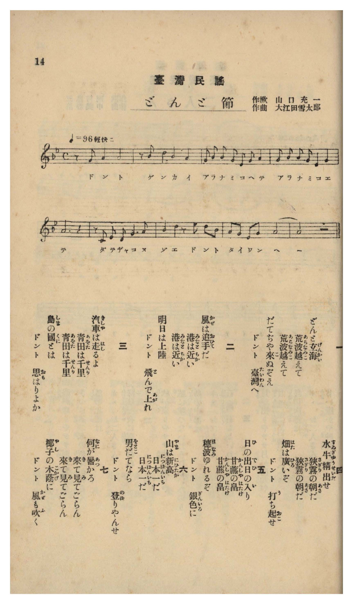

# どんこ節

> Re:Shōka 使用 AI 協助辨識與重建樂譜，可能會有錯誤。歡迎回報。

- **NEUTRINO 歌聲合成版**：<br><audio controls src="donko_bushi_neutrino.mp3"></audio>
- **鋼琴伴奏版**：<br><audio controls src="donko_bushi.mp3"></audio>


- 作詞：山口充一
- 作曲：大江田雪太郎
- 臺灣教育會《臺灣の歌》（御大典記念事業，昭和四年五月一日發行，國臺圖 0786 8）第 14 頁（民謡第三曲）

## 說明

曲目說明與原書資訊（對應 P015.jpg，原書第 14 頁，民謠第三曲）：
- 書名：《臺灣の歌》（國立臺灣圖書館「日治時期圖書影像系統」典藏號 jpli2011-bk-sxt_0786_8_1929，索書號 0786 8）
- 作歌：山口充一
- 作曲：大江田雪太郎
- 調性與拍號：ト短調／變ロ長調五聲音階（G–Bb–C–D–F–G，兩降記號）4/4 拍子（♩= 96 輕快ニ），9 小節
- 內容簡介：全曲共七節歌詞，以「ドント… ドント…」的號子聲貫穿全曲，歌詠渡海來臺、縱貫鐵道千里青田、水牛犁田、甘蔗園銀色穗波、日本第一高山新高山與椰林涼風。

編曲說明：
- 依原譜「輕快ニ」（♩= 96）民謠節奏編配 2 小節前奏與輕快伴奏。


## 歌詞

```text
一
どんと玄海（げんかい）
荒波（あらなみ）越（こ）えて
荒波（あらなみ）越（こ）えて
だてぢや來（こ）ぬぞえ
ドント　臺灣（たいわん）へ

二
風（かぜ）は追手（おひて）だ
港（みなと）は近（ちか）い
港（みなと）は近（ちか）い
明日（あす）は上陸（じやうりく）
ドント　飛（と）んで上（あが）れ

三
汽車（きしや）は走（はし）るよ
青田（あをた）は千里（せんり）
青田（あをた）は千里（せんり）
島（しま）の國（くに）とは
ドント　思（おも）はりよか

四
水牛（すゐぎう）精出（せいだ）せ
狭霧（さぎり）の朝（あさ）だ
狭霧（さぎり）の朝（あさ）だ
畑（はた）は廣（ひろ）いぞ
ドント　打（う）ち起（おこ）せ

五
日（ひ）の出（で）日（ひ）の入（い）り
甘蔗（かんしや）の畠（はたけ）
甘蔗（かんしや）の畠（はたけ）
穗波（ほなみ）ゆれるぞ
ドント　銀色（ぎんいろ）に

六
山（やま）は新高（にひたか）
日本一（につぽんいち）だ
日本一（につぽんいち）だ
男（をとこ）だてなら
ドント　登（のぼ）りやんせ

七
何（なに）が暑（あつ）かろ
來（き）て見（み）てごらん
來（き）て見（み）てごらん
椰子（やし）の木蔭（こかげ）に
ドント　風（かぜ）も吹（ふ）く

一、咚地越過玄界灘的滔天巨浪、越過滔天巨浪，可不是為了擺闊才來的呀，咚地來到臺灣！
二、順風吹送，港口近了、港口近了，明天就要登岸，咚地一躍上岸吧！
三、火車飛馳而過，翠綠稻田綿延千里、翠綠稻田綿延千里，誰能想到這竟是一座海島呢！
四、水牛加把勁吧，晨霧瀰漫的早晨、晨霧瀰漫的早晨，田地廣闊無邊，咚地翻土耕起吧！
五、日出與日落，甘蔗田裡、甘蔗田裡，蔗穗隨風搖曳，咚地閃耀著銀白色光芒！
六、山是新高山，日本第一高、日本第一高，若是好漢的話，咚地登上去吧！
七、哪裡會酷熱難耐呢？請親自來看看、請親自來看看，椰子樹蔭下，咚地涼風習習吹拂！）
```

## ABC

```abc
X:1
T:どんこ節
M:4/4
L:1/16
Q:1/4=96
K:Bb
V:V1 name="Voice" snm="Voi"
[V:V1]
z2 F2 G4 G8 | z2 B2 c6 B2 G4 | F2 B2 B2 G2 D2 F2 G4 | G2 B2 B2 G2 D4 G4 |
w: 1.~ど ん げ | ん か あら な | み こ え て あ ら な | み こ え _ て だ
w: 2.~か ぜ おひ | て だ な と | は ち か い み な と | は ち か _ い あ
w: 3.~き しゃ はし | る よ を た | は せ ん り あ を た | は せ ん _ り し
w: 4.~すゐ ぎう だ | せ _ ぎ り | の あ さ だ さ ぎ り | の あ さ _ だ は
w: 5.~ひ の ひの | い り しゃ の | は た け _ かん しゃ の | は た け _ _ ほ
w: 6.~や ま にひ | た か ぽん い | ち _ だ _ にっ ぽん い | ち _ だ _ _ を
w: 7.~な に あつ | か ろ て み | て ご ら ん き て み | て ご ら _ ん や
G8 z8 | z2 C2 D2 C2 F6 G2 | B4 c4 z2 d2 c2 B2 | G2 F2 D2 F2 G8- |
w: 1.~て | じゃ こ ぬ ぞ え | どん と た い わ | ん _ へ _ _
w: 2.~す | は じゃう り く _ | どん と と ん で | あ が れ _ _
w: 3.~ま | の く に と は | どん と お も は | りょ _ か _ _
w: 4.~た | は ひ ろ い ぞ | どん と う ち お | こ _ せ _ _
w: 5.~な | み ゆ れ る ぞ | どん と ぎ ん い | ろ _ に _ _
w: 6.~と | こ だ て な ら | どん と の ぼ りゃ | ん _ せ _ _
w: 7.~し | の こ か げ に | どん と か ぜ も | ふ _ く _ _
G8 z8 |
w: 1.~_
w: 2.~_
w: 3.~_
w: 4.~_
w: 5.~_
w: 6.~_
w: 7.~_
```

## TMD 檔案連結

- [主旋律 TMD 檔案](donko_bushi.tmd) [[在 TMD Studio 編輯](https://tmdlang.github.io/Tmd-TS/#tmd=s7IKdvYPcrWy4qpTUCpJTLdSyC_KTM_MsypJzCxPzIvPT0vLTM5MzFHi0tJSeNy48nHT5MeNk5-vb1DQ0gJpebJ3zouV897vmfV048an_YuftrY-2dGgBJV5NnsTSGbJ8mcb5z-fsuHl7FVPl6x62dwHln_Rvut54-JnU2e-aNr0bE7z44YuiMjjxnXP1vY8buh-v6fj6b6FQN1PW3e8WDHj6f6tT3Z1P1u69v2enmcz1j6d1PN09uynO7c82TXl2ZwOoK3Ppi99PnPPi4U9QAVP53QDTXs6Z5qCgbmFmYLF-z2dz9esUTA0UXi5oBFo8LMNE1-sWQgUerKjE-zKTrCboAFQkpGfXpRYkFFplZFZXAIMkOTEnPjsxLxEJS5FWwVLMy57WwUnHS4bE30TOy4ufS0uoBHPZ697sWrVsxl9Lzran_bNfzZ7x4vN7S9WdIF8saH3WXunQoCBoaleVkE6yHlgBcgu6gG7aAGyi4BBx_W4eTdQ4dMJvUAO9hCa0_18NcivQHGgd4GKXy5Z8bihBxgYzzbtfjaz6dmc-RDxp3s3Pm3uf7559_OtGx839IICdXr_i5nzFbIKcjKNDAwNdZOydYsrSuJBIRZvEW9oaWQJdNfzLYtAfgGqg4ckyFWg2F0LDGmUeIdJ4Ih2kPSLVfufNSwHhtGz7l6goSBvNXc8n78WKP5-T_-LdV2Pm9e-nLodyAXG64vGTS_nb345qw_oUfdHDZOdkoCEMxC7ALEbELuDwrJ15cuZvcAEAjauExgnCkCzn66dANT0aOZKUHwpvNgz9en-1Y-bgSEGDNYeS4WnG_qBaRjkoKety5-u2_l8w8Inu4Gys562rgA6_2nrxic7moEqgH4EJ--eJ7uXAkP1cXPn4-bNQBc_alimgMwBBujzWS1AFwDtBbr6xabVz1fuh5gFiluQKQue7Vj4bOv2J_vagLH1uKHx-Y6NQGUvJ2x92Tj5aW_zy_ael3MnAYMLKPVsw5bnnbOfdzVCuM-nzHgxZfrTOZNedjW86Nz0fOX0Z5sXgZQB43jOGnCSaXi5egYwJp5N2wBhgAJ4yYZn86Y_27bn5SJggmji4nrcMAHiHZC7prU_bpjIBY4zaKZe8byvBeg-YKg9bpwEFul-3NgCiu4XvZOAFoIlmh43dT5uXPW4ERhbnS-2gVI3sDgAsh83AhnLSFH6uHEBkHrcuOhxUwswUJCk1zxunAdUBIwdaAA_bmiApHCwovlAZz1u6gc6Eax6BxfXk109XEBfgmWBjp4DFl__Yv_eZ52gPPK4setx4yagZWDxBVzPdqwHi-4HOw-oDaJ6IlhwIdAIsEgL8epm9AGjAurpxpkQdU92dL2cuQMsOAPow8eNbY-bgM7oh-QfhMdeLp4NVgQ2HhTqy4E6YWYBMxhQsAfowx2dXM827n2xGyLV-7hxOtBQqIu2bgALrgcKgtV3P27q4IIkJlhMTAIGG0Q1JKmBxWeD7GsCmthJouqnm7eBhaY_btwHVrcOWAyBRfofN64Gi6wAakbx57OGudCoaGqCmA0KjyZQjHFxAUtyLkiiB6uZ-bhpwuPGPmCYgcrtTfuetu-COgEY840LwNpncz3vXvtyznKwxFSQarDbQGXjHIhNwPCbCo1xUpROhcQvMDRhYbAbku42PW4CFsOgGAemT1S_dQKTIlAFyLnAlPECmouA0Q1JorNBSXQKFyyRgAp3UJhBfQV0Vye6VCuEC47hpi4uSAkATd-gRAKP_XXPpwLDA-rex41At3eSqhpcnIBFd8Pz6-MmYHLtASUlNK9CiiCwamAwAs0GZkVIqKwGRmPrWi5g4QOSBaV4SNpYDymUwFpWg_Mh0GZQ1gGFB7D8ApZBMLkljxv3Qg1tXAjLrMQoej4FHOKghAtMeJBAh5Quq4ClEIoHns_cDTZp3ePGPZDQBbkVZB4olnY0cz3ZC0wKQAXAkIAk5Z5nsyBJAphKloBFgKHaywUrsyC-X_ZiGSQHgEMPZPMUUPnXNJlodcDyGlJpgcMOnJNBCXTFiynAFg-obASXbZOgYY0SJ2hFX1PT0wk7wSJbwar7ubiAvBer5r1YCyzQZoFKfWDt8XTSrKdzNgAL5peNfcCi__nUnueNM4CV2LPdU54uWfl0-4pnW1cBlUEUIAuC6tx-YPnW-2zG-udNu57sans2edfL6V3POnuBfgWa8HQiMLJ6IOYDRZ52bICV3o2gohpo6MsFbUBHA135sgHc9tmxHtiGAJasQLNA9RoSF9zY6wPZvWHji2WNwNh7uglYqsJM39HwYlcvsMAECj6dAMxIQAt2dIKqzMbVwLISWLa-XLb5RUMP0Aegpsz-Bc-3LXi-YjewqHu-bf_T3dsgxRtIPQ4poK4Xqza8aN77rHkz0B8vG2Y-Xz0f6G-gxU93LQdWl8Ci8OlEYO5pBJVh8Kr7adeCZ11dT7sbwY7qeTZzBbD4ed6w4dme1aAQnr4SKAJSjE0c5NApG4CeA5Y7wFB93rLwJai4gvr4-f7dT-fMf9EwFVjIwHy8awqkMQAsUED1_vSlLybsBZsCKgaAZr1YvBDeioBwQd4CsldOfzlrBTAink0ANhA3w-14Oa35BbDGnTgdmNmfz9wLzO9PWztfdAGTHtCXrWtBaQfY1JgBzdjgDA9ubyK1RTBbJyAru5cCdT1duvfZnkWg1tJKkEaot2buBsVi3254LAI7BI1PJ68COhbYOXjZuv1528aXsxe_aJgADu75L4CN3mWrXrSvAiU5YBt4TjcorWIIglwGzlfPVuwEZqQnO0AiECshLaPn-ycBETAlPusGVkvAxNjJpaXPxeWbCOwCheVnJqc61BjUVHMpAIGNhZYdmFGjYKBgqmCmoAvGIAgSMYxTMIoD84AskEQNUBGQCeYZQzXUAEmEGMSAGrChPoY1CvGgHpYCsDAA0iuAeBLceKAMWLQbiFuAIpDmFZBaBZYGFidADFLQAcTApmljE1ADdnmQ5mVgcgHCciOI5SDj5wDxeiAGtZmQ7QcbC9ICMWwV2I0Qw0HKF8Jdh08epBvqfoTlxhDze4EYWFM1QzWAmjMo_gea3gRxPshzk4D0fCTzZ0NCqKkLrzxQN1AFyAyQ2VD7TSD2g1odQArU7ACph3gF5GFEEMwGs4GNBZA6qFEgC9ZBLAWLL8ArDwt3kKPgDjCFmL4JqnI5iA1iIlsNdAzU5aA6HRFUIFUwP84H4olEqoF4ZDfCEWaQUAZ5eh9ULai6RnEESDMkEoFSi4EUqCaGRinIgoVI_iOkAuwAYDTBHWAOsQOUcFYDcQ8ozIA1LooDQGmgF2wEKLWAUuR-qMEg9hRIogdbiFseZC0kJYAdxQXN07C8bAC30EDBCJhJjYBZF8Q3A4oA860uJJcbKBiD8ztQBKTVFJ7DIVohNJJh8DwOyXwgGI_iM2AnARRVIKevAeJ50AjqADse1EMDc0E5ChYRoBTRD5KGyu2A24rsArgt8IwOTOlYXQCKcZArwOkfnI_64fJYnAAsoMABvRwsDUrdwBhr6iHGEcAMD0pk2BwBSv_90BQAsgmSU7A6AOjCJpC1YGlQM64dLA1KnwRdAMzykOIBezAAcyIwmUFSLcjMedhdAConQOVaF1gaIgcpIghYD8zwkKIZ03pg2dkECn9QYEK8gtN6UAkDyVugAOgFy60mxnpgVoeFLrr1IPNAJRgou0AcCMoyWK0HRdUeSMg3IyVDogIAmNcRxTtmCoBVdZAKEOQrrC6AVlfAVACS3gqWg6VZXNbXcnHp2ilU2-saGtUqAFmgmh5IK3MBAA)]
- [鋼琴伴奏 TMD 檔案](donko_bushi_piano.tmd) [[在 TMD Studio 編輯](https://tmdlang.github.io/Tmd-TS/#tmd=s7IKdvYPcrWy4tLSUnjcuPJx0-THjZOfr294v6fjZfee5xO2PNmz5enS_uedHe_3dCpoaXHVKSg92Tvnxcp57_fMerpx49P-xU9bW5_saFCCyjybvQkks2T5s43zn0_Z8HL2qqdLVr1s7gPLP9--AiIflGpVnHG0NztR4eXsmc86u5HtAqt80b7reePiZ1Nnvmja9GxO8-OGLojI48Z1z9b2PG7oBjrw6b6FQHuetu54sWLG0_1bn-zqfrZ07fs9Pc9mrH06qefp7NlPd255smvKszkdQPc9m770-cw9Lxb2ABU8ndMNNO3pnGkKBuYWZgoWQK89X7NGwdBE4eWCRrD1JYnpVgr5RSUZ-elFiQUZlVYZmcUl-UWZyYk58dmJeYlKXIq2CpZmXPa2Ck46XDYm-iZ2XFz6WlwQD75YterZjD6gN7keN-9-sm_u0775L9bOedzQ82LP1Kf7Vz9u7n7c0Av0wKOZK0GmAK1_tmHiizULgOEOCuvtK1629ioYKTzd0A8S6ewFCr7oaIdohoTR44YmLi19Li7PvJKifKuAzMS8_CAPhxqDmmouBSCwsdCyAzNqFAzjFHQVjECEgYJxHIgFFKlRMFMwVTAGYjOgBAjWcNWimOaD3TSzeJBpYMOMwDRUyBhEmMWDSLhpvomZeXidZgC1H-4GoAjQcWDH6oJYIIkaoCIgE8yDORjkfIQYxIAasKE-hjUK8aCErABMyUB6BRBPghsPlAGLdgNxC1DkcWPT46ZOILUKLP24cT8QgxR0APEykDRQA3Z5kOZlYHIBwnIjiOUg4-cA8Xog7nrcuAnZfrCxIC0Qw1aB3QgxHKR8Idx1-ORBuqHuR1huDDG_F4inP25qhmpYD-Sh-B9oehPE-SDPTQLS85HMnw0JoaYuvPJA3UAVIDNAZkPtN4HYP_Nx0wQg1fe4sQ2kHuIVkIcRQTAbzH7cOBWkDmoUyIJ1EEvB4gvwysPCHeQouANMIaZvgqpcDmKDmMhWAx0DdXk3JClAgwqkCubH-UA8kUg1EI_sRjjCDBLKIE_vg6pdjZ4EQJohkQiUWgyk9kLsAUUpyIKFSP4jpALsAGA0wR1gDrEDlHBWA3EPKMweNy5BcQAoDfSCjQClFlCK3A81GMSeAkn0YAtxy4OshaQEsKO4YAUE1CIDuIWgksIYiE3BfDMSiiQojWQYPI9DMh8IwoscsM9mQKIK5PQ1QDwPGkEdYMeDajcwF5SjYBEBShH9IGmo3A64rcguQBRssIwOTOlYXQCKcZArwOkfnI_64fJYnAAsoMABvRwsDUrdwBhr6iHGEcAMD0pk2BwBSv_90BQAsgmSU7A6AOjCJpC1YOmmrsdN7WBpUPok6AJglocUD9iDAZgTgckMkmpBZs7D7gJQOQEq17rA0hA5SBFBwHpghocUzZjWA8vOJlD4gwIT4hWc1oNKGEjeAgVAL1huNTHWA7M6LHTRrQeZByrBQNkF4kBQlsFqPSiq9kBCvhkpGRIVAMC8jijeMVMArKqDVIAgX2F1AbS6AqYCkPRWsBwszeKyHqV6x9dWAFfPMAZS-wGEIUKmMFloGwKhDk0Qq7GgoqFGwQiuCm4awbYKkjq4AKKgAXpQ106h2l7X0KhWAcgCN41ADJC3o30MYxFsIyS2MRLbBIltisQ2Q2Kbg9jKXAA)]

## 分析

```text
================================================================================
📊 TMD Song Profile: [ どんこ節 ]
================================================================================
⏱  Duration:       0:22 (22.5s), 9 measures total
🎼 Key & Tempo:    首調基準 B,, != 96.0 BPM, <4/4>
   - 分析範圍：      由實際發聲的音符與和弦推測調性；播放脈絡另行呈現
🎤 人聲音域:    C4 (MIDI 60) – D5 (MIDI 74) [跨度: 14 個半音 / 1.2 個八度, 難度: moderate]
   - 最低音:  C4 in [Main #1 @ m.6, 0:12]
   - 最高音: D5 in [Main #1 @ m.7, 0:16]
   - 適合: soprano, mezzo-soprano, contralto, tenor, baritone, bass
🏛  結構:      Main (22.5s)
⚡ 編曲密度:        Peak 1 軌道同時演奏
🗝  調性診斷：       G 小調（純淨自然小調，未偵測到可信轉調）
   - 風格氣質:    純淨自然小調（陰鬱抒情、旋律集中，無明顯調外色彩）
   - 轉調歷程:    全曲維持單一推測調性（未偵測到可信轉調）
   - 核心骨幹音:  G, A#, C, F, D
   - 調性數值:    G 小調 [相關度: 0.83, 穩定度: High, 自然音純度: 100.0%]
   - 候選調性 (K-S): G 小調 (0.83), G 大調 (0.64), C 大調 (0.54)
   - 五度圈歷程:   +1
   - 各段落調性細節:
     • [Main #1]: G 小調 (r: 0.83, 自然音純度: 100.0%)

  [ 五度圈游移軌跡 ]
               C  
         F           [G ]*
      Bb               D  
      Eb               A  
         Ab           E  
            Db       B  
               F# 
     (* = active key center)

  [ 十二半音累積音高分佈 ]
     C  : ███████                   13.3%
     C# :                            0.0%
     D  : █████                     10.0%
     D# :                            0.0%
     E  :                            0.0%
     F  : ███████                   13.3%
     F# :                            0.0%
     G  : ████████████████████████  48.3%
     G# :                            0.0%
     A  :                            0.0%
     A# : ███████                   15.0%
     B  :                            0.0%
--------------------------------------------------------------------------------
Assignment 軌道音域：
  - Voice         : C4 – D5 (14 個半音 / 1.2 個八度, 36 個音符)
================================================================================
```


## 原書掃描頁




