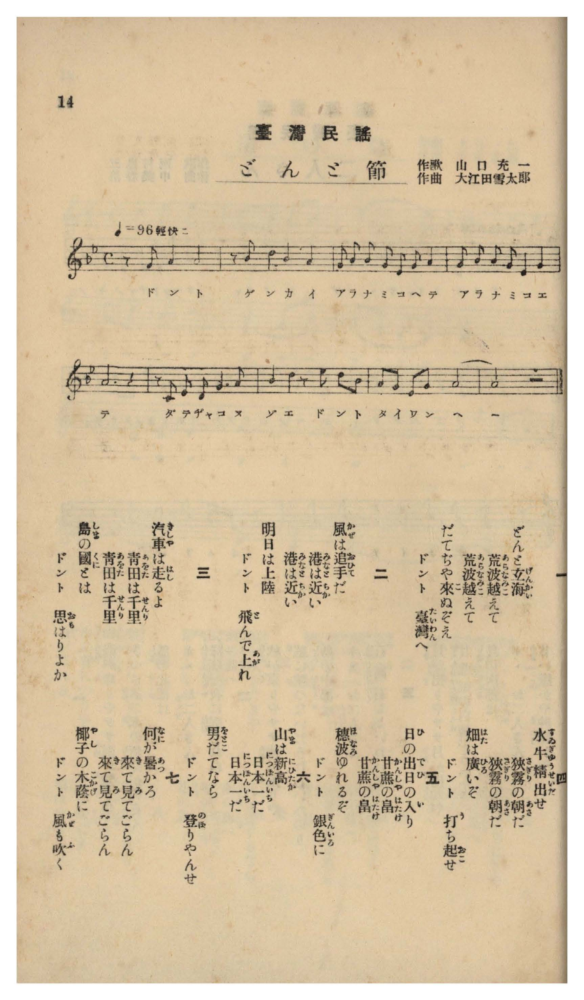

# どんこ節

> Re:Shōka 使用 AI 協助辨識與重建樂譜，可能會有錯誤。歡迎回報。

- **鋼琴伴奏版**：<br><audio controls src="donko_bushi.mp3"></audio>
- **NEUTRINO 歌聲合成版**：<br><audio controls src="donko_bushi_neutrino.mp3"></audio>

- 作詞：山口充一
- 作曲：大江田雪太郎
- 臺灣教育會《臺灣の歌》（御大典記念事業，昭和四年五月一日發行，國臺圖 0786 8）第 14 頁（民謡第三曲）

## 說明

曲目說明與原書資訊（對應 P015.jpg，原書第 14 頁，民謠第三曲）：
- 書名：《臺灣の歌》（國立臺灣圖書館「日治時期圖書影像系統」典藏號 jpli2011-bk-sxt_0786_8_1929，索書號 0786 8）
- 作歌：山口充一
- 作曲：大江田雪太郎
- 調性與拍號：ト短調／變ロ長調五聲音階（G–Bb–C–D–F–G，兩降記號）4/4 拍子（♩= 96 輕快ニ），9 小節
- 內容簡介：全曲共七節歌詞，以「ドント… ドント…」的號子聲貫穿全曲，歌詠渡海來臺、縱貫鐵道千里青田、水牛犁田、甘蔗園銀色穗波、日本第一高山新高山與椰林涼風。

編曲說明：
- 依原譜「輕快ニ」（♩= 96）民謠節奏編配 2 小節前奏與輕快伴奏。


## 歌詞

```text
一
どんと玄海（げんかい）
荒波（あらなみ）越（こ）えて
荒波（あらなみ）越（こ）えて
だてぢや來（こ）ぬぞえ
ドント　臺灣（たいわん）へ

二
風（かぜ）は追手（おひて）だ
港（みなと）は近（ちか）い
港（みなと）は近（ちか）い
明日（あす）は上陸（じやうりく）
ドント　飛（と）んで上（あが）れ

三
汽車（きしや）は走（はし）るよ
青田（あをた）は千里（せんり）
青田（あをた）は千里（せんり）
島（しま）の國（くに）とは
ドント　思（おも）はりよか

四
水牛（すゐぎう）精出（せいだ）せ
狭霧（さぎり）の朝（あさ）だ
狭霧（さぎり）の朝（あさ）だ
畑（はた）は廣（ひろ）いぞ
ドント　打（う）ち起（おこ）せ

五
日（ひ）の出（で）日（ひ）の入（い）り
甘蔗（かんしや）の畠（はたけ）
甘蔗（かんしや）の畠（はたけ）
穗波（ほなみ）ゆれるぞ
ドント　銀色（ぎんいろ）に

六
山（やま）は新高（にひたか）
日本一（につぽんいち）だ
日本一（につぽんいち）だ
男（をとこ）だてなら
ドント　登（のぼ）りやんせ

七
何（なに）が暑（あつ）かろ
來（き）て見（み）てごらん
來（き）て見（み）てごらん
椰子（やし）の木蔭（こかげ）に
ドント　風（かぜ）も吹（ふ）く

一、咚地越過玄界灘的滔天巨浪、越過滔天巨浪，可不是為了擺闊才來的呀，咚地來到臺灣！
二、順風吹送，港口近了、港口近了，明天就要登岸，咚地一躍上岸吧！
三、火車飛馳而過，翠綠稻田綿延千里、翠綠稻田綿延千里，誰能想到這竟是一座海島呢！
四、水牛加把勁吧，晨霧瀰漫的早晨、晨霧瀰漫的早晨，田地廣闊無邊，咚地翻土耕起吧！
五、日出與日落，甘蔗田裡、甘蔗田裡，蔗穗隨風搖曳，咚地閃耀著銀白色光芒！
六、山是新高山，日本第一高、日本第一高，若是好漢的話，咚地登上去吧！
七、哪裡會酷熱難耐呢？請親自來看看、請親自來看看，椰子樹蔭下，咚地涼風習習吹拂！）
```

## ABC

<div class="abc-score" data-abc-src="donko_bushi.abc" aria-label="五線譜載入中"></div>

[下載 ABC 原始檔](donko_bushi.abc)

## TMD 檔案連結

- [主旋律 TMD 檔案](donko_bushi.tmd) [[在 TMD Studio 編輯](https://tmdlang.github.io/Tmd-TS/#tmd=s7IKdvYPcrWy4qpTUCpJTLdSyC_KTM_MsypJzCxPzIvPT0vLTM5MzFGCyyfn5-SkJpdk5sPV5OXHl5YkIlSU5eeU5qZaGSJEivNLi5JTcamHyMYXJKanWgUYGJoiZAqK8stS8xLzEHpTU0qTE0GWxycWF-cDXQZiIzSklmWmpIKUFxRl5iYWVcan5CcD3ZJXguS61KJikOPL8pORvVWSkQp0c1p-TnZ8cX5euhKXlpbC48aVj5smP26c_Hx9g4KWFkjtk71zXqyc937PrKcbNz7tX_y0tfXJjgawKUCZZ7M3gWSWLH-2cf7zKRtezl71dMmql819YPkX7bueNy5-NnXmi6ZNz-Y0P27ogog8blz3bG3P44bu93s6nu5bCNT9tHXHixUznu7f-mRX97Ola9_v6Xk2Y-3TST1PZ89-unPLk11Tns3pANr6bPrS5zP3vFjYA1TwdE430LSnc6YpGJhbmClYvN_T-XzNGgVDE4WXCxqBBj_bMPHFmoVAoSc7OsGu7ET4PL-oJCM_vSixIKPSKiOzuASYAIAhE5-dmAeMI0VbBUszLntbBScdLhsTfRM7Li59LS6gEc9nr3uxatWzGX0vOtqf9s1_NnvHi83tL1Z0gXyxofdZe6cCKCr1sgrSQc4DK0B2UQ_YRQuQXQQMOq7HzbuBCp9O6AVysIfQnO7nq0F-BYoDvQtU_HLJiscNPcDAeLZp97OZTc_mzIeIP9278Wlz__PNu59v3fi4oRcUqNP7X8ycr5BVkJNpZGBoqJuUrVtcURIPCrF4i3hDSyNLoLueb1kE8gtQHTwkQa4Cxe5aYEijxDtMAke0g6RfrNr_rGE5MIyedfcCDQV5q7nj-fy1QPH3e_pfrOt63Lz25dTtQC4wXl80bno5f_PLWX1Aj7o_apjslAQknIHYBYjdgNgdFJatK1_O7AUmELBxncA4UQCa_XTtBKCmRzNXguJL4cWeqU_3r37cDAwxYLD2WCo83dAPTMMgBz1tXf503c7nGxY-2Q2UnfW0dQXQ-U9bNz7Z0QxUAfQjOHn3PNm9FBiqj5s7HzdvBrr4UcMyBWQOMECfz2oBugBoL9DVLzatfr5yP8QsUNyCTFnwbMfCZ1u3P9nXBoytxw2Nz3dsBCp7OWHry8bJT3ubX7b3vJw7CRhcQKlnG7Y875z9vKsRwn0-ZcaLKdOfzpn0sqvhReem5yunP9u8CKQMGMdz1oCTTMPL1TOAMfFs2gYIAxTASzY8mzf92bY9LxcBE0QTF9fjhgkQ74DcNa39ccNELnCcQTP1iud9LUD3AUPtceMksEj348YWUHS_6J0EtBAs0fS4qfNx46rHjcDY6nyxDZS6gcUBkP24EchYRorSx40LgNTjxkWPm1qAgYIkveZx4zygImDsQAP4cUMDJIWDFc0HOutxUz_QiWDVO7i4nuzq4QL6EiwLdPQcsPj6F_v3PusE5ZHHjV2PGzcBLQOLL-B6tmM9WHQ_2HlAbRDVE8GCC4FGgEVaiFc3ow8YFVBPN86EqHuyo-vlzB1gwRlAHz5ubHvcBHRGPyT_IDz2cvFssCKw8aBQXw7UCTMLmMGAgj1AH-7o5Hq2ce-L3RCp3seN04GGQl20dQNYcD1QEKy--3FTBxckMcFiYhIw2CCqIUkNLD4bZF8T0MROElU_3bwNLDT9ceM-sLp1wGIILNL_uHE1WGQFUDOKP581zIVGRVMTxGxQeDSBYoyLC1iSc0ESPVjNzMdNEx439gHDDFRub9r3tH0X1AnAmG9cANY-m-t599qXc5aDJaaCVIPdBiob50BsAobfVGiMk6J0KiR-gaEJC4PdkHS36XETsBgGxTgwfaL6rROYFIEqQM4FpowX0FwEjG5IEp0NSqJTuGCJBFS4g8IM6iuguzrRpVohXHAMN3VxQUoAaPoGJRJ47K97PhUYHlD3Pm4Eur2TVNXg4gQsuhueXx83AZNrDygpoXkVUgSBVQODEWg2MCtCQmU1MBpb13IBCx-QLCjFQ9LGekihBNayGpwPgTaDsg4oPIDlF7AMgsktedy4F2po40JYZiVG0fMp4BAHJVxgwoMEOqR0WQUshVA88HzmbrBJ6x437oGELsitIPNAsbSjmevJXmBSACoAhgQkKfc8mwVJEsBUsgQsAgzVXi5YmQXx_bIXyyA5ABx6IJungMq_pslEqwOW15BKCxx24JwMSqArXkwBtnhAZSO4bJsEDWuUOEEr-pqank7YCRbZClbdz8UF5L1YNe_FWmCBNgtU6gNrj6eTZj2dswFYML9s7AMW_c-n9jxvnAGsxJ7tnvJ0ycqn21c827oKqAyiAFkQVOf2A8u33mcz1j9v2vVkV9uzybteTu961tkL9CvQhKcTgZHVAzEfKPK0YwOs9G4EFdVAQ18uaAM6GujKlw3gts-O9cA2BLBkBZoFqteQuODGXh_I7g0bXyxrBMbe003AUhVm-o6GF7t6gQUmUPDpBGBGAlqwoxNUZTauBpaVwLL15bLNLxp6gD4ANWX2L3i-bcHzFbuBRd3zbfuf7t4GKd5A6nFIAXW9WLXhRfPeZ82bgf542TDz-er5QH8DLX66azmwugQWhU8nAnNPI6gMg1fdT7sWPOvqetrdCHZUz7OZK4DFz_OGDc_2rAaF8PSVQBGQYmziIIdO2QD0HLDcAYbq85aFL0HFFdTHz_fvfjpn_ouGqcBCBubjXVMgjQFggQKq96cvfTFhL9gUUDEANOvF4oXwVgSEC_IWkL1y-stZK4AR8WwCsIG4GW7Hy2nNL4A17sTpwMz-fOZeYH5_2tr5oguY9IC-bF0LSjvApsYMaMYGZ3hwexOpLYLZOgFZ2b0UqOvp0r3P9iwCtZZWgjRCvTVzNygW-3bDYxHYIWh8OnkV0LHAzsHL1u3P2za-nL34RcMEcHDPfwFs9C5b9aJ9FSjJAdvAc7pBaRVDEOQycL56tmInMCM92QESgVgJaRk93z8JiIAp8Vk3sFoCJsZOLi19Li7fRGCXLyw_MznVocagpppLAQhsLLTswIwaBQMFUwUzBV0wBkGQiGGcglEcmAdkgSRqgIqATDDPGKqhBkgixCAG1IAN9TGsUYgH9bAUgIUBkF4BxJPgxgNlwKLdQNwCFIE0r4DUKrA0sDgBYpCCDiAGNk0bm4AasMuDNC8DkwsQlhtBLAcZPweI1wMxqM2EbD_YWJAWiGGrwG6EGA5SvhDuOnzyIN1Q9yMsN4aY3wvEwJqqGaoB1JxB8T_Q9CaI80GemwSk5yOZPxsSQk1deOWBuoEqQGaAzIbabwKxH9TqAFKgZgdIPcQrIA8jgmA2mA1sLIDUQY0CWbAOYilYfAFeeVi4gxwFd4ApxPRNUJXLQWwQE9lqoGOgLgfV6YigAqmC-XE-EE8kUg3EI7sRjjCDhDLI0_ugakHVNYojQJohkQiUWgykQDUxNEpBFixE8h8hFWAHAKMJ7gBziB2ghLMaiHtAYQascVEcAEoDvWAjQKkFlCL3Qw0GsadAEj3YQtzyIGshKQHsKC5onoblZQO4hQYKRsBMagTMuiC-GVAEmG91IbncQMEYnN-BIiCtpvAcDtEKoZEMg-dxSOYDwXgUnwE7CaCoAjl9DRDPg0ZQB9jxoB4amAvKUbCIAKWIfpA0VG4H3FZkF8BtgWd0YErH6gJQjINcAU7_4HzUD5fH4gRgAQUO6OVgaVDqBsZYUw8xjgBmeFAiw-YIUPrvh6YAkE2QnILVAUAXNoGsBUuDmnHtYGlQ-iToAmCWhxQP2IMBmBOByQySakFmzsPuAlA5ASrXusDSEDlIEUHAemCGhxTNmNYDy84mUPiDAhPiFZzWg0oYSN4CBUAvWG41MdYDszosdNGtB5kHKsFA2QXiQFCWwWo9KKr2QEK-GSkZEhUAwLyOKN4xUwCsqoNUgCBfYXUBtLoCpgKQ9FawHCzN4rK-lotL106h2l7X0KhWAcgC1fRAWpkLAA)]
- [鋼琴伴奏 TMD 檔案](donko_bushi_piano.tmd) [[在 TMD Studio 編輯](https://tmdlang.github.io/Tmd-TS/#tmd=s7IKdvYPcrWy4qpTUCpJTLdSSM7PyUlNLsnMz7MqScwsT8yLz8uPLy1JVIKrKMvPKc1NtTJEiBTnlxYlp-JSD5GNL0hMT7UKMDA0RcgUFOWXpeYl5iH0pqaUJieCLI9PLC7OT84EsxEaUssyU1JByguKMnMTiyrjU_KTgW7JK0FyXWpRMcjxBZmJQIckFhUl5qWnoiopyQAKWKXl52THF-fnpStxaWkpPG5c-bhp8uPGyc_XN7zf0_Gye8_zCVue7NnydGn_886O93s6FbS0QAY82Tvnxcp57_fMerpx49P-xU9bW5_saAAbDZR5NnsTSGbJ8mcb5z-fsuHl7FVPl6x62dwHln--fQVEPijVqjjjaG92osLL2TOfdXYj2wVW-aJ91_PGxc-mznzRtOnZnObHDV0QkceN656t7Xnc0A104NN9C4H2PG3d8WLFjKf7tz7Z1f1s6dr3e3qezVj7dFLP09mzn-7c8mTXlGdzOoDuezZ96fOZe14s7AEqeDqnG2ja0znTFAzMLcwULIBee75mjYKhicLLBY2IMMovKsnITy9KLMiotMrILC7JL8pMTsyJz07MA8asoq2CpRmXva2Ckw6XjYm-iR0Xl74WF8SDL1atejajD-hNrsfNu5_sm_u0b_6LtXMeN_S82DP16f7Vj5u7Hzf0Aj3waOZKkClA659tmPhizQJguIPCevuKl629CkYKTzf0g0Q6e4GCLzraIZohYfS4oYlLS5-LyzOvpCjfKgAUz0EeDjUGNdVcCkBgY6FlB2bUKBjGKegqGIEIAwXjOBALKFKjYKZgqmAMxGZACRCs4apFMc0Hu2lm8SDTwIYZgWmokDGIMIsHkXDTfBMz8_A6zQBqP9wNQBGg48CO1QWxQBI1QEVAJpgHczDI-QgxiAE1YEN9DGsU4kEJWQGYkoH0CiCeBDceKAMW7QbiFqDI48amx02dQGoVWPpx434gBinoAOJlIGmgBuzyIM3LwOQChOVGEMtBxs8B4vVA3PW4cROy_WBjQVoghq0CuxFiOEj5Qrjr8MmDdEPdj7DcGGJ-LxBPf9zUDNWwHshD8T_Q9CaI80GemwSk5yOZPxsSQk1deOWBuoEqQGaAzIbabwKxf-bjpglAqu9xYxtIPcQrIA8jgmA2mP24cSpIHdQokAXrIJaCxRfglYeFO8hRcAeYQkzfBFW5HMQGMZGtBjoG6vJuSFKABhVIFcyP84F4IpFqIB7ZjXCEGSSUQZ7eB1W7Gj0JgDRDIhEotRhI7YXYA4pSkAULkfxHSAXYAcBogjvAHGIHKOGsBuIeUJg9blyC4gBQGugFGwFKLaAUuR9qMIg9BZLowRbilgdZC0kJYEdxwQoIqEUGcAtBJYUxEJuC-WYkFElQGskweB6HZD4QhBc5YJ_NgEQVyOlrgHgeNII6wI4H1W5gLihHwSIClCL6QdJQuR1wW5FdgCjYYBkdmNKxugAU4yBXgNM_OB_1w-WxOAFYQIEDejlYGpS6gTHW1EOMI4AZHpTIsDkClP77oSkAZBMkp2B1ANCFTSBrwdJNXY-b2sHSoPRJ0AXALA8pHrAHAzAnApMZJNWCzJyH3QWgcgJUrnWBpSFykCKCgPXADA8pmjGtB5adTaDwBwUmxCs4rQeVMJC8BQqAXrDcamKsB2Z1WOiiWw8yD1SCgbILxIGgLIPVelBU7YGEfDNSMiQqAIB5HVG8Y6YAWFUHqQBBvsLqAmh1BUwFIOmtYDlYmsVlPUr1jq-tAK6eYQyk9gMIQ4RMYbLQNgRCHZogVmNBRUONghFcFdw0gm0VJHVwAURBA_Sgrp1Ctb2uoVGtApAFbhqBGCBvR_sYxiLYRkhsYyS2CRLbFIlthsQ2B7GVuQA)]

## 分析

```text
================================================================================
📊 TMD Song Profile: [ どんこ節 ]
================================================================================
⏱  Duration:       0:22 (22.5s), 9 measures total
🎼 Key & Tempo:    首調基準 B,, != 96.0 BPM, <4/4>
   - 分析範圍：      由實際發聲的音符與和弦推測調性；播放脈絡另行呈現
🎤 人聲音域:    C4 (MIDI 60) – D5 (MIDI 74) [跨度: 14 個半音 / 1.2 個八度, 難度: moderate]
   - 最低音:  C4 in [Main #1 @ m.6, 0:12]
   - 最高音: D5 in [Main #1 @ m.7, 0:16]
   - 適合: soprano, mezzo-soprano, contralto, tenor, baritone, bass
🏛  結構:      Main (22.5s)
⚡ 編曲密度:        Peak 1 軌道同時演奏
🗝  調性診斷：       G 小調（純淨自然小調，未偵測到可信轉調）
   - 風格氣質:    純淨自然小調（陰鬱抒情、旋律集中，無明顯調外色彩）
   - 轉調歷程:    全曲維持單一推測調性（未偵測到可信轉調）
   - 核心骨幹音:  G, A#, C, F, D
   - 調性數值:    G 小調 [相關度: 0.83, 穩定度: High, 自然音純度: 100.0%]
   - 候選調性 (K-S): G 小調 (0.83), G 大調 (0.64), C 大調 (0.54)
   - 五度圈歷程:   +1
   - 各段落調性細節:
     • [Main #1]: G 小調 (r: 0.83, 自然音純度: 100.0%)

  [ 五度圈游移軌跡 ]
               C  
         F           [G ]*
      Bb               D  
      Eb               A  
         Ab           E  
            Db       B  
               F# 
     (* = active key center)

  [ 十二半音累積音高分佈 ]
     C  : ███████                   13.3%
     C# :                            0.0%
     D  : █████                     10.0%
     D# :                            0.0%
     E  :                            0.0%
     F  : ███████                   13.3%
     F# :                            0.0%
     G  : ████████████████████████  48.3%
     G# :                            0.0%
     A  :                            0.0%
     A# : ███████                   15.0%
     B  :                            0.0%
--------------------------------------------------------------------------------
Assignment 軌道音域：
  - Voice         : C4 – D5 (14 個半音 / 1.2 個八度, 36 個音符)
================================================================================
```


## 原書掃描頁




