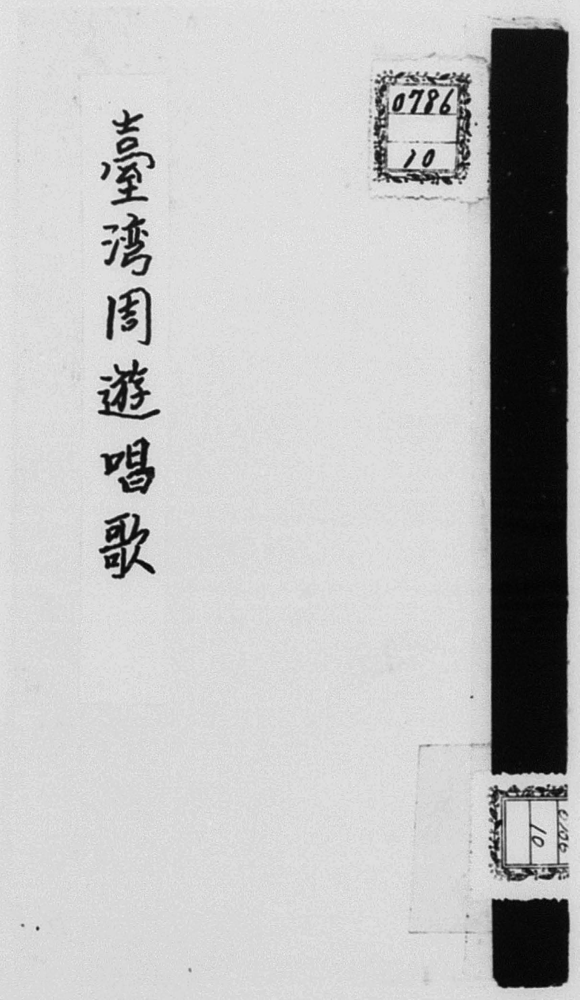
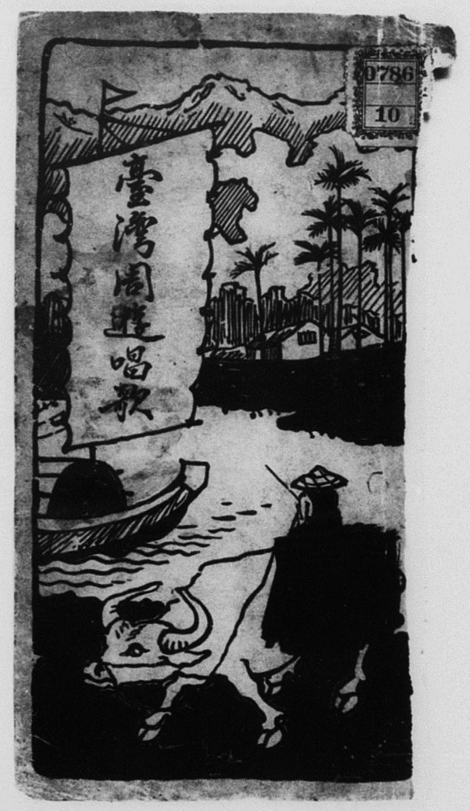
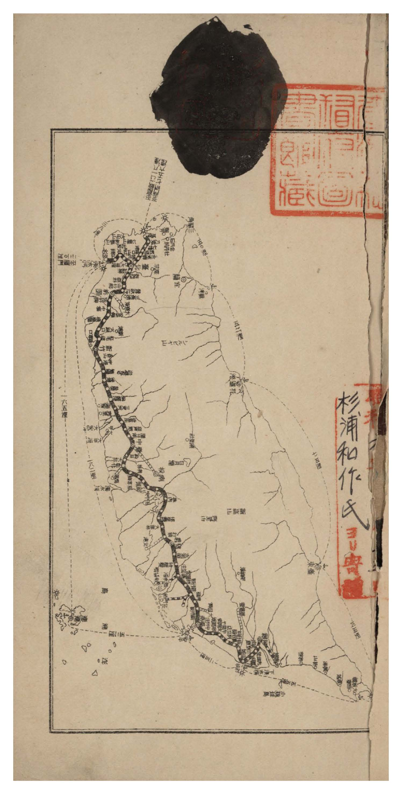
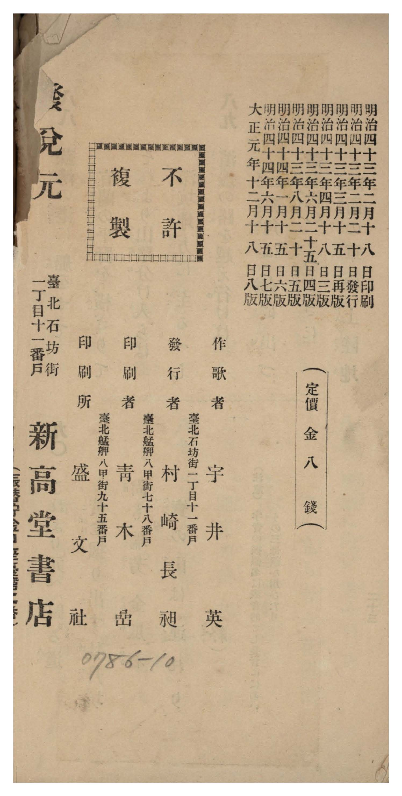
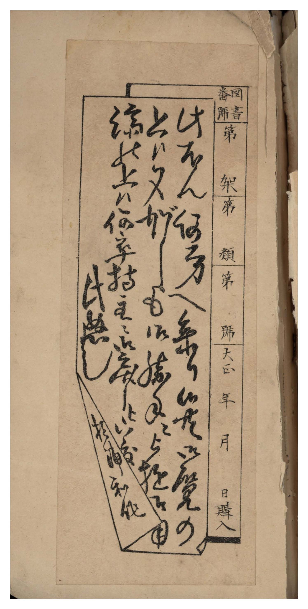

# 書訊與卷首／卷末掃描頁 — 《臺灣周遊唱歌》 明治四十三年初版／大正元年八版（國臺圖 0786 10）

本頁收錄本冊之封面、扉頁、目次（もくろく）、樂典大要、版權頁與封底等原書掃描圖檔（共 5 頁）。

## 館藏詮釋資料（國立臺灣圖書館）

| 欄位 | 內容 |
| :--- | :--- |
| **系統編號** | `jpli2011-bk-sxt_0786_10_1912` |
| **資料格式** | 圖書 |
| **主要題名** | 臺灣周遊唱歌 |
| **作歌者** | 宇井英（臺北石坊街一丁目十一番戶） |
| **作曲者** | 高橋二三四 |
| **發行者／發兌元** | 村崎長昶／臺北新高堂書店（印刷所：盛文社） |
| **出版年（日治）** | 明治 43 年（1910 年）2 月 20 日初版；大正元年（1912 年）12 月 18 日八版 |
| **定價** | 金八錢 |
| **總頁數** | 掃描影像共 29 頁（含外封面、內封扉頁、周遊地圖、五線譜＋簡譜對照頁 1 頁、歌詞本文 23 頁共 90 節、版權頁與杉浦和作藏書票） |
| **索書號** | `0786 10` |
| **舊藏與寄贈** | 杉浦和作氏寄贈臺灣總督府圖書館 |

---

## 卷首與卷末原書掃描頁

### P001.jpg

本冊外封面，左貼毛筆題籤「臺灣周遊唱歌」，右上與右下貼有舊藏圖書分類籤「0786 10」。

### P002.jpg

原書彩色／套色木刻扉頁（內封面），繪有水牛、牧童、帆船、椰林與遠山等臺灣風物，帆面題「臺灣周遊唱歌」，右上貼「0786 10」書標。

### P003.jpg

卷首折頁〈臺灣周遊唱歌地圖〉：繪出基隆港出發、沿西部縱貫鐵路南下至打狗與阿緱（屏東）、再循海路繞行鵝鑾鼻、紅頭嶼（蘭嶼）、卑南（臺東）、花蓮港、蘇澳、宜蘭、深坑、三貂角、瑞芳、金瓜石、牡丹坑返回基隆之全島周遊路線，右側鈐有「臺灣總督府圖書館藏」大方印與「杉浦和作氏ヨリ寄贈」印記。

### P028.jpg

版權頁：記載「明治四十三年二月十八日印刷、明治四十三年二月廿日發行、明治四十三年三月十五日再版、明治四十三年四月廿八日三版、明治四十三年六月廿五日四版、明治四十三年八月十二日五版、明治四十四年一月十五日六版、明治四十四年六月十五日七版、大正元年十二月十八日八版」、「（定價金八錢）」、「作歌者 臺北石坊街一丁目十一番戶 宇井英」、「發行者 臺北艋舺八甲街七十八番戶 村崎長昶」、「印刷者 臺北艋舺八甲街九十五番戶 青木嵒」、「印刷所 盛文社」、「發兌元 臺北石坊街一丁目十一番戶 新高堂書店」。

### P029.jpg

封底裏舊藏者杉浦和作之藏書票（印有「圖書番號 第 架 第 類 第 號 大正 年 月 日購入」，中書草書和歌並署「杉浦和作」）。

