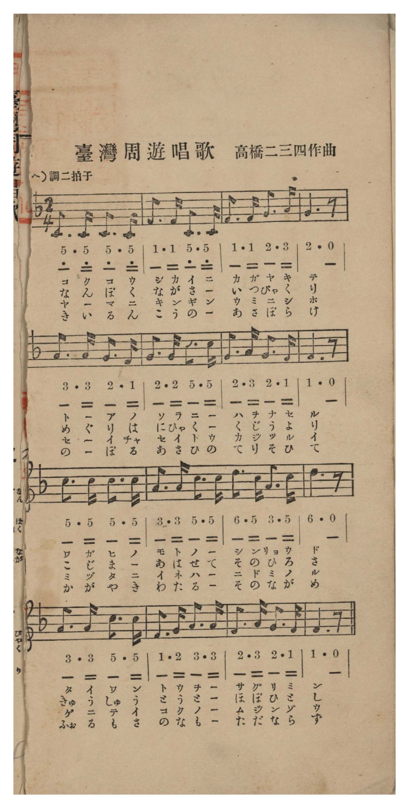
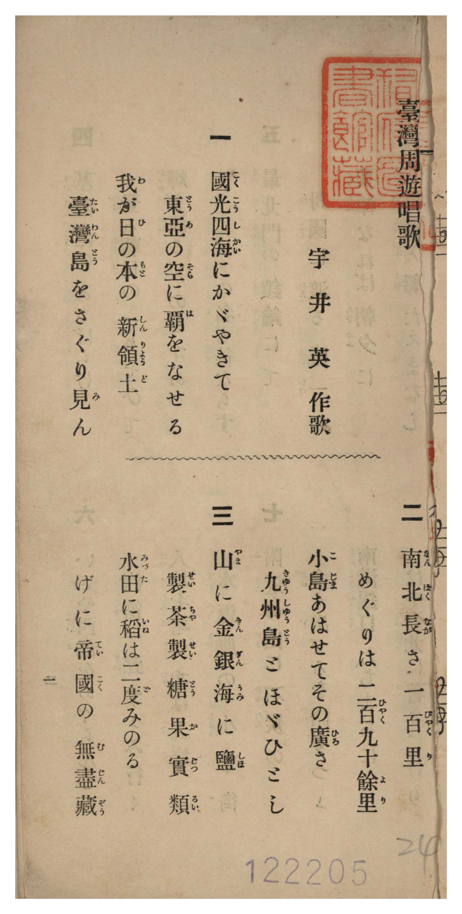

# 臺灣周遊唱歌（簡單版・第一～四節）

> Re:Shōka 使用 AI 協助辨識與重建樂譜，可能會有錯誤。歡迎回報。

- **鋼琴伴奏版**：<br><audio controls src="taiwan_shuyu_shoka.mp3"></audio>
- **NEUTRINO 歌聲合成版**：<br><audio controls src="taiwan_shuyu_shoka_neutrino.mp3"></audio>

- 作詞：宇井英
- 作曲：高橋二三四
- 臺北新高堂書店《臺灣周遊唱歌》（明治四十三年二月廿日初版／大正元年十二月十八日八版，國臺圖 0786 10）

## 說明

曲目說明与原書資訊（對應 P004.jpg–P005.jpg，原書樂譜頁及歌詞第一頁）：
- 書名：《臺灣周遊唱歌》（國立臺灣圖書館「日治時期圖書影像系統」典藏號 jpli2011-bk-sxt_0786_10_1912，索書號 0786 10，杉浦和作舊藏寄贈）
- 作歌：宇井英（臺北石坊街一丁目十一番戶）
- 作曲：高橋二三四
- 發行：明治 43 年（1910 年）2 月 20 日初版、大正元年（1912 年）12 月 18 日八版，臺北新高堂書店（村崎長昶）發兌，定價金八錢
- 調性與拍號：ヘ調（F 大調，五聲音階ヨナ抜き長音階）2/4 拍子，♩= 120
- 版本說明：本頁為「簡單版」，五線譜與音訊合成依原書樂譜頁（P004.jpg）直接印於五線譜與數字簡譜下方之第 1～4 節（片假名、平假名隔節交替）製作；下方歌詞區則完整收錄全書第 1～90 節環島歌詞全文。若欲瀏覽全 90 節完整展開之樂譜與全長 24 分鐘之全曲合成音訊，請見「完整版（全九〇節）」。

編曲說明：
- 以明治時期鐵道唱歌／地理唱歌輕快昂揚之進行曲風格（♩= 120）編配 4 小節前奏與 16 小節雙手鋼琴伴奏。


## 歌詞

```text
一（1）
國光（こくこう）四海（しかい）にかゞやきて
東亞（とうあ）の空（そら）に覇（は）をなせる
我（わ）が日（ひ）の本（もと）の新領土（しんりようど）
臺灣島（たいわんとう）をさぐり見（み）ん

二（2）
南北（なんぼく）長（なが）さ一百里（ぴやくり）
めぐりは二百（ひやく）九十餘里（より）
小島（こじま）あはせてその廣（ひろ）さ
九州島（きゆうしゆうとう）とほゞひとし

三（3）
山（やま）に金銀（きんぎん）海（うみ）に鹽（しほ）
製茶（せいちや）製糖（せいとう）果實類（かじつるい）
水田（みづた）に稻（いね）は二度（ど）みのる
げに帝國（ていこく）の無盡藏（むじんぞう）

四（4）
基隆港（きいるんこう）のあさぼらけ
登（のぼ）る朝日（あさひ）のてりそひて
輝（かゞや）き渡（わた）るそのながめ
フオルモサの名（な）も徒（たゞ）ならず

五（5）
最北門（さいほくもん）の鎖鑰（さやく）にて
母國（ぼこく）に渡（わた）る唯一（ゆいいつ）の
要津（ようしん）なれば朝夕（あさゆふ）に
出船（でふね）入船（いりふね）たえまなし

六（6）
いざや西部（せいぶ）をめぐらんと
汽笛（きてき）一聲（いつせい）すゝみ行（ゆ）く
八堵（はつと）七堵（しちと）の次（つぎ）は五堵（ごと）
水返脚（すいへんきやく）の小市街（しようしがい）

七（7）
附近（ふきん）の山（やま）に石炭（せきたん）の
多（おほ）く出（い）づるを語（かた）りつゝ
南港（なんこう）錫口（しやくこう）たちまちに
はや臺北（たいほく）に著（つ）きにけり

八（8）
四面（しめん）は山（やま）にかこまれて
地勢（ちせい）京都（きようと）にさも似（に）たり
おのづからなる城壁（じようへき）は
げに萬世（ばんせい）のかためなり

九（9）
君（きみ）が御稜威（みいつ）に高砂（たかさご）の
浦回（うらわ）の風（かぜ）もをさまりて
こゝに開（ひら）けし總督府（そうとくふ）
文武（ぶんぶ）の機關（きかん）そなはれり

一〇（10）
市街（しがい）の規模（きぼ）は宏大（こうだい）に
道路（どうろ）平坦（へいたん）砥（と）の如（ごと）く
下水工事（げすいこうじ）に至（いた）るまで
水（みづ）もゝらさぬたくみなり

一一（11）
幾百年後（いくひやくねんご）の膨脹（ぼうちよう）を
かねてはかりて定（さだ）めたる
市區改正（しくかいせい）のをゝしさよ
想（おも）ひやるだにたのもしや

一二（12）
支線（しせん）に乘（の）りて圓山（まるやま）の
臺灣神社（たいわんじんしや）をがみつゝ
基隆川（きいるんがは）をうちわたり
昔（むかし）をしのぶ劍潭寺（けんたんじ）

一三（13）
夙（つと）に學者（がくしや）の淵叢（えんそう）と
稱（とな）へられたる士林（しりん）には
遭難（そうなん）六氏（ろくし）の碑石（ひせき）あり
芝山巖頭（しざんがんとう）香（か）をとゞむ

一四（14）
硫黄（ゆわう）を出（いだ）す北投（ほくとう）は
音（おと）に聞（きこ）ゆる溫泉場（おんせんば）
浴（ゆあ）みする人（ひと）遊（あそ）ぶ人（ひと）
常（つね）に絕（た）えずと聞（き）くぞかし

一五（15）
左（ひだり）に高（たか）きは大屯山（だいとんざん）
右（みぎ）に低（ひく）きは紗帽山（しやぼうざん）
群（むらが）る山（やま）のその奧（おく）に
秀（ひい）でゝ見（み）ゆる七星山（しちせいざん）

一六（16）
江頭（かんたう）すぎて川（かは）ぎしに
沿（そ）ひつゝ行（ゆ）けば淡水港（たんすいこう）
河畔（かはん）の丘（をか）にいかめしき
建物（たてもの）多（おほ）く聳（そび）えたり

一七（17）
屋上（おくじよう）高（たか）くひるがへる
同盟國（どうめいこく）の旗（はた）じるし
問（と）はぬ先（さき）にも知（し）られたり
大英國（だいえいこく）の領事館（りようじかん）

一八（18）
三百年（びやくねん）のそのむかし
萬里（ばんり）の波（なみ）を凌（しの）ぎ來（き）て
武威（ぶい）を振（ふる）ひしイスパニア
サンチアゴ城（じよう）此處（こゝ）に建（た）つ

一九（19）
後（のち）にオランダ來（きた）りしが
鄭氏（ていし）代（かは）りてこれに據（よ）る
榮枯（えいこ）はうつる世（よ）のならひ
英雄（えいゆう）のあと今（いま）いづこ

二〇（20）
樓（ろう）に登（のぼ）りて見渡（みわた）せば
舳艫（じくろ）つらねてうち集（つど）ふ
唐船（もろこしぶね）の數（かず）知（し）らず
觀音山下（かんのんざんか）畫（ゑ）の如（ごと）し

二一（21）
此處（こゝ）の港（みなと）を船出（ふなで）して
海路（かいろ）僅（わづか）に二百餘浬（ひやくより）
その日（ひ）の中（うち）に對岸（たいがん）の
廈門（あもい）の港（みなと）に著（つ）かるべし

二二（22）
再（ふたゝ）び歸（かへ）りて本線（ほんせん）に
うつれば忽（たちま）ち艋舺驛（まんかえき）
新店川（しんてんがは）の鐵橋（てつきよう）も
またゝくひまにうち渡（わた）る

二三（23）
富豪（ふごう）林氏（りんし）の邸宅（ていたく）の
甍（いらか）つらねて構（かま）へたる
枋橋（ぱんきよう）越（こ）ゆれば樹林（じゆりん）なり
山仔脚（さんしきやく）經（へ）て鶯歌石（おうかせき）

二四（24）
鳥（とり）のかたちによく似（に）たる
巨石（きよせき）は立（た）てり山腹（さんぷく）に
鄭軍（ていぐん）砲（はう）をうちし時（とき）
頭（かしら）缺（か）けぬといひ傳（つた）ふ

二五（25）
三角湧（さんかくゆう）はこの奧（おく）へ
一里（り）あまりの小市街（しようしがい）
製腦事業（せいのうじぎよう）見（み）ん人（ひと）は
さらに山路（やまぢ）を辿（たど）るべし

二六（26）
春（はる）桃園（とうえん）の樂鄕（らくきよう）に
遊（あそ）ぶもうれし秋（あき）は又（また）
大嵙崁（たいこかん）なる山奧（やまおく）に
奇巖（きがん）を見（み）るもおもしろし

二七（27）
蕃界（ばんかい）近（ちか）く踏（ふ）み入（い）れば
兩岸（りようがん）けはしき谷川（たにがは）に
藤（とう）にて造（つく）れる吊橋（つりばし）の
あやふくかゝる所（ところ）あり

二八（28）
北部（ほくぶ）諸山（しよざん）の生蕃（せいばん）を
防（ふせ）ぐためとて要所（ようしよ）には
鐵條網（てつじようもう）を張（は）り渡（わた）し
隘勇線（あいゆうせん）を設（まう）けたり

二九（29）
崁仔脚（かんしきやく）をば後（あと）にして
中壢街（ちゆうれきがい）を過（す）ぎ行（ゆ）けば
四面（しめん）の畑（はたけ）はみな茶（ちや）の樹（き）
安平鎭（あんぺいちん）の製茶場（せいちやじよう）

三〇（30）
本島（ほんとう）特產（とくさん）烏龍茶（うーろんちや）
なほも紅茶（こうちや）の實況（じつきよう）を
知（し）らんと思（おも）ふ人（ひと）あらば
必（かなら）ずくゞれこの門（もん）を

三一（31）
楊梅壢（ようばいれき）より大湖口（たいここう）
紅毛田（こうもうでん）を過（す）ぎ行（ゆ）けば
はや著（つ）きにけり新竹（しんちく）に
こゝは昔（むかし）の竹塹埔（ちくざんぽ）

三二（32）
清（しん）の雍正（ようせい）元年（がんねん）に
淡水廳（たんすいちよう）を置（お）かれけり
城壁（じようへき）の跡（あと）猶（なほ）殘（のこ）り
舊刹（きゆうせつ）古廟（こびよう）亦（また）存（そん）す

三三（33）
市街（しがい）の西方（せいほう）約（やく）半里（はんり）
尖筆山（せんぴつざん）のいたゞきに
北白川（きたしらかは）の宮殿下（みやでんか）
御露營（ごろえい）ありし遺跡（いせき）あり

三四（34）
新埔（しんぽ）は蜜柑（みかん）の本場（ほんば）にて
北埔（ほつぽ）に椎茸（しひたけ）多（おほ）く出（い）づ
香山（こうざん）中港（ちゆうこう）過（す）ぎぬれば
次（つぎ）は造橋（ぞうきよう）後壠（こうろう）よ

三五（35）
後壠溪（こうろうけい）の鐵橋（てつきよう）を
渡（わた）れば此處（こゝ）は苗栗（びようりつ）ぞ
石油（せきゆ）の產地（さんち）出磺坑（しゆつこうこう）
これより四里（り）の奧（おく）にあり

三六（36）
銅鑼灣（どうらわん）三叉河（さんさほ）後里庄（こうりしよう）
米（こめ）の產地（さんち）と名（な）も高（たか）き
葫蘆墩驛（ころとんえき）の近傍（きんぼう）に
製麻會社（せいまかいしや）を見（み）て行（ゆ）かん

三七（37）
此處（こゝ）まで數里（すうり）のその間（あひだ）
地勢（ちせい）嶮岨（けんそ）の其（そ）の上（うへ）に
大安（たいあん）大甲（たいこう）二溪（けい）あり
箱根（はこね）のトンネル想（おも）ひやる

三八（38）
林投（なあとう）編（あ）みて作（つく）るてふ
淡水帽（たんすいぼう）の產地（さんち）なる
大甲（たいこう）通霄（つうしよう）宛里（えんり）など
海邊（うみべ）に近（ちか）き土地（とち）にあり

三九（39）
潭仔墘（たんしけん）經（へ）てその次（つぎ）は
中部（ちゆうぶ）一なる臺中（たいちゆう）よ
清朝（しんちよう）かつてこの土地（とち）に
臺灣府（たいわんふ）をば置（お）きたりき

四〇（40）
明治（めいじ）四十一年（ねん）に
はじめて成（な）りし鐵道（てつどう）の
全通式（ぜんつうしき）を舉（あ）げたりし
此處（こゝ）の公園（こうえん）眺（ながめ）よし

四一（41）
陶器（とうき）を出（いだ）す南投（なんとう）へ
輕便鐵道（けいべんてつどう）敷（し）かれたり
本島（ほんとう）無二（むに）の別天地（べつてんち）
埔里社（ほりしや）はなほも奧（おく）と聞（き）く

四二（42）
流石（さすが）に猛（たけ）き霧社蕃（むしやばん）も
馘首（かくしゆ）の刃（やいば）うちすてゝ
厚（あつ）きめぐみを慕（した）ひ來（く）る
蕃產物（ばんさんぶつ）の交換所（こうかんじよ）

四三（43）
日月潭（じつげつたん）の勝景（しようけい）は
蓬萊山（ほうらいさん）もよそならず
綠（みどり）のかげには鳥（とり）うたひ
瑠璃（るり）の水（みづ）には魚（うを）躍（をど）る

四四（44）
烏日（うじつ）過（す）ぐれば大肚（たいと）なり
米（こめ）の集散（しゆうさん）おびたゞし
こゝに河（かは）あり大肚溪（たいとけい）
水（みづ）に遊（あそ）ぶは水牛（すいぎゆう）よ

四五（45）
龍車（りゆうしや）に向（む）かふ蟷螂（とうろう）が
斧（をの）を微塵（みじん）に碎（くだ）かれし
彰化（しようか）の東（ひがし）八卦山（はつけざん）
中臺平野（ちゆうたいへいや）一（ひと）ながめ

四六（46）
茄苳脚（かとうきやく）のその次（つぎ）に
バナヽ朱欒（ざぼん）の產地（さんち）なる
員林（いんりん）過（す）ぐれば社頭（しやとう）なり
田中央（でんちゆうおう）經（へ）て二八水（にはちすい）

四七（47）
全島一（ぜんとういち）の大河（たいが）とて
音（おと）に聞（きこ）えし濁水溪（だくすいけい）
大雨（たいう）至（いた）ればたちまちに
平野（へいや）變（へん）じて海（うみ）となる

四八（48）
林内（りんない）過（す）ぎて車窓（しやそう）より
かすかに見（み）ゆる新高（にひたか）の
山（やま）の高（たか）さは日本一（にほんいち）
明治（めいじ）の帝（みかど）名（な）を賜（たま）ふ

四九（49）
雲林（うんりん）今（いま）は斗六街（とろくがい）
土匪（どひ）のさわぎに大方（おほかた）は
兵火（へいか）の災（さい）に罹（かゝ）りにき
他里霧（たりむ）の次（つぎ）は大莆林（たいほりん）

五〇（50）
打猫（だびよう）の西方（せいほう）三里（り）なる
北港街（ほくこうがい）の媽祖宮（まそきゆう）は
四方（よも）の信仰（しんこう）厚（あつ）きこと
本島一（ほんとういち）と聞（きこ）えたり

五一（51）
林爽文（りんそうぶん）の騷亂（そうらん）に
時（とき）の帝（みかど）が住民（じゆうみん）の
義勇（ぎゆう）嘉（よ）みしてつけられし
嘉義（かぎ）のほまれは碑（ひ）に殘（のこ）る

五二（52）
此處（こゝ）に至（いた）らば農會（のうかい）の
苗圃（びようほ）に足（あし）を運（はこ）ぶべし
小河（をがは）めぐれる丘（をか）の上（うへ）
見渡（みわた）すかぎり檳榔子（びんろうじ）

五三（53）
大森林（だいしんりん）の阿里山（ありさん）は
これより數里（すうり）奧（おく）にあり
枝（えだ）を交（まじ）ふる木々（きゞ）の蔭（かげ）
晝猶暗（ひるなほくら）くものすごし

五四（54）
鐵道線路（てつどうせんろ）の右側（みぎがは）に
立（た）つる目標（めじるし）見（み）おとすな
北回歸線（きたかいきせん）このあたり
はや熱帶（ねつたい）の客（きやく）となる

五五（55）
これより南部（なんぶ）おしなべて
甘蔗（かんしや）の畑（はたけ）うちつゞき
製糖會社（せいとうかいしや）そここゝに
煙突高（えんとつたか）く競（きそ）ひ立（た）つ

五六（56）
水堀頭（すいくつとう）より後壁藔（こうへきりよう）
新營庄（しんえいしよう）の西方（せいほう）に
鹽水港（えんすいこう）の市街（しがい）あり
布袋嘴（ほていし）よりは鹽産（しほさん）す

五七（57）
林鳳營（りんほうえい）經（へ）て蕃仔田（ばんしでん）
灣裡（わんり）を過（す）ぎて新市街（しんしがい）
大目降（だいもくこう）はこの東（ひがし）
糖業試驗所（とうぎようしけんじよ）設（まう）けらる

五八（58）
南部（なんぶ）のみやこ臺南（たいなん）は
本嶋中（ほんとうちゆう）にふるくより
開（ひら）けし地（ち）とて人多（ひとおほ）く
名所舊跡（めいしよきゆうせき）亦（また）多（おほ）し

五九（59）
陸軍衞戍病院（りくぐんえいじゆびよういん）は
オランダ人（じん）の築（きづ）きたる
赤崁樓（せきかんろう）のありし跡（あと）
三層樓閣（さんそうろうかく）聳（そび）えたり

六〇（60）
鄭成功（ていせいこう）を祀（まつ）りたる
延平王（えんぺいおう）の祠（やしろ）あり
領臺以後（りようだいいご）に改（あらた）めて
開山神社（かいさんじんしや）と稱（しよう）せらる

六一（61）
義烈壯烈（ぎれつそうれつ）母刀自（はゝとじ）の
大和魂（やまとだましひ）うけつぎて
社稷（しやしよく）のために竭（つく）したる
君（きみ）がほまれは千代朽（ちよく）ちず

六二（62）
魁斗山上（かいとさんじよう）五妃（ひ）の墓（はか）
寧靖王（ねいせいおう）のきさきたち
操（みさを）まもりてこの土地（とち）に
果（は）てぬと聞（き）くもあはれなり

六三（63）
全臺首學（ぜんだいしゆがく）と記（しる）したる
大成殿（たいせいでん）の建物（たてもの）は
公學校（こうがくこう）に充（あ）てられて
今猶（いまなほ）咿唔（いご）の聲（こゑ）を聞（き）く

六四（64）
僭（せん）してこゝに臺灣（たいわん）の
王（おう）と名（な）のりし朱一貴（しゆいつき）が
住（す）みし昔（むかし）の宮居（みやゐ）あり
今法院（いまほういん）を此處（こゝ）に置（お）く

六五（65）
そゞろに淚（なみだ）そのかみを
しのびまつるもかしこしや
北白川（きたしらかは）の宮殿下（みやでんか）
こゝにみまかり給（たま）ひけり

六六（66）
君（きみ）の勅（みこと）をうけたまひ
近衞（このゑ）の兵（へい）をひきつれて
島（しま）を平（たひら）げ給（たま）ひたる
親王（みこ）のみいさを忘（わす）るなよ

六七（67）
名（な）は安平（あんぴん）と聞（きこ）ゆれど
港次第（みなとしだい）に埋（うづ）もれて
大船岸（たいせんきし）につながれず
風波（ふうは）を凌（しの）く便（たより）なし

六八（68）
赤崁城趾（せきかんじようし）の大榕樹（だいようじゆ）
遙沖（はるかおき）よりながめらる
海（うみ）を行（ゆ）く人（ひと）この樹（き）をば
目當（めあて）となして往來（おうらい）す

六九（69）
これより海路（かいろ）五十二浬（り）
澎湖島（ほうことう）なる媽宮港（まきゆうこう）
みなとの内（うち）は水深（みづふか）く
大艦巨舶（たいかんきよはく）泊（とゞ）むべし

七〇（70）
更（さら）に汽車（きしや）にて中洲庄（ちゆうしうしよう）
車路墘（しやろけん）過（す）ぎて大湖街（たいこがい）
半路竹（はんろちく）經（へ）て阿公店（あこうてん）
橋仔頭（きようしとう）より楠仔坑（なんしこう）

七一（71）
東北指（とうほくさ）して行（ゆ）くときは
蕃薯（いも）に名（な）を得（え）し蕃薯藔（ばんしよりよう）
樟腦出（しようのういだ）す甲仙埔（こうせんほ）
急（いそ）ぐ旅（たび）とて立（た）ちよらず

七二（72）
舊城過（きゆうじようす）ぎて打狗港（たかおこう）
縱貫鐵道（じゆうかんてつどう）こゝに盡（つ）く
商船常（しようせんつね）に輻湊（ふくそう）し
百貨（ひやくか）は日々（ひゞ）に山（やま）を爲（な）す

七三（73）
なほも支線（しせん）に乘（の）りかへて
三塊厝（さんかいせき）を通（とほ）り過（す）ぎ
苙萊出（おんらいい）づる鳳山（ほうざん）に
曹公圳（そうこうしゆう）を探（さぐ）るべし

七四（74）
後庄越（こうしようこ）えて九曲堂（きゆうきよくどう）
一里（り）東（ひがし）に阿緱街（あこうがい）
下淡水（しもたんすい）の河口（かはぐち）に
東港（とうこう）といふ港（みなと）あり

七五（75）
これより五里（り）の海上（かいじよう）に
かすかに見（み）ゆる小琉球（しようりゆうきゆう）
長（なが）さは一里（り）幅半里（はゞはんり）
何（いづ）れの家（いへ）も鹿（しか）を畜（か）ふ

七六（76）
枋藔（ほうりよう）枋山（ほうざん）楓港（ふうこう）と
海邊（うみべ）の路（みち）をたどり行（ゆ）く
山（やま）はせまりて海（うみ）をせめ
波（なみ）は激（げき）して岩（いは）を噛（か）む

七七（77）
車城（しやじよう）に注（そゝ）ぐ四重溪（しじゆうけい）
その川上（かはかみ）の石門（せきもん）は
兩岸（りようがん）いはほそばだちて
恰（あたか）も門（もん）の狀（さま）をなす

七八（78）
明治（めいじ）七年（ねん）我（わ）が軍（ぐん）が
頑強（がんきよう）なりし牡丹社（ぼたんしや）を
劇（はげ）しく攻（せ）めし所（ところ）なり
途（みち）に記念（きねん）の碑（ひ）を探（さぐ）れ

七九（79）
皇澤日々（こうたくひゞ）に霑（うるほ）ひて
學（まな）びの庭（には）に蕃童（ばんどう）が
われ劣（おと）らじと集（つど）ひ來（き）て
御國言葉（みくにことば）の花（はな）ぞ咲（さ）く

八〇（80）
氣候（きこう）はいつも暖（あたゝ）かに
春（はる）の如（ごと）しと聞（きこ）えたる
恒春街（こうしゆんがい）にいたりなば
求（もと）めて來（きた）れ胡蝶蘭（こちようらん）

八一（81）
こゝにて西部（せいぶ）はてぬれば
海路（かいろ）東岸（とうがん）さぐらんと
たよりを待（ま）ちて海濱（かいひん）の
大板轆（たいはんろく）を船出（ふなで）せり

八二（82）
バシイ海峽（かいきよう）隔（へだ）てたる
呂宋（ルソン）と遙（はるか）相（あひ）むかふ
最南端（さいなんたん）の鵞鑾鼻（がらんび）に
大燈臺（だいとうだい）を設（まう）けたり

八三（83）
鼻（はな）をまはりて北方（ほくほう）に
船路（ふなぢ）をかへて進（すゝ）み行（ゆ）く
海上遠（かいじようとほ）く紅頭嶼（こうとうしよ）
雲（くも）か山（やま）かと薄（うす）がすむ

八四（84）
島（しま）のめぐりは九里（り）あまり
太古（たいこ）のさまを見（み）る如（ごと）き
いとあはれなる蠻民（ばんみん）が
二千（せん）ばかりも住（す）むと聞（き）く

八五（85）
やがて卑南（ぴなん）に寄港（きこう）せり
臺東一帶（たいとういつたい）未開（みかい）の地（ち）
天與（てんよ）の遺利（いり）はそのまゝに
人（ひと）の來（きた）りて取（と）るを待（ま）つ

八六（86）
黑潮（くろしほ）に沿（そ）ひ進（すゝ）みつゝ
次（つぎ）に立（た）ち寄（よ）る花蓮港（かれんこう）
移民（いみん）の計畫（けいかく）歩（ほ）を進（すゝ）め
開拓事業（かいたくじぎよう）起（おこ）りたり

八七（87）
これより沿岸（えんがん）二十餘里（より）
幾千尺（いくせんじやく）の斷崖（だんがい）が
海（うみ）にせまりて聳（そび）え立（た）ち
船（ふね）を寄（よ）すべき所（ところ）なし

八八（88）
蘇澳（そおう）の港（みなと）に船（ふね）をすて
宜蘭（ぎらん）の平野（へいや）を横（よこ）ぎりて
それより山路分（やまぢわ）け入（い）らば
深坑地方（しんこうちほう）に至（いた）るべし

八九（89）
濱邊（はまべ）の路（みち）を越（こ）え行（ゆ）けば
三貂角（さんしようかく）は右（みぎ）に出（い）づ
領臺役（りようだいえき）のまつさきに
近衞（このゑ）の軍（ぐん）の上陸地（じようりくち）

九〇（90）
これより元（もと）へ歸（かへ）る道（みち）
黄金掘（こがねほ）り出（だ）す牡丹坑（ぼたんこう）
尙（なほ）も瑞芳（ずいほう）金瓜石（きんかせき）
寶（たから）の山（やま）は連（つらな）れり

（終（をはり））
（注意）字音の振假名は表音的とし長音にはあいうの三母韻を用ひたり
```

## ABC

<div class="abc-score" data-abc-src="taiwan_shuyu_shoka.abc" aria-label="五線譜載入中"></div>

[下載 ABC 原始檔](taiwan_shuyu_shoka.abc)

## TMD 檔案連結

- [主旋律 TMD 檔案](taiwan_shuyu_shoka.tmd) [[在 TMD Studio 編輯](https://tmdlang.github.io/Tmd-TS/#tmd=s7IKdvYPcrWy4qpTUCpJTLdSyC_KTM_MsypJzCxPzIvPT0vLTM5MzFGCyyfn5-SkJpdk5sPVFGeUVpYCyfzsRISysvyc0txUK0OESHF-aVFyKl5NECXxBYnpqVYBBgYmukDCFCFdUJRflpqXmAc0pTgjMy87PyU_Pik_P7u4JL8oFaEstSwzJRWkqKAoMzexqDI-JT8Z6Ja8EiTXpRYVg3wAtbCkKDGvOLkoswDkLYSqkoxUoBfSU_PTixILMiqVuLS0FF6073reuPjpxBUvG7ueTtn4bG3P-z0dzzcsfDpt3fPOjsfNu5-vWfNkR8P7vfOezp79fH3D-z2dClpaICOf7J3zYuW893tmPV3X_mTX1BfdG8E2AYWfzd4EFH65esazld1PdvU82dEJ1AuWBNr2tGf6s2kbgJJPFzQ9m73j6a7pjxu6MF3xuKEb6JBnM_qebdoN1P20txFkzM4tQPOezel4unv_s-lLn3bMBbrx_Z7-p0uWP1u7-GlrM1ABSCVETW_j09bVIGWtq8HKep7O6QY5YM40BQNzCzMFQwOgZxChk19UkgENGauMTFAcZCYn5sRnJ-YBY1TRVsHQyIDL3lbBjcvGSN_EjotLX4sL6NHns9e9WLUK6M4nO_qe9s0H-ujF5vYXK7qAjn-6ofdZe6cCKOL1sgrSHzVMBkU_iAlyC1jtsxVNL9bOebmg8Wl_F9DTwPCEBDdQBOg2YCByAWMAFEoTeoEcPAEF9Nrz1SDfgWTnTANqeblkxeOGHqD3gQH4bGbTsznzIeJP92582tz_fPPu51s3Pm7ofdq648X0_hcz5ytkFeRkGhkYGuomZesWV5TEg8Io3tAg3tDS0Ajo4OdbFoE8B1QID7yeZ3M7n21d9nRSDygtdHQBDXq6vuXFFmBYd4IcDkoKoPSESCFAl0KSwPP5m5_O7XqxcDrQs092NAJDERzDDc-nrnrWsQ1JP7akBJJ7PnPPi4UgsyFJRMHEWAEY-UDzgc41gDA7jRSAyUDByEABnlYeNzQipxWIciOociADpN7QAqwelmiwJllQ0pw78emWvpdTtz-bAXIv0D1PW4Hu6Xm6btbT5p0v2ycCTXjZswjk1her9j9rWP6io_1Zdy8wAEEx2TwDKAg0xU0B6B4ws-fJrikvGje9nL_55ay-x80rHjd3Peua87ixF2gFRBDkI30TBaAhT9dOAGp4NHMlJFWCgqOz49mcNZCUCAqUOWuASeh50y5gEkBk5gZgIgJZ83z7LGCqA7oHaC4wqT6d0PGsY8KTfXPR0iTQebC0C_Lg7C3P-pY-7d3wbNoeZDOeTd3xdO10oCVA7pMd3c-m7XyysxuYihUMgWWGiQK4yOh43tn-tLEdmIpBEbBzM4T9ctYUoOyTXUuezQb6v_PF4r3ACH-_ZzbEFEh2eNrb8BSod13Ps6lbnk3Z9rKn5WnrCqAjYRZYGoBseD5pw9PN26A6gPLT2h83NL3oXvpszabnDf0vlu0FCipAlEKMerpx6stp3UCHQjwL9AZQBTCgFYxMFJ52tL2cMAMoB7ZpEyR0ICEFSg7AXLasGxisEIPAaaQDqPLJzrmPG9ohBSQwoIH2c3E9bpiA7CZsCidygQpXYDIEJXkFBWA2ftoKzPcdjxsnP27sB5NtQClgon-2dTtYfPrjxu7HjS0g3Y2rQeymeY-bWoDp5HHjMqAJz-ZufLILWCoDVa4A6n3c2ARWue75yl1gwbmPm4Dmg_S-WAZy0ePG9SBu06THjaseN85-3NQNMqRjIkiqqR-sElSIgFUCsyLIKGDiAss2Aa2AigBzx4IZT-cAkzbYhU2THzd1PW4CsoEOWAnxGrRs2gzMLEDx-UAvAM0HqQS7E-aGqY8bJwD1AoMYrAyULoBquLiAeR8oACyHwKHUOx2YJcEKVoFN2AMMK6AUMAKhgo1A1UCHTQWVKDP3vWwHaX7cuAUcUEBLgREJMudxUyPEOmAgAC0AqoR4E6IMqAYYV8Bi6eWSGVATgD6C6X26oR_mF6ADZjxuBOoF2ggMk_WgYGxcBgrqxnVPdy-GmQnMfCAnAfWCjN0-D6a993ETMJSACBhuEAYsQECM3aD4BWoHsacDw2EHKHUYQ92wEVSggl0LsX01sNh52QVKT2BjgQ7rA5JAKVjiARoODlKgyp17YclpNzSCFu990QNxEtD9QDMXAk2G5Mvnm6chiUOd92zenKfrl71cCElswDQJDIQlwPQDSZygVLRhy_MpGyDx-LhxKTDSIVY_XwG0ESgINGotWAQU-E93LQMLglILWP06SFJ83AhMFauf7pgLzBpgBcCABWoE5Q5owm5Z-Hz2QmDVAw6KBpAzQB4HBhrIkVxcwKwDlDGBhtj8XS9ntT3bAUzz4CACJUJgDgKqh2Y0kL2gSASmwz3AnPK4cSJQ1_OZEAcDpfaAE2T3szlzYZkCohiaNUDOAyUnYNQDowyUH1_smQsNH3A-BSvrfbZjISR_QcMEFGig1AJJusBkCfJ489THTaseN69-3LzocdNWUFoCNQJAyRuspenpvknQrNQEjAKgscC8ACRngTLLFKCMKTQW5jQAM8vLaZBUAXQqMPR2g3NBEyRtAE1-2Tft5URITAEthSZ-cPECLlLW98ICH5jR4CG_GtMXT6eshxRn4JQMNAeIlkCsAAXFssZnW8CBBi0ZQAUFzOU9jxs3AEP16ZKpiFAFGbIVYhco7tp3vejYCZZdDhSHJJ6nrUthgsCoBIY8VBxcwgAF94GDFJhxnrYChTvMoBkf5LBpQJ--WLr_ZTOwEIOnbVBVDiqIoCUDqPABJnhQIGzc-3wNKCVBSlogCSofdjQAq2xYYl4CMQRs-8zHTcAI3Q9uooBCAyzYD_JF6-qnC4CeAhW8YC2gIvTJjmaYIDA_LkSUq2vAIQxSBqr9wTllCkzlFIgySEZ7sX_Ki5ZZYPGZYMfsALscWAjAY3MdqMja0QRsc8FKaVgsAJMcJM8Ci5dmoKQ5xNiXM1te7AdXBKBQBZUnUHMwih1ga-55Eyh8wSEADB9gmoQqBnl5CcRhwNgBFTVA9wCjEhJoYO5ScB6c9GIVvCSBJCegemB5MhdS4MPyLKTAh-bWlz2rn_ZDCligd8BlOyIjAxMAMCSBCQBIgtIPKMCBMQ5uziHqIHBegPjixUSIOCTFAn0BTP8Tgc4AJZ7VQBkLaBkye_bLuYtgljbCfLoeM1jAfgG6Zx84eYOy0tM5G552Q_QCXQVNLU92rXnZDCmNgYEMiRRIAgCaAMwFTU_2AIsdoDjQEWB_AZ0E8g4wfIAlBrBcBYYeJBN1P53f93QxqOEGLgYhRu2ApFWgC-HF6YsJwE4GpEjfAA5PeLoFGggKf3D6BxoI9DuwsgIqtIT6fQI8C0DqkZ6n-xY-XzHn6QqIpcByG57lVwMbzM8XAJsfkKAGGgssfIAFEzRVgDoOsyEx3gbOaNBU-nIRJD8C1QMbg6CCDtYwAAYj0MugYASFKih_rQY24sCKgdUrpFUzERgpz3fsfT538dNdQO1AKaAySJUKTBugwgRk9bT2Z2sh1c02sPfBuR6Y3VbOfzkdogvoQVC9ABYHmgAsQ4CJB1gygwJkRwOwAQdUBe4_ggIFOVPB8hLQuBfL-p-tgGRgoHHgmgOYStaBeqtgQVBKfdy4AN6YA2W5xskvtkMS-kpwuIBiDtRgngtxLjAugeELzV3PF0BqIGhh8XQZJKyh5QKkuAG1pTdsebp96ZNdkJACBiWkgIDYPgOa9Ns3w0oxeIUEzDnLIYULLGqB1kHiA9SIBEfJGnDUAkMWKAtNLqD-HLhFC2vS7twHbFiBOub7IK0wSDaFNrKApTU4BqDp4kXbihctkOIcWNUA3Qdsg4ASCKRUBsc80GVrwQUwsPgERhEoRQC7XLDKbQFYJTDxAsMI1HwAxg2wC_FsCrA7ASsnQJaCGikoqR5U5APjGSgLzHAdIG83Q0IE2IyFtKDBDgaFCzDCgPkS6G2gLmA1BSp4IN4GN1FBfWVwGpuyHthFglkJbFdD0tLqJzuBQQ4UXAcr4pY9nTMZWnSAUjjQS_ACBFxpgpvNz5fOe74E0jpFbjlDmjogF0CrLVDqA0YFrNgEt3aeboe0QJBbO0Bl8GY_JJRBlTikYHk2A9R6ADelgL4FpmuIMqAvgIXDtqddvc_2rn26HlKAA4tHoGmg9AhJStD4B7VRDWGN1CUzYXUYtFB7unbHi4ZWsCDQHUCLYR4A5sDtW5_2Q8pHoAuAhoJyL1gKVAc_XwEJJmBmBreBQJUc0HFAQ0Cx_XTx6mfz4HUbMN6gIQ4p-F42rn05G5IEICUCqCIBZa7Wtc82QNqOwAACOQbikueLJgJrNWjhAq7VwOLAxA8Koxddc4Fx9nT7tJcLINUeMHSA7QlwyCJ1aV4ug_gdmPUggbgC3ApsAAcTpGFqCG2ZPl-4-uVuYCiAm06g2ICmeXhVCU3bjTNBoxFdkFYSuB2H6C6A_Ql1NDBlQYP7RSOklAV6DxwiIPO7n-1a_Wxz59MFkLwNCixIIgVWCND0uxUsBWqCQdI_MFkBGzXAQRiIe0A9EpAPG0EjXeD2GjCVAZVtQ1MAzoM7YCkA0jRb_XwrxP2QDgGQMQuoGO5OSOEFbsKDEiA0c4ESpSG0Tft0O6Q4BNqxANIjg1Q38LoGLAL08HpgWft0I6xqBpe14EgA-hMUXVDT-iFBBvQhpJW1-sleIANiPqRWAhn1fMv0pzv2woyCtDcghRTCqOf7gHUfOO-ACkhwJxSYMNEbBsB8BO4bLoXUA8CogrZAQCYshzTUgVZD8sRyYF5G7Q6D4g_YUHs2Yz7CMbDmBMIx4CQGbvQaQlu9zzbOhyVXSCkADClIwgHWCH2gkghaUgBDHVw6gASBRoOc9WwTaLQKFslAx4GKGNTWLbDq3fBs-0JgfQFrq0HKBUR1A3XGps3Pp4KLGLBF8Jbikx3g-ANlE0j8AXMuUCPQqcDiHOiMXlBU7d71vBPYRYREM7CvBUx3oJIUs4n5ohESqcCABjIgqQxcwEFKKFAz1xDazn26ERickGQMigp40wmUvNHTFKTmArobWOgASx9wFTOh5_ls4OAqJIog1TbQxSid1GfTIQUTsM6CpHmgFeC0DdQ-FVz6QHMrUMGap62gMSVwdQbJC6uB_nw-H1LZQ8pjeKkHKoxAI4jdG2EOgKRxSImBcABweAbYAgCOCYODGD42A-yyQ5s50PQCaucaQhu6wHIcUnODzd2MXGEjJ2N4TQEqFyesgQ22gBuW0Ly57tlmSKEObEdB0jCwXIMoA1UrkLT2ZB8wxOH5H9zxXLsM1rDcBs0OTZOe9UAS11ZgCMISIzAzAtPjzsfNEx83A_2zCNRQAHaZmzc_bga2z4Hd5y3AhjFYFyJqn61d8mImpBgCNSYhAQ1MX0gF0xJIYgE3gA1hLWBoKwboeWDTDhI5wF76SrBlDXA_IPVhQG1CUMHcAqtooEMYoJh8Ah0eguU4cIMA7CBg9K5-NhmcqptA4-nQgbll657Ng_gfGsOwVAOMTNDgC7RZD9ECGVAAlUSbQHHTvfHlbHANA9ELHmyCKQON5T3ZDckE8HIKyAD2LiCjb5AmrxG0yftsBdBiSJUJMWI1xhgJyCfAcgs6SAAsXOHjBKCCagPIQR2bX3SCEhw4HQJbNJCYB3oDSELaeKC2ycvZkDAFVh-QwaGtoGiYMgHa7we1R0FVGziggckEUsWsAw5Lw0IWGIid6NkHOEwCdMDyBmB1CSxEga1kpGIRmKKh9QMk1z-fCnZkE7ArDDIZo50NqqFAUxOggtsI2urFlrrWwcpFcGMZohnY7e3YCavjgb1soDiwUgAZCs0CW7fDOgTgNiukQ9AMbj2BAhTU-4NEAGQAEzhW-WwreHgW3sJGGrSEZFi04dwnOyB1AiisoblgQ-_TTZDgg_SRQY0aiGJwGdwBG00CBj0w4cDabpi-Q-9TA8MX6Iud8CCDDOrCRnXbIMNbwFAAFmyQINv8bC08GoEMaLICDkDD2tbA4VFoywViH9iTkLwAGlF6uh_Sr4aOBYDVLHzR2f2iY9fLlZCuLLDNDYpncKYABS64f7gBOMcDqw3Bw9mgugap3QwsUCdsBU5JwbIzMG1Cu-5gRzaBnQHsQIE8Aq00QFxgjQYKZcyBM2gKArWbjWDt5vU9LzYCm7mQEAEmNsiY63RYaxXSZoO2Vl827Xi6DtKkhhQuoF4ZPMaeT4GELDD5gCIBLZc9Ww5L_NAAAnYyob2nZ_O6YZ7cCBtPgnryxTZIYQFvUoIH8FbshDXBgQUtUBDeCgd3DsEj1k92w0eqgF0tSLZFDFM93wYuWCCR3bjs5bb1wBkUWEMcGPfA4AO6E9ocB4capBltBG1Gv9wM7RPDqx7ogAZ4FAjs-n6M4RRwLb59BcwaiCfhTf71wIlVpEoBNMAL9MaLVkg3FeKH7chNOGBJ_2I3JMQhkQEcSIT01yFDhaDSGpL3oZ2vxunACVqos2FpENFSAyVA0ODG8z2QUgISf8DWFrDzDVQPNH_T0yaIy4HJEOLIrdD8BWpmGUEbzcDk9WL5pGc7IY1OiLuBpgMLCHhFAHQZqPzDaJjuAGtvgM2CQEIWmPMhIzJEDCxCZhdalwHbIM-WwgcKgU4HRg-kGQKcqIClLNS5H7T-BGwYC-h-cFEFjAlI-QhuXj9uBLYzwKXqPkh7FRjx4EoDpdyBNIuNYM3iGZAkA2yJgoL22cLmp3MgI-vA0AU6DtQRhZZwK5petoALdZDdwNyLlOehwzfovSFwAQnJHdOfQzMaUASasp72Q1p6oJICmuuB_ZWtM59ugbR6IKUvOJ4Q-QjUn4DGENTPKB2Ip0vbgf1SaEKGl9zAEEEJVqCBQGeABjfAEQZUCavFQC1jI2jL-MXU5udTkZpzsJlH2LAwMOlCm8UvdkCaNpDh-v3AYXlIiQO2DFQ0gFzWuhJarSAaoPCaBZiegakPVBa82LAdVvQC_Q8sMuGFLsh7L6aDe1iITi9okuJlA7BvDEn_4IAAjdR1P53QBSu8gIUdMIw2wItLcAoCVl7A4AOWreDxINCYVvezTki9BjQcWGsj9fghqQbUDDCCjQID51SgMweQXjhoDPHF6h1I_UMgCe2MgcYTpswHhiZSygcFKCRmQAlnBqRoALoGWJoB1U-ADcICnQJsRjVCXYaYOIE08GCDG8DKaNHc59sghkDqI9j4LzgBQix6ugc68QDmdqFXQ-AW_MtZM552t8OqV1DtDpuVhFWywKS0ApKFgUkP3vWD9q2AKQjcXDaCNZe3NCIV-JD2FUqBDy4FN8Ba1fApZaDHoC0gYPPk6eJFsMIFOFIFdg0oTYGTN6xb8BLUdwcqAA64ALX3YXZNQY7BPnK_7vlUSHIG9c6AimFFIaghA5sRhc6FggsBSMEPLaefrgONz77sg4QIaErtceMu2PQp1HzIzCpssAUxuYrcHQFP7UIa2cawRvacNbA5YkgzB5rmn3fufD4F4g2gCDD2QGU5SLy5_-W-XpiL2x43A2cwIbPAUNeDkz2wbQY0ren5llaYSshIMMKHwFndZ5thkwjoTRtQasXoi4Lc9qwBkmfhA6ZbMUpuYOgASXBM7Ic0VoDlCaiDApYFjgEB6yLg8BgwUkG1ELSRCZ-mBFoNCiNIO9sY1s5e2vVsUSswgSDlDmA-ByZaUAIBawMVN6BFPzunweaK4MUqYlACGBzP1s-GTVeDQwRScoPGX6DWE5PEoJNMOGaSgA3L56shyQfSqgQWoIiSGzarsR7LCCwwka7e-XThzqfzISMnII2wPgqwiQtJPpD2tDFsBHoHJIzhs6zrXs7uhQ6DQ0MKOgAOXwwFG76Ed_HBQz_gMZ2nuyFNDOQxHZTB-ed7gf14UPyDNQJzOjACwLNnoHFoPLNS615sh_QQoXn_OTRVgtIpkPtsHXS8HNbUBA-_dnQ9hc76wldPAP0CCu6n_Uue7oasQwG6EzhoAXXhE-j6AmhV-3QtxFhgqQ_x6Uxo4gIvr4A1wXFN7CzdD1yghJSZgTUAOGNugQzgQou2p71dsMEQ0CgX0tKRac_XtsEqCsio6xZwRkNUF7B5HuAYKCj5QCqc5zP3Ig3mA1MxqGWINFy37um6dc_W7Yf1ZoFdbqAhoPQLqabBoxcLX87Z9LwdEkBTwBU_kAHxF6imA5r5snEXLEogcyQo9SB4AR4ojKANblBfCZomIUkalBqBDnoxZ86z-ZBiFViOwtsvoMVDsIIQUqiBxpvhSw2AnoSZBgxTYIhATFv9bEnfix5ITxAYE8ACBVpOE5xaBtVoy2bCwhpS0kFDGVixwLqssFoFPq-MmtNBTW1YIwZzSh7Y-IC1M0CLTpCLS2C19nQxpGkCKVJg4yXAKSZIhgX51Rg2qg1W_WwXpNOH0AAuXKBJD2-3E1Q2Y_Qtwf0yLKMR6190T3-2AJK6odkEMuUOlp0HLuY3P9sET-agjAYtiaYsAs5jg8UhvQjQsAEw3J8v3vV0LiTKIUuZgM6DhDiinIWObUEKZWB1jNKjwDIijpzuwK12Y2ir_WVX68uJe4BTY2ANK8GuB00iw-IWWBB0AkeakVwJHE4FpRFgKANtfboLMhIGCWXwKB28Jgb6fCNEI9CtoHW4uPwMLLDQ1uRgzkGASquJq1_MaHu6aCVsyAHUtoRNQ4DyMrRU2T_xKajNCSnUgFKgyQV4KQxsQ7zctfvZnGbYPCCk5AEWZ5C5TMQkIEpDH9h4RKmmQBkRWtKBGqPG0IY-tgQCmv8FjqLBijBgkQ8KKVjxBBpIejkN0lkHltygmRhoKsa2xOHptnVPN0Fay5ApQ-iI2NNWSGEP5cKG4UH1A9znoC7ROsiaSEjFDW0QAMWfT4G0eOEVOqSk74HlIXi-gU7bPV-38dkCSIqGdHWhg4WPm4Er3YHjt73A5Va4Jn6haRDUBzCG9gFAozHQmThgbQWqv6D1wHaIV-ETZ8vAC1shpQak0QuMNGD-BY1kQqvXHbCBKkT1Co9_XKkP1BmEBBDWgHjZMOvlHEgyB9oL7TZAC6Z1sKwHmWeFxivQFytBTtq6_SVIBBITQPcDgwwUGRjdPuC6MODEB8RhQL_DBsQReRbSGTCGdgaAE8fAzsDTRbA8Au0MgFIEKNRQh36gY5UYxS2kSwDre8FLblD3C7QyAxwowElz2KgmJESgyqBFL7htBFxsBiuqIC1kWDEKylBA68DD8MAUis2HoPwIWc4KXWSCPCkP7gKDezWoTSLIsihgUdMLXpQIaeubwNr64FXs4IwKmTsCzabD9j00wFpnKO0ycBoGtqeA6pcBVygjFUPgWnzCVuBiEqSKAlREQlITuCu-Apg6nu6BdNrngN0NSyPQZjNwYBqS6SCpGOgfiOtBnUSso9tPW9fABk4gpT504OT5HEiNDF3aCIkD8HgD0H-Q1rwJtDX_cua2pzMhEQvKSnCnYJkEB64Ig2c9pL4RZKzqxZ6pT_btRwoCUEEAGgCCjOQiBccz6JJhSCMb0mqFrYPA1f1qWQhpaIMb6JBBxHVPO5Y-XbISllKAI03gFATLquA28BRgjoMV3kADIXUOpHgCRiS0W4ZRA6JPi0NCDWy_Cayhv7URNnQJrOOAZQdk8fPq5z2Q6gbep-19OWc50AXQcQiQ6yGz2PChCNC49ctlM14ug4wfgUcHwXU5zJMQjUAtIF1gQcgAJtBSoG_Ba0764CMHsN4PZC0lqDk66VkrJM6AqQwy5LAJNmMGLRahg05TFsGmeSHjTpBSDzi7A11NCto00D8bNlwDSW6QwQVQBwMULJDEBUrBJtDWPGgrzJwOYBkE1gPp2QJTNWjMFN46fdo999lMSJsQPowJr0RARc-LyWteTACN_0KjEdLsAAUHtBMO7q8CpcCLxmATTc-3QRqBwKJ0JerANGg1HqgNiT5sDbQXGG2gabvnExc8nwQJd9ByJ4he9EVZEEPWQoIe6CRgNux8sQvcmACVRNAhUHCgQNdDw5adNPfDpoMg47CgAEZt_gJHr8FTKcBZ5iaIBZAyFdKnhw7sY7aYgNN2z6bC12ZCCmlYGIGS92ZY_wZUoMAX9MGabPA-DagqgVgNq9ShtsMjBhS1GMGBZSQW2K8GLkjvhOQJSA0LHHRGqhYgOQvUIjeBtshBwymQSVHQiCXED_BMu_rpBMguCfBODpCLt76Yv_3FPPhIPlJ7HzwD_GwaZNAWGCGQ1V-Tnu5b93QhZEwO6HTQai5ozl0EiQBg7oOUd5CCCbxcYO-Gpz2Q7AlPoZDKeB1w6wdYHNgWAykGVSDAxca9y2CpFbLeGBhqiPUqwFoStCAWOIDVDrERXp9CQhm83hDsX-i6bsRgDmylOjhNgZvmJtCm-YuelhfdmxFjfrCyHHktMo7aHVyvNU8A7n163Lz32ZyNz9ZAKpRp4OX48KFUvK2hyQthc1BAp0M2ooA0Yk3UwNIQsYIL5Dx4NQJL11M2gAYgl0AqckhfGh5GoPkoUIWA2nCBDBXDkiQoY8KKSMgaa3DBBMrQJrD1J60rgBUNLIAhlTEkyEAtF2jBBBzAgmYN6JQspHaAdJsJL_oC9TOmP9vfCFqdA81HwIUiwPQFyQiIrAS06OVsSBUMsQg8JYO-PBQUdvBZVfgKa6R0hEg4L9ZBciJoQTrYJcBCZhnGfhSgR8DxB0lNoEa2CaKR_bQNMt8NmfIEJjyQuRh99GXArPp8FSQqIJEJWzwI7m2CSxlgYgR6GEgCdz-hL6mCbPGDRRpkjAGas0B-w1jEhdHXA1a-68GVDHjDLNQcSNMBGpG4GnqgCN4BaY6CB0vABTZq13LSi83wpibEAcA5PlBSArewTaAt7JezN8ESP9BLiMSPsbRj_bNp04G5Fja8Bax3IKsfERN2oIZvDySlANtK8P0twBwHVAYM7tWgJAkdBQMNv0DmWSGGgxP11uegxhEsLcCC8jloSAecc2HLnp_vhRgCmoMBexVoGjDgQD3nJ7unARtNwFYL1Ocg70BKWywdA1At0dcG8z5scT8sBMC7YiBtblNYm7tz8vMeiBOBeQExVIhnhA_YokAdsoAVOsA1mTvWw0ITMiEEaZUgRg2frtr7fOk04BAdWA0w1wCTJ3T0EhFqwH1-EHtBaRa6de_J_oVPdkPKO0hnBdq_w9LUAkmBd6uA266wZIhoviIVKYiGJVIRAZvFmQLRagobZZ83_XnHXsgWRlg2hKyiBa2fh2aHFduf7ILUfWAp8LwAvFBHm-DGmuCBgfVkb_-zDZBOJngBAaT_ibT45Pm-lcDpKbACROX9dAa4pwKdEwMaCJo6glZ20KVy4KpzRidQOzStQVMNMEUDYwuyQWM9cM0vWBaS2FdjDD2Dl2lMgTS-TWGNb2zLyDDKS6Dghhf7NgGHb2AmghussKQBqjS7pz-FysJG46BDmqtfbIOYBpqqhZQFL0G5CSgCGsQAqwG2bsCz2-B9idCKArocHDLZB9nOBJoWxVhmiT7qAnIM9nVbkKITGO5dz1ZtfrZsCngbMsTBkCEtUBMSltcgjW9T2FA6sLBYDFy7BskgkDWK8H2isBQ0Yz9oZA7aWoGMRsNbjJBZf8TgIdaRKZzjh6AkDEluINshgQjsQ8ByIqQMBq0ofDYHuGseMm8CzJuQfXXrXkyBr8UANazByXkucJ7i2SyIdyArQsE9ONAUFmQ6C7zBDhTTQOcBV--Ap9enQBrfprDFKuAOKmgnNXSJF6JrCp0XgM5BrwMuUX7aCG_jAktflDlx1AUqoGWAwP30z1aA156DYh662BQoizo2CGougN23ClKEAffjANdbweZ-IVMMkNFFIBu-xgo0KgJOjPCNSKApr-dtG5_ugPSWgYuKwJ0qeMG3DjIciNwABNoLqe_BGQq8XRHa5kYZIe6FT7JDevmQjTqQRZXA8AameVDz5_mUGS-mQKICNsMMm8vENrUL6bICgwk0uQJK7eANrhhDq5DyEnV0FVS0gQtgcGcFZHXrzOerGmFNAfBYGkgjxP_QtRHPV8M2-sKWT6NFGCRpgNvQprBFKcAhwQXAYyAgCQ_SSAPmQ6C5IGeBEzA4gEBTBo0vpkOmTCA1DmhmDb7CAmoacN6xfT5szBtSiUCKJ8SQIJ5aD7q4ZedepLXdEK-irO0GF-pYZ8ygefDpjuYXi7qfzoBN_yAthIV4B9SJ3bn3-RT4Vh2gGngJAJqhAxUroELSFDZuPW_6y82bofNZ0IoJ3CmHzWqhtc2BYwvAEUjYNC9kbAFoDXSOFxSfjYtfLIbNoMAHRjHmfkFNWODEF8qiJ4hRSA0o4LDs7HUvZ0JaceAiD1QiIG9RhK63wuy4gVwCTJJL175YuezlyulI61KAXoMulYKPncIHPbCsywBVf5BcBmlVm8KWr2DPWcCMDZk1nAzqFvYiN6Wg-2UgJTGofbENWJVA7ENuXyCNtIJKX1CZCl-ECkpE2DbswXpz0IYJuA-1Cza1B9n6jpjgAzl-Qi8wREAHjkDmKaEtaUhaRp4QBu_RRZv4RZ8xhBTMkGa0KawZPXMHcAXfi4XznnX0Pp_e-nImZHkBZHcAaDUfLPtAGinwChvU4UTUVsjrwqFLIeBd_HXP10NGV4GFAmTIAjI8DB4A27oEuGwGusQauqEWXK4hhhPABTB4CBFt9hzcp-98unEJUPvLaZB8BOkkQxplkEoaFCWg9IJzjwSwMIK0lc2gbWXQ6vWOCU-7IBPHkHwLKSNgiRm4AmApJJUCQxrcHgW5D7a6cvc2YOfweR8k8iFlB2SVDLQPDQqRpeBBMlDqA61IQy44gLsXQEP6u5dC1wkh1o9BWhJABNlAuBq40w8aHKA2F6TxBRoghyQ9YNsCaScdpGiHhA7qTrrGFbCtZsjlI7AGhI6ita6FtI_NoO1jYLPyeXPH08XrgSRYGzCLAnMysLSGhDqIDVQJ2kjf0fCiHdKrAtaaQFlg2ob2ACFFBvAwnZdrwW1l6OI-oAKgJ4EM0MQ3rP4C5hpQxwda_S3Z93wF7HAQaPAB2fCRFshCstXPV0NyK1AjRAo0CAvbwoK-rRe5Wfy0F1hoLn42B9Jxg8yUQEwAVqPA4wZAwQFuE5tB28Qv1zaCupegdfWQliUkpIE-gQc2NFBB5dIySKsX2sN8ugiS7EG7O6FF1frlL-dOg6UdYOMCnvQQaQfsdNB-GcigBKiEmgwpd4HNJaCloGYb2D-QXENgbgd4sgXEDZBKA7LSFn17GqgsB5_2AQojyN5XcLoAZWszWKu3dQUw3QKH04FbHsGaIYM78OYvpH8IG-hfAWlEAMUhDQek-AG2njsmAJd2IJXHkCCArU4CnTSCfWsUrDu-BuiGZwsghQW8a4pcGa1-2gpp-EK6nUATIF0n8CI84NAKdF0OJFVCV-c8nbT_6RRI4wOeB9fBjkQAFljgBhdw7AJjDqN1LaQpbAY7mKMZtioY6h9IFw7a0IJMtiE8D5vmh_YJoUkDnhxQZ-VB-zlAJSVwOBF0XsMmSOsDEvpARwOzA8RZoCFaYP8TLAup5kE9SaxrsYCd-KcbIYEFri6bgP0gRGkFDKxnm6dCKw1oeEEaJbD6ATgRgq3biDpfCAkmSOPYDN44Bi5YAi6RA60JegZtp4P2VMHGiSGHiAAdCppsAauHbNsFDraDSmXYul_wonLIlhng5mUqrS2CxxbYPeCFCU1dz7dCal_4qBWwOoedqbAWeiYHtMmLUQgBZ2NgYQwe14CEHKz8A5kI3di0fyKwqoYlbGBswzbqtEKG1kHjTzC9QOuB5kN2h4AXHEFn-IDBAXYfcEx-J3yYFd5ImYTNG7DaetkqWAIEuRNWHgHZkMpl0tP9kA43aLAVbAVk0SNovgFUXoBKPzPYSDBKugWeFQBaWwqrz4B-Ax5gBLEAY_AGugMDPHu_Yz1wcAx4QBbMTaDdOGAfIo4aeDof4mJgUMI39cNCBDiMBtyShLL_B7JGDbRIHKIdnGsgEwBAXaAZLuCpDbA9fsA1zEBjodvLMbb59QMnZqEmwzYmIR3RAmmkmkEbqZCGEHD14Itt8I4ZrC2EWEkIy5PAMnLZVNjqXEhzG6IA1EiDVkyNM59tgkyegFb7g5M3aEIe7FZIAw86rQGt6sFrIWAhBd25iHamC8YqV3CLHmmRMGQtAKicmg3sjoKTG6g-BmZDYJqCtHdB_gftv90H30AI3uoCnlkEqwH2fUCJBdxINYM2UlFGQ7BtEwNVrpDDECE7wmDrD5_t6wMthoXPbUNXaAHdAZ_66AYOVoIyPLSzB8xo8GY1tL4AOwCeuNZBh-jBPQBI4gX1FbdDGlGgaTlwuoB2iKGprBO44XjFC9Bpf_CEBolayJo2YAsAVDM-2wxpQwCHqMHDMaCSGLqTY0czpJFqDhvQnQ0p20F7QyAJFXhqD3QCD5x64VN3oC4GcPnflk2wPjF8TgcYD5BJPpBnoMlwN7CjsR62bAXcxAIVwNBlK5g9Q8hiY1jPEL4kB6ln2AsyELYSGLI2FGggdDEw-haoGcDdFGsgZw6CUw2k8gYtLoD6Gngy4u4psKEC-AkyQI_AYhSSRJYuAC2-gS7Qg3T6IJUA2Jug0IQ0as1hg75zN4KGtXsgo60gs2Aj28B6C1pDo-UFyPgudKZ8avOLaZDkA-r4Qssd1DmNp_sgvoIM3E6HaIGNZsB655CMiTyasWI-cCsRbE0IfBYUMqgKDGvoEhHgmqgnu2fClpNCQg1SkEEPPHvWAN2kAhuXmfBsOiQVA-MM0iECemcZ6mANuPkLO2cLGGTghq85tOELWpc8vw-WIuBZBl5UIY0eAOcegOsv4RvloSURInM937HxxabVSEtY4OPhkDyCGCqEFjrgqhd4EhpYMWQ-AJzRpraBinPoEQzwwIIEBNAEyAq41S_27H62E5JRIDti4AdvgAaVgRtLX0CX78HPbYHkZdCEF2zAFCgFGTAF7coCJwvYdBOwb9gBaRNCajbwYmtgcgO1lc2hbWX4EhiiT04BBhmwaofsEel8urDraR-k_QLf2gZpJUPLYOB6J1hCBnf8m7rQci4o_rpnglZ3QFMWeDgJuroDupwYWDICx5tQln8gFm2Duw6zd4LXQcE71tASE9bghHaVn_VB6krQcYdgEcT2NOBRYOCWsTmsZQwc4tvVAt9uiVw8IU3cLAPWDaDDKqHnLcGTHqQ4AEYXNKWAAwtlIx_m4BNo-cSM_c-3b4QVYfBCB1GEgc4VAi9chCUryHgwdEgQbMg64DwEbMcFqBkJXgSE1MmauxGW_CFlC7wjAuQCQ3wrtv3EsIWFwHwHytbmWMaMgTJoq4qBlSNqRxTR_4StpMM3LwycUXk-ofP5BEg3FRb0iAUhiDk8UAsD4whKoM_RQvzpzlbUrQHAcWiUDQJP9kJ6BkCnQlpnwHAHtr_h_S_ITuimlzshLSnQiaDQXDYV0nGF5E3QJlBgagI3ss1h48rzumHlK2TxEqJkBUphTdjPlk6GRQWkaYeIKEj7CNtaUeCuDnjsgeMc1AgCFnOg5U9YDsVDn1wHJhZgzoUe-IXZBAMXC6BDEtHPlQCWR_shg1BANZBuHbhhtQnSMQaaD2uXzoR0NiABBz6QB1gegQ-_g-193A0qy2Fxjp5qnm2GFIfA7hi07gCvZu-FLa4A2govsBGLK6Dnvmyfi5QewcdYwXo8wHV8sL31kCX38DMaIZ14PBsoQX4DxxzQCuDaDGADGNieAB8hAFqpB8nFsDkJYNpB21wFtLobfkIktMwGByukqIa0y81hSzKwrWEAqUJdpop2iixsTzR0NzT0VIwFE5_ugUQvZOsR8pZa0KgKMCifdy58smMnbNQOuCoatnIYtuIdFDRd0MNsIVN04AjofzYFciYFeEsl-BQZbBs8oSt9XjZAsgUswQKLghUznu6HdCGBbRrEsSco08RYyvIeSGoCN9bNoY3157Pan-1bglRZQgpUYIRATpSBVpwv50CMBpU7sAFq6EGisCEk0OALWBzYp1_3dBek1QdaZQR1NHD15GpIuwbSgII3EUDBDR456XnaBSmVYcuFQHUccFXOCoyTNuCrMyEhBXbGvoWgY9RXNLyYCBnABoYX0AtAB0C6EJBVoetedMHXnEFcO-_pJEgLANJ4BA9urIY03y1gzfcNi582QA7MgqxkgE-SgIdpgC2DWZC-G6SugeQ7UJkNTpIom7hBQYNxTAfuNQ_gjl7jJKAhsCoPqc4GBSJ8JgvoT6BjICuhgbkDvCNoI2S4FrZ3FTzejHEQTM-L5oUv5m57MQMSYUAzoUvO4QslwCECaYJbQJvgSEMqy7AfVQoKHfAAJXx_EraeIKgpD-3QA6MIudSAnLcMcgGkOIf3y8Gtc0hShR6bASmJn-2HRCykJgWmXMQ4HKjfM3f_i70Qn0P6PfDODXSvL47TToDFOeSYTUh72gLangYtBWzaDjzcB2jx082Q8WfYhDSsmACeIg4WBzYFIQ1_YHDAhk0nNj1dB67OgafoNu0FTsWAFQDPzoekMugYAFDw-WxI6IB2skBqBMiCTlCAAs_P7Z3-fDUkTCHn50J6T4hlwy-3zns5cd_LPZDiBhi4kACFWAfdw_K8HXT0PVgB7Bgy2AQGNGhw7qoGpwtQbrOAtpVhNsFyF6isBmoD-gdUX4KPq4f0LSH9NZRpXGAMwBIIJAagJybA29MvGyAZFXSELVgXllNsIU2ql6AQh0cJvJcD9Bh0rg64qxbYL326DXLeBiRPQbwN3cEO8gvohH-gLGhEHZKjMVoDoCWkL6ZBOurwXhQwvQNdCKy5QYtcwS1mC1iLGW1MDzQkiHTQ9865WM-xAMfSKuD2UaTUCx_Ng5w-in6GAkYRA1pNAItb5LmB7hcLdsPWNUFKZfiiJvCoM3DFaC_sbACoOLAKB59uCTz9FXlMGpQwsWwJAGUcUDawgDWIQYEHGtB72jsRNo0L3GIKn8NdDbynAekUbHhZC86H4M0toHPkgRtPoEs64Guu4WPm0OUdz-asgk3pQhZywdZ8IE3pgkN2JfCMfbAIeFcE7Hwq4F7Tpx2wthk0PoCJGjKMDQxx6CoLjDG2ddgO2lr2tB9SP0CKYdCZwqhFGHChBSixgBvEFrB9hLsnPoMOu4NOoAKnGui6K7Qz7zDzBeQUPFB2wFjHjDZoAAxucIqDnuQFrB1fTIaProEXdyOt6wM1F5bD0wswuBEr4F6s6ICeRgXd0gKdyX22FhKIkJ4tsK-L6lRwWxkYT8-6gcepwE9ggWRbSBME9QQWaIMbNCABC1ykkgiUUi2grWSUQchN-2G1DGSGF1rLgJM3jlP0d-4DpvynG-Dbe4BOgQxNAEsTEBfi7WfTtj_dAolb4HmPyPUxeF09xuH2yL0HzElutLiBlImwAhE8HgJMOMgRBuobAnvnoEUHkPSF0nqEDF0DkxUoXixgQ9czgO09uMWIiUrsh2RhWA_ZUQMKoHVzYE0GYPxAWwqg_IVtqTWoMboC3P8AxSREJWi1HsQocGcFtrAKfGwO8KYLeEELrAdgLXXgzSXIp7eACiNQKG_fCBw8BOZrWN2CWIsKbhwgKhlshwlDBjdAyQfcLLaA7QjcvxHWewRme6AjcPYeUc6bauzAevgC6ISjTU3AQ47AKmGnS8E2ScBSE_DUHYj7QCvpoKUh5qZx8IqDp5ClyejLDeBFL7iQAuV6yNQzuHrFMRmF0fsBLbsErjOBFZTw41ogi0zA5Sbo7G1IE9kS2kRGWRzXCtkVBD8zZQfGYWndsMFDaDiCy7sW4CURz_ogY2mQrAScU4cOicECAjaECu55wcaM4T0vRDn1dAOkJQWdDgadKzJx3osuSPgCD_QABhY0XQAtfT55DtIRW5AhOthJXqBpfnhVAzrPHJrMMQYGXjZA-i6Q88sgrR_IudxA4edbIU1xYP4BtYWAkiCzgULA7vqzFvCZDGunAzdLgDJiz3rojTTAnfALVwAFn8-CVHHTIRfuwLZugI_AAY8vA5MXcAXHy_nAQcpJz6cAVUImAbu4tPS5uHwTgZeMheVnJqc61BjUVAM9pKBgY2imZQdm1SiYxivoAiGQQrBqFAzBTEOsYkZg2hgoAmFBoAEQ14DN9DGsAaUHsCgwzSCx24B6gP6A8rpBTRIoezVYphvK6wG1E6DsXrDMMiSbQE6C2mQEklsFUdk0GcjeA7cVSQZkXuNUCLt5D1gGZvpiIAZOXjYja2vqwm6ZMUgOpnEf2NEQ9nqwkb1IzuiDs0EybVB1-5H0TAfL7MZukwmSeUCnAvMLinmI4ARGPoq3mqAyUxFB0dQJlpmI1aYaYDRCIhMSlYbwSDVSMAXTpnARZDWQpIA94lcguQ7mnnVgN8yFuwgeDlB3r4fKTEKKtNnguID4HGvENzVCVU6AxxksLmChDOwGNoOjFZqWHje1osQIsHBrRXCbOghFP9BR8EgB9ZOh6QaYKtAlEaGAnLBnAPESqJ5upISIPQVA4xYYk_AUAAxRkAw0MTduwkgBkIwC8gQ8vIGqcGchYAEAFjFFim9YmkCImEFZEBmECNYU0AQLblC22wRlg1NAEyw9rMBwN7RQAOUeUK3WjhJ8K7EHEjj3wzIDKGj3oQQSNFEBowUeLFDLYAGzDuHAJkg5AwlY7HG_H6prKRDPh7Ih5RasUFiLsBVqEywhrkTSDwkKHAkbHPE4y0F40M5HJAksfkKUe4hsghnxmNEMydZGcBlSsz4sVEBFFtSl0CILqVAAZnJkd8OSMnIm3g92NyRmscc6OCfDjQQ1phBc9EIIyobaBylywZkKnjhXICVB7HEPdTMwPuFpCehL9HoOJUk3NUBlgCkT6hfgaCNS8YM97oFt7U5o0AErSHiOmQrWCCsRViFkoN6CBf0CRPRDS_5ZGJbVcnHp2imAGgYKunbKXAA)]
- [鋼琴伴奏 TMD 檔案](taiwan_shuyu_shoka_piano.tmd) [[在 TMD Studio 編輯](https://tmdlang.github.io/Tmd-TS/#tmd=s7IKdvYPcrWy4qpTUCpJTLdSSM7PyUlNLsnMz7MqScwsT8yLL84orSwFkvnZiUpwZWX5OaW5qVaGCJHi_NKi5FS8miBK4gsS01OtAgwMTHSBhClCuqAovyw1LzEPaEpxRmZedn5KfnxSfn52cUl-USpCWWpZZkoqSFFBUWZuYlFlfEp-MtAteSVIrkstKgb5oCAzMS8_PrGoKDEvPRVVSX5RZnom3I8lqYnJGalFCOmSDKB6q_TU_PSixIKMSiUuLS2FF-27njcufjpxxcvGrqdTNj5b2_N-T8fzDQufTlv3vLPjcfPu52vWPNnR8H7vvKezZz9f3_B-T6eClhbIyCd757xYOe_9nllP17U_2TX1RfdGsE1A4WezNwGFX66e8Wxl95NdPU92dAL1giWfb18BkQwCBcfR3uxEhZezZz7r7H7Zvef5hC1P9mx5urQfrBLorqc9059N2wA05umCpmezdzzdNf1xQxemex83dAOd_GxG37NNu4H2PO1tBFm4cwvQ5mdzOp7u3v9s-tKnHXOBvnm_p__pkuXP1i5-2toMVABSCVHT2_i0dTVIWetqsLKep3O6QQ6YM03BwNzCTMHQAOht5GAuyYCGoVVGJigmM5MTc-KzE_OA6ULRVsHQyIDL3lbBjcvGSN_EjotLX4sL4vEXq1YB3Qn0PhcwYJ_sXgpx9LOZTc_mzH85YevLxsmwKOh_OmfD8wltEO6LPVOf7l_9bEbTs_5ZT3Z2v2zY9GJhD9C4l4tWPFuwB-j5RzNXgm0FuhJo0cvWXgUThacb-oHR9bSzFxiiLzraFQzNoEKYAf64oYlLS5-LyzOvpCjfKgCUvoI8HGoMaqq5FIDAxtBMyw7MqlGozk2rVTBW0AVCYwVTMG0KFDYEs4zgMjVANoQFoQ3haiDQAIhruGpRrPTBaWVBrYJhPMgmEAFmGYOIGgUTEGUEFwXL1wApuDCECRWHqoEoB5FwV_gmAnMNYX-DzQEbh2DB_GWIVQwWCrDwQPY9yGAfwxqFx42TwaKPG_uR2G1APY8bp0N53UDcAmWvBst0Q3k9Co-bYDK9YJllSDaBPQ6xyQgktwqismkykL0HbiuSDMi8xqkQdvMesAzM9MVAvOVxUzOytqYu7JYZg-RgGveBHQ1hrwcb2YvkjD44GyTTBlW3H0nPdLDMbuw2mSCZB3Tq4yZowEDNQwTn48Z1KN5qgspMRQRFUydYZiJWm2rgiRuRpCEsI6SMQEyyR0T8CiTXwdyzDuyGuXAXwcMB6u71UJlJSJE2GxwXEJ9jjfimRqjKCfA4g8UFLJQ3gaIWFK3QtPS4qRUlRmaABODcpg5C0Q90FDxSGhfC0w0wVaBLIkIBOWHPAOIlUD3dSAkRewqAxi0wJuEpABiiIBloYm7chJECIBkF5Al4eANV4c5CwJIFLGKKFN-YRaEZlAWRQYhgTQFNsOAGZbtNUDY4BTTB0sMKDHdDCwVQ7mnqetzUjhJ8K7EHEjj3wzIDKGj3oQQSNFEBowUeLFDLYAGzDuHAJkg5AwlY7HG_H6prKRDPh7Ih5RasUFiLsBVqEywhrkTSDwkKHAkbHPE4y0F40M5HJAksfkKUe4hsghnx1KrxEFkfFiqgIgvqUmiRhVQoADM5srthSRk5E-8HuxsSs9hjHZyT4UY2TkfmohdCUDbUPkiRC85U8MS5AikJYo97qJuB8QlPS0BfotdzKEm6qQEqA0yZUL88bpyHVPxgj_utjxs7oUEHrCDhOWYqWCOsRFiFkIF6Cxb0CxDRDy35Z2FYhtI4INBCQW9eQNjQdge4xQIRN4aKm0DVwpVia78ACXArB5YSEYYhaYfpAasES5LXFEKyAqwQ2Sg8LTAzdFEzqD9hcthNp0VLTtdOAdykVAAyQBEX7WMYi2AbIbGNkdgmILYyFwA)]

## 分析

```text
================================================================================
📊 TMD Song Profile: [ 臺灣周遊唱歌（簡單版・第一～四節） ]
================================================================================
⏱  Duration:       0:16 (16.0s), 16 measures total
🎼 Key & Tempo:    首調基準 F, != 120.0 BPM, <2/4>
   - 分析範圍：      由實際發聲的音符與和弦推測調性；播放脈絡另行呈現
🎤 人聲音域:    C4 (MIDI 60) – D5 (MIDI 74) [跨度: 14 個半音 / 1.2 個八度, 難度: moderate]
   - 最低音:  C4 in [Main #1 @ m.1, 0:00]
   - 最高音: D5 in [Main #1 @ m.11, 0:10]
   - 適合: soprano, mezzo-soprano, contralto, tenor, baritone, bass
🏛  結構:      Main (16.0s)
⚡ 編曲密度:        Peak 1 軌道同時演奏
🗝  調性診斷：       C 大調（純淨自然大調，未偵測到可信轉調）
   - 風格氣質:    純淨自然大調（陽光明朗、易唱易記，無明顯調外色彩）
   - 轉調歷程:    全曲維持單一推測調性（未偵測到可信轉調）
   - 核心骨幹音:  C, G, F, A, D
   - 調性數值:    C 大調 [相關度: 0.84, 穩定度: Moderate, 自然音純度: 100.0%]
   - 候選調性 (K-S): C 大調 (0.84), F 大調 (0.78), A 小調 (0.60)
   - 五度圈歷程:   +0
   - 各段落調性細節:
     • [Main #1]: C 大調 (r: 0.84, 自然音純度: 100.0%)

  [ 五度圈游移軌跡 ]
              [C ]*
         F            G  
      Bb               D  
      Eb               A  
         Ab           E  
            Db       B  
               F# 
     (* = active key center)

  [ 十二半音累積音高分佈 ]
     C  : ████████████████████████  28.3%
     C# :                            0.0%
     D  : ██████                     7.5%
     D# :                            0.0%
     E  :                            0.0%
     F  : ██████████████████        21.7%
     F# :                            0.0%
     G  : ████████████████████      24.2%
     G# :                            0.0%
     A  : ████████████████          18.3%
     A# :                            0.0%
     B  :                            0.0%
--------------------------------------------------------------------------------
Assignment 軌道音域：
  - Voice         : C4 – D5 (14 個半音 / 1.2 個八度, 52 個音符)
================================================================================
```


## 原書掃描頁






