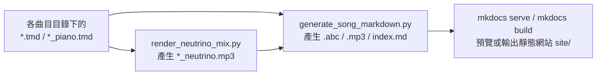

# Re:shōka 網站編譯環境與腳本工具說明手冊

本文件說明建置、編譯與維護 **Re:shōka** 網站所需的作業系統與外部工具安裝來源，以及專案內各個自動化腳本（`scripts/` 與 `.agents/skills/shoka-score-grounding/scripts/`）的完整用法。

> [!IMPORTANT]
> **作業系統限制：本專案的完整編譯管線必須在 macOS 環境下執行。**
> - 核心樂譜編譯器 **`tmd`（TmdSwift）** 的離線音訊渲染功能（`tmd -w`）直接依賴 macOS 原生 `AVFoundation` / `AVAudioEngine` / `AVAudioUnitSampler` 框架，以及 macOS 系統內建的 Apple DLS 音源庫（`/System/Library/Components/CoreAudio.component/Contents/Resources/gs_instruments.dls`）。
> - 高解析度古籍五線譜切片工具（`slice_score.swift`、`crop.swift`）依賴 macOS 原生 `CoreGraphics` 與 `ImageIO` 框架。
> - 若僅在 Linux / CI 環境執行純網頁建置（`mkdocs build`）或略過音訊渲染（`generate_song_markdown.py --no-audio`），仍需在本地 **macOS** 先使用 `tmd` 產生 `.abc`、分析報告與 `.mp3` 音訊。

---

## 一、編譯與維護網站所需的工具與安裝來源

要從 `.tmd` 樂譜原始檔完整編譯出單曲網頁、五線譜（ABC）、鋼琴伴奏 MP3、NEUTRINO 歌聲合成 MP3 與統計報表，請依序在 **macOS** 安裝以下工具：

### 1. 本地端必備：`tmd` CLI 工具（TmdSwift）
本專案所有樂譜皆以 **TMD（Timebase Mark Down）** 格式撰寫，**本地端必須先安裝 `tmd` 命令列工具**並置於 `PATH`（如 `/usr/local/bin/tmd` 或 `/opt/homebrew/bin/tmd`），所有建置與審查腳本才能運作。

- **專案網址**：[https://github.com/TMDLang/TmdSwift](https://github.com/TMDLang/TmdSwift)
- **安裝方式 A（透過官方 Homebrew Tap 安裝）**：
  ```bash
  brew tap TMDLang/tmd
  brew tap --trust TMDLang/tmd
  brew install tmd
  ```
- **安裝方式 B（從原始碼以 Swift 編譯安裝）**：
  ```bash
  git clone https://github.com/TMDLang/TmdSwift.git
  cd TmdSwift
  swift build -c release
  sudo cp .build/release/tmd /usr/local/bin/tmd
  ```
- **驗證安裝**：
  ```bash
  tmd --version
  ```
- **在本專案中負責的工作**：
  - **語法與拍數／歌詞對位驗證**：`tmd check <file.tmd>`
  - **自動排版**：`tmd format <file.tmd> -i`
  - **匯出 ABC 五線譜**：`tmd <file.tmd> -a <out.abc>`（供網頁前端 `abcjs` 渲染向量五線譜）
  - **匯出 MusicXML**：`tmd <file.tmd> -x <out.musicxml>`（供 NEUTRINO 歌聲合成讀取）
  - **離線渲染 WAV 音訊（macOS 專屬）**：`tmd <file.tmd> -w <out.wav>`
  - **抽離單一樂器聲部**：`tmd refactor extract-instrument <file.tmd> --instrument PianoLH -o <out.tmd>`
  - **樂曲結構與音域分析**：`tmd inspect <file.tmd>`
  - **產生 TMD Studio 線上編輯連結**：`tmd studio-url <file.tmd>`

---

### 2. Xcode Command Line Tools（Swift 編譯環境）
用於編譯 `TmdSwift` 以及執行本專案內建的 macOS 原生影像切片腳本（`scripts/crop.swift` 與 `.agents/skills/shoka-score-grounding/scripts/slice_score.swift`）。

- **安裝方式**：
  ```bash
  xcode-select --install
  ```

---

### 3. `ffmpeg` 與 `ffprobe`
用於音訊轉檔壓縮、音量偵測正規化與人聲伴奏混音。

- **安裝方式（透過 [Homebrew](https://brew.sh/)）**：
  ```bash
  brew install ffmpeg
  ```
- **在本專案中負責的工作**：
  - 將 `tmd -w` 產生的無損 `.wav` 轉為高音質 `.mp3`（`libmp3lame -q:a 2`）。
  - 透過 `volumedetect` 濾鏡偵測整軌峰值音量（`max_volume`），自動將 `tmd -w` 預設偏小的音量（約 `-14 dB`）線性增益補償至 `-1.5 dB`，同時完整保留曲內的 `{p}`、`{mf}`、`{f}` 強弱表情對比。
  - 將 NEUTRINO 合成的人聲 `.wav` 與鋼琴伴奏 `.wav` 進行時間軸對齊（`-ss` 與 `adelay`）及雙軌混音（`amix` + `alimiter`）。

---

### 4. NEUTRINO（日語 AI 歌聲合成引擎）
用於將含有日文歌詞軌（`L|`、`L1|`..`L64|`）的曲目合成為擬真人聲並混入鋼琴伴奏（執行 `scripts/render_neutrino_mix.py` 時必備）。

- **官方下載網址**：[STUDIO NEUTRINO 官網（macOS 版下載）](https://studio-neutrino.com/)
- **安裝位置與解除 macOS Gatekeeper 隔離屬性**：
  1. 下載 macOS 版壓縮檔後，解壓縮並將 `NEUTRINO` 資料夾移至 **`/Applications/NEUTRINO`**（若放於其他路徑，執行腳本時可透過 `--neutrino-dir` 指定）。
  2. 首次執行前，需賦予執行權限並移除 macOS 隔離屬性：
     ```bash
     chmod 755 /Applications/NEUTRINO/bin/*
     xattr -dr com.apple.quarantine /Applications/NEUTRINO
     ```
- **核心組件與聲庫模型**：
  - `/Applications/NEUTRINO/bin/musicXMLtoLabel`：將 MusicXML 轉為音素與時間標籤 `.lab`
  - `/Applications/NEUTRINO/bin/neutrino`：神經網路推論 timing、pitch、melspec 與 vocoder 合成 `.wav`
  - `/Applications/NEUTRINO/model/`：內附 `MERROW`（預設）、`RUNO`、`NAKUMO`、`REINA`、`SOMA` 等歌手模型（亦可由官網追加下載其他模型放入 `model/` 目錄）

---

### 5. Python 3（建議 3.11+）與虛擬環境套件
用於執行網站產生器、統計腳本與 MkDocs 靜態網站編譯。

- **安裝方式（透過 Homebrew 與 `venv`）**：
  ```bash
  brew install python
  python3 -m venv venv
  ./venv/bin/pip install --upgrade pip
  ./venv/bin/pip install -r requirements.txt
  ```
  *(註：直接執行根目錄的 `./run.sh` 也會自動建立 `venv` 並安裝 `requirements.txt` 內的所有套件，包含 `mkdocs==1.6.1`、`mkdocs-material==9.7.7`、`pymdown-extensions==12.3` 等。)*

---

## 二、網站預覽與靜態編譯流程



### 1. 啟動本地即時預覽伺服器
根目錄下的 [`run.sh`](../run.sh) 會自動檢查並建立 `venv`、安裝相依套件，並以 `--dirty` 模式啟動 MkDocs 預覽伺服器（預設 `http://127.0.0.1:8000`）：
```bash
./run.sh
```

### 2. 編譯完整靜態網站
若需輸出部署用的靜態 HTML 網站至 `site/` 目錄：
```bash
./venv/bin/mkdocs build
```

---

## 三、`scripts/` 目錄下各腳本詳細用法

### 1. [`scripts/generate_song_markdown.py`](../scripts/generate_song_markdown.py) — 單曲頁面、音訊與全站導覽產生器
專案最核心的建置腳本。負責掃描指定目錄下的 `.tmd` 與 `*_piano.tmd`，自動呼叫 `tmd` 與 `ffmpeg` 產生 `.abc` 五線譜、峰值正規化後的 `.mp3` 音訊、單曲 `index.md`（若目錄下存在 `*_neutrino.mp3`，會自動在頁面同時掛載「鋼琴伴奏版」與「NEUTRINO 歌聲合成版」雙播放器）、冊別總覽 `index.md`、跨冊重複歌曲索引，並更新 `mkdocs.yml` 的 `nav` 導覽樹。

```bash
# 1. 更新全站（預設開啟平行處理，且僅重新轉檔有修改過的 TMD）
python3 scripts/generate_song_markdown.py

# 2. 僅更新單一歌曲資料夾，並強制重新產生 .abc 與 .mp3
python3 scripts/generate_song_markdown.py --force docs/shintei_jido_shoka/grade_4_2020.006.0847.0004/3_02_niwatori

# 3. 針對單一冊別強制重新渲染所有 MP3（套用 -1.5 dB 峰值音量正規化）
python3 scripts/generate_song_markdown.py --force docs/kogakko_shoka/grade_3

# 4. 僅快速更新 Markdown 頁面與 .abc（略過耗時的 WAV/MP3 音訊渲染）
python3 scripts/generate_song_markdown.py --no-audio docs/utanohon

# 5. 指定自訂 SoundFont (.sf2 / .dls) 或保留中間 WAV 檔
python3 scripts/generate_song_markdown.py --soundfont /path/to/piano.sf2 --keep-wav docs/kogakko_shoka/grade_3/1_awoba
```

| 參數 | 說明 |
| :--- | :--- |
| `directory` | 目標路徑：可為單曲目錄、冊別目錄或 `docs`（預設：`docs`） |
| `--force` | 忽略檔案修改時間快取，強制重新產生所有 `.abc` 與 `.mp3` |
| `--no-audio` | 略過 WAV/MP3 音訊渲染，僅更新 `.abc` 與 `index.md`（速度極快） |
| `-j`, `--jobs` | 批次平行處理的執行緒數量（預設為系統 CPU 核心數） |
| `--soundfont` | 指定傳遞給 `tmd -w` 的 `.sf2` 或 `.dls` 音源檔路徑 |
| `--keep-wav` | 轉出 MP3 後保留中間產生的 `.wav` 檔 |

---

### 2. [`scripts/render_neutrino_mix.py`](../scripts/render_neutrino_mix.py) — NEUTRINO 人聲合成與伴奏混音腳本
將 TMD 樂譜中的日文歌詞軌（`L|`、`L1|`..`L64|`）透過 NEUTRINO 轉為人聲，並用 `ffmpeg` 與鋼琴伴奏混音輸出 `<stem>_neutrino.mp3`。

**核心自動化處理機制**：
1. **前奏／間奏無歌詞音符自動轉休止符**：匯出 MusicXML 後，自動保留含歌詞的聲部（如 `PianoRH`），並將該聲部中所有「無歌詞且非連音線延音」的純器樂音符（如 `Intro` 前奏、間奏、尾奏）轉換為同等時值的 `<rest/>`，確保時間軸與伴奏 100% 同步且不會觸發 NEUTRINO 空白歌詞崩潰。
2. **字頭子音先行發聲（Pre-utterance）精準對齊**：若樂曲第 1 小節無前奏休止而由 NEUTRINO 自動插入 1 小節前導休止符，腳本會解析 `timing.lab` 中第一個子音的實際起點，保留 30ms 字頭子音緩衝並同步計算 `adelay` 補償伴奏，讓第一拍母音與鋼琴和弦落點精準重疊。
3. **雙軌峰值音量平衡**：自動偵測 `vocal.wav` 與 `piano.wav` 峰值，將人聲正規化至 `-2.0 dB`、鋼琴伴奏正規化至 `-4.5 dB` 後再進行混音。

```bash
# 1. 針對單首曲目合成 NEUTRINO 混音版（輸出至該目錄下的 <stem>_neutrino.mp3）
python3 scripts/render_neutrino_mix.py docs/kogakko_shoka/grade_3/1_awoba

# 2. 批次合成整冊目錄底下的所有歌曲（跑完後可接 generate_song_markdown.py --no-audio 更新頁面）
python3 scripts/render_neutrino_mix.py docs/kogakko_shoka/grade_3
python3 scripts/generate_song_markdown.py --no-audio docs/kogakko_shoka/grade_3

# 3. 指定歌手模型（如 RUNO）並僅使用左手伴奏（--lh-only，避免右手鋼琴與人聲重疊）
python3 scripts/render_neutrino_mix.py docs/kogakko_shoka/grade_3/1_awoba -m RUNO --lh-only

# 4. 直接覆寫預設的 <stem>.mp3
python3 scripts/render_neutrino_mix.py docs/kogakko_shoka/grade_3/1_awoba --replace-song-mp3
```

| 參數 | 說明 |
| :--- | :--- |
| `target` | 單曲目錄、整冊目錄或單一 `.tmd` 檔案路徑 |
| `-m`, `--model` | NEUTRINO 歌手模型名稱（`MERROW`、`RUNO`、`NAKUMO`、`REINA`、`SOMA`，預設：`MERROW`） |
| `-o`, `--output` | 自訂輸出檔案路徑（預設：`<song_dir>/<stem>_neutrino.mp3`） |
| `--replace-song-mp3` | 直接覆寫歌曲目錄下的 `<stem>.mp3` |
| `--lh-only` | 伴奏僅渲染左手軌（`PianoLH`），讓主旋律完全由人聲擔綱 |
| `--vocal-volume` | 峰值正規化後的人聲音量倍率（預設：`1.0`） |
| `--piano-volume` | 峰值正規化後的伴奏音量倍率（預設：`1.0`） |
| `--style-shift` | 傳遞給 NEUTRINO 的 `-k` style shift 參數（預設：`0`） |
| `--transpose` | 傳遞給 NEUTRINO 的 `-f` 半音移調參數（預設：`0`） |
| `--threads` | 執行緒數量 `-n`（預設：`0`，自動使用全部 CPU 核心） |
| `--keep-temp` | 保留 `/tmp` 下的暫存工作目錄（含 `.musicxml`、`full.lab`、`timing.lab`、`vocal.wav`）以便除錯 |

---

### 3. 樂譜轉錄、高解析切片與校對審查腳本

這組工具用於將古籍掃描圖檔（`P0xx.jpg`）轉錄為 TMD 樂譜時的防幻覺校對工作流：

#### (1) [`.agents/skills/shoka-score-grounding/scripts/slice_score.py`](../.agents/skills/shoka-score-grounding/scripts/slice_score.py) — 五線譜自動投影切片工具
透過底層的 `slice_score.swift` 計算掃描頁的水平黑色像素投影，自動定位每一行五線譜的真實 Y 座標並無損裁切出單行五線譜與底部歌詞，避免多模態模型在大圖縮圖下看錯線間。

```bash
# 對指定歌曲目錄的掃描圖自動切出 staff_1.png ~ staff_4.png 與 bottom_lyrics.png
python3 .agents/skills/shoka-score-grounding/scripts/slice_score.py \
    docs/shintei_jido_shoka/grade_4_2020.006.0847.0004/3_02_niwatori \
    -o /tmp/slices
```

#### (2) [`.agents/skills/shoka-score-grounding/scripts/audit_score.py`](../.agents/skills/shoka-score-grounding/scripts/audit_score.py) — 主旋律常理與字音對位審查工具
對轉錄完成的 `.tmd` 執行五項自動化防幻覺檢查：
1. 呼叫 `tmd check` 驗證小節拍數與 `L1|`、`L2|` 歌詞格數 1:1 對齊。
2. 偵測異常大跳音程（超過大六度且非八度之突兀跳進，常為高低八度或加線看錯）。
3. 審核國小學童歌唱音域界限（跨度是否超過 17 個半音）。
4. 檢查註解歌詞字數與發聲音符數是否吻合。
5. 自動連動呼叫 `audit_piano_harmony.py` 檢查同目錄下的 `*_piano.tmd` 伴奏和聲。

```bash
python3 .agents/skills/shoka-score-grounding/scripts/audit_score.py \
    docs/shintei_jido_shoka/grade_4_2020.006.0847.0004/3_02_niwatori/niwatori.tmd
```

#### (3) [`scripts/audit_piano_harmony.py`](../scripts/audit_piano_harmony.py) — 鋼琴伴奏垂直和聲與撞音審查工具
解析 `*_piano.tmd`（或單獨對整冊執行），比對 `PianoRH`（右手旋律）與 `PianoLH`（左手低音與和弦）在時間軸上的垂直音高關係，自動抓出強拍上的小二度／大七度尖銳撞音，以及樂句終止式和弦錯置問題。

```bash
# 檢查單首伴奏檔或整冊目錄下的所有 *_piano.tmd
python3 scripts/audit_piano_harmony.py docs/shintei_jido_shoka/grade_4_2020.006.0847.0004
```

#### (4) [`scripts/crop`](../scripts/crop)（由 [`scripts/crop.swift`](../scripts/crop.swift) 編譯）— 自訂座標局部裁切工具
依像素座標 `(x, y, width, height)` 快速裁切掃描圖檔的任意局部區域：

```bash
./scripts/crop input.jpg output.png 100 200 800 300
```

---

### 4. 音樂學統計與旋律動機檢索腳本

以下腳本共用 [`scripts/shoka_data.py`](../scripts/shoka_data.py) 資料載入與音高特徵萃取模組，用於分析全庫 734 首曲目的音樂學特徵：

#### (1) [`scripts/stats_tonality.py`](../scripts/stats_tonality.py) — 調性分布統計
依叢書、冊別／學年、學期統計各調號（C、G、D、A、E、F、Bb、Eb、Ab 等）之曲數與百分比。
```bash
# 統計《新定兒童唱歌》並去除跨冊重複曲目，輸出 Markdown 表格
python3 scripts/stats_tonality.py --collection shintei_jido_shoka --deduplicate --markdown
```

#### (2) [`scripts/stats_meter.py`](../scripts/stats_meter.py) — 拍號與速度（BPM）統計
依叢書、冊別、學期統計拍號（`2/4`、`4/4`、`3/4`、`6/8` 等）與速度（平均 BPM、中位數、最快／最慢曲目）。
```bash
python3 scripts/stats_meter.py --collection shintei_jido_shoka --deduplicate -o docs/stats_meter.md
```

#### (3) [`scripts/stats_pentatonic.py`](../scripts/stats_pentatonic.py) — 五聲音階與七聲音階結構統計
分析每首曲目的實際音級集合（Pitch-class set），分類為「嚴格五聲音階」、「準五聲音階」、「六聲音階」、「標準七聲自然音階」與「含變化音音階」，觀察低年級至高年級的音階演進。
```bash
python3 scripts/stats_pentatonic.py --collection shintei_jido_shoka --deduplicate
```

#### (4) [`scripts/find_tmd_motifs.py`](../scripts/find_tmd_motifs.py) — 跨曲重複旋律動機檢索工具
在指定目錄的所有 `.tmd` 樂譜中搜尋重複出現的旋律片段（Motif），支援三種比對模式：
- `--mode degree`：直接比對首調唱名序列（如 `1 2 3 5`）
- `--mode interval`：比對相鄰音程半音差（移調不變）
- `--mode contour`：僅比對旋律上行／下行／同音輪廓

```bash
# 在《楊金土手抄唱歌帖》中尋找長度為 8 個音的共同旋律動機
python3 scripts/find_tmd_motifs.py docs/shokacho --window 8 --mode degree
```
