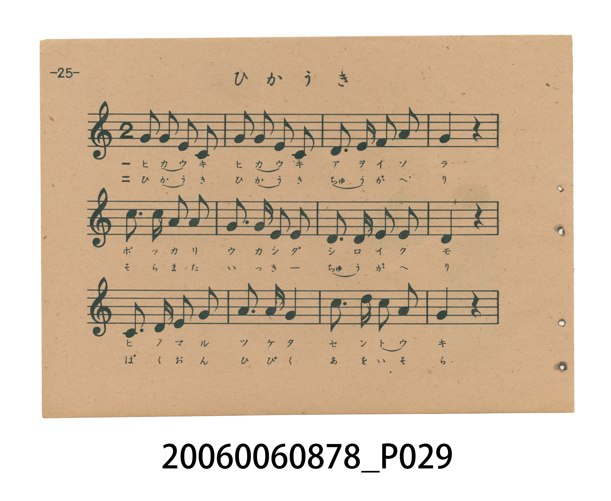
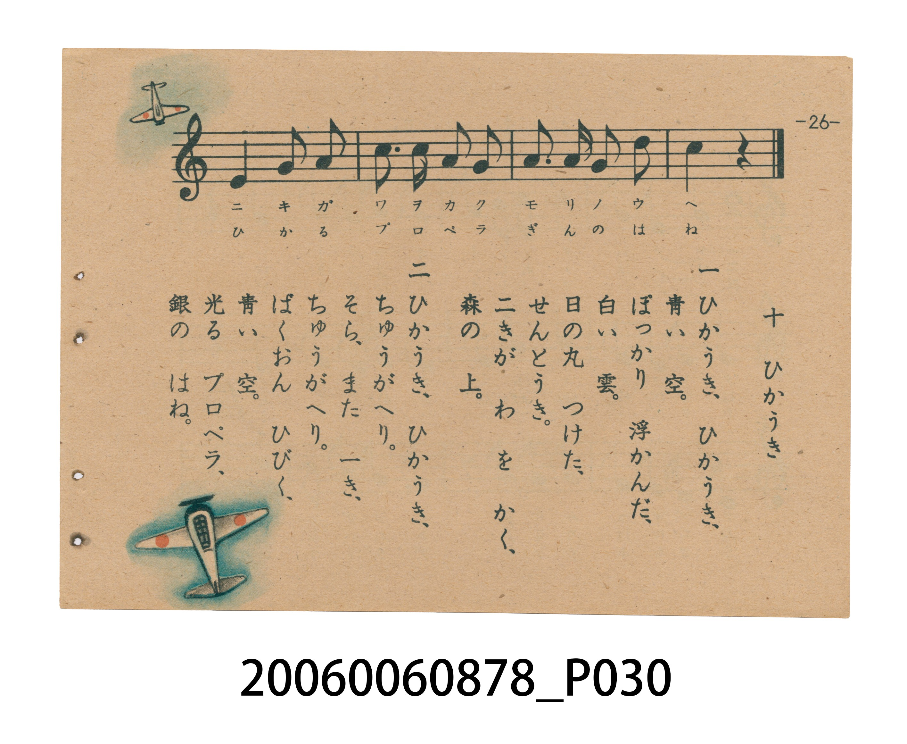

# ひかうき（飛機）

> Re:Shōka 使用 AI 協助辨識與重建樂譜，可能會有錯誤。歡迎回報。

- **鋼琴伴奏版**：<br><audio controls src="hikoki.mp3"></audio>
- **NEUTRINO 歌聲合成版**：<br><audio controls src="hikoki_neutrino.mp3"></audio>

- 日治時期國民學校唱歌（うたのほん 下・第十課）
- 國立臺灣歷史博物館典藏

## 說明


- 出處：臺灣總督府編《うたのほん 下》（國民學校初等科第二學年用），第十課〈ひかうき〉（飛機），原書第 25–26 頁。
- 調性與拍號：C 大調（?= C，無升降記號），2/4 拍，速度 != 112。
- 背景與曲風：第一節描寫晴朗藍天與白雲間，漆有日之丸標誌的兩架戰鬥機在森林上空盤旋畫圈；第二節描寫飛機在空中接連翻筋斗（宙返り）、爆音迴盪天際、螺旋槳與銀翼閃耀的景象。
- 版本說明：本檔案為原書單聲部五線譜旋律之忠實數位化版本。

### 編曲說明（鋼琴伴奏版）：

1. 前奏 (Intro, 4 小節)：擷取主旋律核心樂句作為導奏，建立調性與拍感。
2. 主歌伴奏 (Hikoki)：右手 (PianoRH) 演奏原書歌唱主旋律；左手 (PianoLH)
依國民學校低學年教材純樸明朗之風格配以和聲伴奏。


## 歌詞

```text
一　ひかうき、ひかうき、
青い　空。
ぽっかり　浮かんだ、
白い　雲。
日の丸　つけた、
せんとうき。
二きが　わを　かく、
森の　上。

二　ひかうき、ひかうき、
ちゅうがへり。
そら、また　一き、
ちゅうがへり。
ばくおん　ひびく、
青い　空。
光る　プロペラ、
銀の　はね。
```

## ABC

<div class="abc-score" data-abc-src="hikoki.abc" aria-label="五線譜載入中"></div>

[下載 ABC 原始檔](hikoki.abc)

## TMD 檔案連結

- [主旋律 TMD 檔案](hikoki.tmd) [[在 TMD Studio 編輯](https://tmdlang.github.io/Tmd-TS/#tmd=s7IKdvYPcrWy4qpTUCpJTLdSyC_KTM_MsypJzCxPzIvPT0vLTM5MzFGCyyfn5-SkJpdk5udZlZYk5uVn5OchJMvyc0pzU62MECLF-aVFyalwpfHpqehy8QWJ6alWAQZGlroBBsYGCOmCovyy1LzEPKB2qGvSgQJFeflFQFPyUouQXZValpmSClJZUJSZm1hUGZ-Snwx0SV4JkttSi4pBri7LT0bWmV9UkpGfXpRYkFFplZFZXAL0P1A-PjsxLxGhqCQjFeitxLLMRJDHlbi0tBQeN2563Nj9uLHtcWPv-z0dLxfPfrZy_vs9nQpaWlyKtgqGhkZc9rYKzlw2RvomdiCDnk1f-mzT7mczm57Nmf90TvezDROfrt3xbMHCp1M2PlvbAzQCbNb8x43rHjfuftw0WeHJju7Hzbufr1nztLfxxapNQLPBDgLqfb66-0X7rueNi5-t3f60f9PT3lnPO1e-XLLiaeuOF9P7lbi49LUUbKkFuBQUFB43THg2e9Pz2eterFr1bEbf44aJYNHm3U_bd72YOfX9nlkQ9zzfsff53MVPd815vn3F44YubD5q6AZ6FcX_HXOfr-18vnwi0KdPdvUABZ_u3PJ8ygqgf9_v6YF7_3EDMIAQQf64ASiLCHWgyqd985_N3gFUr2Bk-qhhspGZwssFjY8bmqAufbFq_7OG5S862p91976YCdQzy1nh6ZLlQGGgOaCYAlnWsvBpb_vLmb0vVswAqwGZC4w_BaAeIOtlw_ynu5YpQGIXyeTmnmcz14NMnr3p5SKgu2eBfLKj4fn6hmf9_U_Xr342c8uzOdNfTO99umQlUNnzmXtfAlVOmww08tmetmdzOoFJ48nO7ic7djxbMfPFqp7ns1qetq58Nm_bs44NL9csBfrw6ZwVzxavezZv-pMdXc9X7no-e8mz6d3Pp65-Oqfj_Z7ZkICDWwcJFKAWoMonO9Y-61v6smHx8_27n6_tfjZtOij01818sX_K46YuoAcfNzQ-72h7OX_zi_1bns9eBXThy1mzgYIv5u0CWvFs-Wagg192NTzfv-fltOYXDQ1At4E8u3Ehwv_POzuezVkDSRlAzwPZz1ZNebaw43nTLkicPJ227kXjppfNK57smvJ8-6wXa-cAjX66rxvo56f7Fzxdv-zZ1B1P9vY-7ZkGMQpkNDTVQQwA5o8XK-c9bV3xbFo70D0gTwEZq-a9WLsemBSBPkKLdaDIs75mYGgAHaIAKlmAMqCyBRyhnWCzgfHzuKEBNUU1onFB6l7OnfS4sQWoFBiYMC837n3cuBiksKkLKPFsKzB5A9mTHzcugGoCxjBEEzCeoZqAUQzMB8AoBtu65HHjRFDOgCh_3DgbrH0FzGawDmCUgjiNPSAdTf2PmyaBtQKd1w_VB0wSoLzV0ABMFVBNQJ9DwgUYEZB0AFQLyyU9L6bMAqZCUPJashLinxd7pr5c3AJEQF-8mDgdFLt7p0AS6LM5W4EKgAkUaPrTJateztz7bPp0eAKFJ02gGkhihSc7XCkVqBIe-kC_ERP6jxsXPm5qBQsBA2MHOMChcTD3cRMo8T5u3AcOSGAYAM0jQt8GUPg1doECHOqCzYgQxRLbT1s7HzcBi62Gx83THzevfdw863HzSpjyLqAJoAh43Lj-ceNaouIAni_hORKo7fmc7qcTG0Cy_cAM0An0CzBAsap8sXf-y81bQNlp_v6n-3ZixigwmwLR85l7gA4HiqPl4xedm4DOAOZmaGQAnUt5DQEFClr6XFwemdn52ZlWAZnA-t6hxqCmGmSFgo2hmZYdmFWjYKqgC8bGQGwIxNhEjIAkiG8CJM3gakDQAErXgE3zMawBlkCTgPzHTavB5DIwuRasB49M0yKwKY-bNwHZS8Aye6F6VmK3yQgo17gJpLKxG0y2gcleiC48MqCUCLEMKAFMj2DWDqgzujAsg4aSYRyYD6RA_kcOA1NwOIEwLJyMMESwh9NcqJ-bYWHSvArqDFDYQELqcfNmsEwDVGY7VM9aeDith4YTJASxhxPUpqZOIHsf2MPzoaHRAg2KxdAQAuskP5Sg_gelE1Do1IBDChResPQCD0mjOAiLuOQE8nIfEM8Ds0CBBZKBOr5pIxDvRzi-aTdUx2Yg7gCrAAUoSAaU3HAF0gaof_uBGORDUAsJkZhAMkDzgLKIQGqC2j8JGpCQgAbZ04krhECpApJqYF5HTVmYoQYMKCRl2IMIlM4hTgF58HHTGmgAgdIGLFdBch1qagGlOFDAIgVR8ww8QQQJCHjOagKRID3ToaYBU2XzLDALlGtBOkBmQ4ISWDKDdUJd0IgZFbVcXLp2CpASC2wpkKfMBQA)]
- [鋼琴伴奏 TMD 檔案](hikoki_piano.tmd) [[在 TMD Studio 編輯](https://tmdlang.github.io/Tmd-TS/#tmd=s7IKdvYPcrWy4qpTUCpJTLdSSM7PyUlNLsnMz7MqLUnMy8_Iz1OCS5bl55TmploZIUSK80uLklPhSuPTU9Hl4gsS01OtAgyMLHUDDIwNENIFRfllqXmJeUDtJYmZ5YlAzUCBorz8IqApealFiTkItallmSmpIJUFRZm5iUWV8Sn5yUCX5JUguS21qBjk6oJMoFPiE4uKEvPSU1GV5BeVZOSnFyUWZFRaZWQWl-QXZSYn5sRnJ-YlIhSVZAB1WSWWZSaCAkGJS0tL4XHjpseN3Y8b2x439r7f0_Fy8exnK-e_39MJYnfveT5hy5M9W54u7X_e2QEUVNDS4lK0VTA0NOKyt1Vw5rIx0jexA5n-bPrSZ5t2P5vZ9GzO_Kdzup9tmPh07Y5nCxY-nbLx2doeoFlgC-Y_blz3uHH346bJCk92dD9u3v18zZqnvY0vVm0Cmg12JVDv89XdL9p3PW9c_Gzt9qf9m572znreufLlkhVPW3e8mN6vxMWlr6VgSy3ApaCg8LhhwrPZm57PXvdi1apnM_oeN0wEizbvftq-68XMqe_3zIK45_mOvc_nLn66a87z7SseN3Rh81FDN9CrKP7vmPt8befz5ROBPn2yqwco-HTnludTVoADuAfu_ccNwABCxMPjBnDwI6Ki52nf_GezdwDVKxiZPmqYbGSm8HJB4-OGJqhLX6za_6xh-YuO9mfdvS9mAvXMclZ4umQ5UBhoDiimQJa1LHza2_5yZu-LFTPAakDmAuNPAagHyHrZMP_prmUKkNhFMrm559nM9SCTZ296uQjo7lkgn-xoeL6-4Vl__9P1q5_N3PJszvQX03ufLlkJVPZ85t6XQJXTJgONfLan7dmcTmDSeLKz-8mOHc9WzHyxquf5rJanrSufzdv2rGPDyzVLgT58OmfFs8Xrns2b_mRH1_OVu57PXvJsevfzqaufzgEmudmQgINbBwkUoBagyic71j7rW_qyYfHz_bufr-1-Nm06KPTXzXyxf8rjpi6gBx83ND7vaHs5f_OL_Vuez14FdOHLWbOBgi_m7QJa8Wz5ZqCDX3Y1PN-_5-W05hcNDUC3gTy7cSHC_8C4BvockjKwZglgiICUKigY6ik87ewFiitoeOaVFOXrKJgoPN3QD3S5JlDNs8nAxDztyY7dQIuf7ut-tmDH0_3Nz1Y0Pe1f-mTvnOdNu55u6APqBUX17l2gLIAUo89a5kMdpKBgpAdMaLuBeQriBgUNj8zs_OxMkBVP-zc_6-xW0AgAFRJBHpoKz_ZMASqBJB2gDmBehNsPDNin25chlPt4aELMB4In--YiJ-Ene_sgyfbZ1JnP5k54vmXKsxU7gKEBjHVgvALTxLMFe1629j7ZvfTppJ4XjZsgDgM5GJq54A54sXLe09YVz6a1A70FijsgY9W8F2vXA3McMGjREjdQ5FlfMzDSn62aogAqYYEyoDIWHOSdYLOByfBxQwNqxmlE44LUvZw76XFjC1ApMM3AYrZx7-PGxSCFTV1AiWdbgbkYyJ78uHEBVBMwIUM0AZMzVBMwJQOzOzAlg21d8rhxIqgAgCh_3DgbrH0FzGawDmDKBXEae0A6mvofN00CawU6DxhAYH3AlA8qQhoagIkfqgnoc0i4AOMUktyBamGFQc-LKbOAmQ2Ui5ashPjnxZ6pLxe3ABHQFy8mTgcl4r1TIPnw2ZytQAXAfAg0_emSVS9n7n02fTo8H8JzIFANJE_CcxeuDAlUCQ99oN-ICf3HjQsfN7WChYCBsQMc4NA4mPu4CZRHHzfuAwckMAyA5hGhbwMo_Bq7QAEOdcFmRIhiie2nrZ2Pm4Clc8Pj5umPm9c-bp71uHklTHkX0ARQBDxuXP-4cS1RcQAvfuAFD1Db8zndTyc2gGT7O4DFHtAvwADFqvLF3vkvN28BZpWX8_c_3bcTM0aBpREQPZ-5B-hwoDhacfWicxPQGcBCCxoZQOdSXhFCgYKWPhcXuPiyghYjDjUGNdXgssHG0EzLDsyqUTBW0AVDUyA2A-IaBcM4sACQAvFB4jVgFkgexDMCycOV6SoYQOkarloUG32QbTSBW2gSrxBtEgsyAMgwBDFAIqbIIiCDIKUhfreDXAPCID8Ygh2FKWIEdpsxsAiH-Q8kj-pukGk-hjXAWmISkP-4aTWYXAYm14L14JFpWgQ25XHzJiB7CVhmL1TPSuw2GQHlGjeBVDZ2g8k2MNkL0YVHBpSNIJYBJYCZCczaAXVGF4Zl0FBCjU_kMDAFhxMIw8LJCEMEezjNhfq5GRYmzaugzgCFDSSkHjdvBss0QGW2Q_WshYfTemg4QUIQezhBbWrqBLL3gT08HxoaLdCgWAwNIbBO8kMJ6n9QOsFM8xCzoSEJzABgFnHJCeTlPiCeB2aBAgskA3V800Yg3o9wfNNuqI7NQNwBVgEKUJAMKLnhCqQNUP_2AzHIh6BWLCIxgWSA5gFlEYHUBLV_EjQgIQENsqcTVwhRs6RABBEonUOcAvLg46Y10AACpQ1YroLkOtTUAkpxoIBFCqLmGXiCCBIQ8JzVBCJBeqZDTQOmyuZZYBYo14J0gMyGBCWwWgHrhLqgETMq0AosHEUfqHyDF31gBkZhiK2QBJeNcBEjIMMoF4tSEANenhI0FKPkNYB4Q9dOAVyGKwAZEC9F-wDVIvGMwDxlLgA)]

## 分析

```text
================================================================================
📊 TMD Song Profile: [ ひかうき（飛機） ]
================================================================================
⏱  Duration:       0:17 (17.1s), 16 measures total
🎼 Key & Tempo:    首調基準 C, != 112.0 BPM, <2/4>
   - 分析範圍：      由實際發聲的音符與和弦推測調性；播放脈絡另行呈現
🎤 人聲音域:    C4 (MIDI 60) – D5 (MIDI 74) [跨度: 14 個半音 / 1.2 個八度, 難度: moderate]
   - 最低音:  C4 in [Hikoki #1 @ m.1, 0:00]
   - 最高音: D5 in [Hikoki #1 @ m.11, 0:11]
   - 適合: soprano, mezzo-soprano, contralto, tenor, baritone, bass
🏛  結構:      Hikoki (17.1s)
⚡ 編曲密度:        Peak 1 軌道同時演奏
🗝  調性診斷：       C 大調（純淨自然大調，未偵測到可信轉調）
   - 風格氣質:    純淨自然大調（陽光明朗、易唱易記，無明顯調外色彩）
   - 轉調歷程:    全曲維持單一推測調性（未偵測到可信轉調）
   - 核心骨幹音:  G, C, A, E, D
   - 調性數值:    C 大調 [相關度: 0.86, 穩定度: Moderate, 自然音純度: 100.0%]
   - 候選調性 (K-S): C 大調 (0.86), G 大調 (0.77), A 小調 (0.63)
   - 五度圈歷程:   +0
   - 各段落調性細節:
     • [Hikoki #1]: C 大調 (r: 0.86, 自然音純度: 100.0%)

  [ 五度圈游移軌跡 ]
              [C ]*
         F            G  
      Bb               D  
      Eb               A  
         Ab           E  
            Db       B  
               F# 
     (* = active key center)

  [ 十二半音累積音高分佈 ]
     C  : ██████████████████        21.4%
     C# :                            0.0%
     D  : ███████████               13.4%
     D# :                            0.0%
     E  : █████████████             15.2%
     F  : ███                        3.6%
     F# :                            0.0%
     G  : ████████████████████████  28.6%
     G# :                            0.0%
     A  : ███████████████           17.9%
     A# :                            0.0%
     B  :                            0.0%
--------------------------------------------------------------------------------
Assignment 軌道音域：
  - Piano         : C4 – D5 (14 個半音 / 1.2 個八度, 50 個音符)
================================================================================
```


## 原書掃描頁






