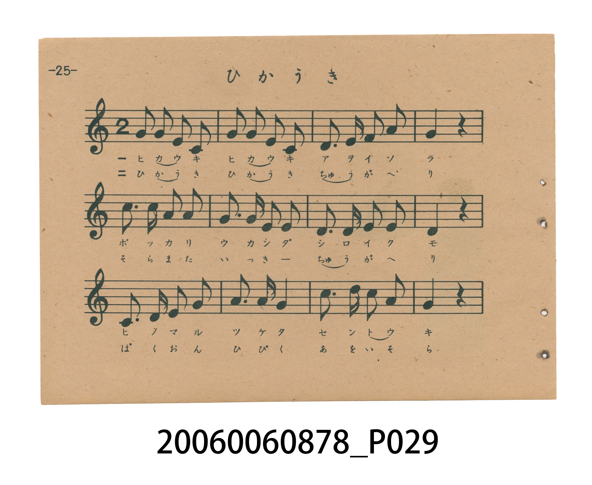
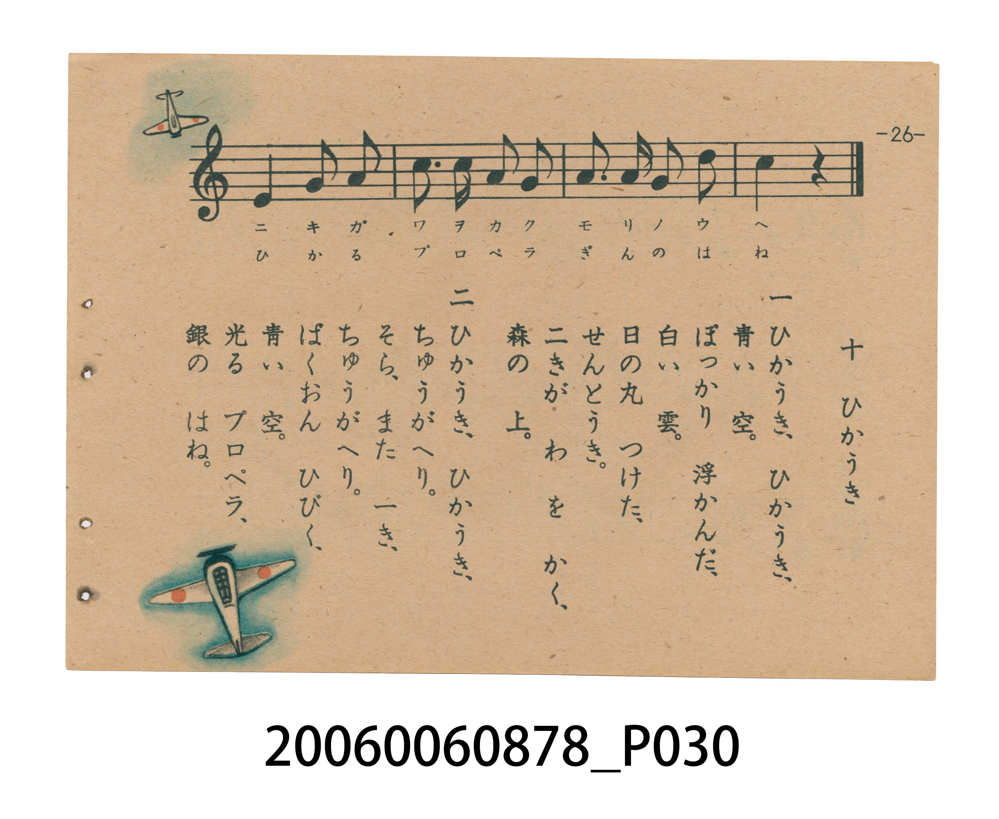

# ひかうき（飛機）

> Re:Shōka 使用 AI 協助辨識與重建樂譜，可能會有錯誤。歡迎回報。

- **NEUTRINO 歌聲合成版**：<br><audio controls src="hikoki_neutrino.mp3"></audio>
- **鋼琴伴奏版**：<br><audio controls src="hikoki.mp3"></audio>


- 日治時期國民學校唱歌（うたのほん 下・第十課）
- 國立臺灣歷史博物館典藏

## 說明


- 出處：臺灣總督府編《うたのほん 下》（國民學校初等科第二學年用），第十課〈ひかうき〉（飛機），原書第 25–26 頁。
- 調性與拍號：C 大調（?= C，無升降記號），2/4 拍，速度 != 112。
- 背景與曲風：第一節描寫晴朗藍天與白雲間，漆有日之丸標誌的兩架戰鬥機在森林上空盤旋畫圈；第二節描寫飛機在空中接連翻筋斗（宙返り）、爆音迴盪天際、螺旋槳與銀翼閃耀的景象。
- 版本說明：本檔案為原書單聲部五線譜旋律之忠實數位化版本。

### 編曲說明（鋼琴伴奏版）：

1. 前奏 (Intro, 4 小節)：擷取主旋律核心樂句作為導奏，建立調性與拍感。
2. 主歌伴奏 (Hikoki)：右手 (PianoRH) 演奏原書歌唱主旋律；左手 (PianoLH)
依國民學校低學年教材純樸明朗之風格配以和聲伴奏。


## 歌詞

```text
一　ひかうき、ひかうき、
青い　空。
ぽっかり　浮かんだ、
白い　雲。
日の丸　つけた、
せんとうき。
二きが　わを　かく、
森の　上。

二　ひかうき、ひかうき、
ちゅうがへり。
そら、また　一き、
ちゅうがへり。
ばくおん　ひびく、
青い　空。
光る　プロペラ、
銀の　はね。
```

## ABC

```abc
X:1
T:ひかうき（飛機）
M:2/4
L:1/16
Q:1/4=112
K:C
V:V1 name="Piano" snm="Pia"
[V:V1]
G2 G2 E2 C2 | G2 G2 E2 C2 | D3 E F2 A2 | G4 z4 |
w: 1.~ヒ カ ウ キ | ヒ カ ウ キ | ア ヲ イ ソ | ラ
w: 2.~ひ か う き | ひ か う き | ちゅ う が へ | り
c3 c A2 A2 | G3 G E2 E2 | D3 D E2 E2 | D4 z4 |
w: 1.~ポ ッ カ リ | ウ カ ン ダ | シ ロ イ ク | モ
w: 2.~そ ら ま た | い っ き _ | ちゅ う が へ | り
C3 D F2 G2 | A3 A G4 | c3 d c2 A2 | G4 z4 |
w: 1.~ヒ ノ マ ル | ツ ケ タ | セ ン ト ウ | キ
w: 2.~ば く お ん | ひ び く | あ を い そ | ら
E4 G2 A2 | c3 c A2 G2 | A3 A G2 d2 | c4 z4 |
w: 1.~ニ キ ガ | ワ ヲ カ ク | モ リ ノ ウ | ヘ
w: 2.~ひ か る | プ ロ ペ ラ | ぎ ん の は | ね
```

## TMD 檔案連結

- [主旋律 TMD 檔案](hikoki.tmd) [[在 TMD Studio 編輯](https://tmdlang.github.io/Tmd-TS/#tmd=s7IKdvYPcrWy4qpTUCpJTLdSyC_KTM_MsypJzCxPzIvPT0vLTM5MzFHi0tJSeNy46XFj9-PGtseNve_3dLxcPPvZyvnv93QqaGlxKdoqGBoacdnbKjhz2Rjpm9iBDHw2femzTbufzWx6Nmf-0zndzzZMfLp2x7MFC59O2fhsbQ_QCLBZ8x83rnvcuPtx02SFJzu6Hzfvfr5mzdPexherNgHNVgKZA9T7fHX3i_ZdzxsXP1u7_Wn_pqe9s553rny5ZMXT1h0vpvcrcXHpaynYUgtwKSgoPG6Y8Gz2puez171YterZjL7HDRPBos27n7bvejFz6vs9syDueb5j7_O5i5_umvN8-4rHDV3YfNTQDfQqiv875j5f2_l8-USgT5_s6gEKPt255fmUFUD_vt_TA_f-4wZgACGC_HEDUBYR6kCVT_vmP5u9A6hewcj0UcNkIzOFlwsaHzc0QV36YtX-Zw3LX3S0P-vufTETqGeWs8LTJcuBwkBzQDEFsqxl4dPe9pcze1-smAFWAzIXGH8KQD1A1suG-U93LVOAxC6Syc09z2auB5k8e9PLRUB3zwL5ZEfD8_UNz_r7n65f_Wzmlmdzpr-Y3vt0yUqgsucz974Eqpw2GWjksz1tz-Z0ApPGk53dT3bseLZi5otVPc9ntTxtXfls3rZnHRterlkK9OHTOSueLV73bN70Jzu6nq_c9Xz2kmfTu59PXf10Tsf7PbMhAQe3DhIoQC1AlU92rH3Wt_Rlw-Ln-3c_X9v9bNp0UOivm_li_5THTV1ADz5uaHze0fZy_uYX-7c8n70K6MKXs2YDBV_M2wW04tnyzUAHv-xqeL5_z8tpzS8aGoBuA3l240KE_593djybswaSMoCeB7KfrZrybGHH86ZdkDh5Om3di8ZNL5tXPNk15fn2WS_WzgEa_XRfN9DPT_cveLp-2bOpO57s7X3aMw1iFMhoaKqDGADMHy9WznvauuLZtHage0CeAjJWzXuxdj0wKQJ9hBbrQJFnfc3A0AA6RCHAwMgSKBNgYGwAjtBOsNnA-Hnc0ICaohrRuCB1L-dOetzYAlQKDEyYlxv3Pm5cDFLY1AWUeLYVmLyB7MmPGxdANQFjGKIJGM9QTcAoBuYDYBSDbV3yuHEiKGdAlD9unA3WvgJmM1gHMEpBnMYekI6m_sdNk8Bagc7rh-oDJglQ3mpoAKYKqCagzyHhAowISDoAqoXlkp4XU2YBUyEoeS1ZCfHPiz1TXy5uASKgL15MnA6K3b1TIAn02ZytQAXABAo0_emSVS9n7n02fTo8gcKTJlANJLHCkx2ulApUCQ99oN-ICf3HjQsfN7WChYCBsQMc4NA4mPu4CZR4HzfuAwckMAyA5hGhbwMo_Bq7QAEOdcFmRIhiie2nrZ2Pm4DFVsPj5umPm9c-bp71uHklTHkX0ARQBDxuXP-4cS1RcQDPl_AcCdT2fE7304kNINl-YAboBPoFGKBYVb7YO__l5i2g7DR__9N9OzFjFJhNgej5zD1AhwPF0fLxi85NQGcAczM0MoDOpbyGgAIFLX0uLo_M7PzsTKuAzMS8fIcag5pqkBUKNoZmWnZgVo2CqYIuGBsDsSEQYxMxApIgvgmQNIOrAUEDKF0DNs3HsAZYAk0C8h83rQaTy8DkWrAePDJNi8CmPG7eBGQvAcvshepZid0mI6Bc4yaQysZuMNkGJnshuvDIgFIixDKgBDA9glk7oM7owrAMGkqGcWA-kAL5HzkMTMHhBMKwcDLCEMEeTnOhfm6GhUnzKqgzQGEDCanHzZvBMg1Qme1QPWvh4bQeGk6QEMQeTlCbmjqB7H1gD8-HhkYLNCgWQ0MIrJP8UIL6H5ROQKFTAw4pUHjB0gs8JI3iICzikhPIy31APA_MAgUWSAbq-KaNQLwf4fim3VAdm4G4A6wCFKAgGVBywxVIG6D-7QdikA9BLSREYgLJAM0DyiICqQlq_yRoQEICGmRPJ64QAqUKSKqBeR01ZWGGGjCgkJRhDyJQOoc4BeTBx01roAEEShuwXAXJdaipBZTiQAGLFETNM_AEESQg4DmrCUSC9EyHmgZMlc2zwCxQrgXpAJkNCUpgyQzWCXVBI2ZU1HJx6dopQEossKVAnjIXAA)]
- [鋼琴伴奏 TMD 檔案](hikoki_piano.tmd) [[在 TMD Studio 編輯](https://tmdlang.github.io/Tmd-TS/#tmd=s7IKdvYPcrWy4tLSUnjcuOlxY_fjxrbHjb3v93S8XDz72cr57_d0gtjde55P2PJkz5anS_ufd3YABRW0tLgUbRUMDY247G0VnLlsjPRN7LjqFJSeTV_6bNPuZzObns2Z_3RO97MNE5-u3fFswcKnUzY-W9sDNAtswfzHjeseN-5-3DRZ4cmO7sfNu5-vWfO0t_HFqk1As5VA5gD1Pl_d_aJ91_PGxc_Wbn_av-lp76znnStfLlnxtHXHi-n9Slxc-loKttQCXAoKCo8bJjybven57HUvVq16NqPvccNEsGjz7qftu17MnPp-zyyIe57v2Pt87uKnu-Y8377icUMXNh81dAO9iuL_jrnP13Y-Xz4R6NMnu3qAgk93bnk-ZQU4gHvg3n_cAAwgRDw8bgAHPyIqep72zX82ewdQvYKR6aOGyUZmCi8XND5uaIK69MWq_c8alr_oaH_W3ftiJlDPLGeFp0uWA4WB5oBiCmRZy8Knve0vZ_a-WDEDrAZkLjD-FIB6gKyXDfOf7lqmAIldJJObe57NXA8yefaml4uA7p4F8smOhufrG5719z9dv_rZzC3P5kx_Mb336ZKVQGXPZ-59CVQ5bTLQyGd72p7N6QQmjSc7u5_s2PFsxcwXq3qez2p52rry2bxtzzo2vFyzFOjDp3NWPFu87tm86U92dD1fuev57CXPpnc_n7r66RxgkpsNCTi4dZBAAWoBqnyyY-2zvqUvGxY_37_7-druZ9Omg0J_3cwX-6c8buoCevBxQ-PzjraX8ze_2L_l-exVQBe-nDUbKPhi3i6gFc-WbwY6-GVXw_P9e15Oa37R0AB0G8izGxci_A-Ma6DPISkDa5YAhghIqYKCoZ7C085eoLiChmdeSVG-joKJwtMN_UCXawLVPJsMTMzTnuzYDbT46b7uZwt2PN3f_GxF09P-pU_2znnetOvphj6gXlBU794FygJIMfqsZT7UQQoKRnrAhLYbmKcgblDQ8MjMzs_OBFnxtH_zs85uBY2AzMS8_CAPTYVne6YAlUCSDlAHMC_C7QcG7NPtyxDKfTw0IeYDwZN9c5GT8JO9fZBk-2zqzGdzJzzfMuXZih3A0ADGOjBegWni2YI9L1t7n-xe-nRSz4vGTRCHgRwMzVxwB7xYOe9p64pn09qB3gLFHZCxat6LteuBOQ4YtGiJGyjyrK8ZGOnPVk1RCDAwsgTKBBgYG4CDvBNsNjAZPm5oQM04jWhckLqXcyc9bmwBKgWmGVjMNu593LgYpLCpCyjxbCswFwPZkx83LoBqAiZkiCZgcoZqAqZkYHYHpmSwrUseN04EFQAQ5Y8bZ4O1r4DZDNYBTLkgTmMPSEdT_-OmSWCtQOcBAwisD5jyQUVIQwMw8UM1AX0OCRdgnEKSO1AtrDDoeTFlFjCzgXLRkpUQ_7zYM_Xl4hYgAvrixcTpoES8dwokHz6bsxWoAJgPgaY_XbLq5cy9z6ZPh-dDeA4EqoHkSXjuwpUhgSrhoQ_0GzGh_7hx4eOmVrAQMDB2gAMcGgdzHzeB8ujjxn3ggASGAdA8IvRtAIVfYxcowKEu2IwIUSyx_bS183ETsHRueNw8_XHz2sfNsx43r4Qp7wKaAIqAx43rHzeuJSoO4MUPvOABans-p_vpxAaQbH8HsNgD-gUYoFhVvtg7_-XmLcCs8nL-_qf7dmLGKLA0AqLnM_cAHQ4URyuuXnRuAjoDWGhBIwPoXMorQihQ0NLn4gIXX1bQYsShxqCmGlw22BiaadmBWTUKxgq6YGgKxGZAXKNgGAcWAFIgPki8BswCyYN4RiB5uDJdBQMoXcNVi2KjD7KNJnALTeIVok1iQQYAGYYgBkjEFFkEZBCkNMTvdpBrQBjkB0OwozBFjMBuMwYW4TD_geRR3Q0yzcewBlhLTALyHzetBpPLwORasB48Mk2LwKY8bt4EZC8By-yF6lmJ3SYjoFzjJpDKxm4w2QYmeyG68MiAshHEMqAEMDOBWTugzujCsAwaSqjxiRwGpuBwAmFYOBlhiGAPp7lQPzfDwqR5FdQZoLCBhNTj5s1gmQaozHaonrXwcFoPDSdICGIPJ6hNTZ1A9j6wh-dDQ6MFGhSLoSEE1kl-KEH9D0onmGkeYjY0JIEZAMwiLjmBvNwHxPPALFBggWSgjm_aCMT7EY5v2g3VsRmIO8AqQAEKkgElN1yBtAHq334gBvkQ1IpFJCaQDNA8oCwikJqg9k-CBiQkoEH2dOIKIWqWFIggAqVziFNAHnzctAYaQKC0ActVkFyHmlpAKQ4UsEhB1DwDTxBBAgKes5pAJEjPdKhpwFTZPAvMAuVakA6Q2ZCgBFYrYJ1QFzRiRgVagYWj6AOVb_CiD8zAKAyxFZLgshEuYgRkGOViUQpiwMtTgoZilLwGEG_o2imAy3AFIAPipWgfoFoknhGYp8wFAA)]

## 分析

```text
================================================================================
📊 TMD Song Profile: [ ひかうき（飛機） ]
================================================================================
⏱  Duration:       0:17 (17.1s), 16 measures total
🎼 Key & Tempo:    首調基準 C, != 112.0 BPM, <2/4>
   - 分析範圍：      由實際發聲的音符與和弦推測調性；播放脈絡另行呈現
🎤 人聲音域:    C4 (MIDI 60) – D5 (MIDI 74) [跨度: 14 個半音 / 1.2 個八度, 難度: moderate]
   - 最低音:  C4 in [Hikoki #1 @ m.1, 0:00]
   - 最高音: D5 in [Hikoki #1 @ m.11, 0:11]
   - 適合: soprano, mezzo-soprano, contralto, tenor, baritone, bass
🏛  結構:      Hikoki (17.1s)
⚡ 編曲密度:        Peak 1 軌道同時演奏
🗝  調性診斷：       C 大調（純淨自然大調，未偵測到可信轉調）
   - 風格氣質:    純淨自然大調（陽光明朗、易唱易記，無明顯調外色彩）
   - 轉調歷程:    全曲維持單一推測調性（未偵測到可信轉調）
   - 核心骨幹音:  G, C, A, E, D
   - 調性數值:    C 大調 [相關度: 0.86, 穩定度: Moderate, 自然音純度: 100.0%]
   - 候選調性 (K-S): C 大調 (0.86), G 大調 (0.77), A 小調 (0.63)
   - 五度圈歷程:   +0
   - 各段落調性細節:
     • [Hikoki #1]: C 大調 (r: 0.86, 自然音純度: 100.0%)

  [ 五度圈游移軌跡 ]
              [C ]*
         F            G  
      Bb               D  
      Eb               A  
         Ab           E  
            Db       B  
               F# 
     (* = active key center)

  [ 十二半音累積音高分佈 ]
     C  : ██████████████████        21.4%
     C# :                            0.0%
     D  : ███████████               13.4%
     D# :                            0.0%
     E  : █████████████             15.2%
     F  : ███                        3.6%
     F# :                            0.0%
     G  : ████████████████████████  28.6%
     G# :                            0.0%
     A  : ███████████████           17.9%
     A# :                            0.0%
     B  :                            0.0%
--------------------------------------------------------------------------------
Assignment 軌道音域：
  - Piano         : C4 – D5 (14 個半音 / 1.2 個八度, 50 個音符)
================================================================================
```


## 原書掃描頁






