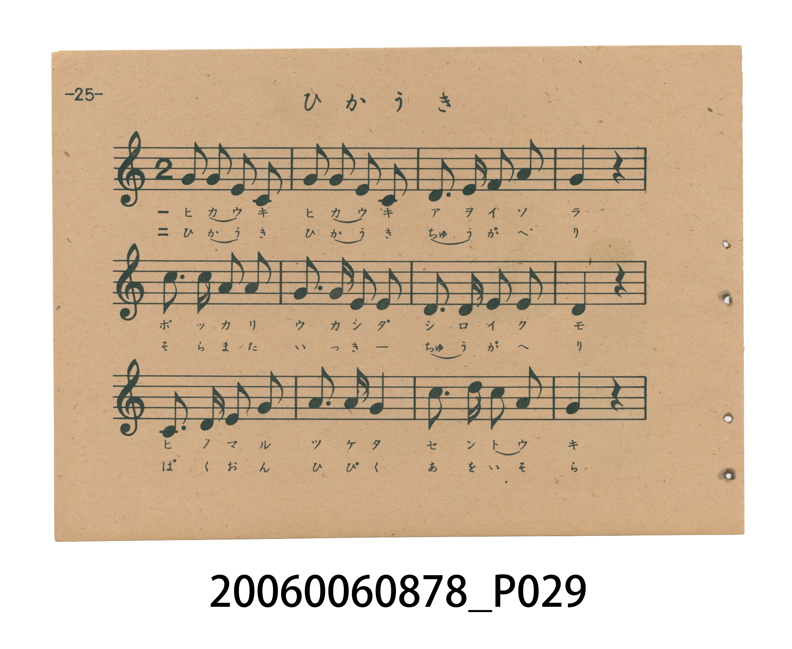
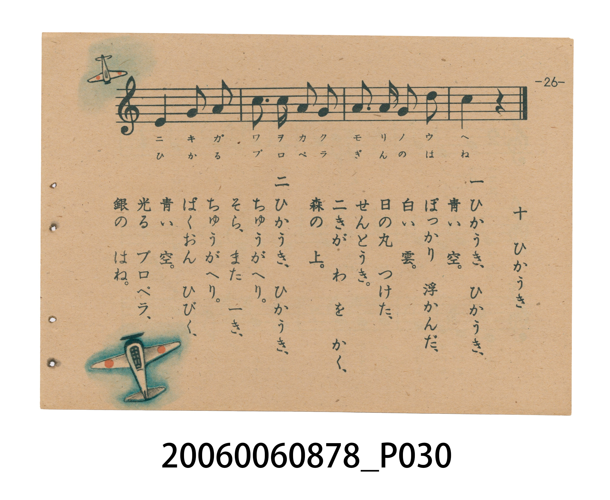

# ひかうき（飛機）

> Re:Shoka 使用 AI 協助辨識與重建樂譜，可能會有錯誤。歡迎回報。

<audio controls src="hikoki.mp3"></audio>

- 日治時期國民學校唱歌（うたのほん 下・第十課）
- 國立臺灣歷史博物館典藏

## 說明

【曲目說明】
・出處：臺灣總督府編《うたのほん 下》（國民學校初等科第二學年用），第十課〈ひかうき〉（飛機），原書第 25–26 頁。
・調性與拍號：C 大調（?= C，無升降記號），2/4 拍，速度 != 112。
・背景與曲風：第一節描寫晴朗藍天與白雲間，漆有日之丸標誌的兩架戰鬥機在森林上空盤旋畫圈；第二節描寫飛機在空中接連翻筋斗（宙返り）、爆音迴盪天際、螺旋槳與銀翼閃耀的景象。
・版本說明：本檔案為原書單聲部五線譜旋律之忠實數位化版本。

・編曲說明（鋼琴伴奏版）：
1. 前奏 (Intro, 4 小節)：擷取主旋律核心樂句作為導奏，建立調性與拍感。
2. 主歌伴奏 (Hikoki)：右手 (PianoRH) 演奏原書歌唱主旋律；左手 (PianoLH)
依國民學校低學年教材純樸明朗之風格配以和聲伴奏。

## 跨冊／重複收錄參照

> 同名異曲（各冊收錄之不同詞曲版本）

- **[同名異曲]** 《新定兒童唱歌》尋常科第一學年用（2020.006.0847.0001）：[**〈ヒカウキ〉**](../../../shintei_jido_shoka/grade_1_2020.006.0847.0001/3_04_hikoki/index.md)（`F` / `2/4` — [原始 TMD](../../../shintei_jido_shoka/grade_1_2020.006.0847.0001/3_04_hikoki/hikoki.tmd)）
- **[同名異曲]** 《新定兒童唱歌》尋常科第五學年用（2020.006.0847.0005）：[**〈飛行機〉**](../../../shintei_jido_shoka/grade_5_2020.006.0847.0005/2_04_hikoki/index.md)（`G` / `2/4` — [原始 TMD](../../../shintei_jido_shoka/grade_5_2020.006.0847.0005/2_04_hikoki/hikoki.tmd)）
- 總表：[跨冊重複與同名歌曲總索引](../../../duplicate_songs.md)

## 歌詞

```text
一　ひかうき、ひかうき、
青い　空。
ぽっかり　浮かんだ、
白い　雲。
日の丸　つけた、
せんとうき。
二きが　わを　かく、
森の　上。

二　ひかうき、ひかうき、
ちゅうがへり。
そら、また　一き、
ちゅうがへり。
ばくおん　ひびく、
青い　空。
光る　プロペラ、
銀の　はね。
```

## ABC

```abc
X:1
T:ひかうき（飛機）
M:2/4
L:1/16
Q:1/4=112
K:C
V:V1 name="Piano" snm="Pia"
[V:V1]
G2 G2 E2 C2 | G2 G2 E2 C2 | D3 E F2 A2 | G4 z4 |
c3 c A2 A2 | G3 G E2 E2 | D3 D E2 E2 | D4 z4 |
C3 D F2 G2 | A3 A G4 | c3 d c2 A2 | G4 z4 |
E4 G2 A2 | c3 c A2 G2 | A3 A G2 d2 | c4 z4 |
```

## TMD 檔案連結

- [主旋律 TMD 檔案](hikoki.tmd) [[在 TMD Studio 編輯](https://tmdlang.github.io/Tmd-TS/#tmd=s7IKdvYPcrWy4tLSUnjcuOlxY_fjxrbHjb3v93S8XDz72cr57_d0KmhpcSnaKhgaGnHZ2yo4c9kY6ZvYcdUpKD2bvvTZpt3PZjY9mzP_6ZzuZxsmPl2749mChU-nbHy2tgdoBNis-Y8b1z1u3P24abLCkx3dj5t3P1-z5mlv44tVm4BmK4HMAep9vrr7Rfuu542Ln63d_rR_09PeWc87V75csuJp644X0_uVuLj0tRRsqQW4FBQUHjdMeDZ70_PZ616sWvVsRt_jholg0ebdT9t3vZg59f2eWRD3PN-x9_ncxU93zXm-fcXjhi5sPmroBnoVxf8dc5-v7Xy-fCLQp0929QAFn-7c8nzKCqB_3-_pgXv_cQMwgBBB_rgBKIsIdaDKp33zn83eAVSvYGT6qGGykZnCywWNjxuaoC59sWr_s4blLzran3X3vpgJ1DPLWeHpkuVAYaA5oJgCWday8Glv-8uZvS9WzACrAZkLjD8FoB4g62XD_Ke7lilAYhfJ5OaeZzPXg0yevenlIqC7Z4F8sqPh-fqGZ_39T9evfjZzy7M5019M7326ZCVQ2fOZe18CVU6bDDTy2Z62Z3M6gUnjyc7uJzt2PFsx88WqnuezWp62rnw2b9uzjg0v1ywF-vDpnBXPFq97Nm_6kx1dz1fuej57ybPp3c-nrn46p-P9ntmQgINbBwkUoBagyic71j7rW_qyYfHz_bufr-1-Nm06KPTXzXyxf8rjpi6gBx83ND7vaHs5f_OL_Vuez14FdOHLWbOBgi_m7QJa8Wz5ZqCDX3Y1PN-_5-W05hcNDUC3gTy7cSHC_887O57NWQNJGUDPA9nPVk15trDjedMuSJw8nbbuReOml80rnuya8nz7rBdr5wCNfrqvG-jnp_sXPF2_7NnUHU_29j7tmQYxCmQ0NNVBDADmjxcr5z1tXfFsWjvQPSBPARmr5r1Yux6YFIE-Qot1oMizvmZgaAAdohBgYGQJlAkwMDYAR2gn2Gxg_DxuaEBNUY1oXJC6l3MnPW5sASoFBibMy417HzcuBils6gJKPNsKTN5A9uTHjQugmoAxDNEEjGeoJmAUA_MBMIrBti553DgRlDMgyh83zgZrXwGzGawDGKUgTmMPSEdT_-OmSWCtQOf1Q_UBkwQobzU0AFMFVBPQ55BwAUYEJB0A1cJySc-LKbOAqRCUvJashPjnxZ6pLxe3ABHQFy8mTgfF7t4pkAT6bM5WoAJgAgWa_nTJqpcz9z6bPh2eQOFJE6gGkljhyQ5XSgWqhIc-0G_EhP7jxoWPm1rBQsDA2AEOcGgczH3cBEq8jxv3gQMSGAZA84jQtwEUfo1doACHumAzIkSxxPbT1s7HTcBiq-Fx8_THzWsfN8963LwSprwLaAIoAh43rn_cuJaoOIDnS3iOBGp7Pqf76cQGkGw_MAN0Av0CDFCsKl_snf9y8xZQdpq__-m-nZgxCsymQPR85h6gw4HiaPn4RecmoDOAuRkaGUDnUl5DQIGClj4Xl0dmdn52plVAZmJevkONQY1CNcgOBRtDMy07MAtYNQG9ZwUsOCaB4qNpNZhcBibXAskafDJNi8BFziYgawkQ7wWrXgkyFgGAroDZs6sHaE_jJnC8d4PJNjDZCzENjwwo-YAFgQkIiHeALe_CalGNgqmCLhgbA7EhEGMTMQKSIL4JkDSDqwFBAyhdA84ZSOEzF-zXZnBIPG5eBXYCJDRA_M1A3AAW2w5WtxYaJuvBYQIKJ3xhAja7qRPI2gfE88F-bgGHwGJwKDxu3kN6OBjGgT0CpEA-RPalKTgkQBgWEkYYInhCApwemvuAeB4Qrwb7EOzapo1AvB_iDJDLdoMVgoKmAxxYIDFQ0sEXFBvA3u4H4i6g6slICQNoDlAcZnhjE9jGSeCQAoUgyPBOXEEB9SQoukFBUAMODlCgwKIdHlxGcRAWkakClFrBDgFF-BpwUKwH-xqUKYAJAykBgBINONggIdE8g0BIgHwN9ng3UEs3WMt0sDFAq5pngXMaKBz6wNZPBrLWATHYukbsgVwDjmBIAoB5EDWRYIYNMDiQlCEHRC0Xl66dAqSAAbGUubgA)]
- [鋼琴伴奏 TMD 檔案](hikoki_piano.tmd) [[在 TMD Studio 編輯](https://tmdlang.github.io/Tmd-TS/#tmd=s7IKdvYPcrWy4tLSUnjcuOlxY_fjxrbHjb3v93S8XDz72cr57_d0gtjde55P2PJkz5anS_ufd3YABRW0tLgUbRUMDY247G0VnLlsjPRN7LjqFJSeTV_6bNPuZzObns2Z_3RO97MNE5-u3fFswcKnUzY-W9sDNAtswfzHjeseN-5-3DRZ4cmO7sfNu5-vWfO0t_HFqk1As5VA5gD1Pl_d_aJ91_PGxc_Wbn_av-lp76znnStfLlnxtHXHi-n9Slxc-loKttQCXAoKCo8bJjybven57HUvVq16NqPvccNEsGjz7qftu17MnPp-zyyIe57v2Pt87uKnu-Y8377icUMXNh81dAO9iuL_jrnP13Y-Xz4R6NMnu3qAgk93bnk-ZQU4gHvg3n_cAAwgRDw8bgAHPyIqep72zX82ewdQvYKR6aOGyUZmCi8XND5uaIK69MWq_c8alr_oaH_W3ftiJlDPLGeFp0uWA4WB5oBiCmRZy8Knve0vZ_a-WDEDrAZkLjD-FIB6gKyXDfOf7lqmAIldJJObe57NXA8yefaml4uA7p4F8smOhufrG5719z9dv_rZzC3P5kx_Mb336ZKVQGXPZ-59CVQ5bTLQyGd72p7N6QQmjSc7u5_s2PFsxcwXq3qez2p52rry2bxtzzo2vFyzFOjDp3NWPFu87tm86U92dD1fuev57CXPpnc_n7r66RxgkpsNCTi4dZBAAWoBqnyyY-2zvqUvGxY_37_7-druZ9Omg0J_3cwX-6c8buoCevBxQ-PzjraX8ze_2L_l-exVQBe-nDUbKPhi3i6gFc-WbwY6-GVXw_P9e15Oa37R0AB0G8izGxci_A-Ma6DPISkDa5YAhghIqYKCoZ7C085eoLiChmdeSVG-joKJwtMN_UCXawLVPJsMTMzTnuzYDbT46b7uZwt2PN3f_GxF09P-pU_2znnetOvphj6gXlBU794FygJIMfqsZT7UQQoKRnrAhLYbmKcgblDQ8MjMzs_OBFnxtH_zs85uBY2AzMS8_CAPTYVne6YAlUCSDlAHMC_C7QcG7NPtyxDKfTw0IeYDwZN9c5GT8JO9fZBk-2zqzGdzJzzfMuXZih3A0ADGOjBegWni2YI9L1t7n-xe-nRSz4vGTRCHgRwMzVxwB7xYOe9p64pn09qB3gLFHZCxat6LteuBOQ4YtGiJGyjyrK8ZGOnPVk1RCDAwsgTKBBgYG4CDvBNsNjAZPm5oQM04jWhckLqXcyc9bmwBKgWmGVjMNu593LgYpLCpCyjxbCswFwPZkx83LoBqAiZkiCZgcoZqAqZkYHYHpmSwrUseN04EFQAQ5Y8bZ4O1r4DZDNYBTLkgTmMPSEdT_-OmSWCtQOcBAwisD5jyQUVIQwMw8UM1AX0OCRdgnEKSO1AtrDDoeTFlFjCzgXLRkpUQ_7zYM_Xl4hYgAvrixcTpoES8dwokHz6bsxWoAJgPgaY_XbLq5cy9z6ZPh-dDeA4EqoHkSXjuwpUhgSrhoQ_0GzGh_7hx4eOmVrAQMDB2gAMcGgdzHzeB8ujjxn3ggASGAdA8IvRtAIVfYxcowKEu2IwIUSyx_bS183ETsHRueNw8_XHz2sfNsx43r4Qp7wKaAIqAx43rHzeuJSoO4MUPvOABans-p_vpxAaQbH8HsNgD-gUYoFhVvtg7_-XmLcCs8nL-_qf7dmLGKLA0AqLnM_cAHQ4URyuuXnRuAjoDWGhBIwPoXMorQihQ0NLn4gIXX1bQYsShxqBGoRpcONgYmmnZgVk1wLJNFwxNgdgMiGsUDOPAAkAKxAeJ14BZIHkQzwgkD1emq2AApWu4alGs9EGx0gRhY7xCtEksyAQgwxDEAImYIouATIKUh3hdD2xAAGPHCli8TwIlp6bVYHIZmFwLtguPTNMicMWwCchaAsR7wapXwspOCAAGIsyeXT1Aexo3gZNtN5hsA5O9ENPwyIBSP1gQmP6BeAfY8i6sFtWAAxiEjUExAA5nTBEjcHAbg6MOEmUgedSoQAufuWC_NoND4nHzKrATIKEB4m8G4gaw2HawurXQMFkPDhNQOOELE7DZTZ1A1j4gng_2cws4BBaDQ-Fx8x7SwwE1ESL70hQcEiAMCwkjDBE8IQFOD819QDwPiFeDfQh2bdNGIN4PcQbIZbvBCkFB0wEOLJAYKOngC4oNYG_3A3EXUPVkpIQBNAcoDjO8sQls4yRwSIFCEGR4J66ggHoSFN2YuRHsSVhwAbMmmEVkqgClVrBDQBG-BhwU68G-BmUKYMJASgCgRAMONkhINM8gEBIgX4M93g3U0g3WMh1sDNCq5lngnAYKhz6w9ZOBrHVADLauEXsg14AjmIolFXL5gquoApVH8KIKzMAovLAVauCyDC5iBGQY5WJRCmLAyz-ChmKUlAYQf-jaKYALXQUgA-InVJYyFxcA)]

## 分析

```text
================================================================================
📊 TMD Song Profile: [ ひかうき（飛機） ]
================================================================================
⏱  Duration:       0:17 (17.1s), 16 measures total
🎼 Key & Tempo:    首調基準 C, != 112.0 BPM, <2/4>
   - 分析範圍：      由實際發聲的音符與和弦推測調性；播放脈絡另行呈現
🎤 人聲音域:    C4 (MIDI 60) – D5 (MIDI 74) [跨度: 14 個半音 / 1.2 個八度, 難度: moderate]
   - 最低音:  C4 in [Hikoki #1 @ m.1, 0:00]
   - 最高音: D5 in [Hikoki #1 @ m.11, 0:11]
   - 適合: soprano, mezzo-soprano, contralto, tenor, baritone, bass
🏛  結構:      Hikoki (17.1s)
⚡ 編曲密度:        Peak 1 軌道同時演奏
🗝  調性診斷：       C 大調（純淨自然大調，未偵測到可信轉調）
   - 風格氣質:    純淨自然大調（陽光明朗、易唱易記，無明顯調外色彩）
   - 轉調歷程:    全曲維持單一推測調性（未偵測到可信轉調）
   - 核心骨幹音:  G, C, A, E, D
   - 調性數值:    C 大調 [相關度: 0.86, 穩定度: Moderate, 自然音純度: 100.0%]
   - 候選調性 (K-S): C 大調 (0.86), G 大調 (0.77), A 小調 (0.63)
   - 五度圈歷程:   +0
   - 各段落調性細節:
     • [Hikoki #1]: C 大調 (r: 0.86, 自然音純度: 100.0%)

  [ 五度圈游移軌跡 ]
              [C ]*
         F            G  
      Bb               D  
      Eb               A  
         Ab           E  
            Db       B  
               F# 
     (* = active key center)

  [ 十二半音累積音高分佈 ]
     C  : ██████████████████        21.4%
     C# :                            0.0%
     D  : ███████████               13.4%
     D# :                            0.0%
     E  : █████████████             15.2%
     F  : ███                        3.6%
     F# :                            0.0%
     G  : ████████████████████████  28.6%
     G# :                            0.0%
     A  : ███████████████           17.9%
     A# :                            0.0%
     B  :                            0.0%
--------------------------------------------------------------------------------
Assignment 軌道音域：
  - Piano         : C4 – D5 (14 個半音 / 1.2 個八度, 50 個音符)
================================================================================
```


## 原書掃描頁






