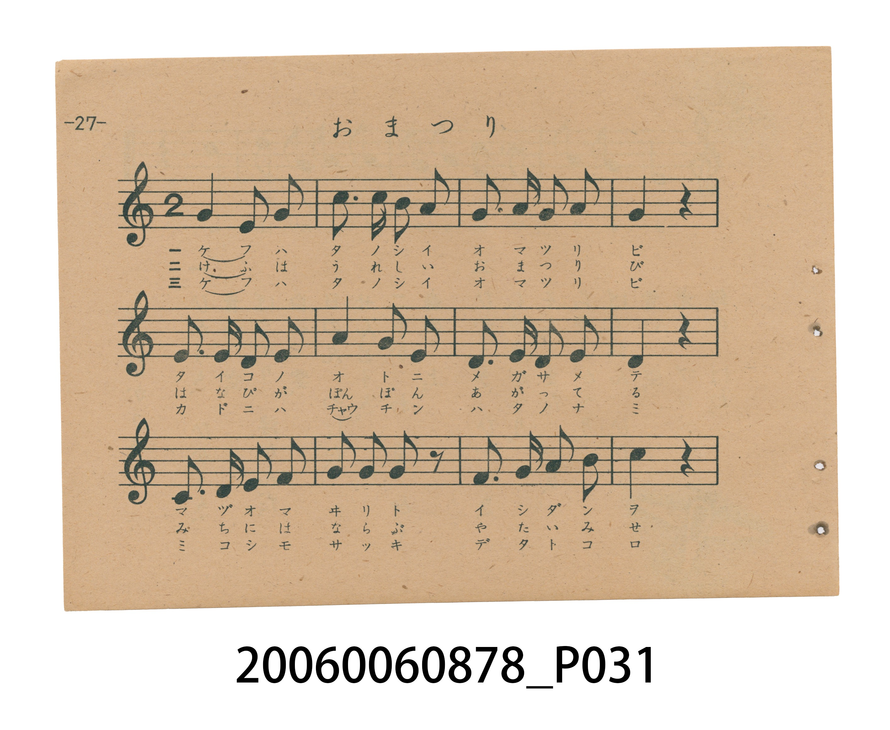
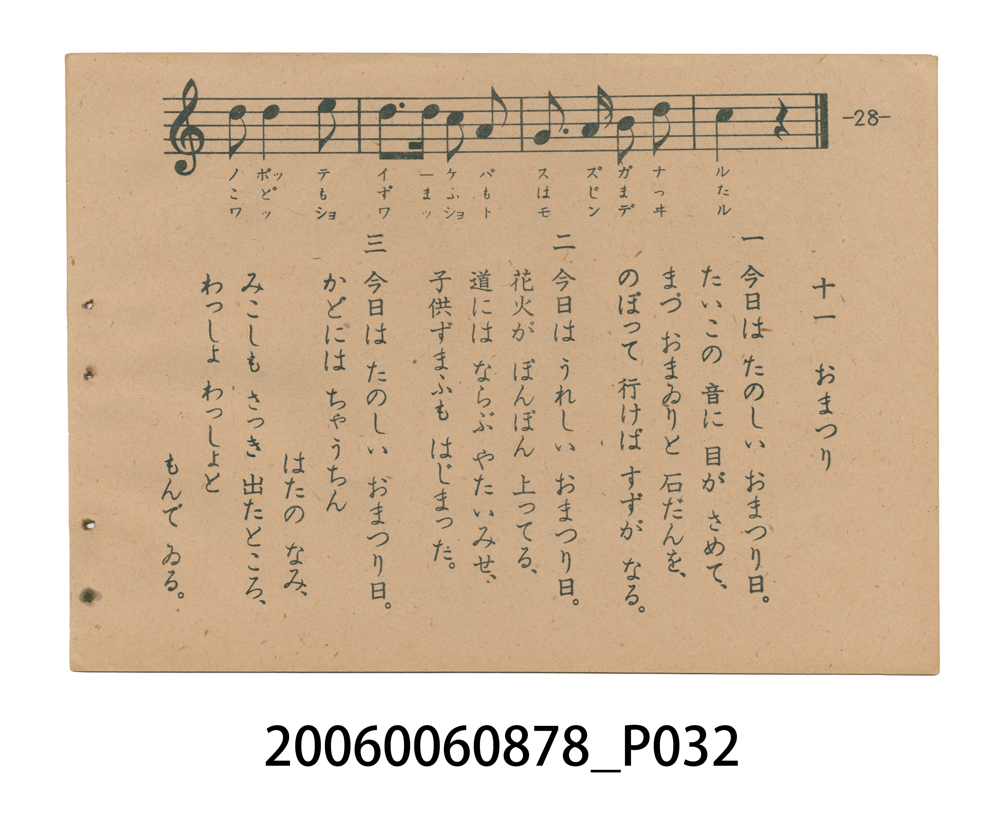

# おまつり（祭典）

<audio controls src="omatsuri.mp3"></audio>

- 日治時期國民學校唱歌（うたのほん 下・第十一課）
- 國立臺灣歷史博物館典藏

## 說明

【曲目說明】
・出處：臺灣總督府編《うたのほん 下》（國民學校初等科第二學年用），第十一課〈おまつり〉（祭典），原書第 27–28 頁。
・調性與拍號：ハ調（C 大調，主音為 C，並於第 2、11、15 小節使用導音 Si＝`7`），2/4 拍，速度 != 112。
・背景與曲風：描寫秋日豐收祭典中神社林間太鼓咚咚響起、幡旗隨晨風飄揚的熱鬧景象；原書第 28 頁配有大鳥居與紅白祭典幡旗高聳於林間的插圖。
・版本說明：本檔案為原書單聲部五線譜旋律之忠實數位化版本。

・編曲說明（鋼琴伴奏版）：
1. 前奏 (Intro, 4 小節)：擷取主旋律核心樂句作為導奏，建立調性與拍感。
2. 主歌伴奏 (Omatsuri)：右手 (PianoRH) 演奏原書歌唱主旋律；左手 (PianoLH)
依國民學校低學年教材純樸明朗之風格配以和聲伴奏。

## 歌詞

```text
一　もりの　太こが　どんと　なりゃ、
おこめも　せんども　うれしさう。
ことしは　ゆたかな　秋まつり、
どんどん　なる　なる、お太こが。

二　宮の　のぼりが　はたはたと、
はれた　朝風　吹きわたり、
うぶすなざまの　おまつりに、
どんどん　なる　なる、お太こが。
```

## ABC

```abc
X:1
T:おまつり（祭典）
M:2/4
L:1/16
Q:1/4=112
K:C
V:V1 name="Piano" snm="Pia"
[V:V1]
G4 A2 G2 | c3 c B2 c2 | G2 A2 G2 A2 | G4 z4 |
E2 E2 D2 E2 | A4 G2 E2 | D2 E2 G2 E2 | D4 z4 |
C2 D2 E2 D2 | G2 G2 G2 z2 | E2 G2 A2 B2 | c4 z4 |
d2 d4 e2 | d3 d c2 A2 | G3 A B2 d2 | c4 z4 |
```

## TMD 檔案連結

- [主旋律 TMD 檔案](omatsuri.tmd) [[在 TMD Studio 編輯](https://tmdlang.github.io/Tmd-TS/#tmd=s7IKdvYPcrWy4tLSUnjc2PW4cd_jxiWPm7re7-l4vnTt09Yd7_d0KmhpcSnaKhgaGnHZ2yo4c9kY6ZvYcdUpKD2bvvTZpt3PZjY9mzP_6ZzuZxsmPl2749mChU-nbHy2tgdoxOPGtseN8x83rnvcuPtx02SFJzu6Hzfvfr5mzdPexic7Gl6s2gQ0XglkFFD789XdL9p3PW9c_Gzt9qf9m572znreufLlkhVAR7yY3q_ExaWvpWBLLcCloKDwuGHCs9mbns9e92LVqmcz-h43TASLNu9-2r7rxcyp7_fMgrjn-Y69z-cufrprzvPtKx43AMMI01MN3UDfogRBx9znazufL58I9OyTXT1Awac7tzyfsgLo3_d7epBD4HEDMJgQAf-4AagAEfZAxU_75j-bvQOoRcHI_FHDZCMLhZcLGh83NEEd-2LV_mcNy190tD_r7n0xcz7Q1Y-b-4GCQFOcFZ4uWQ5m9jzZsfvl_M3Pm3YpOIN5y55N2wM28nFDo6EhiDBVeLqh__n6hid79wPd-XRDH1C9QnDm-z1zE8wTIC4BxrsC0BYg62XD_Ke7lilAUgWSW5p7ns1cD3LL7E0vFwE9O-tZf__T9aufL-8GppUXGyc8m7IN4rUnO9Y-Xzrv-ZJ9z-ZNfzlt8tMlq17umfx00iwgejl__4ut24FOerpz4bPp01_OWvFs5gqgaS8Xtzzrn_V8Vsvzto0v1ywHWbRx4fs9s5HCBxw0L1t7n83pBPr85ealTze2Al3zfEvr85l7IRZDDV0940XjZmAYQKwHGvqsf9LTOdMQXnne2fFszhpIygD5Y86aZ6umPFvYAQxCiIVPp6170bjpZfOKJ7umPN8-68XaOc-mdz_d1_1kZ_fT_Querl_2bOqOJ3t7n_ZMgxgFMhqa6iAGALPIi5XznraueDatHehIYIiAGKvmvVi7HpgUQYkANcqBIs_6moEBCnSIQoCBsSFQBkgZgeOmE2w2MEU9bmh43NQESkjABNrQAAzYx42THzf2gMQbVwLT6-NGYCIGsleB1DQ1A8MZ7CpQEpz8uKkRpBkkPRusFKgBwm173NTzuHH648apIDY0lEAGrwCLAl0MtBaSL7pBZjc0AOMcKVFDLYE4AExC3QDMO3BGI9AVSA4GWwL0NSRMQJGweB0wvl4sXgiML0SKmbMBkmJA-WrF7ucbN4NifMoGoLIne-cAi5AnO-e_XLj-6b7pz9YufDptzvOWhc_WTwGa_mR3FzBPPpsBTEbgdAlMWOBkCst7PZDkCDV_4nSg-yAMkNSS5VAHTASGeBM8_HeBwvnpOmDRAAp8cBmxBxwXkPBfDw4gCAmMBWigrAeH7Xygimdz5gITOsiICTsfN_Y-buoHiSOFHzCEtz1unAkKsMZp4OCF2INUfjSuplJoQ_InKKjBWebp1FVPpy6DksAwAedGYFA8m7nl2ZzpoBwEzqVAlz_rbnrR0POyEZhvep7OWfF0XceLtduBpj1umPJ8yqKnc-aD2VNBAQ4tC4DVDYmhDXQr5ZUAFCho6XNx-ecmlhSXFmVaBWQm5uU71BjUKFSDbFGwsdCyAzOA1Q8wf1kpALMEEHcBw3cdULQGWMauAmUFIO4B84EhDpQH8VcA8SqQCDingcwAWQUza1cP0KzG_UDZFrhZIBqYZKDm94BF1gPxfDgNElkBNgpuWI2CqYKughmQrFHQMIxT0NVVMIzTVNXQ1dVUMAcywQpA0mZQpQZAXANOsAhPNYIsBDq6qRHsQZA1s6HeAHkHItIGZPUA6elAPBUqguIUhL-ArgUrnQ_1FzDMgFqApQMQzwGLbAXiXqCqfpi_gH5G85cxEBoBcQ3Q6bpAp4NYID6MhcMrsLAHOXM92GSgw8FhCLIdHCNg9wBtb9wHxEuw2Y7wCkjzNiCeCdc8DaoRFmmgsIMYBDIGJLIa3SuGYIcbgWMABA3A3gPFiTlIFhhr2P0CS0sQGmQ0MLU1QfwBoiHWw9IgxDmgdIjVJ1QwDBjscSCkq2AMSlgaIKYuUACa3oAeAaUyDWAyAyZJeCIEqkLxZC0Xl66dAizPgdjKXAA)]
- [鋼琴伴奏 TMD 檔案](omatsuri_piano.tmd) [[在 TMD Studio 編輯](https://tmdlang.github.io/Tmd-TS/#tmd=s7IKdvYPcrWy4tLSUnjc2PW4cd_jxiWPm7re7-l4vnTt09Yd7_d0Atkvu_c8n7DlyZ4tT5f2P-_sAAoqaGlxKdoqGBoacdnbKjhz2Rjpm9hx1SkoPZu-9Nmm3c9mNj2bM__pnO5nGyY-Xbvj2YKFT6dsfLa2B2jW48a2x43zHzeue9y4-3HTZIUnO7ofN-9-vmbN097GJzsaXqzaBDReCWQUUPvz1d0v2nc9b1z8bO32p_2bnvbOet658uWSFUCXvZjer8TFpa-lYEstwKWgoPC4YcKz2Zuez173YtWqZzP6HjdMBIs2737avuvFzKnv98yCuOf5jr3P5y5-umvO8-0rHjcAAw7TUw3dQN-iBEHH3OdrO58vnwj07JNdPUDBpzu3PJ-yAhzGPcgh8LgBGEyI2HjcAIoEpAjpedo3_9nsHUAtCkbmjxomG1kovFzQ-LihCerYF6v2P2tY_qKj_Vl374uZ84GuftzcDxQEmuKs8HTJcjCz58mO3S_nb37etEvBGcxb9mzaHrCRjxsaDQ1BhKnC0w39z9c3PNm7H-jOpxv6gOoVgjPf75mbYJ4AcQkw3hWAtgBZLxvmP921TAGSKpDc0tzzbOZ6kFtmb3q5COjZWc_6-5-uX_18eTcwrbzYOOHZlG0Qrz3Zsfb50nnPl-x7Nm_6y2mTny5Z9XLP5KeTZgHRy_n7X2zdDnTS050Ln02f_nLWimczVwBNe7m45Vn_rOezWp63bXy5ZjnIoo0L3--ZjRQ-4KB52dr7bE4n0OcvNy99urEV6JrnW1qfz9wLsRhq6OoZLxo3A8MAYj3Q0Gf9k57OmYbwCjCugZ6ApAysuQLoOZBSBQVDPYWnnb1AcQUNz7ySonwdBRNoUGqCAmAyMDFPAwb_s-ndT_d1P1uw4-n-5mcrmp72L32ydw4wQoAhDdQLiufdu0BZACk6n7XMhzpIQcFID5jQdgOzFcQNChr-uYklxaVFmSBLnvZvftbZraARkJmYlx_koanwbM8UoCJIyAD1ADMk3AWgENu-DKHcx0MTYgMQPNk3FzkRP9nbB0m4z6bOfDZ3wvMtU56t2AEMj2dzpj_Z2Q2MkmcL9gBD-8nupU8n9bxo3ARxGsjJ0OwFd8CLlfOetq54Nq0d6DFg1IMYq-a9WLsemOdAqR01bQNFnvU1A1POs1VTFAIMjA2BMkDKCBzonWCzgVnncUPD46YmUI4B5sSGBmAKetw4-XFjD0i8cSUwYz5uBOZWIHsVSE1TMzBBgV0FymuTHzc1gjSDpGeDlQI1QLhtj5t6HjdOf9w4FcSGJgeQwSvAokAXA62FFADdILMbGoCJGyn3Qi2BOABMQt0ALCTgjEagK5AcDLYE6GtImIASzeJ1wIT5YvFCYMJEZI05GyBZA1SArNj9fONmUNKesgGoDJSSOlc-2Tn_5cL1T_dNf7Z24dNpc563LHy2fgrQ9Ce7u0BxOAOYX8AZEJiDwPkRVsj0QPId1PyJ04HugzBAUkuWQx0wERjiTfDw3wUK56frgGUgKPDBheEecFxAwn89OIAgJDAWoIGyHhy2wDTd8GzOXGDyARkxYefjxt7HTf0gcaTwA4bwtseNM0EB1jgNHLwQe5AKysbVVAptSEEECmpw2fB06qqnU5dBSWCYgIsdYFA8m7kFmPBBRQW4OAK6_Fl304uGnpeNwAKi5-mcFU_XdbxYux1o2uOGKc-nLHo6Zz6YPRUU4NBCD1jZkhjaQLdSXttBgYKWPhcXuIyygpYUDjUGNQrV4PxvY6FlB2bUKBjFgZCugnEckKMBYuoCBTRVNXR1NRUM4xTMQMKmIFEzqKA5SEMNSE5XwQCIa7hqUWzyQbHJBG6TabxCtGkslGGWC2OBhQyBDEMgA2QUrLDD525g8wBYLFgpAHMyEHcBk8U6sB3AEAXlYCDuAfOBCQUoD-KvAOJVIBFwAQEuAYEhBDNrVw_QrMb9QNkWuFkgGpjSoeb3gEXWA_F8OA0SWQEtTqGGAf0EDBIzIAkMNlAQ6QIDCh5wQAGQApA0KFxBSiEhiOqpRpCFQEc3NYI9CLJmNtQbIO9ARNqArB4gPR2Ip0JFUJyC8BfQtWCl86H-AoYZUAuwUAPiOWCRrUDcC1TVD_MX0M9o_jIGQiMgrgE6XRfodBALxIexcHgFFvYgZ64Hmwx0ODgMQbaDYwTsHqDtjfuAeAk22xFeAWneBsQz4ZqnQTXCIg0UdhCDQMaARFaje8UQ7HAjcAyAoAHYe6A4MUdN2Gh-gaUlCA0yGpjamiD-ANEQ62FpEOIcUDrE6hMqGEa13Iua5XBlYFgmRWWYIGdkdJUmMAZIAZyBphKlBMAUIa74AMYhyCe6dgrgokgByID5Cp2tzAUA)]

## 分析

```text
================================================================================
📊 TMD Song Profile: [ おまつり（祭典） ]
================================================================================
⏱  Duration:       0:17 (17.1s), 16 measures total
🎼 Key & Tempo:    首調基準 C, != 112.0 BPM, <2/4>
   - 分析範圍：      由實際發聲的音符與和弦推測調性；播放脈絡另行呈現
🎤 人聲音域:    C4 (MIDI 60) – E5 (MIDI 76) [跨度: 16 個半音 / 1.3 個八度, 難度: moderate]
   - 最低音:  C4 in [Omatsuri #1 @ m.9, 0:08]
   - 最高音: E5 in [Omatsuri #1 @ m.13, 0:13]
   - 適合: soprano, mezzo-soprano, contralto, tenor, baritone, bass
🏛  結構:      Omatsuri (17.1s)
⚡ 編曲密度:        Peak 1 軌道同時演奏
🗝  調性診斷：       G 大調（純淨自然大調，未偵測到可信轉調）
   - 風格氣質:    純淨自然大調（陽光明朗、易唱易記，無明顯調外色彩）
   - 轉調歷程:    全曲維持單一推測調性（未偵測到可信轉調）
   - 核心骨幹音:  G, D, C, E, A
   - 調性數值:    G 大調 [相關度: 0.90, 穩定度: High, 自然音純度: 100.0%]
   - 候選調性 (K-S): G 大調 (0.90), C 大調 (0.73), E 小調 (0.66)
   - 五度圈歷程:   +1
   - 各段落調性細節:
     • [Omatsuri #1]: G 大調 (r: 0.90, 自然音純度: 100.0%)

  [ 五度圈游移軌跡 ]
               C  
         F           [G ]*
      Bb               D  
      Eb               A  
         Ab           E  
            Db       B  
               F# 
     (* = active key center)

  [ 十二半音累積音高分佈 ]
     C  : ███████████████           16.4%
     C# :                            0.0%
     D  : ████████████████████      21.8%
     D# :                            0.0%
     E  : ███████████████           16.4%
     F  :                            0.0%
     F# :                            0.0%
     G  : ████████████████████████  26.4%
     G# :                            0.0%
     A  : ████████████              13.6%
     A# :                            0.0%
     B  : █████                      5.5%
--------------------------------------------------------------------------------
Assignment 軌道音域：
  - Piano         : C4 – E5 (16 個半音 / 1.3 個八度, 48 個音符)
================================================================================
```


## 原書掃描頁






