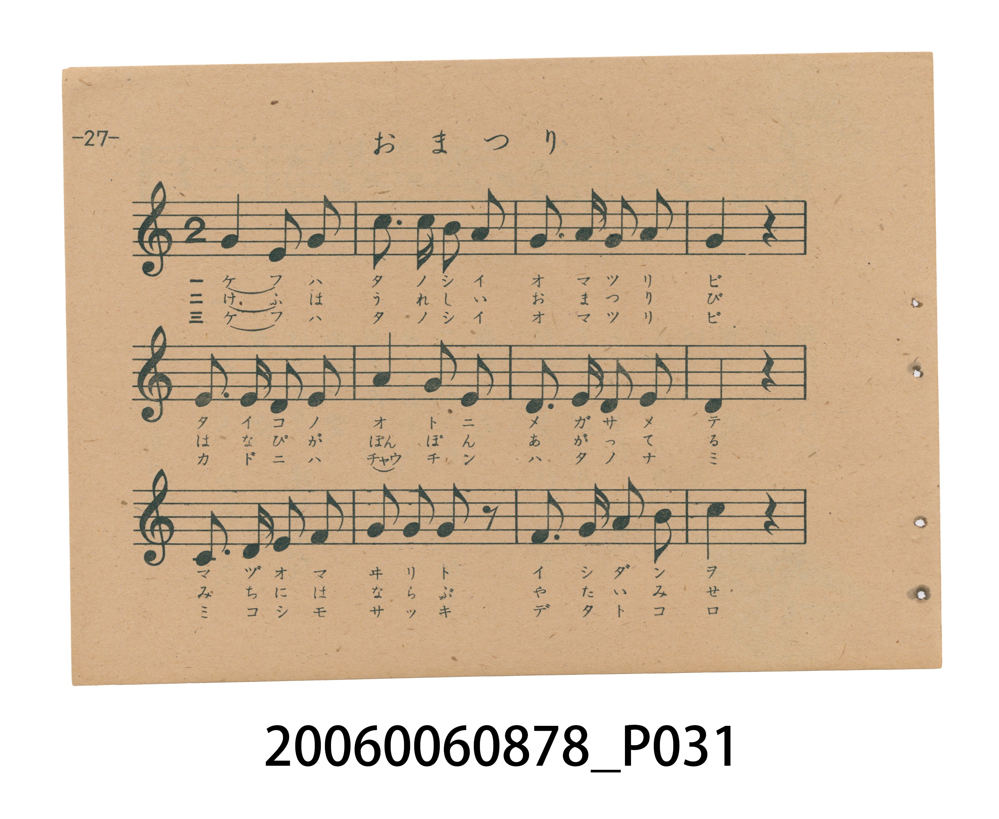
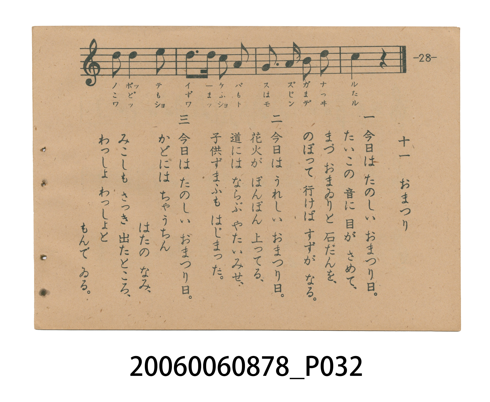

# おまつり（祭典）

> Re:Shōka 使用 AI 協助辨識與重建樂譜，可能會有錯誤。歡迎回報。

- **鋼琴伴奏版**：<br><audio controls src="omatsuri.mp3"></audio>
- **NEUTRINO 歌聲合成版**：<br><audio controls src="omatsuri_neutrino.mp3"></audio>

- 日治時期國民學校唱歌（うたのほん 下・第十一課）
- 國立臺灣歷史博物館典藏

## 說明


- 出處：臺灣總督府編《うたのほん 下》（國民學校初等科第二學年用），第十一課〈おまつり〉（祭典），原書第 27–28 頁。
- 調性與拍號：C 大調（?= C，無升降記號），2/4 拍，速度 != 112。
- 背景與曲風：共三節歌詞，第一節描寫祭典日清晨被太鼓聲喚醒、踏上石階參拜搖響神社鈴鐺；第二節描寫煙火升空、屋台攤販林立與兒童相撲開賽的喜慶；第三節描寫街角燈籠旗海與神轎「わっしょ わっしょ」熱鬧巡行的景象。
- 版本說明：本檔案為原書單聲部五線譜旋律之忠實數位化版本。

### 編曲說明（鋼琴伴奏版）：

1. 前奏 (Intro, 4 小節)：擷取主旋律核心樂句作為導奏，建立調性與拍感。
2. 主歌伴奏 (Omatsuri)：右手 (PianoRH) 演奏原書歌唱主旋律；左手 (PianoLH)
依國民學校低學年教材純樸明朗之風格配以和聲伴奏。


## 歌詞

```text
一　今日は　たのしい　おまつり日。
たいこの　音に　目が　さめて、
まづ　おまゐりと　石だんを、
のぼって　行けば　すずが　なる。

二　今日は　うれしい　おまつり日。
花火が　ぽんぽん　上ってる、
道には　ならぶ　やたいみせ、
子供ずまふも　はじまった。

三　今日は　たのしい　おまつり日。
かどには　ちゃうちん　はたの　なみ、
みこしも　さっき　出たところ、
わっしょ　わっしょと　もんで　ゐる。
```

## ABC

<div class="abc-score" data-abc-src="omatsuri.abc" aria-label="五線譜載入中"></div>

[下載 ABC 原始檔](omatsuri.abc)

## TMD 檔案連結

- [主旋律 TMD 檔案](omatsuri.tmd) [[在 TMD Studio 編輯](https://tmdlang.github.io/Tmd-TS/#tmd=s7IKdvYPcrWy4qpTUCpJTLdSyC_KTM_MsypJzCxPzIvPT0vLTM5MzFGCyyfn5-SkJpdk5udZlZYk5uVn5OchJMvyc0pzU62MECLF-aVFyalwpfHpqehy8QWJ6alWAQbGhrpAAklrQVF-WWpeYh5QO9Q16UCBorz8IqApealFyK5KLctMSQWpLCjKzE0sqoxPyU8GuiSvBMltqUXFIFeX5Scj68wvKsnITy9KLMiotMrILC4B-h8oH5-dmJeIUFSSkQr0VlpqcUlmGUizlpbC48aux437HjcuedzU9X5Px_Ola5-27ni_p1NBS4tL0VbB0NCIy95WwZnLxkjfxA5k0LPpS59t2v1sZtOzOfOfzul-tmHi07U7ni1Y-HTKxmdre4BGPG5se9w4_3HjuseNux83TVZ4sqP7cfPu52vWPO1tfLKj4cWqTUDjwW4Can--uvtF-67njYufrd3-tH_T095ZzztXvlyyAuiIF9P7lbi49LUUbKkFuBQUFB43THg2e9Pz2eterFr1bEbf44aJYNHm3U_bd72YOfX9nlkQ9zzfsff53MVPd815vn3F4wZgGGF6qqEb6FuUIOiY-3xt5_PlE4GefbKrByj4dOeW51NWAP37fk8Pcgg8bgAGEyLgHzcAFSDCHqj4ad_8Z7N3ALUoGJk_aphsZKHwckHj44YmqGNfrNr_rGH5i472Z929L2bOB7raWeHpkuVAYaA5oPgC2dey8Glv-8uZvS9WzACrAZkLjEUFoB4g62XD_Ke7lilA4hjJ5OaeZzPXg0yevenlIqDTZz1t3fhkR-fz9Q3A6H2xch7EJ0BvgET6-5-uXw1xNyhd7Gh9NnPFi0Wrny5Z9XLP5BeNm55Om_WybdLjhsYXO_qf7Oh6Pn_zy1l9T_ubn3XPeTZh2sv5-58vnfd8yb6XHVteTtj1fs9sSMAhTG6d-bxxNdAXz1fuAhrydGP30_4Nz6YsebFp5bN500Fpp6P9aeuk56uXPp-949mkTS-ndb_YvPf5rJan0-Y8a90GNRDieLCBLxZOf7F80vP2jucbFzybPv3Z1u1AE4BueLEXmBJ6Hjf1P25c_Lhx-uOmdgVkzuOG3udtG1-uWf50-8IXC3uAFoDCaONCRLA97-x4NmcNJE0BwwzIfrZqyrOFHc-bdkGi8um0dcDweNm84smuKc-3z3qxds6z6d1P93U_2dn9dP-Cp-uXPZu648ne3qc90yBGgYyGpleIAZDQf9q64tm0dqCjn-xYC2Ksmvdi7XpgIgYlH9TEAhR51tcM9DbQIQqgYgkoAyqYwOmgE2w2MBIfNzQ82d0FjLvHjUBjGmBpfPrjxhYwF5FGQWqg3gUpanncOBmktKHh5fzNjxtXAxnATPW4sQesberjpsbHjcuAcQbRADQDqBtmXtMEUJpvBOarBmCKeNy4AJijHjeBkglENdCYPeCwBxrQAAzvx40THzduAOuf-bhxFsySVY-bgJkQ7CSgZyFBAQx7oH-eLln5bMb6p_tXP1vRBIwseAIFqn46ZwU8dQLDEJg6n-xrA2WHZdOetoKi68mutqd9uyFp9EVDD3LCBSp7sXUDkAtSsK8HmG6ACfdp_7qnM3c-2TsHmJqB5sPDdhfIkahh2_a4CegXvGH7omsjMMXDfLgXFDAQEmjWDqAGcKCAvA0OqpegOACqhhgPDI_Ox43bQOwmYPRAImn_48bZUNVP1054sm82OACB9m593NQE1rb-ceMMsAjQ7Pn4whOYu57ub0YLT0gWfb5gAxA9nbMBmFdB4bNkJTDHgkK1cfKL7euftq58Nr3xWd-kpx3TX0ycDsnAoEIOKes-2TkfZP7ybmD4Iwfjjk7ykmj348aVSGGz8HFTM7gMBzJAgQn2NtggSMgBwwmW-oAhBgxVYLaHBM9UcMD0AtnAGgKsZwVIQRNQBKIBpZwABj0SF5zEQQaBonE5mA1M-qQnWkix9axv9rPd-4HhAym_QGXfsqZnmxc927rqRccaUKE0ffrTncCCHpQygSXa087Zzzp7gQELdDiw4AJqBEnN2fdk165naxc_ndYFjAtgqfd0xv6nk3aDilcoA1bWzdnwfEP7s8mNz7rWgMtHcKQA3U15RQwFClr6XFz-uYklxaVFmVYBmcC2lUONQU01yBIFG0MzLTswq0bBVEEXDM2AGMSuUTCMAwsAKXMIBRKEKDMD0yClCI0GULoGbKCPYQ0w2jZCxR43TwWT_WAdj5v2Q0X7gOztIFbTEqjMKqjMPCBuAbNAIkCZ5snY7TECyjVOhNnTuBVMrofoaWyDiDb1ANnTwTIgM0EyXVD1-4AYZDcwaUNlNmO3x5j2_oHGhDGYa6xgBCZBikEBDYKgoIaIgORQ1UBEsEcD1HlARz1uAnkP5FBk54FEOsBkN9RxC6E61gAxOEjBIiAZSJBijwZQsIMCdRU0GIFlLEQXuHyFWdW4F2w0iA-SaoKKguJoMZi1DOo4kGNwxcRqqLM7oY6Gx0Vz4-PmxY-bQGZAVDSCSZBzQLIgVSDb90MD4XEzNN6b52PYBo0PQyAHFs6QnAEiYRikHBZnpuCYAuUWeO7BGiHA1ACyuRXsElAUQERAMhvAPIgYKEogxkPSE0j1dqB4A4qPNmG3BxwhoIgHlsdgEhRiiJwBtqGpEyy2DckeUBoFic2H5hWIGSAds7HbA4oNcNhBkxYk_TcvgpoHSTzNYJm1CHua26H-AcUDOOmBdYNkQKqwxoMRKETBBDjtQ8ojKB9IgQMcuUgyA8cEWAGB6IAkhDkQd0JSDSiZI4f7RqDYBJhWIH8nVHwXOJMgpyNIysQeH6A0D6w0YbY0gdI-SHwWhA8ujcAhBpeBZakZYFkQC5RHQDKY6RURHyBdSL5p2v64eTnUeVADgZJwYUgMgCRBsQZJW5AYgqRH7L6q5eLStVOAVS1gy4F8ZS4A)]
- [鋼琴伴奏 TMD 檔案](omatsuri_piano.tmd) [[在 TMD Studio 編輯](https://tmdlang.github.io/Tmd-TS/#tmd=s7IKdvYPcrWy4qpTUCpJTLdSSM7PyUlNLsnMz7MqLUnMy8_Iz1OCS5bl55TmploZIUSK80uLklPhSuPTU9Hl4gsS01OtAgyMDXWBBJLWgqL8stS8xDyg9pLEzPJEoGagQFFefhHQlLzUosQchNrUssyUVJDKgqLM3MSiyviU_GSgS_JKkNyWWlQMcnVBJtAp8YlFRYl56amoSvKLSjLy04sSCzIqrTIyi0vyizKTE3PisxPzEhGKSjKAuqzSUotLMstATtDSUnjc2PW4cd_jxiWPm7re7-l4vnTt09Yd7_d0Atkvu_c8n7DlyZ4tT5f2P-_sAAoqaGlxKdoqGBoacdnbKjhz2Rjpm9iBTH82femzTbufzWx6Nmf-0zndzzZMfLp2x7MFC59O2fhsbQ_QrMeNbY8b5z9uXPe4cffjpskKT3Z0P27e_XzNmqe9jU92NLxYtQloPNihQO3PV3e_aN_1vHHxs7Xbn_Zveto763nnypdLVgBd9mJ6vxIXl76Wgi21AJeCgsLjhgnPZm96Pnvdi1Wrns3oe9wwESzavPtp-64XM6e-3zML4p7nO_Y-n7v46a45z7eveNwADDhMTzV0A32LEgQdc5-v7Xy-fCLQs0929QAFn-7c8nzKCnAY9yCHwOMGYDAhYuNxAygSkCKk52nf_GezdwC1KBiZP2qYbGSh8HJB4-OGJqhjX6za_6xh-YuO9mfdvS9mzge62lnh6ZLlQGGgOaD4AtnXsvBpb_vLmb0vVswAqwGZC4xFBaAeIOtlw_ynu5YpQOIYyeTmnmcz14NMnr3p5SKg02c9bd34ZEfn8_UNwOh9sXIexCdAb4BE-vufrl8NcTcoXexofTZzxYtFq58uWfVyz-QXjZueTpv1sm3S44bGFzv6n-zoej5_88tZfU_7m591z3k2YdrL-fufL533fMm-lx1bXk7Y9X7PbEjAIUxunfm8cTXQF89X7gIa8nRj99P-Dc-mLHmxaeWzedNBaaej_WnrpOerlz6fvePZpE0vp3W_2Lz3-ayWp9PmPGvdBjUQ4niwgS8WTn-xfNLz9o7nGxc8mz792dbtQBOAbnixF5gSeh439T9uXPy4cfrjpnYFZM7jht7nbRtfrln-dPvCFwt7gBaAwmjjQkSwAVMJMMAgaQprfgIGJEipgoKhnsLTzl6guIKGZ15JUb6OgonC0w39QCdqAtU8mwzMBtOe7Nj9bHr3033dzxbseLq_-dmKpqf9S5_snfO8adfTDX1AvaAUsnsXKACQEsKzlvlQBykoGOkBk-huYIxB3KCg4Z-bWFJcWpQJsuRp_-Znnd0KGgGgMibIQ1Ph2Z4pQEWQNAfUA8zKcBcAw_Dp9mUI5T4emhAbgODJvrnIyf_J3j5Ikn82deazuROeb5nybMUOYHg8mzP9yc5uYGJ6tmDPy9beJ7uXPp3UA0wcEKeBnAzNmHAHAJPZ09YVz6a1Az32ZMdaEGPVvBdr1wNzKyifoOYKoMizvmZg_D5bNUUBVEADZUBFNDjQO8FmA1Pr44aGJ7u7gIn0cSPQmAZYZp7-uLEFzEVkRpAaaLyCFLU8bpwMUtrQ8HL-5seNq4EMYOnxuLEHrG3q46bGx43LgIkTogFoBlA3zLymCaDM3QgsQBqASf9x4wJg0fG4CZQfIKqBxuwBJzKgAQ3AhPW4ceLjxg1g_TMfN86CWbLqcROwtAE7CehZSFAAoxHon6dLVj6bsf7p_tXAJAJMlfCcCFT9dM4KeDYEhiEwGz7Z1wbK98umPW3tAKakJ7vanvbthmTGFw09yDkUqOzF1g1ALkjBvh5gBgHm0Kf9657O3AlMhcBsCzQfHra7QI5EDdu2x01Av-AN2xddG4FZG-bDvaCAgZBAs3YANYADBeRtcFC9BMUBUDXEeGB4dD5u3AZiNwGjBxJJ-x83zoaqfrp2wpN9s8EBCLR36-OmJrC29Y8bZ4BFgGbDcgrW8AQWI8BchxaekLLo-YINQPR0zgZgoQQKnyUrgUUTKFQbJ7_Yvv5p68pn0xuf9U162jH9xcTpkJIKlFeRyqgnO-eDzF_eDQx_5GDc0UleEu1-3LgSKWwWPm5qBldWQAYoMMHeBhsECTlgOMFSHzDEgKEKLN8gwTMVHDC9QDawKgTrWQFS0AQUgWhAKRCBQY_EBSdxkEGgaFwOZgOTPumJFlI-P-ub_Wz3fmD4QApqUCG_rOnZ5kXPtq560bEGVPpOn_50J7BGA6VMYNH9tHP2s85eYMACHQ4soYEaQVJz9j3ZtevZ2sVPp3UB4wJYvD-dsf_ppN2gegTKgBXqczY839D-bHLjs6414IoAHClAd1Pe4oACBS19Li5waW8FLXMdagxqqsEFqY2hmZYdmFWjYBSnoAshQNAYxIAKgoUNQSwzsKApWMxMwRymoQYiC4IGULqGqxbFVh9kW03glprGK0SbxkIZZrkwFljIEMgwBDJAJsFqEPxegDgM4kwQG-4uIAVyLJiHcD-IRvYRsutBBvoY1gAT3kao2OPmqWCyH6zjcdN-qGgfkL0dxGpaApVZBZWZB8QtYBZIBCjTPBm7PUZAucaJMHsat4LJ9RA9jW0Q0aYeIHs6WAZkJkimC6p-HxCD7AZmTqjMZuz2GNPeP9CYMAZzjRWMwCRIMSigQRAU1BARkByqGogI9miAOg_oqMdNIO-BHIrsPJBIB5jshjpuIVTHGiAGBylYBCQDCVLs0QAKdlCgroIGI7CWgOgC1xAwqxr3go0G8UFSTVBRUBwtBrOWQR0HcgyumFgNdXYn1NHwuGhufNy8-HETyAyIikYwCXIOSBakCmT7fmggPG6GxnvzfAzboPFhCOTAwhmSM0AkDIOUw-LMFBxToNyCNVfDIwSYGkA2t4JdAooCiAhIZgOYBxEDRQnEeEh6AqneDhRvQPHRJuz2gCMEFPHAGgVMgkIMkTPANjR1gsW2IdkDSqMgsfnQvAIxA6RjNnZ7QLEBDjto0oKk_-ZFUPMgiacZLLMWYU9zO9Q_oHgAJz2wbpAMSBXWeKB2IYuIDkhCmANxJyTVgJI5crhvBIpNgGkF8ndCxXeBMwlyOoKkTOzxAUrzwGofZksTKO2DxGdB-ODSCBxicBlYlpoBlgWxQHkEJIOZXhHxAdKF5Jum7Y-bl0OdBzUQKAkXhsQASBIUa5C0BYkhSHrE7iuMmgVHNQWrilAZJsjVFbpKExgDpADOQFOJUs9hihBXSRpAPKJrpwCubxWADJinon2AxqDwjdD4xmC-MhcA)]

## 分析

```text
================================================================================
📊 TMD Song Profile: [ おまつり（祭典） ]
================================================================================
⏱  Duration:       0:17 (17.1s), 16 measures total
🎼 Key & Tempo:    首調基準 C, != 112.0 BPM, <2/4>
   - 分析範圍：      由實際發聲的音符與和弦推測調性；播放脈絡另行呈現
🎤 人聲音域:    C4 (MIDI 60) – E5 (MIDI 76) [跨度: 16 個半音 / 1.3 個八度, 難度: moderate]
   - 最低音:  C4 in [Omatsuri #1 @ m.9, 0:08]
   - 最高音: E5 in [Omatsuri #1 @ m.13, 0:13]
   - 適合: soprano, mezzo-soprano, contralto, tenor, baritone, bass
🏛  結構:      Omatsuri (17.1s)
⚡ 編曲密度:        Peak 1 軌道同時演奏
🗝  調性診斷：       G 大調（純淨自然大調，未偵測到可信轉調）
   - 風格氣質:    純淨自然大調（陽光明朗、易唱易記，無明顯調外色彩）
   - 轉調歷程:    全曲維持單一推測調性（未偵測到可信轉調）
   - 核心骨幹音:  G, D, C, E, A
   - 調性數值:    G 大調 [相關度: 0.91, 穩定度: High, 自然音純度: 100.0%]
   - 候選調性 (K-S): G 大調 (0.91), C 大調 (0.73), E 小調 (0.65)
   - 五度圈歷程:   +1
   - 各段落調性細節:
     • [Omatsuri #1]: G 大調 (r: 0.91, 自然音純度: 100.0%)

  [ 五度圈游移軌跡 ]
               C  
         F           [G ]*
      Bb               D  
      Eb               A  
         Ab           E  
            Db       B  
               F# 
     (* = active key center)

  [ 十二半音累積音高分佈 ]
     C  : ███████████████           16.4%
     C# :                            0.0%
     D  : █████████████████████     22.7%
     D# :                            0.0%
     E  : ███████████████           16.4%
     F  :                            0.0%
     F# :                            0.0%
     G  : ████████████████████████  26.4%
     G# :                            0.0%
     A  : ████████████              12.7%
     A# :                            0.0%
     B  : █████                      5.5%
--------------------------------------------------------------------------------
Assignment 軌道音域：
  - Piano         : C4 – E5 (16 個半音 / 1.3 個八度, 48 個音符)
================================================================================
```


## 原書掃描頁






