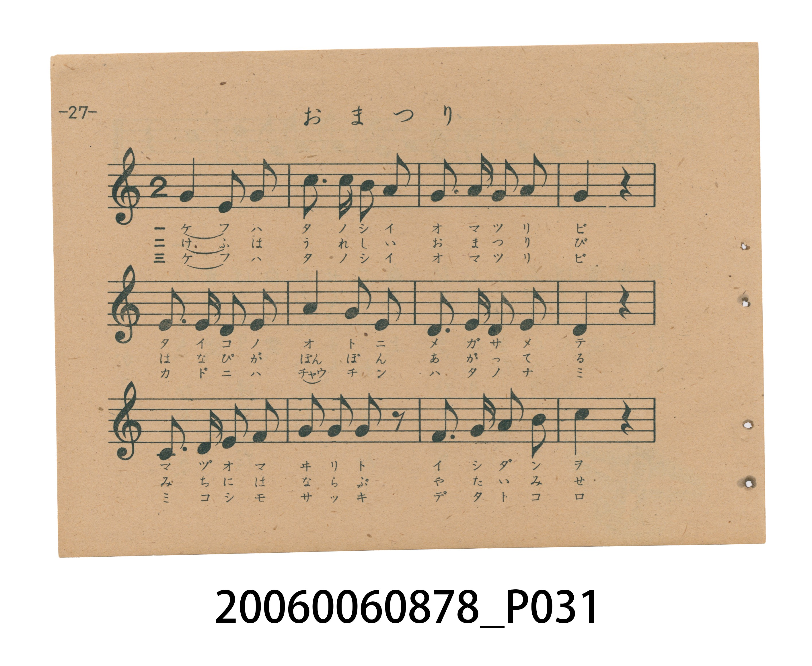
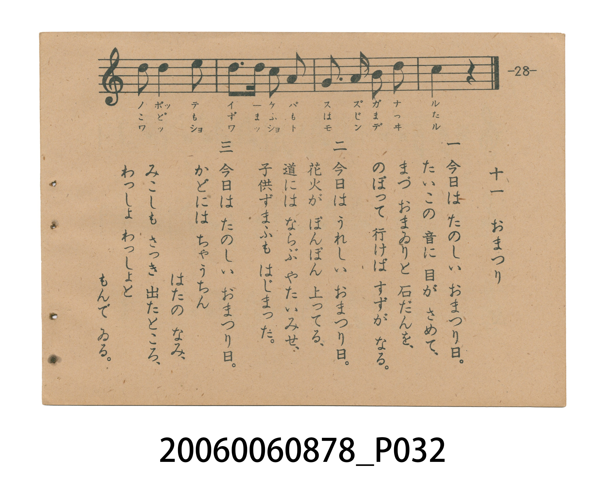

# おまつり（祭典）

> Re:Shōka 使用 AI 協助辨識與重建樂譜，可能會有錯誤。歡迎回報。

- **鋼琴伴奏版**：<br><audio controls src="omatsuri.mp3"></audio>
- **NEUTRINO 歌聲合成版**：<br><audio controls src="omatsuri_neutrino.mp3"></audio>

- 日治時期國民學校唱歌（うたのほん 下・第十一課）
- 國立臺灣歷史博物館典藏

## 說明


- 出處：臺灣總督府編《うたのほん 下》（國民學校初等科第二學年用），第十一課〈おまつり〉（祭典），原書第 27–28 頁。
- 調性與拍號：C 大調（?= C，無升降記號），2/4 拍，速度 != 112。
- 背景與曲風：共三節歌詞，第一節描寫祭典日清晨被太鼓聲喚醒、踏上石階參拜搖響神社鈴鐺；第二節描寫煙火升空、屋台攤販林立與兒童相撲開賽的喜慶；第三節描寫街角燈籠旗海與神轎「わっしょ わっしょ」熱鬧巡行的景象。
- 版本說明：本檔案為原書單聲部五線譜旋律之忠實數位化版本。

### 編曲說明（鋼琴伴奏版）：

1. 前奏 (Intro, 4 小節)：擷取主旋律核心樂句作為導奏，建立調性與拍感。
2. 主歌伴奏 (Omatsuri)：右手 (PianoRH) 演奏原書歌唱主旋律；左手 (PianoLH)
依國民學校低學年教材純樸明朗之風格配以和聲伴奏。


## 歌詞

```text
一　今日は　たのしい　おまつり日。
たいこの　音に　目が　さめて、
まづ　おまゐりと　石だんを、
のぼって　行けば　すずが　なる。

二　今日は　うれしい　おまつり日。
花火が　ぽんぽん　上ってる、
道には　ならぶ　やたいみせ、
子供ずまふも　はじまった。

三　今日は　たのしい　おまつり日。
かどには　ちゃうちん　はたの　なみ、
みこしも　さっき　出たところ、
わっしょ　わっしょと　もんで　ゐる。
```

## ABC

```abc
X:1
T:おまつり（祭典）
M:2/4
L:1/16
Q:1/4=112
K:C
V:V1 name="Piano" snm="Pia"
[V:V1]
G4 A2 G2 | c3 c B2 c2 | G3 A G2 A2 | G4 z4 |
w: 1.~ケ フ ハ | タ ノ シ イ | オ マ ツ リ | ビ
w: 2.~け ふ は | う れ し い | お ま つ り | び
w: 3.~ケ フ ハ | タ ノ シ イ | オ マ ツ リ | ビ
E3 E D2 E2 | A4 G2 E2 | D3 E D2 E2 | D4 z4 |
w: 1.~タ イ コ ノ | オ ト ニ | メ ガ サ メ | テ
w: 2.~は な び が | ぽん ぽ ん | あ が っ て | る
w: 3.~カ ド ニ ハ | チャウ チ ン | ハ タ ノ ナ | ミ
C2 D2 E2 G2 | G2 G2 G2 z2 | E3 G A2 B2 | c4 z4 |
w: 1.~マ ヅ オ マ | ヰ リ ト | イ シ ダ ン | ヲ
w: 2.~み ち に は | な ら ぶ | や た い み | せ
w: 3.~ミ コ シ モ | サ ッ キ | デ タ ト コ | ロ
d2 d4 e2 | d3 d c2 A2 | G3 A B2 d2 | c4 z4 |
w: 1.~ノ ボッ テ | イ ケ バ _ | ス ズ ガ ナ | ル
w: 2.~こ ど も | ず ま ふ も | は じ ま っ | た
w: 3.~ワ ッ ショ | ワ ッ ショ ト | モ ン デ ヰ | ル
```

## TMD 檔案連結

- [主旋律 TMD 檔案](omatsuri.tmd) [[在 TMD Studio 編輯](https://tmdlang.github.io/Tmd-TS/#tmd=s7IKdvYPcrWy4qpTUCpJTLdSyC_KTM_MsypJzCxPzIvPT0vLTM5MzFHi0tJSeNzY9bhx3-PGJY-but7v6Xi-dO3T1h3v93QqaGlxKdoqGBoacdnbKjhz2Rjpm9iBDHw2femzTbufzWx6Nmf-0zndzzZMfLp2x7MFC59O2fhsbQ_QiMeNbY8b5z9uXPe4cffjpskKT3Z0P27e_XzNmqe9jU92NLxYtQlovBLIKKD256u7X7Tvet64-Nna7U_7Nz3tnfW8c-XLJSuAjngxvV-Ji0tfS8GWWoBLQUHhccOEZ7M3PZ-97sWqVc9m9D1umAgWbd79tH3Xi5lT3--ZBXHP8x17n89d_HTXnOfbVzxuAIYRpqcauoG-RQmCjrnP13Y-Xz4R6Nknu3qAgk93bnk-ZQXQv-_39CCHwOMGYDAhAv5xA1ABIuyBip_2zX82ewdQi4KR-aOGyUYWCi8XND5uaII69sWq_c8alr_oaH_W3fti5nygq50Vni5ZDhQGmgOKL5B9LQuf9ra_nNn7YsUMsBqQucBYVADqAbJeNsx_umuZAiSOkUxu7nk2cz3I5NmbXi4COn3W09aNT3Z0Pl_fAIzeFyvnQXwC9AZIpL__6frVEHeD0sWO1mczV7xYtPrpklUv90x-0bjp6bRZL9smPW5ofLGj_8mOrufzN7-c1fe0v_lZ95xnE6a9nL__-dJ5z5fse9mx5eWEXe_3zIYEHMLk1pnPG1cDffF85S6gIU83dj_t3_BsypIXm1Y-mzcdlHY62p-2Tnq-eunz2TueTdr0clr3i817n89qeTptzrPWbVADIY4HG_hi4fQXyyc9b-94vnHBs-nTn23dDjQB6IYXe4EpoedxU__jxsWPG6c_bmpXQOY8buh93rbx5ZrlT7cvfLGwB2gBKIw2LkQE2_POjmdz1kDSFDDMgOxnq6Y8W9jxvGkXJCqfTlsHDI-XzSue7JryfPusF2vnPJve_XRf95Od3U_3L3i6ftmzqTue7O192jMNYhTIaGh6hRgACf2nrSueTWsHOvrJjrUgxqp5L9auByZiUPJBTSxAkWd9zUBvAx2iEGBgbAiUAVJG4HTQCTYbGImPGxqe7O4Cxt3jRqAxDbA0Pv1xYwuYi0ijIDVQ74IUtTxunAxS2tDwcv7mx42rgQxgpnrc2APWNvVxU-PjxmXAOINoAJoB1A0zr2kCKM03AvNVAzBFPG5cAMxRj5tAyQSiGmjMHnDYAw1oAIb348aJjxs3gPXPfNw4C2bJqsdNwEwIdhLQs5CgAIY90D9Pl6x8NmP90_2rn61oAkYWPIECVT-dswKeOoFhCEydT_a1gbLDsmlPW0HR9WRX29O-3ZA0-qKhBznhApW92LoByAUp2NcDTDfAhPu0f93TmTuf7J0DTM1A8-FhuwvkSNSwbXvcBPQL3rB90bURmOJhPtwLChgICTRrB1ADOFBA3gYH1UtQHABVQ4wHhkfn48ZtIHYTMHogkbT_ceNsqOqnayc82TcbHIBAe7c-bmoCa1v_uHEGWARo9nx84QnMXU_3N6OFJySLPl-wAYieztkAzKug8FmyEphjQaHaOPnF9vVPW1c-m974rG_S047pLyZOh2RgUCGHlHWf7JwPMn95NzD8kYNxRyd5SbT7ceNKpLBZ-LipGVyGAxmgwAR7G2wQJOSA4QRLfcAQA4YqMNtDgmcqOGB6gWxgDQHWswKkoAkoAtGAUk4Agx6JC07iIINA0bgczAYmfdITLaTYetY3-9nu_cDwgZRfoLJvWdOzzYuebV31omMNqFCaPv3pTmBBD0qZwBLtaefsZ529wIAFOhxYcAE1gqTm7Huya9eztYufTusCxgWw1Hs6Y__TSbtBxSuUASvr5mx4vqH92eTGZ11rwOUjOFKA7qa8IoYCBS19Li7_3MSS4tKiTKuAzMS8fIcag5pqkCUKNoZmWnZgVo2CqYIuGJoBMYhdo2AYBxYAUuYQCiQIUWYGpkFKERoNoHQN2EAfwxpgtG2Eij1ungom-8E6Hjfth4r2AdnbQaymJVCZVVCZeUDcAmaBRIAyzZOx22MElGucCLOncSuYXA_R09gGEW3qAbKng2VAZoJkuqDq9wExyG5g0obKbMZujzHt_QONCWMw11jBCEyCFIMCGgRBQQ0RAcmhqoGIYI8GqPOAjnrcBPIeyKHIzgOJdIDJbqjjFkJ1rAFicJCCRUAykCDFHg2gYAcF6ipoMALLWIgucPkKs6pxL9hoEB8k1QQVBcXRYjBrGdRxIMfgionVUGd3Qh0Nj4vmxsfNix83gcyAqGgEkyDngGRBqkC274cGwuNmaLw3z8ewDRofhkAOLJwhOQNEwjBIOSzOTMExBcot8NyDNUKAqQFkcyvYJaAogIiAZDaAeRAxUJRAjIekJ5Dq7UDxBhQfbcJuDzhCQBEPLI_BJCjEEDkDbENTJ1hsG5I9oDQKEpsPzSsQM0A6ZmO3BxQb4LCDJi1I-m9eBDUPkniawTJrEfY0t0P9A4oHcNID6wbJgFRhjQcjUIiCCXDah5RHUD6QAgc4cpFkBo4JsAIC0QFJCHMg7oSkGlAyRw73jUCxCTCtQP5OqPgucCZBTkeQlIk9PkBpHlhpwmxpAqV9kPgsCB9cGoFDDC4Dy1IzwLIgFiiPgGQw0ysiPkC6kHzTtP1x83Ko86AGAiXhwpAYAEmCYg2StiAxBEmP2H1Vy8Wla6cAq1rAlgP5ylwA)]
- [鋼琴伴奏 TMD 檔案](omatsuri_piano.tmd) [[在 TMD Studio 編輯](https://tmdlang.github.io/Tmd-TS/#tmd=s7IKdvYPcrWy4tLSUnjc2PW4cd_jxiWPm7re7-l4vnTt09Yd7_d0Atkvu_c8n7DlyZ4tT5f2P-_sAAoqaGlxKdoqGBoacdnbKjhz2Rjpm9hx1SkoPZu-9Nmm3c9mNj2bM__pnO5nGyY-Xbvj2YKFT6dsfLa2B2jW48a2x43zHzeue9y4-3HTZIUnO7ofN-9-vmbN097GJzsaXqzaBDReCWQUUPvz1d0v2nc9b1z8bO32p_2bnvbOet658uWSFUCXvZjer8TFpa-lYEstwKWgoPC4YcKz2Zuez173YtWqZzP6HjdMBIs2737avuvFzKnv98yCuOf5jr3P5y5-umvO8-0rHjcAAw7TUw3dQN-iBEHH3OdrO58vnwj07JNdPUDBpzu3PJ-yAhzGPcgh8LgBGEyI2HjcAIoEpAjpedo3_9nsHUAtCkbmjxomG1kovFzQ-LihCerYF6v2P2tY_qKj_Vl374uZ84GudlZ4umQ5UBhoDii-QPa1LHza2_5yZu-LFTPAakDmAmNRAagHyHrZMP_prmUKkDhGMrm559nM9SCTZ296uQjo9FlPWzc-2dH5fH0DMHpfrJwH8QnQGyCR_v6n61dD3A1KFztan81c8WLR6qdLVr3cM_lF46an02a9bJv0uKHxxY7-Jzu6ns_f_HJW39P-5mfdc55NmPZy_v7nS-c9X7LvZceWlxN2vd8zGxJwCJNbZz5vXA30xfOVu4CGPN3Y_bR_w7MpS15sWvls3nRQ2ulof9o66fnqpc9n73g2adPLad0vNu99Pqvl6bQ5z1q3QQ2EOB5s4IuF018sn_S8veP5xgXPpk9_tnU70ASgG17sBaaEnsdN_Y8bFz9unP64qV0BmfO4ofd528aXa5Y_3b7wxcIeoAWgMNq4EBFswFQCDDBImsKan4ABCVKqoGCop_C0sxcorqDhmVdSlK-jYKLwdEM_0ImaQDXPJgOzwbQnO3Y_m979dF_3swU7nu5vfrai6Wn_0id75zxv2vV0Qx9QLyiF7N4FCgCkhPCsZT7UQQoKRnrAJLobGGMQNyho-OcmlhSXFmWCLHnav_lZZ7eCRkBmYl5-kIemwrM9U4CKIGkOqAeYleEuAIbh0-3LEMp9PDQhNgDBk31zkZP_k719kCT_bOrMZ3MnPN8y5dmKHcDweDZn-pOd3cDE9GzBnpetvU92L306qQeYOCBOAzkZmjHhDgAms6etK55Nawd67MmOtSDGqnkv1q4H5lZQPkHNFUCRZ33NwPh9tmqKQoCBsSFQBkgZgQO9E2w2MLU-bmh4srsLmEgfNwKNaYBl5umPG1vAXERmBKmBxitIUcvjxskgpQ0NL-dvfty4GsgAlh6PG3vA2qY-bmp83LgMmDghGoBmAHXDzGuaAMrcjcACpAGY9B83LgAWHY-bQPkBohpozB5wIgMa0ABMWI8bJz5u3ADWP_Nx4yyYJaseNwFLG7CTgJ6FBAUwGoH-ebpk5bMZ65_uXw1MIsBUCc-JQNVP56yAZ0NgGAKz4ZN9baB8v2za09YOYEp6sqvtad9uSGZ80dCDnEOByl5s3QDkghTs6wFmEGAOfdq_7unMncBUCMy2QPPhYbsL5EjUsG173AT0C96wfdG1EZi1YT7cCwoYCAk0awdQAzhQQN4GB9VLUBwAVUOMB4ZH5-PGbSB2EzB6IJG0_3HjbKjqp2snPNk3GxyAQHu3Pm5qAmtb_7hxBlgEaDYsp2ANT2AxAsx1aOEJKYueL9gARE_nbAAWSqDwWbISWDSBQrVx8ovt65-2rnw2vfFZ36SnHdNfTJwOKalAeRWpjHqycz7I_OXdwPBHDsYdneQl0e7HjSuRwmbh46ZmcGUFZIACE-xtsEGQkAOGEyz1AUMMGKrA8g0SPFPBAdMLZAOrQrCeFSAFTUARiAaUAhEY9EhccBIHGQSKxuVgNjDpk55oIeXzs77Zz3bvB4YPpKAGFfLLmp5tXvRs66oXHWtApe_06U93Ams0UMoEFt1PO2c_6-wFBizQ4cASGqgRJDVn35Ndu56tXfx0WhcwLoDF-9MZ-59O2g2qR6AMWKE-Z8PzDe3PJjc-61oDrgjAkQJ0N-UtDihQ0NLn4gKX9lbQMtehxqCmGlyQ2hiaadmBWTUKRnEKuhACBI1BDKggWNgQxDIDC5qCxcwUzGEaaiCyIGgApWu4alFs9UG21QRuqWm8QrRpLJRhlgtjgYUMgQxDIANkEqwGwe8FiMMgzgSx4e4CUiDHgnkI94NoZB8hux5koI9hDTDhbYSKPW6eCib7wToeN-2HivYB2dtBrKYlUJlVUJl5QNwCZoFEgDLNk7HbYwSUa5wIs6dxK5hcD9HT2AYRbeoBsqeDZUBmgmS6oOr3ATHIbmDmhMpsxm6PMe39A40JYzDXWMEITIIUgwIaBEFBDREByaGqgYhgjwao84COetwE8h7IocjOA4l0gMluqOMWQnWsAWJwkIJFQDKQIMUeDaBgBwXqKmgwAmsJiC5wDQGzqnEv2GgQHyTVBBUFxdFiMGsZ1HEgx-CKidVQZ3dCHQ2Pi-bGx82LHzeBzICoaASTIOeAZEGqQLbvhwbC42ZovDfPx7ANGh-GQA4snCE5A0TCMEg5LM5MwTEFyi1YczU8QoCpAWRzK9gloCiAiIBkNoB5EDFQlECMh6QnkOrtQPEGFB9twm4POEJAEQ-sUcAkKMQQOQNsQ1MnWGwbkj2gNAoSmw_NKxAzQDpmY7cHFBvgsIMmLUj6b14ENQ-SeJrBMmsR9jS3Q_0Digdw0gPrBsmAVGGNB2oXsojogCSEORB3QlINKJkjh_tGoNgEmFYgfydUfBc4kyCnI0jKxB4foDQPrPZhtjSB0j5IfBaEDy6NwCEGl4FlqRlgWRALlEdAMpjpFREfIF1Ivmna_rh5OdR5UAOBknBhSAyAJEGxBklbkBiCpEfsvsKoWXBUU7CqCJVhglxdoas0gTFACuAMNJUo9RymCHGVpAHEI7p2CuD6VgHIgHkq2gdoDArfCI1vDOYrcwEA)]

## 分析

```text
================================================================================
📊 TMD Song Profile: [ おまつり（祭典） ]
================================================================================
⏱  Duration:       0:17 (17.1s), 16 measures total
🎼 Key & Tempo:    首調基準 C, != 112.0 BPM, <2/4>
   - 分析範圍：      由實際發聲的音符與和弦推測調性；播放脈絡另行呈現
🎤 人聲音域:    C4 (MIDI 60) – E5 (MIDI 76) [跨度: 16 個半音 / 1.3 個八度, 難度: moderate]
   - 最低音:  C4 in [Omatsuri #1 @ m.9, 0:08]
   - 最高音: E5 in [Omatsuri #1 @ m.13, 0:13]
   - 適合: soprano, mezzo-soprano, contralto, tenor, baritone, bass
🏛  結構:      Omatsuri (17.1s)
⚡ 編曲密度:        Peak 1 軌道同時演奏
🗝  調性診斷：       G 大調（純淨自然大調，未偵測到可信轉調）
   - 風格氣質:    純淨自然大調（陽光明朗、易唱易記，無明顯調外色彩）
   - 轉調歷程:    全曲維持單一推測調性（未偵測到可信轉調）
   - 核心骨幹音:  G, D, C, E, A
   - 調性數值:    G 大調 [相關度: 0.91, 穩定度: High, 自然音純度: 100.0%]
   - 候選調性 (K-S): G 大調 (0.91), C 大調 (0.73), E 小調 (0.65)
   - 五度圈歷程:   +1
   - 各段落調性細節:
     • [Omatsuri #1]: G 大調 (r: 0.91, 自然音純度: 100.0%)

  [ 五度圈游移軌跡 ]
               C  
         F           [G ]*
      Bb               D  
      Eb               A  
         Ab           E  
            Db       B  
               F# 
     (* = active key center)

  [ 十二半音累積音高分佈 ]
     C  : ███████████████           16.4%
     C# :                            0.0%
     D  : █████████████████████     22.7%
     D# :                            0.0%
     E  : ███████████████           16.4%
     F  :                            0.0%
     F# :                            0.0%
     G  : ████████████████████████  26.4%
     G# :                            0.0%
     A  : ████████████              12.7%
     A# :                            0.0%
     B  : █████                      5.5%
--------------------------------------------------------------------------------
Assignment 軌道音域：
  - Piano         : C4 – E5 (16 個半音 / 1.3 個八度, 48 個音符)
================================================================================
```


## 原書掃描頁






