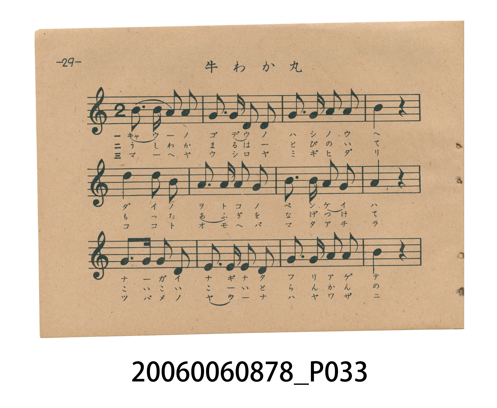
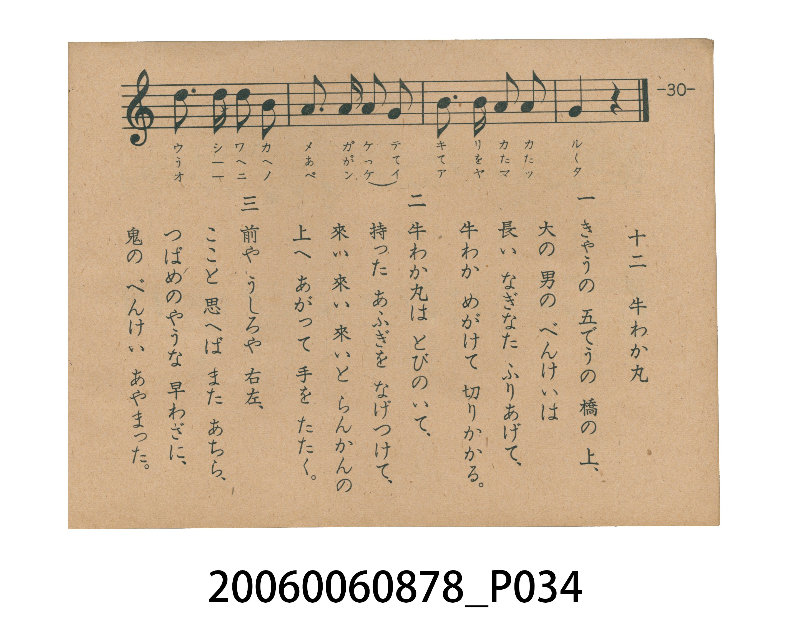

# 牛わか丸（牛若丸）

> Re:Shōka 使用 AI 協助辨識與重建樂譜，可能會有錯誤。歡迎回報。

- **NEUTRINO 歌聲合成版**：<br><audio controls src="ushiwakamaru_neutrino.mp3"></audio>
- **鋼琴伴奏版**：<br><audio controls src="ushiwakamaru.mp3"></audio>


- 日治時期國民學校唱歌（うたのほん 下・第十二課）
- 國立臺灣歷史博物館典藏

## 說明


- 出處：臺灣總督府編《うたのほん 下》（國民學校初等科第二學年用），第十二課〈牛わか丸〉（牛若丸），原書第 29–30 頁。
- 調性與拍號：ト調（G 大調五聲音階，原書五線譜省略調號，實際音高終止於 G 音），2/4 拍，速度 != 108。
- 背景與曲風：原出自明治 44 年（1911）《尋常小學唱歌（一）》第十九曲，為日本家喻戶曉的歷史故事唱歌。描繪京都五條大橋上大漢武藏坊弁慶揮舞長薙刀砍來，少年牛若丸（源義經）擲扇躍上橋欄干拍手招引，並以如燕子般敏捷的身手令鬼弁慶俯首認輸的經典場面。
- 版本說明：本檔案為原書單聲部五線譜旋律之忠實數位化版本。

### 編曲說明（鋼琴伴奏版）：

1. 前奏 (Intro, 4 小節)：擷取主旋律核心樂句作為導奏，建立調性與拍感。
2. 主歌伴奏 (Ushiwakamaru)：右手 (PianoRH) 演奏原書歌唱主旋律；左手 (PianoLH)
依國民學校低學年教材純樸明朗之風格配以和聲伴奏。


## 歌詞

```text
一　きやうの　五でうの　橋の　上、
大の　男の　べんけいは
長い　なぎなた　ふりあげて、
牛わか　めがけて　切りかかる。

二　牛わか丸は　とびのいて、
持った　あふぎを　なげつけて、
來い　來い　來いと　らんかんの
上へ　あがって　手を　たたく。

三　前や　うしろや　右左、
ここと　思へば　また　あちら、
つばめのやうな　早わざに、
鬼の　べんけい　あやまった。
```

## ABC

```abc
X:1
T:牛わか丸（牛若丸）
M:2/4
L:1/16
Q:1/4=108
K:G
V:V1 name="Piano" snm="Pia"
[V:V1]
B3 B A2 A2 | G3 G D2 D2 | G3 G A2 A2 | B4 z4 |
w: 1.~きゃ う の _ | ご で う の | は し の う | へ
w: 2.~う し わ か | ま る は _ | と び の い | て
w: 3.~ま へ や _ | う し ろ や | み ぎ ひ だ | り
d4 d2 B2 | A3 A A2 G2 | B3 B A2 G2 | A4 z4 |
w: 1.~だ い の | を と こ の | べ ん け い | は
w: 2.~も っ た | あ ふ ぎ を | な げ つ け | て
w: 3.~こ こ と | お も へ ば | ま た あ ち | ら
G3 G G2 D2 | E3 E E2 D2 | G3 G A2 A2 | B4 z4 |
w: 1.~な が い _ | な ぎ な た | ふ り あ げ | て
w: 2.~こ い こ い | こ い と _ | ら ん か ん | の
w: 3.~つ ば め の | や う な _ | は や わ ざ | に
d3 d d2 B2 | A3 A A2 G2 | B3 B A2 A2 | G4 z4 |
w: 1.~う し わ か | め が け て | き り か か | る
w: 2.~う へ へ _ | あ が っ て | て を た た | く
w: 3.~お に の _ | べ ん け い | あ や ま っ | た
```

## TMD 檔案連結

- [主旋律 TMD 檔案](ushiwakamaru.tmd) [[在 TMD Studio 編輯](https://tmdlang.github.io/Tmd-TS/#tmd=s7IKdvYPcrWy4qpTUCpJTLdSyC_KTM_Ms8rNz0sqLc7IV-LS0lJ43jn7cVP_48buJzt2vN_TAeS-6F4KZncqaGlxKdoqGBpYcNnbKrhz2Rjpm9iBDHs2femzTbufzWx6Nmf-0zndzzZMfLp2x7MFC59O2fhsbQ_QlMeNbY8b5z9uXPe4cffjpskKT3Z0P27e_XzNmqe9jU929bxYtQlovBLIKKD256u7X7Tvet64-Nna7U_7Nz3tnfW8c-XLJSuetu54Mb1fiYtLX0vBllqAS0FB4XHDhGezNz2fve7FqlXPZvQ9bpgIFm3e_bR914uZU9_vmQVxz_Mde5_PXfx015zn21c8bujC5qmGbqBvUYKgY-7ztZ3Pl08EehboU6Dg051bnk9ZAfTv-z09yCHwuAEU2PCwf9wAVIAS_ED1T_vmP5u9A6hLwcjyUcNkYwOFlwsaHzc0Qd37YtX-Zw3LX3S0P-vufTFzPtDhj5s7gIJAg9wVni5ZDmQ-2TXlReOml_M3v5zVBzcQKPh8-6wXa-c8n9P4fOpSoDKw7p6n65e9nDUbpHj1jOdbm56tXfRs2h4FdwWgCMQ9wASgALQLyHrZMP_prmUKkOSB5KLmnmcz14NcNHvTy0VAX88C2ggK1nZQSAMTjYKJiQIwRIAuNLQ0NASaCgzYpxu6n-7Y8XRDPyi0YEnoyY4GsGw3NMx2zgUaCQrCpl2g5DdnzdN1255O2_2sY9uz2Z3PZ7VAEs-zqa1PdnVDDAG66ll___Odq57sWvOyeS_Q088WzQWGyrOVwPDuAjH2LHq2dhkwjT2d2_V0T-Oz1m3P-te96Jj3cur2F9NmPu1oeL6g98m-NlDAAKMXGI2IyOl4tmvC830rn2-bDHTks8mbnnW2v9jVCzQWaPizNS1Pd24CBtOzzu5n3bOf7gGmqJ4nO5Y92b306bKm5-1Tn66d8KJjzbOp_c96twNd_mLXaqDKJ7uXvFyzB-KMJ_vXv1w27cWq3hd7dgAVAG0B5oWnC7a8nLsIEdTPOzuAoQBJwsBwBrKfrZrybGEHMIAgsfx02jpQ1DevgEf3s-ndT_d1P9nZ_XT_AmBcP5u648ne3qc90yBGgYyGZg-IAcAwfLFy3tPWFc-mtQOj9MmOtSDGqnkv1q4H5hlQakVNmKBg6WsGhjnQIQoBBsbGQBkgZQJOO51gs4Gx-rih4XFj7-OmFnB-WgfkAt33uHE5nAsMQqj4jq7HDY0gbcDIggg9n7IdwnjcuBOYBx83TnzcCDRoPUgRMNpAHJDcqseNfWByPpi79XETMPc2PW6c9LhxGdRIeN4DqWhqfNzYAzYMKN3wtKMdrAHojO7HTUAF4CAH-g7id1CingMMVCyJChjRoNicO-Hl2sZni5YD4w6SzCDRCso2q2cAESiZbd0OT2ZA8Wdz5r6YOB2ewF7s73u5YC0w-T3t2w20Hh56u4CJugGl1GgERgXQhyseN24Gl0zAwID58FkP0FeLYWEA9P1WUKg0TYKFEDAwlsD8DNYATOuQAERnAI0HBVInOMSBQQIk10FiExhKwJILYjwwAIG2gQIQmJxh9gDLSyDqxxKGCM_umfp0-_IX2ze_nAYsTXuedXWBsgMwsXXvB4UJMGt3tgOzDDCXPdnV9rKxDxgm4AzV8LKp6-m0LqCaxw09QJc-nQhMW40YDGCuBKkEmo-WPYEaQQ5FCt4dwPKm4WknOHGCHA_0_PTHTVDu0_7NT7fDgupxIzAMgAgUMM8a5oJCoXEDWM8-pABfCAozmAZgWG8AJ7R1sLS_CqR5-kpwZE573LgaqhRYDGBJ4xAjQTqBNkBiFSNIgT59Nqf5aeskYPoEeQMYCMgi-4CpB1Vk-zKgr0Bh3tkLLJ1AJcecFS8bZr5YvPBp7-6n_R1POzaAwrxpMVAElHqbFiOXYM-XzgNWA_ASDJT4101GFGI75z-fMuNZ9xxgPQmsCiClGdA0aIADnU55bQ4FClr6XFyhxRmZ5YnZibmJRaVWAZmJefkONQY11SCLFGwMzbTswKwaBWMFXSA0VjACkiBco2AIFjFUMI0HUmACIYZQBdGnq2AApWvA5vkY1gDjFphEmsGCwHgF4nUwJUD2FKj4crAciAWSBcmsh8pMh4pB5EEyO7BbZQSSA6mB6mrqB7O6obr2QWSauuFmQ8RXQHVshtvTApVZht0eYyTTgG4BJjok05Dt7wXbBzNtP1SmD4g3gVkLIDJNXRj2QOPCFCoAokHhWwMOa1CIg2hQHKDGF0QEogZ7TICshDgD5Cx4YDdNgoquAGVdZJnGndBgmwxkT0QJHlggYomGpia4PYvB5HyoHog4sKwFBwTIXJDNIJlVUJlJoLIAzALZRigaQG6F6IO4GhSZIHFIkILcAUkuwMIFKgOLuPlQ1wCLIWgYdGLYA40GWGIH0dD0bwaidEEUmEVWroD5uAcaprAkBBMHJRQQGxF6W6G-6oK7HRZ6OMIInCUgYQSyAxZKsBhEloFkA-SQgMQ5KPuAWBAdsKyLLS5AsQYJaWA5DmbBUhfEd5DMD_EdShYHysMy6zSozGoMe1CyhCnRWQK5CMMeDThLDLAnYBEESfqgYAYXaFCHgyICHEBwPSAaV0TAbAKWGfAyDDlTgOyBZBeYPZBoBWUSSCJAJAWQS3FFBDTxAwMRtazFnZWhLgBFBDiDQNwBkgHZh2pPLReXrp0CcnUCthoopswFAA)]
- [鋼琴伴奏 TMD 檔案](ushiwakamaru_piano.tmd) [[在 TMD Studio 編輯](https://tmdlang.github.io/Tmd-TS/#tmd=s7IKdvYPcrWy4tLSUnjeOftxU__jxu4nO3a839MB5L7oXgpmdwK5L7v3PJ-w5cmeLU-X9j_v7AAKKmhpcSnaKhgaWHDZ2yq4c9kY6ZvYcdUpKD2bvvTZpt3PZjY9mzP_6ZzuZxsmPl2749mChU-nbHy2tgdo1uPGtseN8x83rnvcuPtx02SFJzu6Hzfvfr5mzdPexie7el6s2gQ0XglkFFD789XdL9p3PW9c_Gzt9qf9m572znreufLlkhVPW3e8mN6vxMWlr6VgSy3ApaCg8LhhwrPZm57PXvdi1apnM_oeN0wEizbvftq-68XMqe_3zIK45_mOvc_nLn66a87z7SseN3Rh81RDN9C3KEHQMff52s7nyycCPQv0KVDw6c4tz6esAIdxD3IIPG4AxQA8Qh43gCIBNU56nvbNfzZ7B1CXgpHlo4bJxgYKLxc0Pm5ogrr3xar9zxqWv-hof9bd-2LmfKDDHzd3AAWBBrkrPF2yHMh8smvKi8ZNL-dvfjmrD24gUPD59lkv1s55Pqfx-dSlQGVg3T1P1y97OWs2SPHqGc-3Nj1bu-jZtD0K7gpAEYh7gAlAAWgXkPWyYf7TXcsUIMkDyUXNPc9mrge5aPaml4uAvp4FtBEUrO2gkAYmGgUTEwVgiABdaGhpaAg0FRiwTzd0P92x4-mGflBowZLQkx0NYNluaJjtnAs0EhSETbtAyW_Omqfrtj2dtvtZx7Znszufz2qBJJ5nU1uf7OqGGAJ01bP-_uc7Vz3ZteZl816gp58tmgsMlWcrgeHdBWLsWfRs7TJgGns6t-vpnsZnrdue9a970THv5dTtL6bNfNrR8HxB75N9baCAAUYvMBoRkdPxbNeE5_tWPt82GejIZ5M3Petsf7GrF2gs0PBna1qe7twEDKZnnd3Pumc_3QNMUT1Pdix7snvp02VNz9unPl074UXHmmdT-5_1bge6_MWu1UCVT3YveblmD8QZT_avf7ls2otVvS_27AAqANoCzAtPF2x5OXcRIqiBiRIYIpAkjDX7AgMfpFRBwVBP4WlnL1BcQcMzr6QoX0cBGAcb-p-vb9AEqnk2GRhw057s2P1sevfTfd3PFux4ur_52Yqmp_1Ln-ydAwzupxv6gHpBobB7FyivIiW6Zy3zoQ5SUDDSA-aI3cBwh7hBQSO0OCOzPDE7MTexqBRk0dP-zUB_KmgEZCbm5Qd5aCo82zMFqBCSJIH6gLEGd8X7PbOfbl-GUO7joQmxBQie7JuLnOOe7O2D5LJnU2c-mzvh-ZYpz1bsACW2OdOf7OwGJsJnC_a8bO0Fhf6kHmBegDgP5GxoWQB3wIuV8562rng2rR3ouSc71oIYq-a9WLseWECAsiZqLgSlgb5mYAJ7tmqKQoCBsTFQBkiZgAO-E2w2MAk_bmh43Nj7uKkFXHisA3KByfBx43I4F5heoOI7uh43NIK0AVMmROj5lO0QxuPGncAC53HjxMeNQIPWgxQB0yiIA5Jb9bixD0wC4wLI3fq4CVhUNT1unPS4cRnUSHhBA1LR1Pi4sQdsGFC64WlHO1gD0Bndj5uACsDRCfQdxO-geJuzAmsOAqYIUNKdO-Hl2sZni5YDEyokT0HSMKiMWD0DiEB5aut2eJ4Cij-bM_fFxOnw3PRif9_LBWuBee1p326g9fDQ2wXMwQ0oRWQjMCqAPlzxuHEzuBgGBgbMh896gL5aDAsDoO-3gkKlaRIshICBsQTmZ7AGYMaGBCA6A2g8KJA6wSEODBIguQ4Sm8BQAhbTEOOBAQi0DRSAwEQKswdYOQAROG2hhSHCs3umPt2-_MX2zS-nARN5z7OuLlDeBya27v2gMAGWY53twPIBWKQ82dX2srEPGCbg0qPhZVPX02ldQDWPG3qALn06EZi2GjEYwCIIpBJoPlpZBNQIcihS8O4AFq4NwHIBlDhBjgd6fvrjJigXmFeB-Q8aVI8bgWEARKCAedYwFxQKjRvAevYhBfhCUJjBNADDegM4oa2Dpf1VIM3TV4Ijc9rjxtVQpcAyD0sahxgJ0gm0ARKrGEEK9OmzOc1PWycB0yfIG8BAQBbZB0w9qCLblwF9BQrzTlBhACrY5qx42TDzxeKFT3t3P-3veNqxARTmTYuBIqDU27QYubh-vnQesM6DF9egxL9uMqLE3jn_-ZQZz7rnABsFwCIHUnQDTYMGONDplDddoEBBS5-LC1yOW0FLUocag5pqcPFoY2imZQdm1SiYKugCoSmYNgbiGgUjsIgRmDYEi4DEQbIgERCuAYuDoAGUruGqRbHNB9k2E7hlhvEK0YaxIFvjgSyzXDjTFMyESYMMQ64W8PsAl-sMgUaDvAYiEGIIVRB9yH4AmedjWANMmMD03QwWBCZKIF4HUwJkT4GKLwfLgVggWZDMeqjMdKgYRB4kswO7VUYgOZAaqK6mfjCrG6prH0SmqRtuNkR8BVTHZrg9LVCZZdjtMUYyDegWYI5BMg3Z_l6wfTDT9kNl-oB4E5i1ACLT1IVhD0pqAqUn4lITRASiBntMgKyEOAPkLHhgN02Ciq4AlTvIMo07ocE2GcieiBI8sEDEEg1NTXB7FoPJ-VA9EHFgRQEOCJC5IJtBMqugMpNABRmYBbKNUDSA3ArRB3E1KDJB4pAgBbkDklyAJSNUBhZx86GuAZah0DDoxLAHls_AXEMwDU3_ZiBKF0SBWWTlCpiPe6BhCktCMHFQQgGxEaG3FeqrLrjbYaGHI4zAWQISRiA7YKEEi0FkGUg2QA4JSJyDsg-IBdEBy7rY4gIUa5CQBlZCYBYsdUF8B8n8EN-hZHGgPCyzToPKrMawh8oFLCIacJYYYE_AIgiS9EHBDC7QoA4HRQQ4gOB6QDSuiIDZBCwz4GUYcqYA2QPJLjB7INEKyiSQRIBICiCX4ooIaOIHBiJqWYs7K0NdAIoIcAaBuAMkA7IP1R6stQmhGgrEwF1B4VeMqOLA2mAJAS5lhkURTrNxVpUGEK_p2imAK14FIAPZm9E-QO0YYkZYxIzBYspcAA)]

## 分析

```text
================================================================================
📊 TMD Song Profile: [ 牛わか丸（牛若丸） ]
================================================================================
⏱  Duration:       0:17 (17.8s), 16 measures total
🎼 Key & Tempo:    首調基準 G, != 108.0 BPM, <2/4>
   - 分析範圍：      由實際發聲的音符與和弦推測調性；播放脈絡另行呈現
🎤 人聲音域:    D4 (MIDI 62) – D5 (MIDI 74) [跨度: 12 個半音 / 1.0 個八度, 難度: easy]
   - 最低音:  D4 in [Ushiwakamaru #1 @ m.2, 0:01]
   - 最高音: D5 in [Ushiwakamaru #1 @ m.5, 0:04]
   - 適合: soprano, mezzo-soprano, contralto, tenor, baritone, bass
🏛  結構:      Ushiwakamaru (17.8s)
⚡ 編曲密度:        Peak 1 軌道同時演奏
🗝  調性診斷：       G 調性不明確（純淨自然大調，未偵測到可信轉調）
   - 風格氣質:    純淨自然大調（陽光明朗、易唱易記，無明顯調外色彩）
   - 轉調歷程:    全曲維持單一推測調性（未偵測到可信轉調）
   - 核心骨幹音:  A, G, B, D, E
   - 調性數值:    G 調性不明確 [相關度: 0.72, 穩定度: Ambiguous, 自然音純度: 100.0%]
   - 候選調性 (K-S): G 大調 (0.72), D 大調 (0.72), B 小調 (0.52)
   - 五度圈歷程:   +1
   - 各段落調性細節:
     • [Ushiwakamaru #1]: G 調性不明確 (r: 0.72, 自然音純度: 100.0%)

  [ 五度圈游移軌跡 ]
               C  
         F           [G ]*
      Bb               D  
      Eb               A  
         Ab           E  
            Db       B  
               F# 
     (* = active key center)

  [ 十二半音累積音高分佈 ]
     C  :                            0.0%
     C# :                            0.0%
     D  : ██████████████            17.9%
     D# :                            0.0%
     E  : ████                       5.4%
     F  :                            0.0%
     F# :                            0.0%
     G  : ████████████████████      25.0%
     G# :                            0.0%
     A  : ████████████████████████  30.4%
     A# :                            0.0%
     B  : █████████████████         21.4%
--------------------------------------------------------------------------------
Assignment 軌道音域：
  - Piano         : D4 – D5 (12 個半音 / 1.0 個八度, 51 個音符)
================================================================================
```


## 原書掃描頁






