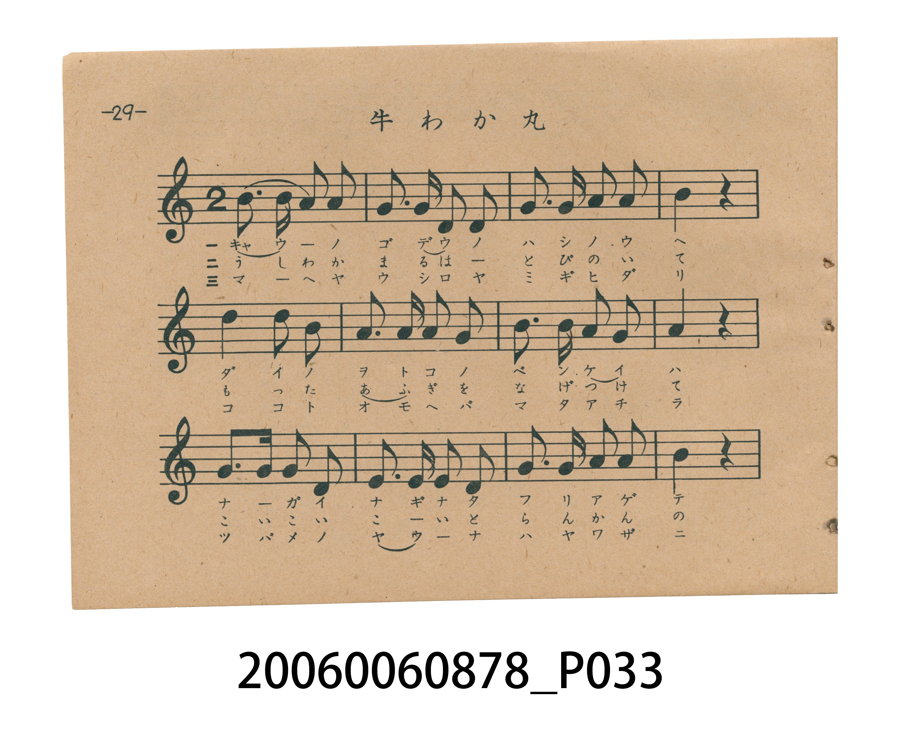
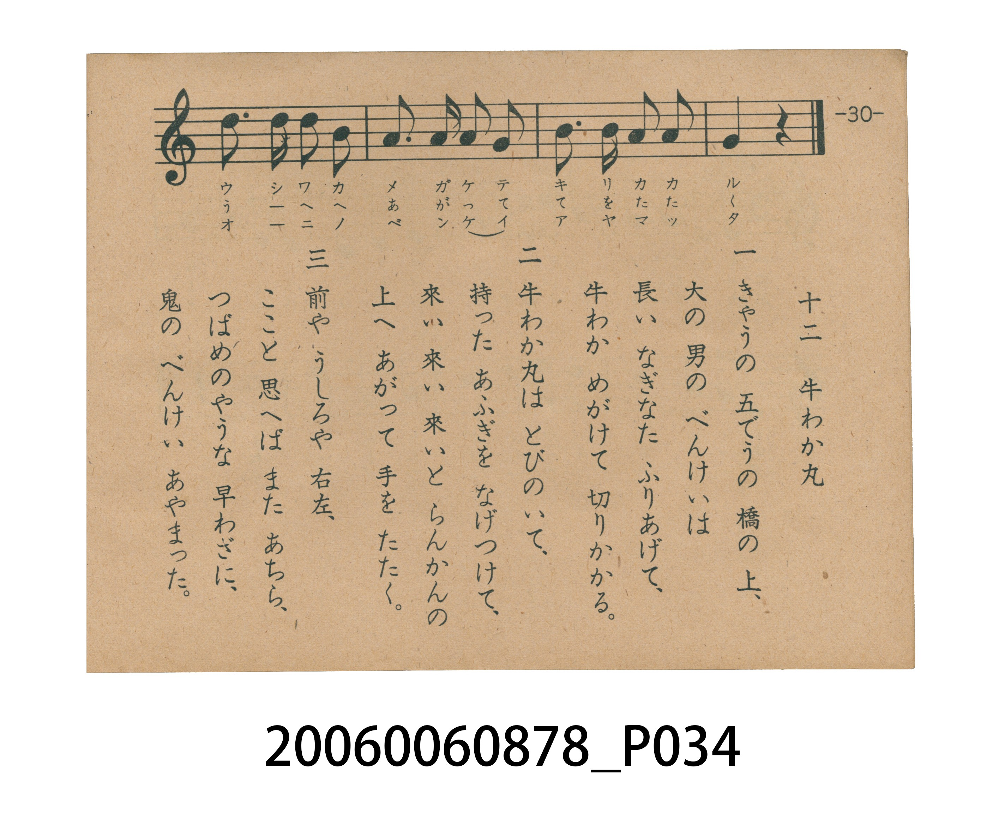

# 牛わか丸（牛若丸）

> Re:Shoka 使用 AI 協助辨識與重建樂譜，可能會有錯誤。歡迎回報。

<audio controls src="ushiwakamaru.mp3"></audio>

- 日治時期國民學校唱歌（うたのほん 下・第十二課）
- 國立臺灣歷史博物館典藏

## 說明

【曲目說明】
・出處：臺灣總督府編《うたのほん 下》（國民學校初等科第二學年用），第十二課〈牛わか丸〉（牛若丸），原書第 29–30 頁。
・調性與拍號：ホ短調五聲音階（E 羽調式／陽音階，記於關係調 `?= G` 下主音為 `6_`＝E4，原書五線譜省略調號），2/4 拍，速度 != 108。
・背景與曲風：原出自明治 44 年（1911）《尋常小學唱歌（一）》第十九曲，為日本家喻戶曉的歷史故事唱歌。本冊收錄原曲前兩節，描繪京都五條大橋上大漢武藏坊弁慶揮舞長薙刀砍來，吹笛而至的少年牛若丸（源義經）輕盈躍上橋欄干的經典場面。
・版本說明：本檔案為原書單聲部五線譜旋律之忠實數位化版本。

・編曲說明（鋼琴伴奏版）：
1. 前奏 (Intro, 4 小節)：擷取主旋律核心樂句作為導奏，建立調性與拍感。
2. 主歌伴奏 (Ushiwakamaru)：右手 (PianoRH) 演奏原書歌唱主旋律；左手 (PianoLH)
依國民學校低學年教材純樸明朗之風格配以和聲伴奏。

## 跨冊／重複收錄參照

> 同詞異曲（第一節同採文部省『尋常小學唱歌』「京の五條の橋の上…」歌詞；《うたのほん》下卷為文部省原曲五聲小調／都節音階版，《新定兒童唱歌》第一學年則改譜為 G 大調旋律並改寫第二節歌詞）

- **[同詞異曲]** 《新定兒童唱歌》尋常科第一學年用（2020.006.0847.0001）：[**〈ウシワカマル〉**](../../../shintei_jido_shoka/grade_1_2020.006.0847.0001/2_04_ushiwakamaru/index.md)（`G` / `2/4` — [原始 TMD](../../../shintei_jido_shoka/grade_1_2020.006.0847.0001/2_04_ushiwakamaru/ushiwakamaru.tmd)）
- 總表：[跨冊重複與同名歌曲總索引](../../../duplicate_songs.md)

## 歌詞

```text
一　京の　五條の　橋の　上、
大の　ををこの　べんけいは、
長い　なぎなた　ふりあげて、
牛わか　めがけて　切りかかる。

二　風が　そよそよ　吹く　夜に、
笛を　吹き　吹き　來かかるは、
まへがみすがたの　牛わかよ、
ひらりと　とんで　欄干に。
```

## ABC

```abc
X:1
T:牛わか丸（牛若丸）
M:2/4
L:1/16
Q:1/4=108
K:G
V:V1 name="Piano" snm="Pia"
[V:V1]
d3 d B2 A2 | B3 B G2 E2 | D3 E G2 A2 | B4 z4 |
d4 B2 A2 | G2 G2 G2 E2 | A3 A G2 G2 | A4 z4 |
D3 D E2 G2 | E2 D2 E2 G2 | A3 A G2 A2 | B4 z4 |
d3 d d2 B2 | A3 A G2 E2 | B3 B A2 A2 | E4 z4 |
```

## TMD 檔案連結

- [主旋律 TMD 檔案](ushiwakamaru.tmd) [[在 TMD Studio 編輯](https://tmdlang.github.io/Tmd-TS/#tmd=s7IKdvYPcrWy4tLSUnjeOftxU__jxu4nO3a839MB5L7oXgpmdypoaXEp2ioYGlhw2dsquHPZGOmb2HHVKSg9m7702abdz2Y2PZsz_-mc7mcbJj5du-PZgoVPp2x8trYHaMrjxrbHjfMfN6573Lj7cdNkhSc7uh83736-Zs3T3sYnu3perNoENF4JZBRQ-_PV3S_adz1vXPxs7fan_Zue9s563rny5ZIVT1t3vJjer8TFpa-lYEstwKWgoPC4YcKz2Zuez173YtWqZzP6HjdMBIs2737avuvFzKnv98yCuOf5jr3P5y5-umvO8-0rHjd0YfNUQzfQtyhB0DH3-drO58snAj0L9ClQ8OnOLc-nrAD69_2eHuQQeNwACmx42D9uACpACX6g-qd985_N3gHUpWBk-ahhsrGBwssFjY8bmqDufbFq_7OG5S862p91976YOR_o8MfNs5_PXwsUf7JryovGTS_nb345qw9orqvC8317gcJP9_S_39P_cuZemEzPixUznk3b83L6nCf7m4AKFBJAUZ0A8tyTHbuBqp437VJIMItPeL9nrqsJ3ElA459vn_Vi7ZzncxqfT10K1Ai2H-RmYCJRALoHyHrZMP_prmUKkCSE5Ormnmcz14NcPXvTy0XAkJkFNBMU9O2g2AAmLAUTEwVgqAGdbWhpaAg0FRj4Tzd0P92x4-mGflCIwpLZkx0NYNluaLjunAs0EhTMTbtASXTOmqfrtj2dtvtZx7Znszufz2qBJLBnU1uf7OqGGAJ0FUhZW9ezKdte9rSAPbfpaWfv09aVz9cDDe951t__fOeqJ7vWvGzeC_T0s0Vzny5Z_mwlMHC6QIw9i56tXQZMpU_ndj3d0_isdduz_nUvOua9nLr9xbSZTzsani_ofbKvDRRsE3Y-XzP7RUPPi_bNQJc8BaYXYLpAxHbHs10Tnu9b-XzbZKCPXuyZ-nx2x4tdvUBbgHY9W9PydOcmoC6gLDBTPF2w5eXcRYjwfN7ZAfQDJC0DAxPIfrZqyrOFHcBQgETW02nrQGmheQU81p5N7366r_vJzu6n-xc8Xb_s2dQdT_b2Pu2ZBjEKZDQ0n0AMAAbUi5XznraueDatHRhvT3asBTFWzXuxdj0w84CSLWoKBXmnrxkYdECHKAQYGBsDZYAUMPkAE0gn2Gxg1D1uaACGKyg_gRigoIWwgT6GCu7oetzQCFINDGqI0OOmSSDUOBnKbdwJzImPGyc-bmx53Ah0DFg1MPRBfJD0qseNfWByPpi79XETMBs3PW4EGrEMqhqeCcHGNz5u7AGbB5RueNrRDtYAdE_34yagAnCQA30H8Tso5c4BBiqWtAHKWLtWP5s74eXaxmeLloNiHJxaIIkElDdWzwAiUGrZuh2eWkDpbc7cFxOnwxPGi_19LxesBaaip327gdbDQ28XMOU2ADMPyLUgj8193AQsdMEk0NkTdj5u7Acxlsx53Lga5s81QH9Ogkn3IjOASRThSXgwPm7c97hxBzg89j9unAlmgIu_hgZEmIEshKre9LipExxcwMIS6KQV4JhZDopQcPoFuwRbAD7dtw7ok6f7JoDQhJ3PupvAwTXn2cxZwAABJpSXTV1AcVCwrJn9dO2EF1s3vGzsA7oZqAwUYmsXP5ux_vnUmUAFkGwFzL8vV68D5RdYMD6dCArbp_2rXizrfrJ7GiR_AU0GZbF9-19s3wyMsie72uB5DRrUQLdSXuNAgYKWPhdXaHFGZnlidmJuYlGpVUBmYl6-Q41BjUI1yCYFGwstOzADWN8B3WYFDNLex03tQKoNiNcp1ADJKUA8AyiILLYeiKeDeSBRkMgOkClAALQSZt6uHpB53UA8B4h7gKIghXMVgBEIp0EiW4G4HyLa1A0WWY1qWI2ChqmCrq6Cqaaqhq6upoKxghFIzBgkZgwVM1QwiwcrjAeJmsXDhUFKgSoVDIC4BpySkTwLTDm7wd4Au61pEpC9Aognwz26EygK4k0E4hao13F4FOQNkBcmQT0K4vfCaZAIiAcKDiCGehTNsBoFoD-h3jMEQ4injEB-MoJ7yRAoBhTC7qVV4LAGuRbiDBC_D0rPhzmsqQtINwHxJLDIMlx-2geOWYiB-8FKZ0J58-FBBEoVwLTQBIxCoM9AwdiBEXvgSDGFRQrQUyAvACmgBJSD7ke80YZpZSPUWaB4WgYLbLAvIQEOUtONy5ebgJKdUOUrwJqBiQAc7cuhCQNYyIC4oIibTEwKNQW6HdNPkMhESbZGYI8CJWA-reXi0rVTQM60IL4yFwA)]
- [鋼琴伴奏 TMD 檔案](ushiwakamaru_piano.tmd) [[在 TMD Studio 編輯](https://tmdlang.github.io/Tmd-TS/#tmd=s7IKdvYPcrWy4tLSUnjeOftxU__jxu4nO3a839MB5L7oXgpmdwK5L7v3PJ-w5cmeLU-X9j_v7AAKKmhpcSnaKhgaWHDZ2yq4c9kY6ZvYcdUpKD2bvvTZpt3PZjY9mzP_6ZzuZxsmPl2749mChU-nbHy2tgdo1uPGtseN8x83rnvcuPtx02SFJzu6Hzfvfr5mzdPexie7el6s2gQ0XglkFFD789XdL9p3PW9c_Gzt9qf9m572znreufLlkhVPW3e8mN6vxMWlr6VgSy3ApaCg8LhhwrPZm57PXvdi1apnM_oeN0wEizbvftq-68XMqe_3zIK45_mOvc_nLn66a87z7SseN3Rh81RDN9C3KEHQMff52s7nyycCPQv0KVDw6c4tz6esAIdxD3IIPG4AxQA8Qh43gCIBNU56nvbNfzZ7B1CXgpHlo4bJxgYKLxc0Pm5ogrr3xar9zxqWv-hof9bd-2LmfKDDHzfPfj5_LVD8ya4pLxo3vZy_-eWsPqC5rgrP9-0FCj_d0_9-T__LmXthMj0vVsx4Nm3Py-lznuxvAipQSABFdQLIc0927Aaqet60SyHBLD7h_Z65riZwJwGNf7591ou1c57PaXw-dSlQI9h-kJuBiUQB6B4g62XD_Ke7lilAkhCSq5t7ns1cD3L17E0vFwFDZhbQTFDQt4NiA5iwFExMFIChBnS2oaWhIdBUYOA_3dD9dMeOpxv6QSEKS2ZPdjSAZbuh4bpzLtBIUDA37QIl0Tlrnq7b9nTa7mcd257N7nw-qwWSwJ5NbX2yqxtiCNBVIGVtXc-mbHvZ0wL23Kannb1PW1c-Xw80vOdZf__znaue7Frzsnkv0NPPFs19umT5s5XAwOkCMfYserZ2GTCVPp3b9XRP47PWbc_6173omPdy6vYX02Y-7Wh4vqD3yb42ULBN2Pl8zewXDT0v2jcDXfIUmF6A6QIR2x3Pdk14vm_l822TgT56sWfq89kdL3b1Am0B2vVsTcvTnZuAuoCywEzxdMGWl3MXIcITmDqBjoakZaz5GBjCIKUKCoZ6CiC_Le1X0PDMKynK11EABvSGfqBPNYFqnk0Ghs40YKw_m979dF_3swU7nu5vfrai6Wn_0id75wDD9OmGPqBekGd27wJlWqTU96xlPtRBCgpGesDUsxsYuBA3KGiEFmdklidmJ-YmFpWCLHrav_lZZ7eCRkBmYl5-kIemwrM9U4AKISkLqA8YNXBXvN8z--n2ZQjlPh6aEFuA4Mm-uchZ78nePkh2ezZ15rO5E55vmfJsxQ5Qipoz_cnObmBKe7Zgz8vW3ie7lz6d1APMHBDngZwNLRTgDnixct7T1hXPprUDPfdkx1oQY9W8F2vXA0sKUB5FzY6guOtrBqaTZ6umKAQYGBsDZYAUMK8AA74TbDYwnT5uaAAmIlDhAWKA0hGEDYxeqOCOrscNjSDVwHQFEXrcNAmEGidDuY07gcXO48aJjxtbHjcCHQNWDUxqID5IetXjxj4wCYwLIHfr4yZgmdX0uBFoxDKoaniJAza-8XFjD9g8oHTD0452sAage7ofNwEVgKMT6DuI30HxNmcF1owAKkV2rQYG-cu1jc8WLQclb3DWgOQIUEGwegYQgbLG1u3wrAHKXHPmvpg4HZ4LXuzve7lgLTDLPO3bDbQeHnq7gNm0ARh_INeCPDb3cROwhgGTQGdP2Pm4ERiLDU-XzHncuBrmzzVAf06CSfciM4D5EeFJeDA-btz3uHEHODz2P26cCWaAy_qGBkSYgSyEqt70uKkTHFzAmgHopBXgmFkOilBwZgW7BFsAPt23DuiTp_smgNCEnc-6m8DBNefZzFnAAAEmlJdNXUBxULCsmf107YQXWze8bOwDuhmoDBRiaxc_m7H--dSZQAWQMgSYoV-uXgcqHGDB-HQiKGyf9q96saz7ye5pkMIEaDKoPNm3_8X2zcAoe7KrDV6wQIMa6FbKq1coUNDS5-ICFzFW0EzuUGNQo1ANzro2Flp2YEaNgoapgq6ugqmmqoaurqaCqYIxSMwIJGYEFTNUMIsHCRqDBI2hgkZAWAOS0FUwAOIarloU23xQbDOB22YYrxBtGAtkmAIZZrkgljGQZQpiAA2DCIHMQi6w8HkA2DABhqsVMDn0Pm5qB1JtQLwOaNrjxilAPAMoiCy2Hoing3kgUZDIDmhJBgwumHm7ekDmdQPxHCDuATscmNgVgIkPToNEtgJxP0S0qRssshrVMPTQNQYHGmpAwkIXGCBAUbN4uDBIKVAlNHjRPAtM9bvB3gC7rWkSkL0CiCfDPboTKAriTQTiFqjXcXgU5A2QFyZBPQri98JpkAiIBwoOIIZ6FM0wYHwCXQnxniEYQjyFlo4MgWJAIexeWgUOa5BrIc4A8fug9HyYw5q6gHQTEE8CiyzD5ad94JiFGLgfrHQmlDcfHkSgVAFMC03AKAT6DBSMHRixB44UU1ikAD0F8gKQAkpAOeh-xBttmFY2Qp0FiqdlsMAG-xIS4CA13bh8uQko2QlVvgKsGZgIwNG-HJowgAUkiAuKuMnEpFCK8j9mniVYDIAYkGIAVCCAiwGYHH6l8EIEpAeWBmHioJIERQFOQ7EXQwYQ_-jaKYCLNAUgA9lv2PjKXAA)]

## 分析

```text
================================================================================
📊 TMD Song Profile: [ 牛わか丸（牛若丸） ]
================================================================================
⏱  Duration:       0:17 (17.8s), 16 measures total
🎼 Key & Tempo:    首調基準 G, != 108.0 BPM, <2/4>
   - 分析範圍：      由實際發聲的音符與和弦推測調性；播放脈絡另行呈現
🎤 人聲音域:    D4 (MIDI 62) – D5 (MIDI 74) [跨度: 12 個半音 / 1.0 個八度, 難度: easy]
   - 最低音:  D4 in [Ushiwakamaru #1 @ m.3, 0:02]
   - 最高音: D5 in [Ushiwakamaru #1 @ m.1, 0:00]
   - 適合: soprano, mezzo-soprano, contralto, tenor, baritone, bass
🏛  結構:      Ushiwakamaru (17.8s)
⚡ 編曲密度:        Peak 1 軌道同時演奏
🗝  調性診斷：       D 大調（純淨自然大調，未偵測到可信轉調）
   - 風格氣質:    純淨自然大調（陽光明朗、易唱易記，無明顯調外色彩）
   - 轉調歷程:    全曲維持單一推測調性（未偵測到可信轉調）
   - 核心骨幹音:  A, D, G, B, E
   - 調性數值:    D 大調 [相關度: 0.77, 穩定度: Moderate, 自然音純度: 100.0%]
   - 候選調性 (K-S): D 大調 (0.77), G 大調 (0.73), E 小調 (0.58)
   - 五度圈歷程:   +2
   - 各段落調性細節:
     • [Ushiwakamaru #1]: D 大調 (r: 0.77, 自然音純度: 100.0%)

  [ 五度圈游移軌跡 ]
               C  
         F            G  
      Bb              [D ]*
      Eb               A  
         Ab           E  
            Db       B  
               F# 
     (* = active key center)

  [ 十二半音累積音高分佈 ]
     C  :                            0.0%
     C# :                            0.0%
     D  : ████████████████████      20.5%
     D# :                            0.0%
     E  : ███████████████           15.2%
     F  :                            0.0%
     F# :                            0.0%
     G  : ███████████████████       19.6%
     G# :                            0.0%
     A  : ████████████████████████  25.0%
     A# :                            0.0%
     B  : ███████████████████       19.6%
--------------------------------------------------------------------------------
Assignment 軌道音域：
  - Piano         : D4 – D5 (12 個半音 / 1.0 個八度, 51 個音符)
================================================================================
```


## 原書掃描頁






