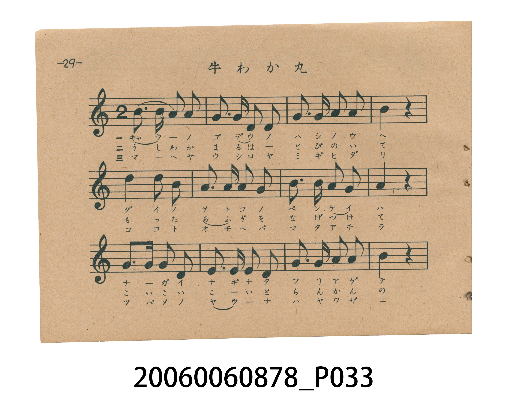
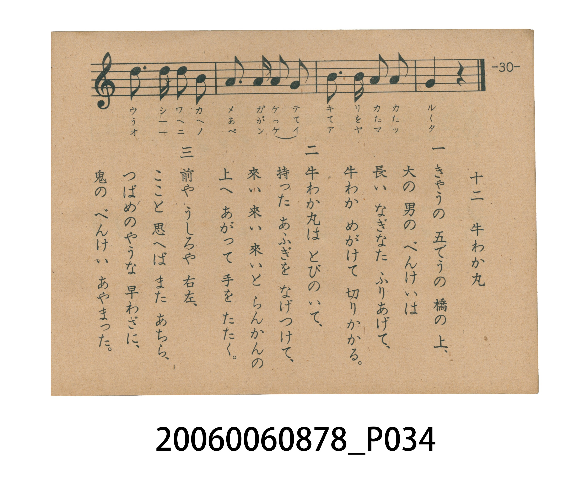

# 牛わか丸（牛若丸）

> Re:Shōka 使用 AI 協助辨識與重建樂譜，可能會有錯誤。歡迎[回報](https://github.com/TMDLang/reshoka/issues)。

- **鋼琴伴奏版**：<br><audio controls src="ushiwakamaru.mp3"></audio>
- **NEUTRINO 歌聲合成版**：<br><audio controls src="ushiwakamaru_neutrino.mp3"></audio>

- 日治時期國民學校唱歌（うたのほん 下・第十二課）
- 國立臺灣歷史博物館典藏

## 說明


- 出處：臺灣總督府編《うたのほん 下》（國民學校初等科第二學年用），第十二課〈牛わか丸〉（牛若丸），原書第 29–30 頁。
- 調性與拍號：ト調（G 大調五聲音階，原書五線譜省略調號，實際音高終止於 G 音），2/4 拍，速度 != 108。
- 背景與曲風：原出自明治 44 年（1911）《尋常小學唱歌（一）》第十九曲，為日本家喻戶曉的歷史故事唱歌。描繪京都五條大橋上大漢武藏坊弁慶揮舞長薙刀砍來，少年牛若丸（源義經）擲扇躍上橋欄干拍手招引，並以如燕子般敏捷的身手令鬼弁慶俯首認輸的經典場面。
- 版本說明：本檔案為原書單聲部五線譜旋律之忠實數位化版本。

### 編曲說明（鋼琴伴奏版）：

1. 前奏 (Intro, 4 小節)：擷取主旋律核心樂句作為導奏，建立調性與拍感。
2. 主歌伴奏 (Ushiwakamaru)：右手 (PianoRH) 演奏原書歌唱主旋律；左手 (PianoLH)
依國民學校低學年教材純樸明朗之風格配以和聲伴奏。


## 歌詞

```text
一　きやうの　五でうの　橋の　上、
大の　男の　べんけいは
長い　なぎなた　ふりあげて、
牛わか　めがけて　切りかかる。

二　牛わか丸は　とびのいて、
持った　あふぎを　なげつけて、
來い　來い　來いと　らんかんの
上へ　あがって　手を　たたく。

三　前や　うしろや　右左、
ここと　思へば　また　あちら、
つばめのやうな　早わざに、
鬼の　べんけい　あやまった。
```

## ABC

<div class="abc-score" data-abc-src="ushiwakamaru.abc" aria-label="五線譜載入中"></div>

[下載 ABC 原始檔](ushiwakamaru.abc)

## TMD 檔案連結

- [主旋律 TMD 檔案](ushiwakamaru.tmd) [[在 TMD Studio 編輯](https://tmdlang.github.io/Tmd-TS/#tmd=s7IKdvYPcrWy4qpTUCpJTLdSyC_KTM_Ms8rNz0sqLc7IV4JLJOfn5KQml2Tm51mVliTm5Wfk5yEky_JzSnNTrYwQIsX5pUXJqXCl8emp6HLxBYnpqVYBBsbGukDCBCFdUJRflpqXmAfUXpKYWZ4I1AwUKMrLLwKakpdalJiDUJtalpmSClJZUJSZm1hUGZ-Snwx0SV4JkttSi4pBri7LT0bWmV9UkpGfXpRYkFFplZFZXAL0OFA-PjsxLxGhqCQjFegtiHSlEpeWlsLzztmPm_ofN3Y_2bHj_Z4OIPdF91Iwu1NBS4tL0VbB0MCCy95WwZ3LxkjfxA5k1LPpS59t2v1sZtOzOfOfzul-tmHi07U7ni1Y-HTKxmdre4CmPG5se9w4_3HjuseNux83TVZ4sqP7cfPu52vWPO1tfLKr58WqTUDjwa4Can--uvtF-67njYufrd3-tH_T095ZzztXvlyy4mnrjhfT-5W4uPS1FGypBbgUFBQeN0x4NnvT89nrXqxa9WxG3-OGiWDR5t1P23e9mDn1_Z5ZEPc837H3-dzFT3fNeb59xeOGLmyeaugG-hYlCDrmPl_b-Xz5RKBngT4FCj7dueX5lBVA_77f04McAo8bQIEND_vHDUAFKMEPVP-0b_6z2TuAuhSMLB81TDY2UHi5oPFxQxPUvS9W7X_WsPxFR_uz7t4XM-cDHf64uQMoCDTIXeHpkuVA5pNdU140bno5f_PLWX1wA4GCz7fPerF2zvM5jc-nLgUqA-vuebp-2ctZs0GKV894vrXp2dpFz6btUXBXAIpA3ANMAApAu4Cslw3zn-5apgBJHkguau55NnM9yEWzN71cBPT1LKCNoGBtB4U0MNEomJgoAEME6EJDS0NDoKnAgH26ofvpjh1PN_SDQguWhJ7saADLdkPDbOdcoJGgIGzaBUp-c9Y8Xbft6bTdzzq2PZvd-XxWCyTxPJva-mRXN8QQoKue9fc_37nqya41L5v3Aj39bNFcYKg8WwkM7y4QY8-iZ2uXAdPY07ldT_c0Pmvd9qx_3YuOeS-nbn8xbebTjobnC3qf7GsDBQwweoHRiIicjme7Jjzft_L5tslARz6bvOlZZ_uLXb1AY4GGP1vT8nTnJmAwPevsftY9--keYIrqebJj2ZPdS58ua3rePvXp2gkvOtY8m9r_rHc70OUvdq0Gqnyye8nLNXsgzniyf_3LZdNerOp9sWcHUAHQFmBeeLpgy8u5ixBB_byzAxgKkCQMDGcg-9mqKc8WdgADCBLLT6etA0V98wp4dD-b3v10X_eTnd1P9y8AxvWzqTue7O192jMNYhTIaGj2gBgADMMXK-c9bV3xbFo7MEqf7FgLYqya92LtemCeAaVW1IQJCpa-ZmCYAx2iACoHgTKgkhCcdjrBZgNj9XFDw-PG3sdNLeD8tA7IBbrvceNyOBcYhFDxHV2PGxpB2oCRBRF6PmU7hPG4cScwDz5unPi4EWjQepAiYLSBOCC5VY8b-8DkfDB36-MmYO5tetw46XHjMqiR8LwHUtHU-LixB2wYULrhaUc7WAPQGd2Pm4AKwEEO9B3E76BEPQcYqFgSFTCiQbE5d8LLtY3PFi0Hxh0kmUGiFZRtVs8AIlAy27odnsyA4s_mzH0xcTo8gb3Y3_dywVpg8nvatxtoPTz0dgETdQNKqdEIjAqgD1c8btwMLpmAgQHz4bMeoK8Ww8IA6PutoFBpmgQLIWBgLIH5GawBmNYhAYjOABoPCqROcIgDgwRIroPEJjCUgCUXxHhgAAJtAwUgMDnD7AGWl0DUjyUMEZ7dM_Xp9uUvtm9-OQ1YmvY86-oCZQdgYuveDwoTYNbubAdmGWAue7Kr7WVjHzBMwBmq4WVT19NpXUA1jxt6gC59OhGYthoxGMBcCVIJNB8tewI1ghyKFLw7gOVNw9NOcOIEOR7o-emPm6Dcp_2bn26HBdXjRmAYABEoYJ41zAWFQuMGsJ59SAG-EBRmMA3AsN4ATmjrYGl_FUjz9JXgyJz2uHE1VCmwGMCSxiFGgnQCbYDEKkaQAn36bE7z09ZJwPQJ8gYwEJBF9gFTD6rI9mVAX4HCvLMXWDqBSo45K142zHyxeOHT3t1P-zuedmwAhXnTYqAIKPU2LUYuwZ4vnQesBuAlGCjxr5uMKMR2zn8-Zcaz7jnAehJYFUBKM6Bp0AAHOp3y2hwKFLT0ubhCizOAbavsRGCrqdQqIBPYTHOoMaipBlmkYGNopmUHZtUoGCvoAqGxghGQBOEaBUOwiKGCaTyQAhMIMYQqiD5dBQMoXQM2z8ewBhi3wCTSDBYExisQr4MpAbKnQMWXg-VALJAsSGY9VGY6VAwiD5LZgd0qI5AcSA1UV1M_mNUN1bUPItPUDTcbIr4CqmMz3J4WqMwy7PYYI5kGdAsw0SGZhmx_L9g-mGn7oTJ9QLwJzFoAkWnqwrAHGhemUAEQDQrfGnBYg0IcRIPiADW-ICIQNdhjAmQlxBkgZ8EDu2kSVHQFKOsiyzTuhAbbZCB7IkrwwAIRSzQ0NcHtWQwm50P1QMSBZS04IEDmgmwGyayCykwClQVgFsg2QtEAcitEH8TVoMgEiUOCFOQOSHIBFi5QGVjEzYe6BlgMQcOgE8MeaDTAEjuIhqZ_MxClC6LALLJyBczHPdAwhSUhmDgooYDYiNDbCvVVF9ztsNDDEUbgLAEJI5AdsFCCxSCyDCQbIIcEJM5B2QfEguiAZV1scQGKNUhIA8txMAuWuiC-g2R-iO9QsjhQHpZZp0FlVmPYg5IlTInOEshFGPZowFligD0BiyBI0gcFM7hAgzocFBHgAILrAdG4IgJmE7DMgJdhyJkCZA8ku8DsgUQrKJNAEgEiKYBciisioIkfGIioZS3urAx1ASgiwBkE4g6QDMg-VHtqubh07RSQqxOw1UAxZS4A)]
- [鋼琴伴奏 TMD 檔案](ushiwakamaru_piano.tmd) [[在 TMD Studio 編輯](https://tmdlang.github.io/Tmd-TS/#tmd=s7IKdvYPcrWy4qpTUCpJTLdSSM7PyUlNLsnMz7MqLUnMy8_Iz1OCS5bl55TmploZIUSK80uLklPhSuPTU9Hl4gsS01OtAgyMjXWBhAlCuqAovyw1LzEPqL0kMbM8EagZKFCUl18ENCUvtSgxB6E2tSwzJRWksqAoMzexqDI-JT8Z6JK8EiS3pRYVg1xdkAl0SnxiUVFiXnoqqpL8opKM_PSixIKMSquMzOKS_KLM5MSc-OzEvESEopIMoC6odKUSl5aWwvPO2Y-b-h83dj_ZseP9ng4g90X3UjC7E8h92b3n-YQtT_Zsebq0_3lnB1BQQUuLS9FWwdDAgsveVsGdy8ZI38QOZP6z6Uufbdr9bGbTsznzn87pfrZh4tO1O54tWPh0ysZna3uAZj1ubHvcOP9x47rHjbsfN01WeLKj-3Hz7udr1jztbXyyq-fFqk1A48FOBWp_vrr7Rfuu542Ln63d_rR_09PeWc87V75csuJp644X0_uVuLj0tRRsqQW4FBQUHjdMeDZ70_PZ616sWvVsRt_jholg0ebdT9t3vZg59f2eWRD3PN-x9_ncxU93zXm-fcXjhi5snmroBvoWJQg65j5f2_l8-USgZ4E-BQo-3bnl-ZQV4DDuQQ6Bxw2gGIBHyOMGUCSgxknP0775z2bvAOpSMLJ81DDZ2EDh5YLGxw1NUPe-WLX_WcPyFx3tz7p7X8ycD3T44-YOoCDQIHeFp0uWA5lPdk150bjp5fzNL2f1wQ0ECj7fPuvF2jnP5zQ-n7oUqAysu-fp-mUvZ80GKV494_nWpmdrFz2btkfBXQEoAnEPMAEoAO0Csl42zH-6a5kCJHkguai559nM9SAXzd70chHQ17OANoKCtR0U0sBEo2BiogAMEaALDS0NDYGmAgP26Ybupzt2PN3QDwotWBJ6sqMBLNsNDbOdc4FGgoKwaRco-c1Z83TdtqfTdj_r2PZsdufzWS2QxPNsauuTXd0QQ4Cuetbf_3znqie71rxs3gv09LNFc4Gh8mwlMLy7QIw9i56tXQZMY0_ndj3d0_isdduz_nUvOua9nLr9xbSZTzsani_ofbKvDRQwwOgFRiMicjqe7ZrwfN_K59smAx35bPKmZ53tL3b1Ao0FGv5sTcvTnZuAwfSss_tZ9-yne4ApqufJjmVPdi99uqzpefvUp2snvOhY82xq_7Pe7UCXv9i1Gqjyye4lL9fsgTjjyf71L5dNe7Gq98WeHUAFQFuAeeHpgi0v5y5CBDUwUQJDBJKEsWZfYOCDlCooGOopPO3sBYoraHjmlRTl6ygA42BD__P1DZpANc8mAwNu2pMdu59N7366r_vZgh1P9zc_W9H0tH_pk71zgMH9dEMfUC8oFHbvAuVVpET3rGU-1EEKCkZ6wByxGxjuEDcoaIQWZwBLw-xEYDlXCrLoaf9moD8VNAJABVuQh6bCsz1TgAohSRKoDxhrcFe83zP76fZlCOU-HpoQW4Dgyb65yDnuyd4-SC57NnXms7kTnm-Z8mzFDlBimzP9yc5uYCJ8tmDPy9ZeUOhP6gHmBYjzQM6GlgVwB7xYOe9p64pn09qBnnuyYy2IsWrei7XrgQUEKGui5kJQGuhrBiawZ6umKIBqBaAMqF4AB3wn2GxgEn7c0PC4sfdxUwu48FgH5AKT4ePG5XAuML1AxXd0PW5oBGkDpkyI0PMp2yGMx407gQXO48aJjxuBBq0HKQKmURAHJLfqcWMfmATGBZC79XETsKhqetw46XHjMqiR8IIGpKKp8XFjD9gwoHTD0452sAagM7ofNwEVgKMT6DuI30HxNmcF1hwETBGgpDt3wsu1jc8WLQcmVEiegqRhUBmxegYQgfLU1u3wPAUUfzZn7ouJ0-G56cX-vpcL1gLz2tO-3UDr4aG3C5iDG1CKyEZgVAB9uOJx42ZwMQwMDJgPn_UAfbUYFgZA328FhUrTJFgIAQNjCczPYA3AjA0JQHQG0HhQIHWCQxwYJEByHSQ2gaEELKYhxgMDEGgbKACBiRRmD7ByACJw2kILQ4Rn90x9un35i-2bX04DJvKeZ11doLwPTGzd-0FhAizHOtuB5QOwSHmyq-1lYx8wTMClR8PLpq6n07qAah439ABd-nQiMG01YjCARRBIJdB8tLIIqBHkUKTg3QEsXBuA5QIocYIcD_T89MdNUC4wrwLzHzSoHjcCwwCIQAHzrGEuKBQaN4D17EMK8IWgMINpAIb1BnBCWwdL-6tAmqevBEfmtMeNq6FKgWUeljQOMRKkE2gDJFYxghTo02dzmp-2TgKmT5A3gIGALLIPmHpQRbYvA_oKFOadoMIAVLDNWfGyYeaLxQuf9u5-2t_xtGMDKMybFgNFQKm3aTFycf186TxgnQcvrkGJf91kRIm9c_7zKTOedc8BNgqARQ6k6AaaBg1woNMpb7pAgYKWPhcXuBy3gpakDjUGNdXg4tHG0EzLDsyqUTBV0AVCUzBtDMQ1CkZgESMwbQgWAYmDZEEiIFwDFgdBAyhdw1WLYpsPsm0mcMsM4xWiDWNBtsYDWWa5cKYpmAmTBhmGXC3g9wEu1xkCjQZ5DUQgxBCqIPqQ_QAyz8ewBpgwgem7GSwITJRAvA6mBMieAhVfDpYDsUCyIJn1UJnpUDGIPEhmB3arjEByIDVQXU39YFY3VNc-iExTN9xsiPgKqI7NcHtaoDLLsNtjjGQa0C3AHINkGrL9vWD7YKbth8r0AfEmMGsBRKapC8MelNQESk_EpSaICEQN9pgAWQlxBshZ8MBumgQVXQEqd5BlGndCg20ykD0RJXhggYglGpqa4PYsBpPzoXog4sCKAhwQIHNBNoNkVkFlJoEKMjALZBuhaAC5FaIP4mpQZILEIUEKcgckuQBLRqgMLOLmQ10DLEOhYdCJYQ8sn4G5hmAamv7NQJQuiAKzyMoVMB_3QMMUloRg4qCEAmIjQm8r1FddcLfDQg9HGIGzBCSMQHbAQgkWg8gykGyAHBKQOAdlHxALogOWdbHFBSjWICENrITALFjqgvgOkvkhvkPJ4kB5WGadBpVZjWEPlQtYRDTgLDHAnoBFECTpg4IZXKBBHQ6KCHAAwfWAaFwRAbMJWGbAyzDkTAGyB5JdYPZAohWUSSCJAJEUQC7FFRHQxA8MRNSyFndWhroAFBHgDAJxB0gGZB-qPVhrE0I1FIiBu4LCrxhRxYG1wRICXMoMiyKcZuOsKg0gXtO1UwBXvApABrI3o32A2jHEjLCIGYPFlLkA)]

## 分析

```text
================================================================================
📊 TMD Song Profile: [ 牛わか丸（牛若丸） ]
================================================================================
⏱  Duration:       0:17 (17.8s), 16 measures total
🎼 Key & Tempo:    首調基準 G, != 108.0 BPM, <2/4>
   - 分析範圍：      由實際發聲的音符與和弦推測調性；播放脈絡另行呈現
🎤 人聲音域:    D4 (MIDI 62) – D5 (MIDI 74) [跨度: 12 個半音 / 1.0 個八度, 難度: easy]
   - 最低音:  D4 in [Ushiwakamaru #1 @ m.2, 0:01]
   - 最高音: D5 in [Ushiwakamaru #1 @ m.5, 0:04]
   - 適合: soprano, mezzo-soprano, contralto, tenor, baritone, bass
🏛  結構:      Ushiwakamaru (17.8s)
⚡ 編曲密度:        Peak 1 軌道同時演奏
🗝  調性診斷：       G 調性不明確（純淨自然大調，未偵測到可信轉調）
   - 風格氣質:    純淨自然大調（陽光明朗、易唱易記，無明顯調外色彩）
   - 轉調歷程:    全曲維持單一推測調性（未偵測到可信轉調）
   - 核心骨幹音:  A, G, B, D, E
   - 調性數值:    G 調性不明確 [相關度: 0.72, 穩定度: Ambiguous, 自然音純度: 100.0%]
   - 候選調性 (K-S): G 大調 (0.72), D 大調 (0.72), B 小調 (0.52)
   - 五度圈歷程:   +1
   - 各段落調性細節:
     • [Ushiwakamaru #1]: G 調性不明確 (r: 0.72, 自然音純度: 100.0%)

  [ 五度圈游移軌跡 ]
               C  
         F           [G ]*
      Bb               D  
      Eb               A  
         Ab           E  
            Db       B  
               F# 
     (* = active key center)

  [ 十二半音累積音高分佈 ]
     C  :                            0.0%
     C# :                            0.0%
     D  : ██████████████            17.9%
     D# :                            0.0%
     E  : ████                       5.4%
     F  :                            0.0%
     F# :                            0.0%
     G  : ████████████████████      25.0%
     G# :                            0.0%
     A  : ████████████████████████  30.4%
     A# :                            0.0%
     B  : █████████████████         21.4%
--------------------------------------------------------------------------------
Assignment 軌道音域：
  - Piano         : D4 – D5 (12 個半音 / 1.0 個八度, 51 個音符)
================================================================================
```


## 原書掃描頁






