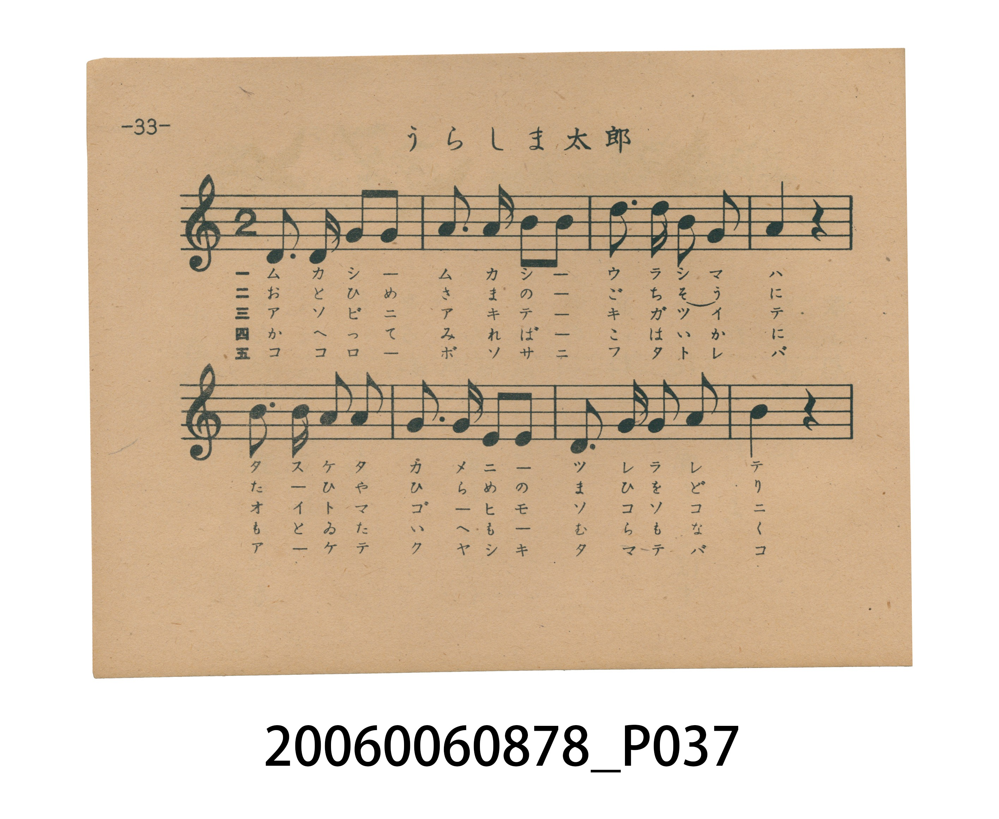
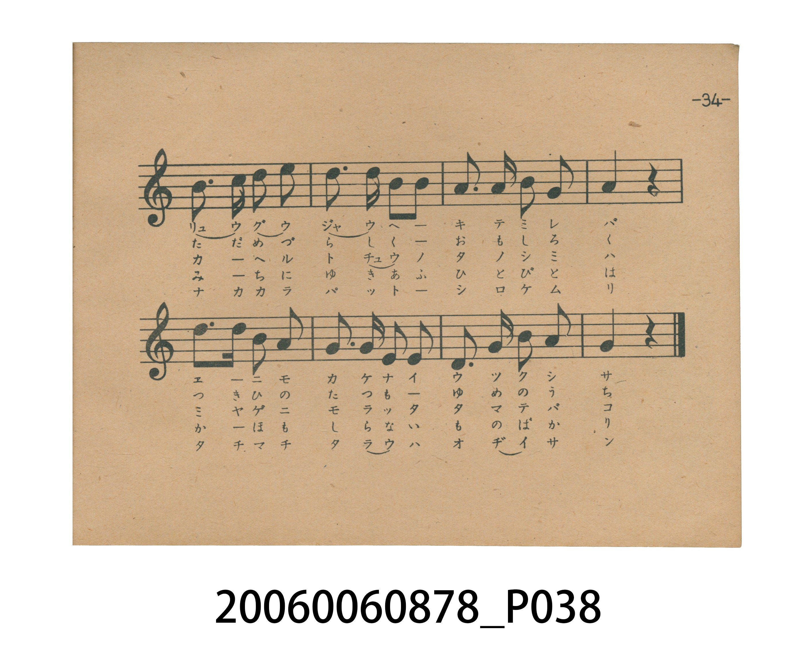
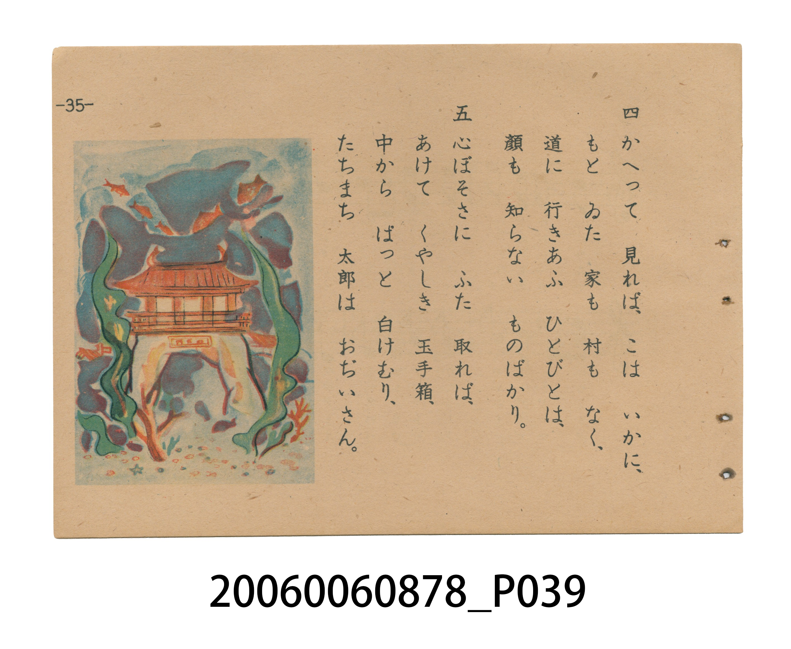
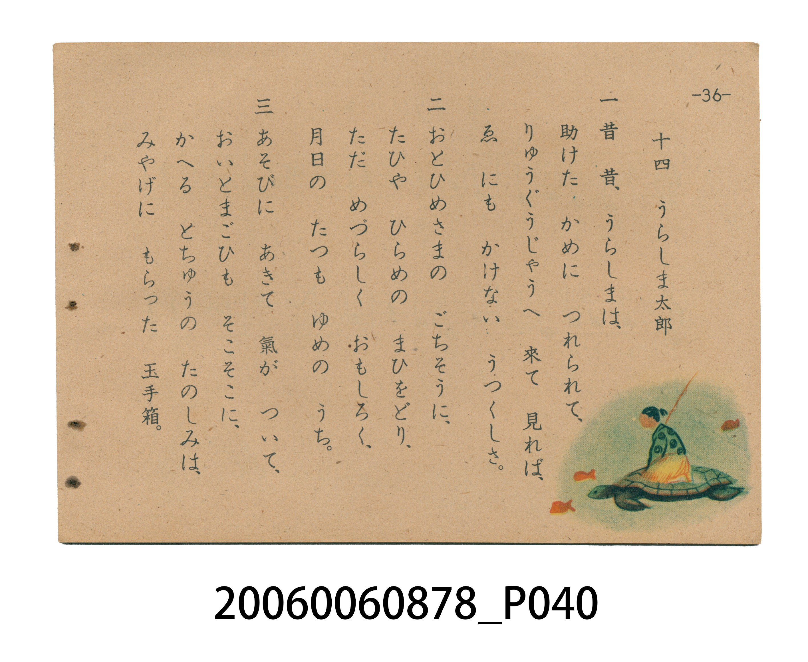

# うらしま太郎（浦島太郎）

> Re:Shōka 使用 AI 協助辨識與重建樂譜，可能會有錯誤。歡迎[回報](https://github.com/TMDLang/reshoka/issues)。

- **鋼琴伴奏版**：<br><audio controls src="urashimataro.mp3"></audio>
- **NEUTRINO 歌聲合成版**：<br><audio controls src="urashimataro_neutrino.mp3"></audio>

- 日治時期國民學校唱歌（うたのほん 下・第十四課）
- 國立臺灣歷史博物館典藏

## 說明


- 出處：臺灣總督府編《うたのほん 下》（國民學校初等科第二學年用），第十四課〈うらしま太郎〉（浦島太郎），原書第 33–36 頁。
- 調性與拍號：ト調（G 大調，原書五線譜省略調號，實際音高終止於 G 音），2/4 拍，速度 != 108。
- 背景與曲風：原出自明治 44 年（1911）《尋常小學唱歌（一）》第十二曲，亦收錄於臺灣總督府昭和 11 年《公學校唱歌集 第一學年用》第十九課。全曲共五節，原書第 35–36 頁配有龍宮城與浦島太郎騎龜前往龍宮之彩圖。
- 版本說明：本檔案為原書單聲部五線譜旋律之忠實數位化版本。

### 編曲說明（鋼琴伴奏版）：

1. 前奏 (Intro, 4 小節)：擷取主旋律核心樂句作為導奏，建立調性與拍感。
2. 主歌伴奏 (Urashimataro)：右手 (PianoRH) 演奏原書歌唱主旋律；左手 (PianoLH)
依國民學校低學年教材純樸明朗之風格配以和聲伴奏。


## 歌詞

```text
一　昔、昔、うらしまは、
助けた　かめに　つれられて、
りゅうぐうじゃうへ　來て　見れば、
ゑにも　かけない　うつくしさ。

二　おとひめさまの　ごちそうに、
たひや　ひらめの　まひをどり、
ただ　めづらしく　おもしろく、
月日の　たつも　ゆめの　うち。

三　あそびに　あきて　氣が　ついて、
おいとまごひも　そこそこに、
かへる　とちゅうの　たのしみは、
みやげに　もらった　玉手箱。

四　かへって　見れば、こは　いかに、
もと　ゐた　家も　村も　なく、
道に　行きあふ　ひとびとは、
顔も　知らない　ものばかり。

五　心ぼそさに　ふた　取れば、
あけて　くやしき　玉手箱、
中から　ぱっと　白けむり、
たちまち　太郎は　おぢいさん。
```

## ABC

<div class="abc-score" data-abc-src="urashimataro.abc" aria-label="五線譜載入中"></div>

[下載 ABC 原始檔](urashimataro.abc)

## TMD 檔案連結

- [主旋律 TMD 檔案](urashimataro.tmd) [[在 TMD Studio 編輯](https://tmdlang.github.io/Tmd-TS/#tmd=s7IKdvYPcrWy4qpTUCpJTLdSyC_KTM_Ms8rNz0sqLc7IV8KQSM3MyowvSa0oScrPz0ZIJ-fn5KQml2Tm51mVliTm5Wfk5yEky_JzSnNTrYwQIsX5pUXJqXCl8emp6HLxBYnpqVYBBsbmugEGJgYI6YKi_LLUvMQ8oPaSxMzyRKBmoEBRXn4R0JS81KLEHITa1LLMlFSQyoKizNzEosr4lPxkoEvySpDcllpUDHJ1WX4yss78opKM_PSixIKMSquMzOISoPeB8vHZiXmJCEUlGalAb-WkAu1NUeLS0lJ43Nj2uKnzceP0x437ni5Z9bK57_2ejmdblz3dvA3G7VTQ0uJStFUwNLDgsrdVcOeyMdI3sQMZ-Wz60mebdj-b2fRszvync7qfbZj4dO2OZwsWPp2y8dnaHqBBINMb5z9uXPe4cffjpskKT3Z0P27e_XzNmqe9jU9nz36xahPQeLDrgNqfr-5-0b7reePiZ2u3P-3f9LR31vPOlS-XrHjauuPF9H4lLi59LQVbagEuBQWFxw0Tns3e9Hz2uherVj2b0fe4YSJYtHn30_ZdL2ZOfb9nFsQ9z3fsfT538dNdc55vX_G4oQubpxq6gb5FCYKOuc_Xdj5fPhHo2Se7eoCCT3dueT5lBdC_7_f0IIfA4wZwMKFGwuMGoDL0eABqfNo3_9nsHUDtCsbGjxomG5spvFzQ-LihCerwF6v2P2tY_qKj_Vl374uZ84E-eNzcARQEmuWu8HTJcjATasiTXVOeb5_1Yu2c53Man09dCpQC6-h5un7Zy1mzX87f_HL1jOdbm56tXfRs2h4FdwWgCMQNwNhXAJoPZL1smP901zIFSNpAckVzz7OZ60GumL3p5SKgl2cBbQSFaTsomIEpRsHERAEYHEBXGVoaGgJNBYbq0w3dT3fseLqhHxRUsPTzZEcDWLYbEmDAgAQaCbT4ya5lz6Zse9nTAnQaWhw9m7H26aQeBUNDkA0gc1vXICfKl7PbFEBRsqMBHiUI43fOBcdH09PWFUB7nrZuBIXReqATkMPdFB7uL1t7n83pfLmv9-m6dU_n94E8jBRhL1f0vdw352ln79N9DRA1T3Z2P9278umcaYiget7Z8WzOGkj6A4YTkP1s1ZRnCzueN-2CWPl02roXjZteNq-AR9ez6d1P93WDzNq_ABhXz6bueLK392nPNIhRIKOhaRtiANDPL1bOA_loWjvQhU92rAUxVs17sXY9MMEDwxgtMYGSXV_zs_5-oEMUQIUZUAZUnIHjvhNsNjDwHjc0PJsx5XFDI4RETsCPG4EGN4LUPe1a-bhxIiivNDQ8bux-3ARUtxrMXvK4qQekAUg2LoOqftzU9bipFZy5JoDJGY-bmsGMHUA9T_YBGUClDS-WAQ0CatsA1wa0YfXjpiaoJSALVz1ubAFzgXqWPG7sBztsKjTUgR6EeB-ULvfNA0YQ0CQIAxjRyDH4YtHqJ7unPetseDZ14vNZLc-b-0ERumPbi4nTQWlwX9vTjg3w2AcGyvM5wFKg5_m-vqf7pr9sWPx86urna9teNu993rLw2eapwCB9vnMV0BHwYNzVA3YksEBZ8bhxEzh4poIDcB1YfMrjxoWPG-eCfQEMNohvQQUPUCnEe0AGMAyB2iAagDqBIpMeN64EhSWShgUgaZC6pbBY6ofaDAw2ILepFywC1vBsTgewWIcZCdQMjCtw2DYBoxhuFdBJC7GE55OdM58uXwPMck927H4-e_az5tZna_Y93dcKKiuaWkCZZf3sl2tngXLK-inAghfIfr5_JRC92Lr9Rcc8UKgCMyZQdjqw0NnwdGn7035gou58sW0xuLQB1gybQO7b2viyYS4wYJ819j5d1vR0zoqnSxYBEzZy2O4AlhpAdwK9BwzAzbB0B-QCvQpKRs82LH7cCAl_YAppQUqGoPgA8oFRAgxPYBwAgxSStoAGTYaRiPgAprgdj5uANQBQBVDPQlgahocfsJoABvh-RLYAcYAR2AiMKLCrgMaDYgXoHlBGed7X-ayz-_m6jViC93nfymcrmp7PXviio-Ppvp6ns-e9bOx7vnQeMCmCyqieNhCaMBES_i_2rX2xEFiI9rzY0f9kR9eztTteNkwB1dW79z_d3wyqsfe1AlM1KM3PWP9k7xxgkfNkzxaQ3cvWPe_d9GJLByjNI7kGFrbAaguW13aAnY2eLcEhBPQtUA3Qm0Bl8NACJTdgeQv0MzCLg3z7dN02SPA-mzsRFs7A3AtLjC-hYd0A9Ak46oD6t0KTPii0gRELJGEB-3LhFIgZz-dDEjqsHABZC4yGDeBCCJgzMMuB2fOAefnZ1NaXLZ3wjPyyYebzlduer54PDJ9nDX0vd-0BKnuyCyQFKlrnrHm6sfXJ3n5gKAF9AUrScye-6OsCJssnO3qBwfFkFyhSXmxfDwz8F_v7Xs5d9Hz2jpeN7UD1T3btegoqe3uAxTIoGc9Y_3zLAqAuoIIXa2cAFQAVP10LLFiRygogrwEYb48b94DTILCggCTprdCA7J-GWiyCggpYFILiBhSeoAQHTIbAsg45hYGVgnIOKGAgOWYjOEpBkfR85l6QEU3A8EMpTYCFEjBnALN_A7StAo1rYL5ZBI7xqcBWEbZABubTtUuAFRqwPARWDUBrgY4GNp6ez570YjIoVJ91Tn45DRRuT3YvAQbRs6YpzxpXICdCUHguXggKnP17n87Z8LRtErBVAYyvlzMXAx37vHUmSMHezudz9rycNhniuKcbNr5Y1_WsYwLQ2BcNjc87dgERNGCB7qO8IQkFClr6XFyhRYnFGcBme0liUb5VQCawp-BQY1BTDbJIwcbQTMsOzKpRMI1X0AVCIGUIpEC4RsEILGSkYAwkQRioCqIIzENWo6tgAKVrwOb5GNYAc1YDWAQYkUA8HSaPW7yxDSLe1AkVB0YqVGY9dluMQHJdUNNWAPEmsP5GqK6pUJl9QLwOyZ4pUPGFQDwXzALZDJJZjd0eY5BcE1TXXCDeDGaBVCPL9ALxMiR7eqHiPUC8BMxqgcrAVKHZYwKS64bq2gHEi8EskGqQzH5o-IDM24Bkz2SojvVQGyBm4PGPKbKuyUATIS6F6NmD5E9QCCL8uRUqMx8c2hCXQGRgrkHYA01WoIQCSjygZALCNeBkA0o8ZqAEBybgic8QLAlRBtGINV0B7Ye4YyYQT4S6COIOaNgBUwDC7yBxUOhDQw6YupBdjiMmwCkLZs8moHpQuMJMA6UyaDoFpzVI6gLJgNIrTMckMGslRKYJkkqxpyxYCm6BhSs83cNSKsg8SCqDiINSLTTuoCkYFJt4YhyUsqAmgHNK0wSUcIP4DpzmkO2B5VSwT0HiwPoLqqMfuz3glAWzZyJafoDoAYUlLH-D0h1ySINyKkgHJEUhUinOlGUCLpLMwIqRCydIcYVcgBEurkBtfag72oAYEkKwkgHU8keS3IHkLZAnINkUkkXxZQvMxLUAnoiWQnSBEyiIPx0pmJGSCTAioMEHzrZ4IgOcuJCKkyYIG6IHlNDAhSDI1xB_ItIxzHHr4DEF8hiekhhcckHLJ3C5ipT7mqDlOrh8hKQiUEmClJPAZTekTAU5C4894PQFSoOQUg7iPUiQgWQ2QmUWwz0IEYfUMqAAg5YY4JSNPV_CKkQwF5KaiCi50JVhT2IguyElKmp-hkUSKMeAfIeoKWBhtwQazRC_IGo37IkLWt6BQxxcJ2LELNA8lJwOq3tBJSdILSLlL8RuDzhxwWokUI6GlHfQugJW1oDrckgtBitrSMnrmLXibrSQg8UsyB6UkIOXdqA0DLIBXiviKovBaQvmOlAaBpXCEP8jyYBtguQWUBpFLr8XQW2HxA3IJkwf1XJx6dopILfKwJYDxZS5AA)]
- [鋼琴伴奏 TMD 檔案](urashimataro_piano.tmd) [[在 TMD Studio 編輯](https://tmdlang.github.io/Tmd-TS/#tmd=s7IKdvYPcrWy4qpTUCpJTLdSSM7PyUlNLsnMz7MqLUnMy8_Iz1OCS5bl55TmploZIUSK80uLklPhSuPTU9Hl4gsS01OtAgyMzXUDDEwMENIFRfllqXmJeUDtJYmZ5YlAzUCBorz8IqApealFiTkItallmSmpIJUFRZm5iUWV8Sn5yUCX5JUguS21qBjk6oJMoFPiE4uKEvPSU1GV5BeVZOSnFyUWZFRaZWQWl-QXZSYn5sRnJ-YlIhSVZAB1WeWkAt2QosSlpaXwuLHtcVPn48bpjxv3PV2y6mVz3_s9Hc-2Lnu6eRuM2wkUedm95_mELU_2bHm6tP95ZwdQUEFLi0vRVsHQwILL3lbBncvGSN_EDmTPs-lLn23a_Wxm07M585_O6X62YeLTtTueLVj4dMrGZ2t7gGaBrGyc_7hx3ePG3Y-bJis82dH9uHn38zVrnvY2Pp09-8WqTUDjwU4Gan--uvtF-67njYufrd3-tH_T095ZzztXvlyy4mnrjhfT-5W4uPS1FGypBbgUFBQeN0x4NnvT89nrXqxa9WxG3-OGiWDR5t1P23e9mDn1_Z5ZEPc837H3-dzFT3fNeb59xeOGLmyeaugG-hYlCDrmPl_b-Xz5RKBnn-zqAQo-3bnl-ZQV4DDuQQ6Bxw3gYEKNmccNoKjAiJyep33zn83eAdSuYGz8qGGysZnCywWNjxuaoA5_sWr_s4blLzran3X3vpg5H-iDx80dQEGgWe4KT5csBzOhhjzZNeX59lkv1s55Pqfx-dSlQCmwjp6n65e9nDX75fzNL1fPeL616dnaRc-m7VFwVwCKQNwAjH0FoPlA1suG-U93LVOApA0kVzT3PJu5HuSK2ZteLgJ6eRbQRlCYtoOCGZhiFExMFIDBAXSVoaWhIdBUYKg-3dD9dMeOpxv6QUEFSz9PdjSAZbshAQYMSKCRQIuf7Fr2bMq2lz0tQKehxdGzGWufTupRMDQE2QAyt3UNcqJ8ObtNARQlOxrgUYIwfudccHw0PW1dAbTnaetGUBitBzoBOdxN4eH-srX32ZzOl_t6n65b93R-H8jDSBH2ckXfy31znnb2Pt3XAFHzZGf3070rn86ZhggqYIoC2gRJf1jzHjDwQEoVFAz1FEBmLe1X0PDMKynK11EAhuGGfqDzNIFqnk0GZplpT3bsfja9--m-7mcLdjzd3_xsRdPT_qVP9s553rTr6YY-oF6QT3bvAmU0pITyrGU-1EEKCkZ6wOS8GxhOEDcoaIQWJRZnAIuqksSifJBFT_s3P-vsVtAIAJVOQR6aCs_2TAEqhIQPUB8wlOGueL9n9tPtyxDKfTw0IbYAwZN9c5Gzy5O9fZD4eDZ15rO5E55vmfJsxQ5QYpkzHRhqwET0bMEeYHA_2b0UGLkvGjdBnAdyNjQjwx3wYuU8UPRNawd67smOtSDGqnkv1q4H5m5gAKPlHFAe62t-1t__bNUUBVDRDpQBFe7ggO8Emw1MKY8bGp7NmPK4oRFCIufWx41AgxtB6p52rXzcOBFUMDQ0PG7sftwEVLcazF7yuKkHpAFINi6Dqn7c1PW4qRVckkwAkzMeNzWDGTuAep7sAzKAShteLAMaBNS2Aa4NaMPqx01NUEtAFq563NgC5gL1LHnc2A922FRojAI9CPE-KOr2zQOmIKBJEAYwLSAn1xeLVj_ZPe1ZZ8OzqROfz2p53twPSr07tr2YOB2U4fa1Pe3YAE_qwEB5PgcYvz3P9_U93Tf9ZcPi51NXP1_b9rJ57_OWhc82TwUG6fOdq4COgAfjrh6wI4Gl54rHjZvAwTMVHIDrwOJTHjcufNw4F-wLYLBBfAsqZYFKId4DMoBhCNQG0QDUCRSZ9LhxJSgskTQsAEmD1C2FxRIwnYBtBgYbkNvUCxYBa3g2pwNYh8GMBGoGxhU4bJuAUQy3CuikhVjC88nOmU-XrwGWL8AE_3z27GfNrc_W7Hu6rxVUMDa1gEqG9bNfrp0FymTrpwBrGSD7-f6VQPRi6_YXHfNAoQoshYCy04El7IanS9uf9ncAdb3YthhctAKrwU0g921tfNkwFxiwzxp7ny5rejpnxdMli4AJGzlsdwCLSKA7gd4DBuBmWLoDcoFeBSWjZxsWP26EhD8whbQgJUNQfAD5wCgBhicwDoBBCklbQIMmw0hEfABT3I7HTcDqDqgCqGchLA3Dww9YJwIDfD8iW4A4wAhsBEYU2FVA40GxAnQPKKM87-sEFg_P123EErzP-1YCC7Dnsxe-6Oh4uq_n6ex5Lxv7ni-dB0yKoGKspw2EJkyEhP-LfWtfLATWGD0vdvQ_2dH1bO2Olw1TQA2T3ftBBSGwebKvFZiqQWl-xnpIiQgsQkB2L1v3vHfTiy0doDSP5BpY2ALraFhe2wF2Nnq2BIcQ0LdANUBvApXBQwuU3ICVC9DPwCwO8u3Tddsgwfts7kRYOANzLywxvoSGdQPQJ-CoA-rfCk36oNAGRiyQhAXsy4VTIGY8nw9J6LByAGQtMBo2gAshYM7ALAdmzwPm5WdTW1-2dMIz8suGmc9Xbnu-ej4wfJ419L3ctQeo7MkukBSoaJ2z5unG1id7-4GhBPQFKEnPnfiirwuYLJ_s6AUGx5NdoEh5sX09MPBf7O97OXfR89k7Xja2A9U_2bXrKajs7QEWy6BkPGP98y0LgLqACl6snQFUAFT8dC2wYEUqK4C8BmC8PW7cA06DwIICkqS3QgOyfxpqsQgKKmBRCIobUHiCEhwwGQLLOuQUBlYKyjmggIHkmI3gKAVF0vOZe0FGNAHDD6U0ARZKwJwBzP4N0IYZNK6B-WYROManApuA2AIZmE_XLnk6bR2wPARWDUBrwfVz9_PZk15MBoXqs87JL6eBwu3J7iXAIHrWNOVZ4wrkRAgKz8ULQYGzf-_TORuetk0CNqGA8fVy5mKgY5-3zgQp2Nv5fM6el9MmQxz3dMPGF-u6nnVMABr7oqHxeccuIIIGLNB9lLeaoUBBS5-LC9wKsYK2AxxqDGqqwZW7jaGZlh2YVaNgqqALhKYKxkDSCIhrFAzBIoYKZvFACkwAVYEokCC6Ml0FAyhdw1WLYqEPsoUmcPsM4xWiDWOhDNNcEMssHs6EyYLMQm7WEPADxHVACuQoEK4BOxLkVJCDQRjVp8hqkL0AMs_HsAZYMDSARYDpEIinw-Rxize2QcSbOqHiwDQJlVmP3RYjkFwX1LQVQLwJrL8RqmsqVGYfEK9DsmcKVHwhEM8Fs0A2g2RWY7fHGCTXBNU1F4g3g1kg1cgyvUC8DMmeXqh4DxAvAbNaoDIwVWj2mIDkuqG6dgDxYjALpBoksx8aPiDzNiDZMxmqYz3UBogZePxjiqxrMtBEiEshevYg-RMUggh_boXKzAeHNsQlEBmYaxD2QJMVKKGAEg8omRCRNUCSEGUQjVjTFdB-iDtmAvFEqIsg7oCGHTAFIPwOEgeFPjTkgKkL2eU4YgKcsmD2bAKqB4UrzDRQKoOmU3Bag6QukAwovcJ0TAKzVkJkmiCpFHvKgqXgFli4wtM9LKWCzIOkMog4KNVC4w6agkGxiSfGQSkLagI4pzRNQAk3iO_AaQ7ZHlhOBfsUJA6sfqE6-rHbA05ZMHsmouUHiB5QWMLyNyjdIYc0KKeCdEBSFCKV4kxZJuAiyQysGLlwghRXyAUY4eIK1FWBuqMNiCEhBCsZQB0XJMkdSN4CeQKSTSFZFF-2wExcC-CJaClEFziBgvjTkYIZKZkAIwIafOBsiycywIkLqThpgrAhekAJDVwIgnwN8SciHcMctw4eUyCP4SmJwSUXtHwCl6tIua8JWq6Dy0dIKgKVJEg5CVx2Q8pUkLPw2ANOX6A0CCnlIN6DBBlIZiNUZjHcgxBxSC0DCjBoiQFO2djzJfUrdUQSA9kNKVFR8zMskkA5BuQ7RE0BC7sl0GiG-AVRu2FPXNDyDhzi4DoRI2aB5qHkdFjdCyo5QWoRKX8hdnvAiQtWI4FyNKS8g9YVsLIGXJdDajFYWUNKXsesFXejhRwsZkH2oIQcvLQDpWGQDfBaEVdZDE5bMNeB0jCoFIb4H0kGbBMkt4DSKHL5vQhqOyRuQDZh-ghro4yYdh5agw_eykNTagpqCGJjgbUhqTZDMYaQaoSl2NqbBhCP6dopgBuvCkAGsiejfYAGY4gZYREzxiJmgkXMFCymzAUA)]

## 分析

```text
================================================================================
📊 TMD Song Profile: [ うらしま太郎（浦島太郎） ]
================================================================================
⏱  Duration:       0:17 (17.8s), 16 measures total
🎼 Key & Tempo:    首調基準 G, != 108.0 BPM, <2/4>
   - 分析範圍：      由實際發聲的音符與和弦推測調性；播放脈絡另行呈現
🎤 人聲音域:    D4 (MIDI 62) – E5 (MIDI 76) [跨度: 14 個半音 / 1.2 個八度, 難度: moderate]
   - 最低音:  D4 in [Urashimataro #1 @ m.1, 0:00]
   - 最高音: E5 in [Urashimataro #1 @ m.9, 0:09]
   - 適合: soprano, mezzo-soprano, contralto, tenor, baritone, bass
🏛  結構:      Urashimataro (17.8s)
⚡ 編曲密度:        Peak 1 軌道同時演奏
🗝  調性診斷：       G 調性不明確（純淨自然大調，未偵測到可信轉調）
   - 風格氣質:    純淨自然大調（陽光明朗、易唱易記，無明顯調外色彩）
   - 轉調歷程:    全曲維持單一推測調性（未偵測到可信轉調）
   - 核心骨幹音:  B, A, D, G, E
   - 調性數值:    G 調性不明確 [相關度: 0.78, 穩定度: Ambiguous, 自然音純度: 100.0%]
   - 候選調性 (K-S): G 大調 (0.78), D 大調 (0.75), B 小調 (0.65)
   - 五度圈歷程:   +1
   - 各段落調性細節:
     • [Urashimataro #1]: G 調性不明確 (r: 0.78, 自然音純度: 100.0%)

  [ 五度圈游移軌跡 ]
               C  
         F           [G ]*
      Bb               D  
      Eb               A  
         Ab           E  
            Db       B  
               F# 
     (* = active key center)

  [ 十二半音累積音高分佈 ]
     C  : █                          0.9%
     C# :                            0.0%
     D  : █████████████████████     21.4%
     D# :                            0.0%
     E  : █████████                  8.9%
     F  :                            0.0%
     F# :                            0.0%
     G  : █████████████████████     21.4%
     G# :                            0.0%
     A  : ███████████████████████   23.2%
     A# :                            0.0%
     B  : ████████████████████████  24.1%
--------------------------------------------------------------------------------
Assignment 軌道音域：
  - Piano         : D4 – E5 (14 個半音 / 1.2 個八度, 52 個音符)
================================================================================
```


## 原書掃描頁










