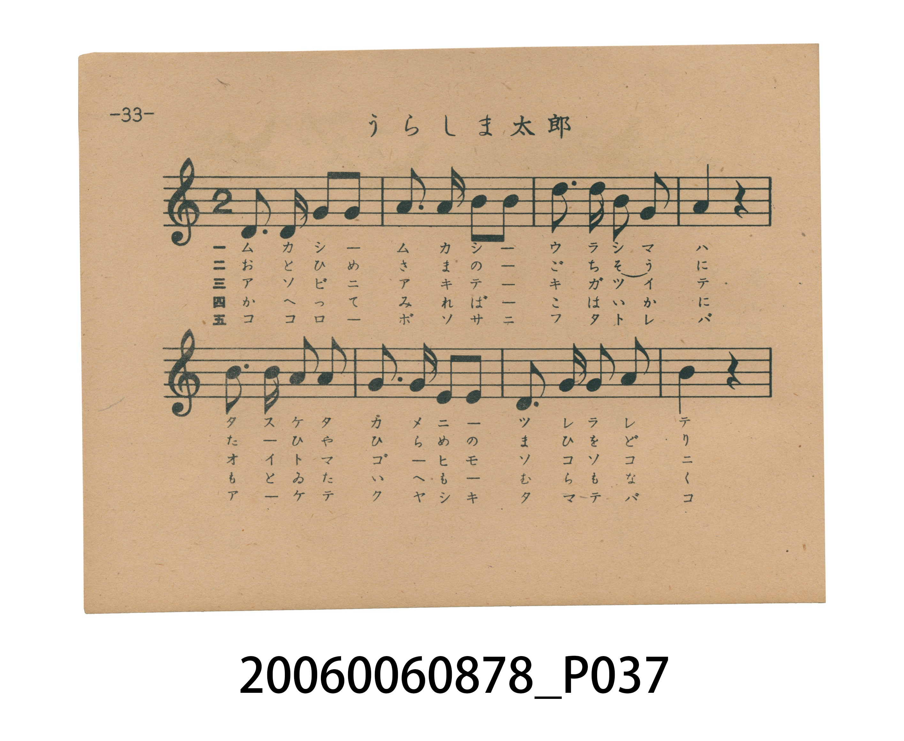
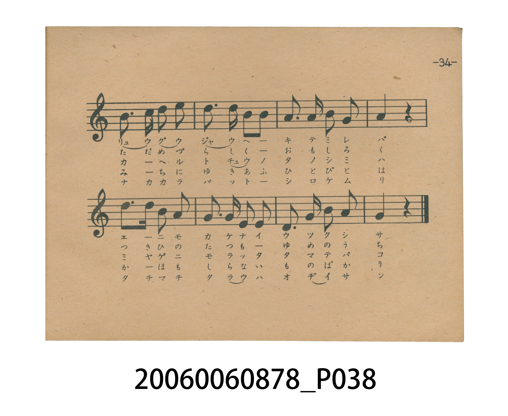
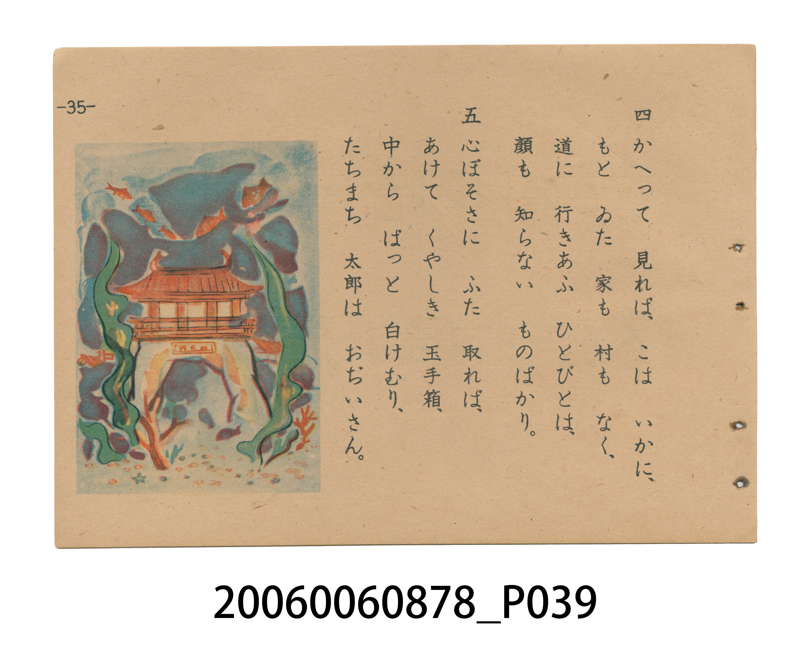
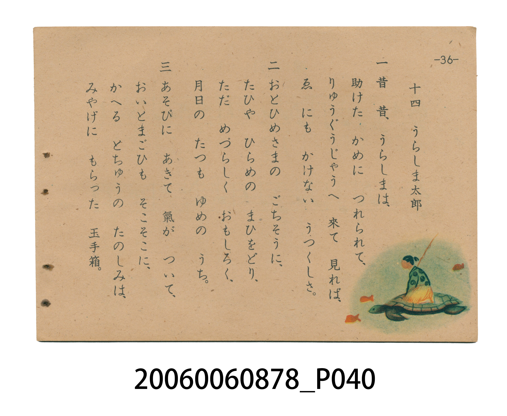

# うらしま太郎（浦島太郎）

> Re:Shōka 使用 AI 協助辨識與重建樂譜，可能會有錯誤。歡迎回報。

- **鋼琴伴奏版**：<br><audio controls src="urashimataro.mp3"></audio>
- **NEUTRINO 歌聲合成版**：<br><audio controls src="urashimataro_neutrino.mp3"></audio>

- 日治時期國民學校唱歌（うたのほん 下・第十四課）
- 國立臺灣歷史博物館典藏

## 說明


- 出處：臺灣總督府編《うたのほん 下》（國民學校初等科第二學年用），第十四課〈うらしま太郎〉（浦島太郎），原書第 33–36 頁。
- 調性與拍號：ト調（G 大調，原書五線譜省略調號，實際音高終止於 G 音），2/4 拍，速度 != 108。
- 背景與曲風：原出自明治 44 年（1911）《尋常小學唱歌（一）》第十二曲，亦收錄於臺灣總督府昭和 11 年《公學校唱歌集 第一學年用》第十九課。全曲共五節，原書第 35–36 頁配有龍宮城與浦島太郎騎龜前往龍宮之彩圖。
- 版本說明：本檔案為原書單聲部五線譜旋律之忠實數位化版本。

### 編曲說明（鋼琴伴奏版）：

1. 前奏 (Intro, 4 小節)：擷取主旋律核心樂句作為導奏，建立調性與拍感。
2. 主歌伴奏 (Urashimataro)：右手 (PianoRH) 演奏原書歌唱主旋律；左手 (PianoLH)
依國民學校低學年教材純樸明朗之風格配以和聲伴奏。


## 歌詞

```text
一　昔、昔、うらしまは、
助けた　かめに　つれられて、
りゅうぐうじゃうへ　來て　見れば、
ゑにも　かけない　うつくしさ。

二　おとひめさまの　ごちそうに、
たひや　ひらめの　まひをどり、
ただ　めづらしく　おもしろく、
月日の　たつも　ゆめの　うち。

三　あそびに　あきて　氣が　ついて、
おいとまごひも　そこそこに、
かへる　とちゅうの　たのしみは、
みやげに　もらった　玉手箱。

四　かへって　見れば、こは　いかに、
もと　ゐた　家も　村も　なく、
道に　行きあふ　ひとびとは、
顔も　知らない　ものばかり。

五　心ぼそさに　ふた　取れば、
あけて　くやしき　玉手箱、
中から　ぱっと　白けむり、
たちまち　太郎は　おぢいさん。
```

## ABC

```abc
X:1
T:うらしま太郎（浦島太郎）
M:2/4
L:1/16
Q:1/4=108
K:G
V:V1 name="Piano" snm="Pia"
[V:V1]
D3 D G2 G2 | A3 A B2 B2 | d3 d B2 G2 | A4 z4 |
w: 1.~む か し _ | む か し _ | う ら し ま | は
w: 2.~お と ひ め | さ ま の _ | ご ち そ う | に
w: 3.~あ そ び に | あ き て _ | き が つ い | て
w: 4.~か へ っ て | み れ ば _ | こ は い か | に
w: 5.~こ こ ろ _ | ぼ そ さ に | ふ た と れ | ば
B3 B A2 A2 | G3 G E2 E2 | D3 G G2 A2 | B4 z4 |
w: 1.~た す け た | か め に _ | つ れ ら れ | て
w: 2.~た ひ や _ | ひ ら め の | ま ひ を ど | り
w: 3.~お い と ま | ご ひ も _ | そ こ そ こ | に
w: 4.~も と ゐ た | い へ も _ | む ら も な | く
w: 5.~あ け て _ | く や し き | た ま て ば | こ
B3 c d2 e2 | d3 d B2 B2 | A3 A B2 G2 | A4 z4 |
w: 1.~りゅ う ぐ う | じゃ う へ _ | き て み れ | ば
w: 2.~た だ め づ | ら し く _ | お も し ろ | く
w: 3.~か へ る _ | と ちゅ う の | た の し み | は
w: 4.~み ち に _ | ゆ き あ ふ | ひ と び と | は
w: 5.~な か か ら | ぱ っ と _ | し ろ け む | り
d3 d B2 A2 | G3 G E2 E2 | D3 G B2 A2 | G4 z4 |
w: 1.~ゑ に も _ | か け な い | う つ く し | さ
w: 2.~つ き ひ の | た つ も _ | ゆ め の う | ち
w: 3.~み や げ に | も ら っ た | た ま て ば | こ
w: 4.~か ほ も _ | し ら な い | も の ば か | り
w: 5.~た ち ま ち | た ら う は | お ぢ い さ | ん
```

## TMD 檔案連結

- [主旋律 TMD 檔案](urashimataro.tmd) [[在 TMD Studio 編輯](https://tmdlang.github.io/Tmd-TS/#tmd=s7IKdvYPcrWy4qpTUCpJTLdSyC_KTM_Ms8rNz0sqLc7IV8KQSM3MyowvSa0oScrPz1bi0tJSeNzY9rip83Hj9MeN-54uWfWyue_9no5nW5c93bwNxu1U0NLiUrRVMDSw4LK3VXDnsjHSN7EDmf1s-tJnm3Y_m9n0bM78p3O6n22Y-HTtjmcLFj6dsvHZ2h6gQSDTG-c_blz3uHH346bJCk92dD9u3v18zZqnvY1PZ89-sWoT0HiwM4Han6_uftG-63nj4mdrtz_t3_S0d9bzzpUvl6x42rrjxfR-JS4ufS0FW2oBLgUFhccNE57N3vR89roXq1Y9m9H3uGEiWLR599P2XS9mTn2_ZxbEPc937H0-d_HTXXOeb1_xuKELm6cauoG-RQmCjrnP13Y-Xz4R6Nknu3qAgk93bnk-ZQXQv-_39CCHwOMGcDChRsLjBqAy9HgAanzaN__Z7B1A7QrGxo8aJhubKbxc0Pi4oQnq8Ber9j9rWP6io_1Zd--LmfOBPnjc3AEUBJrlrvB0yXIwE2rIk11Tnm-f9WLtnOdzGp9PXQqUAuvoebp-2ctZs1_O3_xy9YznW5uerV30bNoeBXcFoAjEDcDYVwCaD2S9bJj_dNcyBUjaQHJFc8-zmetBrpi96eUioJdnAW0EhWk7KJiBKUbBxEQBGBxAVxlaGhoCTQWG6tMN3U937Hi6oR8UVLD082RHA1i2GxJgwIAEGgm0-MmuZc-mbHvZ0wJ0GlocPZux9umkHgVDQ5ANIHNb1yAnypez2xRAUbKjAR4lCON3zgXHR9PT1hVAe562bgSF0XqgE5DD3RQe7i9be5_N6Xy5r_fpunVP5_eBPIwUYS9X9L3cN-dpZ-_TfQ0QNU92dj_du_LpnGmIoHre2fFszhpI-gOGE5D9bNWUZws7njftglj5dNq6F42bXjavgEfXs-ndT_d1g8zavwAYV8-m7niyt_dpzzSIUSCjoWkbYgDQzy9WzgP5aFo70IVPdqwFMVbNe7F2PTDBA8MYLTGBkl1f87P-fqBDFAIMjM2BMgEGJgbguO8Emw0MvMcNDc9mTHnc0AghkRPw40agwY0gdU-7Vj5unAjKKw0Njxu7HzcB1a0Gs5c8buoBaQCSjcugqh83dT1uagVnrglgcsbjpmYwYwdQz5N9QAZQacOLZUCDgNo2wLUBbVj9uKkJagnIwlWPG1vAXKCeJY8b-8EOmwoNdaAHId4Hpct984ARBDQJwgBGNHIMvli0-snuac86G55Nnfh8Vsvz5n5QhO7Y9mLidFAa3Nf2tGMDPPaBgfJ8DrAU6Hm-r-_pvukvGxY_n7r6-dq2l817n7csfLZ5KjBIn-9cBXQEPBh39YAdCSxQVjxu3AQOnqngAFwHFp_yuHHh48a5YF8Agw3iW1DBA1QK8R6QAQxDoDaIBqBOoMikx40rQWGJpGEBSBqkbikslvqhNgODDcht6gWLgDU8m9MBLNZhRgI1A-MKHLZNwCiGWwV00kIs4flk58yny9cAs9yTHbufz579rLn12Zp9T_e1gsqKphZQZlk_--XaWaCcsn4KsOAFsp_vXwlEL7Zuf9ExDxSqwIwJlJ0OLHQ2PF3a_rQfmKg7X2xbDC5tgDXDJpD7tja-bJgLDNhnjb1PlzU9nbPi6ZJFwISNHLY7gKUG0J1A7wEDcDMs3QG5QK-CktGzDYsfN0LCH5hCWpCSISg-gHxglADDExgHwCCFpC2gQZNhJCI-gClux-MmYA0AVAHUsxCWhuHhB6wmgAG-H5EtQBxgBDYCIwrsKqDxoFgBugeUUZ73dT7r7H6-biOW4H3et_LZiqbnsxe-6Oh4uq_n6ex5Lxv7ni-dB0yKoDKqpw2EJkyEhP-LfWtfLAQWoj0vdvQ_2dH1bO2Olw1TQHX17v1P9zeDaux9rcBUDUrzM9Y_2TsHWOQ82bMFZPeydc97N73Y0gFK80iugYUtsNqC5bUdYGejZ0twCAF9C1QD9CZQGTy0QMkNWN4C_QzM4iDfPl23DRK8z-ZOhIUzMPfCEuNLaFg3AH0Cjjqg_q3QpA8KbWDEAklYwL5cOAVixvP5kIQOKwdA1gKjYQO4EALmDMxyYPY8YF5-NrX1ZUsnPCO_bJj5fOW256vnA8PnWUPfy117gMqe7AJJgYrWOWuebmx9srcfGEpAX4CS9NyJL_q6gMnyyY5eYHA82QWKlBfb1wMD_8X-vpdzFz2fveNlYztQ_ZNdu56Cyt4eYLEMSsYz1j_fsgCoC6jgxdoZQAVAxU_XAgtWpLICyGsAxtvjxj3gNAgsKCBJeis0IPunoRaLoKACFoWguAGFJyjBAZMhsKxDTmFgpaCcAwoYSI7ZCI5SUCQ9n7kXZEQTMPxQShNgoQTMGcDs3wBtq0DjGphvFoFjfCqwVYQtkIH5dO0SYIUGLA-BVQPQWqCjgY2n57MnvZgMCtVnnZNfTgOF25PdS4BB9KxpyrPGFciJEBSeixeCAmf_3qdzNjxtmwRsVQDj6-XMxUDHPm-dCVKwt_P5nD0vp02GOO7pho0v1nU965gANPZFQ-Pzjl1ABA1YoPsob0hCgYKWPhdXaFFicUZmbmJJYlG-VUBmYl6-Q41BTTXIIgUbQzMtOzCrRsE0XkEXCIGUIZAC4RoFI7CQkYIxkARhoCqIIjAPWY2uggGUrgGb52NYA8xZDWARYEQC8XSYPG7xxjaIeFMnVBwYqVCZ9dhtMQLJdUFNWwHEm8D6G6G6pkJl9gHxOiR7pkDFFwLxXDALZDNIZjV2e4xBck1QXXOBeDOYBVKNLNMLxMuQ7OmFivcA8RIwqwUqA1OFZo8JSK4bqmsHEC8Gs0CqQTL7oeEDMm8Dkj2ToTrWQ22AmIHHP6bIuiYDTYS4FKJnD5I_QSGI8OdWqMx8cGhDXAKRgbkGYQ80WYESCijxgJIJCNeAkw0o8ZiBEhyYgCc-Q7AkRBlEI9Z0BbQf4o6ZQDwR6iKIO6BhB0wBCL-DxEGhDw05YOpCdjmOmACnLJg9m4DqQeEKMw2UyqDpFJzWIKkLJANKrzAdk8CslRCZJkgqxZ6yYCm4BRau8HQPS6kg8yCpDCIOSrXQuIOmYFBs4olxUMqCmgDOKU0TUMIN4jtwmkO2B5ZTwT4FiQPrL6iOfuz2gFMWzJ6JaPkBogcUlrD8DUp3yCENyqkgHZAUhUilOFOWCbhIMgMrRi6cIMUVcgFGuLgCtfWh7mgDYkgIwUoGUMsfSXIHkrdAnoBkU0gWxZctMBPXAngiWgrRBU6gIP50pGBGSibAiIAGHzjb4okMcOJCKk6aIGyIHlBCAxeCIF9D_IlIxzDHrYPHFMhjeEpicMkFLZ_A5SpS7muCluvg8hGSikAlCVJOApfdkDIV5Cw89oDTFygNQko5iPcgQQaS2QiVWQz3IEQcUsuAAgxaYoBTNvZ8CasQwVxIaiKi5EJXhj2JgeyGlKio-RkWSaAcA_IdoqaAhd0SaDRD_IKo3bAnLmh5Bw5xcJ2IEbNA81ByOqzuBZWcILWIlL8Quz3gxAWrkUA5GlLeQesKWFkDrsshtRisrCElr2PWirvRQg4WsyB7UEIOXtqB0jDIBnitiKssBqctmOtAaRhUCkP8jyQDtgmSW0BpFLn8XgS1HRI3IJswfVTLxaVrp4DcKgNbDhRT5gIA)]
- [鋼琴伴奏 TMD 檔案](urashimataro_piano.tmd) [[在 TMD Studio 編輯](https://tmdlang.github.io/Tmd-TS/#tmd=s7IKdvYPcrWy4tLSUnjc2Pa4qfNx4_THjfueLln1srnv_Z6OZ1uXPd28DcbtBIq87N7zfMKWJ3u2PF3a_7yzAyiooKXFpWirYGhgwWVvq-DOZWOkb2LHVaeg9Gz60mebdj-b2fRszvync7qfbZj4dO2OZwsWPp2y8dnaHqBZICsb5z9uXPe4cffjpskKT3Z0P27e_XzNmqe9jU9nz36xahPQeCWQUUDtz1d3v2jf9bxx8bO125_2b3raO-t558qXS1Y8bd3xYnq_EheXvpaCLbUAl4KCwuOGCc9mb3o-e92LVauezeh73DARLNq8-2n7rhczp77fMwvinuc79j6fu_jprjnPt6943NCFzVMN3UDfogRBx9znazufL58I9OyTXT1Awac7tzyfsgIcxj3IIfC4ARxMqDHzuAEUFRiR0_O0b_6z2TuA2hWMjR81TDY2U3i5oPFxQxPU4S9W7X_WsPxFR_uz7t4XM-cDffC4uQMoCDTLXeHpkuVgJtSQJ7umPN8-68XaOc_nND6fuhQoBdbR83T9spezZr-cv_nl6hnPtzY9W7vo2bQ9Cu4KQBGIG4CxrwA0H8h62TD_6a5lCpC0geSK5p5nM9eDXDF708tFQC_PAtoICtN2UDADU4yCiYkCMDiArjK0NDQEmgoM1acbup_u2PF0Qz8oqGDp58mOBrBsNyTAgAEJNBJo8ZNdy55N2faypwXoNLQ4ejZj7dNJPQqGhiAbQOa2rkFOlC9ntymAomRHAzxKEMbvnAuOj6anrSuA9jxt3QgKo_VAJyCHuyk83F-29j6b0_lyX-_Tdeuezu8DeRgpwl6u6Hu5b87Tzt6n-xogap7s7H66d-XTOdMQQQVMUUCbIOkPa94DBh5IqYKCoZ4CyKyl_QoannklRfk6CsAw3NAPdJ4mUM2zycAsM-3Jjt3Ppnc_3df9bMGOp_ubn61oetq_9MneOc-bdj3d0AfUC_LJ7l2gjIaUUJ61zIc6SEHBSA-YnHcDwwniBgWN0KLE4ozM3MSSxKJ8kEVP-zc_6-xW0AjITMzLD_LQVHi2ZwpQISR8gPqAoQx3xfs9s59uX4ZQ7uOhCbEFCJ7sm4ucXZ7s7YPEx7OpM5_NnfB8y5RnK3aAEsuc6cBQAyaiZwv2AIP7ye6lwMh90bgJ4jyQs6EZGe6AFyvngaJvWjvQc092rAUxVs17sXY9MHcDAxgt54DyWF_zs_7-Z6umKAQYGJsDZQIMTAzAAd8JNhuYUh43NDybMeVxQyOERM6tjxuBBjeC1D3tWvm4cSKoYGhoeNzY_bgJqG41mL3kcVMPSAOQbFwGVf24qetxUyu4JJkAJmc8bmoGM3YA9TzZB2QAlTa8WAY0CKhtA1wb0IbVj5uaoJaALFz1uLEFzAXqWfK4sR_ssKnQGAV6EOJ9UNTtmwdMQUCTIAxgWkBOri8WrX6ye9qzzoZnUyc-n9XyvLkflHp3bHsxcToow-1re9qxAZ7UgYHyfA4wfnue7-t7um_6y4bFz6eufr627WXz3uctC59tngoM0uc7VwEdAQ_GXT1gRwJLzxWPGzeBg2cqOADXgcWnPG5c-LhxLtgXwGCD-BZUygKVQrwHZADDEKgNogGoEygy6XHjSlBYImlYAJIGqVsKiyVgOgHbDAw2ILepFywC1vBsTgewDoMZCdQMjCtw2DYBoxhuFdBJC7GE55OdM58uXwMsX4AJ_vns2c-aW5-t2fd0XyuoYGxqAZUM62e_XDsLlMnWTwHWMkD28_0rgejF1u0vOuaBQhVYCgFlpwNL2A1Pl7Y_7e8A6nqxbTG4aAVWg5tA7tva-LJhLjBgnzX2Pl3W9HTOiqdLFgETNnLY7gAWkUB3Ar0HDMDNsHQH5AK9CkpGzzYsftwICX9gCmlBSoag-ADygVECDE9gHACDFJK2gAZNhpGI-ACmuB2Pm4DVHVAFUM9CWBqGhx-wTgQG-H5EtgBxgBHYCIwosKuAxoNiBegeUEZ53tcJLB6er9uIJXif960EFmDPZy980dHxdF_P09nzXjb2PV86D5gUQcVYTxsITZgICf8X-9a-WAisMXpe7Oh_sqPr2dodLxumgBomu_eDCkJg82RfKzBVg9L8jPWQEhFYhIDsXrbuee-mF1s6QGkeyTWwsAXW0bC8tgPsbPRsCQ4hoG-BaoDeBCqDhxYouQErF6CfgVkc5Nun67ZBgvfZ3ImwcAbmXlhifAkN6wagT8BRB9S_FZr0QaENjFggCQvYlwunQMx4Ph-S0GHlAMhaYDRsABdCwJyBWQ7MngfMy8-mtr5s6YRn5JcNM5-v3PZ89Xxg-Dxr6Hu5aw9Q2ZNdIClQ0TpnzdONrU_29gNDCegLUJKeO_FFXxcwWT7Z0QsMjie7QJHyYvt6YOC_2N_3cu6i57N3vGxsB6p_smvXU1DZ2wMslkHJeMb651sWAHUBFbxYOwOoAKj46VpgwYpUVgB5DcB4e9y4B5wGgQUFJElvhQZk_zTUYhEUVMCiEBQ3oPAEJThgMgSWdcgpDKwUlHNAAQPJMRvBUQqKpOcz94KMaAKGH0ppAiyUgDkDmP0boA0zaFwD880icIxPBTYBsQUyMJ-uXfJ02jpgeQisGoDWguvn7uezJ72YDArVZ52TX04DhduT3UuAQfSsacqzxhXIiRAUnosXggJn_96nczY8bZsEbEIB4-vlzMVAxz5vnQlSsLfz-Zw9L6dNhjju6YaNL9Z1PeuYADT2RUPj845dQAQNWKD7KG81Q4GClj4XF7gVYgVtBzjUGNRUgyt3G0MzLTswq0bBVEEXCE0VjIGkERDXKBiCRQwVzOKBFJgAqgJRIEF0ZboKBlC6hqsWxUIfZAtN4PYZxitEG8ZCGaa5IJZZPJwJkwWZhdysIeAHiOuAFMhRIFwDdiTIqSAHgzCqT5HVIHsBZJ6PYQ2wYGgAiwDTIRBPh8njFm9sg4g3dULFgWkSKrMeuy1GILkuqGkrgHgTWH8jVNdUqMw-IF6HZM8UqPhCIJ4LZoFsBsmsxm6PMUiuCaprLhBvBrNAqpFleoF4GZI9vVDxHiBeAma1QGVgqtDsMQHJdUN17QDixWAWSDVIZj80fEDmbUCyZzJUx3qoDRAz8PjHFFnXZKCJEJdC9OxB8icoBBH-3AqVmQ8ObYhLIDIw1yDsgSYrUEIBJR5QMiEia4AkIcogGrGmK6D9EHfMBOKJUBdB3AENO2AKQPgdJA4KfWjIAVMXsstxxAQ4ZcHs2QRUDwpXmGmgVAZNp-C0BkldIBlQeoXpmARmrYTINEFSKfaUBUvBLbBwhad7WEoFmQdJZRBxUKqFxh00BYNiE0-Mg1IW1ARwTmmagBJuEN-B0xyyPbCcCvYpSBxY_UJ19GO3B5yyYPZMRMsPED2gsITlb1C6Qw5pUE4F6YCkKEQqxZmyTMBFkhlYMXLhBCmukAswwsUVqKsCdUcbEENCCFYygDouSJI7kLwF8gQkm0KyKL5sgZm4FsAT0VKILnACBfGnIwUzUjIBRgQ0-MDZFk9kgBMXUnHSBGFD9IASGrgQBPka4k9EOoY5bh08pkAew1MSg0suaPkELleRcl8TtFwHl4-QVAQqSZByErjshpSpIGfhsQecvkBpEFLKQbwHCTKQzEaozGK4ByHikFoGFGDQEgOcsrHnS-pX6ogkBrIbUqKi5mdYJIFyDMh3iJoCFnZLoNEM8QuidsOeuKDlHTjEwXUiRswCzUPJ6bC6F1RygtQiUv5C7PaAExesRgLlaEh5B60rYGUNuC6H1GKwsoaUvI5ZK-5GCzlYzILsQQk5eGkHSsMgG-C1Iq6yGJy2YK4DpWFQKQzxP5IM2CZIbgGlUeTyexHUdkjcgGzC9BHWRhkx7Ty0Bh-8lYem1BTUEMTGAmtDUm2GYgwh1QhLsbU3DSAe07VTADdeFYAMZE9G-wANxhAzwiJmjEXMBIuYKVhMmQsA)]

## 分析

```text
================================================================================
📊 TMD Song Profile: [ うらしま太郎（浦島太郎） ]
================================================================================
⏱  Duration:       0:17 (17.8s), 16 measures total
🎼 Key & Tempo:    首調基準 G, != 108.0 BPM, <2/4>
   - 分析範圍：      由實際發聲的音符與和弦推測調性；播放脈絡另行呈現
🎤 人聲音域:    D4 (MIDI 62) – E5 (MIDI 76) [跨度: 14 個半音 / 1.2 個八度, 難度: moderate]
   - 最低音:  D4 in [Urashimataro #1 @ m.1, 0:00]
   - 最高音: E5 in [Urashimataro #1 @ m.9, 0:09]
   - 適合: soprano, mezzo-soprano, contralto, tenor, baritone, bass
🏛  結構:      Urashimataro (17.8s)
⚡ 編曲密度:        Peak 1 軌道同時演奏
🗝  調性診斷：       G 調性不明確（純淨自然大調，未偵測到可信轉調）
   - 風格氣質:    純淨自然大調（陽光明朗、易唱易記，無明顯調外色彩）
   - 轉調歷程:    全曲維持單一推測調性（未偵測到可信轉調）
   - 核心骨幹音:  B, A, D, G, E
   - 調性數值:    G 調性不明確 [相關度: 0.78, 穩定度: Ambiguous, 自然音純度: 100.0%]
   - 候選調性 (K-S): G 大調 (0.78), D 大調 (0.75), B 小調 (0.65)
   - 五度圈歷程:   +1
   - 各段落調性細節:
     • [Urashimataro #1]: G 調性不明確 (r: 0.78, 自然音純度: 100.0%)

  [ 五度圈游移軌跡 ]
               C  
         F           [G ]*
      Bb               D  
      Eb               A  
         Ab           E  
            Db       B  
               F# 
     (* = active key center)

  [ 十二半音累積音高分佈 ]
     C  : █                          0.9%
     C# :                            0.0%
     D  : █████████████████████     21.4%
     D# :                            0.0%
     E  : █████████                  8.9%
     F  :                            0.0%
     F# :                            0.0%
     G  : █████████████████████     21.4%
     G# :                            0.0%
     A  : ███████████████████████   23.2%
     A# :                            0.0%
     B  : ████████████████████████  24.1%
--------------------------------------------------------------------------------
Assignment 軌道音域：
  - Piano         : D4 – E5 (14 個半音 / 1.2 個八度, 52 個音符)
================================================================================
```


## 原書掃描頁










