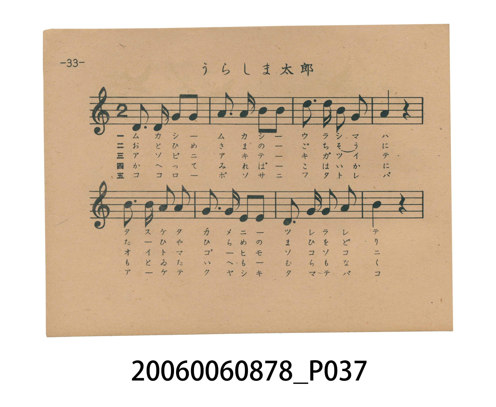
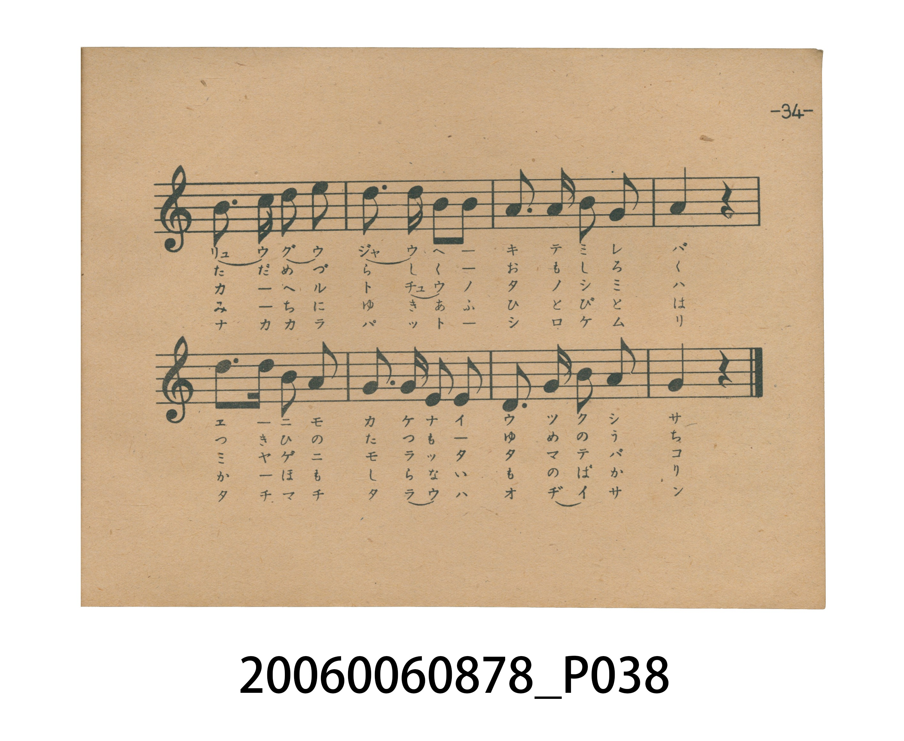
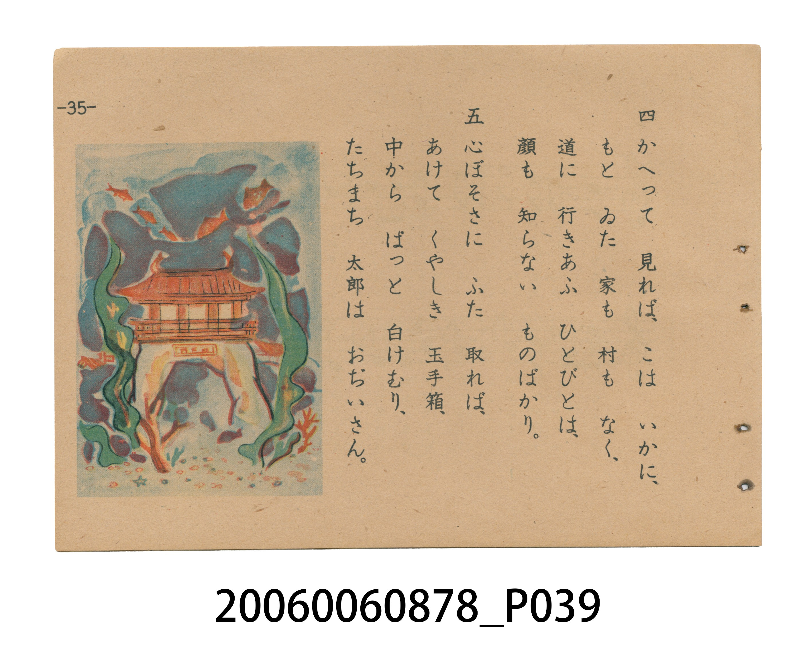
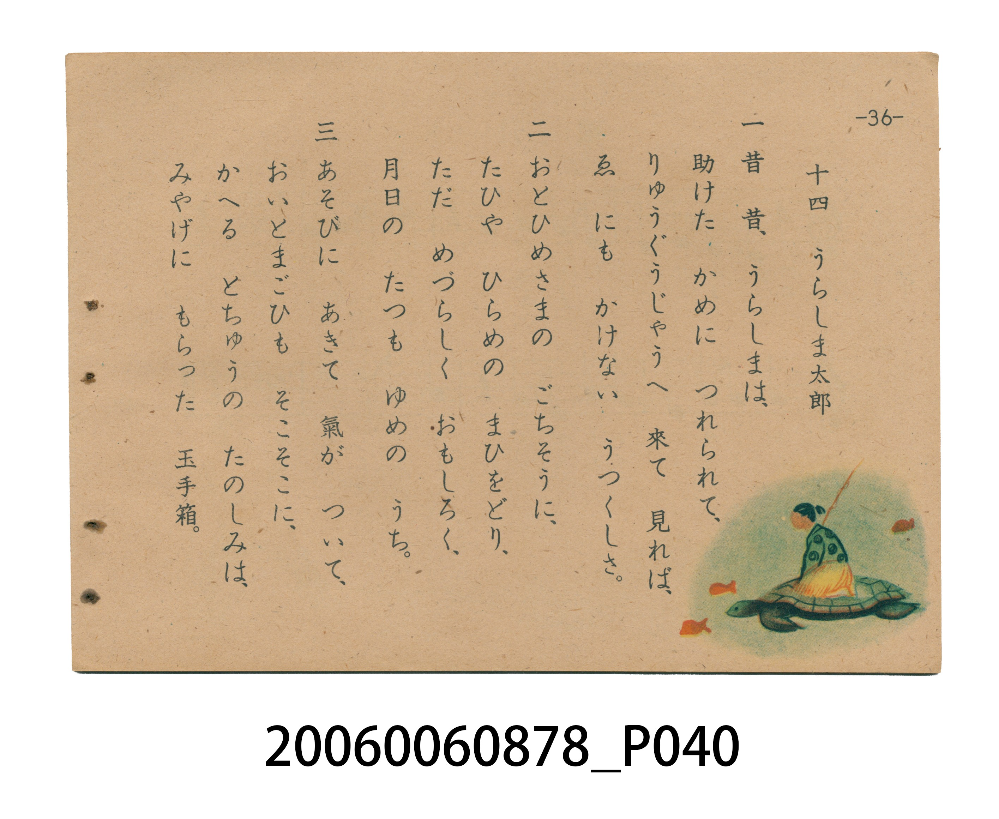

# うらしま太郎（浦島太郎）

<audio controls src="urashimataro.mp3"></audio>

- 日治時期國民學校唱歌（うたのほん 下・第十四課）
- 國立臺灣歷史博物館典藏

## 說明

【曲目說明】
・出處：臺灣總督府編《うたのほん 下》（國民學校初等科第二學年用），第十四課〈うらしま太郎〉（浦島太郎），原書第 33–36 頁。
・調性與拍號：ト調（G 大調五聲音階，原書五線譜省略調號，實際音高終止於 G 音），2/4 拍，速度 != 108。
・背景與曲風：原出自明治 44 年（1911）《尋常小學唱歌（一）》第十二曲，亦收錄於臺灣總督府昭和 11 年《公學校唱歌集 第一學年用》第十九課。國民學校版對歌詞進行了口語化改編並濃縮為五節，原書第 34–36 頁配有浦島太郎騎龜前往龍宮、觀賞鯛魚比目魚歌舞，以及打開玉手箱冒出白煙化為白髮老翁的三幅跨頁彩圖。
・版本說明：本檔案為原書單聲部五線譜旋律之忠實數位化版本。

・編曲說明（鋼琴伴奏版）：
1. 前奏 (Intro, 4 小節)：擷取主旋律核心樂句作為導奏，建立調性與拍感。
2. 主歌伴奏 (Urashimataro)：右手 (PianoRH) 演奏原書歌唱主旋律；左手 (PianoLH)
依國民學校低學年教材純樸明朗之風格配以和聲伴奏。

## 跨冊／重複收錄參照

> 同名異曲（《新定兒童唱歌》第二學年為 1911 年『尋常小學唱歌』「むかしむかし浦島は…」舊版；《うたのほん》下卷為 1941 年國民學校「うらしま太郎は 亀に のり…」改編新詞新曲版）

- **[同名異曲]** 《新定兒童唱歌》尋常科第二學年用（2020.006.0847.0002）：[**〈うらしま太郎〉**](../../../shintei_jido_shoka/grade_2_2020.006.0847.0002/2_09_urashima_taro/index.md)（`F` / `2/4` — [原始 TMD](../../../shintei_jido_shoka/grade_2_2020.006.0847.0002/2_09_urashima_taro/urashima_taro.tmd)）
- 總表：[跨冊重複與同名歌曲總索引](../../../duplicate_songs.md)

## 歌詞

```text
一　むかし　むかし　うらしまは、
はまべで　かめを　たすけたり。
たすけた　かめに　つれられて、
りゅうぐうじゃうへ　いったとさ。

二　りゅうぐうじゃうへ　來て　見れば、
ゑにも　かけない　うつくしさ。
たまの　おごてん　めづらしく、
あそぶ　うらしま　おもしろく。

三　おとひめさまの　ごちそうに、
たひや　ひらめの　まひをどり。
たのしく　日かずを　送る　うち、
早くも　三とせは　すぎにけり。

四　あそびに　あきて　きが　つけば、
家が　こひしく　なりにけり。
もらった　玉てばこ　かかへ、
かへる　うらしま　勇ましや。

五　かへって　見れば、こは　いかに、
もとの　家　なく、人も　なし。
はこを　あければ　白けむり、
たちまち　白がの　おぢいさん。
```

## ABC

```abc
X:1
T:うらしま太郎（浦島太郎）
M:2/4
L:1/16
Q:1/4=108
K:G
V:V1 name="Piano" snm="Pia"
[V:V1]
G3 E D2 E2 | G3 A B2 B2 | d2 d2 A2 B2 | G4 z4 |
B3 B A2 G2 | A3 G E2 G2 | D2 G2 A2 B2 | A4 z4 |
B3 B d2 e2 | d3 d B2 B2 | A3 A d2 G2 | A4 z4 |
B3 B G2 A2 | G3 E D2 D2 | E2 G2 A2 B2 | G4 z4 |
```

## TMD 檔案連結

- [主旋律 TMD 檔案](urashimataro.tmd) [[在 TMD Studio 編輯](https://tmdlang.github.io/Tmd-TS/#tmd=s7IKdvYPcrWy4tLSUnjc2Pa4qfNx4_THjfueLln1srnv_Z6OZ1uXPd28DcbtVNDS4lK0VTA0sOCyt1Vw57Ix0jex46pTUHo2femzTbufzWx6Nmf-0zndzzZMfLp2x7MFC59O2fhsbQ_QIJDpjfMfN6573Lj7cdNkhSc7uh83736-Zs3T3sans2e_WLUJaLwSyCig9ueru1-073reuPjZ2u1P-zc97Z31vHPlyyUrnrbueDG9X4mLS19LwZZagEtBQeFxw4Rnszc9n73uxapVz2b0PW6YCBZt3v20fdeLmVPf75kFcc_zHXufz138dNec59tXPG7owuaphm6gb1GCoGPu87Wdz5dPBHr2ya4eoODTnVueT1kB9O_7PT3IIfC4ARxMqJHwuAGoDD0egBqf9s1_NnsHULuCsfGjhsnGZgovFzQ-bmiCOvzFqv3PGpa_6Gh_1t37YuZ8oA8eN3cABYFmuSs8XbIcyHyya8qLxk0v529-OQtoJtRAoODz7bNerJ3zfE7j86lLgcrAunuerl_2ctZskOLVM55vbXq2dtGzaXsU3BWAIhD3AFOCAtAuIOtlw_ynu5YpQNIJkouae57NXA9y0exNLxcBvT8LaCMofNtBQQ5MPQomJgrAoAG60NDS0BBoKjCEn27ofrpjx9MN_aBgg6WlJzsawLLdkMADBirQSKDFT3YtezZl28ueFqDT0OLr2Yy1Tyf1KBgagmwAmdu6BjmBvpzdpgCKnh0N8OhBGL9zLjhumpAj9Xlnx9MNvUCdL1bOe9mw6cVCoOVtT_sXv1g172nPtGdTdgITyJMdy57tb36-Y93zpl2gYF0PdDVytJnAo-1la--zOZ3IcfxyRd_LfXOedvY-3dfwcl_v03XrHjc0vlje8GLzvJfrZ79cO-vZ-inA5ApiAN3QMQ_k-91Ln_Z3Peuc_HJa9_O-zmed3c_XbXzaNgkYxM9n7n3eOhPoMKBLgOyXq9e9aGh8vr_x-ayWJzs6n-5sfbF9BdAZT_eufDpnGiLGgJ58NmcNJEsAowvIfrZqyrOFHUBTIN54Om0dKAU1r4CnmmfTu5_u636ys_vp_gXAJPNs6o4ne3tBFoONAhkNzW4QAyAB-LR1xbNp7cCU8WTHWhBj1bwXa9cD8yAwqtHSNygn9DU_6-8HOkQhwMDYHCgTYGBiAE6CnWCzgXH4uKHhcVPD48ZuUD5CYyPlr8eNQEsawe4BskD8nY8bl4MVdT9uanzcNAnMBubvmY8bJ4IYTV2wwEEWhWtoXA1mL3nc1AOyBEg2LoPZANTa1AouLyaAyRmPm5rBjB1gPS2PGxeDDV3xuHEq1BKgZyFBAcoq--aBEwOIBMY1clJ5OmfFs63bXzZ1PZs6EZgIgf5_OWv38-Z-YPoBGvRi0WqgODCiISJPd2x7MXH6k93TQAlmX9vTjg1ALUDtT3dNBaqBpLSn84GFThM8PHf1gMMQn_uBJoG92vBiGTAggN7eAPc2MIRWP25qggYSKMBWgXwLiQlgUDX2gyMD5mdwGABjApjcgSqABewUkMFNk8FOAIbwUljs9cOjrulx49zHjdvQIxeiH2gzkNvUC9aAEaqQEID7Ghh0z-cAi--e5_v6nu6b_rJh8fOpq5-vbXvZvPd5y8Jnm6cCE97znauABj3vXwDMYi8nbnq6tQcYbkDtz9btfzZtw9Ol7SCV66egxdHzvpVAA5-tAJYhwEpsGzCdI4fwDmBZBvEtMPY3gf05FSkUgEGwEOxHYIABUxjU28BwAiqFhCSQAUxuQG0QDUCdQJFJjxtXoqVYYD0FCboGYH0Njo9ZkFT-sgGY3IF1FyRWFkIteTZ9JUg1OPZAjgQ5bzY41wDVAVN_H8g9wCiFW4IStjtnPl2-BljOPtmx-8WKtU_XbXm2Zt_Tfa2gCqKpBVjcQcoxUH0AK8qe718JRC-2bgcWaODydsWztQtBgQYs16cvBYYzsH3xtLUTGHpAQ17s7Xw-Z8_LaZPBJdiWpxs2vmzse9q3G5iekcIWWLGCXQtJJJthWRTIBSYJUIoFM8ApHJQYgckTlnSfrtsGk5gMCk9YyIESMNDDaD4HBRIo6YEzcUMDMHGAjAcaBtQMTfpABMwr0NgDc-AhjpRon3a3gyMQmGiBcYsRqsCEBAyQJztbQdXN7HlALz9fOg-YjEHZeUfv82WNzxrmPt2_FRiGz6a2vmzpBCdOYN5oeta-_cXihc-6NgKz__PeTS-2dIDKBFg1AQrPHf1PdnQ9W7vjZcMUUFAjpd5nLf3PNiwG1tnPZ-5BKRmmwPy2A-xz9BIAHHKQ1AIs34DK4KkXlC2BiQmUXMHOA4cqOE8_2bULVlwARYBFNjT1AgvoybASGagZGPQQSxqA9RmYCy6ikDIHMMsAgxGYlCEqgKrhZcoisHumgosVzJJ29jxgmQAJPXiB8LJh5vOV256vnv9sxvpnDX0vd-0BKnuyCyQFrMiA4Q8J52ebJgHjBRSYq3pfrJ0Bql537Xqycz4waoCJGZIysVbQIIt2bIdU08hpG2jji3VdzzomAPVCK-5Je4AIaDKoBu_YBUTQGAF6g_K2MBQoaOlzcYUWJRZnZOYmliQW5VsFZCbm5TvUGNQoVINsUrCx0LIDM4AtcaDjrYBR2gBK1kA8HShag8lvbAOKdYL5wJgBi6wHGQAEQNtgRu3qARkFrWuASkCVDVgttL4BsnaAjAMGOZC5DIj3A9X3gJVswDRuRyfQuMYuIF4BxJuAShvBSqeC3QBMElC3TQHihUA8F-xOkMhqDMOARQnIsCaoss1gRSClIJFesGsghoHYPUC8BIgn4nLZrikgw0DhA8o7EN0gpRDvQLSA-JPB4QRMsGDVWFxWo6BhqKCrq2AWr6mqoaurqWAaD2TDhY2gosZAWKNgCoRGYBZQUsEAiGvAWRkRjWDLQEGzE4iXgy0EOhIYbMDMB3XSfCCeCfYbiA2K6i5cEQlSshqU3aFaQf4Fia0C-wiaKsAB1Q9OGZC4wRGNIHtBUdgCNQzEBiYokNuAEQkSAbkbJDoJSK_E4TJoNILCswMcUYhwBmoFp85-sAjQjUDtYPdDohGrN0HRCPQeJIHBkhPMcJA3IYaBjAaqAKtcBRYBZQvUaDQGxZcxNL6MgDEEFDMCiRlCxYDRChIERrAhNBaB0thjESOOYLEITj4gPjDQQQkNHIKQ_ANKv9hiEWwYcm4BhQooxwCzH7DTCwoZkMFL4fkbpKYfXyyuQwloUNiAEsYscMzBLAAmiCaQKCQ7LsQejaDwBFe7YIPhqRPkWFhu3ACNXJBZkAwELECwRiM46QOVwhM6KLKAAQjNj5BIg_gRJNqALU2gR6OpghlIzBQkZoqSFSFRC8uepuCYxRWdRBSIkC4E1P8rcGUkSHzCirBtUH9ilszACAAnVZB_e_HHJzDQgDkSEl9NsCIMnBtmg2VBIqCU2AdOe2hZCSNbggtEcMzjchrILljxDU5q4PIAa3yCggJUqoOULkSJP1CMQooMUFJbBDYWYiGoVYAvQkE5D1uRC0Q1kAyKXr7WcnHp2ikg16YgvjIXAA)]
- [鋼琴伴奏 TMD 檔案](urashimataro_piano.tmd) [[在 TMD Studio 編輯](https://tmdlang.github.io/Tmd-TS/#tmd=s7IKdvYPcrWy4tLSUnjc2Pa4qfNx4_THjfueLln1srnv_Z6OZ1uXPd28DcbtBIq87N7zfMKWJ3u2PF3a_7yzAyiooKXFpWirYGhgwWVvq-DOZWOkb2LHVaeg9Gz60mebdj-b2fRszvync7qfbZj4dO2OZwsWPp2y8dnaHqBZICsb5z9uXPe4cffjpskKT3Z0P27e_XzNmqe9jU9nz36xahPQeCWQUUDtz1d3v2jf9bxx8bO125_2b3raO-t558qXS1Y8bd3xYnq_EheXvpaCLbUAl4KCwuOGCc9mb3o-e92LVauezeh73DARLNq8-2n7rhczp77fMwvinuc79j6fu_jprjnPt6943NCFzVMN3UDfogRBx9znazufL58I9OyTXT1Awac7tzyfsgIcxj3IIfC4ARxMqDHzuAEUFRiR0_O0b_6z2TuA2hWMjR81TDY2U3i5oPFxQxPU4S9W7X_WsPxFR_uz7t4XM-cDffC4uQMoCDTLXeHpkuVA5pNdU140bno5f_PLWUAzoQYCBZ9vn_Vi7ZzncxqfT10KVAbW3fN0_bKXs2aDFK-e8Xxr07O1i55N26PgrgAUgbgHmBIUgHYBWS8b5j_dtUwBkk6QXNTc82zmepCLZm96uQjo_VlAG0Hh2w4KcmDqUTAxUQAGDdCFhpaGhkBTgSH8dEP30x07nm7oBwUbLC092dEAlu2GBB4wUIFGAi1-smvZsynbXva0AJ2GFl_PZqx9OqlHwdAQZAPI3NY1yAn05ew2BVD07GiARw_C-J1zwXHThBypwOzwdEMvUOeLlfNeNmx6sRBoedvT_sUvVs172jPt2ZSdwATyZMeyZ_ubn-9Y97xpFyhY1wNdjRxtJvBoe9na-2xOJ3Icv1zR93LfnKedvU_3Nbzc1_t03brHDY0vlje82Dzv5frZL9fOerZ-CjC5ghhAN3TMA_l-99Kn_V3POie_nNb9vK_zWWf383Ubn7ZNAgbx85l7n7fOBDoM6BIg--XqdS8aGp_vb3w-q-XJjs6nO1tfbF8BdMbTvSufzpmGiDGgH4ABC8kSWIsDYByClCooGOopgNy6tF9BwzOvpChfRwEYlRv6gV7WBKp5NhmYi6c92bH72fTup_u6ny3Y8XR_87MVTU_7lz7ZOwfopqcb-oB6QaGzexco7yOl3Wct86EOUlAw0gPmsN1AD0PcoKARWpRYnJGZm1iSWJQPsuhp_2agtxU0AjIT8_KDPDQVnu2ZAlQICXOgPmBkw13xfs_sp9uXIZT7eGhCbAGCJ_vmIkf2k719kGTxbOrMZ3MnPN8y5dmKHaA0O2f6k53dwLT8bMEeYBSCImBSDzBLQZwHcja0bIE7AJhanraueDatHei5JzvWghir5r1Yux5Y4AADGC0zg7J9X_Oz_v5nq6YoBBgYmwNlAgxMDMAB3wk2G5hgHzc0PG5qeNzYDSo00NhIhcnjRqAljWD3AFkg_s7HjcvBirofNzU-bpoEZgMLs5mPGyeCGE1dsJSALArX0LgazF7yuKkHZAmQbFwGswGotakVXDhOAJMzHjc1gxk7wHpaHjcuBhu64nHjVKglQM9CggIUjfvmgVM-iAQmCuR88XTOimdbt79s6no2dSIwxwH9_3LW7ufN_cDMAjToxaLVQHFgqoaIPN2x7cXE6U92TwPljn1tTzs2ALUAtT_dNRWoBpKtns4HlrBN8PDc1QMOQ3zuB5oE9mrDi2XAgAB6ewPc28AQWv24qQkaSKAAWwXyLSQmgEHV2A-ODJifwWEAjAlg3gaqANYmU0AGN00GOwEYwkthsQdMS9Coa3rcOPdx4zb0yIXoB9oM5Db1gjVghCokBOC-Bgbd8znAXNDzfF_f033TXzYsfj519fO1bS-b9z5vWfhs81Rgwnu-cxXQoOf9C4DlycuJm55u7QGGG1D7s3X7n03b8HRpO0jl-ilocfS8byXQQFD-ngOssbcB0zlyCO8AFtwQ3wJjfxPYn1ORQgEYBAvBfgQGGDCFQb0NDCegUkhIAhnA5AbUBtEA1AkUmfS4cSVaigVWypCgawA2TsDxMQuSyl82AJM7sKKGxMpCqCXPpq8EqQbHHsiRIOfNBucaoDpg6u8DuQcYpXBLUMJ258yny9cAKxVg8fJixdqn67Y8W7Pv6b5WUG3Y1AIs2yGFNqhIg5Xbz_evBKIXW7cDS29w5bLi2dqFoEADVmLTlwLDGdiYetraCQw9oCEv9nY-n7Pn5bTJ4OJ6y9MNG1829j3t2w1Mz0hhC2xFgF0LSSSbYVkUyAUmCVCKBTPAKRyUGIHJE5Z0n67bBpOYDApPWMiBEjDQw2g-BwUSKOmBM3FDAzBxgIwHGgbUDE36QATMK9DYA3PgIY6UaJ92t4MjEJhogXGLEarAhAQMkCc7W0F16-x5QC8_XzoPmIxB2XlH7_Nljc8a5j7dvxUYhs-mtr5s6QQnTmDeaHrWvv3F4oXPujYCs__z3k0vtnSAygRYnQgKzx39T3Z0PVu742XDFFBQI6XeZy39zzYsBhbqz2fuQSkZpsD8tgPsc_QSABxykNQCLN-AyuCpF5QtgYkJlFzBzgOHKjhPP9m1C1ZcAEWARTY09QIL6MmwEhmoGRj0EEsagJU3mAsuopAyBzDLAIMRmJQhKoCq4WXKIrB7poKLFcySdvY8YJkACT14gfCyYebzlduer57_bMb6Zw19L3ftASp7sgskBazIgOEPCednmyYB4wUUmKt6X6ydAWpL7Nr1ZOd8YNQAEzMkZWJtjYAs2rEd0iZBTttAG1-s63rWMQGoF9pKmbQHiIAmg5orHbuACBojQG9Q3vCHAgUtfS4ucKvFCtpucKgxqFGoBrcGbCy07MCMGgUNYwVdXQVjTVUNXV1NBUMFI5CYIUjMLB4qaBoPQjVAAbC8MZAJVKBgAMQ1XLUotvig2GICt8UwXiHaMBbKMAUxgIZBGDApkEnILR98zgZ2lIDBbQVMhA2gjAjE08HWYPAb24BinWA-MC2BRdZDW0PA8IEZtasHZBS0dgQqAVWPYLXQGhLI2gEyDphIgMxlQLwfqL4HrGQDpnE7OoHGNXYB8Qog3gRU2ghWOhXsBmAihrptChAvBOK5YHeCRFZjGAYs_ECGNUGVbQYrAikFifSCXQMxDMTuAeIlQDwRl8t2TQEZBgofUG6H6AYphXgHogXEnwwOJ2AWA6vG4jJsaQQYozBhI6ioMTixmAIherJBjUawZaCg2QnEy8EWAh0JDDZgcQF10nwgngn2G4gNiuouXBEJUrIaVEBBtYL8CxJbBfYRNFWAA6ofnDIgcYMjGkH2gqKwBWoYiA1MUCC3ASMSJAJyN0h0EpBeicNl0GgEhWcHOKIQ4QzUCk6d_WARoBuB2sHuh0QjVm-CohHoPUgCgyUnmOEgb0IMAxkNVAFWuQosAsoWqNGIkv2NgDEEFDMCiRlCxcC5HhiJiMwPlMYeixhxBItFcPIB8YGBDkpo4BCE5B9Q-sUWi2DDkHMLKFRAOQaY_YBjEqCQARm8FJ6_QWr68cXiOpSABoUNKGHMAscczAJggmgCiUKy40Ls0QgKT3BDAWwwPHWCHAvLjRugkQsyC5KBgAUI1mgEJ32gUnhCB0UWMACh-RESaRA_gkQbsKUJ9Gg0VTADiZmCxExRsiIkamHZ0xQcs7iik4gCEdLpgfp_Ba6MBIlPWBG2DepPzJIZGAHgpAryby_--AQGGjBHQuKrCVaEgXPDbLAsSASUEvvAaQ8tK2FkS3CBCI55XE4D2QUrvsFJDVweYI1PUFCASnWQ0oUo8QeKUUiRAUpqi8DGQiwEtWPwRShZ1TJmZUpU7YxaTcNrZzSVQJuxMEBakFSa5aIYik8p3DKMxoEBxDe6dgrgdoYCkIHsM2L4ylwA)]

## 分析

```text
================================================================================
📊 TMD Song Profile: [ うらしま太郎（浦島太郎） ]
================================================================================
⏱  Duration:       0:17 (17.8s), 16 measures total
🎼 Key & Tempo:    首調基準 G, != 108.0 BPM, <2/4>
   - 分析範圍：      由實際發聲的音符與和弦推測調性；播放脈絡另行呈現
🎤 人聲音域:    D4 (MIDI 62) – E5 (MIDI 76) [跨度: 14 個半音 / 1.2 個八度, 難度: moderate]
   - 最低音:  D4 in [Urashimataro #1 @ m.1, 0:00]
   - 最高音: E5 in [Urashimataro #1 @ m.9, 0:09]
   - 適合: soprano, mezzo-soprano, contralto, tenor, baritone, bass
🏛  結構:      Urashimataro (17.8s)
⚡ 編曲密度:        Peak 1 軌道同時演奏
🗝  調性診斷：       G 大調（純淨自然大調，未偵測到可信轉調）
   - 風格氣質:    純淨自然大調（陽光明朗、易唱易記，無明顯調外色彩）
   - 轉調歷程:    全曲維持單一推測調性（未偵測到可信轉調）
   - 核心骨幹音:  G, A, B, D, E
   - 調性數值:    G 大調 [相關度: 0.80, 穩定度: Moderate, 自然音純度: 100.0%]
   - 候選調性 (K-S): G 大調 (0.80), D 大調 (0.69), B 小調 (0.59)
   - 五度圈歷程:   +1
   - 各段落調性細節:
     • [Urashimataro #1]: G 大調 (r: 0.80, 自然音純度: 100.0%)

  [ 五度圈游移軌跡 ]
               C  
         F           [G ]*
      Bb               D  
      Eb               A  
         Ab           E  
            Db       B  
               F# 
     (* = active key center)

  [ 十二半音累積音高分佈 ]
     C  :                            0.0%
     C# :                            0.0%
     D  : ████████████████          17.9%
     D# :                            0.0%
     E  : ████████                   8.9%
     F  :                            0.0%
     F# :                            0.0%
     G  : ████████████████████████  26.8%
     G# :                            0.0%
     A  : █████████████████████     23.2%
     A# :                            0.0%
     B  : █████████████████████     23.2%
--------------------------------------------------------------------------------
Assignment 軌道音域：
  - Piano         : D4 – E5 (14 個半音 / 1.2 個八度, 52 個音符)
================================================================================
```


## 原書掃描頁










