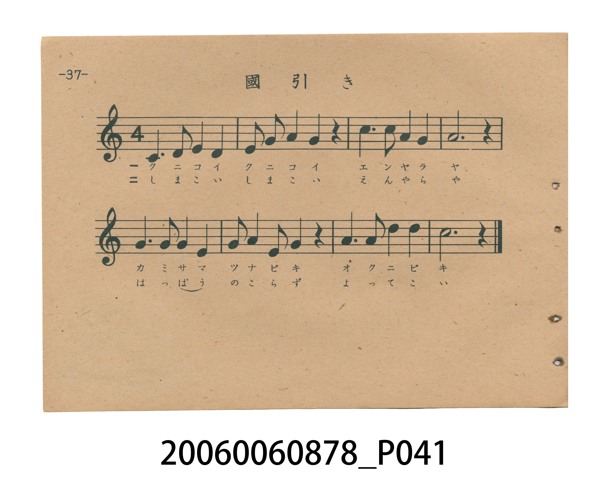
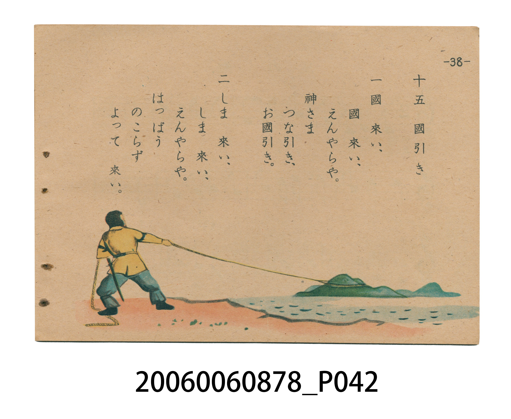

# 國引き（國引）

> Re:Shoka 使用 AI 協助辨識與重建樂譜，可能會有錯誤。歡迎回報。

<audio controls src="kunibiki.mp3"></audio>

- 日治時期國民學校唱歌（うたのほん 下・第十五課）
- 國立臺灣歷史博物館典藏

## 說明

【曲目說明】
・出處：臺灣總督府編《うたのほん 下》（國民學校初等科第二學年用），第十五課〈國引き〉（國引），原書第 37–38 頁。
・調性與拍號：ハ調（C 大調五聲音階，由低音 `1`＝C4 跨八度上行收於高音 `1^`＝C5），4/4 拍（本冊唯一採用四四拍之樂曲），速度 != 96。
・背景與曲風：取材自《出雲國風土記》八束水臣津野命以巨綱牽引土地擴建出雲國的神話（與國民學校初等科二年級《ヨミカタ》國語讀本教材相呼應）。充滿宏偉莊嚴的拉繩號子氣勢；第 38 頁繪有巨神佇立海崖拉動粗繩牽引島嶼的壯闊神話插圖。
・版本說明：本檔案為原書單聲部五線譜旋律之忠實數位化版本。

・編曲說明（鋼琴伴奏版）：
1. 前奏 (Intro, 4 小節)：擷取主旋律核心樂句作為導奏，建立調性與拍感。
2. 主歌伴奏 (Kunibiki)：右手 (PianoRH) 演奏原書歌唱主旋律；左手 (PianoLH)
依國民學校低學年教材純樸明朗之風格配以和聲伴奏。

## 歌詞

```text
一　大づな　かけて　國を　引く、
神の　力を　もろともに。
來い、來い、國よ。來い、國よ。

二　こゑは　高らか　海の　上、
廣い　いづもの　國が　出來、
榮える　み世と　なりました。
```

## ABC

```abc
X:1
T:國引き（國引）
M:4/4
L:1/16
Q:1/4=96
K:C
V:V1 name="Piano" snm="Pia"
[V:V1]
C6 D2 E4 D4 | E2 G2 A2 G2 E4 z4 | c6 c2 A4 A4 | G12 z4 |
E6 G2 E4 D4 | E2 G2 C2 D2 E4 z4 | G6 A2 d4 d4 | c12 z4 |
```

## TMD 檔案連結

- [主旋律 TMD 檔案](kunibiki.tmd) [[在 TMD Studio 編輯](https://tmdlang.github.io/Tmd-TS/#tmd=s7IKdvYPcrWy4tLSUng6p_vpnqmPG3vf7-mAsN_v6VTQ0uJStFWwNOOyt1Vw5rIx0Tex46pTUHo2femzTbufzWx6Nmc-UPGzDROfrt3xbMHCp1M2PlvbAzThcWPb48b5jxvXPW7c_bhpssKTHd2Pm3c_X7PmaW_jk11TXqzaBDRdCWQUUPvz1d0v2nc9b1z8bO32p_2bnvbOet658uWSFU9bd7yY3q_ExaWvpWBLLcCloKDwuGHCs9mbns9e92LVqmcz-h43TASLNu9-2r7rxUygx2dB3PN8x97ncxc_3TXn-fYVjxu6sHmqoRsSXogg6Jj7fG3n8-UTgZ59sqsHKPh055bnU1YA_ft-Tw9yCDxugAY0MNAfNwBlEeEOVPm0b_6z2TuA6hWMzR81TDa2UHi5oPFxQxPUpS9W7X_WsPxFR_uz7t4XM-cDnfy4uR8oCDTFWeHpkuVAJsiWxk0v529-OasPZPWUjU_29gG5CgmGCe_3zHU2UXixHRjGq5_uWvZkR9eLhT3Ppmx7Nm3Py9UzIIriwKpMIc4BxrwC0Cqg8c_mrHna1vV0yvonOxqe9S0Eeu3p7NlABJR9srP72YomYNBC9LxsmA80WwGcgJBc3tzzbOZ6kMtnb3q5CBgus572T3s2d8KL9lXAMAbGwMvZm4ABAZR6Omf-ixUzgEEMdOSzufOfbdjyon3xsy1LX7b3PZ2498nupU-3r3i-bePzzr3AUAMqfjpnw7PJW57u3gU35PmsludL571YuRHobqCNWOMJFEnAGNoyCxTDzSseN89_3LT6cdN-kL1zul-smvdiXQPQz8-mzgQ68vnsHU8n7nnWDvReJ9BLT1tbn-3e_3Rd_9PGzhd9XU9nbQHa-Ky78_nOlcBIebp2wrMNi592L3q_ZzY4IsFx-HznqmdzOkFOXzrvyd52YOJ_tnX70y3TgNqedk99vmk6UDPUS5u3Pd22B2ji08XrX07vgvjkWf-kp3OmIYLzeScoRiAJGRiWIJeumvJsYcfzpl2QJPR02jpQMmheAUwPz7fPerF2zrPp3U_3dQMj6-n-BU_XL3s2dceTvb1Pe6ZBjAIZDc0kEAOAOfrFynlPW1c8m9YODMQnO9aCGMBwWbsemHOAIYuWSEFppK_5WX8_0CEKAQYmhkAZIGUEThSdYLOBSedxQwMwmT5uXPq4ERjvDY8bux83TnzcuAwkPqf7cdMkEAOUN_ofNzSC9AC9D8p6QNGu2RDpx01Nj5t6HzeuADEaV0PD5Mk-YC5tAWqCM8DmdQClMUVAGkBpA-wbUPD1zQbmBWAkAN0GSjzAqNiyCDmBgXJmz_oXjbOez9kHdBEocrpmv2zvf7m36-n-5qe9U0CuA9v0dMJyiCOADJAuYN4GmjAR6HGoLJogPGx29YDDY_LjJmB4AIO4AZgjHzd1gkKooQGYViChAHQmNGCe7l4M9hVQTwsoPEGBAQ4noCcbQWYBswPI5xDVz5YBi6-Ox00gwx437n-yYxooAEHsVY-bgEXcvseN00GlHGbYAJ3xZNcikI-nzQUXLPuf7tsJdM_LucAE3gN0BSiNAmVhme_pBmBlsASYHZ91TAAqAJLANPl8ZyPQBc9m9DyfPRukeN9CkAsgvgfaR3n5DgUKWvpcXN6leZlJmdmZVgGZiXn5DjUGNQrVIFsUbCy07MAMYM0CTItWCo8bgV7fDaSWAvEqIO4G4olAvEyhBkj2A_FqBWCqA9KbwHyQKEjNfiBeB8QLIfymTrAqoGxTExD3gvJR4woID2gC0FEwW3f1gGydDJQCWbMeiOfDjABRIPPbkMwHsXeARYH2A80FxjUUA10MNn0dkktBtvYA8XIg7oXZWqNgqKALhEYKxmBSFyhirGCqYAbEIBEDsIhhHFgRkDIDUiBcA5QHCUEgWBU4oSIFHtAbYLfAaFh4dYDdhE302VxQSLfAaWB6AcuAnAkTAyZtuChGyE2FRkAHUAE0IoAKQYENshIYhU1dQHofEE8Hhy3Q2GWggESoByY8sHqQldh0wC0FBRPI65BgQgScITQoIQEHCSQzBSNQAIIJeGAih1wtF5eunQIsZYLYylwA)]
- [鋼琴伴奏 TMD 檔案](kunibiki_piano.tmd) [[在 TMD Studio 編輯](https://tmdlang.github.io/Tmd-TS/#tmd=s7IKdvYPcrWy4tLSUng6p_vpnqmPG3vf7-mAsN_v6QSyX3bveT5hy5M9W54u7X_e2QEUVNDS4lK0VbA047K3VXDmsjHRN7HjqlNQejZ96bNNu5_NbHo2Zz7QhGcbJj5du-PZgoVPp2x8trYHaNTjxrbHjfMfN6573Lj7cdNkhSc7uh83736-Zs3T3sYnu6a8WLUJaLoSyCig9ueru1-073reuPjZ2u1P-zc97Z31vHPlyyUrnrbueDG9X4mLS19LwZZagEtBQeFxw4Rnszc9n73uxapVz2b0PW6YCBZt3v20fdeLmcDQmAVxz_Mde5_PXfx015zn21c8bujC5qmGbkggIoKgY-7ztZ3Pl08EevbJrh6g4NOdW55PWQEO4h7kEHjcAA19YEw8bgBFAFJk9Dztm_9s9g6gegVj80cNk40tFF4uaHzc0AR16YtV-581LH_R0f6su_fFzPlAJz9u7gcKAk1xVni6ZDmQCbKlcdPL-ZtfzuoDWT1l45O9fUCuQoJhwvs9c51NFF5sB4bx6qe7lj3Z0fViYc-zKdueTdvzcvUMiKI4sCpTiHOAMa8AtApo_LM5a562dT2dsv7JjoZnfQuBXns6ezYQAWWf7Ox-tqIJGLQQPS8b5gPNVgAnICSXN_c8m7ke5PLZm14uAobLrKf9057NnfCifRUwjIEx8HL2JmBAAKWezpn_YsUMYBADHfls7vxnG7a8aF_8bMvSl-19TyfufbJ76dPtK55v2_i8cy8w1ICKn87Z8Gzylqe7d8ENeT6r5fnSeS9WbgS6G2gj1ngCRRIwhrbMAsVw84rHzfMfN61-3LQfZO-c7her5r1Y1wD087OpM4GOfD57x9OJe561A73XCfTS09bWZ7v3P13X_7Sx80Vf19NZW4A2PuvufL5zJTBSnq6d8GzD4qfdi97vmQ2OSHAcPt-56tmcTpDTl857srcdmPifbd3-dMs0oLan3VOfb5oO1Az10uZtT7ftAZr4dPH6l9O7ID551j_p6ZxpiOAEJk1gQEISMtY8DAxgkFIFBUM9haedvUBxBQ3PvJKifB0FE4WnG_qfr2_QBKp5NhmY96Y92bH72fTup_u6ny3Y8XR_MzA2n_YvfbJ3zvOmXU839AH1glLm7l2gHIuUAJ-1zIc6SEHBSA-YL3YDSwGIGxQ0vEvzMpMyszNBljzt3_yss1tBIyAzMS8_yENT4dmeKUBFkLQO1AMsP-AuAAba0-3LEMp9PDQhNgDBk31zkeMSmK4h-QwaSVumPFuxAxgez-ZMByZJYEp6tmDPy9ZeUIqZ1APMExCngZwMLQ3gDnixct7T1hXPprUDPfZkx1oQA5gA1q4HFhHAwEXLjaDM0Nf8rL__2aopCgEGJoZAGSBlBA70TrDZwDzyuKEBmB8fNy593AhM4A2PG7sfN0583LgMJD6n-3HTJBADVAgAHdQI0gOMZ1AZAxTtmg2RftzU9Lip93HjChCjcTU0rJ_sAxZHLUBNcAbYvA6gNKYISAMoE4B9A4ruvtnATA9MbUC3gXIJMM1tWYSck0AR3bP-ReOs53P2AV0ESoVds1-297_c2wVMGE97p4BcB7bp6YTlEEcAGSBdwEIMaMJEoMehsmiC8LDZ1QMOj8mPm4DhAQziBmDR87ipExRCDQ3ATAEJBaAzoQHzdPdisK-AelpA4QkKDHA4AT3ZCDILmO9BPoeofrYMWE53PG4CGfa4cf-THdNAAQhir3rcBCzL9z1unA4qzjHDBuiMJ7sWgXw8bS64BN3_dN9OoHtezgXmZGDyXwzKjEBZWCnzdAOw1lsCzBbPOiYAFQBJYHZ5vrMR6IJnM3qez54NUrxvIcgFEN8D7aO8IoMCBS19Li5wfraC5iqHGoMahWpwXrGx0LIDM2oUjBV0gdAUTBsBMUjEVMEQyAaJGIBFTMFqzBSM4kCKQESNgiGIgkGwMq5aFAt9UCw0gVtoGK8QbRirYAqkTGMRfCBlALIKIowuC8JAaZAVsHIDn7eADQNgDrNSeNwIjNDdQGopEK8C4m4gngjEy4BGA3MWEK9WAOYlIL0JzAeJgtTsB-J1QLwQwm_qBKsCyjY1AXEvqHRoXAHhAU0ABjXM1l09IFsnA6VA1qwH4vkwI0AUyPw2JPNB7B1gUaD9QHOBKRiKgS4Gm74OyaUgW3uAeDkQ98JsBYYROA4gEYaIQjNopEKiEBpdQMoMHJWIaEWOQbTAA3oD7BYYDQuvDrCbsIk-mwsK6RY4DcwFYBmQM2FiwAwLF8UIuanQCOgAKoBGBFAhKLBBVgKjsKkLSO8D4ungsAUauwwUkAj1wOwEVg-yEpsOuKXUTvuoCZOU5G-WC0__UGkTIGUCkoaqMwLL4jECyEDKQSADsWcwkEN17RTA-VQByIA5Gp2tzAUA)]

## 分析

```text
================================================================================
📊 TMD Song Profile: [ 國引き（國引） ]
================================================================================
⏱  Duration:       0:20 (20.0s), 8 measures total
🎼 Key & Tempo:    首調基準 C, != 96.0 BPM, <4/4>
   - 分析範圍：      由實際發聲的音符與和弦推測調性；播放脈絡另行呈現
🎤 人聲音域:    C4 (MIDI 60) – D5 (MIDI 74) [跨度: 14 個半音 / 1.2 個八度, 難度: moderate]
   - 最低音:  C4 in [Kunibiki #1 @ m.1, 0:00]
   - 最高音: D5 in [Kunibiki #1 @ m.7, 0:16]
   - 適合: soprano, mezzo-soprano, contralto, tenor, baritone, bass
🏛  結構:      Kunibiki (20.0s)
⚡ 編曲密度:        Peak 1 軌道同時演奏
🗝  調性診斷：       C 大調（純淨自然大調，未偵測到可信轉調）
   - 風格氣質:    純淨自然大調（陽光明朗、易唱易記，無明顯調外色彩）
   - 轉調歷程:    全曲維持單一推測調性（未偵測到可信轉調）
   - 核心骨幹音:  C, E, G, D, A
   - 調性數值:    C 大調 [相關度: 0.85, 穩定度: Moderate, 自然音純度: 100.0%]
   - 候選調性 (K-S): C 大調 (0.85), G 大調 (0.74), E 小調 (0.68)
   - 五度圈歷程:   +0
   - 各段落調性細節:
     • [Kunibiki #1]: C 大調 (r: 0.85, 自然音純度: 100.0%)

  [ 五度圈游移軌跡 ]
              [C ]*
         F            G  
      Bb               D  
      Eb               A  
         Ab           E  
            Db       B  
               F# 
     (* = active key center)

  [ 十二半音累積音高分佈 ]
     C  : ████████████████████████  25.0%
     C# :                            0.0%
     D  : █████████████████         17.9%
     D# :                            0.0%
     E  : ██████████████████████    23.2%
     F  :                            0.0%
     F# :                            0.0%
     G  : ██████████████████████    23.2%
     G# :                            0.0%
     A  : ██████████                10.7%
     A# :                            0.0%
     B  :                            0.0%
--------------------------------------------------------------------------------
Assignment 軌道音域：
  - Piano         : C4 – D5 (14 個半音 / 1.2 個八度, 28 個音符)
================================================================================
```


## 原書掃描頁






