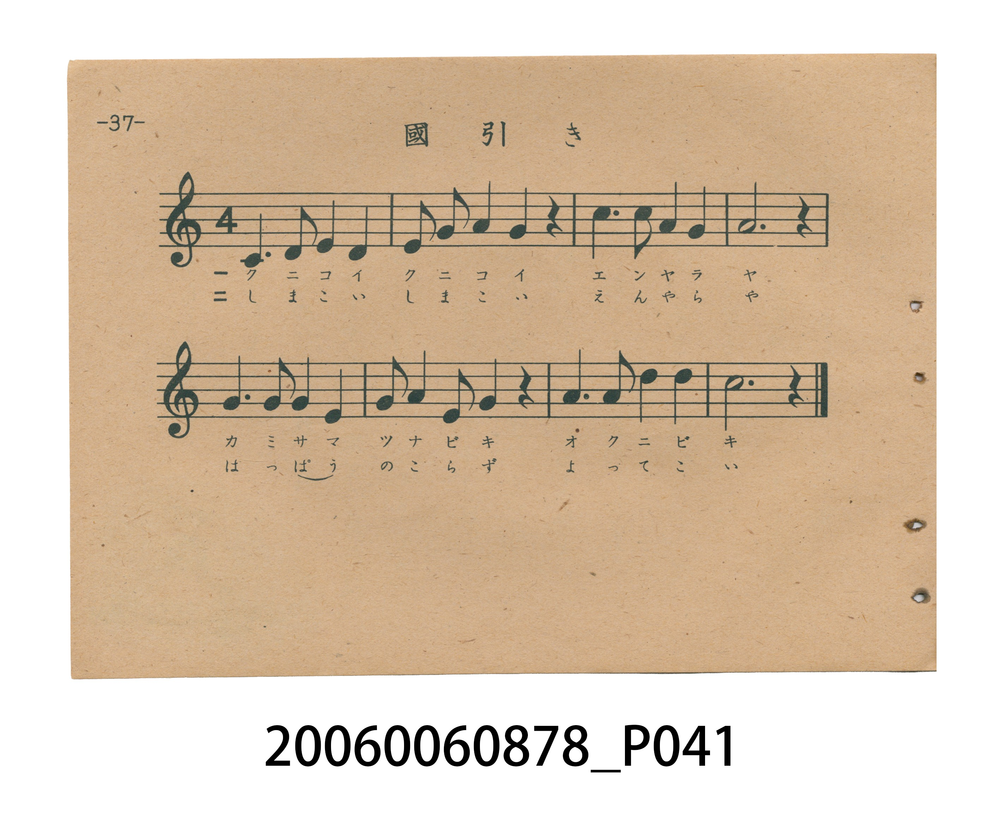
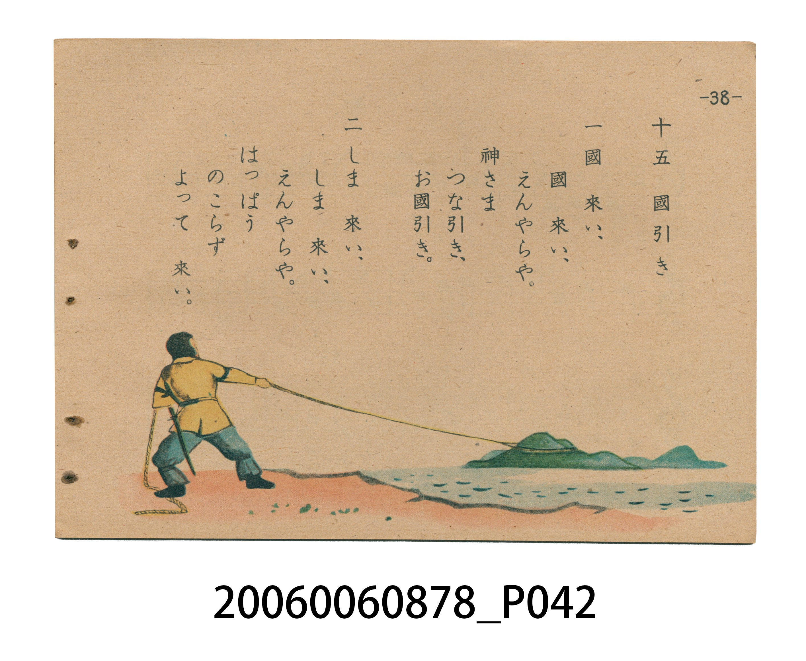

# 國引き（國引）

> Re:Shōka 使用 AI 協助辨識與重建樂譜，可能會有錯誤。歡迎回報。

- **鋼琴伴奏版**：<br><audio controls src="kunibiki.mp3"></audio>
- **NEUTRINO 歌聲合成版**：<br><audio controls src="kunibiki_neutrino.mp3"></audio>

- 日治時期國民學校唱歌（うたのほん 下・第十五課）
- 國立臺灣歷史博物館典藏

## 說明


- 出處：臺灣總督府編《うたのほん 下》（國民學校初等科第二學年用），第十五課〈國引き〉（國引），原書第 37–38 頁。
- 調性與拍號：ハ調（C 大調五聲音階，由低音 `1`＝C4 跨八度上行收於高音 `1^`＝C5），4/4 拍（本冊唯一採用四四拍之樂曲），速度 != 96。
- 背景與曲風：取材自《出雲國風土記》八束水臣津野命以巨綱牽引土地擴建出雲國的神話（與國民學校初等科二年級《ヨミカタ》國語讀本教材相呼應）。充滿宏偉莊嚴的拉繩號子氣勢；第 38 頁繪有巨神佇立海崖拉動粗繩牽引島嶼的壯闊神話插圖。
- 版本說明：本檔案為原書單聲部五線譜旋律之忠實數位化版本。

### 編曲說明（鋼琴伴奏版）：

1. 前奏 (Intro, 4 小節)：擷取主旋律核心樂句作為導奏，建立調性與拍感。
2. 主歌伴奏 (Kunibiki)：右手 (PianoRH) 演奏原書歌唱主旋律；左手 (PianoLH)
依國民學校低學年教材純樸明朗之風格配以和聲伴奏。


## 歌詞

```text
一　國　來い、
國　來い、
えんやらや。
神さま
つな引き、
お國引き。

二　しま　來い、
しま　來い、
えんやらや。
はっぱう
のこらず
よって　來い。
```

## ABC

<div class="abc-score" data-abc-src="kunibiki.abc" aria-label="五線譜載入中"></div>

[下載 ABC 原始檔](kunibiki.abc)

## TMD 檔案連結

- [主旋律 TMD 檔案](kunibiki.tmd) [[在 TMD Studio 編輯](https://tmdlang.github.io/Tmd-TS/#tmd=s7IKdvYPcrWy4qpTUCpJTLdSyC_KTM_Ms8rNz0sqLc7IV4JLJOfn5KQml2Tm51mVliTm5Wfk5yEky_JzSnNTrYwQIsX5pUXJqXCl8emp6HLxBYnpqVYBBiaGukACSWtBUX5Zal5iHlB7SWJmeSJQM1CgKC-_CGhKXmpRYg5CbWpZZkoqSGVBUWZuYlFlfEp-MtAleSVIbkstKga5uiw_GVlnflFJRn56UWJBRqVVRmZxCdDjQPn47MS8RISikoxUoLdyK4FKc_LTK5W4tLQUns7pfrpn6uPG3vd7OiDs93s6FbS0uBRtFSzNuOxtFZy5bEz0TexApjybvvTZpt3PZjY9mzMfqPjZholP1-54tmDh0ykbn63tAZrwuLHtceP8x43rHjfuftw0WeHJju7Hzbufr1nztLfxya4pL1ZtApoOdhBQ-_PV3S_adz1vXPxs7fan_Zue9s563rny5ZIVT1t3vJjer8TFpa-lYEstwKWgoPC4YcKz2Zuez173YtWqZzP6HjdMBIs2737avuvFTKDHZ0Hc83zH3udzFz_dNef59hWPG7qweaqhGxJeiCDomPt8befz5ROBnn2yqwco-HTnludTVgD9-35PD3IIPG6ABjQw0B83AGUR4Q5U-bRv_rPZO4DqFYzNHzVMNrZQeLmg8XFDE9SlL1btf9aw_EVH-7Pu3hcz5wOd_Li5HygINMVZ4emS5UAmyJbGTS_nb345qw9k9ZSNT_b2AbkKCYYJ7_fMdTZReLEdGMarn-5a9mRH14uFPc-mbHs2bc_L1TMgiuLAqkwhzgHGvALQKqDxz-asedrW9XTK-ic7Gp71LQR67ens2UAElH2ys_vZiiZg0EL0vGyYDzRbAZyAkFze3PNs5nqQy2dverkIGC6znvZPezZ3wov2VcAwBsbAy9mbgAEBlHo6Z_6LFTOAQQx05LO5859t2PKiffGzLUtftvc9nbj3ye6lT7eveL5t4_POvcBQAyp-OmfDs8lbnu7eBTfk-ayW50vnvVi5EehuoI1Y4wkUScAY2jILFMPNKx43z3_ctPpx036QvXO6X6ya92JdA9DPz6bOBDry-ewdTyfuedYO9F4n0EtPW1uf7d7_dF3_08bOF31dT2dtAdr4rLvz-c6VwEh5unbCsw2Ln3Yver9nNjgiwXH4fOeqZ3M6QU5fOu_J3nZg4n-2dfvTLdOA2p52T32-aTpQM9RLm7c93bYHaOLTxetfTu-C-ORZ_6Snc6YhgvN5JyhGIAkZGJYgl66a8mxhx_OmXZAk9HTaOlAyaF4BTA_Pt896sXbOs-ndT_d1AyPr6f4FT9cvezZ1x5O9vU97pkGMAhkNzSQQA4A5-sXKeU9bVzyb1g4MxCc71oIYwHBZux6Yc4Ahi5ZIQWmkr_lZfz_QIQqgghAoAyoKwYmiE2w2MOk8bmgABi-QfLIPmKtaHjc0giSwCD1u7ABmtsdNLY-bOkEkxOfAwHjcCMw5-yBKljxuXAXLSVBdXUiZC6wFlAbArgYlOaDcnPlAe55OWA7UgcwF5b0Z-59O2Q4hgZqBdgEDFxg_L4ARBYy3nStB2Qma6kAagWrgPtvVA_TA48bpQKdh-gS7KDb_PW5c_7hx8ePGjcBCB8IHljpAVZ2PG2eB-U3AMhYovwzJOExfghMQwpdIXExfArPwy7mLQFlt2k5gZL9s3vuicdazKf0vG_tgJoB9CbSD8lIYChS09Lm4vEvzMpMyszOtAjKBtapDjUFNNcgSBRsLLTswo0bBUEEXCI0UjMGkLlDEWMFUwQzIMgViA7CIYRxYEZCCideAWTAIVgU2z8ewBhie_WDRx42rgXgymNUC1gOSQReF2ACMKYgeYNkPjCkwqxMiA-ZhsckIpGs61KZ9GDZNxxAlxyZoIIG8DPI4iAYFFEgEFACgoIIZDFFjpmAECiwwAQ847KHUDXX7fiCeCvUFxIVLgHgVWGQzEPciub0LqgcSjhAVEBmQKlyhtB6qazEQbwSz2qC61sFCCBgGwOSPsKkJGkpgPcvALJA6kB7MUKrl4tK1U4AlNrDFQL4yFwA)]
- [鋼琴伴奏 TMD 檔案](kunibiki_piano.tmd) [[在 TMD Studio 編輯](https://tmdlang.github.io/Tmd-TS/#tmd=s7IKdvYPcrWy4qpTUCpJTLdSSM7PyUlNLsnMz7MqLUnMy8_Iz1OCS5bl55TmploZIUSK80uLklPhSuPTU9Hl4gsS01OtAgxMDHWBBJLWgqL8stS8xDyg9pLEzPJEoGagQFFefhHQlLzUosQchNrUssyUVJDKgqLM3MSiyviU_GSgS_JKkNyWWlQMcnVBJtAp8YlFRYl56amoSvKLSjLy04sSCzIqrTIyi0vyizKTE3PisxPzEhGKSjKAuqxyK4FKc_LTK5W4tLQUns7pfrpn6uPG3vd7OiDs93s6geyX3XueT9jyZM-Wp0v7n3d2AAUVtLS4FG0VLM247G0VnLlsTPRN7EBGP5u-9Nmm3c9mNj2bMx9owrMNE5-u3fFswcKnUzY-W9sDNOpxY9vjxvmPG9c9btz9uGmywpMd3Y-bdz9fs-Zpb-OTXVNerNoENB3sSqD256u7X7Tvet64-Nna7U_7Nz3tnfW8c-XLJSuetu54Mb1fiYtLX0vBllqAS0FB4XHDhGezNz2fve7FqlXPZvQ9bpgIFm3e_bR914uZwNCYBXHP8x17n89d_HTXnOfbVzxu6MLmqYZuSCAigqBj7vO1nc-XTwR69smuHqDg051bnk9ZAQ7iHuQQeNwADX1gTDxuAEUAUmT0PO2b_2z2DqB6BWPzRw2TjS0UXi5ofNzQBHXpi1X7nzUsf9HR_qy798XM-UAnP27uBwoCTXFWeLpkOZAJsqVx08v5m1_O6gNZPWXjk719QK5CgmHC-z1znU0UXmwHhvHqp7uWPdnR9WJhz7Mp255N2_Ny9QyIojiwKlOIc4AxrwC0Cmj8szlrnrZ1PZ2y_smOhmd9C4Feezp7NhABZZ_s7H62ogkYtBA9LxvmA81WACcgJJc39zybuR7k8tmbXi4Chsusp_3Tns2d8KJ9FTCMgTHwcvYmYEAApZ7Omf9ixQxgEAMd-Wzu_GcbtrxoX_xsy9KX7X1PJ-59snvp0-0rnm_b-LxzLzDUgIqfztnwbPKWp7t3wQ15Pqvl-dJ5L1ZuBLobaCPWeAJFEjCGtswCxXDzisfN8x83rX7ctB9k75zuF6vmvVjXAPTzs6kzgY58PnvH04l7nrUDvdcJ9NLT1tZnu_c_Xdf_tLHzRV_X01lbgDY-6-58vnMlMFKerp3wbMPip92L3u-ZDY5IcBw-37nq2ZxOkNOXznuytx2Y-J9t3f50yzSgtqfdU59vmg7UDPXS5m1Pt-0Bmvh08fqX07sgPnnWP-npnGmI4AQmTWBAQhIy1jwMDGCQUgUFQz2Fp529QHEFDc-8kqJ8HQUThacb-p-vb9AEqnk2GZj3pj3ZsfvZ9O6n-7qfLdjxdH8zMDaf9i99snfO86ZdTzf0AfWCUubuXaAci5QAn7XMhzpIQcFID5gvdgNLAYgbFDS8S_MykzKzM0GWPO3f_KyzW0EjAFSqBXloKjzbMwWoCJLWgXqA5QfcBcBAe7p9GUK5j4cmxAYgeLJvLnJcAtM1JJ9BI2nLlGcrdgDD49mc6cAkCUxJzxbsednaC0oxk3qAeQLiNJCToaUB3AEvVs572rri2bR2oMee7FgLYgATwNr1wCICGLhouRGUGfqan_X3P1s1RQFUJQBlQJUCONA7wWYD88jjhgagW4Hkk33A4qPlcUMjSAKL0OPGDmCp8rip5XFTJ4iEhCgw1h83AouIfRAlSx43roIVGVBdXUilCFgLKLGDXQ0KcaDcnPlAe55OWA7UgcwFReWM_U-nbIeQQM1Au0Ch1t35ApgigQl050pQuQHNXiCNQDVwn-3qAXrgceN0oNMwfYJdFJv_Hjeuf9y4-HHjRmDpCuEDi1egqs7HjeB0-7gJWJkA5ZchGYfpS3BOQfgSiYvpS2BZ9XLuIlCZMm0nMLJfNu990Tjr2ZT-l419MBPAvgTaQXl1AwUKWvpcXOBcZwVN-w41BjXV4ARtY6FlB2bUKJgq6AKhKZg2BmKQiBmYDRIxgIqA1JgpGMUBKTBRo2AIomAQrIyrFsU-H2T7TOD2GcYrRBvGKpgCKdNYBB9IGYBsggijy4IwUBpkAyxv4_WUIdhVRmAPGYGdC_IOyFsIT0E9AKRg4jVgFqqfQOb5GNYA00g_WPRx42ogngxmtYD1gGTQRSE2AFMfRA-w4gamPjCrEyID5mGxyQikazrUpn0YNk3HECXHJurHPCKUuqFu3w_EU6G-gLhwCRCvAotsBuJeJLd3QfVAwhGiAiIDUoUrlNZDdS0G4o1gVhtU1zpYCAHDAJilETY1QUMJrGcZmAVSB9KDGUoYaY2EBG2WC0_RUGkTIGUCkoaqMwLL4jECyEDKEyADsWcZkDt17RTAGU8ByIC5OdoHqASFbwTmK3MBAA)]

## 分析

```text
================================================================================
📊 TMD Song Profile: [ 國引き（國引） ]
================================================================================
⏱  Duration:       0:20 (20.0s), 8 measures total
🎼 Key & Tempo:    首調基準 C, != 96.0 BPM, <4/4>
   - 分析範圍：      由實際發聲的音符與和弦推測調性；播放脈絡另行呈現
🎤 人聲音域:    C4 (MIDI 60) – D5 (MIDI 74) [跨度: 14 個半音 / 1.2 個八度, 難度: moderate]
   - 最低音:  C4 in [Kunibiki #1 @ m.1, 0:00]
   - 最高音: D5 in [Kunibiki #1 @ m.7, 0:16]
   - 適合: soprano, mezzo-soprano, contralto, tenor, baritone, bass
🏛  結構:      Kunibiki (20.0s)
⚡ 編曲密度:        Peak 1 軌道同時演奏
🗝  調性診斷：       C 大調（純淨自然大調，未偵測到可信轉調）
   - 風格氣質:    純淨自然大調（陽光明朗、易唱易記，無明顯調外色彩）
   - 轉調歷程:    全曲維持單一推測調性（未偵測到可信轉調）
   - 核心骨幹音:  G, C, A, D, E
   - 調性數值:    C 大調 [相關度: 0.80, 穩定度: Moderate, 自然音純度: 100.0%]
   - 候選調性 (K-S): C 大調 (0.80), G 大調 (0.75), A 小調 (0.64)
   - 五度圈歷程:   +0
   - 各段落調性細節:
     • [Kunibiki #1]: C 大調 (r: 0.80, 自然音純度: 100.0%)

  [ 五度圈游移軌跡 ]
              [C ]*
         F            G  
      Bb               D  
      Eb               A  
         Ab           E  
            Db       B  
               F# 
     (* = active key center)

  [ 十二半音累積音高分佈 ]
     C  : ██████████████████        23.2%
     C# :                            0.0%
     D  : ██████████                12.5%
     D# :                            0.0%
     E  : ████████                  10.7%
     F  :                            0.0%
     F# :                            0.0%
     G  : ████████████████████████  30.4%
     G# :                            0.0%
     A  : ██████████████████        23.2%
     A# :                            0.0%
     B  :                            0.0%
--------------------------------------------------------------------------------
Assignment 軌道音域：
  - Piano         : C4 – D5 (14 個半音 / 1.2 個八度, 26 個音符)
================================================================================
```


## 原書掃描頁






