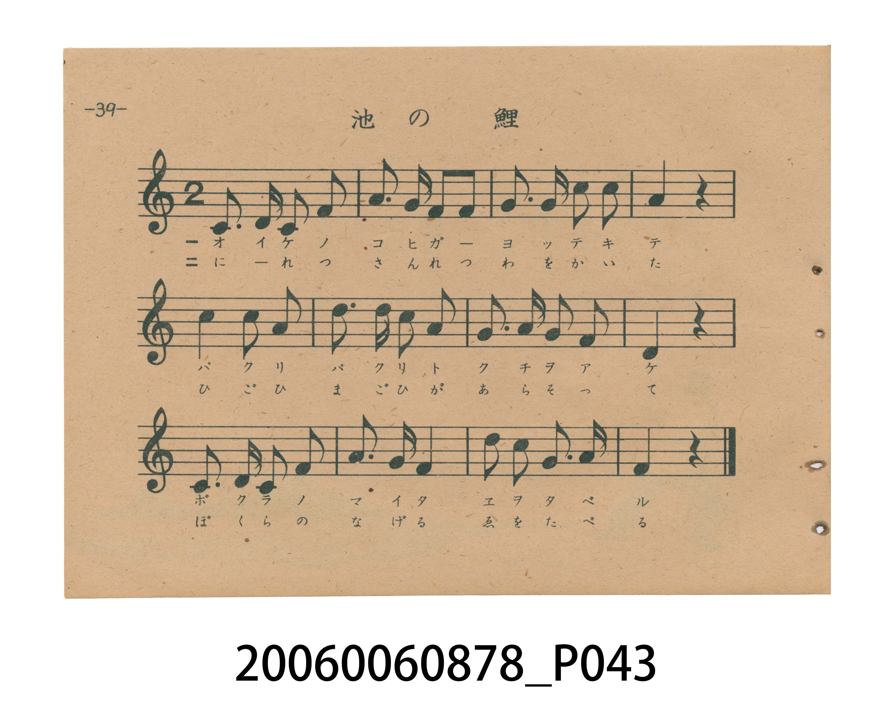
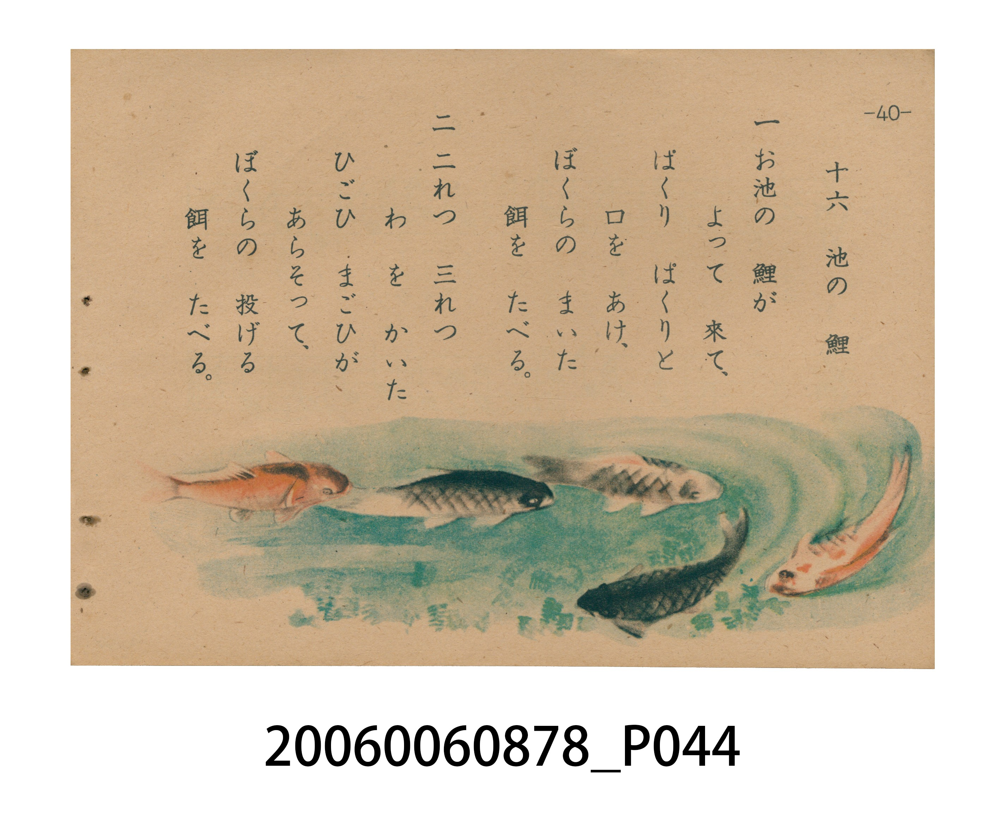

# 池の 鯉（池中的鯉魚）

> Re:Shōka 使用 AI 協助辨識與重建樂譜，可能會有錯誤。歡迎回報。

- **NEUTRINO 歌聲合成版**：<br><audio controls src="ike_no_koi_neutrino.mp3"></audio>
- **鋼琴伴奏版**：<br><audio controls src="ike_no_koi.mp3"></audio>


- 日治時期國民學校唱歌（うたのほん 下・第十六課）
- 國立臺灣歷史博物館典藏

## 說明


- 出處：臺灣總督府編《うたのほん 下》（國民學校初等科第二學年用），第十六課〈池の 鯉〉（池中的鯉魚），原書第 39–40 頁。
- 調性與拍號：ヘ調（F 大調五聲音階，原書五線譜省略調號，實際音高終止於 F 音），2/4 拍，速度 != 104。
- 背景與曲風：旋律優美流暢，生動描繪池中緋鯉（ひごひ）與真鯉（まごひ）成群游來、畫出兩三圈水波並張口爭食餌料的悠游姿態。
- 版本說明：本檔案為原書單聲部五線譜旋律之忠實數位化版本。

### 編曲說明（鋼琴伴奏版）：

1. 前奏 (Intro, 4 小節)：擷取主旋律核心樂句作為導奏，建立調性與拍感。
2. 主歌伴奏 (IkeNoKoi)：右手 (PianoRH) 演奏原書歌唱主旋律；左手 (PianoLH)
依國民學校低學年教材純樸明朗之風格配以和聲伴奏。


## 歌詞

```text
一　お池の　鯉が　よって　來て、
ぱくり　ぱくりと　口を　あけ、
ぼくらの　まいた　餌を　たべる。

二　二れつ　三れつ　わを　かいた
ひごひ　まごひが、あらそって、
ぼくらの　投げる　餌を　たべる。
```

## ABC

```abc
X:1
T:池の 鯉（池中的鯉魚）
M:2/4
L:1/16
Q:1/4=104
K:F
V:V1 name="Piano" snm="Pia"
[V:V1]
C3 D C2 F2 | A3 G F2 F2 | G3 G c2 c2 | G4 z4 |
w: 1.~お い け の | こ ひ が _ | よ っ て き | て
w: 2.~に れ つ _ | さ ん れ つ | わ を か い | た
c4 c2 A2 | d2 d3 c A2 | G3 A G2 F2 | D4 z4 |
w: 1.~ぱ く り | ぱ く り と | く ち を あ | け
w: 2.~ひ ご ひ | ま ご ひ が | あ ら そ っ | て
C3 D C2 F2 | A3 G F4 | d2 c2 G2 A2 | F4 z4 |
w: 1.~ぼ く ら の | ま い た | え を た べ | る
w: 2.~ぼ く ら の | な げ る | ゑ を た べ | る
```

## TMD 檔案連結

- [主旋律 TMD 檔案](ike_no_koi.tmd) [[在 TMD Studio 編輯](https://tmdlang.github.io/Tmd-TS/#tmd=s7IKdvYPcrWy4qpTUCpJTLdSyC_KTM_Ms8rNz0sqLc7IV-LS0lJ4tnHB48Z1Ci_Xd77f0wHkPNmx9vmsFiD35dpZ7_d0KmhpcSnaKhgamHDZ2yq4cdkY6ZvYgQx8Nn3ps027n81sejZn_tM53c82THy6dsezBQufTtn4bG0P0KzHjW2PG-cDzX7cuPtx02SFJzu6Hzfvfr5mzdPexqeta1-s2gQ0XglkFFD789XdL9p3PW9c_Gzt9qf9m572znreufLlkhVPW3e8mN6vxMWlr6VgSy3ApaCg8LhhwrPZm57PXvdi1apnM_oeN0wEizbvftq-68XMqe_3zIK45_mOvc_nLn66a87z7SseN3Rh81RDN9C3KEHQMff52s7nyycCPftkVw9Q8OnOLc-nrAD69_2eHuQQeNwACnJo-D9uwB4FQD1P--Y_m70DqFPB2PJRw2QTA4WXCxofNzRB3fxi1f5nDctfdLQ_6-59MXM-0PGPm2cABYHGuSk8XbIcyHyya8qLxk0v529-OasPbiBQ8Pn2WS_Wznk-p_H51KVAZWDdPU_XL3s5azZI8eoZz7c2PVu76Nm0PQpuCkARiHuAiUABaBeQ9bJh_tNdyxQgSQTJRc09z2auB7lo9qaXi4A-n_VsevfTfd1PW1Y939f3bGvjs1mLQGExZf7T7qnP-vuf71wF9fj2bkhSfNy46XHjFCAJtBFozvM582Hi--DizzomPN-35NmOHU_2tT1uAHphNTD2nraufLKj8-mcjmcbtjzbvOjJjmVP92x92r_4ecfal4vnv1zS82zaTGDwPmtaANT4dPn-Z63AKIS5-3lnx7M5ayBpAuToOWuerZrybGHH86ZdkCB7Om0dKBybV8DDDuKxJzu7n-5fAAy4Z1N3PNnb-7RnGsQokNHQ9AYxAJg5Xqyc97R1xbNp7UB_Ab0MYqya92LtemAiBHoQLZZBSaKvGRhEQIcoBBiYGANlgJQJOCI6wWY_2dHwuKHhcWMXJC0B2aDU1NgDEmwCBtjix43LgGxQIIEYjWD3NG583Nj_uKkLrBPGbgSm8QZgWD1umgQWb3rcOBGuYQ9YEdBgkA3gaGgB5QWgbUt6YBqAWWPn4yZYgALdDvEZKCg3Lni6cMaLxQvhSftF46xnU_pBsber7WVjH9B5wBQB9AswukDkBGCe2gBkv5zW_XTGlqfbt4AS5oTmFxOnP-uY-LRh4rNJk4C5D2Ta2lkgFzQ0wcNjF8jrILKp53HjEhB7Ryec_bgJ6AuIa7shXoB4D5rcYH4Ds0Fh2AgKBpC358JCElt4POua-rhxEtjrxIUHPLECUyrQSOQk-2zP4md7VgF99nxLKzSoOtpf7p4IKxF6gEn5aWvHs8YJT_f1gAIJOVS6pmIJFaDdlBebUKCgpc_F5Zmd6pfvnZ9pFZCZmJfvUGNQUw2yRMHG0EzLDsyqUTCNV9AFQrN4CMsQiGsUjMFiRmAeRMQIKmIKJEEYJqKrYACla8AG-hjWAAO9CywCjDcgnghmrQPredw4GSqzCYh7YDoVgBkAKr4YiJeBWb1QHSAeFnuMQHKrIbqaeoDsJQjTGqdCxSeD5UCmgWRB9vRDZSYBxbqhboTomY9hDyyEoAIgGhQwNQpmoACDikFEIIFhDKYhAQYMUNzhsxEqBkybYNeAwgsmDhGDiAKzOlQGKta4EOx2EKsJKgMKX1zhswluzxQwCeKDxPfBxZDjAiQDMhVkdyeQPRcsuxgqgxkPxKYgSKyAAgwUhKAgggQaTA5bCO2Bhw_ILcgpCOR2WNqCxRlIHJSCYGEDEgfmaYhMEyiecYUQbntWQWWAKQVuAsg0cHom0p5aLi5dOwVYNgRbC-QrcwEA)]
- [鋼琴伴奏 TMD 檔案](ike_no_koi_piano.tmd) [[在 TMD Studio 編輯](https://tmdlang.github.io/Tmd-TS/#tmd=s7IKdvYPcrWy4tLSUni2ccHjxnUKL9d3vt_TAeQ82bH2-awWIPfl2lnv94AEX3bveT5hy5M9W54u7X_e2QEUVNDS4lK0VTA0MOGyt1Vw47Ix0jex46pTUHo2femzTbufzWx6Nmf-0zndzzZMfLp2x7MFC59O2fhsbQ_QrMeNbY8b5wMtfNy4-3HTZIUnO7ofN-9-vmbN097Gp61rX6zaBDReCWQUUPvz1d0v2nc9b1z8bO32p_2bnvbOet658uWSFU9bd7yY3q_ExaWvpWBLLcCloKDwuGHCs9mbns9e92LVqmcz-h43TASLNu9-2r7rxcyp7_fMgrjn-Y69z-cufrprzvPtKx43dGHzVEM30LcoQdAx9_nazufLJwI9-2RXD1Dw6c4tz6esAIdxD3IIPG4AxQM0Uh434IqXnqd985_N3gHUqWBs-ahhsomBwssFjY8bmqBufrFq_7OG5S862p91976YOR_o-MfNM4CCQOPcFJ4uWQ5kPtk15UXjppfzN7-c1Qc3ECj4fPusF2vnPJ_T-HzqUqAysO6ep-uXvZw1G6R49YznW5uerV30bNoeBTcFoAjEPcBEoAC0C8h62TD_6a5lCpAkguSi5p5nM9eDXDR708tFQJ_Peja9--m-7qctq57v63u2tfHZrEWgsJgy_2n31Gf9_c93roJ6fHs3JH0-btz0uHEKkATaCDTn-Zz5MPF9cPFnHROe71vybMeOJ_vaHjcAvbAaGHtPW1c-2dH5dE7Hsw1bnm1e9GTHsqd7tj7tX_y8Y-3LxfNfLul5Nm0mMHifNS0Aany6fP-zVmAUwtwNjGWgiyFpAmt-APoEpFRBwVBP4WlnL1BcQcMzr6QoX0fBROHphv7n6xs0Qb6dDEzG057s2A3x9rMFO57ub362oulp_9Ine-c8b9r1dEMfUC8orHfvAiV-pBh81jIf6iAFBSM9YBLbDcxQEDcA7cpO9cv3zs8EWfK0f_Ozzm4FjYDMxLz8IA9NhWd7pgAVQeIWqAeYFeEueL9n9tPtyxDKfTw0ITYAwZN9c5GT75O9fZAk-2zqzGdzJzzfMuXZih3A8Hg2Z_qTnd3A2Hy2YM_L1t4nu5c-ndQDTFQQp4GcDM1YcAe8WDnvaeuKZ9PagR4Dxi2IsWrei7XrgbkNGLhoyRmU9vuagWnh2aopCgEGJsZAGSBlAg70TrDZT3Y0PG5oeNzYBck0QDYo2zT2gASbgClj8ePGZUA2KDWAGI1g9zRufNzY_7ipC6wTxm4EZuYGYKJ43DQJLN70uHEiXMMesCKgwSAbwOmtBZTpgbYt6YFpAJYBOx83wVIO0O0Qn4GifuOCpwtnvFi8EJ6HXzTOejalH5RMd7W9bOwDOg8Y70C_ANMliJwALDw2ANkvp3U_nbHl6fYtoFQxofnFxOnPOiY-bZj4bNIkYDEDMm3tLJALGprg4bEL5HUQ2dTzuHEJiL2jE85-3AT0BcS13RAvQLwHzVcwv4HZoDBsBAUDyNtzYSGJLTyedU193DgJ7HXiwgOeK4FZEmgkct58tmfxsz2rgD57vqUVGlQd7S93T4QVfT3APPu0teNZ44Sn-3pAgYQcKl1TsYQK0G7K6wcoUNDS5-IC520raA5zqDGoqQZnGxtDMy07MKtGwTReQRcIzeIhLEMgrlEwBosZgXkgWKNgBiRNwWK6YNkauJwBTA1XLYqFPsgWmiDZF68QbRgLY5mCWGZwliFUEmwWtLCg0P0QEZC7QSIgP4AwTATZ_SADfQxrgGmmCywCTHZAPBHMWgfW87hxMlRmExD3wEMHmH-h4ouBeBmY1QvVAeJhsccIJLcaoqupB8hegjCtcSpUfDJYDmQaSBZkTz9UZhJQrBvqRoie-Rj2wEIIKgCiIVEHikwQBolBRCCBYQymIQEGDFDc4bMRKgbMWmDXgMILJg4Rg4gCSyqoDFSscSHY7SBWE1QGFL64wmcT3J4pYBLEB4nvg4shxwVIBmQqyO5OIHsuWHYxVAYzHqifAxAhtAcePiC3IKcgkNthaQsWZyBxUAqChQ1IHFgkQWSaQPGMK4Rw27MKKgNMKXATQKaB0zOR9mDkQhyZGpyBwZkaloGx5XOoYrgSEAOe681ysaklWFoYQFypa6cALnoUQAyoi6N9gBpR-EZgvjIXAA)]

## 分析

```text
================================================================================
📊 TMD Song Profile: [ 池の 鯉（池中的鯉魚） ]
================================================================================
⏱  Duration:       0:13 (13.8s), 12 measures total
🎼 Key & Tempo:    首調基準 F, != 104.0 BPM, <2/4>
   - 分析範圍：      由實際發聲的音符與和弦推測調性；播放脈絡另行呈現
🎤 人聲音域:    C4 (MIDI 60) – D5 (MIDI 74) [跨度: 14 個半音 / 1.2 個八度, 難度: moderate]
   - 最低音:  C4 in [IkeNoKoi #1 @ m.1, 0:00]
   - 最高音: D5 in [IkeNoKoi #1 @ m.6, 0:05]
   - 適合: soprano, mezzo-soprano, contralto, tenor, baritone, bass
🏛  結構:      IkeNoKoi (13.8s)
⚡ 編曲密度:        Peak 1 軌道同時演奏
🗝  調性診斷：       C 調性不明確（純淨自然大調，未偵測到可信轉調）
   - 風格氣質:    純淨自然大調（陽光明朗、易唱易記，無明顯調外色彩）
   - 轉調歷程:    全曲維持單一推測調性（未偵測到可信轉調）
   - 核心骨幹音:  C, F, G, D, A
   - 調性數值:    C 調性不明確 [相關度: 0.83, 穩定度: Ambiguous, 自然音純度: 100.0%]
   - 候選調性 (K-S): C 大調 (0.83), F 大調 (0.80), A 小調 (0.58)
   - 五度圈歷程:   +0
   - 各段落調性細節:
     • [IkeNoKoi #1]: C 調性不明確 (r: 0.83, 自然音純度: 100.0%)

  [ 五度圈游移軌跡 ]
              [C ]*
         F            G  
      Bb               D  
      Eb               A  
         Ab           E  
            Db       B  
               F# 
     (* = active key center)

  [ 十二半音累積音高分佈 ]
     C  : ████████████████████████  27.4%
     C# :                            0.0%
     D  : ██████████████            15.5%
     D# :                            0.0%
     E  :                            0.0%
     F  : ███████████████████       21.4%
     F# :                            0.0%
     G  : ██████████████████        20.2%
     G# :                            0.0%
     A  : ██████████████            15.5%
     A# :                            0.0%
     B  :                            0.0%
--------------------------------------------------------------------------------
Assignment 軌道音域：
  - Piano         : C4 – D5 (14 個半音 / 1.2 個八度, 37 個音符)
================================================================================
```


## 原書掃描頁






