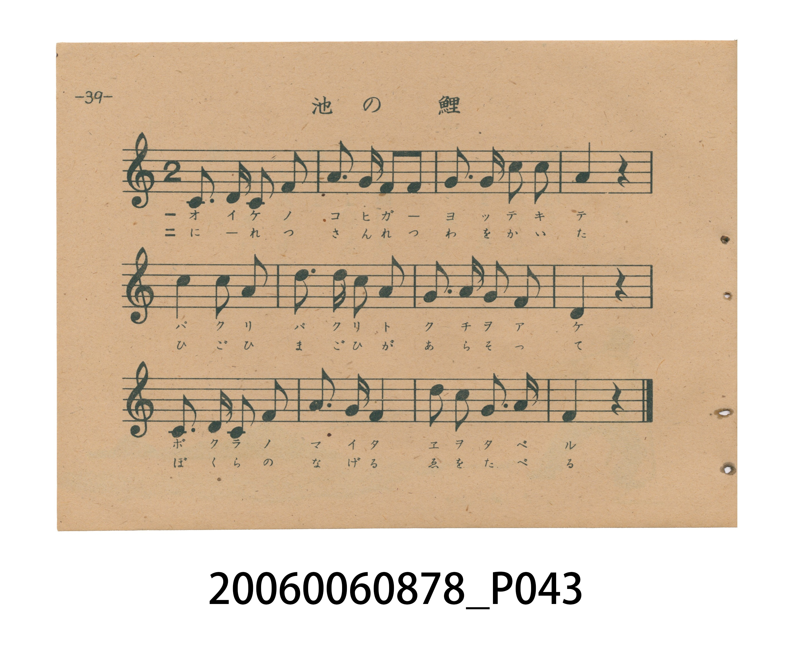
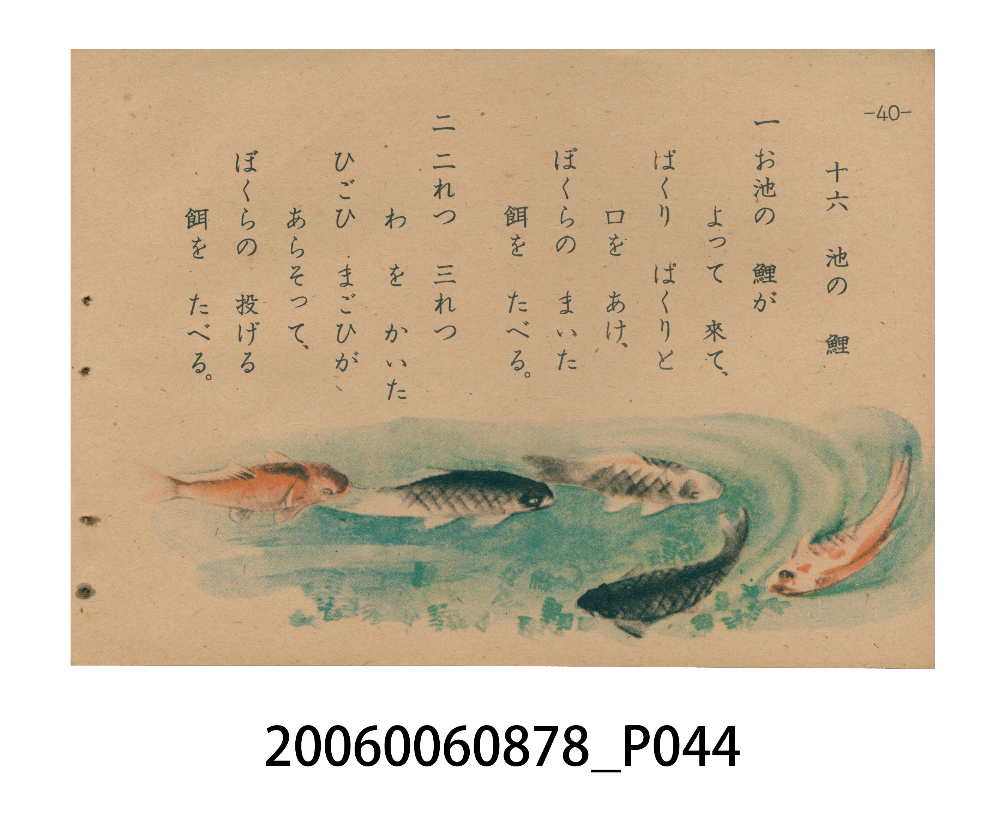

# 池の 鯉（池中的鯉魚）

> Re:Shōka 使用 AI 協助辨識與重建樂譜，可能會有錯誤。歡迎回報。

- **鋼琴伴奏版**：<br><audio controls src="ike_no_koi.mp3"></audio>
- **NEUTRINO 歌聲合成版**：<br><audio controls src="ike_no_koi_neutrino.mp3"></audio>

- 日治時期國民學校唱歌（うたのほん 下・第十六課）
- 國立臺灣歷史博物館典藏

## 說明


- 出處：臺灣總督府編《うたのほん 下》（國民學校初等科第二學年用），第十六課〈池の 鯉〉（池中的鯉魚），原書第 39–40 頁。
- 調性與拍號：ヘ調（F 大調五聲音階，原書五線譜省略調號，實際音高終止於 F 音），2/4 拍，速度 != 104。
- 背景與曲風：旋律優美流暢，生動描繪池中緋鯉（ひごひ）與真鯉（まごひ）成群游來、畫出兩三圈水波並張口爭食餌料的悠游姿態。
- 版本說明：本檔案為原書單聲部五線譜旋律之忠實數位化版本。

### 編曲說明（鋼琴伴奏版）：

1. 前奏 (Intro, 4 小節)：擷取主旋律核心樂句作為導奏，建立調性與拍感。
2. 主歌伴奏 (IkeNoKoi)：右手 (PianoRH) 演奏原書歌唱主旋律；左手 (PianoLH)
依國民學校低學年教材純樸明朗之風格配以和聲伴奏。


## 歌詞

```text
一　お池の　鯉が　よって　來て、
ぱくり　ぱくりと　口を　あけ、
ぼくらの　まいた　餌を　たべる。

二　二れつ　三れつ　わを　かいた
ひごひ　まごひが、あらそって、
ぼくらの　投げる　餌を　たべる。
```

## ABC

<div class="abc-score" data-abc-src="ike_no_koi.abc" aria-label="五線譜載入中"></div>

[下載 ABC 原始檔](ike_no_koi.abc)

## TMD 檔案連結

- [主旋律 TMD 檔案](ike_no_koi.tmd) [[在 TMD Studio 編輯](https://tmdlang.github.io/Tmd-TS/#tmd=s7IKdvYPcrWy4qpTUCpJTLdSyC_KTM_Ms8rNz0sqLc7IV4JLJOfn5KQml2Tm51mVliTm5Wfk5yEky_JzSnNTrYwQIsX5pUXJqXCl8emp6HLxBYnpqVYBBibGukDCBCFdUJRflpqXmAfUXpKYWZ4I1AwUKMrLLwKakpdalJiDUJtalpmSClJZUJSZm1hUGZ-Snwx0SV4JkttSi4pBri7LT0bWmV9UkpGfXpRYkFFplZFZXAL0OFA-PjsxLxGhqCQjFeitxDyg2TnFSlxaWgrPNi543LhO4eX6zvd7OoCcJzvWPp_VAuS-XDvr_Z5OBS0tLkVbBUMDEy57WwU3LhsjfRM7kHHPpi99tmn3s5lNz-bMfzqn-9mGiU_X7ni2YOHTKRufre0BmvW4se1x43yg2Y8bdz9umqzwZEf34-bdz9esedrb-LR17YtVm4DGg10G1P58dfeL9l3PGxc_W7v9af-mp72znneufLlkxdPWHS-m9ytxcelrKdhSC3ApKCg8bpjwbPam57PXvVi16tmMvscNE8Gizbuftu96MXPq-z2zIO55vmPv87mLn-6a83z7iscNXdg81dAN9C1KEHTMfb628_nyiUDPPtnVAxR8unPL8ykrgP59v6cHOQQeN4CCHBr-jxuwRwFQz9O--c9m7wDqVDC2fNQw2cRA4eWCxscNTVA3v1i1_1nD8hcd7c-6e1_MnA90_OPmGUBBoHFuCk-XLAcyn-ya8qJx08v5m1_O6oMbCBR8vn3Wi7Vzns9pfD51KVAZWHfP0_XLXs6aDVK8esbzrU3P1i56Nm2PgpsCUATiHmAiUADaBWS9bJj_dNcyBUgSQXJRc8-zmetBLpq96eUioM9nPZve_XRf99OWVc_39T3b2vhs1iJQWEyZ_7R76rP-_uc7V0E9vr0bkhQfN2563DgFSAJtBJrzfM58mPg-uPizjgnP9y15tmPHk31tjxuAXlgNjL2nrSuf7Oh8Oqfj2YYtzzYverJj2dM9W5_2L37esfbl4vkvl_Q8mzYTGLzPmhYANT5dvv9ZKzAKYe5-3tnxbM4aSJoAOXrOmmerpjxb2PG8aRckyJ5OWwcKx-YV8LCDeOzJzu6n-xcAA-7Z1B1P9vY-7ZkGMQpkNDS9QQwAZo4XK-c9bV3xbFo70F9AL4MYq-a9WLsemAiBHkSLZVCS6GsGBhHQIQqgwgUoAypewBHRCTb7yY6Gxw0Njxu7IGkJyAalpsYekGATMMAWP25cBmSDAgnEaAS7p3Hj48b-x01dYJ0wdiMwjTcAw-px0ySweNPjxolwDXvAioAGg2wAR0MLKC8AbVvSA9MAzBo7HzfBAhTodojPQEG5ccHThTNeLF4IT9ovGmc9m9IPir1dbS8b-4DOA6YIoF-A0QUiJwDz1AYg--W07qcztjzdvgWUMCc0v5g4_VnHxKcNE59NmgTMfSDT1s4CuaChCR4eu0BeB5FNPY8bl4DYOzrh7MdNQF9AXNsN8QLEe9DkBvMbmA0Kw0ZQMIC8PRcWktjC41nX1MeNk8BeJy484IkVmFKBRiIn2Wd7Fj_bswros-dbWqFB1dH-cvdEWInQA0zKT1s7njVOeLqvBxRIyKHSNRVLqADtprzYhAIFLX0uLs_sVL987_xMq4BMYH3oUGNQUw2yRMHG0EzLDsyqUTCNV9AFQrN4CMsQiGsUjMFiRmAeRMQIKmIKJEEYJqKrYACla8AG-hjWAAO9CywCjDcgnghmrQPredw4GSqzCYh7YDoVgBkAKr4YiJeBWb1QHSAeFnuMQHKrIbqaeoDsJQjTGqdCxSeD5UCmgWRB9vRDZSYBxbqhboTomY9hDyyEoAIgGhQwNQpmoACDikFEIIFhDKYhAQYMUNzhsxEqBkybYNeAwgsmDhGDiAKzOlQGKta4EOx2EKsJKgMKX1zhswluzxQwCeKDxPfBxZDjAiQDMhVkdyeQPRcsuxgqgxkPxKYgSKyAAgwUhKAgggQaTA5bCO2Bhw_ILcgpCOR2WNqCxRlIHJSCYGEDEgfmaYhMEyiecYUQbntWQWWAKQVuAsg0cHom0p5aLi5dOwVYNgRbC-QrcwEA)]
- [鋼琴伴奏 TMD 檔案](ike_no_koi_piano.tmd) [[在 TMD Studio 編輯](https://tmdlang.github.io/Tmd-TS/#tmd=s7IKdvYPcrWy4qpTUCpJTLdSSM7PyUlNLsnMz7MqLUnMy8_Iz1OCS5bl55TmploZIUSK80uLklPhSuPTU9Hl4gsS01OtAgxMjHWBhAlCuqAovyw1LzEPqL0kMbM8EagZKFCUl18ENCUvtSgxB6E2tSwzJRWksqAoMzexqDI-JT8Z6JK8EiS3pRYVg1xdkAl0SnxiUVFiXnoqqpL8opKM_PSixIKMSquMzOKS_KLM5MSc-OzEvESEopIMoC6rxDygPTnFSlxaWgrPNi543LhO4eX6zvd7OoCcJzvWPp_VAuS-XDvr_R6Q4MvuPc8nbHmyZ8vTpf3POzuAggpaWlyKtgqGBiZc9rYKblw2RvomdiA7nk1f-mzT7mczm57Nmf90TvezDROfrt3xbMHCp1M2PlvbAzTrcWPb48b5QAsfN-5-3DRZ4cmO7sfNu5-vWfO0t_Fp69oXqzYBjQc7F6j9-eruF-27njcufrZ2-9P-TU97Zz3vXPlyyYqnrTteTO9X4uLS11KwpRbgUlBQeNww4dnsTc9nr3uxatWzGX2PGyaCRZt3P23f9WLm1Pd7ZkHc83zH3udzFz_dNef59hWPG7qweaqhG-hblCDomPt8befz5ROBnn2yqwco-HTnludTVoDDuAc5BB43gOIBGimPG3DFS8_TvvnPZu8A6lQwtnzUMNnEQOHlgsbHDU1QN79Ytf9Zw_IXHe3PuntfzJwPdPzj5hlAQaBxbgpPlywHMp_smvKicdPL-ZtfzuqDGwgUfL591ou1c57PaXw-dSlQGVh3z9P1y17Omg1SvHrG861Nz9YuejZtj4KbAlAE4h5gIlAA2gVkvWyY_3TXMgVIEkFyUXPPs5nrQS6avenlIqDPZz2b3v10X_fTllXP9_U929r4bNYiUFhMmf-0e-qz_v7nO1dBPb69G5I-Hzduetw4BUgCbQSa83zOfJj4Prj4s44Jz_ctebZjx5N9bY8bgF5YDYy9p60rn-zofDqn49mGLc82L3qyY9nTPVuf9i9-3rH25eL5L5f0PJs2Exi8z5oWADU-Xb7_WSswCmHuBsYy0MWQNIE1PwB9AlKqoGCop_C0sxcorqDhmVdSlK-jYKLwdEP_8_UNmiDfTgYm42lPduyGePvZgh1P9zc_W9H0tH_pk71znjfterqhD6gXFNa7d4ESP1IMPmuZD3WQgoKRHjCJ7QZmKIgbgHZlp_rle-dngix52r_5WWe3gkYAqKQI8tBUeLZnClARJG6BeoBZEe6C93tmP92-DKHcx0MTYgMQPNk3Fzn5PtnbB0myz6bOfDZ3wvMtU56t2AEMj2dzpj_Z2Q2MzWcL9rxs7X2ye-nTST3ARAVxGsjJ0IwFd8CLlfOetq54Nq0d6DFg3IIYq-a9WLsemNuAgYuWnEFpv68ZmBaerZqiACpmgTKgghYc6J1gs5_saHjc0PC4sQuSaYBsULZp7AEJNgFTxuLHjcuAbFBqADEawe5p3Pi4sf9xUxdYJ4zdCMzMDcBE8bhpEli86XHjRLiGPWBFQINBNoDTWwso0wNtW9ID0wAsA3Y-boKlHKDbIT4DRf3GBU8XznixeCE8D79onPVsSj8ome5qe9nYB3QeMN6BfgGmSxA5AVh4bACyX07rfjpjy9PtW0CpYkLzi4nTn3VMfNow8dmkScBiBmTa2lkgFzQ0wcNjF8jrILKp53HjEhB7Ryec_bgJ6AuIa7shXoB4D5qvYH4Ds0Fh2AgKBpC358JCElt4POua-rhxEtjrxIUHPFcCsyTQSOS8-WzP4md7VgF99nxLKzSoOtpf7p4IK_p6gHn2aWvHs8YJT_f1gAIJOVS6pmIJFaDdlNcPUKCgpc_FBc7bVtAc5lBjUFMNzjY2hmZadmBWjYJpvIIuEJrFQ1iGQFyjYAwWMwLzQLBGwQxImoLFdMGyNXA5A5garloUC32QLTRBsi9eIdowFsYyBbHM4CxDqCTYLGhhQaH7ISIgd4NEQH4AYZgIsvtBBvoY1gDTTBdYBJjsgHgimLUOrOdx42SozCYg7oGHDjD_QsUXA_EyMKsXqgPEw2KPEUhuNURXUw-QvQRhWuNUqPhksBzINJAsyJ5-qMwkoFg31I0QPfMx7IGFEFQAREOiDhSZIAwSg4hAAsMYTEMCDBiguMNnI1QMmLXArgGFF0wcIgYRBZZUUBmoWONCsNtBrCaoDCh8cYXPJrg9U8AkiA8S3wcXQ44LkAzIVJDdnUD2XLDsYqgMZjxQPwcgQmgPPHxAbkFOQSC3w9IWLM5A4qAUBAsbkDiwSILINIHiGVcI4bZnFVQGmFLgJoBMA6dnIu3ByIU4MjU4A4MzNSwDY8vnUMVwJSAGPNeb5WJTS7C0MIC4UtdOAVz0KIAYUBdH-wA1ovCNwHxlLgA)]

## 分析

```text
================================================================================
📊 TMD Song Profile: [ 池の 鯉（池中的鯉魚） ]
================================================================================
⏱  Duration:       0:13 (13.8s), 12 measures total
🎼 Key & Tempo:    首調基準 F, != 104.0 BPM, <2/4>
   - 分析範圍：      由實際發聲的音符與和弦推測調性；播放脈絡另行呈現
🎤 人聲音域:    C4 (MIDI 60) – D5 (MIDI 74) [跨度: 14 個半音 / 1.2 個八度, 難度: moderate]
   - 最低音:  C4 in [IkeNoKoi #1 @ m.1, 0:00]
   - 最高音: D5 in [IkeNoKoi #1 @ m.6, 0:05]
   - 適合: soprano, mezzo-soprano, contralto, tenor, baritone, bass
🏛  結構:      IkeNoKoi (13.8s)
⚡ 編曲密度:        Peak 1 軌道同時演奏
🗝  調性診斷：       C 調性不明確（純淨自然大調，未偵測到可信轉調）
   - 風格氣質:    純淨自然大調（陽光明朗、易唱易記，無明顯調外色彩）
   - 轉調歷程:    全曲維持單一推測調性（未偵測到可信轉調）
   - 核心骨幹音:  C, F, G, D, A
   - 調性數值:    C 調性不明確 [相關度: 0.83, 穩定度: Ambiguous, 自然音純度: 100.0%]
   - 候選調性 (K-S): C 大調 (0.83), F 大調 (0.80), A 小調 (0.58)
   - 五度圈歷程:   +0
   - 各段落調性細節:
     • [IkeNoKoi #1]: C 調性不明確 (r: 0.83, 自然音純度: 100.0%)

  [ 五度圈游移軌跡 ]
              [C ]*
         F            G  
      Bb               D  
      Eb               A  
         Ab           E  
            Db       B  
               F# 
     (* = active key center)

  [ 十二半音累積音高分佈 ]
     C  : ████████████████████████  27.4%
     C# :                            0.0%
     D  : ██████████████            15.5%
     D# :                            0.0%
     E  :                            0.0%
     F  : ███████████████████       21.4%
     F# :                            0.0%
     G  : ██████████████████        20.2%
     G# :                            0.0%
     A  : ██████████████            15.5%
     A# :                            0.0%
     B  :                            0.0%
--------------------------------------------------------------------------------
Assignment 軌道音域：
  - Piano         : C4 – D5 (14 個半音 / 1.2 個八度, 37 個音符)
================================================================================
```


## 原書掃描頁






