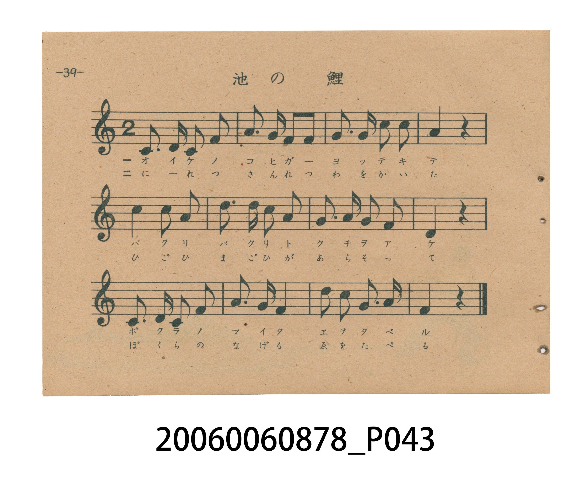
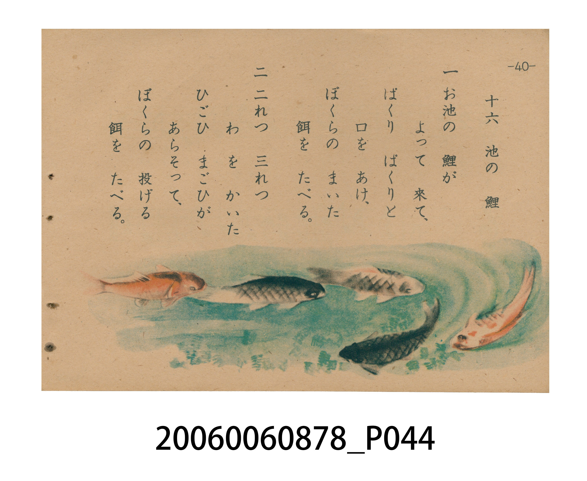

# 池の 鯉（池中的鯉魚）

> Re:Shoka 使用 AI 協助辨識與重建樂譜，可能會有錯誤。歡迎回報。

<audio controls src="ike_no_koi.mp3"></audio>

- 日治時期國民學校唱歌（うたのほん 下・第十六課）
- 國立臺灣歷史博物館典藏

## 說明

【曲目說明】
・出處：臺灣總督府編《うたのほん 下》（國民學校初等科第二學年用），第十六課〈池の 鯉〉（池中的鯉魚），原書第 39–40 頁。
・調性與拍號：ハ調（C 大調記譜，原書五線譜無調號，實際音高終止於 F4＝`4`），2/4 拍，速度 != 104。
・背景與曲風：旋律優美流暢，生動描繪池中緋鯉（ひごひ）與真鯉（まごひ）成群游來、畫出兩三圈水波並張口爭食餌料的悠游姿態。
・版本說明：本檔案為原書單聲部五線譜旋律之忠實數位化版本。

・編曲說明（鋼琴伴奏版）：
1. 前奏 (Intro, 4 小節)：擷取主旋律核心樂句作為導奏，建立調性與拍感。
2. 主歌伴奏 (IkeNoKoi)：右手 (PianoRH) 演奏原書歌唱主旋律；左手 (PianoLH)
依國民學校低學年教材純樸明朗之風格配以和聲伴奏。

## 跨冊／重複收錄參照

> 同名異曲（《新定兒童唱歌》第一學年〈イケノコヒ〉與國民學校《うたのほん》下卷〈池の 鯉〉為不同詞曲版本）

- **[同名異曲]** 《新定兒童唱歌》尋常科第一學年用（2020.006.0847.0001）：[**〈イケノコヒ〉**](../../../shintei_jido_shoka/grade_1_2020.006.0847.0001/1_05_ike_no_koi/index.md)（`G` / `2/4` — [原始 TMD](../../../shintei_jido_shoka/grade_1_2020.006.0847.0001/1_05_ike_no_koi/ike_no_koi.tmd)）
- 總表：[跨冊重複與同名歌曲總索引](../../../duplicate_songs.md)

## 歌詞

```text
一　お池の　鯉が　よって　來て、
ぱくり　ぱくりと　口を　あけ、
ぼくらの　まいた　餌を　たべる。

二　二れつ　三れつ　わを　かいた
ひごひ　まごひが、あらそって、
ぼくらの　投げる　餌を　たべる。
```

## ABC

```abc
X:1
T:池の 鯉（池中的鯉魚）
M:2/4
L:1/16
Q:1/4=104
K:C
V:V1 name="Piano" snm="Pia"
[V:V1]
C3 D C2 F2 | A3 G F2 F2 | G3 G c2 c2 | G4 z4 |
c4 c2 A2 | d2 d3 c A2 | G3 A G2 F2 | D4 z4 |
C3 D C2 F2 | A3 G F4 | d2 c2 G2 A2 | F4 z4 |
```

## TMD 檔案連結

- [主旋律 TMD 檔案](ike_no_koi.tmd) [[在 TMD Studio 編輯](https://tmdlang.github.io/Tmd-TS/#tmd=s7IKdvYPcrWy4tLSUni2ccHjxnUKL9d3vt_TAeQ82bH2-awWIPfl2lnv93QqaGlxKdoqGBqYcNnbKjhz2Rjpm9hx1SkoPZu-9Nmm3c9mNj2bM__pnO5nGyY-Xbvj2YKFT6dsfLa2B2jW48a2x43zgWY_btz9uGmywpMd3Y-bdz9fs-Zpb-PT1rUvVm0CGq8EMgqo_fnq7hftu543Ln62dvvT_k1Pe2c971z5csmKp607XkzvV-Li0tdSsKUW4FJQUHjcMOHZ7E3PZ697sWrVsxl9jxsmgkWbdz9t3_Vi5tT3e2ZB3PN8x97ncxc_3TXn-fYVjxu6sHmqoRvoW5Qg6Jj7fG3n8-UTgZ59sqsHKPh055bnU1YA_ft-Tw9yCDxuAAU5NPwfN2CPAqCep33zn83eAdSpYGz5qGGyiYHCywWNjxuaoG5-sWr_s4blLzran3X3vpg5H-j4x839QEGgcc4KT5csBzJfrJjxYu0cuFFPdk15vn0WUOR5y0KQLEhTz9P1y17Omv1y_uaXq2c839r0bO2iZ9P2KLiZvN8zN8EkAeISYPQrAG0Bsl42zH-6a5kCJHEguaW559nM9SC3zN70chHQz7OeTe9-uq_7acuq5_v6nm1tfDZrESgUpsx_2j31WX__852roF7e3g1JhI8bNz1unAIkgTYCzXk-Zz5MfB9c_FnHhOf7ljzbsePJvrbHDY3Pp64GxtvT1pVPdnQ-ndPxbMOWZ5sXPdmx7OmerU_7Fz_vWPty8fyXS3qeTZsJDNhnTQuAGp8u3_-sFRh5MHc_7-x4NmcNJDWAHD1nzbNVU54t7HjetAsSZE-nrXvRuOll8wp42EE89mRn99P9C4Bh92zqjid7e5_2TIMYBTIamtIgBgCzxYuV8562rng2rR3oL6CXQYxV816sXQ9MfkAPosUvKDH0NQODCOgQhQADE2OgDJACRgcwNDrBZj_Z0fC4oeFxYxckFQHZoHTU2AMSbAIG2OLHjcuAbFAggRiNYPc0bnzc2P-4qQusE8ZuBKbuBmBYPW6aBBZvetw4Ea5hD1gR0GCQDeBoaAHlAqBtS3pgGoCZYufjJliAAt0O8RkoKDcueLpwxovFC-GJ-kXjrGdT-kGxt6vtZWMf0HnAFAH0CzC6QOQEYG7aAGS_nNb9dMaWp9u3gNLmhOYXE6c_65j4tGHis0mTgPkOZNraWSAXNDTBw2MXyOsgsqnnceMSEHtHJ5z9uAnoC4hruyFegHgPmtxgfgOzQWHYCAoGkLfnwkISW3g865r6uHES2OvEhQc8sQJTKtBI5CT7bM_iZ3tWAX32fEsrNKg62l_unggrC3qASflpa8ezxglP9_WAAgk5VLqmYgkVoN2UF5hQoKClz8XlmZ3ql--dn2kVkJmYl-9QY1CjUA2yRcHG0EzLDswCltXAaLQCBlQXELcA8UQgXqdQAyQng8IbiHuA6oD8pg4gezEQLwPiXrCKZSAjgABoGcywXT0gw1YDlfcA6SUQrY1TgXygcVAxkGH9QDwJyOsGWwtSMx_FrBoFQwVdIDQC0yZAXKNgBhYxBfMgIqZQEcM4IAUmYGK6CgZQugac3JB8uhGIQdZ3QR2H4AOzFlgEyGtcCHVgE1hkIi6fggJoCpiGGLYPzgcFHEikCWhQJ5CeCw4-LMEG9CrI5SAIZoC8WaNgBGIaxUFFIWIQr5mBaUgAGBHy7B6o50AugEQryIWgiAaFN4gPjFawR-cD8U5w3HTj8iymYauAGKgZrAWkFZh68BtGKF7BnoB4HhwYIK9CPA-TRXi1lotL104BlspBbGUuLgA)]
- [鋼琴伴奏 TMD 檔案](ike_no_koi_piano.tmd) [[在 TMD Studio 編輯](https://tmdlang.github.io/Tmd-TS/#tmd=s7IKdvYPcrWy4tLSUni2ccHjxnUKL9d3vt_TAeQ82bH2-awWIPfl2lnv94AEX3bveT5hy5M9W54u7X_e2QEUVNDS4lK0VTA0MOGyt1Vw5rIx0jex46pTUHo2femzTbufzWx6Nmf-0zndzzZMfLp2x7MFC59O2fhsbQ_QrMeNbY8b5wMtfNy4-3HTZIUnO7ofN-9-vmbN097Gp61rX6zaBDReCWQUUPvz1d0v2nc9b1z8bO32p_2bnvbOet658uWSFU9bd7yY3q_ExaWvpWBLLcCloKDwuGHCs9mbns9e92LVqmcz-h43TASLNu9-2r7rxcyp7_fMgrjn-Y69z-cufrprzvPtKx43dGHzVEM30LcoQdAx9_nazufLJwI9-2RXD1Dw6c4tz6esAIdxD3IIPG4AxQM0Uh434IqXnqd985_N3gHUqWBs-ahhsomBwssFjY8bmqBufrFq_7OG5S862p91976YOR_o-MfN_UBBoHHOCk-XLAcyX6yY8WLtHLhRT3ZNeb59FlDkectCkCxIU8_T9ctezpr9cv7ml6tnPN_a9GztomfT9ii4mbzfMzfBJAHiEmD0KwBtAbJeNsx_umuZAiRxILmluefZzPUgt8ze9HIR0M-znk3vfrqv-2nLquf7-p5tbXw2axEoFKbMf9o99Vl___Odq6Be3t4NSZmPGzc9bpwCJIE2As15Pmc-THwfXPxZx4Tn-5Y827Hjyb62xw2Nz6euBsbb09aVT3Z0Pp3T8WzDlmebFz3Zsezpnq1P-xc_71j7cvH8l0t6nk2bCQzYZ00LgBqfLt__rBUYeTB3A-MX6GJIasCaE4A-ASlVUDDUU3ja2QsUV9DwzCspytdRMFF4uqH_-foGTZBvJwMT8LQnO3ZDvP1swY6n-5ufrWh62r_0yd45z5t2Pd3QB9QLCu7du0DJHinunrXMhzpIQcFID5i4dgOzEsQNQLuyU_3yvfMzQZY87d_8rLNbQSMgMzEvP8hDU-HZnilARZC4BeoBZkK4C97vmf10-zKEch8PTYgNQPBk31zkhPtkbx8ksT6bOvPZ3AnPt0x5tmIHMDyezZn-ZGc3MDafLdjzsrX3ye6lTyf1vGjcBHEayMnQLAV3wIuV8562rng2rR3oMWDcghir5r1Yux6Yz4CBi5aQQam-rxmYFp6tmqIQYGBiDJQBUsB0Bwz0TrDZT3Y0PG5oeNzYBckuQDYowzT2gASbgClj8ePGZUA2KDWAGI1g9zRufNzY_7ipC6wTxm4EZuMGYKJ43DQJLN70uHEiXMMesCKgwSAbwOmtBZTdgbYt6YFpAOb-nY-bYCkH6HaIz0BRv3HB04UzXixeCM-9LxpnPZvSD0qmu9peNvYBnQeMd6BfgOkSRE4AFhsbgOyX07qfztjydPsWUKqY0Pxi4vRnHROfNkx8NmkSsIABmbZ2FsgFDU3w8NgF8jqIbOp53LgExN7RCWc_bgL6AuLabogXIN6D5iuY38BsUBg2goIB5O25sJDEFh7PuqY-bpwE9jpx4QHPlcAsCTQSOW8-27P42Z5VQJ8939IKDaqO9pe7J8IKvR5gnn3a2vGsccLTfT2gQEIOla6pWEIFaDflNQMUKGjpc3GB87YVNIc51BjUKFSD842NoZmWHZhVo2CooAuERmDaBIhrFEzBIiZQGiRiFAekDEEESMwMLAZSC4IGMFVctSgW-qBYaIKwL14h2iQWyjAEMYxgDBOoFNgkaFGB1_XAGhWYBq2AsdwFxC1APBGI1wGNetw4GZRYgLgHbCswhwHZi4F4GRD3glUsg5YgwJCCGbarB2TYaqDyHiC9BKK1cSqQDzQOKgYyrB-IJwF53WBrQWrmo5iFLVhBwQYKQBAPOaBNISELJmBiyMGK5tONQAyyvgvqOAQfWC6ARYC8xoVQBzaBRSbi8ikogKaAaYhh--B8UMCBRJqABnUC6bng4MMSbECvglwOgmAGJHWAU4xRHFQUIgbxmhmYhgSAESHP7oF6DuQCSLSCXAiKaFB4g_jAaAV7dD4Q7wTHTTcuz2IatgqIgZrBWkBagakHv2GE4pXU7IKSyHHlGFD-AOcYWP7AzENQlXAFIAY8SxnlYlGKPxsaQNyna6cAztEKIAbUrehsZS4uAA)]

## 分析

```text
================================================================================
📊 TMD Song Profile: [ 池の 鯉（池中的鯉魚） ]
================================================================================
⏱  Duration:       0:13 (13.8s), 12 measures total
🎼 Key & Tempo:    首調基準 C, != 104.0 BPM, <2/4>
   - 分析範圍：      由實際發聲的音符與和弦推測調性；播放脈絡另行呈現
🎤 人聲音域:    C4 (MIDI 60) – D5 (MIDI 74) [跨度: 14 個半音 / 1.2 個八度, 難度: moderate]
   - 最低音:  C4 in [IkeNoKoi #1 @ m.1, 0:00]
   - 最高音: D5 in [IkeNoKoi #1 @ m.6, 0:05]
   - 適合: soprano, mezzo-soprano, contralto, tenor, baritone, bass
🏛  結構:      IkeNoKoi (13.8s)
⚡ 編曲密度:        Peak 1 軌道同時演奏
🗝  調性診斷：       C 調性不明確（純淨自然大調，未偵測到可信轉調）
   - 風格氣質:    純淨自然大調（陽光明朗、易唱易記，無明顯調外色彩）
   - 轉調歷程:    全曲維持單一推測調性（未偵測到可信轉調）
   - 核心骨幹音:  C, F, G, D, A
   - 調性數值:    C 調性不明確 [相關度: 0.83, 穩定度: Ambiguous, 自然音純度: 100.0%]
   - 候選調性 (K-S): C 大調 (0.83), F 大調 (0.80), A 小調 (0.58)
   - 五度圈歷程:   +0
   - 各段落調性細節:
     • [IkeNoKoi #1]: C 調性不明確 (r: 0.83, 自然音純度: 100.0%)

  [ 五度圈游移軌跡 ]
              [C ]*
         F            G  
      Bb               D  
      Eb               A  
         Ab           E  
            Db       B  
               F# 
     (* = active key center)

  [ 十二半音累積音高分佈 ]
     C  : ████████████████████████  27.4%
     C# :                            0.0%
     D  : ██████████████            15.5%
     D# :                            0.0%
     E  :                            0.0%
     F  : ███████████████████       21.4%
     F# :                            0.0%
     G  : ██████████████████        20.2%
     G# :                            0.0%
     A  : ██████████████            15.5%
     A# :                            0.0%
     B  :                            0.0%
--------------------------------------------------------------------------------
Assignment 軌道音域：
  - Piano         : C4 – D5 (14 個半音 / 1.2 個八度, 37 個音符)
================================================================================
```


## 原書掃描頁






