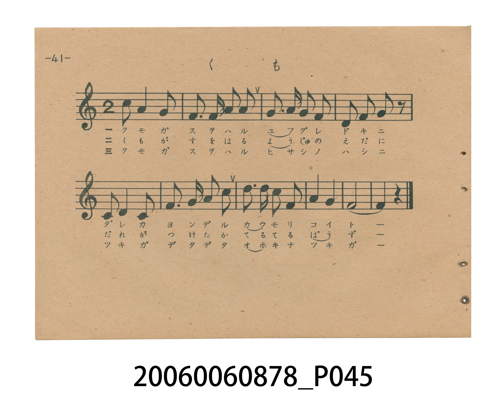
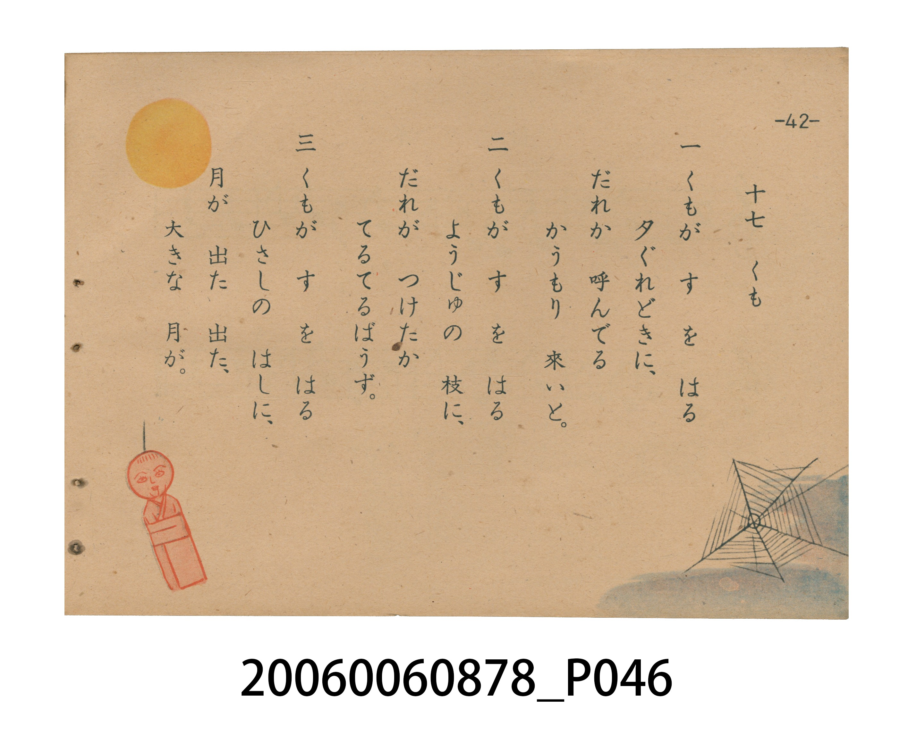

# くも（蜘蛛）

> Re:Shoka 使用 AI 協助辨識與重建樂譜，可能會有錯誤。歡迎回報。

<audio controls src="kumo.mp3"></audio>

- 日治時期國民學校唱歌（うたのほん 下・第十七課）
- 國立臺灣歷史博物館典藏

## 說明

【曲目說明】
・出處：臺灣總督府編《うたのほん 下》（國民學校初等科第二學年用），第十七課〈くも〉（蜘蛛），原書第 41–42 頁。
・調性與拍號：ホ短調五聲音階（E 羽調式／陽音階，記於關係調 `?= G` 下主音為 `6_`＝E4，原書五線譜省略調號），2/4 拍，共 9 小節（後樂段末尾將主音 `6_` 以連結線延展為第 8–9 小節，營造黃昏與月夜靜謐悠遠的餘韻），速度 != 96。
・背景與曲風：極具臺灣地方特色的是**第二節歌詞**：日本內地版原詞作「梅の 小枝に」（梅樹小枝上），臺灣總督府版特別改編為**「ようじゅの 枝に」（榕樹的樹枝上）**，將臺灣隨處可見、氣根垂懸的榕樹寫入教材，第 42 頁並繪有圓月高懸於屋簷與大榕樹蜘蛛網間的插圖。
・版本說明：本檔案為原書單聲部五線譜旋律之忠實數位化版本。

・編曲說明（鋼琴伴奏版）：
1. 前奏 (Intro, 4 小節)：擷取主旋律核心樂句作為導奏，建立調性與拍感。
2. 主歌伴奏 (Kumo)：右手 (PianoRH) 演奏原書歌唱主旋律；左手 (PianoLH)
依國民學校低學年教材純樸明朗之風格配以和聲伴奏。

## 歌詞

```text
一　くもが　すを　はる
夕ぐれどきに、
だれか　呼んでる
かうもり　來いと。

二　くもが　すを　はる
ようじゅの　枝に、
だれが　つけたか
てるてるばうず。

三　くもが　すを　はる
ひさしの　はしに、
月が　出た　出た、
大きな　月が。
```

## ABC

```abc
X:1
T:くも（蜘蛛）
M:2/4
L:1/16
Q:1/4=96
K:G
V:V1 name="Piano" snm="Pia"
[V:V1]
d2 A4 G2 | E3 E G2 A2 | G3 A G2 E2 | D2 D2 D2 z2 |
D2 D4 E2 | G3 A B2 A2 | d2 d2 B2 A2 | B4 A4 |
E6 z2 |
```

## TMD 檔案連結

- [主旋律 TMD 檔案](kumo.tmd) [[在 TMD Studio 編輯](https://tmdlang.github.io/Tmd-TS/#tmd=s7IKdvYPcrWy4tLSUnjc2P-4qen9no4Xc2a8mD37_Z5OBS0tLkVbBUszLntbBXcuGyN9EzuuOgWlZ9OXPtu0-9nMpmdz5j-d0_1sw8Sna3c8W7Dw6ZSNz9b2AE143Nj2uHH-48Z1jxt3P26arPBkR_fj5t3P16x52tv4ZEfzi1WbgKYrgYwCan--uvtF-67njYufrd3-tH_T095ZzztXvlyy4mnrjhfT-5W4uPS1FGypBbgUFBQeN0x4NnvT89nrXqxa9WxG3-OGiWDR5t1P23e9mDn1_Z5ZEPc837H3-dzFT3fNeb59xeOGLmyeaugG-hYlCDrmPl_b-Xz5RKBnn-zqAQo-3bnl-ZQVQP--39ODHAKPG4DBBArxxw1AKUSgA5U97Zv_bPYOoGIFE8NHDZNNjBReLmh83NAEdeaLVfufNSx_0dH-rLv3xcz5QPc-bp79fP5aoPiTXVNeNG56OX_zy1l9QENdFZ7v2wsUfrqn__2e_pcz98Jkel6smPFs2p6X0-c82d8EVKCQAIrhBJCfnuzYDVT1vGmXQoJZfML7PXNdTeBOAhr_fPusF2vnPJ_T-HzqUqBGsP0gNwPThgLQPSClrRsVLBWebuh_vr4BFDr7ep6taHq2buuzOaufbtj3dEM7xAaw8QpPdi992bD4-dYJQHOf7t72dONUoM0gn1sAPY4wped5-_yXDQte7m5-NqMf5PM5HU-XzHk5d86LNROeNS142bjg-ayWl0tmvJy_G-Kclw3zn-5apgBOvUgh19zzbOZ6kP7Zm14uAkbKrGdLtz5t3Q6J76dzNjybtvN5584XnZuAxj2bsV5LCxKNQDcAE_aLlfO0tEB6gMl_zpqnrcuBGp53dgCDBijzZO-cxw09zxa1AhMIyNnP5s193Lj6cQMwRDqAos9W7IQIPtnRBXEhehrr7ADa_LRj6bMpO4HpDRgKWlpAAx83QTLTjMdNYJNRjF02FWgsyKUrdsJNBrmwBxjIEONfzloBTNFP-9e_WAZMrI3PNix-tmDn03lNz9p3gPSBDXi6fvXT1qXPps58NncCJI0qQFLckx3Lnu9c9WxO59M5k4EB_nL1DKA2YKp5urH7-YbtwFB8umQ5xAhI4n2-bdPLaZNB5vZPejpnGiLYgX4DBhgkt4HCb86aZ6umPFvYAfQkJF09nbYOlGybV8AT2LPp3U_3dT_Z2f10_4Kn65c9m7rjyd7epz3TIEaBjIbmZIgBkNh52rri2bR2oMOe7FgLYqya92LtemD2BoYVWmYChV5f87P-fqBDFAIMTEyBMkDKDBw1nWCzn-xoeNzQAM2ijT1g9szHTZPAjPWPm7pBip4umfq4ccLjpp7HjSsfN_aCo6YR7LLGBWBRYKg3PJ24B1hePG5cDtUEEgXGKdDYpi6g9JN9wPhtedwILGPAAQYqDMAuBwbV0zkroGELzCHbQKkSkgWAZe_TjjZgbAFj58WqDc_WAhPvCqA9T6fNejFxOqhEaOh5MXfmi7kLnu5fDbTg6USgZ4AlDTDZQH23C-IjvL5DS3xAOVjyQ_EjRPeSx40TweUj1I_LgIbAyA1gY4COIsKDkBQFtOjlgrXgJN3zZEfv8_lLgdkR5NO-2UDBJ7vans3c8nTJyqcrmoEIaC4i1jqJ8FfjpseNwIibDvEUSALEhvkLmNYhWoH1AchHCAZYGpjqwVG9ChQeUKVE-AuSa142dT3fvhgccR1Pdq0DGgyMHaB3gGbD2aAMvHQv0BoQOQecoSCKwZEI8inQMsqrQihQ0NLn4vIuzc23CshMzMt3qDGoUagG2aBgY6FlB2YAK2BgbrACtRCAaaIJSPcARWuA9EwgfxKQXg-ku0EiTW1AHghPALJ7wGpWAnEvEK8G2QQzblcPccZ1QI0DJUEgtQ6sDCS4AN3EHZ1Emdi4CYinAvF0uHFAOTAPblyNgqmCkYKugiGQpWEWr6Crq2AWr6mqoaurCRQzAokaggSN4GJARUBN8VBkoFADToxIAQd0LjA4gJkD4i5gxgK2IIBFAtxZ3RCPghzf1AUWAcm3QL2xAjPsYCbCfLoEiCcC8XywYSCRZWDDYTRIBJQPgdQsIAcIMAIPZAQopmBGAl0HNg5Cg0S6gHg3VNUquLW9UPU9SAEIDghQuGGEljE4BE2BEMIyBioDhXYNSLEuEIKCr5aLS9dOAZQsQbQyFwA)]
- [鋼琴伴奏 TMD 檔案](kumo_piano.tmd) [[在 TMD Studio 編輯](https://tmdlang.github.io/Tmd-TS/#tmd=s7IKdvYPcrWy4tLSUnjc2P-4qen9no4Xc2a8mD37_Z5OIPtl957nE7Y82bPl6dL-550dQEEFLS0uRVsFSzMue1sFdy4bI30TO646BaVn05c-27T72cymZ3PmP53T_WzDxKdrdzxbsPDplI3P1vYAjXrc2Pa4cf7jxnWPG3c_bpqs8GRH9-Pm3c_XrHna2_hkR_OLVZuApiuBjAJqf766-0X7rueNi5-t3f60f9PT3lnPO1e-XLLiaeuOF9P7lbi49LUUbKkFuBQUFB43THg2e9Pz2eterFr1bEbf44aJYNHm3U_bd72YOfX9nlkQ9zzfsff53MVPd815vn3F44YubJ5q6Ab6FiUIOuY-X9v5fPlEoGef7OoBCj7dueX5lBXgIO5BDoHHDcBgAkXD4wZQ6CPFRM_TvvnPZu8AKlYwMXzUMNnESOHlgsbHDU1QZ75Ytf9Zw_IXHe3PuntfzJwPdO_j5tnP568Fij_ZNeVF46aX8ze_nNUHNNRV4fm-vUDhp3v63-_pfzlzL0ym58WKGc-m7Xk5fc6T_U1ABQoJoBhOAPnpyY7dQFXPm3YpJJjFJ7zfM9fVBO4koPHPt896sXbO8zmNz6cuBWoE2w9yMzBtKADdA1LaulHBUuHphv7n6xtAobOv59mKpmfrtj6bs_rphn1PN7RDbAAbr_Bk99KXDYufb50ANPfp7m1PN04F2gzyuQXQ4whTep63z3_ZsODl7uZnM_pBPp_T8XTJnJdz57xYM-FZ04KXjQuez2p5uWTGy_m7Ic552TD_6a5lCuDUixRyzT3PZq4H6Z-96eUiYKTMerZ069PW7ZD4fjpnw7NpO5937nzRuQlo3LMZ67W0INEIdAMwYb9YOU9LC6QHmPznrHnauhyoAZhRgEEDlHmyd87jhp5ni1qBCQTk7Gfz5j5uXP24ARgiHUDRZyt2QgSf7OiCuBA9jXV2AG1-2rH02ZSdwPQGDAUtLaCBj5sgmWnG4yawySjGLpsKNBbk0hU74SaDXNgDDGSI8S9nrQCm6Kf9618sAybWxmcbFj9bsPPpvKZn7TtA-sAGPF2_-mnr0mdTZz6bOwGSRhUgKe7JjmXPd656Nqfz6ZzJwAB_uXoGUBsw1Tzd2P18w3ZgKD5dshxiBCTxPt-26eW0ySBz-yc9nTMNEexA_wADHJLbsBY0wEAFKVVQMNRTeNrZCxRX0PDMKynK11EwgaYBTVDATwYWENOAyefZ9O6n-7qfLdjxdH8zMHE97V8KDH5gkD3d0AfUCwqA3btAxQpSRnnWMh_qIAUFIz1gQt8NjFGIGxQ0vEtz80EWPO3f_KyzW0EjIDMxLz_IQ1Ph2Z4pQAWQxA9UDyzg4La_3zP76fZlCOU-HpoQ04Hgyb65yIXCk719kIIAEsjPt0x5tmIHMCyezZn-ZGc3MCE-W7DnZWsvMC88ndQDzL8QZ4GcCy2u4A4AJrSnrSueTWsHeurJjrUgxqp5L9auB5ZhwIBFKzFASaSv-Vl__7NVUxQCDExMgTJAygwc4J1gs5_saHjc0AAthxp7wOyZj5smgRnrHzd1gxQ9XTL1ceOEx009jxtXPm7sBae_RrDLGheARYFJq-HpxD3AQvFx43KoJpAoMOECjW3qAko_2QdMxC2PG4EFKTgSQCUe2OWgUJ-zApqAgMXANlDWg-RzYAXztKMNGJvAJPhi1YZna4E5dAXQnqfTZr2YOB1U7DX0vJg788XcBU_3rwZa8HQi0DPA4hSYN6C-2wXxEV7foeUwoBwsj6H4EaJ7yePGieBKAOrHZUBDYOQGsDFARxHhQUi2AVr0csFacL7tebKj9_n8pcAyB-TTvtlAwSe72p7N3PJ0ycqnK5qBCGguItY6ifBX46bHjcCImw7xFEgCxIb5C5ihIVqBlR7IRwgGWBqYtcFRvQoUHlClRPgLUjS8bOp6vn0xOOI6nuxaBzQYGDtA7wDNhrNBmXTpXqA1IHIOuNSAKAZHIsinQMsor--hQEFLn4sLXKJYQfO2Q41BjUI1OMfaWGjZgRk1CqZAaKxgBGQZK-gCaV0gyyweSIEglGkAYnLVopjng2KeCdw8w3iFaMNYkHFAhimIATQi2iwXyjKAGAQqfvC5C9gAAmZUK1CzDZhcm4B0D9h0YKwD-ZOA9Hog3Q0SaWoD8kB4ApDdA1azEoh7gXg1KBBgxu3qIc64DqhxoNwBpNaBlYEEF6CbuKOTKBMbNwHxVCCeDjcOKAfmwY0DxQMo7A2BLA1QmOsCA0tTVUNXVxMoBoodDUOQoBFcDKgIqCkeikDBihZwQOcCgwOYbyHuAuZ5YAsOWFrBndUN8SjI8U1dYBGQfAvUGyswww5mIsynS4B4IhDPBxsGElkGNhxGg0RARQSQmgXkAAFG4IGMAMUUzEig68DGQWiQSBcQ74aqWgW3theqvgcpAMEBAQo3jNCCpG88KR0jVeJL3WiJGiQEYUHjAe4cJAVgPXAGctaAWq1rpwDOXApABsgZ2GhlLgA)]

## 分析

```text
================================================================================
📊 TMD Song Profile: [ くも（蜘蛛） ]
================================================================================
⏱  Duration:       0:11 (11.2s), 9 measures total
🎼 Key & Tempo:    首調基準 G, != 96.0 BPM, <2/4>
   - 分析範圍：      由實際發聲的音符與和弦推測調性；播放脈絡另行呈現
🎤 人聲音域:    D4 (MIDI 62) – D5 (MIDI 74) [跨度: 12 個半音 / 1.0 個八度, 難度: easy]
   - 最低音:  D4 in [Kumo #1 @ m.4, 0:03]
   - 最高音: D5 in [Kumo #1 @ m.1, 0:00]
   - 適合: soprano, mezzo-soprano, contralto, tenor, baritone, bass
🏛  結構:      Kumo (11.2s)
⚡ 編曲密度:        Peak 1 軌道同時演奏
🗝  調性診斷：       D 大調（純淨自然大調，未偵測到可信轉調）
   - 風格氣質:    純淨自然大調（陽光明朗、易唱易記，無明顯調外色彩）
   - 轉調歷程:    全曲維持單一推測調性（未偵測到可信轉調）
   - 核心骨幹音:  D, A, E, G, B
   - 調性數值:    D 大調 [相關度: 0.82, 穩定度: Moderate, 自然音純度: 100.0%]
   - 候選調性 (K-S): D 大調 (0.82), G 大調 (0.70), A 大調 (0.62)
   - 五度圈歷程:   +2
   - 各段落調性細節:
     • [Kumo #1]: D 大調 (r: 0.82, 自然音純度: 100.0%)

  [ 五度圈游移軌跡 ]
               C  
         F            G  
      Bb              [D ]*
      Eb               A  
         Ab           E  
            Db       B  
               F# 
     (* = active key center)

  [ 十二半音累積音高分佈 ]
     C  :                            0.0%
     C# :                            0.0%
     D  : ████████████████████████  26.5%
     D# :                            0.0%
     E  : ███████████████████       20.6%
     F  :                            0.0%
     F# :                            0.0%
     G  : ████████████████          17.6%
     G# :                            0.0%
     A  : █████████████████████     23.5%
     A# :                            0.0%
     B  : ███████████               11.8%
--------------------------------------------------------------------------------
Assignment 軌道音域：
  - Piano         : D4 – D5 (12 個半音 / 1.0 個八度, 28 個音符)
================================================================================
```


## 原書掃描頁






