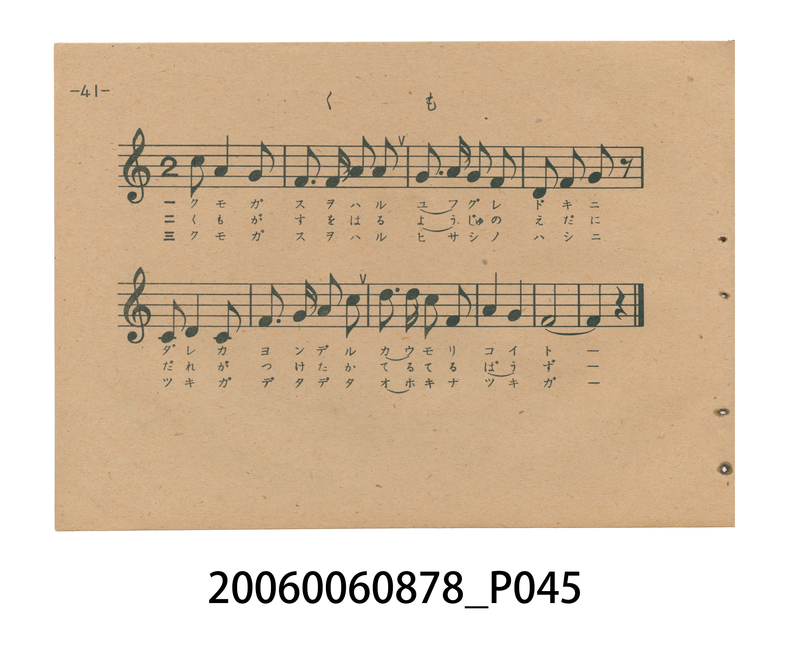
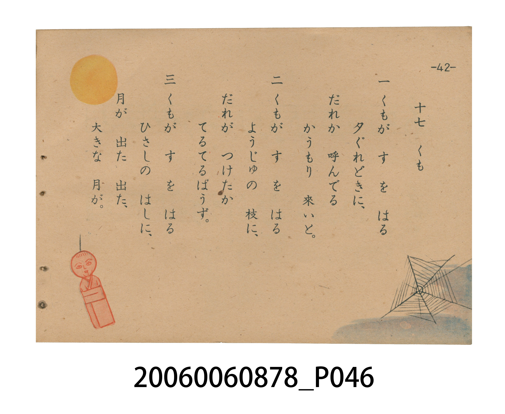

# くも（蜘蛛）

> Re:Shōka 使用 AI 協助辨識與重建樂譜，可能會有錯誤。歡迎[回報](https://github.com/TMDLang/reshoka/issues)。

- **鋼琴伴奏版**：<br><audio controls src="kumo.mp3"></audio>
- **NEUTRINO 歌聲合成版**：<br><audio controls src="kumo_neutrino.mp3"></audio>

- 日治時期國民學校唱歌（うたのほん 下・第十七課）
- 國立臺灣歷史博物館典藏

## 說明


- 出處：臺灣總督府編《うたのほん 下》（國民學校初等科第二學年用），第十七課〈くも〉（蜘蛛），原書第 41–42 頁。
- 調性與拍號：ヘ調（F 大調五聲音階，原書五線譜省略調號，實際音高終止於 F 音），2/4 拍，共 10 小節（後樂段末尾將主音以連結線延展為第 9–10 小節，營造黃昏與月夜靜謐悠遠的餘韻），速度 != 96。
- 背景與曲風：極具臺灣地方特色的是**第二節歌詞**：日本內地版原詞作「梅の 小枝に」（梅樹小枝上），臺灣總督府版特別改編為**「ようじゅの 枝に」（榕樹的樹枝上）**，將臺灣隨處可見、氣根垂懸的榕樹寫入教材，第 42 頁並繪有圓月高懸於晴天娃娃與蜘蛛網間的插圖。
- 版本說明：本檔案為原書單聲部五線譜旋律之忠實數位化版本。

### 編曲說明（鋼琴伴奏版）：

1. 前奏 (Intro, 4 小節)：擷取主旋律核心樂句作為導奏，建立調性與拍感。
2. 主歌伴奏 (Kumo)：右手 (PianoRH) 演奏原書歌唱主旋律；左手 (PianoLH)
依國民學校低學年教材純樸明朗之風格配以和聲伴奏。


## 歌詞

```text
一　くもが　すを　はる
夕ぐれどきに、
だれか　呼んでる
かうもり　來いと。

二　くもが　すを　はる
ようじゅの　枝に、
だれが　つけたか
てるてるばうず。

三　くもが　すを　はる
ひさしの　はしに、
月が　出た　出た、
大きな　月が。
```

## ABC

<div class="abc-score" data-abc-src="kumo.abc" aria-label="五線譜載入中"></div>

[下載 ABC 原始檔](kumo.abc)

## TMD 檔案連結

- [主旋律 TMD 檔案](kumo.tmd) [[在 TMD Studio 編輯](https://tmdlang.github.io/Tmd-TS/#tmd=s7IKdvYPcrWy4qpTUCpJTLdSyC_KTM_MsypJzCxPzIvPT0vLTM5MzFGCyyfn5-SkJpdk5udZlZYk5uVn5OchJMvyc0pzU62MECLF-aVFyalwpfHpqehy8QWJ6alWAQYmprpAwgwhXVCUX5aal5gH1A51TTpQoCgvvwhoSl5qEbKrUssyU1JBKguKMnMTiyrjU_KTgS7JK0FyW2pRMcjVZfnJyDrzi0oy8tOLEgsyKq0yMotLgP4HysdnJ-YlIhSVZKQCvZWYBzQ7p1iJS0tL4XFj_-Ompvd7Ol7MmfFi9uz3ezoVtLS4FG0VLM247G0V3LhsjPRN7EAGPJu-9Nmm3c9mNj2bM__pnO5nGyY-Xbvj2YKFT6dsfLa2B2jC48a2x43zHzeue9y4-3HTZIUnO7ofN-9-vmbN097GJzuaX6zaBDQd7Bag9ueru1-073reuPjZ2u1P-zc97Z31vHPlyyUrnrbueDG9X4mLS19LwZZagEtBQeFxw4Rnszc9n73uxapVz2b0PW6YCBZt3v20fdeLmVPf75kFcc_zHXufz138dNec59tXPG7owuaphm6gb1GCoGPu87Wdz5dPBHr2ya4eoODTnVueT1kB9O_7PT3IIfC4ARhMoBB_3ACUQgQ6UNnTvvnPZu8AKlYwMXzUMNnESOHlgsbHDU1QZ75Ytf9Zw_IXHe3PuntfzJwPdO_j5hlAQaApbgpPlywHMp_smvKicdPL-ZtfzuqDGwgUfL591ou1c57PaXw-dSlQGVh3z9P1y17Omg1SvHrG861Nz9YuejZtj4KbAlAE4h5gvCsA7QIpbd2oYGig8HRD__P1DSCv7-t5tqLp2bqtz-asfrph39MN7U927Abqe7J76cuGxc-3TgBa-HT3tqcbpz5v2gXykCXQP0gG9Dxvn_-yYcHL3c3PZvSDfDSn4-mSOS_nznmxZsKzpgUvGxc8n9XycsmMl_N3Q5zysmH-013LFMCpEilEmnuezVwP0j9708tFwMCe9Wzp1qet2yHx-HTOhmfTdj7v3PmicxPQuGcz1mtpQaIH6AZggn2xcp6WFkgPMFnPWfO0dTlQw_PODmCgAWWe7J3zuKHn2aJWYMSDnP1s3tzHjasfNwBDowMo-mzFTojgkx1dEBeip53ODqDNTzuWPpuyE5iOgMGgpQU08HETJJPMeNwENhnF2GVTgcaCXLpiJ9xkkAt7gOELMf7lrBXAlPq0f_2LZcBE2Phsw-JnC3Y-ndf0rH0HSB_YgKfrVz9tXfps6sxncydA0p4CJCU92bHs-c5Vz-Z0Pp0zGRjgwFgHagNG-bOZW54uWfl0RTMQAcMSkiKfb9v0ctpkkKH9k57OmYYIc6DHgKEFyUKgwJuz5tmqKc8WdgB9CEluT6etA6XB5hXwdPdsevfTfd1PdnY_3b8AmOieTd3xZG_v055pEKNARkOzJ8QASNQ8bV3xbFo70D1PdqwFMVbNe7F2PTDPAgMKLYeAgq6v-Vl_P9AhCqDSFygDKn_B8dIJNvvJjobHDQ3QfNfYA2bPfNw0CcxY_7ipG6To6ZKpjxsnPG7qedy48nFjLzheGsEua1wAFgUGecPTiXuAhcDjxuVQTSBRYIQCjW3qAko_2QeM3JbHjcCCAxxgoBwOdjkwqJ7OWQENW2D-2AZKkpD0DyxQn3a0AaMKGDUvVm14thaYclcA7Xk6bdaLidNB2byh58XcmS_mLni6fzXQgqcTgZ4BFh_ANAP13S6Ij_D6Di3lAeVgaQ_FjxDdSx43TgQXelA_LgMaAiM3gI0BOooID0JSJNCilwvWgtNzz5Mdvc_nLwXmRZBP-2YDBZ_sakNOgUBzEbHWSYS_Gjc9bgRG3HSIp0ASIDbMX8CEDtEKLORBPkIwwNLAYhMc1atA4QFVSoS_nm7sfr5h-8umrufbF4MjruPJrnVAg4GxA_QO0Gw4G5R7l-4FWgMi54AzFEQxOBJBPgVaRnn9BgUKWvpcXN6luflWAZnAZopDjUFNNcgCBRtDMy07MKtGwVRBV8EYiEHQCIhrFAzBbEOwKAjXgMVBbBANkq1RMIuHMkFCBiAhsHE-hjWgFgSQD4wkqKHAUARrAcYWhN80CcheD2Z1Q2Sa2qAqtwLxBLAMTM9KsHgvmFyNapcReXZ1QFW2ATEo-YM566DaQJLAxI_NOmOyrGvcBFU5FYino9gFVgcVQ9gFixZQAINDGQTBPFjMGIFjBRRvwHgAi5iBeZCYQY5LEITpQsAaOAtkI1gEKfLAfgcHP8TdaMEGbPIAizsUH4JoaICCQwZY9kFlJsNNaYHbDSwNiXUPOILR3QML8SVQ_kQgno_s0sZlUJd2Q9kIl26AmwJJcBDRWcS6B5wCQPZCEiSqe0BhAuLPh4UP2FUgGVBogPi74Ql5FYofkM0DicL8is89tVxcunYKoLwNdhqQrcwFAA)]
- [鋼琴伴奏 TMD 檔案](kumo_piano.tmd) [[在 TMD Studio 編輯](https://tmdlang.github.io/Tmd-TS/#tmd=s7IKdvYPcrWy4qpTUCpJTLdSSM7PyUlNLsnMz7MqLUnMy8_Iz1OCS5bl55TmploZIUSK80uLklPhSuPTU9Hl4gsS01OtAgxMTHWBhBlCuqAovyw1LzEPqL0kMbM8EagZKFCUl18ENCUvtSgxB6E2tSwzJRWksqAoMzexqDI-JT8Z6JK8EiS3pRYVg1xdkAl0SnxiUVFiXnoqqpL8opKM_PSixIKMSquMzOKS_KLM5MSc-OzEvESEopIMoC6rxDygPTnFSlxaWgqPG_sfNzW939PxYs6MF7Nnv9_TCWS_7N7zfMKWJ3u2PF3a_7yzAyiooKXFpWirYGnGZW-r4MZlY6RvYgcy9dn0pc827X42s-nZnPlP53Q_2zDx6dodzxYsfDpl47O1PUCjHje2PW6c_7hx3ePG3Y-bJis82dH9uHn38zVrnvY2PtnR_GLVJqDpYAcCtT9f3f2ifdfzxsXP1m5_2r_pae-s550rXy5Z8bR1x4vp_UpcXPpaCrbUAlwKCgqPGyY8m73p-ex1L1atejaj73HDRLBo8-6n7btezJz6fs8siHue79j7fO7ip7vmPN--4nFDFzZPNXQDfYsSBB1zn6_tfL58ItCzT3b1AAWf7tzyfMoKcBD3IIfA4wZgMIGi4XEDKPSRYqLnad_8Z7N3ABUrmBg-aphsYqTwckHj44YmqDNfrNr_rGH5i472Z929L2bOB7r3cfMMoCDQFDeFp0uWA5lPdk150bjp5fzNL2f1wQ0ECj7fPuvF2jnP5zQ-n7oUqAysu-fp-mUvZ80GKV494_nWpmdrFz2btkfBTQEoAnEPMN4VgHaBlLZuVDA0UHi6of_5-gaQ1_f1PFvR9Gzd1mdzVj_dsO_phvYnO3YD9T3ZvfRlw-LnWycALXy6e9vTjVOfN-0CecgS6B8kA3qet89_2bDg5e7mZzP6QT6a0_F0yZyXc-e8WDPhWdOCl40Lns9qeblkxsv5uyFOedkw_-muZQrgVIkUIs09z2auB-mfvenlImBgz3q2dOvT1u2QeHw6Z8OzaTufd-580bkJaNyzGeu1tCDRA3QDMMG-WDlPSwukB5is56x52rocqAGYAYCBBpR5snfO44aeZ4tagREPcvazeXMfN65-3AAMjQ6g6LMVOyGCT3Z0QVyInnY6O4A2P-1Y-mzKTmA6AgaDlhbQwMdNkEwy43ET2GQUY5dNBRoLcumKnXCTQS7sAYYvxPiXs1YAU-rT_vUvlgETYeOzDYufLdj5dF7Ts_YdIH1gA56uX_20demzqTOfzZ0ASXsKkJT0ZMey5ztXPZvT-XTOZGCAA2MdqA0Y5c9mbnm6ZOXTFc1ABAxLSIp8vm3Ty2mTQYb2T3o6ZxoizIGeAYY2JAthLT2AIQpSqqBgqKfwtLMXKK6g4ZlXUpSvo2ACTQCaoFCfDMz104DJ5tn07qf7up8t2PF0fzMwUT3tXwoMe2B4Pd3QB9QL8v3uXaCyAin1P2uZD3WQgoKRHjBH7gZGJ8QNChrepbn5IAue9m9-1tmtoBEAKkaDPDQVnu2ZAlQAyRNA9cBSC277-z2zn25fhlDu46EJMR0Inuybi5zTn-ztg-RuSAg_3zLl2YodwLB4Nmf6k53dwFT4bMGel629wJzwdFIPMDNCnAVyLrQMgjsAmMqetq54Nq0d6KknO9aCGKvmvVi7HlgwAQMWrRgApY--5mf9_c9WTVEA1UFAGVAtBA7wTrDZT3Y0PG5ogBYujT1g9szHTZPAjPWPm7pBip4umfq4ccLjpp7HjSsfN_aCE18j2GWNC8CiwHTV8HTiHmBJ97hxOVQTSBSYaoHGNnUBpZ_sA6bglseNwNIRHAmgYgzsclCoz1kBTUDAQmAbKN9BMjmw1nja0QaMTWD6e7Fqw7O1wOy5AmjP02mzXkycDirLGnpezJ35Yu6Cp_tXAy14OhHoGWAZCcwYUN_tgvgIr-_QshdQDpbBUPwI0b3kceNEcMkO9eMyoCEwcgPYGKCjiPAgJNsBLXq5YC040_Y82dH7fP5SYIED8mnfbKDgk11tyNkMaC4i1jqJ8FfjpseNwIibDvEUSALEhvkLmJshWoE1GchHCAZYGlg3gKN6FSg8oEqJ8NfTjd3PN2x_2dT1fPticMR1PNm1DmgwMHaA3gGaDWeDMunSvUBrQOQccKkBUQyORJBPgZZRXolDgYKWPhcXuESxguZthxqDmmpwhrUxNNOyA7NqFMwUdIHQTMEUSBoCcY2CMVhEV8EISteAxZFhDZxlABPhqkWxzQfZNhOEZfHxCtFmubFApimIaQpiGQIZhlCGAcQkUOmE39kg5yI7FOZIQ7AoCNdAPWAMpiFeM4uHMkFCILfXgI3zMawBtfqAfGDyghoKjH-wFmA6g_CbJgHZ68GsbohMUxtU5VYgngCWgelZCRbvBZOrUe0yIs-uDqjKNiAGZVwwZx1UG0gSmG2xWWdMlnWNm6AqpwLxdBS7wOqgYgi7YNECCmBwKIMgmAeLGSNwrIDijXqJDhF5YL-Dgx_ibrRgA7ZIgQU1ig9BNDRAwSEDLLWhMpPhprTA7QaW48S6BxzB6O6BhfgSKH8iEM9HdmnjMqhLu6FshEs3wE2BJDiI6Cxi3QNOASB7IQkS1T2gMAHx58PCB-wqkAwoNED83fCEvArFD8jmgURhfsXnHpSsjaOMQC4OIAxEUQFigYoIWGLDKEKILWB07RTApZUCkAFyUbQPUAGcbYTENgazlbkA)]

## 分析

```text
================================================================================
📊 TMD Song Profile: [ くも（蜘蛛） ]
================================================================================
⏱  Duration:       0:12 (12.5s), 10 measures total
🎼 Key & Tempo:    首調基準 F, != 96.0 BPM, <2/4>
   - 分析範圍：      由實際發聲的音符與和弦推測調性；播放脈絡另行呈現
🎤 人聲音域:    C4 (MIDI 60) – D5 (MIDI 74) [跨度: 14 個半音 / 1.2 個八度, 難度: moderate]
   - 最低音:  C4 in [Kumo #1 @ m.5, 0:05]
   - 最高音: D5 in [Kumo #1 @ m.7, 0:07]
   - 適合: soprano, mezzo-soprano, contralto, tenor, baritone, bass
🏛  結構:      Kumo (12.5s)
⚡ 編曲密度:        Peak 1 軌道同時演奏
🗝  調性診斷：       F 大調（純淨自然大調，未偵測到可信轉調）
   - 風格氣質:    純淨自然大調（陽光明朗、易唱易記，無明顯調外色彩）
   - 轉調歷程:    全曲維持單一推測調性（未偵測到可信轉調）
   - 核心骨幹音:  F, A, G, C, D
   - 調性數值:    F 大調 [相關度: 0.85, 穩定度: High, 自然音純度: 100.0%]
   - 候選調性 (K-S): F 大調 (0.85), D 小調 (0.69), C 大調 (0.57)
   - 五度圈歷程:   -1
   - 各段落調性細節:
     • [Kumo #1]: F 大調 (r: 0.85, 自然音純度: 100.0%)

  [ 五度圈游移軌跡 ]
               C  
        [F ]*          G  
      Bb               D  
      Eb               A  
         Ab           E  
            Db       B  
               F# 
     (* = active key center)

  [ 十二半音累積音高分佈 ]
     C  : ██████████                13.5%
     C# :                            0.0%
     D  : ██████████                13.5%
     D# :                            0.0%
     E  :                            0.0%
     F  : ████████████████████████  33.8%
     F# :                            0.0%
     G  : █████████████             18.9%
     G# :                            0.0%
     A  : ██████████████            20.3%
     A# :                            0.0%
     B  :                            0.0%
--------------------------------------------------------------------------------
Assignment 軌道音域：
  - Piano         : C4 – D5 (14 個半音 / 1.2 個八度, 28 個音符)
================================================================================
```


## 原書掃描頁






